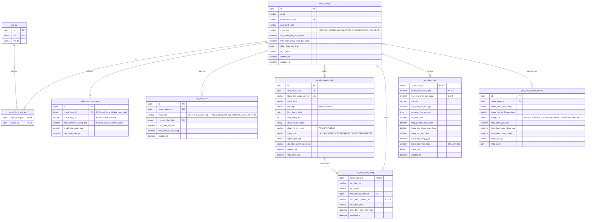
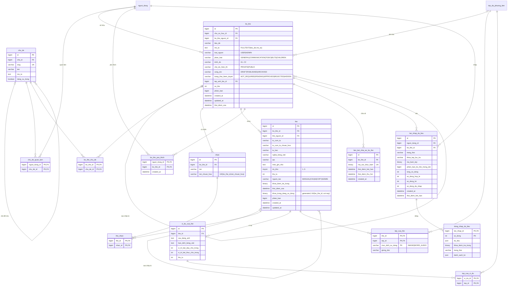
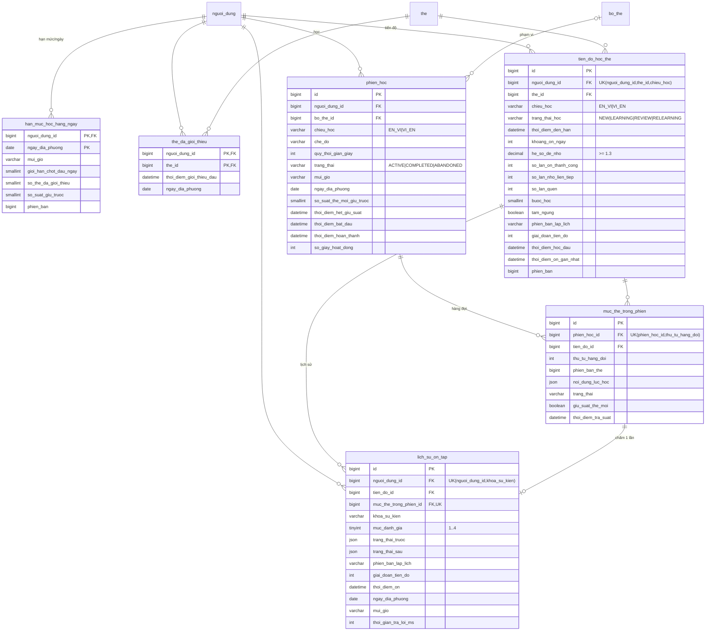
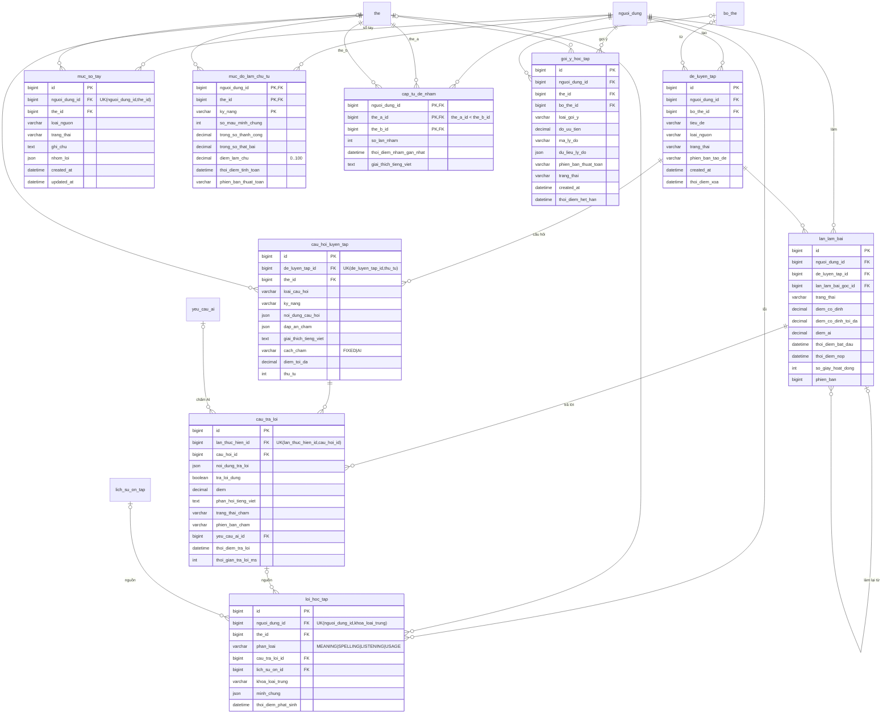
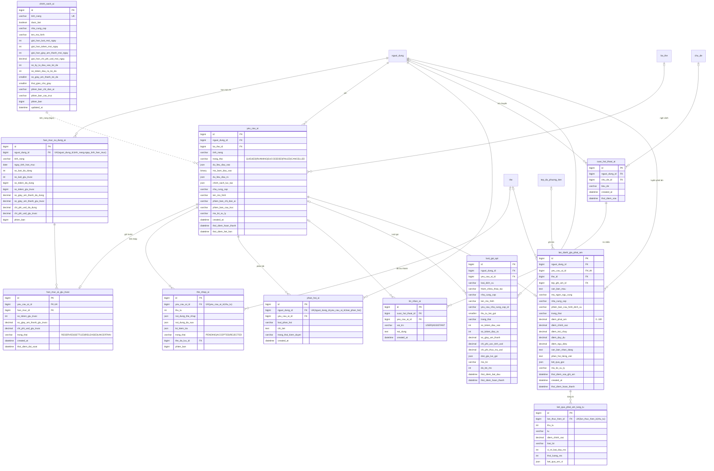
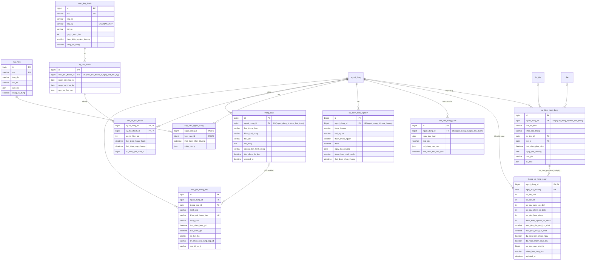
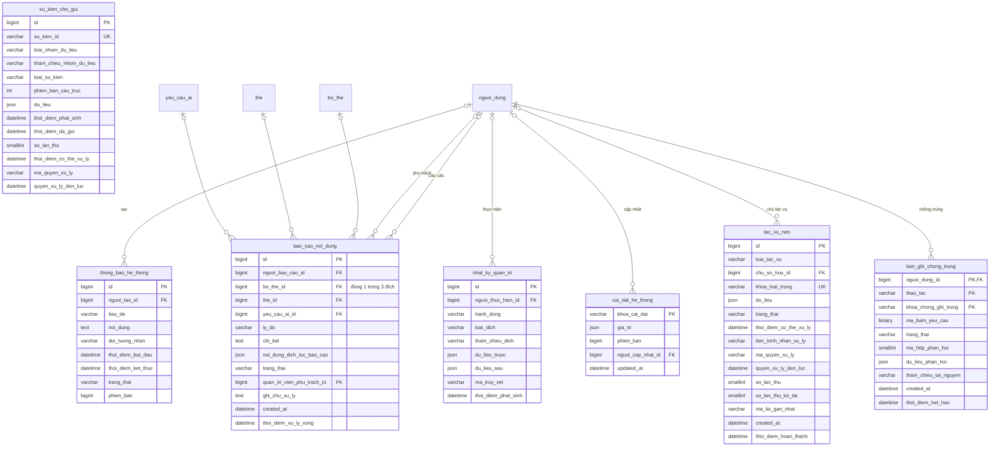

# ERD — VocabLearning (67 bảng, theo `V1__schema.sql`)

Chia 7 nhóm để render được. Bảng thuộc nhóm khác chỉ hiện tên (không cột).
Ký hiệu: `||--o{` 1–n bắt buộc · `|o--o{` 1–n, FK cho phép NULL · `||--o|` 1–1 · `..` liên kết logic (không có FK).

## 1. Tài khoản & tệp

## 2. Nội dung: chủ đề, bộ thẻ, thẻ, nhập CSV

## 3. Học & ôn tập (SRS)

## 4. Luyện tập & phân tích học tập

## 5. AI & phát âm

## 6. Thống kê, thành tích, thông báo

## 7. Quản trị & hạ tầng

`su_kien_cho_gui` (outbox) không có FK — liên kết qua `tham_chieu_nhom_du_lieu`.
