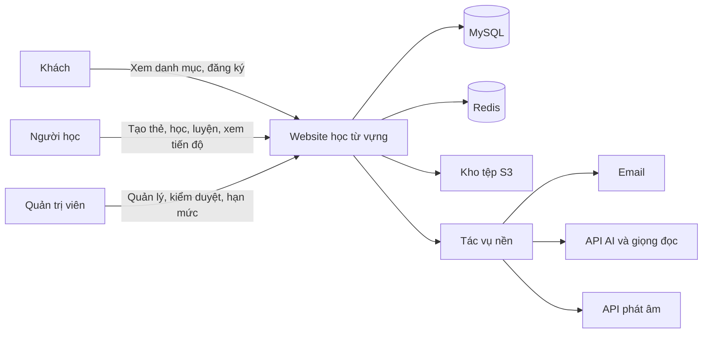
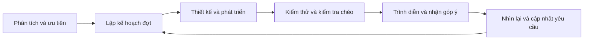

# ĐỀ XUẤT DỰ ÁN

**Tên đề tài:** Xây dựng website học từ vựng tiếng Anh ứng dụng ôn tập ngắt quãng và hỗ trợ trí tuệ nhân tạo.

## THÔNG TIN DỰ ÁN

| Mục | Thông tin |
| --- | --- |
| Dự án viết tắt | VocabLearning — tên quy ước |
| Tên dự án | Xây dựng website học từ vựng tiếng Anh ứng dụng ôn tập ngắt quãng và hỗ trợ trí tuệ nhân tạo |
| Ngày bắt đầu | 28/09/2026 |
| Ngày kết thúc | 14/12/2026 |
| Thời gian thực hiện | 2,5 tháng; 78 ngày lịch tính cả hai đầu mốc |
| Nơi thực hiện | Khoa Công nghệ thông tin |
| Giảng viên hướng dẫn | Lương Thị Thu Phương |
| Email/điện thoại giảng viên | Chưa cung cấp; không dùng thông tin của giảng viên trong mẫu |
| Đại diện nhóm | Huỳnh Gia Pho |
| Chủ sở hữu sản phẩm | Đề xuất nhóm trưởng điều phối yêu cầu; cả nhóm thống nhất với giảng viên |
| Quản lý dự án | Huỳnh Gia Pho — nhóm trưởng; vai trò tổ chức phát triển được mô tả trong kế hoạch |
| Liên hệ nhóm | Email/điện thoại chưa cung cấp |

### Thành viên trong đội

| TT | Họ và tên | Mã số sinh viên | Lớp | Vai trò |
| --- | --- | --- | --- | --- |
| 1 | Huỳnh Gia Pho | 28211152416 | K28TPM5 | Nhóm trưởng |
| 2 | Phạm Ngọc Thái | 28211106637 | K28TPM10 | Thành viên |
| 3 | Nguyễn Đình Nhật Quân | 28211100097 | K28TPM10 | Thành viên |
| 4 | Lê Hữu Thảo | 28212241493 | K28TPM9 | Thành viên |
| 5 | Trần Văn Màu | 28212306184 | K28TPM24 | Thành viên |

## THÔNG TIN TÀI LIỆU

| Mục | Nội dung |
| --- | --- |
| Tên dự án | Xây dựng website học từ vựng tiếng Anh ứng dụng ôn tập ngắt quãng và hỗ trợ trí tuệ nhân tạo |
| Tiêu đề tài liệu | Đề xuất dự án |
| Mã tài liệu | SCI_SE_01 |
| Người thực hiện | Nhóm Huỳnh Gia Pho |
| Phiên bản | 1.1 |
| Ngày lập | 26/09/2026 |
| Trạng thái | Bản thiết kế và kế hoạch; chưa ghi nhận phê duyệt hay kết quả kiểm thử thực tế |
| Ngôn ngữ | Tiếng Việt; giữ tên công nghệ, ID, API, SQL và các tên kỹ thuật cần thiết |
| Quy ước dữ liệu | Tên bảng/cột tiếng Việt không dấu dạng nguoi_dung, bo_the, trang_thai; giữ id, email, password_hash, created_at, updated_at, ipa, slug và kiểu SQL |

## LỊCH SỬ CHỈNH SỬA TÀI LIỆU

| Phiên bản | Người chỉnh sửa | Ngày | Ghi chú |
| --- | --- | --- | --- |
| 1.0 | Nhóm thực hiện | 26/09/2026 | Lập đầy đủ nội dung theo mẫu; đối chiếu 111 mục chức năng và 12 yêu cầu phi chức năng |
| 1.1 | Nhóm thực hiện | 26/09/2026 | Đồng bộ giữa các tài liệu: giao diện JavaScript; đường dẫn trang tiếng Việt; tên VocabLearning và CSDL `vocab_learning`; QT-02 sang đợt 2; tiêu chí ghi nhớ và ngưỡng sổ tay thống nhất; sửa tên kỹ thuật bị đổi nhầm; phân bổ giờ theo người |

## PHÊ DUYỆT TÀI LIỆU

| Vai trò | Họ tên | Chữ ký | Ngày |
| --- | --- | --- | --- |
| Giảng viên hướng dẫn | Lương Thị Thu Phương | Chưa ký | Chưa xác nhận |
| Nhóm trưởng | Huỳnh Gia Pho | Chưa ký | Chưa xác nhận |
| Thành viên | Phạm Ngọc Thái | Chưa ký | Chưa xác nhận |
| Thành viên | Nguyễn Đình Nhật Quân | Chưa ký | Chưa xác nhận |
| Thành viên | Lê Hữu Thảo | Chưa ký | Chưa xác nhận |
| Thành viên | Trần Văn Màu | Chưa ký | Chưa xác nhận |

## MỤC LỤC

  - Thành viên trong đội
- 1. GIỚI THIỆU
  - 1.1. Mục đích
  - 1.2. Phạm vi
  - 1.3. Tham khảo
- 2. TỔNG QUAN DỰ ÁN
  - 2.1. Lý do chọn đề tài
  - 2.2. Định nghĩa dự án
  - 2.3. Giải pháp đề xuất
- 3. KẾ HOẠCH TỔNG THỂ DỰ ÁN
  - 3.1. Định nghĩa Scrum
  - 3.2. Kế hoạch tổng thể
  - 3.3. Quản lý tổ chức
- PHỤ LỤC A — QUY TẮC NGHIỆP VỤ
  - Quy tắc nghiệp vụ
- PHỤ LỤC B — KIẾN TRÚC
  - Kiến trúc hệ thống
- PHỤ LỤC C — THUẬT TOÁN VÀ CÁ NHÂN HÓA
  - Thuật toán ôn tập và cá nhân hóa
- PHỤ LỤC D — TÍCH HỢP AI VÀ PHÁT ÂM
  - Tích hợp API AI và đánh giá phát âm

## 1. GIỚI THIỆU
### 1.1. Mục đích
Tài liệu xác định vấn đề học từ vựng, mục tiêu sản phẩm, phạm vi 111 mục chức năng, kiến trúc, nguồn lực và kế hoạch thực hiện. Nhóm dùng tài liệu để thống nhất với giảng viên trước khi lập yêu cầu chi tiết, thiết kế và kiểm thử. Đây là dự án khóa luận của năm sinh viên, kết quả phải có website chạy thực tế, mã nguồn, dữ liệu minh họa và tài liệu triển khai.
### 1.2. Phạm vi
Bao phủ người học, khách, quản trị viên và các dịch vụ hỗ trợ. Học cốt lõi gồm quản lý nội dung, học/ôn, bài luyện có đáp án cố định, sổ tay và thống kê. AI dùng API có sẵn cho tạo nháp, giải thích và phản hồi; phát âm dùng API đánh giá chuyên dụng. Facebook, IELTS/tiếng Anh trẻ em và hội thoại AI văn bản được đặc tả đầy đủ nhưng giữ trạng thái mở rộng. Không tự bỏ phát âm, báo cáo nội dung, quyền riêng tư hay quản trị khỏi phạm vi chính.
### 1.3. Tham khảo

- [Next.js — tài liệu chính thức](https://nextjs.org/docs).
- [Spring Boot — tài liệu chính thức](https://docs.spring.io/spring-boot/).
- [MySQL 8.4 — tài liệu chính thức](https://dev.mysql.com/doc/refman/8.4/en/).
- [Thuật toán SM-2 gốc — SuperMemo](https://www.supermemo.com/en/blog/application-of-a-computer-to-improve-the-results-obtained-in-working-with-the-supermemo-method).
- Các mẫu SCI_SE_01, SCI_SE_2, SCI_SE_3, SCI_SE_4, SCI_SE_5, SCI_SE_6 và SCI_SE_7 do nhóm cung cấp. Nội dung mẫu thuộc đề tài khác; bộ tài liệu này áp dụng cấu trúc, thay nghiệp vụ bằng hệ thống học từ vựng.

## 2. TỔNG QUAN DỰ ÁN
### 2.1. Lý do chọn đề tài
Người học có thể lưu nhiều từ nhưng khó quyết định từ nào cần ôn, thời điểm ôn và cách chuyển từ nhận biết sang sử dụng. Học theo danh sách hoặc lặp bài dễ thường không thể hiện điểm yếu về nghe, chính tả và ngữ cảnh. Một website kết hợp bộ thẻ, lịch SRS và luyện nhiều kỹ năng giúp tổ chức quá trình học; lịch sử lỗi cung cấp căn cứ cho gợi ý thay vì đề xuất ngẫu nhiên.
Tích hợp API AI giúp giải thích nghĩa theo đoạn văn, hỗ trợ tạo nội dung và phản hồi câu viết. AI có thể sai hoặc không khả dụng nên nội dung phải được kiểm tra, người học quyết định trước khi lưu thẻ, điểm AI tách khỏi chấm đáp án cố định. Nhóm có cơ hội vận dụng phân tích yêu cầu, thiết kế dữ liệu, bảo mật, xử lý đồng thời và vận hành dịch vụ ngoài.
### 2.2. Định nghĩa dự án
VocabLearning là website tiếng Việt hỗ trợ học từ/cụm từ tiếng Anh. Mỗi thẻ có một nghĩa mục tiêu, từ loại, phiên âm, ví dụ, bản dịch, ảnh và âm thanh. Người học tự xác định trình độ, mục tiêu, thời gian và số từ mới; tiến độ được lưu riêng theo người, thẻ và chiều học. Nội dung quản trị và nội dung người dùng chia sẻ được phân biệt, công khai phải kiểm duyệt.
### 2.3. Giải pháp đề xuất
Giao diện Next.js sử dụng trên máy tính/điện thoại; Spring Boot xử lý toàn bộ nghiệp vụ và quyền; MySQL lưu dữ liệu; Redis giữ phiên và bộ nhớ đệm; kho S3 giữ tệp. Tác vụ nền gửi email, gọi API, tổng hợp và xóa dữ liệu. Dùng biến thể SM-2 có bước học mới/học lại, bảo đảm lượt ôn được ghi một lần. Không huấn luyện mô hình AI riêng.
#### 2.3.1. Mục tiêu dự án
- Hoàn thành chu trình tạo/chọn bộ thẻ → học mới → ôn đúng lịch → luyện tập → xem điểm yếu và tiến độ.
- Hỗ trợ nghĩa, nghe, chính tả và sử dụng từ bằng các bài tương ứng; nêu số mẫu và giới hạn khi đánh giá.
- Có gợi ý giải thích được, hạn mức từ mới, kế hoạch trở lại sau nghỉ và thưởng chống lặp.
- Tích hợp AI/phát âm có hạn mức, lịch sử, xử lý lỗi và kiểm soát chi phí.
- Bảo vệ tài khoản, quyền bộ thẻ và dữ liệu cá nhân; có xóa tài khoản, kiểm thử, demo và hướng dẫn triển khai.
#### 2.3.2. Hoạt động của ứng dụng

Khách chỉ xem công khai đã duyệt. Người học thao tác tài nguyên riêng hoặc tài nguyên công khai được cho phép; sao chép tạo bộ độc lập. Quản trị quản lý tài khoản/nội dung và vận hành, không có chức năng sửa lịch sử học tùy tiện. API ngoài không truy cập trực tiếp MySQL hay nhận khóa nội bộ.
#### 2.3.3. Các chức năng cơ bản của hệ thống

| ID | Nhóm | Chức năng | Tác nhân | Phạm vi | Đợt | Ước lượng giờ |
| --- | --- | --- | --- | --- | --- | --- |
| TK-01 | Tài khoản và hồ sơ | Đăng ký bằng email | Khách/người học | Chính | 1 | 8 |
| TK-02 | Tài khoản và hồ sơ | Xác thực email | Khách/người học | Chính | 1 | 8 |
| TK-03 | Tài khoản và hồ sơ | Đăng nhập bằng email và Google | Khách/người học | Chính | 1 | 8 |
| TK-04 | Tài khoản và hồ sơ | Đăng nhập Facebook — mở rộng | Khách/người học | Mở rộng | Sau phần chính | Chưa cam kết |
| TK-05 | Tài khoản và hồ sơ | Đăng xuất, quên mật khẩu và đặt lại mật khẩu | Khách/người học | Chính | 1 | 8 |
| TK-06 | Tài khoản và hồ sơ | Cập nhật hồ sơ và ảnh đại diện | Người học | Chính | 1 | 8 |
| TK-07 | Tài khoản và hồ sơ | Chọn trình độ, mục tiêu và chủ đề quan tâm | Người học | Chính | 1 | 8 |
| TK-08 | Tài khoản và hồ sơ | Đặt số từ mới và thời gian học mỗi ngày | Người học | Chính | 1 | 8 |
| TK-09 | Tài khoản và hồ sơ | Cài đặt giờ nhắc học, múi giờ và thông báo | Người học | Chính | 1 | 8 |
| TK-10 | Tài khoản và hồ sơ | Xem streak và lịch sử hoạt động | Người học | Chính | 1 | 8 |
| TK-11 | Tài khoản và hồ sơ | Yêu cầu xóa tài khoản và dữ liệu cá nhân | Người học | Chính | 1 | 8 |
| BT-01 | Bộ thẻ và thẻ | Tạo, xem, sửa và xóa bộ thẻ | Người học | Chính | 1 | 8 |
| BT-02 | Bộ thẻ và thẻ | Tạo, sửa và xóa từng thẻ | Người học | Chính | 1 | 8 |
| BT-03 | Bộ thẻ và thẻ | Lưu nội dung từ/cụm từ và đa phương tiện | Người học | Chính | 1 | 8 |
| BT-04 | Bộ thẻ và thẻ | Gắn chủ đề, nhãn và mức độ khó | Người học | Chính | 1 | 8 |
| BT-05 | Bộ thẻ và thẻ | Đặt bộ thẻ công khai hoặc riêng tư | Người học | Chính | 1 | 8 |
| BT-06 | Bộ thẻ và thẻ | Tìm kiếm, lọc và sắp xếp bộ thẻ | Người học | Chính | 1 | 8 |
| BT-07 | Bộ thẻ và thẻ | Sao chép bộ thẻ công khai | Người học | Chính | 1 | 8 |
| BT-08 | Bộ thẻ và thẻ | Nhập và xuất CSV | Người học | Chính | 1 | 8 |
| BT-09 | Bộ thẻ và thẻ | Cảnh báo từ trùng trong cùng bộ | Người học | Chính | 1 | 8 |
| BT-10 | Bộ thẻ và thẻ | Đánh dấu bộ thẻ yêu thích | Người học | Chính | 1 | 8 |
| BT-11 | Bộ thẻ và thẻ | Chia sẻ bộ thẻ bằng liên kết | Người học | Chính | 1 | 8 |
| BT-12 | Bộ thẻ và thẻ | Báo cáo nội dung sai hoặc không phù hợp | Người học | Chính | 1 | 8 |
| ND-01 | Nội dung có sẵn | Bộ từ vựng giao tiếp theo tình huống | Khách/người học | Chính | 1 | 8 |
| ND-02 | Nội dung có sẵn | Bộ từ vựng TOEIC theo chủ đề | Khách/người học | Chính | 1 | 8 |
| ND-03 | Nội dung có sẵn | Phân loại nội dung theo trình độ | Khách/người học | Chính | 1 | 8 |
| ND-04 | Nội dung có sẵn | Tìm kiếm và xem trước bộ thẻ | Khách/người học | Chính | 1 | 8 |
| ND-05 | Nội dung có sẵn | Hiển thị số thẻ và mô tả nội dung | Khách/người học | Chính | 1 | 8 |
| ND-06 | Nội dung có sẵn | Phân biệt bộ quản trị và bộ người dùng | Khách/người học | Chính | 1 | 8 |
| ND-07 | Nội dung có sẵn | Bộ IELTS và tiếng Anh trẻ em — mở rộng | Khách/người học | Mở rộng | Sau phần chính | Chưa cam kết |
| ON-01 | Học và ôn tập | Lật thẻ tương tác | Người học | Chính | 2 | 8 |
| ON-02 | Học và ôn tập | Hỗ trợ phím tắt trên máy tính | Người học | Chính | 2 | 8 |
| ON-03 | Học và ôn tập | Học Anh–Việt hoặc Việt–Anh | Người học | Chính | 2 | 8 |
| ON-04 | Học và ôn tập | Phát audio từ và câu ví dụ | Người học | Chính | 2 | 8 |
| ON-05 | Học và ôn tập | Chọn mức độ Quên, Khó, Nhớ, Dễ | Người học | Chính | 2 | 8 |
| ON-06 | Học và ôn tập | Tính ngày ôn tiếp theo bằng SRS | Người học | Chính | 2 | 8 |
| ON-07 | Học và ôn tập | Lưu trạng thái riêng từng người với từng thẻ | Người học | Chính | 2 | 8 |
| ON-08 | Học và ôn tập | Hiển thị thẻ đến hạn, quá hạn và từ mới | Người học | Chính | 2 | 8 |
| ON-09 | Học và ôn tập | Lưu lịch sử ôn và số lần quên | Người học | Chính | 2 | 8 |
| ON-10 | Học và ôn tập | Giới hạn số từ mới mỗi ngày | Người học | Chính | 2 | 8 |
| ON-11 | Học và ôn tập | Tổng kết phiên học | Người học | Chính | 2 | 8 |
| ON-12 | Học và ôn tập | Tạm ngưng thẻ hoặc đặt lại tiến độ | Người học | Chính | 2 | 8 |
| ON-13 | Học và ôn tập | Tạo phiên theo quỹ thời gian | Người học | Chính | 2 | 8 |
| ON-14 | Học và ôn tập | Chia lịch khi quay lại sau nghỉ | Người học | Chính | 2 | 8 |
| LT-01 | Luyện tập và kiểm tra | Trắc nghiệm chọn nghĩa | Người học | Chính | 2 | 8 |
| LT-02 | Luyện tập và kiểm tra | Trắc nghiệm chọn từ phù hợp | Người học | Chính | 2 | 8 |
| LT-03 | Luyện tập và kiểm tra | Nghe và viết lại từ | Người học | Chính | 2 | 8 |
| LT-04 | Luyện tập và kiểm tra | Điền từ vào chỗ trống | Người học | Chính | 2 | 8 |
| LT-05 | Luyện tập và kiểm tra | Ghép từ với nghĩa | Người học | Chính | 2 | 8 |
| LT-06 | Luyện tập và kiểm tra | Tự nhập từ từ gợi ý nghĩa | Người học | Chính | 2 | 8 |
| LT-07 | Luyện tập và kiểm tra | Phân biệt cặp từ dễ nhầm | Người học | Chính | 2 | 8 |
| LT-08 | Luyện tập và kiểm tra | Viết câu dùng từ mục tiêu | Người học | Chính | 2 | 8 |
| LT-09 | Luyện tập và kiểm tra | Bài kiểm tra tổng hợp theo bộ | Người học | Chính | 2 | 8 |
| LT-10 | Luyện tập và kiểm tra | Chấm bài có đáp án cố định | Người học | Chính | 2 | 8 |
| LT-11 | Luyện tập và kiểm tra | Giải thích đáp án | Người học | Chính | 2 | 8 |
| LT-12 | Luyện tập và kiểm tra | Lịch sử bài làm và luyện lại câu sai | Người học | Chính | 2 | 8 |
| AI-01 | Trí tuệ nhân tạo | Tạo Flashcard từ đoạn văn tiếng Anh | Người học | Chính | 3 | 10 |
| AI-02 | Trí tuệ nhân tạo | Gợi ý nghĩa ngữ cảnh, ví dụ và mẹo nhớ | Người học | Chính | 3 | 10 |
| AI-03 | Trí tuệ nhân tạo | Xem, sửa và chọn thẻ AI trước khi lưu | Người học | Chính | 3 | 10 |
| AI-04 | Trí tuệ nhân tạo | Tạo bài luyện từ từ sai hoặc đến hạn | Người học | Chính | 3 | 10 |
| AI-05 | Trí tuệ nhân tạo | Giải thích khác nhau giữa từ dễ nhầm | Người học | Chính | 3 | 10 |
| AI-06 | Trí tuệ nhân tạo | Sửa câu và giải thích tiếng Việt | Người học | Chính | 3 | 10 |
| AI-07 | Trí tuệ nhân tạo | Tạo đoạn văn hoặc tình huống chứa từ mục tiêu | Người học | Chính | 3 | 10 |
| AI-08 | Trí tuệ nhân tạo | Phản hồi cách dùng từ trong nhiệm vụ thực tế | Người học | Chính | 3 | 10 |
| AI-09 | Trí tuệ nhân tạo | Hội thoại AI bằng văn bản — mở rộng | Người học | Mở rộng | Sau phần chính | Chưa cam kết |
| AI-10 | Trí tuệ nhân tạo | Báo cáo AI sai hoặc không hữu ích | Người học | Chính | 3 | 10 |
| AI-11 | Trí tuệ nhân tạo | Lưu lịch sử nội dung AI | Người học | Chính | 3 | 10 |
| AI-12 | Trí tuệ nhân tạo | Giới hạn lượt và xử lý API không khả dụng | Người học | Chính | 3 | 10 |
| ST-01 | Sổ tay và điểm yếu | Lưu thủ công từ khó | Người học | Chính | 2 | 8 |
| ST-02 | Sổ tay và điểm yếu | Đề xuất từ thường sai vào sổ tay | Người học | Chính | 2 | 8 |
| ST-03 | Sổ tay và điểm yếu | Phân nhóm lỗi | Người học | Chính | 2 | 8 |
| ST-04 | Sổ tay và điểm yếu | Xem hồ sơ điểm yếu | Người học | Chính | 2 | 8 |
| ST-05 | Sổ tay và điểm yếu | Tạo bộ luyện từ lỗi phổ biến | Người học | Chính | 2 | 8 |
| ST-06 | Sổ tay và điểm yếu | Mức độ làm chủ từng từ qua nhiều kỹ năng | Người học | Chính | 2 | 8 |
| ST-07 | Sổ tay và điểm yếu | Theo dõi cặp từ thường nhầm | Người học | Chính | 2 | 8 |
| ST-08 | Sổ tay và điểm yếu | Gợi ý bài luyện phù hợp | Người học | Chính | 2 | 8 |
| ST-09 | Sổ tay và điểm yếu | Xem lý do đề xuất bài hoặc thẻ | Người học | Chính | 2 | 8 |
| TKH-01 | Thống kê học tập | Số từ mới, đang học và đạt tiêu chí ghi nhớ | Người học | Chính | 2 | 8 |
| TKH-02 | Thống kê học tập | Số thẻ ôn theo ngày, tuần, tháng | Người học | Chính | 2 | 8 |
| TKH-03 | Thống kê học tập | Tỷ lệ đúng theo dạng bài | Người học | Chính | 2 | 8 |
| TKH-04 | Thống kê học tập | Thời gian học và hoàn thành mục tiêu | Người học | Chính | 2 | 8 |
| TKH-05 | Thống kê học tập | Biểu đồ hoạt động và streak | Người học | Chính | 2 | 8 |
| TKH-06 | Thống kê học tập | Thống kê theo chủ đề hoặc bộ thẻ | Người học | Chính | 2 | 8 |
| TKH-07 | Thống kê học tập | Danh sách từ thường quên | Người học | Chính | 2 | 8 |
| TKH-08 | Thống kê học tập | So sánh tiến độ giữa các giai đoạn | Người học | Chính | 2 | 8 |
| TKH-09 | Thống kê học tập | Báo cáo tổng kết tuần | Người học | Chính | 2 | 8 |
| TKH-10 | Thống kê học tập | Tiến độ theo kỹ năng sử dụng từ | Người học | Chính | 2 | 8 |
| DL-01 | Động lực và thông báo | Điểm kinh nghiệm khi hoàn thành nhiệm vụ | Người học | Chính | 3 | 10 |
| DL-02 | Động lực và thông báo | Huy hiệu theo thành tích | Người học | Chính | 3 | 10 |
| DL-03 | Động lực và thông báo | Thử thách hằng ngày và hằng tuần | Người học | Chính | 3 | 10 |
| DL-04 | Động lực và thông báo | Theo dõi chuỗi ngày học | Người học | Chính | 3 | 10 |
| DL-05 | Động lực và thông báo | Thông báo thẻ đến hạn trong ứng dụng | Người học | Chính | 3 | 10 |
| DL-06 | Động lực và thông báo | Email nhắc học theo lựa chọn | Người học | Chính | 3 | 10 |
| DL-07 | Động lực và thông báo | Thông báo hoàn thành mục tiêu | Người học | Chính | 3 | 10 |
| PA-01 | Luyện phát âm | Nghe phát âm mẫu | Người học | Chính | 3 | 10 |
| PA-02 | Luyện phát âm | Ghi âm đọc từ hoặc câu | Người học | Chính | 3 | 10 |
| PA-03 | Luyện phát âm | Phát lại bản ghi | Người học | Chính | 3 | 10 |
| PA-04 | Luyện phát âm | Gửi bản ghi đến API phát âm | Người học | Chính | 3 | 10 |
| PA-05 | Luyện phát âm | Hiển thị điểm và phản hồi API hỗ trợ | Người học | Chính | 3 | 10 |
| PA-06 | Luyện phát âm | Lưu kết quả theo dõi cải thiện | Người học | Chính | 3 | 10 |
| PA-07 | Luyện phát âm | Luyện lại từ kết quả thấp | Người học | Chính | 3 | 10 |
| PA-08 | Luyện phát âm | Xóa bản ghi âm | Người học | Chính | 3 | 10 |
| QT-01 | Quản trị | Quản lý, khóa và mở khóa tài khoản | Quản trị viên | Chính | 3 | 10 |
| QT-02 | Quản trị | Phân quyền người học và quản trị viên | Quản trị viên | Chính | 2 | 10 |
| QT-03 | Quản trị | Quản lý chủ đề, bộ thẻ và thẻ mẫu | Quản trị viên | Chính | 3 | 10 |
| QT-04 | Quản trị | Kiểm duyệt nội dung báo cáo | Quản trị viên | Chính | 3 | 10 |
| QT-05 | Quản trị | Xem thống kê sử dụng | Quản trị viên | Chính | 3 | 10 |
| QT-06 | Quản trị | Cấu hình giới hạn AI | Quản trị viên | Chính | 3 | 10 |
| QT-07 | Quản trị | Theo dõi lượt gọi, lỗi và chi phí API | Quản trị viên | Chính | 3 | 10 |
| QT-08 | Quản trị | Quản lý thông báo hệ thống | Quản trị viên | Chính | 3 | 10 |
| QT-09 | Quản trị | Nhật ký thao tác quản trị quan trọng | Quản trị viên | Chính | 3 | 10 |


#### 2.3.4. Mô tả
Phiên học ưu tiên thẻ đến hạn/quá hạn, giới thiệu từ mới trong hạn mức; lật thẻ và tự đánh giá rồi máy chủ tính lịch tiếp. Bài cố định chấm theo đáp án lưu ở máy chủ; bài viết dùng AI và hiển thị trạng thái riêng. Lỗi theo kỹ năng tạo minh chứng cho sổ tay/gợi ý. Tổng kết phản ánh số lượt, số thẻ và thời gian hoạt động, không đồng nhất chuỗi ngày với làm chủ từ. Thông báo dựa giờ/múi giờ và lựa chọn email. Phát âm cho nghe, ghi, phát lại, xác nhận gửi, nhận điểm API và xóa bản ghi.
#### 2.3.5. Các công nghệ ràng buộc
##### Kỹ thuật phát triển hệ thống
Next.js (JavaScript); Java 21, Spring Boot và Spring Security; MySQL 8.4, InnoDB, utf8mb4; Redis/Spring Session; Flyway; kho tương thích S3; Docker Compose. Khóa phiên bản thư viện ở giai đoạn khởi tạo theo khả năng tương thích, không mặc định phiên bản mới nhất. Chi tiết kiến trúc và mô-đun ở phụ lục kỹ thuật dưới đây.
##### Môi trường
Trình duyệt có JavaScript và kết nối Internet; HTTPS bắt buộc cho môi trường thật và micro. Máy phát triển đề xuất RAM 16 GB để chạy đồng thời giao diện, Java, MySQL, Redis và kho tệp; có thể dùng dịch vụ ngoài cho thành phần nặng. Phát âm cần micro và quyền truy cập do người học cấp.
##### Các ràng buộc khác
Nhóm năm người, thời gian 28/09–14/12/2026; ngân sách dự kiến trong kế hoạch dự án. Hạn mức API/cấu hình là thiết kế có thể điều chỉnh sau đo. Không đảm bảo chất lượng AI như chuyên gia ngôn ngữ; chỉ hiển thị chỉ số phát âm được API hỗ trợ. Mở rộng vẫn giữ trong yêu cầu nhưng không được tuyên bố đã hoàn thành khi chưa triển khai.
## 3. KẾ HOẠCH TỔNG THỂ DỰ ÁN
### 3.1. Định nghĩa Scrum
Nhóm tổ chức phát triển theo các đợt có kế hoạch, bản chạy được, đánh giá và cải tiến. Áp dụng hoạt động lập kế hoạch, trao đổi ngắn, trình diễn cuối đợt và nhìn lại; tài liệu được cập nhật xuyên suốt. Vai trò tổ chức là phân công đề xuất, chưa phải quyết định của giảng viên.
#### 3.1.1. Mô tả Scrum
Nhóm trưởng điều phối tiến độ, trở ngại và trao đổi với giảng viên; cả nhóm thống nhất độ ưu tiên và tiêu chí nghiệm thu. Thành viên chịu trách nhiệm thực hiện/kiểm tra chéo phần được giao. Giảng viên góp ý và xác nhận tài liệu khi ký; không ghi sẵn đã phê duyệt.
#### 3.1.2. The artifacts — Các sản phẩm quản lý
Danh sách yêu cầu sản phẩm lưu toàn bộ mục chức năng; danh sách công việc từng đợt chọn từ đó và có ước lượng/người phụ trách; bản tăng trưởng là chức năng chạy được có minh chứng kiểm thử. Quy tắc hoàn thành gồm mã được kiểm tra chéo, kiểm thử đạt, giao diện đủ trạng thái, tài liệu/API/dữ liệu cập nhật và có bản trình diễn.
#### 3.1.3. Process (Quá trình)

### 3.2. Kế hoạch tổng thể

| TT | Tiến trình | Thời gian | Bắt đầu | Kết thúc |
| --- | --- | --- | --- | --- |
| 1 | Khởi tạo | 7 ngày | 28/09/2026 | 04/10/2026 |
| 1.1 | Thu thập yêu cầu | 3 ngày | 28/09/2026 | 30/09/2026 |
| 1.2 | Tạo tài liệu | 4 ngày | 01/10/2026 | 04/10/2026 |
| 2 | Bắt đầu | 7 ngày | 05/10/2026 | 11/10/2026 |
| 2.1 | Họp bắt đầu dự án | 1 ngày | 05/10/2026 | 05/10/2026 |
| 2.2 | Bổ sung tài liệu ban đầu | 6 ngày | 06/10/2026 | 11/10/2026 |
| 3 | Phát triển | 49 ngày | 12/10/2026 | 29/11/2026 |
| 3.1 | Đợt phát triển 1 | 14 ngày | 12/10/2026 | 25/10/2026 |
| 3.2 | Đợt phát triển 2 | 14 ngày | 26/10/2026 | 08/11/2026 |
| 3.3 | Đợt phát triển 3 | 21 ngày | 09/11/2026 | 29/11/2026 |
| 4 | Họp nhận phản hồi và kiểm thử toàn hệ thống | 7 ngày | 30/11/2026 | 06/12/2026 |
| 5 | Viết báo cáo và kết thúc dự án | 8 ngày | 07/12/2026 | 14/12/2026 |


Các dòng con nằm trong dòng cha, không cộng hai lần. Ba đợt lần lượt tập trung tài khoản/nội dung; SRS/luyện tập/cá nhân hóa; AI/phát âm/thành tích/quản trị. Viết báo cáo và kiểm thử diễn ra trong từng đợt, giai đoạn cuối dành cho kiểm tra toàn hệ thống và hoàn tất hồ sơ.
### 3.3. Quản lý tổ chức
#### 3.3.1. Nguồn nhân lực

| Người | Vai trò/trách nhiệm đề xuất |
| --- | --- |
| Huỳnh Gia Pho | Điều phối; tài khoản, bảo mật, phân quyền; động lực học (XP, huy hiệu, thử thách, chuỗi ngày) và thông báo; quản trị gồm màn hình cấu hình hạn mức AI và theo dõi chi phí; tích hợp bản phát hành |
| Phạm Ngọc Thái | Bộ/thẻ, danh mục, CSV, quyền tệp và giao diện nội dung |
| Nguyễn Đình Nhật Quân | SRS, phiên học, thời gian và thống kê; kiểm chứng thuật toán |
| Lê Hữu Thảo | Bài luyện, sổ tay, gợi ý và thiết kế kiểm thử |
| Trần Văn Màu | AI, phát âm, tác vụ nền; cơ chế giữ trước hạn mức, ghi lượt gọi và đối soát chi phí phía dịch vụ (cung cấp dữ liệu cho QT-06/QT-07) |


#### 3.3.2. Phi nhân lực

| Danh mục | Mục đích | Số lượng | Tiêu chí chấp nhận | Ngày mục tiêu |
| --- | --- | --- | --- | --- |
| Máy phát triển | Lập trình/kiểm thử | 5 | Chạy được phần được giao và truy cập môi trường tích hợp | 28/09/2026 |
| Git và kho mã | Quản lý thay đổi | 1 kho | Có nhánh, kiểm tra chéo, tệp khóa phiên bản; không có bí mật | 28/09/2026 |
| Môi trường MySQL/Redis/S3 | Lưu dữ liệu/phiên/tệp | 1 bộ | Cài đặt tự động, có dữ liệu mẫu và kiểm tra sức khỏe | 04/10/2026 |
| Tài khoản API/email | Tích hợp dịch vụ ngoài | Theo nhà cung cấp | Khóa máy chủ, hạn mức và chế độ thử nghiệm | 11/10/2026 |
| Máy chủ HTTPS | Trình diễn/triển khai | 1 | Có chứng thư, sao lưu và hướng dẫn vận hành | 29/11/2026 |


## PHỤ LỤC A — QUY TẮC NGHIỆP VỤ

### Quy tắc nghiệp vụ

#### A.1 Tài khoản

- Email có bản hiển thị và bản chuẩn hóa bằng bỏ khoảng trắng hai đầu, chuyển chữ thường. Không bỏ dấu chấm hay phần sau dấu `+` để suy đoán cùng người.
- Tài khoản chưa xác thực chỉ dùng chức năng xác thực/gửi lại/đăng xuất. Google phải được kiểm tra chữ ký, bên phát hành, đối tượng nhận, mã ngẫu nhiên và thông tin xác thực email khi có.
- Không tự liên kết Google với tài khoản email trùng. Người dùng đăng nhập tài khoản hiện có, xác thực lại và xác nhận liên kết.
- `password_hash` có thể `NULL` với người chỉ dùng Google. Không cho gỡ phương thức đăng nhập cuối cùng.
- Khóa, đặt lại mật khẩu, thay đổi quyền hoặc xóa tài khoản phải thu hồi phiên; kiểm tra trạng thái tài khoản khi xử lý yêu cầu nhạy cảm.

#### A.2 Bộ thẻ và quyền nội dung

- Bộ xuất hiện công khai khi đồng thời có `che_do_hien_thi=PUBLIC`, `vong_doi=PUBLISHED`, `trang_thai_kiem_duyet=APPROVED` và chưa bị xóa.
- Sửa nội dung bộ công khai đưa về chờ duyệt, tạm ẩn khỏi danh mục. Chủ bộ vẫn học được. Giữ bản công bố cũ là cải tiến sau này nếu bổ sung bảng phiên bản nội dung.
- Nguồn `ADMIN` chỉ do quản trị viên tạo; sao chép thành nguồn `USER` và giữ `bo_the_nguon_id` để ghi nhận nguồn gốc.
- Thư viện gồm bộ sở hữu và bản sao. Yêu thích chỉ đánh dấu bộ công khai, không tự tạo tiến độ học.
- Liên kết chia sẻ luôn kiểm tra quyền hiện tại; liên kết bộ riêng chỉ điều hướng sau khi chủ sở hữu đăng nhập.
- Trùng hoàn toàn: cùng từ đã chuẩn hóa, từ loại và nghĩa đã chuẩn hóa trong một bộ. Cùng từ nhưng khác nghĩa chỉ cảnh báo.
- Chuẩn hóa Unicode NFC, bỏ khoảng trắng thừa, chuyển chữ thường bằng `Locale.ROOT`; không bỏ dấu nghĩa tiếng Việt. `khoa_kiem_tra_trung` là SHA-256 của từ + ký tự phân cách + từ loại + ký tự phân cách + nghĩa.
- Xóa mềm nội dung để giữ lịch sử. Xóa vật lý theo thời hạn lưu và quy trình kiểm tra tham chiếu; xóa tài khoản có quy trình riêng.

#### A.3 Thời gian và chuỗi ngày học

- Máy chủ/cơ sở dữ liệu dùng UTC với `DATETIME(3)`; API trả ISO-8601 có `Z`. Giờ nhắc học là giờ địa phương, không ghi giờ UTC vào trường đó.
- Múi giờ theo IANA, ví dụ `Asia/Ho_Chi_Minh`. Sự kiện lưu `ngay_dia_phuong` và múi giờ lúc phát sinh; đổi múi giờ không viết lại lịch sử.
- Ngày đủ điều kiện chuỗi học khi có ít nhất một lượt ôn hợp lệ hoặc một bài luyện đã nộp. Đăng nhập, lật thẻ, nghe âm thanh hoặc gọi AI không tự tạo ngày học.
- Chuỗi hiện tại kết thúc hôm nay; nếu hôm nay chưa học có thể tính chuỗi kết thúc hôm qua. Cũ hơn thì bằng 0. Chuỗi dài nhất tính từ các ngày học không trùng nhau.
- Đổi múi giờ tối đa một lần/24 giờ; không cấp thưởng lần hai cho cùng cửa sổ thưởng. Thời gian học hợp nhất các khoảng hoạt động giữa nhiều tab/phiên để không đếm đôi.
- Chỉ tính thời gian khi trang hiển thị và có tương tác gần đây; mỗi khoảng tối đa 60 giây. Không tính toàn bộ thời gian mở tab.
- Thẻ đạt tiêu chí ghi nhớ khi ở `REVIEW`, khoảng ôn ≥21 ngày, nhớ thành công ≥3 lần liên tiếp và không tạm ngưng. Đây là chỉ báo ôn tập, chưa phải làm chủ mọi kỹ năng.

#### A.4 Hạn mức và điểm thưởng

- Từ mới mặc định 10/ngày, cho chọn 0–100; học mặc định 15 phút/ngày, cho chọn 1–240 phút.
- Một thẻ chỉ tiêu thụ một suất từ mới khi giới thiệu lần đầu, không đếm hai lần vì học hai chiều.
- Giữ trước hạn mức AI trước khi gọi dịch vụ; giới hạn theo tính năng và tổng chi phí. Hết thời gian chờ vẫn có thể phát sinh phí, nên giữ trạng thái chưa xác định để đối soát.
- Thưởng ôn tối đa một lần/thẻ/ngày; thưởng luyện tối đa một lần/thẻ/dạng bài/ngày. Lặp bước học hoặc bài dễ không tạo điểm mới.
- Đề xuất: ôn hợp lệ 5 XP, bài cố định đúng 3 XP, tổng tối đa 200 XP/ngày gồm cả thử thách. Chỉ cấp khi có kết quả, không cấp vì mở đáp án.
- Điểm bài viết AI hoặc phát âm không tự thay lịch SRS. Lịch ôn chỉ đổi khi người học đánh giá thẻ trong phiên học.


## PHỤ LỤC B — KIẾN TRÚC

### Kiến trúc hệ thống

#### B.1 Thành phần

```text
Trình duyệt máy tính / điện thoại
              |
            HTTPS
              v
     Nginx — máy chủ trung gian
        | /                    | /api, /oauth2, /login/oauth2
        v                      v
     Next.js              Spring Boot API
        |                      |-- MySQL: dữ liệu, tác vụ, sự kiện
        +-- API nội bộ --------|-- Redis: phiên, bộ nhớ đệm, giới hạn tần suất
                               |-- Kho S3: ảnh và âm thanh
                               |
                   Tiến trình xử lý nền Spring Boot
                               |-- Dịch vụ email
                               |-- API AI / tạo giọng đọc
                               +-- API đánh giá phát âm
```

Next.js dùng App Router và JavaScript; dựng trang danh mục ở máy chủ, xử lý lật thẻ/âm thanh/ghi âm ở trình duyệt. Spring Boot là nơi duy nhất xử lý nghiệp vụ và truy cập MySQL. Giao diện không giữ khóa AI.

Dùng cùng tên miền qua Nginx để đơn giản hóa cookie và chống giả mạo yêu cầu. Nội dung cá nhân trả `Cache-Control: private, no-store`; không lưu chung phản hồi chứa dữ liệu người dùng. Tham khảo [hướng dẫn tự triển khai Next.js](https://nextjs.org/docs/app/guides/self-hosting).

#### B.2 Công nghệ và lựa chọn thay thế

| Thành phần | Lựa chọn | Lý do / phương án khác |
|---|---|---|
| Giao diện | Next.js App Router, JavaScript | Thuận tiện dựng trang danh mục và tối ưu tìm kiếm; ứng dụng một trang là lựa chọn đơn giản hơn |
| Trạng thái giao diện | TanStack Query; trạng thái cục bộ cho lật thẻ | Không đưa toàn bộ dữ liệu máy chủ vào kho trạng thái chung |
| Biểu mẫu | React Hook Form, Zod | Máy chủ vẫn kiểm tra dữ liệu bằng Bean Validation |
| Máy chủ | Spring Boot, Spring MVC, Spring Security, Spring Data JPA | Chưa cần WebFlux; tách xử lý chậm sang tiến trình nền |
| Java | Java 21 LTS; Spring Boot bản chính thức còn được hỗ trợ | Khóa phiên bản cụ thể và kiểm tra tương thích thư viện lúc khởi tạo dự án |
| Cơ sở dữ liệu | MySQL 8.4 LTS, InnoDB, utf8mb4 | Đúng yêu cầu; chưa cần đổi sang PostgreSQL |
| Cập nhật cấu trúc | Flyway; Hibernate `ddl-auto=validate` | Không tự sửa cấu trúc dữ liệu trong môi trường thật |
| Phiên và bộ nhớ đệm | Redis, Spring Session | Lưu phiên trong bộ nhớ ứng dụng không phù hợp nhiều bản chạy |
| Tác vụ nền | Hàng đợi bền vững MySQL; quyền xử lý có thời hạn; bảng sự kiện sau giao dịch | Chỉ thêm Kafka/RabbitMQ khi tải và số thành phần nhận sự kiện tăng |
| Tệp | Kho tương thích S3; MinIO ở máy cá nhân | Kho đối tượng quản lý ảnh/âm thanh tốt hơn cơ sở dữ liệu |
| Tìm kiếm | MySQL FULLTEXT và chỉ mục lọc | Elasticsearch dành cho giai đoạn cần chất lượng tìm kiếm cao hơn |
| Triển khai | Docker Compose cho bản minh họa | Kubernetes chưa cần với nhóm nhỏ |

Tài liệu Spring Boot được đối chiếu khi thiết kế ghi bản 4.1.1 yêu cầu Java từ 17. Khóa bản vá cụ thể khi tạo dự án; kiểm tra Node LTS tương thích với Next.js, SDK của dịch vụ ngoài và chính sách hỗ trợ. Tài liệu này không thay tệp khóa phiên bản thư viện.

#### B.3 Phân chia nghiệp vụ

| Mô-đun | Dữ liệu chính | Trách nhiệm |
|---|---|---|
| Tài khoản | User, AuthIdentity, AuthToken | Đăng nhập, phân quyền, liên kết và xóa tài khoản |
| Nội dung | Deck, Card, Example, MediaAsset | Bộ thẻ, ví dụ, tệp, quyền, sao chép, CSV |
| Danh mục | Topic, Tag, Deck | Tìm kiếm, xem trước, trình độ và nguồn |
| Học | UserCardProgress, StudySession, ReviewLog | SRS, hạn mức từ mới, lịch sử |
| Luyện tập | PracticeSet, Question, Attempt, Answer | Tạo đề, chấm cố định, lịch sử |
| Cá nhân hóa | Notebook, SkillMastery, Recommendation | Lỗi, cặp nhầm, mức làm chủ, lý do gợi ý |
| AI | AiRequest, Candidate, UsageBucket | Nhà cung cấp, chỉ dẫn, hạn mức, đầu ra |
| Phát âm | PronunciationAttempt | Bản ghi, điểm và phản hồi |
| Duy trì học | DailyActivity, XpLedger, Challenge, Notification | Thống kê, chuỗi ngày, thưởng và nhắc |
| Quản trị | Report, AuditLog, SystemSetting | Kiểm duyệt, cấu hình và nhật ký |

Mô-đun gọi nhau qua dịch vụ, không trực tiếp sửa lớp truy cập dữ liệu của mô-đun khác. Dữ liệu nghiệp vụ chính ghi nhất quán trong giao dịch MySQL; email, AI và thống kê có thể hoàn tất sau. Bảng `su_kien_cho_gui` ghi sự kiện cùng giao dịch để không mất tác vụ sau khi dữ liệu đã lưu.


## PHỤ LỤC C — THUẬT TOÁN VÀ CÁ NHÂN HÓA

### Thuật toán ôn tập và cá nhân hóa

#### C.1 Thuật toán SRS

SRS là ôn lặp lại ngắt quãng. Bộ lập lịch `SM2_V1` là **biến thể thiết kế** dựa trên hệ số dễ nhớ và khoảng ôn của SM-2, thêm bước học ngắn và bốn mức đánh giá. Không gọi đây là SM-2 nguyên bản hoặc FSRS; không dùng AI tính lịch.

| Mã | Nút | Điểm chất lượng q | Hành vi |
|---|---|---|---|
| 1 | Quên | 1 | Về bước 1 phút; đang ôn thì chuyển học lại, tăng số lần quên |
| 2 | Khó | 3 | Giữ bước ngắn hoặc tăng khoảng ôn chậm |
| 3 | Nhớ | 4 | Sang bước tiếp hoặc tăng khoảng ôn bình thường |
| 4 | Dễ | 5 | Bỏ qua bước học hoặc tăng khoảng ôn nhiều hơn |

Thông số: hệ số dễ nhớ ban đầu 2,5, tối thiểu 1,3; bước ngắn 1 phút/10 phút; tốt nghiệp học thường 1 ngày, học dễ 4 ngày; khoảng tối đa 365 ngày. Đồng hồ máy chủ được thay bằng đồng hồ giả lập trong kiểm thử.

**Thẻ mới `NEW`:** Quên → học bước 0 sau 1 phút; Khó → bước 0 sau 6 phút; Nhớ → bước 1 sau 10 phút; Dễ → ôn sau 4 ngày. Ghi `thoi_diem_hoc_dau`; không tăng số lần quên vì chưa từng học.

**Đang học `LEARNING`:** Quên về bước 0 sau 1 phút. Khó giữ bước, hẹn 6 phút ở bước 0 hoặc 15 phút ở bước 1. Nhớ đi từ bước 0 sang bước 1 sau 10 phút, từ bước 1 sang ôn sau 1 ngày. Dễ chuyển ôn sau 4 ngày. Không cập nhật hệ số dễ nhớ trong các bước ngắn.

**Đang ôn `REVIEW`:** Gọi I là khoảng ôn cũ theo ngày, EF là hệ số dễ nhớ cũ. Hàm giới hạn đưa giá trị vào khoảng 1–365.

```text
Quên:
  Chuyển RELEARNING, bước 0, đến hạn sau 1 phút.
  Số lần quên +1; số lần nhớ liên tiếp =0; số lần ôn thành công =0.
  EF mới = max(1.3, EF-0.2); giữ I để phục hồi sau học lại.
Khó:
  I mới = giới hạn(ceil(I*1.2), 1, 365).
  EF mới = max(1.3, EF-0.15); nhớ liên tiếp =0; ôn thành công +1.
Nhớ:
  I mới = giới hạn(max(I+1, round(I*EF)), 1, 365).
  EF không đổi; nhớ liên tiếp +1; ôn thành công +1.
Dễ:
  I mới = giới hạn(max(I+1, round(I*EF*1.3)), 1, 365).
  EF mới = EF+0.1; nhớ liên tiếp +1; ôn thành công +1.
Khó/Nhớ/Dễ: đến hạn = thời điểm hiện tại + I mới *24 giờ.
```

**Học lại `RELEARNING`:** Dùng hai bước ngắn như trên. Quên trong cùng đợt không tăng thêm số lần quên. Nhớ qua bước cuối hoặc chọn Dễ thì trở lại ôn với I mới = `max(1,ceil(I_cũ*0.5))`. Chỉ chuyển từ ôn sang học lại tăng một lần quên. Hoàn tất bước học không tự thêm một lần nhớ thành công trong giai đoạn ôn.

Ví dụ: I=6 ngày, EF=2,5, chọn Nhớ →15 ngày. Chọn Quên → học lại sau 1 phút, số lần quên tăng 1; hoàn tất học lại →3 ngày. Thẻ mới chọn Nhớ →10 phút, tiếp tục Nhớ →1 ngày.

Khoảng ngày trong SRS là 24 giờ; hạn mức/ngày và giờ nhắc theo ngày địa phương. Phiên bản thuật toán, trạng thái trước/sau được lưu để giải thích mọi thay đổi; không cộng khoảng thưởng vì ôn trễ ở V1.

#### C.2 Hàng đợi và giới hạn từ mới

1. Ưu tiên học/học lại đã đến hạn; sau đó ôn quá hạn theo tỷ lệ `(now-due)/max(interval,1)` giảm dần, ôn đến hạn hôm nay, cuối cùng là thẻ mới còn hạn mức.
2. Khóa người dùng/hạn mức khi giữ suất từ mới. Bản đầu chỉ có một phiên học `ACTIVE`/người; mở lại phiên cũ hoặc chủ động dừng trước khi tạo phiên khác.
3. Chỉ giữ suất cho thẻ chưa có trong `the_da_gioi_thieu`. Khi hiển thị lần đầu, chuyển suất giữ trước thành đã dùng trong cùng giao dịch và ghi thẻ đã giới thiệu.
4. Suất chưa hiển thị hết hạn sau 30 phút; tiến trình nền trả suất và đánh dấu đã trả. Muốn hiển thị sau đó phải kiểm tra và giữ lại suất; không cho bộ đếm âm.
5. Qua ngày mới: trả suất chưa dùng của ngày cũ, giữ lại theo ngày mới. Thêm kiểm tra số thẻ mới trong 24 giờ liên tục để không vượt hạn mức bằng đổi múi giờ.
6. Quỹ thời gian T: số thẻ ước tính bằng T chia trung vị thời gian trả lời 7 ngày; mặc định 20 giây/thẻ. Không ép thẻ chưa đến bước ngắn xuất hiện. Cùng tiến độ có thể lặp trong phiên bằng mục thẻ mới, mỗi mục chỉ ghi một lượt ôn.
7. Nghỉ ≥7 ngày: gợi ý tối đa 50 lượt ôn/ngày, tạm giảm từ mới về 0 nếu người dùng chọn; chia số nợ thành kế hoạch 7–14 ngày, không sửa ngày đến hạn thật.
8. Tạm ngưng loại thẻ khỏi hàng đợi. Đặt lại tăng `giai_doan_tien_do`, về `NEW` và xóa giá trị lập lịch; giữ `the_da_gioi_thieu` và lịch sử để tránh đếm lại từ mới hoặc tăng điểm bằng đặt lại.

Mục tiêu chốt đầu ngày bằng `gioi_han_chot_dau_ngay`; thay đổi áp dụng ngày sau và được thông báo. Phân biệt: đến hạn ngay là `thoi_diem_den_han≤now`; quá hạn là trước đầu ngày; đến hạn hôm nay là trước cuối ngày địa phương.

#### C.3 Tạo và chấm bài

| Mã dạng bài | Nội dung | Cách chấm |
|---|---|---|
| `MCQ_MEANING` | Chọn nghĩa từ bốn phương án | So mã phương án trên máy chủ |
| `MCQ_WORD` | Chọn từ từ nghĩa/ngữ cảnh | Một đáp án rõ ràng, tránh phương án đồng nghĩa gây mơ hồ |
| `DICTATION` | Nghe và viết lại | So cách viết được chấp nhận sau chuẩn hóa có phiên bản |
| `CLOZE` | Điền từ vào câu ví dụ | Dùng vị trí chỗ trống đã kiểm tra, không thay mọi chuỗi giống nhau |
| `MATCHING` | Ghép từ–nghĩa | Chấm từng cặp, có thể cho điểm một phần theo quy tắc cố định |
| `TYPE_FROM_MEANING` | Nhập từ từ nghĩa và từ loại | So chính xác sau chuẩn hóa; không tự chấp nhận gần đúng |
| `CONFUSABLE_PAIR` | Phân biệt hai từ dễ nhầm | Đáp án cố định; ghi cặp bị nhầm theo lựa chọn |
| `SENTENCE_WRITING` | Viết câu dùng từ mục tiêu | AI phản hồi/điểm riêng, có thể chưa chấm khi dịch vụ lỗi |
| `MIXED_TEST` | Kiểm tra tổng hợp | Tổng điểm cố định riêng với điểm AI |

`dap_an_cham` gồm `acceptedAnswers`, `correctOptionId`, `pairs`, `normalizationVersion`, `rubric` tùy dạng. Đề cố định khi `READY`; sửa thẻ không đổi đề đã tạo. Không đủ bốn phương án khác nhau thì chuyển dạng nhập từ hoặc yêu cầu bộ khác; thiếu âm thanh thì bỏ câu nghe và nêu lý do.

Không trả đáp án trước nộp. Kiểm tra tổng hợp chỉ giải thích sau nộp cả bài. Điểm AI chưa có không tính thành 0 cố định. Luyện tập ghi minh chứng nhưng không tự thay lịch SRS.

#### C.4 Điểm yếu và gợi ý

- Kỹ năng: nghĩa, chính tả, nghe, sử dụng và phát âm. Chỉ lấy dữ liệu đã chấm đáng tin cậy.
- Với bài cố định, trọng số mẫu = `exp(-age_days/30)`, mức làm chủ = `100*(1+success)/(2+success+failure)`. Dưới năm mẫu trả `NULL` và hiện “Chưa đủ dữ liệu”. Phát âm dùng trung bình điểm API có trọng số, không tự đổi thành đúng/sai.
- Phản hồi bài viết AI có nhãn riêng; chỉ tổng hợp kỹ năng sử dụng khi cùng tiêu chí/phiên bản chấm. Không trộn vào tỷ lệ đúng cố định.
- Đề xuất từ khó khi ≥3 lỗi/14 ngày hoặc ≥2 lần quên/7 ngày. Người học chấp nhận/bỏ qua; không tự xóa mục sổ tay thủ công.
- Điểm gợi ý = 0,5×tỷ lệ lỗi gần đây +0,3×độ quá hạn chuẩn hóa +0,2×điểm yếu kỹ năng, mỗi thành phần trong [0,1]. Lưu số mẫu, kỳ tính và mã lý do, ví dụ “Bạn viết sai từ này 3 lần trong 7 ngày”.
- Cặp nhầm lưu với `the_a_id<the_b_id`, tăng một lần/sự kiện. Hai nghĩa của cùng từ vẫn có ID thẻ khác nhau.


## PHỤ LỤC D — TÍCH HỢP AI VÀ PHÁT ÂM

### Tích hợp API AI và đánh giá phát âm

#### D.1 Dịch vụ có sẵn

| Tác vụ | Dịch vụ | Ghi chú |
|---|---|---|
| Tạo thẻ, nghĩa ngữ cảnh, mẹo nhớ, phân biệt từ, sửa câu, tình huống | API mô hình ngôn ngữ, ví dụ OpenAI | Đầu ra theo cấu trúc JSON; mô hình/chỉ dẫn lấy từ cấu hình |
| Âm thanh từ/câu | API chuyển văn bản thành giọng nói, ví dụ OpenAI/Azure Speech | Lưu lại theo văn bản/giọng/ngôn ngữ/tốc độ/phiên bản |
| Nghe chép | Âm thanh tạo sẵn hoặc biên tập | Chấm cố định, không cần AI khi làm bài |
| Phát âm | Azure Speech Pronunciation Assessment | Đọc theo văn bản mẫu; mặc định `en-US` |
| Hội thoại văn bản | API mô hình ngôn ngữ | Mở rộng; giới hạn lượt và độ dài ngữ cảnh |

Đầu ra có cấu trúc giảm lỗi định dạng nhưng không bảo đảm đúng nghĩa. Xem [đầu ra có cấu trúc của OpenAI](https://developers.openai.com/api/docs/guides/structured-outputs). Khả năng chấm/điểm theo ngôn ngữ phải bám [tài liệu đánh giá phát âm Microsoft](https://learn.microsoft.com/en-us/azure/ai-services/speech-service/how-to-pronunciation-assessment); không tự tạo điểm ngữ điệu khi dịch vụ không trả.

#### D.2 Tạo thẻ bằng AI

```text
Gửi đoạn văn + mã bộ + số thẻ tối đa
 -> Kiểm tra quyền, sự đồng ý, độ dài và tần suất.
 -> Giao dịch: giữ hạn mức + tạo yeu_cau_ai + tác vụ nền + sự kiện.
 -> Trả 202 và requestId.
 -> Tiến trình nền nhận quyền xử lý, lấy cấu hình và gọi API ngoài giao dịch.
 -> Kiểm tra cấu trúc, nghiệp vụ và nội dung an toàn.
 -> Lưu kết quả, thẻ nháp và mức sử dụng.
 -> Giao diện hỏi trạng thái sau 2 giây, rồi 5 giây; dừng khi kết thúc.
 -> Người học chọn/sửa thẻ.
 -> Khi lưu: kiểm tra lại, khóa bộ/nháp, chống trùng, ghi thẻ trong giao dịch.
```

```json
{
  "cards": [{
    "expression": "make an appointment",
    "partOfSpeech": "PHRASE",
    "meaningVi": "đặt lịch hẹn",
    "ipa": null,
    "exampleEn": "I would like to make an appointment.",
    "exampleVi": "Tôi muốn đặt lịch hẹn.",
    "memoryTipVi": "Học cả cụm make an appointment.",
    "sourceQuote": "I would like to make an appointment.",
    "difficulty": 2
  }]
}
```

Cấu trúc yêu cầu `additionalProperties=false`, đúng kiểu và trường bắt buộc, quy định NULL rõ ràng. Tối đa 30 thẻ/yêu cầu; từ ≤255 ký tự, nghĩa ≤1000, ví dụ ≤2000, độ khó 1–5. Trích dẫn nguồn phải thực sự có trong đoạn văn hoặc bị đánh dấu cần kiểm tra. IPA không chắc thì NULL. Không tự tải URL ảnh/âm thanh do mô hình trả.

Chỉ dẫn hệ thống có phiên bản; đoạn văn đặt riêng như dữ liệu, không được thay chỉ dẫn. Không cấp quyền duyệt web, tệp, công cụ thực thi hoặc khóa bí mật cho mô hình. Văn bản “ignore instructions” vẫn chỉ là dữ liệu. Đầu ra hiển thị như văn bản, không thực thi HTML.

#### D.3 Hạn mức, lỗi và chi phí

- Đề xuất ban đầu: tạo thẻ 5 tác vụ/ngày; phản hồi bài viết 10; giải thích ngữ cảnh 10; phát âm 300 giây/ngày, tối đa 30 giây/bản ghi. Giới hạn tổng chi phí bằng tính năng `TOTAL`.
- Tạo giọng đọc và phát âm cũng có `yeu_cau_ai` để dùng chung điều phối, hạn mức và nhật ký; `lan_danh_gia_phat_am.yeu_cau_ai_id` liên kết tác vụ. Trường giây âm thanh tách riêng với **token**, là đơn vị văn bản AI xử lý, không phải mã xác thực đăng nhập.
- Hạn mức API tính theo ngày UTC để không lách bằng đổi múi giờ. Khóa hạn mức tính năng và tổng theo ID tăng dần; cập nhật cả hai trong một giao dịch. Ghi thông tin tổng trong `chinh_sach_luc_tao`; khi thêm nhiều chiều hạn mức có thể bổ sung bảng liên kết phần giữ trước.
- Giữ trước số token/giây và chi phí tối đa từ đầu vào/giới hạn đầu ra/đơn giá cấu hình. Không coi các tác vụ có cùng chi phí.
- Thử lại tối đa hai lần cho lỗi mạng trước khi chắc chắn gửi, lỗi 429/5xx theo thời gian chờ nhà cung cấp, tăng dần và có độ trễ ngẫu nhiên. Lỗi khóa/hạn mức, từ chối an toàn không thử vô hạn; sửa lỗi cấu trúc tối đa một lần trong hạn mức và thời hạn.
- Đã gửi nhưng hết thời gian chờ: `UNCERTAIN`, đối soát bằng ID yêu cầu nếu dịch vụ hỗ trợ. Không tự hoàn hạn mức rồi gọi lại vô hạn. Người dùng có thể tạo yêu cầu mới có chủ ý.
- Tạm ngắt nhà cung cấp sau ngưỡng lỗi, ví dụ năm lỗi liên tiếp; thử lại kết nối sau 30 giây. Mặc định tối đa bốn lượt gọi đồng thời, hạn chế nhận tác vụ khi hàng đợi đầy.
- Hết hạn mức trả 429 và thời điểm mở lại; lỗi dịch vụ có mã riêng. Học, CSV, bài cố định và âm thanh đã lưu vẫn dùng được.
- Nội dung AI cá nhân chỉ lưu đệm theo người dùng. Chỉ chia sẻ bộ nhớ đệm với nội dung mẫu công khai hợp lệ; không trả đoạn văn người A cho B.
- Ghi từng lượt gọi, token, giây, độ trễ, lỗi và chi phí ước tính/thực trả. Đơn giá có phiên bản, không cố định bảng giá thị trường trong mã.

#### D.4 Đánh giá phát âm

1. Trình duyệt ghi tối đa 30 giây, chọn MIME thực sự hỗ trợ, tệp tối đa 10MB; xin quyền micrô và sự đồng ý gửi dịch vụ.
2. Tệp riêng tư được kiểm tra dấu nhận dạng/thời lượng; tiến trình nền chuyển sang định dạng dịch vụ yêu cầu, ví dụ PCM một kênh 16kHz, trong môi trường cách ly.
3. Tạo tác vụ và giữ trước hạn mức; cố định `van_ban_mau`, ngôn ngữ và phiên bản cấu hình.
4. Gọi API, lưu kết quả gốc/điểm/từng từ/âm vị. Không phát hiện giọng nói hoặc lỗi thì báo rõ, không gán điểm 0 giả.
5. Hiển thị độ chính xác, trôi chảy, đầy đủ và ngữ điệu chỉ khi dịch vụ hỗ trợ và trả. Phản hồi tiếng Việt ánh xạ từ lỗi; giải thích bằng LLM là tùy chọn có hạn mức riêng.
6. Xóa âm thanh thì ngăn cấp đường dẫn mới, xóa tệp và liên kết, có thể giữ điểm. Xóa cả lần đánh giá thì xóa điểm, kết quả gốc, từng từ và tệp không còn dùng.

Bản ghi người học không dùng bộ nhớ đệm chung. Sao chép tệp riêng của tác giả phải tạo tệp/thông tin độc lập hoặc dùng bản công khai đã được cấp phép. Xóa lịch sử AI liên quan phát âm phải làm sạch nội dung, không xóa ID tác vụ khi còn khóa ngoại hoặc kế toán hạn mức cần giữ.


