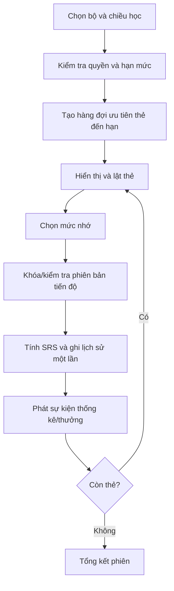
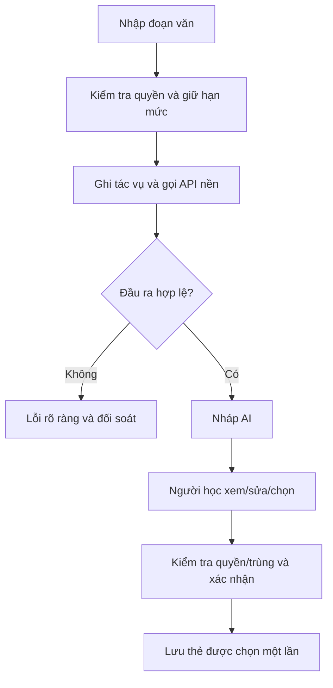

# DANH SÁCH YÊU CẦU SẢN PHẨM

**Tên đề tài:** Xây dựng website học từ vựng tiếng Anh ứng dụng ôn tập ngắt quãng và hỗ trợ trí tuệ nhân tạo.

## THÔNG TIN DỰ ÁN

| Mục | Thông tin |
| --- | --- |
| Dự án viết tắt | VocabLearning — tên quy ước |
| Tên dự án | Xây dựng website học từ vựng tiếng Anh ứng dụng ôn tập ngắt quãng và hỗ trợ trí tuệ nhân tạo |
| Ngày bắt đầu | 28/09/2026 |
| Ngày kết thúc | 14/12/2026 |
| Thời gian thực hiện | 2,5 tháng; 78 ngày lịch tính cả hai đầu mốc |
| Nơi thực hiện | Khoa Công nghệ thông tin |
| Giảng viên hướng dẫn | Lương Thị Thu Phương |
| Email/điện thoại giảng viên | Chưa cung cấp; không dùng thông tin của giảng viên trong mẫu |
| Đại diện nhóm | Huỳnh Gia Pho |
| Chủ sở hữu sản phẩm | Đề xuất nhóm trưởng điều phối yêu cầu; cả nhóm thống nhất với giảng viên |
| Quản lý dự án | Huỳnh Gia Pho — nhóm trưởng; vai trò tổ chức phát triển được mô tả trong kế hoạch |
| Liên hệ nhóm | Email/điện thoại chưa cung cấp |

### Thành viên trong đội

| TT | Họ và tên | Mã số sinh viên | Lớp | Vai trò |
| --- | --- | --- | --- | --- |
| 1 | Huỳnh Gia Pho | 28211152416 | K28TPM5 | Nhóm trưởng |
| 2 | Phạm Ngọc Thái | 28211106637 | K28TPM10 | Thành viên |
| 3 | Nguyễn Đình Nhật Quân | 28211100097 | K28TPM10 | Thành viên |
| 4 | Lê Hữu Thảo | 28212241493 | K28TPM9 | Thành viên |
| 5 | Trần Văn Màu | 28212306184 | K28TPM24 | Thành viên |

## THÔNG TIN TÀI LIỆU

| Mục | Nội dung |
| --- | --- |
| Tên dự án | Xây dựng website học từ vựng tiếng Anh ứng dụng ôn tập ngắt quãng và hỗ trợ trí tuệ nhân tạo |
| Tiêu đề tài liệu | Danh sách yêu cầu sản phẩm |
| Mã tài liệu | SCI_SE_4 |
| Người thực hiện | Nhóm Huỳnh Gia Pho |
| Phiên bản | 1.1 |
| Ngày lập | 26/09/2026 |
| Trạng thái | Bản thiết kế và kế hoạch; chưa ghi nhận phê duyệt hay kết quả kiểm thử thực tế |
| Ngôn ngữ | Tiếng Việt; giữ tên công nghệ, ID, API, SQL và các tên kỹ thuật cần thiết |
| Quy ước dữ liệu | Tên bảng/cột tiếng Việt không dấu dạng nguoi_dung, bo_the, trang_thai; giữ id, email, password_hash, created_at, updated_at, ipa, slug và kiểu SQL |

## LỊCH SỬ CHỈNH SỬA TÀI LIỆU

| Phiên bản | Người chỉnh sửa | Ngày | Ghi chú |
| --- | --- | --- | --- |
| 1.0 | Nhóm thực hiện | 26/09/2026 | Lập đầy đủ nội dung theo mẫu; đối chiếu 111 mục chức năng và 12 yêu cầu phi chức năng |
| 1.1 | Nhóm thực hiện | 26/09/2026 | Đồng bộ giữa các tài liệu: giao diện JavaScript; đường dẫn trang tiếng Việt; tên VocabLearning và CSDL `vocab_learning`; QT-02 sang đợt 2; tiêu chí ghi nhớ và ngưỡng sổ tay thống nhất; sửa tên kỹ thuật bị đổi nhầm; phân bổ giờ theo người |

## PHÊ DUYỆT TÀI LIỆU

| Vai trò | Họ tên | Chữ ký | Ngày |
| --- | --- | --- | --- |
| Giảng viên hướng dẫn | Lương Thị Thu Phương | Chưa ký | Chưa xác nhận |
| Nhóm trưởng | Huỳnh Gia Pho | Chưa ký | Chưa xác nhận |
| Thành viên | Phạm Ngọc Thái | Chưa ký | Chưa xác nhận |
| Thành viên | Nguyễn Đình Nhật Quân | Chưa ký | Chưa xác nhận |
| Thành viên | Lê Hữu Thảo | Chưa ký | Chưa xác nhận |
| Thành viên | Trần Văn Màu | Chưa ký | Chưa xác nhận |

## MỤC LỤC

  - Thành viên trong đội
- 1. GIỚI THIỆU
  - 1.1. Mục đích
  - 1.2. Phạm vi
  - 1.3. Tài liệu tham khảo
- 2. NỘI DUNG
  - 2.1. Mô tả Product Backlog
  - 2.2. Ưu tiên và ước tính
  - 2.3. Chia theo từng Sprint
  - 2.4. Yêu cầu phi chức năng và công việc kỹ thuật
  - 2.5. Liên kết và phụ thuộc nghiệp vụ
  - 2.6. Trường hợp sử dụng và biểu đồ hoạt động
- PHỤ LỤC A — THUẬT TOÁN
  - Thuật toán ôn tập và cá nhân hóa
- PHỤ LỤC B — API
  - Đặc tả API
- PHỤ LỤC C — LUỒNG VÀ GIAO DỊCH
  - Luồng xử lý và giao dịch
- PHỤ LỤC D — BẢO MẬT
  - Bảo mật và quyền riêng tư

## 1. GIỚI THIỆU
### 1.1. Mục đích
Định nghĩa toàn bộ hạng mục sản phẩm để ưu tiên, ước lượng, phân chia đợt và nghiệm thu. Không gộp một nhóm lớn thành một dòng CRUD rồi bỏ các nghiệp vụ SRS, chấm bài, AI, phát âm, hạn mức, nhắc học hay xóa dữ liệu.
### 1.2. Phạm vi
111 mục chức năng thuộc 11 nhóm và 12 yêu cầu phi chức năng; ba mục mở rộng chứa Facebook, IELTS/tiếng Anh trẻ em và hội thoại AI. Các điều kiện trước/sau, luồng, xử lý lỗi và tiêu chí chấp nhận đều có ở mỗi hạng mục; API, quyền, thuật toán và giao dịch chi tiết trong phụ lục.
### 1.3. Tài liệu tham khảo

- [Next.js — tài liệu chính thức](https://nextjs.org/docs).
- [Spring Boot — tài liệu chính thức](https://docs.spring.io/spring-boot/).
- [MySQL 8.4 — tài liệu chính thức](https://dev.mysql.com/doc/refman/8.4/en/).
- [Thuật toán SM-2 gốc — SuperMemo](https://www.supermemo.com/en/blog/application-of-a-computer-to-improve-the-results-obtained-in-working-with-the-supermemo-method).
- Các mẫu SCI_SE_01, SCI_SE_2, SCI_SE_3, SCI_SE_4, SCI_SE_5, SCI_SE_6 và SCI_SE_7 do nhóm cung cấp. Nội dung mẫu thuộc đề tài khác; bộ tài liệu này áp dụng cấu trúc, thay nghiệp vụ bằng hệ thống học từ vựng.

## 2. NỘI DUNG
### 2.1. Mô tả Product Backlog
Mã PB dùng cùng hậu tố với yêu cầu, ví dụ PB-ON-06 liên kết ON-06. Không dùng mã PB trùng cho hai chức năng. Độ ưu tiên P0 là điều kiện nền tảng/cốt lõi/bảo mật; P1 là chức năng chính bổ trợ; P2 là mở rộng. P1 vẫn phải bàn giao trong phạm vi chính, không có nghĩa tùy ý bỏ.

#### 2.1.1. PB-TK-01 — Đăng ký bằng email

| Mục | Nội dung |
| --- | --- |
| ID | PB-TK-01 |
| Yêu cầu liên kết | TK-01 |
| Tác nhân | Khách/người học |
| Mô tả | Đăng ký bằng email |
| Điều kiện trước | Khách truy cập được trang xác thực; dịch vụ email/nhà cung cấp đăng nhập được cấu hình cho luồng tương ứng. Thao tác đăng xuất/đổi mật khẩu áp dụng phiên của chính người dùng. |
| Tiêu chí chấp nhận | Email chuẩn hóa là duy nhất; tạo tài khoản chờ xác thực, password_hash và email xác thực, không trả mật khẩu trong phản hồi |
| Luồng xử lý | Chuẩn hóa và kiểm tra dữ liệu; xác minh danh tính/phiên hoặc mã một lần theo luồng; ghi thay đổi, thu hồi phiên khi cần và tạo email/tác vụ có kiểm soát. |
| Điều kiện sau | Kết quả đã được máy chủ xác nhận; chỉ dữ liệu thuộc phạm vi được phép thay đổi. Thao tác xem không tạo sự kiện học/thưởng. Thao tác ghi lưu được mã truy vết; lỗi không để dữ liệu dở dang hoặc báo thành công trước khi hoàn tất. |
| Quy tắc/ngoại lệ | Email sai định dạng hoặc đã tồn tại; mật khẩu dưới 10 ký tự; gửi lại cùng yêu cầu không tạo thêm tài khoản |
| Ưu tiên | P0 |
| Ước lượng | 8 giờ-người phần chính |
| Phụ trách đề xuất | Huỳnh Gia Pho |
| Đợt | 1 |
| Giao diện | UI01, UI02, UI03, UI04, UI05, UI06, UI07 |
| Dữ liệu | nguoi_dung, danh_tinh_dang_nhap, ma_xac_thuc, ho_so_nguoi_dung, tuy_chon_hoc, yeu_cau_xoa_tai_khoan |
| Nghiệm thu | TC-TK-01-01/02/03; kiểm tra quyền và tình huống trọng yếu liên quan |


**Điều kiện hoàn thành hạng mục:** Luồng chính và lỗi riêng được triển khai; kiểm tra máy chủ/giao diện đạt; không có lỗi quyền; SQL/API/tài liệu cập nhật; người kiểm tra chéo xác nhận minh chứng. Chưa có minh chứng thì trạng thái là chưa thực hiện/chưa xác minh.

#### 2.1.2. PB-TK-02 — Xác thực email

| Mục | Nội dung |
| --- | --- |
| ID | PB-TK-02 |
| Yêu cầu liên kết | TK-02 |
| Tác nhân | Khách/người học |
| Mô tả | Xác thực email |
| Điều kiện trước | Khách truy cập được trang xác thực; dịch vụ email/nhà cung cấp đăng nhập được cấu hình cho luồng tương ứng. Thao tác đăng xuất/đổi mật khẩu áp dụng phiên của chính người dùng. |
| Tiêu chí chấp nhận | Mã ngẫu nhiên chỉ lưu bản băm, dùng một lần trong 24 giờ; xác thực thành công chuyển trạng thái sang ACTIVE; gửi lại có giới hạn |
| Luồng xử lý | Chuẩn hóa và kiểm tra dữ liệu; xác minh danh tính/phiên hoặc mã một lần theo luồng; ghi thay đổi, thu hồi phiên khi cần và tạo email/tác vụ có kiểm soát. |
| Điều kiện sau | Kết quả đã được máy chủ xác nhận; chỉ dữ liệu thuộc phạm vi được phép thay đổi. Thao tác xem không tạo sự kiện học/thưởng. Thao tác ghi lưu được mã truy vết; lỗi không để dữ liệu dở dang hoặc báo thành công trước khi hoàn tất. |
| Quy tắc/ngoại lệ | Mã hết hạn, đã dùng hoặc của tài khoản khác không kích hoạt tài khoản |
| Ưu tiên | P0 |
| Ước lượng | 8 giờ-người phần chính |
| Phụ trách đề xuất | Huỳnh Gia Pho |
| Đợt | 1 |
| Giao diện | UI01, UI02, UI03, UI04, UI05, UI06, UI07 |
| Dữ liệu | nguoi_dung, danh_tinh_dang_nhap, ma_xac_thuc, ho_so_nguoi_dung, tuy_chon_hoc, yeu_cau_xoa_tai_khoan |
| Nghiệm thu | TC-TK-02-01/02/03; kiểm tra quyền và tình huống trọng yếu liên quan |


**Điều kiện hoàn thành hạng mục:** Luồng chính và lỗi riêng được triển khai; kiểm tra máy chủ/giao diện đạt; không có lỗi quyền; SQL/API/tài liệu cập nhật; người kiểm tra chéo xác nhận minh chứng. Chưa có minh chứng thì trạng thái là chưa thực hiện/chưa xác minh.

#### 2.1.3. PB-TK-03 — Đăng nhập bằng email và Google

| Mục | Nội dung |
| --- | --- |
| ID | PB-TK-03 |
| Yêu cầu liên kết | TK-03 |
| Tác nhân | Khách/người học |
| Mô tả | Đăng nhập bằng email và Google |
| Điều kiện trước | Khách truy cập được trang xác thực; dịch vụ email/nhà cung cấp đăng nhập được cấu hình cho luồng tương ứng. Thao tác đăng xuất/đổi mật khẩu áp dụng phiên của chính người dùng. |
| Tiêu chí chấp nhận | Email/mật khẩu đúng tạo phiên mới; Google kiểm tra nhà cung cấp, state, nonce và định danh; không tự ghép tài khoản trùng email |
| Luồng xử lý | Chuẩn hóa và kiểm tra dữ liệu; xác minh danh tính/phiên hoặc mã một lần theo luồng; ghi thay đổi, thu hồi phiên khi cần và tạo email/tác vụ có kiểm soát. |
| Điều kiện sau | Kết quả đã được máy chủ xác nhận; chỉ dữ liệu thuộc phạm vi được phép thay đổi. Thao tác xem không tạo sự kiện học/thưởng. Thao tác ghi lưu được mã truy vết; lỗi không để dữ liệu dở dang hoặc báo thành công trước khi hoàn tất. |
| Quy tắc/ngoại lệ | Mật khẩu sai, tài khoản khóa, email chưa xác thực, Google hủy cấp quyền; trả thông báo phù hợp và không tạo phiên |
| Ưu tiên | P0 |
| Ước lượng | 8 giờ-người phần chính |
| Phụ trách đề xuất | Huỳnh Gia Pho |
| Đợt | 1 |
| Giao diện | UI01, UI02, UI03, UI04, UI05, UI06, UI07 |
| Dữ liệu | nguoi_dung, danh_tinh_dang_nhap, ma_xac_thuc, ho_so_nguoi_dung, tuy_chon_hoc, yeu_cau_xoa_tai_khoan |
| Nghiệm thu | TC-TK-03-01/02/03; kiểm tra quyền và tình huống trọng yếu liên quan |


**Điều kiện hoàn thành hạng mục:** Luồng chính và lỗi riêng được triển khai; kiểm tra máy chủ/giao diện đạt; không có lỗi quyền; SQL/API/tài liệu cập nhật; người kiểm tra chéo xác nhận minh chứng. Chưa có minh chứng thì trạng thái là chưa thực hiện/chưa xác minh.

#### 2.1.4. PB-TK-04 — Đăng nhập Facebook — mở rộng

| Mục | Nội dung |
| --- | --- |
| ID | PB-TK-04 |
| Yêu cầu liên kết | TK-04 |
| Tác nhân | Khách/người học |
| Mô tả | Đăng nhập Facebook — mở rộng |
| Điều kiện trước | Khách truy cập được trang xác thực; dịch vụ email/nhà cung cấp đăng nhập được cấu hình cho luồng tương ứng. Thao tác đăng xuất/đổi mật khẩu áp dụng phiên của chính người dùng. |
| Tiêu chí chấp nhận | Đăng nhập qua định danh Facebook hợp lệ; cùng quy tắc liên kết và khóa tài khoản như Google; có thể tắt bằng cấu hình |
| Luồng xử lý | Chuẩn hóa và kiểm tra dữ liệu; xác minh danh tính/phiên hoặc mã một lần theo luồng; ghi thay đổi, thu hồi phiên khi cần và tạo email/tác vụ có kiểm soát. |
| Điều kiện sau | Kết quả đã được máy chủ xác nhận; chỉ dữ liệu thuộc phạm vi được phép thay đổi. Thao tác xem không tạo sự kiện học/thưởng. Thao tác ghi lưu được mã truy vết; lỗi không để dữ liệu dở dang hoặc báo thành công trước khi hoàn tất. |
| Quy tắc/ngoại lệ | Nhà cung cấp không trả email hoặc người dùng từ chối; không tạo email giả hay tự ghép danh tính |
| Ưu tiên | P2 |
| Ước lượng | Chưa cam kết giờ triển khai; đặc tả giữ đầy đủ |
| Phụ trách đề xuất | Huỳnh Gia Pho |
| Đợt | Sau phần chính |
| Giao diện | UI01, UI02, UI03, UI04, UI05, UI06, UI07 |
| Dữ liệu | nguoi_dung, danh_tinh_dang_nhap, ma_xac_thuc, ho_so_nguoi_dung, tuy_chon_hoc, yeu_cau_xoa_tai_khoan |
| Nghiệm thu | TC-TK-04-01/02/03; kiểm tra quyền và tình huống trọng yếu liên quan |


**Điều kiện hoàn thành hạng mục:** Luồng chính và lỗi riêng được triển khai; kiểm tra máy chủ/giao diện đạt; không có lỗi quyền; SQL/API/tài liệu cập nhật; người kiểm tra chéo xác nhận minh chứng. Chưa có minh chứng thì trạng thái là chưa thực hiện/chưa xác minh.

#### 2.1.5. PB-TK-05 — Đăng xuất, quên mật khẩu và đặt lại mật khẩu

| Mục | Nội dung |
| --- | --- |
| ID | PB-TK-05 |
| Yêu cầu liên kết | TK-05 |
| Tác nhân | Khách/người học |
| Mô tả | Đăng xuất, quên mật khẩu và đặt lại mật khẩu |
| Điều kiện trước | Khách truy cập được trang xác thực; dịch vụ email/nhà cung cấp đăng nhập được cấu hình cho luồng tương ứng. Thao tác đăng xuất/đổi mật khẩu áp dụng phiên của chính người dùng. |
| Tiêu chí chấp nhận | Đăng xuất thu hồi phiên; quên mật khẩu trả thông báo chung; mã đặt lại dùng một lần trong 15 phút; đổi mật khẩu thu hồi các phiên cũ |
| Luồng xử lý | Chuẩn hóa và kiểm tra dữ liệu; xác minh danh tính/phiên hoặc mã một lần theo luồng; ghi thay đổi, thu hồi phiên khi cần và tạo email/tác vụ có kiểm soát. |
| Điều kiện sau | Kết quả đã được máy chủ xác nhận; chỉ dữ liệu thuộc phạm vi được phép thay đổi. Thao tác xem không tạo sự kiện học/thưởng. Thao tác ghi lưu được mã truy vết; lỗi không để dữ liệu dở dang hoặc báo thành công trước khi hoàn tất. |
| Quy tắc/ngoại lệ | Mã đặt lại sai/hết hạn/đã dùng; mật khẩu xác nhận khác nhau; tài khoản chỉ Google không được tự đặt mật khẩu khi chưa xác minh |
| Ưu tiên | P0 |
| Ước lượng | 8 giờ-người phần chính |
| Phụ trách đề xuất | Huỳnh Gia Pho |
| Đợt | 1 |
| Giao diện | UI01, UI02, UI03, UI04, UI05, UI06, UI07 |
| Dữ liệu | nguoi_dung, danh_tinh_dang_nhap, ma_xac_thuc, ho_so_nguoi_dung, tuy_chon_hoc, yeu_cau_xoa_tai_khoan |
| Nghiệm thu | TC-TK-05-01/02/03; kiểm tra quyền và tình huống trọng yếu liên quan |


**Điều kiện hoàn thành hạng mục:** Luồng chính và lỗi riêng được triển khai; kiểm tra máy chủ/giao diện đạt; không có lỗi quyền; SQL/API/tài liệu cập nhật; người kiểm tra chéo xác nhận minh chứng. Chưa có minh chứng thì trạng thái là chưa thực hiện/chưa xác minh.

#### 2.1.6. PB-TK-06 — Cập nhật hồ sơ và ảnh đại diện

| Mục | Nội dung |
| --- | --- |
| ID | PB-TK-06 |
| Yêu cầu liên kết | TK-06 |
| Tác nhân | Người học |
| Mô tả | Cập nhật hồ sơ và ảnh đại diện |
| Điều kiện trước | Tài khoản ACTIVE đã xác thực email; phiên còn hiệu lực; có quyền với bộ/thẻ/bài/tệp được chọn; tài nguyên chưa bị xóa hoặc ẩn khỏi quyền sử dụng. |
| Tiêu chí chấp nhận | Lưu tên hiển thị 2–100 ký tự; nhận JPEG/PNG/WebP tối đa 5 MB; xử lý ảnh và thay tệp cũ có kiểm tra tham chiếu |
| Luồng xử lý | Chuẩn hóa và kiểm tra dữ liệu; xác minh danh tính/phiên hoặc mã một lần theo luồng; ghi thay đổi, thu hồi phiên khi cần và tạo email/tác vụ có kiểm soát. |
| Điều kiện sau | Kết quả đã được máy chủ xác nhận; chỉ dữ liệu thuộc phạm vi được phép thay đổi. Thao tác xem không tạo sự kiện học/thưởng. Thao tác ghi lưu được mã truy vết; lỗi không để dữ liệu dở dang hoặc báo thành công trước khi hoàn tất. |
| Quy tắc/ngoại lệ | Tệp giả ảnh, ảnh quá lớn, tên rỗng; người khác không được sửa hồ sơ |
| Ưu tiên | P0 |
| Ước lượng | 8 giờ-người phần chính |
| Phụ trách đề xuất | Huỳnh Gia Pho |
| Đợt | 1 |
| Giao diện | UI01, UI02, UI03, UI04, UI05, UI06, UI07 |
| Dữ liệu | nguoi_dung, danh_tinh_dang_nhap, ma_xac_thuc, ho_so_nguoi_dung, tuy_chon_hoc, yeu_cau_xoa_tai_khoan |
| Nghiệm thu | TC-TK-06-01/02/03; kiểm tra quyền và tình huống trọng yếu liên quan |


**Điều kiện hoàn thành hạng mục:** Luồng chính và lỗi riêng được triển khai; kiểm tra máy chủ/giao diện đạt; không có lỗi quyền; SQL/API/tài liệu cập nhật; người kiểm tra chéo xác nhận minh chứng. Chưa có minh chứng thì trạng thái là chưa thực hiện/chưa xác minh.

#### 2.1.7. PB-TK-07 — Chọn trình độ, mục tiêu và chủ đề quan tâm

| Mục | Nội dung |
| --- | --- |
| ID | PB-TK-07 |
| Yêu cầu liên kết | TK-07 |
| Tác nhân | Người học |
| Mô tả | Chọn trình độ, mục tiêu và chủ đề quan tâm |
| Điều kiện trước | Tài khoản ACTIVE đã xác thực email; phiên còn hiệu lực; có quyền với bộ/thẻ/bài/tệp được chọn; tài nguyên chưa bị xóa hoặc ẩn khỏi quyền sử dụng. |
| Tiêu chí chấp nhận | Chọn A1–C2 khi hoàn tất thiết lập; lưu mục tiêu và nhiều chủ đề đang hoạt động; nêu rõ đây là trình độ tự đánh giá |
| Luồng xử lý | Chuẩn hóa và kiểm tra dữ liệu; xác minh danh tính/phiên hoặc mã một lần theo luồng; ghi thay đổi, thu hồi phiên khi cần và tạo email/tác vụ có kiểm soát. |
| Điều kiện sau | Kết quả đã được máy chủ xác nhận; chỉ dữ liệu thuộc phạm vi được phép thay đổi. Thao tác xem không tạo sự kiện học/thưởng. Thao tác ghi lưu được mã truy vết; lỗi không để dữ liệu dở dang hoặc báo thành công trước khi hoàn tất. |
| Quy tắc/ngoại lệ | Trình độ ngoài danh sách; chủ đề đã bị ẩn; mục tiêu vượt 500 ký tự |
| Ưu tiên | P0 |
| Ước lượng | 8 giờ-người phần chính |
| Phụ trách đề xuất | Huỳnh Gia Pho |
| Đợt | 1 |
| Giao diện | UI01, UI02, UI03, UI04, UI05, UI06, UI07 |
| Dữ liệu | nguoi_dung, danh_tinh_dang_nhap, ma_xac_thuc, ho_so_nguoi_dung, tuy_chon_hoc, yeu_cau_xoa_tai_khoan |
| Nghiệm thu | TC-TK-07-01/02/03; kiểm tra quyền và tình huống trọng yếu liên quan |


**Điều kiện hoàn thành hạng mục:** Luồng chính và lỗi riêng được triển khai; kiểm tra máy chủ/giao diện đạt; không có lỗi quyền; SQL/API/tài liệu cập nhật; người kiểm tra chéo xác nhận minh chứng. Chưa có minh chứng thì trạng thái là chưa thực hiện/chưa xác minh.

#### 2.1.8. PB-TK-08 — Đặt số từ mới và thời gian học mỗi ngày

| Mục | Nội dung |
| --- | --- |
| ID | PB-TK-08 |
| Yêu cầu liên kết | TK-08 |
| Tác nhân | Người học |
| Mô tả | Đặt số từ mới và thời gian học mỗi ngày |
| Điều kiện trước | Tài khoản ACTIVE đã xác thực email; phiên còn hiệu lực; có quyền với bộ/thẻ/bài/tệp được chọn; tài nguyên chưa bị xóa hoặc ẩn khỏi quyền sử dụng. |
| Tiêu chí chấp nhận | Số từ mới 0–100, thời gian 1–240 phút; thay đổi không xóa tiến độ; hạn mức từ mới được kiểm tra tại máy chủ |
| Luồng xử lý | Chuẩn hóa và kiểm tra dữ liệu; xác minh danh tính/phiên hoặc mã một lần theo luồng; ghi thay đổi, thu hồi phiên khi cần và tạo email/tác vụ có kiểm soát. |
| Điều kiện sau | Kết quả đã được máy chủ xác nhận; chỉ dữ liệu thuộc phạm vi được phép thay đổi. Thao tác xem không tạo sự kiện học/thưởng. Thao tác ghi lưu được mã truy vết; lỗi không để dữ liệu dở dang hoặc báo thành công trước khi hoàn tất. |
| Quy tắc/ngoại lệ | Số âm, số thập phân hoặc vượt ngưỡng; hai phiên đồng thời không vượt số từ mới |
| Ưu tiên | P0 |
| Ước lượng | 8 giờ-người phần chính |
| Phụ trách đề xuất | Huỳnh Gia Pho |
| Đợt | 1 |
| Giao diện | UI01, UI02, UI03, UI04, UI05, UI06, UI07 |
| Dữ liệu | nguoi_dung, danh_tinh_dang_nhap, ma_xac_thuc, ho_so_nguoi_dung, tuy_chon_hoc, yeu_cau_xoa_tai_khoan |
| Nghiệm thu | TC-TK-08-01/02/03; kiểm tra quyền và tình huống trọng yếu liên quan |


**Điều kiện hoàn thành hạng mục:** Luồng chính và lỗi riêng được triển khai; kiểm tra máy chủ/giao diện đạt; không có lỗi quyền; SQL/API/tài liệu cập nhật; người kiểm tra chéo xác nhận minh chứng. Chưa có minh chứng thì trạng thái là chưa thực hiện/chưa xác minh.

#### 2.1.9. PB-TK-09 — Cài đặt giờ nhắc học, múi giờ và thông báo

| Mục | Nội dung |
| --- | --- |
| ID | PB-TK-09 |
| Yêu cầu liên kết | TK-09 |
| Tác nhân | Người học |
| Mô tả | Cài đặt giờ nhắc học, múi giờ và thông báo |
| Điều kiện trước | Tài khoản ACTIVE đã xác thực email; phiên còn hiệu lực; có quyền với bộ/thẻ/bài/tệp được chọn; tài nguyên chưa bị xóa hoặc ẩn khỏi quyền sử dụng. |
| Tiêu chí chấp nhận | Lưu giờ HH:mm và tên múi giờ IANA; bật/tắt riêng email và thông báo; tính lại lịch nhắc tương lai |
| Luồng xử lý | Chuẩn hóa và kiểm tra dữ liệu; xác minh danh tính/phiên hoặc mã một lần theo luồng; ghi thay đổi, thu hồi phiên khi cần và tạo email/tác vụ có kiểm soát. |
| Điều kiện sau | Kết quả đã được máy chủ xác nhận; chỉ dữ liệu thuộc phạm vi được phép thay đổi. Thao tác xem không tạo sự kiện học/thưởng. Thao tác ghi lưu được mã truy vết; lỗi không để dữ liệu dở dang hoặc báo thành công trước khi hoàn tất. |
| Quy tắc/ngoại lệ | Múi giờ không tồn tại; giờ sai định dạng; đổi múi giờ không tạo thêm chuỗi ngày hoặc thêm lượt nhắc |
| Ưu tiên | P0 |
| Ước lượng | 8 giờ-người phần chính |
| Phụ trách đề xuất | Huỳnh Gia Pho |
| Đợt | 1 |
| Giao diện | UI01, UI02, UI03, UI04, UI05, UI06, UI07 |
| Dữ liệu | nguoi_dung, danh_tinh_dang_nhap, ma_xac_thuc, ho_so_nguoi_dung, tuy_chon_hoc, yeu_cau_xoa_tai_khoan |
| Nghiệm thu | TC-TK-09-01/02/03; kiểm tra quyền và tình huống trọng yếu liên quan |


**Điều kiện hoàn thành hạng mục:** Luồng chính và lỗi riêng được triển khai; kiểm tra máy chủ/giao diện đạt; không có lỗi quyền; SQL/API/tài liệu cập nhật; người kiểm tra chéo xác nhận minh chứng. Chưa có minh chứng thì trạng thái là chưa thực hiện/chưa xác minh.

#### 2.1.10. PB-TK-10 — Xem streak và lịch sử hoạt động

| Mục | Nội dung |
| --- | --- |
| ID | PB-TK-10 |
| Yêu cầu liên kết | TK-10 |
| Tác nhân | Người học |
| Mô tả | Xem streak và lịch sử hoạt động |
| Điều kiện trước | Tài khoản ACTIVE đã xác thực email; phiên còn hiệu lực; có quyền với bộ/thẻ/bài/tệp được chọn; tài nguyên chưa bị xóa hoặc ẩn khỏi quyền sử dụng. |
| Tiêu chí chấp nhận | Hiển thị chuỗi ngày học và sự kiện theo ngày địa phương cố định tại lúc ghi; ngày có hoạt động học hợp lệ mới được tính |
| Luồng xử lý | Chuẩn hóa và kiểm tra dữ liệu; xác minh danh tính/phiên hoặc mã một lần theo luồng; ghi thay đổi, thu hồi phiên khi cần và tạo email/tác vụ có kiểm soát. |
| Điều kiện sau | Kết quả đã được máy chủ xác nhận; chỉ dữ liệu thuộc phạm vi được phép thay đổi. Thao tác xem không tạo sự kiện học/thưởng. Thao tác ghi lưu được mã truy vết; lỗi không để dữ liệu dở dang hoặc báo thành công trước khi hoàn tất. |
| Quy tắc/ngoại lệ | Chưa có dữ liệu; đổi múi giờ hoặc mở trang nhiều lần không tự tăng chuỗi ngày |
| Ưu tiên | P0 |
| Ước lượng | 8 giờ-người phần chính |
| Phụ trách đề xuất | Huỳnh Gia Pho |
| Đợt | 1 |
| Giao diện | UI01, UI02, UI03, UI04, UI05, UI06, UI07 |
| Dữ liệu | nguoi_dung, danh_tinh_dang_nhap, ma_xac_thuc, ho_so_nguoi_dung, tuy_chon_hoc, yeu_cau_xoa_tai_khoan |
| Nghiệm thu | TC-TK-10-01/02/03; kiểm tra quyền và tình huống trọng yếu liên quan |


**Điều kiện hoàn thành hạng mục:** Luồng chính và lỗi riêng được triển khai; kiểm tra máy chủ/giao diện đạt; không có lỗi quyền; SQL/API/tài liệu cập nhật; người kiểm tra chéo xác nhận minh chứng. Chưa có minh chứng thì trạng thái là chưa thực hiện/chưa xác minh.

#### 2.1.11. PB-TK-11 — Yêu cầu xóa tài khoản và dữ liệu cá nhân

| Mục | Nội dung |
| --- | --- |
| ID | PB-TK-11 |
| Yêu cầu liên kết | TK-11 |
| Tác nhân | Người học |
| Mô tả | Yêu cầu xóa tài khoản và dữ liệu cá nhân |
| Điều kiện trước | Tài khoản ACTIVE đã xác thực email; phiên còn hiệu lực; có quyền với bộ/thẻ/bài/tệp được chọn; tài nguyên chưa bị xóa hoặc ẩn khỏi quyền sử dụng. |
| Tiêu chí chấp nhận | Xác thực lại, khóa sử dụng ngay, cho hủy trong 7 ngày trước khi bắt đầu xóa; xóa dữ liệu cá nhân và tệp theo tham chiếu, theo dõi trạng thái |
| Luồng xử lý | Chuẩn hóa và kiểm tra dữ liệu; xác minh danh tính/phiên hoặc mã một lần theo luồng; ghi thay đổi, thu hồi phiên khi cần và tạo email/tác vụ có kiểm soát. |
| Điều kiện sau | Kết quả đã được máy chủ xác nhận; chỉ dữ liệu thuộc phạm vi được phép thay đổi. Thao tác xem không tạo sự kiện học/thưởng. Thao tác ghi lưu được mã truy vết; lỗi không để dữ liệu dở dang hoặc báo thành công trước khi hoàn tất. |
| Quy tắc/ngoại lệ | Người khác gửi yêu cầu; hủy khi đã xóa; tác vụ lỗi phải tiếp tục từ bước đã hoàn thành thay vì báo xóa thành công giả |
| Ưu tiên | P0 |
| Ước lượng | 8 giờ-người phần chính |
| Phụ trách đề xuất | Huỳnh Gia Pho |
| Đợt | 1 |
| Giao diện | UI01, UI02, UI03, UI04, UI05, UI06, UI07 |
| Dữ liệu | nguoi_dung, danh_tinh_dang_nhap, ma_xac_thuc, ho_so_nguoi_dung, tuy_chon_hoc, yeu_cau_xoa_tai_khoan |
| Nghiệm thu | TC-TK-11-01/02/03; kiểm tra quyền và tình huống trọng yếu liên quan |


**Điều kiện hoàn thành hạng mục:** Luồng chính và lỗi riêng được triển khai; kiểm tra máy chủ/giao diện đạt; không có lỗi quyền; SQL/API/tài liệu cập nhật; người kiểm tra chéo xác nhận minh chứng. Chưa có minh chứng thì trạng thái là chưa thực hiện/chưa xác minh.

#### 2.1.12. PB-BT-01 — Tạo, xem, sửa và xóa bộ thẻ

| Mục | Nội dung |
| --- | --- |
| ID | PB-BT-01 |
| Yêu cầu liên kết | BT-01 |
| Tác nhân | Người học |
| Mô tả | Tạo, xem, sửa và xóa bộ thẻ |
| Điều kiện trước | Tài khoản ACTIVE đã xác thực email; phiên còn hiệu lực; có quyền với bộ/thẻ/bài/tệp được chọn; tài nguyên chưa bị xóa hoặc ẩn khỏi quyền sử dụng. |
| Tiêu chí chấp nhận | Tên bộ 1–150 ký tự; chủ sở hữu được sửa/xóa; xóa ngừng đưa thẻ vào học; kiểm tra phiên bản khi sửa |
| Luồng xử lý | Kiểm tra chủ sở hữu, quyền tệp và phiên bản bộ/thẻ; chuẩn hóa dữ liệu, kiểm tra trùng; ghi thay đổi/ảnh chụp lịch sử và sự kiện liên quan; không sửa tiến độ của người khác. |
| Điều kiện sau | Kết quả đã được máy chủ xác nhận; chỉ dữ liệu thuộc phạm vi được phép thay đổi. Thao tác xem không tạo sự kiện học/thưởng. Thao tác ghi lưu được mã truy vết; lỗi không để dữ liệu dở dang hoặc báo thành công trước khi hoàn tất. |
| Quy tắc/ngoại lệ | Người khác thao tác; tên rỗng; bản sửa đã cũ; không xóa bản sao độc lập của người khác |
| Ưu tiên | P0 |
| Ước lượng | 8 giờ-người phần chính |
| Phụ trách đề xuất | Phạm Ngọc Thái |
| Đợt | 1 |
| Giao diện | UI08, UI09, UI10, UI11, UI12, UI13 |
| Dữ liệu | bo_the, the, nhan, the_nhan, vi_du_cua_the, tep_cua_the, lan_nhap_du_lieu, bao_cao_noi_dung |
| Nghiệm thu | TC-BT-01-01/02/03; kiểm tra quyền và tình huống trọng yếu liên quan |


**Điều kiện hoàn thành hạng mục:** Luồng chính và lỗi riêng được triển khai; kiểm tra máy chủ/giao diện đạt; không có lỗi quyền; SQL/API/tài liệu cập nhật; người kiểm tra chéo xác nhận minh chứng. Chưa có minh chứng thì trạng thái là chưa thực hiện/chưa xác minh.

#### 2.1.13. PB-BT-02 — Tạo, sửa và xóa từng thẻ

| Mục | Nội dung |
| --- | --- |
| ID | PB-BT-02 |
| Yêu cầu liên kết | BT-02 |
| Tác nhân | Người học |
| Mô tả | Tạo, sửa và xóa từng thẻ |
| Điều kiện trước | Tài khoản ACTIVE đã xác thực email; phiên còn hiệu lực; có quyền với bộ/thẻ/bài/tệp được chọn; tài nguyên chưa bị xóa hoặc ẩn khỏi quyền sử dụng. |
| Tiêu chí chấp nhận | Thẻ thuộc đúng bộ; từ/cụm từ 1–255 ký tự và nghĩa mục tiêu bắt buộc; sửa nội dung không ghi đè lịch sử đã học |
| Luồng xử lý | Kiểm tra chủ sở hữu, quyền tệp và phiên bản bộ/thẻ; chuẩn hóa dữ liệu, kiểm tra trùng; ghi thay đổi/ảnh chụp lịch sử và sự kiện liên quan; không sửa tiến độ của người khác. |
| Điều kiện sau | Kết quả đã được máy chủ xác nhận; chỉ dữ liệu thuộc phạm vi được phép thay đổi. Thao tác xem không tạo sự kiện học/thưởng. Thao tác ghi lưu được mã truy vết; lỗi không để dữ liệu dở dang hoặc báo thành công trước khi hoàn tất. |
| Quy tắc/ngoại lệ | Thẻ sai bộ; thiếu nghĩa; phiên bản cũ; không tiếp tục học thẻ đã xóa |
| Ưu tiên | P0 |
| Ước lượng | 8 giờ-người phần chính |
| Phụ trách đề xuất | Phạm Ngọc Thái |
| Đợt | 1 |
| Giao diện | UI08, UI09, UI10, UI11, UI12, UI13 |
| Dữ liệu | bo_the, the, nhan, the_nhan, vi_du_cua_the, tep_cua_the, lan_nhap_du_lieu, bao_cao_noi_dung |
| Nghiệm thu | TC-BT-02-01/02/03; kiểm tra quyền và tình huống trọng yếu liên quan |


**Điều kiện hoàn thành hạng mục:** Luồng chính và lỗi riêng được triển khai; kiểm tra máy chủ/giao diện đạt; không có lỗi quyền; SQL/API/tài liệu cập nhật; người kiểm tra chéo xác nhận minh chứng. Chưa có minh chứng thì trạng thái là chưa thực hiện/chưa xác minh.

#### 2.1.14. PB-BT-03 — Lưu nội dung từ/cụm từ và đa phương tiện

| Mục | Nội dung |
| --- | --- |
| ID | PB-BT-03 |
| Yêu cầu liên kết | BT-03 |
| Tác nhân | Người học |
| Mô tả | Lưu nội dung từ/cụm từ và đa phương tiện |
| Điều kiện trước | Tài khoản ACTIVE đã xác thực email; phiên còn hiệu lực; có quyền với bộ/thẻ/bài/tệp được chọn; tài nguyên chưa bị xóa hoặc ẩn khỏi quyền sử dụng. |
| Tiêu chí chấp nhận | Lưu từ loại, nghĩa, IPA, nhiều ví dụ và bản dịch, ảnh, audio từ và audio ví dụ; một thẻ ứng với một nghĩa mục tiêu |
| Luồng xử lý | Kiểm tra chủ sở hữu, quyền tệp và phiên bản bộ/thẻ; chuẩn hóa dữ liệu, kiểm tra trùng; ghi thay đổi/ảnh chụp lịch sử và sự kiện liên quan; không sửa tiến độ của người khác. |
| Điều kiện sau | Kết quả đã được máy chủ xác nhận; chỉ dữ liệu thuộc phạm vi được phép thay đổi. Thao tác xem không tạo sự kiện học/thưởng. Thao tác ghi lưu được mã truy vết; lỗi không để dữ liệu dở dang hoặc báo thành công trước khi hoàn tất. |
| Quy tắc/ngoại lệ | Tệp hỏng, loại tệp không cho phép hoặc tệp thuộc người khác; trường bắt buộc thiếu |
| Ưu tiên | P0 |
| Ước lượng | 8 giờ-người phần chính |
| Phụ trách đề xuất | Phạm Ngọc Thái |
| Đợt | 1 |
| Giao diện | UI08, UI09, UI10, UI11, UI12, UI13 |
| Dữ liệu | bo_the, the, nhan, the_nhan, vi_du_cua_the, tep_cua_the, lan_nhap_du_lieu, bao_cao_noi_dung |
| Nghiệm thu | TC-BT-03-01/02/03; kiểm tra quyền và tình huống trọng yếu liên quan |


**Điều kiện hoàn thành hạng mục:** Luồng chính và lỗi riêng được triển khai; kiểm tra máy chủ/giao diện đạt; không có lỗi quyền; SQL/API/tài liệu cập nhật; người kiểm tra chéo xác nhận minh chứng. Chưa có minh chứng thì trạng thái là chưa thực hiện/chưa xác minh.

#### 2.1.15. PB-BT-04 — Gắn chủ đề, nhãn và mức độ khó

| Mục | Nội dung |
| --- | --- |
| ID | PB-BT-04 |
| Yêu cầu liên kết | BT-04 |
| Tác nhân | Người học |
| Mô tả | Gắn chủ đề, nhãn và mức độ khó |
| Điều kiện trước | Tài khoản ACTIVE đã xác thực email; phiên còn hiệu lực; có quyền với bộ/thẻ/bài/tệp được chọn; tài nguyên chưa bị xóa hoặc ẩn khỏi quyền sử dụng. |
| Tiêu chí chấp nhận | Bộ có nhiều chủ đề; thẻ có nhiều nhãn thuộc chính bộ; độ khó thuộc 1–5 |
| Luồng xử lý | Kiểm tra chủ sở hữu, quyền tệp và phiên bản bộ/thẻ; chuẩn hóa dữ liệu, kiểm tra trùng; ghi thay đổi/ảnh chụp lịch sử và sự kiện liên quan; không sửa tiến độ của người khác. |
| Điều kiện sau | Kết quả đã được máy chủ xác nhận; chỉ dữ liệu thuộc phạm vi được phép thay đổi. Thao tác xem không tạo sự kiện học/thưởng. Thao tác ghi lưu được mã truy vết; lỗi không để dữ liệu dở dang hoặc báo thành công trước khi hoàn tất. |
| Quy tắc/ngoại lệ | Nhãn thuộc bộ khác; chủ đề không hoạt động; độ khó không hợp lệ |
| Ưu tiên | P0 |
| Ước lượng | 8 giờ-người phần chính |
| Phụ trách đề xuất | Phạm Ngọc Thái |
| Đợt | 1 |
| Giao diện | UI08, UI09, UI10, UI11, UI12, UI13 |
| Dữ liệu | bo_the, the, nhan, the_nhan, vi_du_cua_the, tep_cua_the, lan_nhap_du_lieu, bao_cao_noi_dung |
| Nghiệm thu | TC-BT-04-01/02/03; kiểm tra quyền và tình huống trọng yếu liên quan |


**Điều kiện hoàn thành hạng mục:** Luồng chính và lỗi riêng được triển khai; kiểm tra máy chủ/giao diện đạt; không có lỗi quyền; SQL/API/tài liệu cập nhật; người kiểm tra chéo xác nhận minh chứng. Chưa có minh chứng thì trạng thái là chưa thực hiện/chưa xác minh.

#### 2.1.16. PB-BT-05 — Đặt bộ thẻ công khai hoặc riêng tư

| Mục | Nội dung |
| --- | --- |
| ID | PB-BT-05 |
| Yêu cầu liên kết | BT-05 |
| Tác nhân | Người học |
| Mô tả | Đặt bộ thẻ công khai hoặc riêng tư |
| Điều kiện trước | Tài khoản ACTIVE đã xác thực email; phiên còn hiệu lực; có quyền với bộ/thẻ/bài/tệp được chọn; tài nguyên chưa bị xóa hoặc ẩn khỏi quyền sử dụng. |
| Tiêu chí chấp nhận | Riêng tư chỉ chủ sở hữu truy cập; công khai chờ kiểm duyệt và chỉ hiển thị khi được duyệt; đổi về riêng tư có hiệu lực ngay |
| Luồng xử lý | Kiểm tra chủ sở hữu, quyền tệp và phiên bản bộ/thẻ; chuẩn hóa dữ liệu, kiểm tra trùng; ghi thay đổi/ảnh chụp lịch sử và sự kiện liên quan; không sửa tiến độ của người khác. |
| Điều kiện sau | Kết quả đã được máy chủ xác nhận; chỉ dữ liệu thuộc phạm vi được phép thay đổi. Thao tác xem không tạo sự kiện học/thưởng. Thao tác ghi lưu được mã truy vết; lỗi không để dữ liệu dở dang hoặc báo thành công trước khi hoàn tất. |
| Quy tắc/ngoại lệ | Chia sẻ liên kết không vượt quyền; bản bị từ chối không xuất hiện ở danh mục |
| Ưu tiên | P0 |
| Ước lượng | 8 giờ-người phần chính |
| Phụ trách đề xuất | Phạm Ngọc Thái |
| Đợt | 1 |
| Giao diện | UI08, UI09, UI10, UI11, UI12, UI13 |
| Dữ liệu | bo_the, the, nhan, the_nhan, vi_du_cua_the, tep_cua_the, lan_nhap_du_lieu, bao_cao_noi_dung |
| Nghiệm thu | TC-BT-05-01/02/03; kiểm tra quyền và tình huống trọng yếu liên quan |


**Điều kiện hoàn thành hạng mục:** Luồng chính và lỗi riêng được triển khai; kiểm tra máy chủ/giao diện đạt; không có lỗi quyền; SQL/API/tài liệu cập nhật; người kiểm tra chéo xác nhận minh chứng. Chưa có minh chứng thì trạng thái là chưa thực hiện/chưa xác minh.

#### 2.1.17. PB-BT-06 — Tìm kiếm, lọc và sắp xếp bộ thẻ

| Mục | Nội dung |
| --- | --- |
| ID | PB-BT-06 |
| Yêu cầu liên kết | BT-06 |
| Tác nhân | Người học |
| Mô tả | Tìm kiếm, lọc và sắp xếp bộ thẻ |
| Điều kiện trước | Tài khoản ACTIVE đã xác thực email; phiên còn hiệu lực; có quyền với bộ/thẻ/bài/tệp được chọn; tài nguyên chưa bị xóa hoặc ẩn khỏi quyền sử dụng. |
| Tiêu chí chấp nhận | Tìm theo tên; lọc chủ đề, trình độ, nguồn và quyền; sắp xếp mới nhất/tên/số thẻ; phân trang ổn định |
| Luồng xử lý | Kiểm tra chủ sở hữu, quyền tệp và phiên bản bộ/thẻ; chuẩn hóa dữ liệu, kiểm tra trùng; ghi thay đổi/ảnh chụp lịch sử và sự kiện liên quan; không sửa tiến độ của người khác. |
| Điều kiện sau | Kết quả đã được máy chủ xác nhận; chỉ dữ liệu thuộc phạm vi được phép thay đổi. Thao tác xem không tạo sự kiện học/thưởng. Thao tác ghi lưu được mã truy vết; lỗi không để dữ liệu dở dang hoặc báo thành công trước khi hoàn tất. |
| Quy tắc/ngoại lệ | Tham số sắp xếp lạ; trang quá lớn; kết quả không chứa bộ riêng tư của người khác |
| Ưu tiên | P0 |
| Ước lượng | 8 giờ-người phần chính |
| Phụ trách đề xuất | Phạm Ngọc Thái |
| Đợt | 1 |
| Giao diện | UI08, UI09, UI10, UI11, UI12, UI13 |
| Dữ liệu | bo_the, the, nhan, the_nhan, vi_du_cua_the, tep_cua_the, lan_nhap_du_lieu, bao_cao_noi_dung |
| Nghiệm thu | TC-BT-06-01/02/03; kiểm tra quyền và tình huống trọng yếu liên quan |


**Điều kiện hoàn thành hạng mục:** Luồng chính và lỗi riêng được triển khai; kiểm tra máy chủ/giao diện đạt; không có lỗi quyền; SQL/API/tài liệu cập nhật; người kiểm tra chéo xác nhận minh chứng. Chưa có minh chứng thì trạng thái là chưa thực hiện/chưa xác minh.

#### 2.1.18. PB-BT-07 — Sao chép bộ thẻ công khai

| Mục | Nội dung |
| --- | --- |
| ID | PB-BT-07 |
| Yêu cầu liên kết | BT-07 |
| Tác nhân | Người học |
| Mô tả | Sao chép bộ thẻ công khai |
| Điều kiện trước | Tài khoản ACTIVE đã xác thực email; phiên còn hiệu lực; có quyền với bộ/thẻ/bài/tệp được chọn; tài nguyên chưa bị xóa hoặc ẩn khỏi quyền sử dụng. |
| Tiêu chí chấp nhận | Chỉ sao chép bộ công khai đã duyệt; tạo bộ riêng tư độc lập, giữ nguồn và nội dung, không mang tiến độ của chủ bộ |
| Luồng xử lý | Kiểm tra chủ sở hữu, quyền tệp và phiên bản bộ/thẻ; chuẩn hóa dữ liệu, kiểm tra trùng; ghi thay đổi/ảnh chụp lịch sử và sự kiện liên quan; không sửa tiến độ của người khác. |
| Điều kiện sau | Kết quả đã được máy chủ xác nhận; chỉ dữ liệu thuộc phạm vi được phép thay đổi. Thao tác xem không tạo sự kiện học/thưởng. Thao tác ghi lưu được mã truy vết; lỗi không để dữ liệu dở dang hoặc báo thành công trước khi hoàn tất. |
| Quy tắc/ngoại lệ | Bộ nguồn bị ẩn khi sao chép; lỗi tệp hoặc gửi lại không tạo bản sao trùng |
| Ưu tiên | P0 |
| Ước lượng | 8 giờ-người phần chính |
| Phụ trách đề xuất | Phạm Ngọc Thái |
| Đợt | 1 |
| Giao diện | UI08, UI09, UI10, UI11, UI12, UI13 |
| Dữ liệu | bo_the, the, nhan, the_nhan, vi_du_cua_the, tep_cua_the, lan_nhap_du_lieu, bao_cao_noi_dung |
| Nghiệm thu | TC-BT-07-01/02/03; kiểm tra quyền và tình huống trọng yếu liên quan |


**Điều kiện hoàn thành hạng mục:** Luồng chính và lỗi riêng được triển khai; kiểm tra máy chủ/giao diện đạt; không có lỗi quyền; SQL/API/tài liệu cập nhật; người kiểm tra chéo xác nhận minh chứng. Chưa có minh chứng thì trạng thái là chưa thực hiện/chưa xác minh.

#### 2.1.19. PB-BT-08 — Nhập và xuất CSV

| Mục | Nội dung |
| --- | --- |
| ID | PB-BT-08 |
| Yêu cầu liên kết | BT-08 |
| Tác nhân | Người học |
| Mô tả | Nhập và xuất CSV |
| Điều kiện trước | Tài khoản ACTIVE đã xác thực email; phiên còn hiệu lực; có quyền với bộ/thẻ/bài/tệp được chọn; tài nguyên chưa bị xóa hoặc ẩn khỏi quyền sử dụng. |
| Tiêu chí chấp nhận | CSV UTF-8 có tiêu đề cột; giới hạn 5 MB/5000 dòng; xem trước lỗi theo dòng trước xác nhận; xuất thoát dữ liệu công thức nguy hiểm |
| Luồng xử lý | Kiểm tra chủ sở hữu, quyền tệp và phiên bản bộ/thẻ; chuẩn hóa dữ liệu, kiểm tra trùng; ghi thay đổi/ảnh chụp lịch sử và sự kiện liên quan; không sửa tiến độ của người khác. |
| Điều kiện sau | Kết quả đã được máy chủ xác nhận; chỉ dữ liệu thuộc phạm vi được phép thay đổi. Thao tác xem không tạo sự kiện học/thưởng. Thao tác ghi lưu được mã truy vết; lỗi không để dữ liệu dở dang hoặc báo thành công trước khi hoàn tất. |
| Quy tắc/ngoại lệ | Dòng lỗi, mã hóa sai, thiếu cột, tệp quá lớn; người dùng chọn dòng hợp lệ trước xác nhận; tập được xác nhận còn lỗi thì trả 422 và không ghi một phần |
| Ưu tiên | P0 |
| Ước lượng | 8 giờ-người phần chính |
| Phụ trách đề xuất | Phạm Ngọc Thái |
| Đợt | 1 |
| Giao diện | UI08, UI09, UI10, UI11, UI12, UI13 |
| Dữ liệu | bo_the, the, nhan, the_nhan, vi_du_cua_the, tep_cua_the, lan_nhap_du_lieu, bao_cao_noi_dung |
| Nghiệm thu | TC-BT-08-01/02/03; kiểm tra quyền và tình huống trọng yếu liên quan |


**Điều kiện hoàn thành hạng mục:** Luồng chính và lỗi riêng được triển khai; kiểm tra máy chủ/giao diện đạt; không có lỗi quyền; SQL/API/tài liệu cập nhật; người kiểm tra chéo xác nhận minh chứng. Chưa có minh chứng thì trạng thái là chưa thực hiện/chưa xác minh.

#### 2.1.20. PB-BT-09 — Cảnh báo từ trùng trong cùng bộ

| Mục | Nội dung |
| --- | --- |
| ID | PB-BT-09 |
| Yêu cầu liên kết | BT-09 |
| Tác nhân | Người học |
| Mô tả | Cảnh báo từ trùng trong cùng bộ |
| Điều kiện trước | Tài khoản ACTIVE đã xác thực email; phiên còn hiệu lực; có quyền với bộ/thẻ/bài/tệp được chọn; tài nguyên chưa bị xóa hoặc ẩn khỏi quyền sử dụng. |
| Tiêu chí chấp nhận | So sánh từ chuẩn hóa + từ loại + nghĩa chuẩn hóa; cảnh báo liên kết thẻ hiện có; cùng từ khác nghĩa được phép lưu |
| Luồng xử lý | Kiểm tra chủ sở hữu, quyền tệp và phiên bản bộ/thẻ; chuẩn hóa dữ liệu, kiểm tra trùng; ghi thay đổi/ảnh chụp lịch sử và sự kiện liên quan; không sửa tiến độ của người khác. |
| Điều kiện sau | Kết quả đã được máy chủ xác nhận; chỉ dữ liệu thuộc phạm vi được phép thay đổi. Thao tác xem không tạo sự kiện học/thưởng. Thao tác ghi lưu được mã truy vết; lỗi không để dữ liệu dở dang hoặc báo thành công trước khi hoàn tất. |
| Quy tắc/ngoại lệ | Khác chữ hoa/khoảng trắng vẫn nhận diện; hai yêu cầu đồng thời không lách quy tắc trùng |
| Ưu tiên | P0 |
| Ước lượng | 8 giờ-người phần chính |
| Phụ trách đề xuất | Phạm Ngọc Thái |
| Đợt | 1 |
| Giao diện | UI08, UI09, UI10, UI11, UI12, UI13 |
| Dữ liệu | bo_the, the, nhan, the_nhan, vi_du_cua_the, tep_cua_the, lan_nhap_du_lieu, bao_cao_noi_dung |
| Nghiệm thu | TC-BT-09-01/02/03; kiểm tra quyền và tình huống trọng yếu liên quan |


**Điều kiện hoàn thành hạng mục:** Luồng chính và lỗi riêng được triển khai; kiểm tra máy chủ/giao diện đạt; không có lỗi quyền; SQL/API/tài liệu cập nhật; người kiểm tra chéo xác nhận minh chứng. Chưa có minh chứng thì trạng thái là chưa thực hiện/chưa xác minh.

#### 2.1.21. PB-BT-10 — Đánh dấu bộ thẻ yêu thích

| Mục | Nội dung |
| --- | --- |
| ID | PB-BT-10 |
| Yêu cầu liên kết | BT-10 |
| Tác nhân | Người học |
| Mô tả | Đánh dấu bộ thẻ yêu thích |
| Điều kiện trước | Tài khoản ACTIVE đã xác thực email; phiên còn hiệu lực; có quyền với bộ/thẻ/bài/tệp được chọn; tài nguyên chưa bị xóa hoặc ẩn khỏi quyền sử dụng. |
| Tiêu chí chấp nhận | Một người chỉ có một bản đánh dấu mỗi bộ; bật/tắt không xóa bộ; danh sách yêu thích vẫn kiểm tra quyền |
| Luồng xử lý | Kiểm tra chủ sở hữu, quyền tệp và phiên bản bộ/thẻ; chuẩn hóa dữ liệu, kiểm tra trùng; ghi thay đổi/ảnh chụp lịch sử và sự kiện liên quan; không sửa tiến độ của người khác. |
| Điều kiện sau | Kết quả đã được máy chủ xác nhận; chỉ dữ liệu thuộc phạm vi được phép thay đổi. Thao tác xem không tạo sự kiện học/thưởng. Thao tác ghi lưu được mã truy vết; lỗi không để dữ liệu dở dang hoặc báo thành công trước khi hoàn tất. |
| Quy tắc/ngoại lệ | Bộ đã ẩn/xóa phải hiện không khả dụng; gửi bật yêu thích lặp không tạo hàng trùng |
| Ưu tiên | P0 |
| Ước lượng | 8 giờ-người phần chính |
| Phụ trách đề xuất | Phạm Ngọc Thái |
| Đợt | 1 |
| Giao diện | UI08, UI09, UI10, UI11, UI12, UI13 |
| Dữ liệu | bo_the, the, nhan, the_nhan, vi_du_cua_the, tep_cua_the, lan_nhap_du_lieu, bao_cao_noi_dung |
| Nghiệm thu | TC-BT-10-01/02/03; kiểm tra quyền và tình huống trọng yếu liên quan |


**Điều kiện hoàn thành hạng mục:** Luồng chính và lỗi riêng được triển khai; kiểm tra máy chủ/giao diện đạt; không có lỗi quyền; SQL/API/tài liệu cập nhật; người kiểm tra chéo xác nhận minh chứng. Chưa có minh chứng thì trạng thái là chưa thực hiện/chưa xác minh.

#### 2.1.22. PB-BT-11 — Chia sẻ bộ thẻ bằng liên kết

| Mục | Nội dung |
| --- | --- |
| ID | PB-BT-11 |
| Yêu cầu liên kết | BT-11 |
| Tác nhân | Người học |
| Mô tả | Chia sẻ bộ thẻ bằng liên kết |
| Điều kiện trước | Tài khoản ACTIVE đã xác thực email; phiên còn hiệu lực; có quyền với bộ/thẻ/bài/tệp được chọn; tài nguyên chưa bị xóa hoặc ẩn khỏi quyền sử dụng. |
| Tiêu chí chấp nhận | Liên kết có mã ngẫu nhiên, có thể thu hồi; chỉ cấp xem theo quyền của bộ; bộ riêng tư không tự công khai |
| Luồng xử lý | Kiểm tra chủ sở hữu, quyền tệp và phiên bản bộ/thẻ; chuẩn hóa dữ liệu, kiểm tra trùng; ghi thay đổi/ảnh chụp lịch sử và sự kiện liên quan; không sửa tiến độ của người khác. |
| Điều kiện sau | Kết quả đã được máy chủ xác nhận; chỉ dữ liệu thuộc phạm vi được phép thay đổi. Thao tác xem không tạo sự kiện học/thưởng. Thao tác ghi lưu được mã truy vết; lỗi không để dữ liệu dở dang hoặc báo thành công trước khi hoàn tất. |
| Quy tắc/ngoại lệ | Liên kết bị thu hồi, sai hoặc đến bộ bị ẩn; không lộ dữ liệu riêng |
| Ưu tiên | P0 |
| Ước lượng | 8 giờ-người phần chính |
| Phụ trách đề xuất | Phạm Ngọc Thái |
| Đợt | 1 |
| Giao diện | UI08, UI09, UI10, UI11, UI12, UI13 |
| Dữ liệu | bo_the, the, nhan, the_nhan, vi_du_cua_the, tep_cua_the, lan_nhap_du_lieu, bao_cao_noi_dung |
| Nghiệm thu | TC-BT-11-01/02/03; kiểm tra quyền và tình huống trọng yếu liên quan |


**Điều kiện hoàn thành hạng mục:** Luồng chính và lỗi riêng được triển khai; kiểm tra máy chủ/giao diện đạt; không có lỗi quyền; SQL/API/tài liệu cập nhật; người kiểm tra chéo xác nhận minh chứng. Chưa có minh chứng thì trạng thái là chưa thực hiện/chưa xác minh.

#### 2.1.23. PB-BT-12 — Báo cáo nội dung sai hoặc không phù hợp

| Mục | Nội dung |
| --- | --- |
| ID | PB-BT-12 |
| Yêu cầu liên kết | BT-12 |
| Tác nhân | Người học |
| Mô tả | Báo cáo nội dung sai hoặc không phù hợp |
| Điều kiện trước | Tài khoản ACTIVE đã xác thực email; phiên còn hiệu lực; có quyền với bộ/thẻ/bài/tệp được chọn; tài nguyên chưa bị xóa hoặc ẩn khỏi quyền sử dụng. |
| Tiêu chí chấp nhận | Chọn lý do, mô tả và đối tượng; lưu phiếu kiểm duyệt; một báo cáo không tự khóa nội dung |
| Luồng xử lý | Kiểm tra chủ sở hữu, quyền tệp và phiên bản bộ/thẻ; chuẩn hóa dữ liệu, kiểm tra trùng; ghi thay đổi/ảnh chụp lịch sử và sự kiện liên quan; không sửa tiến độ của người khác. |
| Điều kiện sau | Kết quả đã được máy chủ xác nhận; chỉ dữ liệu thuộc phạm vi được phép thay đổi. Thao tác xem không tạo sự kiện học/thưởng. Thao tác ghi lưu được mã truy vết; lỗi không để dữ liệu dở dang hoặc báo thành công trước khi hoàn tất. |
| Quy tắc/ngoại lệ | Mô tả rỗng, đối tượng không tồn tại, gửi liên tục; hạn chế lạm dụng |
| Ưu tiên | P0 |
| Ước lượng | 8 giờ-người phần chính |
| Phụ trách đề xuất | Phạm Ngọc Thái |
| Đợt | 1 |
| Giao diện | UI08, UI09, UI10, UI11, UI12, UI13 |
| Dữ liệu | bo_the, the, nhan, the_nhan, vi_du_cua_the, tep_cua_the, lan_nhap_du_lieu, bao_cao_noi_dung |
| Nghiệm thu | TC-BT-12-01/02/03; kiểm tra quyền và tình huống trọng yếu liên quan |


**Điều kiện hoàn thành hạng mục:** Luồng chính và lỗi riêng được triển khai; kiểm tra máy chủ/giao diện đạt; không có lỗi quyền; SQL/API/tài liệu cập nhật; người kiểm tra chéo xác nhận minh chứng. Chưa có minh chứng thì trạng thái là chưa thực hiện/chưa xác minh.

#### 2.1.24. PB-ND-01 — Bộ từ vựng giao tiếp theo tình huống

| Mục | Nội dung |
| --- | --- |
| ID | PB-ND-01 |
| Yêu cầu liên kết | ND-01 |
| Tác nhân | Khách/người học |
| Mô tả | Bộ từ vựng giao tiếp theo tình huống |
| Điều kiện trước | Bộ thẻ công khai đã qua kiểm duyệt; khách được xem danh mục/xem trước, sao chép cần tài khoản hoạt động. |
| Tiêu chí chấp nhận | Cung cấp bộ chào hỏi, mua sắm, du lịch và công việc; ví dụ phù hợp tình huống, có nguồn quản trị |
| Luồng xử lý | Truy vấn bộ công khai đã duyệt với bộ lọc/phân trang; trả nguồn, trình độ, mô tả, số thẻ và phần xem trước; kiểm tra lại quyền trước sao chép. |
| Điều kiện sau | Kết quả đã được máy chủ xác nhận; chỉ dữ liệu thuộc phạm vi được phép thay đổi. Thao tác xem không tạo sự kiện học/thưởng. Thao tác ghi lưu được mã truy vết; lỗi không để dữ liệu dở dang hoặc báo thành công trước khi hoàn tất. |
| Quy tắc/ngoại lệ | Bộ chưa duyệt hoặc thiếu thẻ không được giới thiệu là bộ hoàn chỉnh |
| Ưu tiên | P1 |
| Ước lượng | 8 giờ-người phần chính |
| Phụ trách đề xuất | Phạm Ngọc Thái |
| Đợt | 1 |
| Giao diện | UI08, UI09, UI14 |
| Dữ liệu | chu_de, bo_the, bo_the_chu_de, the |
| Nghiệm thu | TC-ND-01-01/02/03; kiểm tra quyền và tình huống trọng yếu liên quan |


**Điều kiện hoàn thành hạng mục:** Luồng chính và lỗi riêng được triển khai; kiểm tra máy chủ/giao diện đạt; không có lỗi quyền; SQL/API/tài liệu cập nhật; người kiểm tra chéo xác nhận minh chứng. Chưa có minh chứng thì trạng thái là chưa thực hiện/chưa xác minh.

#### 2.1.25. PB-ND-02 — Bộ từ vựng TOEIC theo chủ đề

| Mục | Nội dung |
| --- | --- |
| ID | PB-ND-02 |
| Yêu cầu liên kết | ND-02 |
| Tác nhân | Khách/người học |
| Mô tả | Bộ từ vựng TOEIC theo chủ đề |
| Điều kiện trước | Bộ thẻ công khai đã qua kiểm duyệt; khách được xem danh mục/xem trước, sao chép cần tài khoản hoạt động. |
| Tiêu chí chấp nhận | Cung cấp bộ công sở, tuyển dụng, thương mại và du lịch; nhãn TOEIC, mô tả và trình độ phù hợp |
| Luồng xử lý | Truy vấn bộ công khai đã duyệt với bộ lọc/phân trang; trả nguồn, trình độ, mô tả, số thẻ và phần xem trước; kiểm tra lại quyền trước sao chép. |
| Điều kiện sau | Kết quả đã được máy chủ xác nhận; chỉ dữ liệu thuộc phạm vi được phép thay đổi. Thao tác xem không tạo sự kiện học/thưởng. Thao tác ghi lưu được mã truy vết; lỗi không để dữ liệu dở dang hoặc báo thành công trước khi hoàn tất. |
| Quy tắc/ngoại lệ | Nội dung sai hoặc quyền sử dụng chưa rõ phải được rà soát trước công khai |
| Ưu tiên | P1 |
| Ước lượng | 8 giờ-người phần chính |
| Phụ trách đề xuất | Phạm Ngọc Thái |
| Đợt | 1 |
| Giao diện | UI08, UI09, UI14 |
| Dữ liệu | chu_de, bo_the, bo_the_chu_de, the |
| Nghiệm thu | TC-ND-02-01/02/03; kiểm tra quyền và tình huống trọng yếu liên quan |


**Điều kiện hoàn thành hạng mục:** Luồng chính và lỗi riêng được triển khai; kiểm tra máy chủ/giao diện đạt; không có lỗi quyền; SQL/API/tài liệu cập nhật; người kiểm tra chéo xác nhận minh chứng. Chưa có minh chứng thì trạng thái là chưa thực hiện/chưa xác minh.

#### 2.1.26. PB-ND-03 — Phân loại nội dung theo trình độ

| Mục | Nội dung |
| --- | --- |
| ID | PB-ND-03 |
| Yêu cầu liên kết | ND-03 |
| Tác nhân | Khách/người học |
| Mô tả | Phân loại nội dung theo trình độ |
| Điều kiện trước | Bộ thẻ công khai đã qua kiểm duyệt; khách được xem danh mục/xem trước, sao chép cần tài khoản hoạt động. |
| Tiêu chí chấp nhận | Bộ có trình độ CEFR và chủ đề; người dùng lọc theo trình độ; không dùng tự đánh giá để khóa nội dung |
| Luồng xử lý | Truy vấn bộ công khai đã duyệt với bộ lọc/phân trang; trả nguồn, trình độ, mô tả, số thẻ và phần xem trước; kiểm tra lại quyền trước sao chép. |
| Điều kiện sau | Kết quả đã được máy chủ xác nhận; chỉ dữ liệu thuộc phạm vi được phép thay đổi. Thao tác xem không tạo sự kiện học/thưởng. Thao tác ghi lưu được mã truy vết; lỗi không để dữ liệu dở dang hoặc báo thành công trước khi hoàn tất. |
| Quy tắc/ngoại lệ | Trình độ ngoài danh sách hoặc bộ không hoạt động không xuất hiện ở bộ lọc |
| Ưu tiên | P1 |
| Ước lượng | 8 giờ-người phần chính |
| Phụ trách đề xuất | Phạm Ngọc Thái |
| Đợt | 1 |
| Giao diện | UI08, UI09, UI14 |
| Dữ liệu | chu_de, bo_the, bo_the_chu_de, the |
| Nghiệm thu | TC-ND-03-01/02/03; kiểm tra quyền và tình huống trọng yếu liên quan |


**Điều kiện hoàn thành hạng mục:** Luồng chính và lỗi riêng được triển khai; kiểm tra máy chủ/giao diện đạt; không có lỗi quyền; SQL/API/tài liệu cập nhật; người kiểm tra chéo xác nhận minh chứng. Chưa có minh chứng thì trạng thái là chưa thực hiện/chưa xác minh.

#### 2.1.27. PB-ND-04 — Tìm kiếm và xem trước bộ thẻ

| Mục | Nội dung |
| --- | --- |
| ID | PB-ND-04 |
| Yêu cầu liên kết | ND-04 |
| Tác nhân | Khách/người học |
| Mô tả | Tìm kiếm và xem trước bộ thẻ |
| Điều kiện trước | Bộ thẻ công khai đã qua kiểm duyệt; khách được xem danh mục/xem trước, sao chép cần tài khoản hoạt động. |
| Tiêu chí chấp nhận | Khách xem tối đa 10 thẻ mẫu của bộ đã duyệt; người học xem chi tiết theo quyền và có nút sao chép |
| Luồng xử lý | Truy vấn bộ công khai đã duyệt với bộ lọc/phân trang; trả nguồn, trình độ, mô tả, số thẻ và phần xem trước; kiểm tra lại quyền trước sao chép. |
| Điều kiện sau | Kết quả đã được máy chủ xác nhận; chỉ dữ liệu thuộc phạm vi được phép thay đổi. Thao tác xem không tạo sự kiện học/thưởng. Thao tác ghi lưu được mã truy vết; lỗi không để dữ liệu dở dang hoặc báo thành công trước khi hoàn tất. |
| Quy tắc/ngoại lệ | Không trả toàn bộ dữ liệu bộ riêng tư; bộ không tồn tại hoặc bị ẩn trả trạng thái rõ |
| Ưu tiên | P1 |
| Ước lượng | 8 giờ-người phần chính |
| Phụ trách đề xuất | Phạm Ngọc Thái |
| Đợt | 1 |
| Giao diện | UI08, UI09, UI14 |
| Dữ liệu | chu_de, bo_the, bo_the_chu_de, the |
| Nghiệm thu | TC-ND-04-01/02/03; kiểm tra quyền và tình huống trọng yếu liên quan |


**Điều kiện hoàn thành hạng mục:** Luồng chính và lỗi riêng được triển khai; kiểm tra máy chủ/giao diện đạt; không có lỗi quyền; SQL/API/tài liệu cập nhật; người kiểm tra chéo xác nhận minh chứng. Chưa có minh chứng thì trạng thái là chưa thực hiện/chưa xác minh.

#### 2.1.28. PB-ND-05 — Hiển thị số thẻ và mô tả nội dung

| Mục | Nội dung |
| --- | --- |
| ID | PB-ND-05 |
| Yêu cầu liên kết | ND-05 |
| Tác nhân | Khách/người học |
| Mô tả | Hiển thị số thẻ và mô tả nội dung |
| Điều kiện trước | Bộ thẻ công khai đã qua kiểm duyệt; khách được xem danh mục/xem trước, sao chép cần tài khoản hoạt động. |
| Tiêu chí chấp nhận | Số thẻ phản ánh thẻ đang hoạt động; mô tả tối đa 2000 ký tự; phân biệt số thẻ với số từ gốc |
| Luồng xử lý | Truy vấn bộ công khai đã duyệt với bộ lọc/phân trang; trả nguồn, trình độ, mô tả, số thẻ và phần xem trước; kiểm tra lại quyền trước sao chép. |
| Điều kiện sau | Kết quả đã được máy chủ xác nhận; chỉ dữ liệu thuộc phạm vi được phép thay đổi. Thao tác xem không tạo sự kiện học/thưởng. Thao tác ghi lưu được mã truy vết; lỗi không để dữ liệu dở dang hoặc báo thành công trước khi hoàn tất. |
| Quy tắc/ngoại lệ | Xóa/thêm thẻ phải cập nhật số đếm; chưa có thẻ hiện 0 và hướng dẫn |
| Ưu tiên | P1 |
| Ước lượng | 8 giờ-người phần chính |
| Phụ trách đề xuất | Phạm Ngọc Thái |
| Đợt | 1 |
| Giao diện | UI08, UI09, UI14 |
| Dữ liệu | chu_de, bo_the, bo_the_chu_de, the |
| Nghiệm thu | TC-ND-05-01/02/03; kiểm tra quyền và tình huống trọng yếu liên quan |


**Điều kiện hoàn thành hạng mục:** Luồng chính và lỗi riêng được triển khai; kiểm tra máy chủ/giao diện đạt; không có lỗi quyền; SQL/API/tài liệu cập nhật; người kiểm tra chéo xác nhận minh chứng. Chưa có minh chứng thì trạng thái là chưa thực hiện/chưa xác minh.

#### 2.1.29. PB-ND-06 — Phân biệt bộ quản trị và bộ người dùng

| Mục | Nội dung |
| --- | --- |
| ID | PB-ND-06 |
| Yêu cầu liên kết | ND-06 |
| Tác nhân | Khách/người học |
| Mô tả | Phân biệt bộ quản trị và bộ người dùng |
| Điều kiện trước | Bộ thẻ công khai đã qua kiểm duyệt; khách được xem danh mục/xem trước, sao chép cần tài khoản hoạt động. |
| Tiêu chí chấp nhận | Nhãn nguồn rõ ràng, hiển thị tác giả công khai phù hợp quyền; bộ quản trị có quy trình duyệt và nguồn nội dung |
| Luồng xử lý | Truy vấn bộ công khai đã duyệt với bộ lọc/phân trang; trả nguồn, trình độ, mô tả, số thẻ và phần xem trước; kiểm tra lại quyền trước sao chép. |
| Điều kiện sau | Kết quả đã được máy chủ xác nhận; chỉ dữ liệu thuộc phạm vi được phép thay đổi. Thao tác xem không tạo sự kiện học/thưởng. Thao tác ghi lưu được mã truy vết; lỗi không để dữ liệu dở dang hoặc báo thành công trước khi hoàn tất. |
| Quy tắc/ngoại lệ | Người học không thể tự đặt nhãn bộ chính thức bằng sửa yêu cầu |
| Ưu tiên | P1 |
| Ước lượng | 8 giờ-người phần chính |
| Phụ trách đề xuất | Phạm Ngọc Thái |
| Đợt | 1 |
| Giao diện | UI08, UI09, UI14 |
| Dữ liệu | chu_de, bo_the, bo_the_chu_de, the |
| Nghiệm thu | TC-ND-06-01/02/03; kiểm tra quyền và tình huống trọng yếu liên quan |


**Điều kiện hoàn thành hạng mục:** Luồng chính và lỗi riêng được triển khai; kiểm tra máy chủ/giao diện đạt; không có lỗi quyền; SQL/API/tài liệu cập nhật; người kiểm tra chéo xác nhận minh chứng. Chưa có minh chứng thì trạng thái là chưa thực hiện/chưa xác minh.

#### 2.1.30. PB-ND-07 — Bộ IELTS và tiếng Anh trẻ em — mở rộng

| Mục | Nội dung |
| --- | --- |
| ID | PB-ND-07 |
| Yêu cầu liên kết | ND-07 |
| Tác nhân | Khách/người học |
| Mô tả | Bộ IELTS và tiếng Anh trẻ em — mở rộng |
| Điều kiện trước | Bộ thẻ công khai đã qua kiểm duyệt; khách được xem danh mục/xem trước, sao chép cần tài khoản hoạt động. |
| Tiêu chí chấp nhận | Có phân loại IELTS/CHILDREN, trình độ và rà soát nội dung riêng; chỉ bật sau các chức năng chính |
| Luồng xử lý | Truy vấn bộ công khai đã duyệt với bộ lọc/phân trang; trả nguồn, trình độ, mô tả, số thẻ và phần xem trước; kiểm tra lại quyền trước sao chép. |
| Điều kiện sau | Kết quả đã được máy chủ xác nhận; chỉ dữ liệu thuộc phạm vi được phép thay đổi. Thao tác xem không tạo sự kiện học/thưởng. Thao tác ghi lưu được mã truy vết; lỗi không để dữ liệu dở dang hoặc báo thành công trước khi hoàn tất. |
| Quy tắc/ngoại lệ | Không mặc nhiên thu dữ liệu trẻ em; nội dung chưa rà soát không được công khai |
| Ưu tiên | P2 |
| Ước lượng | Chưa cam kết giờ triển khai; đặc tả giữ đầy đủ |
| Phụ trách đề xuất | Phạm Ngọc Thái |
| Đợt | Sau phần chính |
| Giao diện | UI08, UI09, UI14 |
| Dữ liệu | chu_de, bo_the, bo_the_chu_de, the |
| Nghiệm thu | TC-ND-07-01/02/03; kiểm tra quyền và tình huống trọng yếu liên quan |


**Điều kiện hoàn thành hạng mục:** Luồng chính và lỗi riêng được triển khai; kiểm tra máy chủ/giao diện đạt; không có lỗi quyền; SQL/API/tài liệu cập nhật; người kiểm tra chéo xác nhận minh chứng. Chưa có minh chứng thì trạng thái là chưa thực hiện/chưa xác minh.

#### 2.1.31. PB-ON-01 — Lật thẻ tương tác

| Mục | Nội dung |
| --- | --- |
| ID | PB-ON-01 |
| Yêu cầu liên kết | ON-01 |
| Tác nhân | Người học |
| Mô tả | Lật thẻ tương tác |
| Điều kiện trước | Tài khoản ACTIVE đã xác thực email; phiên còn hiệu lực; có quyền với bộ/thẻ/bài/tệp được chọn; tài nguyên chưa bị xóa hoặc ẩn khỏi quyền sử dụng. |
| Tiêu chí chấp nhận | Mặt trước và sau hiển thị đúng chiều học; chỉ đánh giá sau khi đã lật; chuyển thẻ không mất lượt ôn đã xác nhận |
| Luồng xử lý | Đọc phiên và tiến độ hiện tại; kiểm tra chiều học, suất từ mới và phiên bản; tính kết quả tại máy chủ; ghi tiến độ, lịch sử và sự kiện trong giao dịch ngắn. |
| Điều kiện sau | Kết quả đã được máy chủ xác nhận; chỉ dữ liệu thuộc phạm vi được phép thay đổi. Thao tác xem không tạo sự kiện học/thưởng. Thao tác ghi lưu được mã truy vết; lỗi không để dữ liệu dở dang hoặc báo thành công trước khi hoàn tất. |
| Quy tắc/ngoại lệ | Nhấn nhiều lần khi đang gửi không ghi nhiều lượt; thẻ không còn khả dụng bị bỏ qua có thông báo |
| Ưu tiên | P0 |
| Ước lượng | 8 giờ-người phần chính |
| Phụ trách đề xuất | Nguyễn Đình Nhật Quân |
| Đợt | 2 |
| Giao diện | UI15, UI16, UI17, UI18 |
| Dữ liệu | phien_hoc, tien_do_hoc_the, muc_the_trong_phien, lich_su_on_tap, han_muc_hoc_hang_ngay, the_da_gioi_thieu |
| Nghiệm thu | TC-ON-01-01/02/03; kiểm tra quyền và tình huống trọng yếu liên quan |


**Điều kiện hoàn thành hạng mục:** Luồng chính và lỗi riêng được triển khai; kiểm tra máy chủ/giao diện đạt; không có lỗi quyền; SQL/API/tài liệu cập nhật; người kiểm tra chéo xác nhận minh chứng. Chưa có minh chứng thì trạng thái là chưa thực hiện/chưa xác minh.

#### 2.1.32. PB-ON-02 — Hỗ trợ phím tắt trên máy tính

| Mục | Nội dung |
| --- | --- |
| ID | PB-ON-02 |
| Yêu cầu liên kết | ON-02 |
| Tác nhân | Người học |
| Mô tả | Hỗ trợ phím tắt trên máy tính |
| Điều kiện trước | Tài khoản ACTIVE đã xác thực email; phiên còn hiệu lực; có quyền với bộ/thẻ/bài/tệp được chọn; tài nguyên chưa bị xóa hoặc ẩn khỏi quyền sử dụng. |
| Tiêu chí chấp nhận | Space lật; 1/2/3/4 chọn Quên/Khó/Nhớ/Dễ; Enter tiếp tục; có hướng dẫn và không bắt phím trong ô nhập |
| Luồng xử lý | Đọc phiên và tiến độ hiện tại; kiểm tra chiều học, suất từ mới và phiên bản; tính kết quả tại máy chủ; ghi tiến độ, lịch sử và sự kiện trong giao dịch ngắn. |
| Điều kiện sau | Kết quả đã được máy chủ xác nhận; chỉ dữ liệu thuộc phạm vi được phép thay đổi. Thao tác xem không tạo sự kiện học/thưởng. Thao tác ghi lưu được mã truy vết; lỗi không để dữ liệu dở dang hoặc báo thành công trước khi hoàn tất. |
| Quy tắc/ngoại lệ | Đang nhập câu hoặc hộp thoại thì phím tắt không gửi đánh giá |
| Ưu tiên | P0 |
| Ước lượng | 8 giờ-người phần chính |
| Phụ trách đề xuất | Nguyễn Đình Nhật Quân |
| Đợt | 2 |
| Giao diện | UI15, UI16, UI17, UI18 |
| Dữ liệu | phien_hoc, tien_do_hoc_the, muc_the_trong_phien, lich_su_on_tap, han_muc_hoc_hang_ngay, the_da_gioi_thieu |
| Nghiệm thu | TC-ON-02-01/02/03; kiểm tra quyền và tình huống trọng yếu liên quan |


**Điều kiện hoàn thành hạng mục:** Luồng chính và lỗi riêng được triển khai; kiểm tra máy chủ/giao diện đạt; không có lỗi quyền; SQL/API/tài liệu cập nhật; người kiểm tra chéo xác nhận minh chứng. Chưa có minh chứng thì trạng thái là chưa thực hiện/chưa xác minh.

#### 2.1.33. PB-ON-03 — Học Anh–Việt hoặc Việt–Anh

| Mục | Nội dung |
| --- | --- |
| ID | PB-ON-03 |
| Yêu cầu liên kết | ON-03 |
| Tác nhân | Người học |
| Mô tả | Học Anh–Việt hoặc Việt–Anh |
| Điều kiện trước | Tài khoản ACTIVE đã xác thực email; phiên còn hiệu lực; có quyền với bộ/thẻ/bài/tệp được chọn; tài nguyên chưa bị xóa hoặc ẩn khỏi quyền sử dụng. |
| Tiêu chí chấp nhận | Người học chọn chiều trước phiên; đáp án và tiến độ tách theo người + thẻ + chiều học |
| Luồng xử lý | Đọc phiên và tiến độ hiện tại; kiểm tra chiều học, suất từ mới và phiên bản; tính kết quả tại máy chủ; ghi tiến độ, lịch sử và sự kiện trong giao dịch ngắn. |
| Điều kiện sau | Kết quả đã được máy chủ xác nhận; chỉ dữ liệu thuộc phạm vi được phép thay đổi. Thao tác xem không tạo sự kiện học/thưởng. Thao tác ghi lưu được mã truy vết; lỗi không để dữ liệu dở dang hoặc báo thành công trước khi hoàn tất. |
| Quy tắc/ngoại lệ | Đổi chiều không sử dụng nhầm lịch hay tự coi chiều còn lại đã nhớ |
| Ưu tiên | P0 |
| Ước lượng | 8 giờ-người phần chính |
| Phụ trách đề xuất | Nguyễn Đình Nhật Quân |
| Đợt | 2 |
| Giao diện | UI15, UI16, UI17, UI18 |
| Dữ liệu | phien_hoc, tien_do_hoc_the, muc_the_trong_phien, lich_su_on_tap, han_muc_hoc_hang_ngay, the_da_gioi_thieu |
| Nghiệm thu | TC-ON-03-01/02/03; kiểm tra quyền và tình huống trọng yếu liên quan |


**Điều kiện hoàn thành hạng mục:** Luồng chính và lỗi riêng được triển khai; kiểm tra máy chủ/giao diện đạt; không có lỗi quyền; SQL/API/tài liệu cập nhật; người kiểm tra chéo xác nhận minh chứng. Chưa có minh chứng thì trạng thái là chưa thực hiện/chưa xác minh.

#### 2.1.34. PB-ON-04 — Phát audio từ và câu ví dụ

| Mục | Nội dung |
| --- | --- |
| ID | PB-ON-04 |
| Yêu cầu liên kết | ON-04 |
| Tác nhân | Người học |
| Mô tả | Phát audio từ và câu ví dụ |
| Điều kiện trước | Tài khoản ACTIVE đã xác thực email; phiên còn hiệu lực; có quyền với bộ/thẻ/bài/tệp được chọn; tài nguyên chưa bị xóa hoặc ẩn khỏi quyền sử dụng. |
| Tiêu chí chấp nhận | Phát tệp đã lưu đúng từ/câu, có điều khiển dừng và tốc độ; không tự phát gây chồng âm |
| Luồng xử lý | Đọc phiên và tiến độ hiện tại; kiểm tra chiều học, suất từ mới và phiên bản; tính kết quả tại máy chủ; ghi tiến độ, lịch sử và sự kiện trong giao dịch ngắn. |
| Điều kiện sau | Kết quả đã được máy chủ xác nhận; chỉ dữ liệu thuộc phạm vi được phép thay đổi. Thao tác xem không tạo sự kiện học/thưởng. Thao tác ghi lưu được mã truy vết; lỗi không để dữ liệu dở dang hoặc báo thành công trước khi hoàn tất. |
| Quy tắc/ngoại lệ | Tệp thiếu/lỗi hiện nút thử lại và vẫn cho phép học bằng chữ |
| Ưu tiên | P0 |
| Ước lượng | 8 giờ-người phần chính |
| Phụ trách đề xuất | Nguyễn Đình Nhật Quân |
| Đợt | 2 |
| Giao diện | UI15, UI16, UI17, UI18 |
| Dữ liệu | phien_hoc, tien_do_hoc_the, muc_the_trong_phien, lich_su_on_tap, han_muc_hoc_hang_ngay, the_da_gioi_thieu |
| Nghiệm thu | TC-ON-04-01/02/03; kiểm tra quyền và tình huống trọng yếu liên quan |


**Điều kiện hoàn thành hạng mục:** Luồng chính và lỗi riêng được triển khai; kiểm tra máy chủ/giao diện đạt; không có lỗi quyền; SQL/API/tài liệu cập nhật; người kiểm tra chéo xác nhận minh chứng. Chưa có minh chứng thì trạng thái là chưa thực hiện/chưa xác minh.

#### 2.1.35. PB-ON-05 — Chọn mức độ Quên, Khó, Nhớ, Dễ

| Mục | Nội dung |
| --- | --- |
| ID | PB-ON-05 |
| Yêu cầu liên kết | ON-05 |
| Tác nhân | Người học |
| Mô tả | Chọn mức độ Quên, Khó, Nhớ, Dễ |
| Điều kiện trước | Tài khoản ACTIVE đã xác thực email; phiên còn hiệu lực; có quyền với bộ/thẻ/bài/tệp được chọn; tài nguyên chưa bị xóa hoặc ẩn khỏi quyền sử dụng. |
| Tiêu chí chấp nhận | Gửi mã mức nhớ hợp lệ, mã lượt và phiên bản tiến độ; kết quả được máy chủ xác nhận trước cập nhật giao diện |
| Luồng xử lý | Đọc phiên và tiến độ hiện tại; kiểm tra chiều học, suất từ mới và phiên bản; tính kết quả tại máy chủ; ghi tiến độ, lịch sử và sự kiện trong giao dịch ngắn. |
| Điều kiện sau | Kết quả đã được máy chủ xác nhận; chỉ dữ liệu thuộc phạm vi được phép thay đổi. Thao tác xem không tạo sự kiện học/thưởng. Thao tác ghi lưu được mã truy vết; lỗi không để dữ liệu dở dang hoặc báo thành công trước khi hoàn tất. |
| Quy tắc/ngoại lệ | Mức ngoài danh sách, lượt không thuộc phiên, gửi trùng hoặc đánh giá trước lật bị từ chối |
| Ưu tiên | P0 |
| Ước lượng | 8 giờ-người phần chính |
| Phụ trách đề xuất | Nguyễn Đình Nhật Quân |
| Đợt | 2 |
| Giao diện | UI15, UI16, UI17, UI18 |
| Dữ liệu | phien_hoc, tien_do_hoc_the, muc_the_trong_phien, lich_su_on_tap, han_muc_hoc_hang_ngay, the_da_gioi_thieu |
| Nghiệm thu | TC-ON-05-01/02/03; kiểm tra quyền và tình huống trọng yếu liên quan |


**Điều kiện hoàn thành hạng mục:** Luồng chính và lỗi riêng được triển khai; kiểm tra máy chủ/giao diện đạt; không có lỗi quyền; SQL/API/tài liệu cập nhật; người kiểm tra chéo xác nhận minh chứng. Chưa có minh chứng thì trạng thái là chưa thực hiện/chưa xác minh.

#### 2.1.36. PB-ON-06 — Tính ngày ôn tiếp theo bằng SRS

| Mục | Nội dung |
| --- | --- |
| ID | PB-ON-06 |
| Yêu cầu liên kết | ON-06 |
| Tác nhân | Người học |
| Mô tả | Tính ngày ôn tiếp theo bằng SRS |
| Điều kiện trước | Tài khoản ACTIVE đã xác thực email; phiên còn hiệu lực; có quyền với bộ/thẻ/bài/tệp được chọn; tài nguyên chưa bị xóa hoặc ẩn khỏi quyền sử dụng. |
| Tiêu chí chấp nhận | Biến thể SM-2 dùng hệ số tối thiểu 1.3, bước học mới/học lại và khoảng ôn; lưu phiên bản thuật toán |
| Luồng xử lý | Đọc phiên và tiến độ hiện tại; kiểm tra chiều học, suất từ mới và phiên bản; tính kết quả tại máy chủ; ghi tiến độ, lịch sử và sự kiện trong giao dịch ngắn. |
| Điều kiện sau | Kết quả đã được máy chủ xác nhận; chỉ dữ liệu thuộc phạm vi được phép thay đổi. Thao tác xem không tạo sự kiện học/thưởng. Thao tác ghi lưu được mã truy vết; lỗi không để dữ liệu dở dang hoặc báo thành công trước khi hoàn tất. |
| Quy tắc/ngoại lệ | Kiểm thử bốn mức nhớ và dữ liệu biên; ngày đến hạn không lấy từ máy người dùng |
| Ưu tiên | P0 |
| Ước lượng | 8 giờ-người phần chính |
| Phụ trách đề xuất | Nguyễn Đình Nhật Quân |
| Đợt | 2 |
| Giao diện | UI15, UI16, UI17, UI18 |
| Dữ liệu | phien_hoc, tien_do_hoc_the, muc_the_trong_phien, lich_su_on_tap, han_muc_hoc_hang_ngay, the_da_gioi_thieu |
| Nghiệm thu | TC-ON-06-01/02/03; kiểm tra quyền và tình huống trọng yếu liên quan |


**Điều kiện hoàn thành hạng mục:** Luồng chính và lỗi riêng được triển khai; kiểm tra máy chủ/giao diện đạt; không có lỗi quyền; SQL/API/tài liệu cập nhật; người kiểm tra chéo xác nhận minh chứng. Chưa có minh chứng thì trạng thái là chưa thực hiện/chưa xác minh.

#### 2.1.37. PB-ON-07 — Lưu trạng thái riêng từng người với từng thẻ

| Mục | Nội dung |
| --- | --- |
| ID | PB-ON-07 |
| Yêu cầu liên kết | ON-07 |
| Tác nhân | Người học |
| Mô tả | Lưu trạng thái riêng từng người với từng thẻ |
| Điều kiện trước | Tài khoản ACTIVE đã xác thực email; phiên còn hiệu lực; có quyền với bộ/thẻ/bài/tệp được chọn; tài nguyên chưa bị xóa hoặc ẩn khỏi quyền sử dụng. |
| Tiêu chí chấp nhận | Khóa duy nhất người + thẻ + chiều; có NEW/LEARNING/REVIEW/RELEARNING và cờ tam_ngung, khoảng ôn và phiên bản |
| Luồng xử lý | Đọc phiên và tiến độ hiện tại; kiểm tra chiều học, suất từ mới và phiên bản; tính kết quả tại máy chủ; ghi tiến độ, lịch sử và sự kiện trong giao dịch ngắn. |
| Điều kiện sau | Kết quả đã được máy chủ xác nhận; chỉ dữ liệu thuộc phạm vi được phép thay đổi. Thao tác xem không tạo sự kiện học/thưởng. Thao tác ghi lưu được mã truy vết; lỗi không để dữ liệu dở dang hoặc báo thành công trước khi hoàn tất. |
| Quy tắc/ngoại lệ | Hai người không dùng chung tiến độ; cập nhật xung đột phải đọc lại trạng thái mới |
| Ưu tiên | P0 |
| Ước lượng | 8 giờ-người phần chính |
| Phụ trách đề xuất | Nguyễn Đình Nhật Quân |
| Đợt | 2 |
| Giao diện | UI15, UI16, UI17, UI18 |
| Dữ liệu | phien_hoc, tien_do_hoc_the, muc_the_trong_phien, lich_su_on_tap, han_muc_hoc_hang_ngay, the_da_gioi_thieu |
| Nghiệm thu | TC-ON-07-01/02/03; kiểm tra quyền và tình huống trọng yếu liên quan |


**Điều kiện hoàn thành hạng mục:** Luồng chính và lỗi riêng được triển khai; kiểm tra máy chủ/giao diện đạt; không có lỗi quyền; SQL/API/tài liệu cập nhật; người kiểm tra chéo xác nhận minh chứng. Chưa có minh chứng thì trạng thái là chưa thực hiện/chưa xác minh.

#### 2.1.38. PB-ON-08 — Hiển thị thẻ đến hạn, quá hạn và từ mới

| Mục | Nội dung |
| --- | --- |
| ID | PB-ON-08 |
| Yêu cầu liên kết | ON-08 |
| Tác nhân | Người học |
| Mô tả | Hiển thị thẻ đến hạn, quá hạn và từ mới |
| Điều kiện trước | Tài khoản ACTIVE đã xác thực email; phiên còn hiệu lực; có quyền với bộ/thẻ/bài/tệp được chọn; tài nguyên chưa bị xóa hoặc ẩn khỏi quyền sử dụng. |
| Tiêu chí chấp nhận | Đến hạn khi due_at nhỏ hơn hoặc bằng hiện tại; quá hạn là vượt mốc đến hạn; thẻ mới chưa giới thiệu; đếm không trùng |
| Luồng xử lý | Đọc phiên và tiến độ hiện tại; kiểm tra chiều học, suất từ mới và phiên bản; tính kết quả tại máy chủ; ghi tiến độ, lịch sử và sự kiện trong giao dịch ngắn. |
| Điều kiện sau | Kết quả đã được máy chủ xác nhận; chỉ dữ liệu thuộc phạm vi được phép thay đổi. Thao tác xem không tạo sự kiện học/thưởng. Thao tác ghi lưu được mã truy vết; lỗi không để dữ liệu dở dang hoặc báo thành công trước khi hoàn tất. |
| Quy tắc/ngoại lệ | Không đưa thẻ tạm ngưng/đã xóa vào hàng đợi; múi giờ không thay đổi thời điểm UTC |
| Ưu tiên | P0 |
| Ước lượng | 8 giờ-người phần chính |
| Phụ trách đề xuất | Nguyễn Đình Nhật Quân |
| Đợt | 2 |
| Giao diện | UI15, UI16, UI17, UI18 |
| Dữ liệu | phien_hoc, tien_do_hoc_the, muc_the_trong_phien, lich_su_on_tap, han_muc_hoc_hang_ngay, the_da_gioi_thieu |
| Nghiệm thu | TC-ON-08-01/02/03; kiểm tra quyền và tình huống trọng yếu liên quan |


**Điều kiện hoàn thành hạng mục:** Luồng chính và lỗi riêng được triển khai; kiểm tra máy chủ/giao diện đạt; không có lỗi quyền; SQL/API/tài liệu cập nhật; người kiểm tra chéo xác nhận minh chứng. Chưa có minh chứng thì trạng thái là chưa thực hiện/chưa xác minh.

#### 2.1.39. PB-ON-09 — Lưu lịch sử ôn và số lần quên

| Mục | Nội dung |
| --- | --- |
| ID | PB-ON-09 |
| Yêu cầu liên kết | ON-09 |
| Tác nhân | Người học |
| Mô tả | Lưu lịch sử ôn và số lần quên |
| Điều kiện trước | Tài khoản ACTIVE đã xác thực email; phiên còn hiệu lực; có quyền với bộ/thẻ/bài/tệp được chọn; tài nguyên chưa bị xóa hoặc ẩn khỏi quyền sử dụng. |
| Tiêu chí chấp nhận | Lưu mức nhớ, thời gian, lịch trước/sau và ảnh chụp nội dung; Chuyển REVIEW sang RELEARNING tăng số lần quên một lần; Quên khi NEW hoặc trong cùng đợt học lại không tăng bộ đếm |
| Luồng xử lý | Đọc phiên và tiến độ hiện tại; kiểm tra chiều học, suất từ mới và phiên bản; tính kết quả tại máy chủ; ghi tiến độ, lịch sử và sự kiện trong giao dịch ngắn. |
| Điều kiện sau | Kết quả đã được máy chủ xác nhận; chỉ dữ liệu thuộc phạm vi được phép thay đổi. Thao tác xem không tạo sự kiện học/thưởng. Thao tác ghi lưu được mã truy vết; lỗi không để dữ liệu dở dang hoặc báo thành công trước khi hoàn tất. |
| Quy tắc/ngoại lệ | Gửi lại cùng mã lượt không tăng lần quên hoặc sinh thêm lịch sử |
| Ưu tiên | P0 |
| Ước lượng | 8 giờ-người phần chính |
| Phụ trách đề xuất | Nguyễn Đình Nhật Quân |
| Đợt | 2 |
| Giao diện | UI15, UI16, UI17, UI18 |
| Dữ liệu | phien_hoc, tien_do_hoc_the, muc_the_trong_phien, lich_su_on_tap, han_muc_hoc_hang_ngay, the_da_gioi_thieu |
| Nghiệm thu | TC-ON-09-01/02/03; kiểm tra quyền và tình huống trọng yếu liên quan |


**Điều kiện hoàn thành hạng mục:** Luồng chính và lỗi riêng được triển khai; kiểm tra máy chủ/giao diện đạt; không có lỗi quyền; SQL/API/tài liệu cập nhật; người kiểm tra chéo xác nhận minh chứng. Chưa có minh chứng thì trạng thái là chưa thực hiện/chưa xác minh.

#### 2.1.40. PB-ON-10 — Giới hạn số từ mới mỗi ngày

| Mục | Nội dung |
| --- | --- |
| ID | PB-ON-10 |
| Yêu cầu liên kết | ON-10 |
| Tác nhân | Người học |
| Mô tả | Giới hạn số từ mới mỗi ngày |
| Điều kiện trước | Tài khoản ACTIVE đã xác thực email; phiên còn hiệu lực; có quyền với bộ/thẻ/bài/tệp được chọn; tài nguyên chưa bị xóa hoặc ẩn khỏi quyền sử dụng. |
| Tiêu chí chấp nhận | Tính thẻ mới duy nhất theo ngày học; cùng thẻ học hai chiều không tăng hai từ mới; kiểm tra đồng thời và cửa sổ chống đổi múi giờ |
| Luồng xử lý | Đọc phiên và tiến độ hiện tại; kiểm tra chiều học, suất từ mới và phiên bản; tính kết quả tại máy chủ; ghi tiến độ, lịch sử và sự kiện trong giao dịch ngắn. |
| Điều kiện sau | Kết quả đã được máy chủ xác nhận; chỉ dữ liệu thuộc phạm vi được phép thay đổi. Thao tác xem không tạo sự kiện học/thưởng. Thao tác ghi lưu được mã truy vết; lỗi không để dữ liệu dở dang hoặc báo thành công trước khi hoàn tất. |
| Quy tắc/ngoại lệ | Hết hạn mức chỉ còn ôn thẻ cũ; không vượt hạn mức bằng mở nhiều phiên |
| Ưu tiên | P0 |
| Ước lượng | 8 giờ-người phần chính |
| Phụ trách đề xuất | Nguyễn Đình Nhật Quân |
| Đợt | 2 |
| Giao diện | UI15, UI16, UI17, UI18 |
| Dữ liệu | phien_hoc, tien_do_hoc_the, muc_the_trong_phien, lich_su_on_tap, han_muc_hoc_hang_ngay, the_da_gioi_thieu |
| Nghiệm thu | TC-ON-10-01/02/03; kiểm tra quyền và tình huống trọng yếu liên quan |


**Điều kiện hoàn thành hạng mục:** Luồng chính và lỗi riêng được triển khai; kiểm tra máy chủ/giao diện đạt; không có lỗi quyền; SQL/API/tài liệu cập nhật; người kiểm tra chéo xác nhận minh chứng. Chưa có minh chứng thì trạng thái là chưa thực hiện/chưa xác minh.

#### 2.1.41. PB-ON-11 — Tổng kết phiên học

| Mục | Nội dung |
| --- | --- |
| ID | PB-ON-11 |
| Yêu cầu liên kết | ON-11 |
| Tác nhân | Người học |
| Mô tả | Tổng kết phiên học |
| Điều kiện trước | Tài khoản ACTIVE đã xác thực email; phiên còn hiệu lực; có quyền với bộ/thẻ/bài/tệp được chọn; tài nguyên chưa bị xóa hoặc ẩn khỏi quyền sử dụng. |
| Tiêu chí chấp nhận | Hiển thị số thẻ đã ôn, từ mới, mức nhớ và thời gian hoạt động; tách phiên hoàn thành/dở dang |
| Luồng xử lý | Đọc phiên và tiến độ hiện tại; kiểm tra chiều học, suất từ mới và phiên bản; tính kết quả tại máy chủ; ghi tiến độ, lịch sử và sự kiện trong giao dịch ngắn. |
| Điều kiện sau | Kết quả đã được máy chủ xác nhận; chỉ dữ liệu thuộc phạm vi được phép thay đổi. Thao tác xem không tạo sự kiện học/thưởng. Thao tác ghi lưu được mã truy vết; lỗi không để dữ liệu dở dang hoặc báo thành công trước khi hoàn tất. |
| Quy tắc/ngoại lệ | Đóng trang rồi mở lại giữ lượt đã xác nhận; thời gian bỏ tab không tính toàn bộ là học |
| Ưu tiên | P0 |
| Ước lượng | 8 giờ-người phần chính |
| Phụ trách đề xuất | Nguyễn Đình Nhật Quân |
| Đợt | 2 |
| Giao diện | UI15, UI16, UI17, UI18 |
| Dữ liệu | phien_hoc, tien_do_hoc_the, muc_the_trong_phien, lich_su_on_tap, han_muc_hoc_hang_ngay, the_da_gioi_thieu |
| Nghiệm thu | TC-ON-11-01/02/03; kiểm tra quyền và tình huống trọng yếu liên quan |


**Điều kiện hoàn thành hạng mục:** Luồng chính và lỗi riêng được triển khai; kiểm tra máy chủ/giao diện đạt; không có lỗi quyền; SQL/API/tài liệu cập nhật; người kiểm tra chéo xác nhận minh chứng. Chưa có minh chứng thì trạng thái là chưa thực hiện/chưa xác minh.

#### 2.1.42. PB-ON-12 — Tạm ngưng thẻ hoặc đặt lại tiến độ

| Mục | Nội dung |
| --- | --- |
| ID | PB-ON-12 |
| Yêu cầu liên kết | ON-12 |
| Tác nhân | Người học |
| Mô tả | Tạm ngưng thẻ hoặc đặt lại tiến độ |
| Điều kiện trước | Tài khoản ACTIVE đã xác thực email; phiên còn hiệu lực; có quyền với bộ/thẻ/bài/tệp được chọn; tài nguyên chưa bị xóa hoặc ẩn khỏi quyền sử dụng. |
| Tiêu chí chấp nhận | Tạm ngưng không xóa lịch sử; khôi phục theo chính sách; đặt lại tạo giai đoạn mới có xác nhận |
| Luồng xử lý | Đọc phiên và tiến độ hiện tại; kiểm tra chiều học, suất từ mới và phiên bản; tính kết quả tại máy chủ; ghi tiến độ, lịch sử và sự kiện trong giao dịch ngắn. |
| Điều kiện sau | Kết quả đã được máy chủ xác nhận; chỉ dữ liệu thuộc phạm vi được phép thay đổi. Thao tác xem không tạo sự kiện học/thưởng. Thao tác ghi lưu được mã truy vết; lỗi không để dữ liệu dở dang hoặc báo thành công trước khi hoàn tất. |
| Quy tắc/ngoại lệ | Không được đặt lại tiến độ của người khác; đặt lại không xóa lịch sử cũ hoặc tạo XP giả |
| Ưu tiên | P0 |
| Ước lượng | 8 giờ-người phần chính |
| Phụ trách đề xuất | Nguyễn Đình Nhật Quân |
| Đợt | 2 |
| Giao diện | UI15, UI16, UI17, UI18 |
| Dữ liệu | phien_hoc, tien_do_hoc_the, muc_the_trong_phien, lich_su_on_tap, han_muc_hoc_hang_ngay, the_da_gioi_thieu |
| Nghiệm thu | TC-ON-12-01/02/03; kiểm tra quyền và tình huống trọng yếu liên quan |


**Điều kiện hoàn thành hạng mục:** Luồng chính và lỗi riêng được triển khai; kiểm tra máy chủ/giao diện đạt; không có lỗi quyền; SQL/API/tài liệu cập nhật; người kiểm tra chéo xác nhận minh chứng. Chưa có minh chứng thì trạng thái là chưa thực hiện/chưa xác minh.

#### 2.1.43. PB-ON-13 — Tạo phiên theo quỹ thời gian

| Mục | Nội dung |
| --- | --- |
| ID | PB-ON-13 |
| Yêu cầu liên kết | ON-13 |
| Tác nhân | Người học |
| Mô tả | Tạo phiên theo quỹ thời gian |
| Điều kiện trước | Tài khoản ACTIVE đã xác thực email; phiên còn hiệu lực; có quyền với bộ/thẻ/bài/tệp được chọn; tài nguyên chưa bị xóa hoặc ẩn khỏi quyền sử dụng. |
| Tiêu chí chấp nhận | Người học chọn 5/10/15/30 phút hoặc 1–240 phút; ưu tiên thẻ đến hạn, ước lượng theo tốc độ gần đây |
| Luồng xử lý | Đọc phiên và tiến độ hiện tại; kiểm tra chiều học, suất từ mới và phiên bản; tính kết quả tại máy chủ; ghi tiến độ, lịch sử và sự kiện trong giao dịch ngắn. |
| Điều kiện sau | Kết quả đã được máy chủ xác nhận; chỉ dữ liệu thuộc phạm vi được phép thay đổi. Thao tác xem không tạo sự kiện học/thưởng. Thao tác ghi lưu được mã truy vết; lỗi không để dữ liệu dở dang hoặc báo thành công trước khi hoàn tất. |
| Quy tắc/ngoại lệ | Không có dữ liệu dùng ước lượng mặc định; đây là ước lượng, không cam kết số phút tuyệt đối |
| Ưu tiên | P0 |
| Ước lượng | 8 giờ-người phần chính |
| Phụ trách đề xuất | Nguyễn Đình Nhật Quân |
| Đợt | 2 |
| Giao diện | UI15, UI16, UI17, UI18 |
| Dữ liệu | phien_hoc, tien_do_hoc_the, muc_the_trong_phien, lich_su_on_tap, han_muc_hoc_hang_ngay, the_da_gioi_thieu |
| Nghiệm thu | TC-ON-13-01/02/03; kiểm tra quyền và tình huống trọng yếu liên quan |


**Điều kiện hoàn thành hạng mục:** Luồng chính và lỗi riêng được triển khai; kiểm tra máy chủ/giao diện đạt; không có lỗi quyền; SQL/API/tài liệu cập nhật; người kiểm tra chéo xác nhận minh chứng. Chưa có minh chứng thì trạng thái là chưa thực hiện/chưa xác minh.

#### 2.1.44. PB-ON-14 — Chia lịch khi quay lại sau nghỉ

| Mục | Nội dung |
| --- | --- |
| ID | PB-ON-14 |
| Yêu cầu liên kết | ON-14 |
| Tác nhân | Người học |
| Mô tả | Chia lịch khi quay lại sau nghỉ |
| Điều kiện trước | Tài khoản ACTIVE đã xác thực email; phiên còn hiệu lực; có quyền với bộ/thẻ/bài/tệp được chọn; tài nguyên chưa bị xóa hoặc ẩn khỏi quyền sử dụng. |
| Tiêu chí chấp nhận | Đề xuất ngân sách ôn nợ theo ngày và ưu tiên thẻ hay quên; không sửa giả ngày đến hạn để che nợ |
| Luồng xử lý | Đọc phiên và tiến độ hiện tại; kiểm tra chiều học, suất từ mới và phiên bản; tính kết quả tại máy chủ; ghi tiến độ, lịch sử và sự kiện trong giao dịch ngắn. |
| Điều kiện sau | Kết quả đã được máy chủ xác nhận; chỉ dữ liệu thuộc phạm vi được phép thay đổi. Thao tác xem không tạo sự kiện học/thưởng. Thao tác ghi lưu được mã truy vết; lỗi không để dữ liệu dở dang hoặc báo thành công trước khi hoàn tất. |
| Quy tắc/ngoại lệ | Nợ lớn, không đủ thời gian hoặc đổi mục tiêu phải tính lại đề xuất và giải thích |
| Ưu tiên | P0 |
| Ước lượng | 8 giờ-người phần chính |
| Phụ trách đề xuất | Nguyễn Đình Nhật Quân |
| Đợt | 2 |
| Giao diện | UI15, UI16, UI17, UI18 |
| Dữ liệu | phien_hoc, tien_do_hoc_the, muc_the_trong_phien, lich_su_on_tap, han_muc_hoc_hang_ngay, the_da_gioi_thieu |
| Nghiệm thu | TC-ON-14-01/02/03; kiểm tra quyền và tình huống trọng yếu liên quan |


**Điều kiện hoàn thành hạng mục:** Luồng chính và lỗi riêng được triển khai; kiểm tra máy chủ/giao diện đạt; không có lỗi quyền; SQL/API/tài liệu cập nhật; người kiểm tra chéo xác nhận minh chứng. Chưa có minh chứng thì trạng thái là chưa thực hiện/chưa xác minh.

#### 2.1.45. PB-LT-01 — Trắc nghiệm chọn nghĩa

| Mục | Nội dung |
| --- | --- |
| ID | PB-LT-01 |
| Yêu cầu liên kết | LT-01 |
| Tác nhân | Người học |
| Mô tả | Trắc nghiệm chọn nghĩa |
| Điều kiện trước | Tài khoản ACTIVE đã xác thực email; phiên còn hiệu lực; có quyền với bộ/thẻ/bài/tệp được chọn; tài nguyên chưa bị xóa hoặc ẩn khỏi quyền sử dụng. |
| Tiêu chí chấp nhận | Một đáp án đúng và phương án nhiễu khác biệt; chấm ở máy chủ theo đáp án của câu tại thời điểm tạo |
| Luồng xử lý | Lấy đề/câu đã cố định; nhận câu trả lời hoặc cấu hình tạo bài; kiểm tra câu thuộc đề và lần làm; chấm ở máy chủ hoặc tạo tác vụ AI riêng; ghi lịch sử và lỗi có minh chứng. |
| Điều kiện sau | Kết quả đã được máy chủ xác nhận; chỉ dữ liệu thuộc phạm vi được phép thay đổi. Thao tác xem không tạo sự kiện học/thưởng. Thao tác ghi lưu được mã truy vết; lỗi không để dữ liệu dở dang hoặc báo thành công trước khi hoàn tất. |
| Quy tắc/ngoại lệ | Không đủ nghĩa khác biệt thì thông báo và chọn dạng khác, không tạo câu mơ hồ |
| Ưu tiên | P0 |
| Ước lượng | 8 giờ-người phần chính |
| Phụ trách đề xuất | Lê Hữu Thảo |
| Đợt | 2 |
| Giao diện | UI19, UI20, UI21, UI22 |
| Dữ liệu | de_luyen_tap, cau_hoi_luyen_tap, lan_lam_bai, cau_tra_loi, loi_hoc_tap |
| Nghiệm thu | TC-LT-01-01/02/03; kiểm tra quyền và tình huống trọng yếu liên quan |


**Điều kiện hoàn thành hạng mục:** Luồng chính và lỗi riêng được triển khai; kiểm tra máy chủ/giao diện đạt; không có lỗi quyền; SQL/API/tài liệu cập nhật; người kiểm tra chéo xác nhận minh chứng. Chưa có minh chứng thì trạng thái là chưa thực hiện/chưa xác minh.

#### 2.1.46. PB-LT-02 — Trắc nghiệm chọn từ phù hợp

| Mục | Nội dung |
| --- | --- |
| ID | PB-LT-02 |
| Yêu cầu liên kết | LT-02 |
| Tác nhân | Người học |
| Mô tả | Trắc nghiệm chọn từ phù hợp |
| Điều kiện trước | Tài khoản ACTIVE đã xác thực email; phiên còn hiệu lực; có quyền với bộ/thẻ/bài/tệp được chọn; tài nguyên chưa bị xóa hoặc ẩn khỏi quyền sử dụng. |
| Tiêu chí chấp nhận | Gợi ý nghĩa/ngữ cảnh có một từ mục tiêu; phương án nhiễu cùng vai trò hợp lý nhưng không cùng đáp án |
| Luồng xử lý | Lấy đề/câu đã cố định; nhận câu trả lời hoặc cấu hình tạo bài; kiểm tra câu thuộc đề và lần làm; chấm ở máy chủ hoặc tạo tác vụ AI riêng; ghi lịch sử và lỗi có minh chứng. |
| Điều kiện sau | Kết quả đã được máy chủ xác nhận; chỉ dữ liệu thuộc phạm vi được phép thay đổi. Thao tác xem không tạo sự kiện học/thưởng. Thao tác ghi lưu được mã truy vết; lỗi không để dữ liệu dở dang hoặc báo thành công trước khi hoàn tất. |
| Quy tắc/ngoại lệ | Không trả cờ đúng về giao diện trước nộp; đáp án không thuộc lựa chọn bị từ chối |
| Ưu tiên | P0 |
| Ước lượng | 8 giờ-người phần chính |
| Phụ trách đề xuất | Lê Hữu Thảo |
| Đợt | 2 |
| Giao diện | UI19, UI20, UI21, UI22 |
| Dữ liệu | de_luyen_tap, cau_hoi_luyen_tap, lan_lam_bai, cau_tra_loi, loi_hoc_tap |
| Nghiệm thu | TC-LT-02-01/02/03; kiểm tra quyền và tình huống trọng yếu liên quan |


**Điều kiện hoàn thành hạng mục:** Luồng chính và lỗi riêng được triển khai; kiểm tra máy chủ/giao diện đạt; không có lỗi quyền; SQL/API/tài liệu cập nhật; người kiểm tra chéo xác nhận minh chứng. Chưa có minh chứng thì trạng thái là chưa thực hiện/chưa xác minh.

#### 2.1.47. PB-LT-03 — Nghe và viết lại từ

| Mục | Nội dung |
| --- | --- |
| ID | PB-LT-03 |
| Yêu cầu liên kết | LT-03 |
| Tác nhân | Người học |
| Mô tả | Nghe và viết lại từ |
| Điều kiện trước | Tài khoản ACTIVE đã xác thực email; phiên còn hiệu lực; có quyền với bộ/thẻ/bài/tệp được chọn; tài nguyên chưa bị xóa hoặc ẩn khỏi quyền sử dụng. |
| Tiêu chí chấp nhận | Phát audio hợp lệ, nhận văn bản, chuẩn hóa chữ hoa/khoảng trắng và so sánh danh sách đáp án được duyệt |
| Luồng xử lý | Lấy đề/câu đã cố định; nhận câu trả lời hoặc cấu hình tạo bài; kiểm tra câu thuộc đề và lần làm; chấm ở máy chủ hoặc tạo tác vụ AI riêng; ghi lịch sử và lỗi có minh chứng. |
| Điều kiện sau | Kết quả đã được máy chủ xác nhận; chỉ dữ liệu thuộc phạm vi được phép thay đổi. Thao tác xem không tạo sự kiện học/thưởng. Thao tác ghi lưu được mã truy vết; lỗi không để dữ liệu dở dang hoặc báo thành công trước khi hoàn tất. |
| Quy tắc/ngoại lệ | Thiếu audio không tạo câu nghe; ký tự rỗng hoặc chỉ khoảng trắng không được chấm đúng |
| Ưu tiên | P0 |
| Ước lượng | 8 giờ-người phần chính |
| Phụ trách đề xuất | Lê Hữu Thảo |
| Đợt | 2 |
| Giao diện | UI19, UI20, UI21, UI22 |
| Dữ liệu | de_luyen_tap, cau_hoi_luyen_tap, lan_lam_bai, cau_tra_loi, loi_hoc_tap |
| Nghiệm thu | TC-LT-03-01/02/03; kiểm tra quyền và tình huống trọng yếu liên quan |


**Điều kiện hoàn thành hạng mục:** Luồng chính và lỗi riêng được triển khai; kiểm tra máy chủ/giao diện đạt; không có lỗi quyền; SQL/API/tài liệu cập nhật; người kiểm tra chéo xác nhận minh chứng. Chưa có minh chứng thì trạng thái là chưa thực hiện/chưa xác minh.

#### 2.1.48. PB-LT-04 — Điền từ vào chỗ trống

| Mục | Nội dung |
| --- | --- |
| ID | PB-LT-04 |
| Yêu cầu liên kết | LT-04 |
| Tác nhân | Người học |
| Mô tả | Điền từ vào chỗ trống |
| Điều kiện trước | Tài khoản ACTIVE đã xác thực email; phiên còn hiệu lực; có quyền với bộ/thẻ/bài/tệp được chọn; tài nguyên chưa bị xóa hoặc ẩn khỏi quyền sử dụng. |
| Tiêu chí chấp nhận | Câu có chỗ trống xác định, lưu vị trí và đáp án cho phép; chấm theo dạng câu và giải thích |
| Luồng xử lý | Lấy đề/câu đã cố định; nhận câu trả lời hoặc cấu hình tạo bài; kiểm tra câu thuộc đề và lần làm; chấm ở máy chủ hoặc tạo tác vụ AI riêng; ghi lịch sử và lỗi có minh chứng. |
| Điều kiện sau | Kết quả đã được máy chủ xác nhận; chỉ dữ liệu thuộc phạm vi được phép thay đổi. Thao tác xem không tạo sự kiện học/thưởng. Thao tác ghi lưu được mã truy vết; lỗi không để dữ liệu dở dang hoặc báo thành công trước khi hoàn tất. |
| Quy tắc/ngoại lệ | Không dùng thay chuỗi toàn cục gây mất nhiều từ; nhiều đáp án hợp lệ phải được khai báo |
| Ưu tiên | P0 |
| Ước lượng | 8 giờ-người phần chính |
| Phụ trách đề xuất | Lê Hữu Thảo |
| Đợt | 2 |
| Giao diện | UI19, UI20, UI21, UI22 |
| Dữ liệu | de_luyen_tap, cau_hoi_luyen_tap, lan_lam_bai, cau_tra_loi, loi_hoc_tap |
| Nghiệm thu | TC-LT-04-01/02/03; kiểm tra quyền và tình huống trọng yếu liên quan |


**Điều kiện hoàn thành hạng mục:** Luồng chính và lỗi riêng được triển khai; kiểm tra máy chủ/giao diện đạt; không có lỗi quyền; SQL/API/tài liệu cập nhật; người kiểm tra chéo xác nhận minh chứng. Chưa có minh chứng thì trạng thái là chưa thực hiện/chưa xác minh.

#### 2.1.49. PB-LT-05 — Ghép từ với nghĩa

| Mục | Nội dung |
| --- | --- |
| ID | PB-LT-05 |
| Yêu cầu liên kết | LT-05 |
| Tác nhân | Người học |
| Mô tả | Ghép từ với nghĩa |
| Điều kiện trước | Tài khoản ACTIVE đã xác thực email; phiên còn hiệu lực; có quyền với bộ/thẻ/bài/tệp được chọn; tài nguyên chưa bị xóa hoặc ẩn khỏi quyền sử dụng. |
| Tiêu chí chấp nhận | Bộ cặp không trùng đáp án mơ hồ; chấm từng cặp, không phụ thuộc thứ tự hiển thị |
| Luồng xử lý | Lấy đề/câu đã cố định; nhận câu trả lời hoặc cấu hình tạo bài; kiểm tra câu thuộc đề và lần làm; chấm ở máy chủ hoặc tạo tác vụ AI riêng; ghi lịch sử và lỗi có minh chứng. |
| Điều kiện sau | Kết quả đã được máy chủ xác nhận; chỉ dữ liệu thuộc phạm vi được phép thay đổi. Thao tác xem không tạo sự kiện học/thưởng. Thao tác ghi lưu được mã truy vết; lỗi không để dữ liệu dở dang hoặc báo thành công trước khi hoàn tất. |
| Quy tắc/ngoại lệ | Gửi thiếu cặp, lặp đối tượng hoặc ghép sai; điểm phản ánh từng cặp đúng |
| Ưu tiên | P0 |
| Ước lượng | 8 giờ-người phần chính |
| Phụ trách đề xuất | Lê Hữu Thảo |
| Đợt | 2 |
| Giao diện | UI19, UI20, UI21, UI22 |
| Dữ liệu | de_luyen_tap, cau_hoi_luyen_tap, lan_lam_bai, cau_tra_loi, loi_hoc_tap |
| Nghiệm thu | TC-LT-05-01/02/03; kiểm tra quyền và tình huống trọng yếu liên quan |


**Điều kiện hoàn thành hạng mục:** Luồng chính và lỗi riêng được triển khai; kiểm tra máy chủ/giao diện đạt; không có lỗi quyền; SQL/API/tài liệu cập nhật; người kiểm tra chéo xác nhận minh chứng. Chưa có minh chứng thì trạng thái là chưa thực hiện/chưa xác minh.

#### 2.1.50. PB-LT-06 — Tự nhập từ từ gợi ý nghĩa

| Mục | Nội dung |
| --- | --- |
| ID | PB-LT-06 |
| Yêu cầu liên kết | LT-06 |
| Tác nhân | Người học |
| Mô tả | Tự nhập từ từ gợi ý nghĩa |
| Điều kiện trước | Tài khoản ACTIVE đã xác thực email; phiên còn hiệu lực; có quyền với bộ/thẻ/bài/tệp được chọn; tài nguyên chưa bị xóa hoặc ẩn khỏi quyền sử dụng. |
| Tiêu chí chấp nhận | Lưu đáp án được phép, chuẩn hóa theo chính sách; không tự bỏ dấu hoặc sửa chính tả để coi đúng |
| Luồng xử lý | Lấy đề/câu đã cố định; nhận câu trả lời hoặc cấu hình tạo bài; kiểm tra câu thuộc đề và lần làm; chấm ở máy chủ hoặc tạo tác vụ AI riêng; ghi lịch sử và lỗi có minh chứng. |
| Điều kiện sau | Kết quả đã được máy chủ xác nhận; chỉ dữ liệu thuộc phạm vi được phép thay đổi. Thao tác xem không tạo sự kiện học/thưởng. Thao tác ghi lưu được mã truy vết; lỗi không để dữ liệu dở dang hoặc báo thành công trước khi hoàn tất. |
| Quy tắc/ngoại lệ | Cùng nghĩa có nhiều từ hợp lệ phải khai báo; không chấp nhận gần giống nếu không có quy tắc |
| Ưu tiên | P0 |
| Ước lượng | 8 giờ-người phần chính |
| Phụ trách đề xuất | Lê Hữu Thảo |
| Đợt | 2 |
| Giao diện | UI19, UI20, UI21, UI22 |
| Dữ liệu | de_luyen_tap, cau_hoi_luyen_tap, lan_lam_bai, cau_tra_loi, loi_hoc_tap |
| Nghiệm thu | TC-LT-06-01/02/03; kiểm tra quyền và tình huống trọng yếu liên quan |


**Điều kiện hoàn thành hạng mục:** Luồng chính và lỗi riêng được triển khai; kiểm tra máy chủ/giao diện đạt; không có lỗi quyền; SQL/API/tài liệu cập nhật; người kiểm tra chéo xác nhận minh chứng. Chưa có minh chứng thì trạng thái là chưa thực hiện/chưa xác minh.

#### 2.1.51. PB-LT-07 — Phân biệt cặp từ dễ nhầm

| Mục | Nội dung |
| --- | --- |
| ID | PB-LT-07 |
| Yêu cầu liên kết | LT-07 |
| Tác nhân | Người học |
| Mô tả | Phân biệt cặp từ dễ nhầm |
| Điều kiện trước | Tài khoản ACTIVE đã xác thực email; phiên còn hiệu lực; có quyền với bộ/thẻ/bài/tệp được chọn; tài nguyên chưa bị xóa hoặc ẩn khỏi quyền sử dụng. |
| Tiêu chí chấp nhận | Câu hỏi cho từng cặp được duyệt, có ngữ cảnh và giải thích phân biệt sau trả lời |
| Luồng xử lý | Lấy đề/câu đã cố định; nhận câu trả lời hoặc cấu hình tạo bài; kiểm tra câu thuộc đề và lần làm; chấm ở máy chủ hoặc tạo tác vụ AI riêng; ghi lịch sử và lỗi có minh chứng. |
| Điều kiện sau | Kết quả đã được máy chủ xác nhận; chỉ dữ liệu thuộc phạm vi được phép thay đổi. Thao tác xem không tạo sự kiện học/thưởng. Thao tác ghi lưu được mã truy vết; lỗi không để dữ liệu dở dang hoặc báo thành công trước khi hoàn tất. |
| Quy tắc/ngoại lệ | Cặp thiếu ngữ cảnh rõ phải sửa trước dùng; ghi lỗi vào nhóm cặp từ cụ thể |
| Ưu tiên | P0 |
| Ước lượng | 8 giờ-người phần chính |
| Phụ trách đề xuất | Lê Hữu Thảo |
| Đợt | 2 |
| Giao diện | UI19, UI20, UI21, UI22 |
| Dữ liệu | de_luyen_tap, cau_hoi_luyen_tap, lan_lam_bai, cau_tra_loi, loi_hoc_tap |
| Nghiệm thu | TC-LT-07-01/02/03; kiểm tra quyền và tình huống trọng yếu liên quan |


**Điều kiện hoàn thành hạng mục:** Luồng chính và lỗi riêng được triển khai; kiểm tra máy chủ/giao diện đạt; không có lỗi quyền; SQL/API/tài liệu cập nhật; người kiểm tra chéo xác nhận minh chứng. Chưa có minh chứng thì trạng thái là chưa thực hiện/chưa xác minh.

#### 2.1.52. PB-LT-08 — Viết câu dùng từ mục tiêu

| Mục | Nội dung |
| --- | --- |
| ID | PB-LT-08 |
| Yêu cầu liên kết | LT-08 |
| Tác nhân | Người học |
| Mô tả | Viết câu dùng từ mục tiêu |
| Điều kiện trước | Tài khoản ACTIVE đã xác thực email; phiên còn hiệu lực; có quyền với bộ/thẻ/bài/tệp được chọn; tài nguyên chưa bị xóa hoặc ẩn khỏi quyền sử dụng. |
| Tiêu chí chấp nhận | Kiểm tra có từ mục tiêu rồi gửi AI khi đủ hạn mức; phản hồi tiếng Việt; điểm AI tách khỏi điểm cố định |
| Luồng xử lý | Lấy đề/câu đã cố định; nhận câu trả lời hoặc cấu hình tạo bài; kiểm tra câu thuộc đề và lần làm; chấm ở máy chủ hoặc tạo tác vụ AI riêng; ghi lịch sử và lỗi có minh chứng. |
| Điều kiện sau | Kết quả đã được máy chủ xác nhận; chỉ dữ liệu thuộc phạm vi được phép thay đổi. Thao tác xem không tạo sự kiện học/thưởng. Thao tác ghi lưu được mã truy vết; lỗi không để dữ liệu dở dang hoặc báo thành công trước khi hoàn tất. |
| Quy tắc/ngoại lệ | AI lỗi vẫn lưu câu viết và trạng thái chưa đánh giá; không tự chấm 0 khi dịch vụ lỗi |
| Ưu tiên | P0 |
| Ước lượng | 8 giờ-người phần chính |
| Phụ trách đề xuất | Lê Hữu Thảo |
| Đợt | 2 |
| Giao diện | UI19, UI20, UI21, UI22 |
| Dữ liệu | de_luyen_tap, cau_hoi_luyen_tap, lan_lam_bai, cau_tra_loi, loi_hoc_tap |
| Nghiệm thu | TC-LT-08-01/02/03; kiểm tra quyền và tình huống trọng yếu liên quan |


**Điều kiện hoàn thành hạng mục:** Luồng chính và lỗi riêng được triển khai; kiểm tra máy chủ/giao diện đạt; không có lỗi quyền; SQL/API/tài liệu cập nhật; người kiểm tra chéo xác nhận minh chứng. Chưa có minh chứng thì trạng thái là chưa thực hiện/chưa xác minh.

#### 2.1.53. PB-LT-09 — Bài kiểm tra tổng hợp theo bộ

| Mục | Nội dung |
| --- | --- |
| ID | PB-LT-09 |
| Yêu cầu liên kết | LT-09 |
| Tác nhân | Người học |
| Mô tả | Bài kiểm tra tổng hợp theo bộ |
| Điều kiện trước | Tài khoản ACTIVE đã xác thực email; phiên còn hiệu lực; có quyền với bộ/thẻ/bài/tệp được chọn; tài nguyên chưa bị xóa hoặc ẩn khỏi quyền sử dụng. |
| Tiêu chí chấp nhận | Chọn số câu, dạng và bộ có quyền; lưu bộ đề cố định cho lần làm, chấm tổng kết |
| Luồng xử lý | Lấy đề/câu đã cố định; nhận câu trả lời hoặc cấu hình tạo bài; kiểm tra câu thuộc đề và lần làm; chấm ở máy chủ hoặc tạo tác vụ AI riêng; ghi lịch sử và lỗi có minh chứng. |
| Điều kiện sau | Kết quả đã được máy chủ xác nhận; chỉ dữ liệu thuộc phạm vi được phép thay đổi. Thao tác xem không tạo sự kiện học/thưởng. Thao tác ghi lưu được mã truy vết; lỗi không để dữ liệu dở dang hoặc báo thành công trước khi hoàn tất. |
| Quy tắc/ngoại lệ | Không đủ nội dung thì thông báo số câu khả dụng; không sinh câu dùng thẻ người khác riêng tư |
| Ưu tiên | P0 |
| Ước lượng | 8 giờ-người phần chính |
| Phụ trách đề xuất | Lê Hữu Thảo |
| Đợt | 2 |
| Giao diện | UI19, UI20, UI21, UI22 |
| Dữ liệu | de_luyen_tap, cau_hoi_luyen_tap, lan_lam_bai, cau_tra_loi, loi_hoc_tap |
| Nghiệm thu | TC-LT-09-01/02/03; kiểm tra quyền và tình huống trọng yếu liên quan |


**Điều kiện hoàn thành hạng mục:** Luồng chính và lỗi riêng được triển khai; kiểm tra máy chủ/giao diện đạt; không có lỗi quyền; SQL/API/tài liệu cập nhật; người kiểm tra chéo xác nhận minh chứng. Chưa có minh chứng thì trạng thái là chưa thực hiện/chưa xác minh.

#### 2.1.54. PB-LT-10 — Chấm bài có đáp án cố định

| Mục | Nội dung |
| --- | --- |
| ID | PB-LT-10 |
| Yêu cầu liên kết | LT-10 |
| Tác nhân | Người học |
| Mô tả | Chấm bài có đáp án cố định |
| Điều kiện trước | Tài khoản ACTIVE đã xác thực email; phiên còn hiệu lực; có quyền với bộ/thẻ/bài/tệp được chọn; tài nguyên chưa bị xóa hoặc ẩn khỏi quyền sử dụng. |
| Tiêu chí chấp nhận | Máy chủ đối chiếu đáp án lưu riêng, chấm từng câu và tổng điểm trong cùng giao dịch |
| Luồng xử lý | Lấy đề/câu đã cố định; nhận câu trả lời hoặc cấu hình tạo bài; kiểm tra câu thuộc đề và lần làm; chấm ở máy chủ hoặc tạo tác vụ AI riêng; ghi lịch sử và lỗi có minh chứng. |
| Điều kiện sau | Kết quả đã được máy chủ xác nhận; chỉ dữ liệu thuộc phạm vi được phép thay đổi. Thao tác xem không tạo sự kiện học/thưởng. Thao tác ghi lưu được mã truy vết; lỗi không để dữ liệu dở dang hoặc báo thành công trước khi hoàn tất. |
| Quy tắc/ngoại lệ | Gửi lại cùng lần nộp không chấm/cộng thưởng lại; không tin điểm do trình duyệt gửi |
| Ưu tiên | P0 |
| Ước lượng | 8 giờ-người phần chính |
| Phụ trách đề xuất | Lê Hữu Thảo |
| Đợt | 2 |
| Giao diện | UI19, UI20, UI21, UI22 |
| Dữ liệu | de_luyen_tap, cau_hoi_luyen_tap, lan_lam_bai, cau_tra_loi, loi_hoc_tap |
| Nghiệm thu | TC-LT-10-01/02/03; kiểm tra quyền và tình huống trọng yếu liên quan |


**Điều kiện hoàn thành hạng mục:** Luồng chính và lỗi riêng được triển khai; kiểm tra máy chủ/giao diện đạt; không có lỗi quyền; SQL/API/tài liệu cập nhật; người kiểm tra chéo xác nhận minh chứng. Chưa có minh chứng thì trạng thái là chưa thực hiện/chưa xác minh.

#### 2.1.55. PB-LT-11 — Giải thích đáp án

| Mục | Nội dung |
| --- | --- |
| ID | PB-LT-11 |
| Yêu cầu liên kết | LT-11 |
| Tác nhân | Người học |
| Mô tả | Giải thích đáp án |
| Điều kiện trước | Tài khoản ACTIVE đã xác thực email; phiên còn hiệu lực; có quyền với bộ/thẻ/bài/tệp được chọn; tài nguyên chưa bị xóa hoặc ẩn khỏi quyền sử dụng. |
| Tiêu chí chấp nhận | Sau nộp hiển thị đáp án đúng, nghĩa/ngữ cảnh và lý do; giải thích cố định không phụ thuộc AI |
| Luồng xử lý | Lấy đề/câu đã cố định; nhận câu trả lời hoặc cấu hình tạo bài; kiểm tra câu thuộc đề và lần làm; chấm ở máy chủ hoặc tạo tác vụ AI riêng; ghi lịch sử và lỗi có minh chứng. |
| Điều kiện sau | Kết quả đã được máy chủ xác nhận; chỉ dữ liệu thuộc phạm vi được phép thay đổi. Thao tác xem không tạo sự kiện học/thưởng. Thao tác ghi lưu được mã truy vết; lỗi không để dữ liệu dở dang hoặc báo thành công trước khi hoàn tất. |
| Quy tắc/ngoại lệ | Chưa nộp không lộ đáp án; giải thích AI được gắn nhãn và báo cáo được |
| Ưu tiên | P0 |
| Ước lượng | 8 giờ-người phần chính |
| Phụ trách đề xuất | Lê Hữu Thảo |
| Đợt | 2 |
| Giao diện | UI19, UI20, UI21, UI22 |
| Dữ liệu | de_luyen_tap, cau_hoi_luyen_tap, lan_lam_bai, cau_tra_loi, loi_hoc_tap |
| Nghiệm thu | TC-LT-11-01/02/03; kiểm tra quyền và tình huống trọng yếu liên quan |


**Điều kiện hoàn thành hạng mục:** Luồng chính và lỗi riêng được triển khai; kiểm tra máy chủ/giao diện đạt; không có lỗi quyền; SQL/API/tài liệu cập nhật; người kiểm tra chéo xác nhận minh chứng. Chưa có minh chứng thì trạng thái là chưa thực hiện/chưa xác minh.

#### 2.1.56. PB-LT-12 — Lịch sử bài làm và luyện lại câu sai

| Mục | Nội dung |
| --- | --- |
| ID | PB-LT-12 |
| Yêu cầu liên kết | LT-12 |
| Tác nhân | Người học |
| Mô tả | Lịch sử bài làm và luyện lại câu sai |
| Điều kiện trước | Tài khoản ACTIVE đã xác thực email; phiên còn hiệu lực; có quyền với bộ/thẻ/bài/tệp được chọn; tài nguyên chưa bị xóa hoặc ẩn khỏi quyền sử dụng. |
| Tiêu chí chấp nhận | Giữ lịch sử điểm, thời gian, câu trả lời; tạo lần luyện mới từ câu sai và truy vết lần gốc |
| Luồng xử lý | Lấy đề/câu đã cố định; nhận câu trả lời hoặc cấu hình tạo bài; kiểm tra câu thuộc đề và lần làm; chấm ở máy chủ hoặc tạo tác vụ AI riêng; ghi lịch sử và lỗi có minh chứng. |
| Điều kiện sau | Kết quả đã được máy chủ xác nhận; chỉ dữ liệu thuộc phạm vi được phép thay đổi. Thao tác xem không tạo sự kiện học/thưởng. Thao tác ghi lưu được mã truy vết; lỗi không để dữ liệu dở dang hoặc báo thành công trước khi hoàn tất. |
| Quy tắc/ngoại lệ | Không ghi đè điểm lần trước; câu nguồn đã xóa dùng ảnh chụp hợp lệ hoặc thông báo |
| Ưu tiên | P0 |
| Ước lượng | 8 giờ-người phần chính |
| Phụ trách đề xuất | Lê Hữu Thảo |
| Đợt | 2 |
| Giao diện | UI19, UI20, UI21, UI22 |
| Dữ liệu | de_luyen_tap, cau_hoi_luyen_tap, lan_lam_bai, cau_tra_loi, loi_hoc_tap |
| Nghiệm thu | TC-LT-12-01/02/03; kiểm tra quyền và tình huống trọng yếu liên quan |


**Điều kiện hoàn thành hạng mục:** Luồng chính và lỗi riêng được triển khai; kiểm tra máy chủ/giao diện đạt; không có lỗi quyền; SQL/API/tài liệu cập nhật; người kiểm tra chéo xác nhận minh chứng. Chưa có minh chứng thì trạng thái là chưa thực hiện/chưa xác minh.

#### 2.1.57. PB-AI-01 — Tạo Flashcard từ đoạn văn tiếng Anh

| Mục | Nội dung |
| --- | --- |
| ID | PB-AI-01 |
| Yêu cầu liên kết | AI-01 |
| Tác nhân | Người học |
| Mô tả | Tạo Flashcard từ đoạn văn tiếng Anh |
| Điều kiện trước | Tài khoản ACTIVE đã xác thực email; phiên còn hiệu lực; có quyền với bộ/thẻ/bài/tệp được chọn; tài nguyên chưa bị xóa hoặc ẩn khỏi quyền sử dụng. |
| Tiêu chí chấp nhận | Nhận đoạn 50–10000 ký tự, mục tiêu tối đa 30 thẻ; gọi API, kiểm tra cấu trúc và lưu nháp; không lưu thẳng vào bộ |
| Luồng xử lý | Kiểm tra quyền, sự đồng ý và hạn mức; giữ trước mức sử dụng, ghi tác vụ; tiến trình nền gọi API ngoài giao dịch; kiểm tra đầu ra; ghi kết quả/nháp và đối soát. |
| Điều kiện sau | Kết quả đã được máy chủ xác nhận; chỉ dữ liệu thuộc phạm vi được phép thay đổi. Thao tác xem không tạo sự kiện học/thưởng. Thao tác ghi lưu được mã truy vết; lỗi không để dữ liệu dở dang hoặc báo thành công trước khi hoàn tất. |
| Quy tắc/ngoại lệ | Đoạn rỗng/quá dài, API trả JSON sai hoặc có chỉ dẫn độc hại; không thực thi nội dung người dùng |
| Ưu tiên | P1 |
| Ước lượng | 10 giờ-người phần chính |
| Phụ trách đề xuất | Trần Văn Màu |
| Đợt | 3 |
| Giao diện | UI23, UI24, UI25, UI26 |
| Dữ liệu | yeu_cau_ai, the_nhap_ai, phan_hoi_ai, luot_goi_api, han_muc_su_dung_ai, cuoc_hoi_thoai_ai, tin_nhan_ai |
| Nghiệm thu | TC-AI-01-01/02/03; kiểm tra quyền và tình huống trọng yếu liên quan |


**Điều kiện hoàn thành hạng mục:** Luồng chính và lỗi riêng được triển khai; kiểm tra máy chủ/giao diện đạt; không có lỗi quyền; SQL/API/tài liệu cập nhật; người kiểm tra chéo xác nhận minh chứng. Chưa có minh chứng thì trạng thái là chưa thực hiện/chưa xác minh.

#### 2.1.58. PB-AI-02 — Gợi ý nghĩa ngữ cảnh, ví dụ và mẹo nhớ

| Mục | Nội dung |
| --- | --- |
| ID | PB-AI-02 |
| Yêu cầu liên kết | AI-02 |
| Tác nhân | Người học |
| Mô tả | Gợi ý nghĩa ngữ cảnh, ví dụ và mẹo nhớ |
| Điều kiện trước | Tài khoản ACTIVE đã xác thực email; phiên còn hiệu lực; có quyền với bộ/thẻ/bài/tệp được chọn; tài nguyên chưa bị xóa hoặc ẩn khỏi quyền sử dụng. |
| Tiêu chí chấp nhận | Mỗi gợi ý có từ mục tiêu, nghĩa tiếng Việt, ví dụ phù hợp và mẹo tùy chọn; gắn nhãn AI |
| Luồng xử lý | Kiểm tra quyền, sự đồng ý và hạn mức; giữ trước mức sử dụng, ghi tác vụ; tiến trình nền gọi API ngoài giao dịch; kiểm tra đầu ra; ghi kết quả/nháp và đối soát. |
| Điều kiện sau | Kết quả đã được máy chủ xác nhận; chỉ dữ liệu thuộc phạm vi được phép thay đổi. Thao tác xem không tạo sự kiện học/thưởng. Thao tác ghi lưu được mã truy vết; lỗi không để dữ liệu dở dang hoặc báo thành công trước khi hoàn tất. |
| Quy tắc/ngoại lệ | Nghĩa không phù hợp, ví dụ thiếu từ, phản hồi không hữu ích được phép sửa/báo cáo |
| Ưu tiên | P1 |
| Ước lượng | 10 giờ-người phần chính |
| Phụ trách đề xuất | Trần Văn Màu |
| Đợt | 3 |
| Giao diện | UI23, UI24, UI25, UI26 |
| Dữ liệu | yeu_cau_ai, the_nhap_ai, phan_hoi_ai, luot_goi_api, han_muc_su_dung_ai, cuoc_hoi_thoai_ai, tin_nhan_ai |
| Nghiệm thu | TC-AI-02-01/02/03; kiểm tra quyền và tình huống trọng yếu liên quan |


**Điều kiện hoàn thành hạng mục:** Luồng chính và lỗi riêng được triển khai; kiểm tra máy chủ/giao diện đạt; không có lỗi quyền; SQL/API/tài liệu cập nhật; người kiểm tra chéo xác nhận minh chứng. Chưa có minh chứng thì trạng thái là chưa thực hiện/chưa xác minh.

#### 2.1.59. PB-AI-03 — Xem, sửa và chọn thẻ AI trước khi lưu

| Mục | Nội dung |
| --- | --- |
| ID | PB-AI-03 |
| Yêu cầu liên kết | AI-03 |
| Tác nhân | Người học |
| Mô tả | Xem, sửa và chọn thẻ AI trước khi lưu |
| Điều kiện trước | Tài khoản ACTIVE đã xác thực email; phiên còn hiệu lực; có quyền với bộ/thẻ/bài/tệp được chọn; tài nguyên chưa bị xóa hoặc ẩn khỏi quyền sử dụng. |
| Tiêu chí chấp nhận | Hiển thị từng nháp, cho chỉnh sửa/chọn; xác nhận mới ghi thẻ đã chọn vào bộ có quyền, kiểm tra trùng |
| Luồng xử lý | Kiểm tra quyền, sự đồng ý và hạn mức; giữ trước mức sử dụng, ghi tác vụ; tiến trình nền gọi API ngoài giao dịch; kiểm tra đầu ra; ghi kết quả/nháp và đối soát. |
| Điều kiện sau | Kết quả đã được máy chủ xác nhận; chỉ dữ liệu thuộc phạm vi được phép thay đổi. Thao tác xem không tạo sự kiện học/thưởng. Thao tác ghi lưu được mã truy vết; lỗi không để dữ liệu dở dang hoặc báo thành công trước khi hoàn tất. |
| Quy tắc/ngoại lệ | Nháp của người khác, thẻ không chọn, bộ bị xóa hoặc gửi xác nhận lặp không được ghi sai/trùng |
| Ưu tiên | P0 |
| Ước lượng | 10 giờ-người phần chính |
| Phụ trách đề xuất | Trần Văn Màu |
| Đợt | 3 |
| Giao diện | UI23, UI24, UI25, UI26 |
| Dữ liệu | yeu_cau_ai, the_nhap_ai, phan_hoi_ai, luot_goi_api, han_muc_su_dung_ai, cuoc_hoi_thoai_ai, tin_nhan_ai |
| Nghiệm thu | TC-AI-03-01/02/03; kiểm tra quyền và tình huống trọng yếu liên quan |


**Điều kiện hoàn thành hạng mục:** Luồng chính và lỗi riêng được triển khai; kiểm tra máy chủ/giao diện đạt; không có lỗi quyền; SQL/API/tài liệu cập nhật; người kiểm tra chéo xác nhận minh chứng. Chưa có minh chứng thì trạng thái là chưa thực hiện/chưa xác minh.

#### 2.1.60. PB-AI-04 — Tạo bài luyện từ từ sai hoặc đến hạn

| Mục | Nội dung |
| --- | --- |
| ID | PB-AI-04 |
| Yêu cầu liên kết | AI-04 |
| Tác nhân | Người học |
| Mô tả | Tạo bài luyện từ từ sai hoặc đến hạn |
| Điều kiện trước | Tài khoản ACTIVE đã xác thực email; phiên còn hiệu lực; có quyền với bộ/thẻ/bài/tệp được chọn; tài nguyên chưa bị xóa hoặc ẩn khỏi quyền sử dụng. |
| Tiêu chí chấp nhận | Lấy danh sách từ của người học, chọn số câu và dạng; kiểm tra đáp án/nguồn trước phát hành bài |
| Luồng xử lý | Kiểm tra quyền, sự đồng ý và hạn mức; giữ trước mức sử dụng, ghi tác vụ; tiến trình nền gọi API ngoài giao dịch; kiểm tra đầu ra; ghi kết quả/nháp và đối soát. |
| Điều kiện sau | Kết quả đã được máy chủ xác nhận; chỉ dữ liệu thuộc phạm vi được phép thay đổi. Thao tác xem không tạo sự kiện học/thưởng. Thao tác ghi lưu được mã truy vết; lỗi không để dữ liệu dở dang hoặc báo thành công trước khi hoàn tất. |
| Quy tắc/ngoại lệ | AI không tạo được đáp án chắc chắn thì đánh dấu cần duyệt; không phát hành câu mơ hồ |
| Ưu tiên | P1 |
| Ước lượng | 10 giờ-người phần chính |
| Phụ trách đề xuất | Trần Văn Màu |
| Đợt | 3 |
| Giao diện | UI23, UI24, UI25, UI26 |
| Dữ liệu | yeu_cau_ai, the_nhap_ai, phan_hoi_ai, luot_goi_api, han_muc_su_dung_ai, cuoc_hoi_thoai_ai, tin_nhan_ai |
| Nghiệm thu | TC-AI-04-01/02/03; kiểm tra quyền và tình huống trọng yếu liên quan |


**Điều kiện hoàn thành hạng mục:** Luồng chính và lỗi riêng được triển khai; kiểm tra máy chủ/giao diện đạt; không có lỗi quyền; SQL/API/tài liệu cập nhật; người kiểm tra chéo xác nhận minh chứng. Chưa có minh chứng thì trạng thái là chưa thực hiện/chưa xác minh.

#### 2.1.61. PB-AI-05 — Giải thích khác nhau giữa từ dễ nhầm

| Mục | Nội dung |
| --- | --- |
| ID | PB-AI-05 |
| Yêu cầu liên kết | AI-05 |
| Tác nhân | Người học |
| Mô tả | Giải thích khác nhau giữa từ dễ nhầm |
| Điều kiện trước | Tài khoản ACTIVE đã xác thực email; phiên còn hiệu lực; có quyền với bộ/thẻ/bài/tệp được chọn; tài nguyên chưa bị xóa hoặc ẩn khỏi quyền sử dụng. |
| Tiêu chí chấp nhận | Nhận 2–5 từ, trả nghĩa, cách dùng, ví dụ đối chiếu và giải thích tiếng Việt |
| Luồng xử lý | Kiểm tra quyền, sự đồng ý và hạn mức; giữ trước mức sử dụng, ghi tác vụ; tiến trình nền gọi API ngoài giao dịch; kiểm tra đầu ra; ghi kết quả/nháp và đối soát. |
| Điều kiện sau | Kết quả đã được máy chủ xác nhận; chỉ dữ liệu thuộc phạm vi được phép thay đổi. Thao tác xem không tạo sự kiện học/thưởng. Thao tác ghi lưu được mã truy vết; lỗi không để dữ liệu dở dang hoặc báo thành công trước khi hoàn tất. |
| Quy tắc/ngoại lệ | Từ trùng hoặc không rõ nghĩa yêu cầu bổ sung ngữ cảnh; phản hồi lỗi không được lưu như thành công |
| Ưu tiên | P1 |
| Ước lượng | 10 giờ-người phần chính |
| Phụ trách đề xuất | Trần Văn Màu |
| Đợt | 3 |
| Giao diện | UI23, UI24, UI25, UI26 |
| Dữ liệu | yeu_cau_ai, the_nhap_ai, phan_hoi_ai, luot_goi_api, han_muc_su_dung_ai, cuoc_hoi_thoai_ai, tin_nhan_ai |
| Nghiệm thu | TC-AI-05-01/02/03; kiểm tra quyền và tình huống trọng yếu liên quan |


**Điều kiện hoàn thành hạng mục:** Luồng chính và lỗi riêng được triển khai; kiểm tra máy chủ/giao diện đạt; không có lỗi quyền; SQL/API/tài liệu cập nhật; người kiểm tra chéo xác nhận minh chứng. Chưa có minh chứng thì trạng thái là chưa thực hiện/chưa xác minh.

#### 2.1.62. PB-AI-06 — Sửa câu và giải thích tiếng Việt

| Mục | Nội dung |
| --- | --- |
| ID | PB-AI-06 |
| Yêu cầu liên kết | AI-06 |
| Tác nhân | Người học |
| Mô tả | Sửa câu và giải thích tiếng Việt |
| Điều kiện trước | Tài khoản ACTIVE đã xác thực email; phiên còn hiệu lực; có quyền với bộ/thẻ/bài/tệp được chọn; tài nguyên chưa bị xóa hoặc ẩn khỏi quyền sử dụng. |
| Tiêu chí chấp nhận | Lưu câu gốc, câu gợi ý và lý do từng sửa; người học có thể chấp nhận hoặc giữ câu cũ |
| Luồng xử lý | Kiểm tra quyền, sự đồng ý và hạn mức; giữ trước mức sử dụng, ghi tác vụ; tiến trình nền gọi API ngoài giao dịch; kiểm tra đầu ra; ghi kết quả/nháp và đối soát. |
| Điều kiện sau | Kết quả đã được máy chủ xác nhận; chỉ dữ liệu thuộc phạm vi được phép thay đổi. Thao tác xem không tạo sự kiện học/thưởng. Thao tác ghi lưu được mã truy vết; lỗi không để dữ liệu dở dang hoặc báo thành công trước khi hoàn tất. |
| Quy tắc/ngoại lệ | Câu quá dài hoặc AI đổi nghĩa phải cho báo cáo; không sửa đè câu gốc |
| Ưu tiên | P1 |
| Ước lượng | 10 giờ-người phần chính |
| Phụ trách đề xuất | Trần Văn Màu |
| Đợt | 3 |
| Giao diện | UI23, UI24, UI25, UI26 |
| Dữ liệu | yeu_cau_ai, the_nhap_ai, phan_hoi_ai, luot_goi_api, han_muc_su_dung_ai, cuoc_hoi_thoai_ai, tin_nhan_ai |
| Nghiệm thu | TC-AI-06-01/02/03; kiểm tra quyền và tình huống trọng yếu liên quan |


**Điều kiện hoàn thành hạng mục:** Luồng chính và lỗi riêng được triển khai; kiểm tra máy chủ/giao diện đạt; không có lỗi quyền; SQL/API/tài liệu cập nhật; người kiểm tra chéo xác nhận minh chứng. Chưa có minh chứng thì trạng thái là chưa thực hiện/chưa xác minh.

#### 2.1.63. PB-AI-07 — Tạo đoạn văn hoặc tình huống chứa từ mục tiêu

| Mục | Nội dung |
| --- | --- |
| ID | PB-AI-07 |
| Yêu cầu liên kết | AI-07 |
| Tác nhân | Người học |
| Mô tả | Tạo đoạn văn hoặc tình huống chứa từ mục tiêu |
| Điều kiện trước | Tài khoản ACTIVE đã xác thực email; phiên còn hiệu lực; có quyền với bộ/thẻ/bài/tệp được chọn; tài nguyên chưa bị xóa hoặc ẩn khỏi quyền sử dụng. |
| Tiêu chí chấp nhận | Nhận 1–20 từ có quyền, trình độ và chủ đề; kiểm tra từ mục tiêu xuất hiện, nêu từ nào chưa dùng |
| Luồng xử lý | Kiểm tra quyền, sự đồng ý và hạn mức; giữ trước mức sử dụng, ghi tác vụ; tiến trình nền gọi API ngoài giao dịch; kiểm tra đầu ra; ghi kết quả/nháp và đối soát. |
| Điều kiện sau | Kết quả đã được máy chủ xác nhận; chỉ dữ liệu thuộc phạm vi được phép thay đổi. Thao tác xem không tạo sự kiện học/thưởng. Thao tác ghi lưu được mã truy vết; lỗi không để dữ liệu dở dang hoặc báo thành công trước khi hoàn tất. |
| Quy tắc/ngoại lệ | Đầu ra bỏ từ hoặc nội dung không phù hợp bị đánh dấu và không coi đủ yêu cầu |
| Ưu tiên | P1 |
| Ước lượng | 10 giờ-người phần chính |
| Phụ trách đề xuất | Trần Văn Màu |
| Đợt | 3 |
| Giao diện | UI23, UI24, UI25, UI26 |
| Dữ liệu | yeu_cau_ai, the_nhap_ai, phan_hoi_ai, luot_goi_api, han_muc_su_dung_ai, cuoc_hoi_thoai_ai, tin_nhan_ai |
| Nghiệm thu | TC-AI-07-01/02/03; kiểm tra quyền và tình huống trọng yếu liên quan |


**Điều kiện hoàn thành hạng mục:** Luồng chính và lỗi riêng được triển khai; kiểm tra máy chủ/giao diện đạt; không có lỗi quyền; SQL/API/tài liệu cập nhật; người kiểm tra chéo xác nhận minh chứng. Chưa có minh chứng thì trạng thái là chưa thực hiện/chưa xác minh.

#### 2.1.64. PB-AI-08 — Phản hồi cách dùng từ trong nhiệm vụ thực tế

| Mục | Nội dung |
| --- | --- |
| ID | PB-AI-08 |
| Yêu cầu liên kết | AI-08 |
| Tác nhân | Người học |
| Mô tả | Phản hồi cách dùng từ trong nhiệm vụ thực tế |
| Điều kiện trước | Tài khoản ACTIVE đã xác thực email; phiên còn hiệu lực; có quyền với bộ/thẻ/bài/tệp được chọn; tài nguyên chưa bị xóa hoặc ẩn khỏi quyền sử dụng. |
| Tiêu chí chấp nhận | Cho nhiệm vụ viết email/đoạn hội thoại, phản hồi về từ mục tiêu, ngữ cảnh và gợi ý cải thiện bằng tiếng Việt |
| Luồng xử lý | Kiểm tra quyền, sự đồng ý và hạn mức; giữ trước mức sử dụng, ghi tác vụ; tiến trình nền gọi API ngoài giao dịch; kiểm tra đầu ra; ghi kết quả/nháp và đối soát. |
| Điều kiện sau | Kết quả đã được máy chủ xác nhận; chỉ dữ liệu thuộc phạm vi được phép thay đổi. Thao tác xem không tạo sự kiện học/thưởng. Thao tác ghi lưu được mã truy vết; lỗi không để dữ liệu dở dang hoặc báo thành công trước khi hoàn tất. |
| Quy tắc/ngoại lệ | AI lỗi giữ bài gốc; phản hồi mang tính hỗ trợ, không coi là kết quả kiểm tra chuẩn hóa |
| Ưu tiên | P1 |
| Ước lượng | 10 giờ-người phần chính |
| Phụ trách đề xuất | Trần Văn Màu |
| Đợt | 3 |
| Giao diện | UI23, UI24, UI25, UI26 |
| Dữ liệu | yeu_cau_ai, the_nhap_ai, phan_hoi_ai, luot_goi_api, han_muc_su_dung_ai, cuoc_hoi_thoai_ai, tin_nhan_ai |
| Nghiệm thu | TC-AI-08-01/02/03; kiểm tra quyền và tình huống trọng yếu liên quan |


**Điều kiện hoàn thành hạng mục:** Luồng chính và lỗi riêng được triển khai; kiểm tra máy chủ/giao diện đạt; không có lỗi quyền; SQL/API/tài liệu cập nhật; người kiểm tra chéo xác nhận minh chứng. Chưa có minh chứng thì trạng thái là chưa thực hiện/chưa xác minh.

#### 2.1.65. PB-AI-09 — Hội thoại AI bằng văn bản — mở rộng

| Mục | Nội dung |
| --- | --- |
| ID | PB-AI-09 |
| Yêu cầu liên kết | AI-09 |
| Tác nhân | Người học |
| Mô tả | Hội thoại AI bằng văn bản — mở rộng |
| Điều kiện trước | Tài khoản ACTIVE đã xác thực email; phiên còn hiệu lực; có quyền với bộ/thẻ/bài/tệp được chọn; tài nguyên chưa bị xóa hoặc ẩn khỏi quyền sử dụng. |
| Tiêu chí chấp nhận | Lưu cuộc hội thoại theo chủ đề và người sở hữu, giới hạn lượt/ngữ cảnh; cho kết thúc và xóa |
| Luồng xử lý | Kiểm tra quyền, sự đồng ý và hạn mức; giữ trước mức sử dụng, ghi tác vụ; tiến trình nền gọi API ngoài giao dịch; kiểm tra đầu ra; ghi kết quả/nháp và đối soát. |
| Điều kiện sau | Kết quả đã được máy chủ xác nhận; chỉ dữ liệu thuộc phạm vi được phép thay đổi. Thao tác xem không tạo sự kiện học/thưởng. Thao tác ghi lưu được mã truy vết; lỗi không để dữ liệu dở dang hoặc báo thành công trước khi hoàn tất. |
| Quy tắc/ngoại lệ | Không truy cập hội thoại người khác; không để lịch sử vô hạn làm vượt ngân sách |
| Ưu tiên | P2 |
| Ước lượng | Chưa cam kết giờ triển khai; đặc tả giữ đầy đủ |
| Phụ trách đề xuất | Trần Văn Màu |
| Đợt | Sau phần chính |
| Giao diện | UI23, UI24, UI25, UI26 |
| Dữ liệu | yeu_cau_ai, the_nhap_ai, phan_hoi_ai, luot_goi_api, han_muc_su_dung_ai, cuoc_hoi_thoai_ai, tin_nhan_ai |
| Nghiệm thu | TC-AI-09-01/02/03; kiểm tra quyền và tình huống trọng yếu liên quan |


**Điều kiện hoàn thành hạng mục:** Luồng chính và lỗi riêng được triển khai; kiểm tra máy chủ/giao diện đạt; không có lỗi quyền; SQL/API/tài liệu cập nhật; người kiểm tra chéo xác nhận minh chứng. Chưa có minh chứng thì trạng thái là chưa thực hiện/chưa xác minh.

#### 2.1.66. PB-AI-10 — Báo cáo AI sai hoặc không hữu ích

| Mục | Nội dung |
| --- | --- |
| ID | PB-AI-10 |
| Yêu cầu liên kết | AI-10 |
| Tác nhân | Người học |
| Mô tả | Báo cáo AI sai hoặc không hữu ích |
| Điều kiện trước | Tài khoản ACTIVE đã xác thực email; phiên còn hiệu lực; có quyền với bộ/thẻ/bài/tệp được chọn; tài nguyên chưa bị xóa hoặc ẩn khỏi quyền sử dụng. |
| Tiêu chí chấp nhận | Gắn báo cáo với phản hồi cụ thể, lý do và ghi chú; quản trị xem theo quyền kiểm duyệt |
| Luồng xử lý | Kiểm tra quyền, sự đồng ý và hạn mức; giữ trước mức sử dụng, ghi tác vụ; tiến trình nền gọi API ngoài giao dịch; kiểm tra đầu ra; ghi kết quả/nháp và đối soát. |
| Điều kiện sau | Kết quả đã được máy chủ xác nhận; chỉ dữ liệu thuộc phạm vi được phép thay đổi. Thao tác xem không tạo sự kiện học/thưởng. Thao tác ghi lưu được mã truy vết; lỗi không để dữ liệu dở dang hoặc báo thành công trước khi hoàn tất. |
| Quy tắc/ngoại lệ | Phản hồi không tồn tại/không thuộc người học hoặc lạm dụng báo cáo bị từ chối |
| Ưu tiên | P1 |
| Ước lượng | 10 giờ-người phần chính |
| Phụ trách đề xuất | Trần Văn Màu |
| Đợt | 3 |
| Giao diện | UI23, UI24, UI25, UI26 |
| Dữ liệu | yeu_cau_ai, the_nhap_ai, phan_hoi_ai, luot_goi_api, han_muc_su_dung_ai, cuoc_hoi_thoai_ai, tin_nhan_ai |
| Nghiệm thu | TC-AI-10-01/02/03; kiểm tra quyền và tình huống trọng yếu liên quan |


**Điều kiện hoàn thành hạng mục:** Luồng chính và lỗi riêng được triển khai; kiểm tra máy chủ/giao diện đạt; không có lỗi quyền; SQL/API/tài liệu cập nhật; người kiểm tra chéo xác nhận minh chứng. Chưa có minh chứng thì trạng thái là chưa thực hiện/chưa xác minh.

#### 2.1.67. PB-AI-11 — Lưu lịch sử nội dung AI

| Mục | Nội dung |
| --- | --- |
| ID | PB-AI-11 |
| Yêu cầu liên kết | AI-11 |
| Tác nhân | Người học |
| Mô tả | Lưu lịch sử nội dung AI |
| Điều kiện trước | Tài khoản ACTIVE đã xác thực email; phiên còn hiệu lực; có quyền với bộ/thẻ/bài/tệp được chọn; tài nguyên chưa bị xóa hoặc ẩn khỏi quyền sử dụng. |
| Tiêu chí chấp nhận | Hiển thị yêu cầu, trạng thái và phản hồi đã lưu; tìm theo loại/ngày; tuân thủ thời hạn lưu |
| Luồng xử lý | Kiểm tra quyền, sự đồng ý và hạn mức; giữ trước mức sử dụng, ghi tác vụ; tiến trình nền gọi API ngoài giao dịch; kiểm tra đầu ra; ghi kết quả/nháp và đối soát. |
| Điều kiện sau | Kết quả đã được máy chủ xác nhận; chỉ dữ liệu thuộc phạm vi được phép thay đổi. Thao tác xem không tạo sự kiện học/thưởng. Thao tác ghi lưu được mã truy vết; lỗi không để dữ liệu dở dang hoặc báo thành công trước khi hoàn tất. |
| Quy tắc/ngoại lệ | Hết hạn lưu hoặc yêu cầu đã xóa hiện rõ; không trả toàn bộ chỉ dẫn hệ thống hay khóa API |
| Ưu tiên | P1 |
| Ước lượng | 10 giờ-người phần chính |
| Phụ trách đề xuất | Trần Văn Màu |
| Đợt | 3 |
| Giao diện | UI23, UI24, UI25, UI26 |
| Dữ liệu | yeu_cau_ai, the_nhap_ai, phan_hoi_ai, luot_goi_api, han_muc_su_dung_ai, cuoc_hoi_thoai_ai, tin_nhan_ai |
| Nghiệm thu | TC-AI-11-01/02/03; kiểm tra quyền và tình huống trọng yếu liên quan |


**Điều kiện hoàn thành hạng mục:** Luồng chính và lỗi riêng được triển khai; kiểm tra máy chủ/giao diện đạt; không có lỗi quyền; SQL/API/tài liệu cập nhật; người kiểm tra chéo xác nhận minh chứng. Chưa có minh chứng thì trạng thái là chưa thực hiện/chưa xác minh.

#### 2.1.68. PB-AI-12 — Giới hạn lượt và xử lý API không khả dụng

| Mục | Nội dung |
| --- | --- |
| ID | PB-AI-12 |
| Yêu cầu liên kết | AI-12 |
| Tác nhân | Người học |
| Mô tả | Giới hạn lượt và xử lý API không khả dụng |
| Điều kiện trước | Tài khoản ACTIVE đã xác thực email; phiên còn hiệu lực; có quyền với bộ/thẻ/bài/tệp được chọn; tài nguyên chưa bị xóa hoặc ẩn khỏi quyền sử dụng. |
| Tiêu chí chấp nhận | Giữ trước hạn mức theo ngày UTC, hạn mức toàn hệ thống và tính năng; có thời gian chờ, thử lại giới hạn và đối soát chi phí |
| Luồng xử lý | Kiểm tra quyền, sự đồng ý và hạn mức; giữ trước mức sử dụng, ghi tác vụ; tiến trình nền gọi API ngoài giao dịch; kiểm tra đầu ra; ghi kết quả/nháp và đối soát. |
| Điều kiện sau | Kết quả đã được máy chủ xác nhận; chỉ dữ liệu thuộc phạm vi được phép thay đổi. Thao tác xem không tạo sự kiện học/thưởng. Thao tác ghi lưu được mã truy vết; lỗi không để dữ liệu dở dang hoặc báo thành công trước khi hoàn tất. |
| Quy tắc/ngoại lệ | 429, timeout, 5xx hoặc kết quả chưa rõ không trừ/cộng lượt tùy tiện; ôn tập và bài cố định vẫn dùng được |
| Ưu tiên | P0 |
| Ước lượng | 10 giờ-người phần chính |
| Phụ trách đề xuất | Trần Văn Màu |
| Đợt | 3 |
| Giao diện | UI23, UI24, UI25, UI26 |
| Dữ liệu | yeu_cau_ai, the_nhap_ai, phan_hoi_ai, luot_goi_api, han_muc_su_dung_ai, cuoc_hoi_thoai_ai, tin_nhan_ai |
| Nghiệm thu | TC-AI-12-01/02/03; kiểm tra quyền và tình huống trọng yếu liên quan |


**Điều kiện hoàn thành hạng mục:** Luồng chính và lỗi riêng được triển khai; kiểm tra máy chủ/giao diện đạt; không có lỗi quyền; SQL/API/tài liệu cập nhật; người kiểm tra chéo xác nhận minh chứng. Chưa có minh chứng thì trạng thái là chưa thực hiện/chưa xác minh.

#### 2.1.69. PB-ST-01 — Lưu thủ công từ khó

| Mục | Nội dung |
| --- | --- |
| ID | PB-ST-01 |
| Yêu cầu liên kết | ST-01 |
| Tác nhân | Người học |
| Mô tả | Lưu thủ công từ khó |
| Điều kiện trước | Tài khoản ACTIVE đã xác thực email; phiên còn hiệu lực; có quyền với bộ/thẻ/bài/tệp được chọn; tài nguyên chưa bị xóa hoặc ẩn khỏi quyền sử dụng. |
| Tiêu chí chấp nhận | Lưu thẻ có quyền, ghi chú và lý do; một thẻ có một mục sổ tay/người; bỏ lưu không xóa thẻ |
| Luồng xử lý | Đọc lịch sử sai/ôn thuộc người dùng; áp dụng quy tắc có phiên bản và đủ mẫu; lưu gợi ý/ghi chú hoặc tạo bài; kèm nguồn và lý do giải thích. |
| Điều kiện sau | Kết quả đã được máy chủ xác nhận; chỉ dữ liệu thuộc phạm vi được phép thay đổi. Thao tác xem không tạo sự kiện học/thưởng. Thao tác ghi lưu được mã truy vết; lỗi không để dữ liệu dở dang hoặc báo thành công trước khi hoàn tất. |
| Quy tắc/ngoại lệ | Gửi lặp không tạo mục trùng; thẻ bị ẩn phải hiện tình trạng khả dụng |
| Ưu tiên | P1 |
| Ước lượng | 8 giờ-người phần chính |
| Phụ trách đề xuất | Lê Hữu Thảo |
| Đợt | 2 |
| Giao diện | UI27, UI28, UI29 |
| Dữ liệu | muc_so_tay, loi_hoc_tap, muc_do_lam_chu_tu, cap_tu_de_nham, goi_y_hoc_tap |
| Nghiệm thu | TC-ST-01-01/02/03; kiểm tra quyền và tình huống trọng yếu liên quan |


**Điều kiện hoàn thành hạng mục:** Luồng chính và lỗi riêng được triển khai; kiểm tra máy chủ/giao diện đạt; không có lỗi quyền; SQL/API/tài liệu cập nhật; người kiểm tra chéo xác nhận minh chứng. Chưa có minh chứng thì trạng thái là chưa thực hiện/chưa xác minh.

#### 2.1.70. PB-ST-02 — Đề xuất từ thường sai vào sổ tay

| Mục | Nội dung |
| --- | --- |
| ID | PB-ST-02 |
| Yêu cầu liên kết | ST-02 |
| Tác nhân | Người học |
| Mô tả | Đề xuất từ thường sai vào sổ tay |
| Điều kiện trước | Tài khoản ACTIVE đã xác thực email; phiên còn hiệu lực; có quyền với bộ/thẻ/bài/tệp được chọn; tài nguyên chưa bị xóa hoặc ẩn khỏi quyền sử dụng. |
| Tiêu chí chấp nhận | Khi có ít nhất 3 lỗi trong 14 ngày hoặc ít nhất 2 lần Quên trong 7 ngày, đề xuất có minh chứng; người dùng chấp nhận mới lưu |
| Luồng xử lý | Đọc lịch sử sai/ôn thuộc người dùng; áp dụng quy tắc có phiên bản và đủ mẫu; lưu gợi ý/ghi chú hoặc tạo bài; kèm nguồn và lý do giải thích. |
| Điều kiện sau | Kết quả đã được máy chủ xác nhận; chỉ dữ liệu thuộc phạm vi được phép thay đổi. Thao tác xem không tạo sự kiện học/thưởng. Thao tác ghi lưu được mã truy vết; lỗi không để dữ liệu dở dang hoặc báo thành công trước khi hoàn tất. |
| Quy tắc/ngoại lệ | Không tự kết luận điểm yếu từ một câu sai; từ đã lưu không đề xuất lặp |
| Ưu tiên | P1 |
| Ước lượng | 8 giờ-người phần chính |
| Phụ trách đề xuất | Lê Hữu Thảo |
| Đợt | 2 |
| Giao diện | UI27, UI28, UI29 |
| Dữ liệu | muc_so_tay, loi_hoc_tap, muc_do_lam_chu_tu, cap_tu_de_nham, goi_y_hoc_tap |
| Nghiệm thu | TC-ST-02-01/02/03; kiểm tra quyền và tình huống trọng yếu liên quan |


**Điều kiện hoàn thành hạng mục:** Luồng chính và lỗi riêng được triển khai; kiểm tra máy chủ/giao diện đạt; không có lỗi quyền; SQL/API/tài liệu cập nhật; người kiểm tra chéo xác nhận minh chứng. Chưa có minh chứng thì trạng thái là chưa thực hiện/chưa xác minh.

#### 2.1.71. PB-ST-03 — Phân nhóm lỗi

| Mục | Nội dung |
| --- | --- |
| ID | PB-ST-03 |
| Yêu cầu liên kết | ST-03 |
| Tác nhân | Người học |
| Mô tả | Phân nhóm lỗi |
| Điều kiện trước | Tài khoản ACTIVE đã xác thực email; phiên còn hiệu lực; có quyền với bộ/thẻ/bài/tệp được chọn; tài nguyên chưa bị xóa hoặc ẩn khỏi quyền sử dụng. |
| Tiêu chí chấp nhận | Nhóm MEANING/SPELLING/LISTENING/USAGE; một lỗi có nguồn lần làm/lượt ôn và từ liên quan |
| Luồng xử lý | Đọc lịch sử sai/ôn thuộc người dùng; áp dụng quy tắc có phiên bản và đủ mẫu; lưu gợi ý/ghi chú hoặc tạo bài; kèm nguồn và lý do giải thích. |
| Điều kiện sau | Kết quả đã được máy chủ xác nhận; chỉ dữ liệu thuộc phạm vi được phép thay đổi. Thao tác xem không tạo sự kiện học/thưởng. Thao tác ghi lưu được mã truy vết; lỗi không để dữ liệu dở dang hoặc báo thành công trước khi hoàn tất. |
| Quy tắc/ngoại lệ | Không gán lỗi AI chưa đánh giá thành lỗi cố định; người học thấy nguồn minh chứng |
| Ưu tiên | P1 |
| Ước lượng | 8 giờ-người phần chính |
| Phụ trách đề xuất | Lê Hữu Thảo |
| Đợt | 2 |
| Giao diện | UI27, UI28, UI29 |
| Dữ liệu | muc_so_tay, loi_hoc_tap, muc_do_lam_chu_tu, cap_tu_de_nham, goi_y_hoc_tap |
| Nghiệm thu | TC-ST-03-01/02/03; kiểm tra quyền và tình huống trọng yếu liên quan |


**Điều kiện hoàn thành hạng mục:** Luồng chính và lỗi riêng được triển khai; kiểm tra máy chủ/giao diện đạt; không có lỗi quyền; SQL/API/tài liệu cập nhật; người kiểm tra chéo xác nhận minh chứng. Chưa có minh chứng thì trạng thái là chưa thực hiện/chưa xác minh.

#### 2.1.72. PB-ST-04 — Xem hồ sơ điểm yếu

| Mục | Nội dung |
| --- | --- |
| ID | PB-ST-04 |
| Yêu cầu liên kết | ST-04 |
| Tác nhân | Người học |
| Mô tả | Xem hồ sơ điểm yếu |
| Điều kiện trước | Tài khoản ACTIVE đã xác thực email; phiên còn hiệu lực; có quyền với bộ/thẻ/bài/tệp được chọn; tài nguyên chưa bị xóa hoặc ẩn khỏi quyền sử dụng. |
| Tiêu chí chấp nhận | Tổng hợp theo kỹ năng, chủ đề, từ và khoảng thời gian; nêu số mẫu và mức độ tin cậy |
| Luồng xử lý | Đọc lịch sử sai/ôn thuộc người dùng; áp dụng quy tắc có phiên bản và đủ mẫu; lưu gợi ý/ghi chú hoặc tạo bài; kèm nguồn và lý do giải thích. |
| Điều kiện sau | Kết quả đã được máy chủ xác nhận; chỉ dữ liệu thuộc phạm vi được phép thay đổi. Thao tác xem không tạo sự kiện học/thưởng. Thao tác ghi lưu được mã truy vết; lỗi không để dữ liệu dở dang hoặc báo thành công trước khi hoàn tất. |
| Quy tắc/ngoại lệ | Chưa đủ mẫu hiện chưa đủ dữ liệu; không coi chưa làm là kỹ năng yếu |
| Ưu tiên | P1 |
| Ước lượng | 8 giờ-người phần chính |
| Phụ trách đề xuất | Lê Hữu Thảo |
| Đợt | 2 |
| Giao diện | UI27, UI28, UI29 |
| Dữ liệu | muc_so_tay, loi_hoc_tap, muc_do_lam_chu_tu, cap_tu_de_nham, goi_y_hoc_tap |
| Nghiệm thu | TC-ST-04-01/02/03; kiểm tra quyền và tình huống trọng yếu liên quan |


**Điều kiện hoàn thành hạng mục:** Luồng chính và lỗi riêng được triển khai; kiểm tra máy chủ/giao diện đạt; không có lỗi quyền; SQL/API/tài liệu cập nhật; người kiểm tra chéo xác nhận minh chứng. Chưa có minh chứng thì trạng thái là chưa thực hiện/chưa xác minh.

#### 2.1.73. PB-ST-05 — Tạo bộ luyện từ lỗi phổ biến

| Mục | Nội dung |
| --- | --- |
| ID | PB-ST-05 |
| Yêu cầu liên kết | ST-05 |
| Tác nhân | Người học |
| Mô tả | Tạo bộ luyện từ lỗi phổ biến |
| Điều kiện trước | Tài khoản ACTIVE đã xác thực email; phiên còn hiệu lực; có quyền với bộ/thẻ/bài/tệp được chọn; tài nguyên chưa bị xóa hoặc ẩn khỏi quyền sử dụng. |
| Tiêu chí chấp nhận | Chọn lỗi/từ, tạo đề với dạng phù hợp, giữ liên kết các lỗi đầu vào |
| Luồng xử lý | Đọc lịch sử sai/ôn thuộc người dùng; áp dụng quy tắc có phiên bản và đủ mẫu; lưu gợi ý/ghi chú hoặc tạo bài; kèm nguồn và lý do giải thích. |
| Điều kiện sau | Kết quả đã được máy chủ xác nhận; chỉ dữ liệu thuộc phạm vi được phép thay đổi. Thao tác xem không tạo sự kiện học/thưởng. Thao tác ghi lưu được mã truy vết; lỗi không để dữ liệu dở dang hoặc báo thành công trước khi hoàn tất. |
| Quy tắc/ngoại lệ | Lỗi đã xóa hoặc thẻ không dùng được thì loại khỏi đề và báo số câu còn lại |
| Ưu tiên | P1 |
| Ước lượng | 8 giờ-người phần chính |
| Phụ trách đề xuất | Lê Hữu Thảo |
| Đợt | 2 |
| Giao diện | UI27, UI28, UI29 |
| Dữ liệu | muc_so_tay, loi_hoc_tap, muc_do_lam_chu_tu, cap_tu_de_nham, goi_y_hoc_tap |
| Nghiệm thu | TC-ST-05-01/02/03; kiểm tra quyền và tình huống trọng yếu liên quan |


**Điều kiện hoàn thành hạng mục:** Luồng chính và lỗi riêng được triển khai; kiểm tra máy chủ/giao diện đạt; không có lỗi quyền; SQL/API/tài liệu cập nhật; người kiểm tra chéo xác nhận minh chứng. Chưa có minh chứng thì trạng thái là chưa thực hiện/chưa xác minh.

#### 2.1.74. PB-ST-06 — Mức độ làm chủ từng từ qua nhiều kỹ năng

| Mục | Nội dung |
| --- | --- |
| ID | PB-ST-06 |
| Yêu cầu liên kết | ST-06 |
| Tác nhân | Người học |
| Mô tả | Mức độ làm chủ từng từ qua nhiều kỹ năng |
| Điều kiện trước | Tài khoản ACTIVE đã xác thực email; phiên còn hiệu lực; có quyền với bộ/thẻ/bài/tệp được chọn; tài nguyên chưa bị xóa hoặc ẩn khỏi quyền sử dụng. |
| Tiêu chí chấp nhận | Tách nhận biết nghĩa, chính tả, nghe và sử dụng; tính trên các sự kiện hợp lệ có đủ mẫu |
| Luồng xử lý | Đọc lịch sử sai/ôn thuộc người dùng; áp dụng quy tắc có phiên bản và đủ mẫu; lưu gợi ý/ghi chú hoặc tạo bài; kèm nguồn và lý do giải thích. |
| Điều kiện sau | Kết quả đã được máy chủ xác nhận; chỉ dữ liệu thuộc phạm vi được phép thay đổi. Thao tác xem không tạo sự kiện học/thưởng. Thao tác ghi lưu được mã truy vết; lỗi không để dữ liệu dở dang hoặc báo thành công trước khi hoàn tất. |
| Quy tắc/ngoại lệ | Không gộp điểm AI với điểm cố định hoặc coi một chiều học đại diện mọi kỹ năng |
| Ưu tiên | P1 |
| Ước lượng | 8 giờ-người phần chính |
| Phụ trách đề xuất | Lê Hữu Thảo |
| Đợt | 2 |
| Giao diện | UI27, UI28, UI29 |
| Dữ liệu | muc_so_tay, loi_hoc_tap, muc_do_lam_chu_tu, cap_tu_de_nham, goi_y_hoc_tap |
| Nghiệm thu | TC-ST-06-01/02/03; kiểm tra quyền và tình huống trọng yếu liên quan |


**Điều kiện hoàn thành hạng mục:** Luồng chính và lỗi riêng được triển khai; kiểm tra máy chủ/giao diện đạt; không có lỗi quyền; SQL/API/tài liệu cập nhật; người kiểm tra chéo xác nhận minh chứng. Chưa có minh chứng thì trạng thái là chưa thực hiện/chưa xác minh.

#### 2.1.75. PB-ST-07 — Theo dõi cặp từ thường nhầm

| Mục | Nội dung |
| --- | --- |
| ID | PB-ST-07 |
| Yêu cầu liên kết | ST-07 |
| Tác nhân | Người học |
| Mô tả | Theo dõi cặp từ thường nhầm |
| Điều kiện trước | Tài khoản ACTIVE đã xác thực email; phiên còn hiệu lực; có quyền với bộ/thẻ/bài/tệp được chọn; tài nguyên chưa bị xóa hoặc ẩn khỏi quyền sử dụng. |
| Tiêu chí chấp nhận | Thống kê lỗi đúng cặp và ngữ cảnh, số lần, lần gần nhất; liên kết bài phân biệt |
| Luồng xử lý | Đọc lịch sử sai/ôn thuộc người dùng; áp dụng quy tắc có phiên bản và đủ mẫu; lưu gợi ý/ghi chú hoặc tạo bài; kèm nguồn và lý do giải thích. |
| Điều kiện sau | Kết quả đã được máy chủ xác nhận; chỉ dữ liệu thuộc phạm vi được phép thay đổi. Thao tác xem không tạo sự kiện học/thưởng. Thao tác ghi lưu được mã truy vết; lỗi không để dữ liệu dở dang hoặc báo thành công trước khi hoàn tất. |
| Quy tắc/ngoại lệ | Không tạo cặp từ chỉ từ trùng chuỗi; cặp thuộc người khác không được xem |
| Ưu tiên | P1 |
| Ước lượng | 8 giờ-người phần chính |
| Phụ trách đề xuất | Lê Hữu Thảo |
| Đợt | 2 |
| Giao diện | UI27, UI28, UI29 |
| Dữ liệu | muc_so_tay, loi_hoc_tap, muc_do_lam_chu_tu, cap_tu_de_nham, goi_y_hoc_tap |
| Nghiệm thu | TC-ST-07-01/02/03; kiểm tra quyền và tình huống trọng yếu liên quan |


**Điều kiện hoàn thành hạng mục:** Luồng chính và lỗi riêng được triển khai; kiểm tra máy chủ/giao diện đạt; không có lỗi quyền; SQL/API/tài liệu cập nhật; người kiểm tra chéo xác nhận minh chứng. Chưa có minh chứng thì trạng thái là chưa thực hiện/chưa xác minh.

#### 2.1.76. PB-ST-08 — Gợi ý bài luyện phù hợp

| Mục | Nội dung |
| --- | --- |
| ID | PB-ST-08 |
| Yêu cầu liên kết | ST-08 |
| Tác nhân | Người học |
| Mô tả | Gợi ý bài luyện phù hợp |
| Điều kiện trước | Tài khoản ACTIVE đã xác thực email; phiên còn hiệu lực; có quyền với bộ/thẻ/bài/tệp được chọn; tài nguyên chưa bị xóa hoặc ẩn khỏi quyền sử dụng. |
| Tiêu chí chấp nhận | Xếp ưu tiên từ đến hạn, lỗi lặp và kỹ năng yếu; giới hạn số gợi ý; ghi lý do và phiên bản quy tắc |
| Luồng xử lý | Đọc lịch sử sai/ôn thuộc người dùng; áp dụng quy tắc có phiên bản và đủ mẫu; lưu gợi ý/ghi chú hoặc tạo bài; kèm nguồn và lý do giải thích. |
| Điều kiện sau | Kết quả đã được máy chủ xác nhận; chỉ dữ liệu thuộc phạm vi được phép thay đổi. Thao tác xem không tạo sự kiện học/thưởng. Thao tác ghi lưu được mã truy vết; lỗi không để dữ liệu dở dang hoặc báo thành công trước khi hoàn tất. |
| Quy tắc/ngoại lệ | Không đủ dữ liệu dùng đề xuất khởi đầu; từ tạm ngưng không được đề xuất ôn |
| Ưu tiên | P1 |
| Ước lượng | 8 giờ-người phần chính |
| Phụ trách đề xuất | Lê Hữu Thảo |
| Đợt | 2 |
| Giao diện | UI27, UI28, UI29 |
| Dữ liệu | muc_so_tay, loi_hoc_tap, muc_do_lam_chu_tu, cap_tu_de_nham, goi_y_hoc_tap |
| Nghiệm thu | TC-ST-08-01/02/03; kiểm tra quyền và tình huống trọng yếu liên quan |


**Điều kiện hoàn thành hạng mục:** Luồng chính và lỗi riêng được triển khai; kiểm tra máy chủ/giao diện đạt; không có lỗi quyền; SQL/API/tài liệu cập nhật; người kiểm tra chéo xác nhận minh chứng. Chưa có minh chứng thì trạng thái là chưa thực hiện/chưa xác minh.

#### 2.1.77. PB-ST-09 — Xem lý do đề xuất bài hoặc thẻ

| Mục | Nội dung |
| --- | --- |
| ID | PB-ST-09 |
| Yêu cầu liên kết | ST-09 |
| Tác nhân | Người học |
| Mô tả | Xem lý do đề xuất bài hoặc thẻ |
| Điều kiện trước | Tài khoản ACTIVE đã xác thực email; phiên còn hiệu lực; có quyền với bộ/thẻ/bài/tệp được chọn; tài nguyên chưa bị xóa hoặc ẩn khỏi quyền sử dụng. |
| Tiêu chí chấp nhận | Hiển thị như 3 lần sai chính tả trong 7 ngày hoặc đến hạn hôm nay, kèm nguồn có quyền |
| Luồng xử lý | Đọc lịch sử sai/ôn thuộc người dùng; áp dụng quy tắc có phiên bản và đủ mẫu; lưu gợi ý/ghi chú hoặc tạo bài; kèm nguồn và lý do giải thích. |
| Điều kiện sau | Kết quả đã được máy chủ xác nhận; chỉ dữ liệu thuộc phạm vi được phép thay đổi. Thao tác xem không tạo sự kiện học/thưởng. Thao tác ghi lưu được mã truy vết; lỗi không để dữ liệu dở dang hoặc báo thành công trước khi hoàn tất. |
| Quy tắc/ngoại lệ | Lý do thiếu dữ liệu hoặc đã cũ phải tính lại; không lộ thông tin người khác |
| Ưu tiên | P1 |
| Ước lượng | 8 giờ-người phần chính |
| Phụ trách đề xuất | Lê Hữu Thảo |
| Đợt | 2 |
| Giao diện | UI27, UI28, UI29 |
| Dữ liệu | muc_so_tay, loi_hoc_tap, muc_do_lam_chu_tu, cap_tu_de_nham, goi_y_hoc_tap |
| Nghiệm thu | TC-ST-09-01/02/03; kiểm tra quyền và tình huống trọng yếu liên quan |


**Điều kiện hoàn thành hạng mục:** Luồng chính và lỗi riêng được triển khai; kiểm tra máy chủ/giao diện đạt; không có lỗi quyền; SQL/API/tài liệu cập nhật; người kiểm tra chéo xác nhận minh chứng. Chưa có minh chứng thì trạng thái là chưa thực hiện/chưa xác minh.

#### 2.1.78. PB-TKH-01 — Số từ mới, đang học và đạt tiêu chí ghi nhớ

| Mục | Nội dung |
| --- | --- |
| ID | PB-TKH-01 |
| Yêu cầu liên kết | TKH-01 |
| Tác nhân | Người học |
| Mô tả | Số từ mới, đang học và đạt tiêu chí ghi nhớ |
| Điều kiện trước | Tài khoản ACTIVE đã xác thực email; phiên còn hiệu lực; có quyền với bộ/thẻ/bài/tệp được chọn; tài nguyên chưa bị xóa hoặc ẩn khỏi quyền sử dụng. |
| Tiêu chí chấp nhận | Đếm theo thẻ/chiều hoặc thẻ duy nhất được ghi rõ; đạt ghi nhớ khi REVIEW, khoảng ôn ít nhất 21 ngày và nhớ liên tiếp ít nhất 3 lần (chọn Khó hoặc Quên đặt lại bộ đếm), không tạm ngưng |
| Luồng xử lý | Lấy các sự kiện đã xác nhận theo ngày địa phương và quyền; áp dụng cùng bộ lọc; tính mẫu số, số mẫu và chỉ số; trả dữ liệu và thời điểm cập nhật. |
| Điều kiện sau | Kết quả đã được máy chủ xác nhận; chỉ dữ liệu thuộc phạm vi được phép thay đổi. Thao tác xem không tạo sự kiện học/thưởng. Thao tác ghi lưu được mã truy vết; lỗi không để dữ liệu dở dang hoặc báo thành công trước khi hoàn tất. |
| Quy tắc/ngoại lệ | Không gọi số thẻ là số từ gốc; thẻ tạm ngưng/xóa được tách riêng |
| Ưu tiên | P1 |
| Ước lượng | 8 giờ-người phần chính |
| Phụ trách đề xuất | Nguyễn Đình Nhật Quân |
| Đợt | 2 |
| Giao diện | UI30, UI31 |
| Dữ liệu | su_kien_hoat_dong, thong_ke_hang_ngay, bao_cao_hang_tuan, muc_do_lam_chu_tu |
| Nghiệm thu | TC-TKH-01-01/02/03; kiểm tra quyền và tình huống trọng yếu liên quan |


**Điều kiện hoàn thành hạng mục:** Luồng chính và lỗi riêng được triển khai; kiểm tra máy chủ/giao diện đạt; không có lỗi quyền; SQL/API/tài liệu cập nhật; người kiểm tra chéo xác nhận minh chứng. Chưa có minh chứng thì trạng thái là chưa thực hiện/chưa xác minh.

#### 2.1.79. PB-TKH-02 — Số thẻ ôn theo ngày, tuần, tháng

| Mục | Nội dung |
| --- | --- |
| ID | PB-TKH-02 |
| Yêu cầu liên kết | TKH-02 |
| Tác nhân | Người học |
| Mô tả | Số thẻ ôn theo ngày, tuần, tháng |
| Điều kiện trước | Tài khoản ACTIVE đã xác thực email; phiên còn hiệu lực; có quyền với bộ/thẻ/bài/tệp được chọn; tài nguyên chưa bị xóa hoặc ẩn khỏi quyền sử dụng. |
| Tiêu chí chấp nhận | Tổng hợp lượt ôn duy nhất theo ngày địa phương, có tùy chọn số thẻ duy nhất và số lượt |
| Luồng xử lý | Lấy các sự kiện đã xác nhận theo ngày địa phương và quyền; áp dụng cùng bộ lọc; tính mẫu số, số mẫu và chỉ số; trả dữ liệu và thời điểm cập nhật. |
| Điều kiện sau | Kết quả đã được máy chủ xác nhận; chỉ dữ liệu thuộc phạm vi được phép thay đổi. Thao tác xem không tạo sự kiện học/thưởng. Thao tác ghi lưu được mã truy vết; lỗi không để dữ liệu dở dang hoặc báo thành công trước khi hoàn tất. |
| Quy tắc/ngoại lệ | Không đếm kết quả gửi trùng; khoảng ngày không hợp lệ trả lỗi |
| Ưu tiên | P1 |
| Ước lượng | 8 giờ-người phần chính |
| Phụ trách đề xuất | Nguyễn Đình Nhật Quân |
| Đợt | 2 |
| Giao diện | UI30, UI31 |
| Dữ liệu | su_kien_hoat_dong, thong_ke_hang_ngay, bao_cao_hang_tuan, muc_do_lam_chu_tu |
| Nghiệm thu | TC-TKH-02-01/02/03; kiểm tra quyền và tình huống trọng yếu liên quan |


**Điều kiện hoàn thành hạng mục:** Luồng chính và lỗi riêng được triển khai; kiểm tra máy chủ/giao diện đạt; không có lỗi quyền; SQL/API/tài liệu cập nhật; người kiểm tra chéo xác nhận minh chứng. Chưa có minh chứng thì trạng thái là chưa thực hiện/chưa xác minh.

#### 2.1.80. PB-TKH-03 — Tỷ lệ đúng theo dạng bài

| Mục | Nội dung |
| --- | --- |
| ID | PB-TKH-03 |
| Yêu cầu liên kết | TKH-03 |
| Tác nhân | Người học |
| Mô tả | Tỷ lệ đúng theo dạng bài |
| Điều kiện trước | Tài khoản ACTIVE đã xác thực email; phiên còn hiệu lực; có quyền với bộ/thẻ/bài/tệp được chọn; tài nguyên chưa bị xóa hoặc ẩn khỏi quyền sử dụng. |
| Tiêu chí chấp nhận | Đúng/chấm được cho từng dạng; ghi số câu và tỷ lệ; bài viết AI báo riêng |
| Luồng xử lý | Lấy các sự kiện đã xác nhận theo ngày địa phương và quyền; áp dụng cùng bộ lọc; tính mẫu số, số mẫu và chỉ số; trả dữ liệu và thời điểm cập nhật. |
| Điều kiện sau | Kết quả đã được máy chủ xác nhận; chỉ dữ liệu thuộc phạm vi được phép thay đổi. Thao tác xem không tạo sự kiện học/thưởng. Thao tác ghi lưu được mã truy vết; lỗi không để dữ liệu dở dang hoặc báo thành công trước khi hoàn tất. |
| Quy tắc/ngoại lệ | Mẫu bằng 0 hiện chưa có dữ liệu, không chia cho 0 hoặc coi là 0% yếu |
| Ưu tiên | P1 |
| Ước lượng | 8 giờ-người phần chính |
| Phụ trách đề xuất | Nguyễn Đình Nhật Quân |
| Đợt | 2 |
| Giao diện | UI30, UI31 |
| Dữ liệu | su_kien_hoat_dong, thong_ke_hang_ngay, bao_cao_hang_tuan, muc_do_lam_chu_tu |
| Nghiệm thu | TC-TKH-03-01/02/03; kiểm tra quyền và tình huống trọng yếu liên quan |


**Điều kiện hoàn thành hạng mục:** Luồng chính và lỗi riêng được triển khai; kiểm tra máy chủ/giao diện đạt; không có lỗi quyền; SQL/API/tài liệu cập nhật; người kiểm tra chéo xác nhận minh chứng. Chưa có minh chứng thì trạng thái là chưa thực hiện/chưa xác minh.

#### 2.1.81. PB-TKH-04 — Thời gian học và hoàn thành mục tiêu

| Mục | Nội dung |
| --- | --- |
| ID | PB-TKH-04 |
| Yêu cầu liên kết | TKH-04 |
| Tác nhân | Người học |
| Mô tả | Thời gian học và hoàn thành mục tiêu |
| Điều kiện trước | Tài khoản ACTIVE đã xác thực email; phiên còn hiệu lực; có quyền với bộ/thẻ/bài/tệp được chọn; tài nguyên chưa bị xóa hoặc ẩn khỏi quyền sử dụng. |
| Tiêu chí chấp nhận | Tổng thời gian hoạt động có giới hạn, so mục tiêu ngày; lưu mục tiêu áp dụng trong ngày |
| Luồng xử lý | Lấy các sự kiện đã xác nhận theo ngày địa phương và quyền; áp dụng cùng bộ lọc; tính mẫu số, số mẫu và chỉ số; trả dữ liệu và thời điểm cập nhật. |
| Điều kiện sau | Kết quả đã được máy chủ xác nhận; chỉ dữ liệu thuộc phạm vi được phép thay đổi. Thao tác xem không tạo sự kiện học/thưởng. Thao tác ghi lưu được mã truy vết; lỗi không để dữ liệu dở dang hoặc báo thành công trước khi hoàn tất. |
| Quy tắc/ngoại lệ | Tab nền/không hoạt động không tính vô hạn; sửa mục tiêu không sửa lịch sử ngày cũ |
| Ưu tiên | P1 |
| Ước lượng | 8 giờ-người phần chính |
| Phụ trách đề xuất | Nguyễn Đình Nhật Quân |
| Đợt | 2 |
| Giao diện | UI30, UI31 |
| Dữ liệu | su_kien_hoat_dong, thong_ke_hang_ngay, bao_cao_hang_tuan, muc_do_lam_chu_tu |
| Nghiệm thu | TC-TKH-04-01/02/03; kiểm tra quyền và tình huống trọng yếu liên quan |


**Điều kiện hoàn thành hạng mục:** Luồng chính và lỗi riêng được triển khai; kiểm tra máy chủ/giao diện đạt; không có lỗi quyền; SQL/API/tài liệu cập nhật; người kiểm tra chéo xác nhận minh chứng. Chưa có minh chứng thì trạng thái là chưa thực hiện/chưa xác minh.

#### 2.1.82. PB-TKH-05 — Biểu đồ hoạt động và streak

| Mục | Nội dung |
| --- | --- |
| ID | PB-TKH-05 |
| Yêu cầu liên kết | TKH-05 |
| Tác nhân | Người học |
| Mô tả | Biểu đồ hoạt động và streak |
| Điều kiện trước | Tài khoản ACTIVE đã xác thực email; phiên còn hiệu lực; có quyền với bộ/thẻ/bài/tệp được chọn; tài nguyên chưa bị xóa hoặc ẩn khỏi quyền sử dụng. |
| Tiêu chí chấp nhận | Lịch hoạt động có ngày, cường độ, chú giải; chuỗi ngày dựa sự kiện học đã xác nhận |
| Luồng xử lý | Lấy các sự kiện đã xác nhận theo ngày địa phương và quyền; áp dụng cùng bộ lọc; tính mẫu số, số mẫu và chỉ số; trả dữ liệu và thời điểm cập nhật. |
| Điều kiện sau | Kết quả đã được máy chủ xác nhận; chỉ dữ liệu thuộc phạm vi được phép thay đổi. Thao tác xem không tạo sự kiện học/thưởng. Thao tác ghi lưu được mã truy vết; lỗi không để dữ liệu dở dang hoặc báo thành công trước khi hoàn tất. |
| Quy tắc/ngoại lệ | Không chỉ dùng màu; đổi múi giờ không thay đổi ngày lịch sử đã đóng |
| Ưu tiên | P1 |
| Ước lượng | 8 giờ-người phần chính |
| Phụ trách đề xuất | Nguyễn Đình Nhật Quân |
| Đợt | 2 |
| Giao diện | UI30, UI31 |
| Dữ liệu | su_kien_hoat_dong, thong_ke_hang_ngay, bao_cao_hang_tuan, muc_do_lam_chu_tu |
| Nghiệm thu | TC-TKH-05-01/02/03; kiểm tra quyền và tình huống trọng yếu liên quan |


**Điều kiện hoàn thành hạng mục:** Luồng chính và lỗi riêng được triển khai; kiểm tra máy chủ/giao diện đạt; không có lỗi quyền; SQL/API/tài liệu cập nhật; người kiểm tra chéo xác nhận minh chứng. Chưa có minh chứng thì trạng thái là chưa thực hiện/chưa xác minh.

#### 2.1.83. PB-TKH-06 — Thống kê theo chủ đề hoặc bộ thẻ

| Mục | Nội dung |
| --- | --- |
| ID | PB-TKH-06 |
| Yêu cầu liên kết | TKH-06 |
| Tác nhân | Người học |
| Mô tả | Thống kê theo chủ đề hoặc bộ thẻ |
| Điều kiện trước | Tài khoản ACTIVE đã xác thực email; phiên còn hiệu lực; có quyền với bộ/thẻ/bài/tệp được chọn; tài nguyên chưa bị xóa hoặc ẩn khỏi quyền sử dụng. |
| Tiêu chí chấp nhận | Lọc bộ/chủ đề có quyền, khoảng thời gian; tổng lượt và đúng được tính từ cùng tập sự kiện |
| Luồng xử lý | Lấy các sự kiện đã xác nhận theo ngày địa phương và quyền; áp dụng cùng bộ lọc; tính mẫu số, số mẫu và chỉ số; trả dữ liệu và thời điểm cập nhật. |
| Điều kiện sau | Kết quả đã được máy chủ xác nhận; chỉ dữ liệu thuộc phạm vi được phép thay đổi. Thao tác xem không tạo sự kiện học/thưởng. Thao tác ghi lưu được mã truy vết; lỗi không để dữ liệu dở dang hoặc báo thành công trước khi hoàn tất. |
| Quy tắc/ngoại lệ | Bộ nhiều chủ đề cần nêu không cộng chéo để tránh tổng vượt toàn bộ |
| Ưu tiên | P1 |
| Ước lượng | 8 giờ-người phần chính |
| Phụ trách đề xuất | Nguyễn Đình Nhật Quân |
| Đợt | 2 |
| Giao diện | UI30, UI31 |
| Dữ liệu | su_kien_hoat_dong, thong_ke_hang_ngay, bao_cao_hang_tuan, muc_do_lam_chu_tu |
| Nghiệm thu | TC-TKH-06-01/02/03; kiểm tra quyền và tình huống trọng yếu liên quan |


**Điều kiện hoàn thành hạng mục:** Luồng chính và lỗi riêng được triển khai; kiểm tra máy chủ/giao diện đạt; không có lỗi quyền; SQL/API/tài liệu cập nhật; người kiểm tra chéo xác nhận minh chứng. Chưa có minh chứng thì trạng thái là chưa thực hiện/chưa xác minh.

#### 2.1.84. PB-TKH-07 — Danh sách từ thường quên

| Mục | Nội dung |
| --- | --- |
| ID | PB-TKH-07 |
| Yêu cầu liên kết | TKH-07 |
| Tác nhân | Người học |
| Mô tả | Danh sách từ thường quên |
| Điều kiện trước | Tài khoản ACTIVE đã xác thực email; phiên còn hiệu lực; có quyền với bộ/thẻ/bài/tệp được chọn; tài nguyên chưa bị xóa hoặc ẩn khỏi quyền sử dụng. |
| Tiêu chí chấp nhận | Xếp theo số Quên/tỷ lệ đủ mẫu/gần đây, hiển thị lịch sử và nút luyện |
| Luồng xử lý | Lấy các sự kiện đã xác nhận theo ngày địa phương và quyền; áp dụng cùng bộ lọc; tính mẫu số, số mẫu và chỉ số; trả dữ liệu và thời điểm cập nhật. |
| Điều kiện sau | Kết quả đã được máy chủ xác nhận; chỉ dữ liệu thuộc phạm vi được phép thay đổi. Thao tác xem không tạo sự kiện học/thưởng. Thao tác ghi lưu được mã truy vết; lỗi không để dữ liệu dở dang hoặc báo thành công trước khi hoàn tất. |
| Quy tắc/ngoại lệ | Từ không đủ mẫu không khẳng định hay quên; thẻ đã xóa được ghi rõ |
| Ưu tiên | P1 |
| Ước lượng | 8 giờ-người phần chính |
| Phụ trách đề xuất | Nguyễn Đình Nhật Quân |
| Đợt | 2 |
| Giao diện | UI30, UI31 |
| Dữ liệu | su_kien_hoat_dong, thong_ke_hang_ngay, bao_cao_hang_tuan, muc_do_lam_chu_tu |
| Nghiệm thu | TC-TKH-07-01/02/03; kiểm tra quyền và tình huống trọng yếu liên quan |


**Điều kiện hoàn thành hạng mục:** Luồng chính và lỗi riêng được triển khai; kiểm tra máy chủ/giao diện đạt; không có lỗi quyền; SQL/API/tài liệu cập nhật; người kiểm tra chéo xác nhận minh chứng. Chưa có minh chứng thì trạng thái là chưa thực hiện/chưa xác minh.

#### 2.1.85. PB-TKH-08 — So sánh tiến độ giữa các giai đoạn

| Mục | Nội dung |
| --- | --- |
| ID | PB-TKH-08 |
| Yêu cầu liên kết | TKH-08 |
| Tác nhân | Người học |
| Mô tả | So sánh tiến độ giữa các giai đoạn |
| Điều kiện trước | Tài khoản ACTIVE đã xác thực email; phiên còn hiệu lực; có quyền với bộ/thẻ/bài/tệp được chọn; tài nguyên chưa bị xóa hoặc ẩn khỏi quyền sử dụng. |
| Tiêu chí chấp nhận | So hai khoảng có độ dài và bộ lọc rõ; hiển thị số mẫu, chênh lệch và đơn vị |
| Luồng xử lý | Lấy các sự kiện đã xác nhận theo ngày địa phương và quyền; áp dụng cùng bộ lọc; tính mẫu số, số mẫu và chỉ số; trả dữ liệu và thời điểm cập nhật. |
| Điều kiện sau | Kết quả đã được máy chủ xác nhận; chỉ dữ liệu thuộc phạm vi được phép thay đổi. Thao tác xem không tạo sự kiện học/thưởng. Thao tác ghi lưu được mã truy vết; lỗi không để dữ liệu dở dang hoặc báo thành công trước khi hoàn tất. |
| Quy tắc/ngoại lệ | Hai khoảng khác độ dài cần chuẩn hóa theo ngày hoặc cảnh báo; không suy ra cải thiện nếu thiếu dữ liệu |
| Ưu tiên | P1 |
| Ước lượng | 8 giờ-người phần chính |
| Phụ trách đề xuất | Nguyễn Đình Nhật Quân |
| Đợt | 2 |
| Giao diện | UI30, UI31 |
| Dữ liệu | su_kien_hoat_dong, thong_ke_hang_ngay, bao_cao_hang_tuan, muc_do_lam_chu_tu |
| Nghiệm thu | TC-TKH-08-01/02/03; kiểm tra quyền và tình huống trọng yếu liên quan |


**Điều kiện hoàn thành hạng mục:** Luồng chính và lỗi riêng được triển khai; kiểm tra máy chủ/giao diện đạt; không có lỗi quyền; SQL/API/tài liệu cập nhật; người kiểm tra chéo xác nhận minh chứng. Chưa có minh chứng thì trạng thái là chưa thực hiện/chưa xác minh.

#### 2.1.86. PB-TKH-09 — Báo cáo tổng kết tuần

| Mục | Nội dung |
| --- | --- |
| ID | PB-TKH-09 |
| Yêu cầu liên kết | TKH-09 |
| Tác nhân | Người học |
| Mô tả | Báo cáo tổng kết tuần |
| Điều kiện trước | Tài khoản ACTIVE đã xác thực email; phiên còn hiệu lực; có quyền với bộ/thẻ/bài/tệp được chọn; tài nguyên chưa bị xóa hoặc ẩn khỏi quyền sử dụng. |
| Tiêu chí chấp nhận | Chốt tuần theo múi giờ, lưu số mới/ôn/đúng/thời gian/mục tiêu và gợi ý; xem lại bản báo cáo |
| Luồng xử lý | Lấy các sự kiện đã xác nhận theo ngày địa phương và quyền; áp dụng cùng bộ lọc; tính mẫu số, số mẫu và chỉ số; trả dữ liệu và thời điểm cập nhật. |
| Điều kiện sau | Kết quả đã được máy chủ xác nhận; chỉ dữ liệu thuộc phạm vi được phép thay đổi. Thao tác xem không tạo sự kiện học/thưởng. Thao tác ghi lưu được mã truy vết; lỗi không để dữ liệu dở dang hoặc báo thành công trước khi hoàn tất. |
| Quy tắc/ngoại lệ | Tác vụ chạy lại không tạo báo cáo tuần trùng; email chỉ gửi khi đã chọn |
| Ưu tiên | P1 |
| Ước lượng | 8 giờ-người phần chính |
| Phụ trách đề xuất | Nguyễn Đình Nhật Quân |
| Đợt | 2 |
| Giao diện | UI30, UI31 |
| Dữ liệu | su_kien_hoat_dong, thong_ke_hang_ngay, bao_cao_hang_tuan, muc_do_lam_chu_tu |
| Nghiệm thu | TC-TKH-09-01/02/03; kiểm tra quyền và tình huống trọng yếu liên quan |


**Điều kiện hoàn thành hạng mục:** Luồng chính và lỗi riêng được triển khai; kiểm tra máy chủ/giao diện đạt; không có lỗi quyền; SQL/API/tài liệu cập nhật; người kiểm tra chéo xác nhận minh chứng. Chưa có minh chứng thì trạng thái là chưa thực hiện/chưa xác minh.

#### 2.1.87. PB-TKH-10 — Tiến độ theo kỹ năng sử dụng từ

| Mục | Nội dung |
| --- | --- |
| ID | PB-TKH-10 |
| Yêu cầu liên kết | TKH-10 |
| Tác nhân | Người học |
| Mô tả | Tiến độ theo kỹ năng sử dụng từ |
| Điều kiện trước | Tài khoản ACTIVE đã xác thực email; phiên còn hiệu lực; có quyền với bộ/thẻ/bài/tệp được chọn; tài nguyên chưa bị xóa hoặc ẩn khỏi quyền sử dụng. |
| Tiêu chí chấp nhận | Hiển thị nhận biết, chính tả, nghe, sử dụng riêng; điểm AI gắn nhãn và đủ mẫu |
| Luồng xử lý | Lấy các sự kiện đã xác nhận theo ngày địa phương và quyền; áp dụng cùng bộ lọc; tính mẫu số, số mẫu và chỉ số; trả dữ liệu và thời điểm cập nhật. |
| Điều kiện sau | Kết quả đã được máy chủ xác nhận; chỉ dữ liệu thuộc phạm vi được phép thay đổi. Thao tác xem không tạo sự kiện học/thưởng. Thao tác ghi lưu được mã truy vết; lỗi không để dữ liệu dở dang hoặc báo thành công trước khi hoàn tất. |
| Quy tắc/ngoại lệ | Không suy từ streak ra khả năng phát âm; API không hỗ trợ chỉ số nào thì không tự tạo |
| Ưu tiên | P1 |
| Ước lượng | 8 giờ-người phần chính |
| Phụ trách đề xuất | Nguyễn Đình Nhật Quân |
| Đợt | 2 |
| Giao diện | UI30, UI31 |
| Dữ liệu | su_kien_hoat_dong, thong_ke_hang_ngay, bao_cao_hang_tuan, muc_do_lam_chu_tu |
| Nghiệm thu | TC-TKH-10-01/02/03; kiểm tra quyền và tình huống trọng yếu liên quan |


**Điều kiện hoàn thành hạng mục:** Luồng chính và lỗi riêng được triển khai; kiểm tra máy chủ/giao diện đạt; không có lỗi quyền; SQL/API/tài liệu cập nhật; người kiểm tra chéo xác nhận minh chứng. Chưa có minh chứng thì trạng thái là chưa thực hiện/chưa xác minh.

#### 2.1.88. PB-DL-01 — Điểm kinh nghiệm khi hoàn thành nhiệm vụ

| Mục | Nội dung |
| --- | --- |
| ID | PB-DL-01 |
| Yêu cầu liên kết | DL-01 |
| Tác nhân | Người học |
| Mô tả | Điểm kinh nghiệm khi hoàn thành nhiệm vụ |
| Điều kiện trước | Tài khoản ACTIVE đã xác thực email; phiên còn hiệu lực; có quyền với bộ/thẻ/bài/tệp được chọn; tài nguyên chưa bị xóa hoặc ẩn khỏi quyền sử dụng. |
| Tiêu chí chấp nhận | Ghi sổ thưởng theo sự kiện duy nhất, giới hạn 200 XP/ngày, cùng nhiệm vụ quá dễ chỉ thưởng lần đầu theo chính sách |
| Luồng xử lý | Đọc sự kiện học hợp lệ; kiểm tra kỳ thưởng/nhắc, múi giờ và tùy chọn; dùng khóa sự kiện chống trùng; ghi tiến độ/thưởng/thông báo, gửi email qua tác vụ nền. |
| Điều kiện sau | Kết quả đã được máy chủ xác nhận; chỉ dữ liệu thuộc phạm vi được phép thay đổi. Thao tác xem không tạo sự kiện học/thưởng. Thao tác ghi lưu được mã truy vết; lỗi không để dữ liệu dở dang hoặc báo thành công trước khi hoàn tất. |
| Quy tắc/ngoại lệ | Lặp nộp bài, đổi tiến độ hoặc phát lại sự kiện không tăng XP; máy chủ tự tính điểm |
| Ưu tiên | P1 |
| Ước lượng | 10 giờ-người phần chính |
| Phụ trách đề xuất | Huỳnh Gia Pho |
| Đợt | 3 |
| Giao diện | UI32, UI33, UI34 |
| Dữ liệu | so_diem_kinh_nghiem, huy_hieu, huy_hieu_nguoi_dung, mau_thu_thach, ky_thu_thach, tien_do_thu_thach, thong_bao, luot_gui_thong_bao |
| Nghiệm thu | TC-DL-01-01/02/03; kiểm tra quyền và tình huống trọng yếu liên quan |


**Điều kiện hoàn thành hạng mục:** Luồng chính và lỗi riêng được triển khai; kiểm tra máy chủ/giao diện đạt; không có lỗi quyền; SQL/API/tài liệu cập nhật; người kiểm tra chéo xác nhận minh chứng. Chưa có minh chứng thì trạng thái là chưa thực hiện/chưa xác minh.

#### 2.1.89. PB-DL-02 — Huy hiệu theo thành tích

| Mục | Nội dung |
| --- | --- |
| ID | PB-DL-02 |
| Yêu cầu liên kết | DL-02 |
| Tác nhân | Người học |
| Mô tả | Huy hiệu theo thành tích |
| Điều kiện trước | Tài khoản ACTIVE đã xác thực email; phiên còn hiệu lực; có quyền với bộ/thẻ/bài/tệp được chọn; tài nguyên chưa bị xóa hoặc ẩn khỏi quyền sử dụng. |
| Tiêu chí chấp nhận | Điều kiện huy hiệu phiên bản hóa; cấp một lần/người/huy hiệu, có ngày đạt và minh chứng |
| Luồng xử lý | Đọc sự kiện học hợp lệ; kiểm tra kỳ thưởng/nhắc, múi giờ và tùy chọn; dùng khóa sự kiện chống trùng; ghi tiến độ/thưởng/thông báo, gửi email qua tác vụ nền. |
| Điều kiện sau | Kết quả đã được máy chủ xác nhận; chỉ dữ liệu thuộc phạm vi được phép thay đổi. Thao tác xem không tạo sự kiện học/thưởng. Thao tác ghi lưu được mã truy vết; lỗi không để dữ liệu dở dang hoặc báo thành công trước khi hoàn tất. |
| Quy tắc/ngoại lệ | Không cấp trước khi đủ điều kiện; chạy tác vụ lặp không cấp thêm |
| Ưu tiên | P1 |
| Ước lượng | 10 giờ-người phần chính |
| Phụ trách đề xuất | Huỳnh Gia Pho |
| Đợt | 3 |
| Giao diện | UI32, UI33, UI34 |
| Dữ liệu | so_diem_kinh_nghiem, huy_hieu, huy_hieu_nguoi_dung, mau_thu_thach, ky_thu_thach, tien_do_thu_thach, thong_bao, luot_gui_thong_bao |
| Nghiệm thu | TC-DL-02-01/02/03; kiểm tra quyền và tình huống trọng yếu liên quan |


**Điều kiện hoàn thành hạng mục:** Luồng chính và lỗi riêng được triển khai; kiểm tra máy chủ/giao diện đạt; không có lỗi quyền; SQL/API/tài liệu cập nhật; người kiểm tra chéo xác nhận minh chứng. Chưa có minh chứng thì trạng thái là chưa thực hiện/chưa xác minh.

#### 2.1.90. PB-DL-03 — Thử thách hằng ngày và hằng tuần

| Mục | Nội dung |
| --- | --- |
| ID | PB-DL-03 |
| Yêu cầu liên kết | DL-03 |
| Tác nhân | Người học |
| Mô tả | Thử thách hằng ngày và hằng tuần |
| Điều kiện trước | Tài khoản ACTIVE đã xác thực email; phiên còn hiệu lực; có quyền với bộ/thẻ/bài/tệp được chọn; tài nguyên chưa bị xóa hoặc ẩn khỏi quyền sử dụng. |
| Tiêu chí chấp nhận | Có kỳ bắt đầu/kết thúc, mục tiêu đo được, tiến độ và thưởng; ngày/tuần theo chính sách thời gian |
| Luồng xử lý | Đọc sự kiện học hợp lệ; kiểm tra kỳ thưởng/nhắc, múi giờ và tùy chọn; dùng khóa sự kiện chống trùng; ghi tiến độ/thưởng/thông báo, gửi email qua tác vụ nền. |
| Điều kiện sau | Kết quả đã được máy chủ xác nhận; chỉ dữ liệu thuộc phạm vi được phép thay đổi. Thao tác xem không tạo sự kiện học/thưởng. Thao tác ghi lưu được mã truy vết; lỗi không để dữ liệu dở dang hoặc báo thành công trước khi hoàn tất. |
| Quy tắc/ngoại lệ | Sự kiện ngoài kỳ hoặc đã dùng không cộng tiến độ/thưởng lần nữa |
| Ưu tiên | P1 |
| Ước lượng | 10 giờ-người phần chính |
| Phụ trách đề xuất | Huỳnh Gia Pho |
| Đợt | 3 |
| Giao diện | UI32, UI33, UI34 |
| Dữ liệu | so_diem_kinh_nghiem, huy_hieu, huy_hieu_nguoi_dung, mau_thu_thach, ky_thu_thach, tien_do_thu_thach, thong_bao, luot_gui_thong_bao |
| Nghiệm thu | TC-DL-03-01/02/03; kiểm tra quyền và tình huống trọng yếu liên quan |


**Điều kiện hoàn thành hạng mục:** Luồng chính và lỗi riêng được triển khai; kiểm tra máy chủ/giao diện đạt; không có lỗi quyền; SQL/API/tài liệu cập nhật; người kiểm tra chéo xác nhận minh chứng. Chưa có minh chứng thì trạng thái là chưa thực hiện/chưa xác minh.

#### 2.1.91. PB-DL-04 — Theo dõi chuỗi ngày học

| Mục | Nội dung |
| --- | --- |
| ID | PB-DL-04 |
| Yêu cầu liên kết | DL-04 |
| Tác nhân | Người học |
| Mô tả | Theo dõi chuỗi ngày học |
| Điều kiện trước | Tài khoản ACTIVE đã xác thực email; phiên còn hiệu lực; có quyền với bộ/thẻ/bài/tệp được chọn; tài nguyên chưa bị xóa hoặc ẩn khỏi quyền sử dụng. |
| Tiêu chí chấp nhận | Hiển thị chuỗi hiện tại/dài nhất, ngày gần nhất; sử dụng cùng nguồn với thống kê |
| Luồng xử lý | Đọc sự kiện học hợp lệ; kiểm tra kỳ thưởng/nhắc, múi giờ và tùy chọn; dùng khóa sự kiện chống trùng; ghi tiến độ/thưởng/thông báo, gửi email qua tác vụ nền. |
| Điều kiện sau | Kết quả đã được máy chủ xác nhận; chỉ dữ liệu thuộc phạm vi được phép thay đổi. Thao tác xem không tạo sự kiện học/thưởng. Thao tác ghi lưu được mã truy vết; lỗi không để dữ liệu dở dang hoặc báo thành công trước khi hoàn tất. |
| Quy tắc/ngoại lệ | Mở ứng dụng không tính ngày học; gián đoạn ngày hợp lệ kết thúc chuỗi theo quy tắc |
| Ưu tiên | P1 |
| Ước lượng | 10 giờ-người phần chính |
| Phụ trách đề xuất | Huỳnh Gia Pho |
| Đợt | 3 |
| Giao diện | UI32, UI33, UI34 |
| Dữ liệu | so_diem_kinh_nghiem, huy_hieu, huy_hieu_nguoi_dung, mau_thu_thach, ky_thu_thach, tien_do_thu_thach, thong_bao, luot_gui_thong_bao |
| Nghiệm thu | TC-DL-04-01/02/03; kiểm tra quyền và tình huống trọng yếu liên quan |


**Điều kiện hoàn thành hạng mục:** Luồng chính và lỗi riêng được triển khai; kiểm tra máy chủ/giao diện đạt; không có lỗi quyền; SQL/API/tài liệu cập nhật; người kiểm tra chéo xác nhận minh chứng. Chưa có minh chứng thì trạng thái là chưa thực hiện/chưa xác minh.

#### 2.1.92. PB-DL-05 — Thông báo thẻ đến hạn trong ứng dụng

| Mục | Nội dung |
| --- | --- |
| ID | PB-DL-05 |
| Yêu cầu liên kết | DL-05 |
| Tác nhân | Người học |
| Mô tả | Thông báo thẻ đến hạn trong ứng dụng |
| Điều kiện trước | Tài khoản ACTIVE đã xác thực email; phiên còn hiệu lực; có quyền với bộ/thẻ/bài/tệp được chọn; tài nguyên chưa bị xóa hoặc ẩn khỏi quyền sử dụng. |
| Tiêu chí chấp nhận | Lưu thông báo theo đợt nhắc và người; hiển thị số đến hạn, nút mở hàng đợi, đọc/đánh dấu tất cả |
| Luồng xử lý | Đọc sự kiện học hợp lệ; kiểm tra kỳ thưởng/nhắc, múi giờ và tùy chọn; dùng khóa sự kiện chống trùng; ghi tiến độ/thưởng/thông báo, gửi email qua tác vụ nền. |
| Điều kiện sau | Kết quả đã được máy chủ xác nhận; chỉ dữ liệu thuộc phạm vi được phép thay đổi. Thao tác xem không tạo sự kiện học/thưởng. Thao tác ghi lưu được mã truy vết; lỗi không để dữ liệu dở dang hoặc báo thành công trước khi hoàn tất. |
| Quy tắc/ngoại lệ | Không có thẻ đến hạn không gửi nhắc giả; sự kiện lặp không tạo thông báo trùng |
| Ưu tiên | P1 |
| Ước lượng | 10 giờ-người phần chính |
| Phụ trách đề xuất | Huỳnh Gia Pho |
| Đợt | 3 |
| Giao diện | UI32, UI33, UI34 |
| Dữ liệu | so_diem_kinh_nghiem, huy_hieu, huy_hieu_nguoi_dung, mau_thu_thach, ky_thu_thach, tien_do_thu_thach, thong_bao, luot_gui_thong_bao |
| Nghiệm thu | TC-DL-05-01/02/03; kiểm tra quyền và tình huống trọng yếu liên quan |


**Điều kiện hoàn thành hạng mục:** Luồng chính và lỗi riêng được triển khai; kiểm tra máy chủ/giao diện đạt; không có lỗi quyền; SQL/API/tài liệu cập nhật; người kiểm tra chéo xác nhận minh chứng. Chưa có minh chứng thì trạng thái là chưa thực hiện/chưa xác minh.

#### 2.1.93. PB-DL-06 — Email nhắc học theo lựa chọn

| Mục | Nội dung |
| --- | --- |
| ID | PB-DL-06 |
| Yêu cầu liên kết | DL-06 |
| Tác nhân | Người học |
| Mô tả | Email nhắc học theo lựa chọn |
| Điều kiện trước | Tài khoản ACTIVE đã xác thực email; phiên còn hiệu lực; có quyền với bộ/thẻ/bài/tệp được chọn; tài nguyên chưa bị xóa hoặc ẩn khỏi quyền sử dụng. |
| Tiêu chí chấp nhận | Chỉ gửi khi bật email, email xác thực và đến giờ/múi giờ; liên kết quản lý tùy chọn, theo dõi gửi |
| Luồng xử lý | Đọc sự kiện học hợp lệ; kiểm tra kỳ thưởng/nhắc, múi giờ và tùy chọn; dùng khóa sự kiện chống trùng; ghi tiến độ/thưởng/thông báo, gửi email qua tác vụ nền. |
| Điều kiện sau | Kết quả đã được máy chủ xác nhận; chỉ dữ liệu thuộc phạm vi được phép thay đổi. Thao tác xem không tạo sự kiện học/thưởng. Thao tác ghi lưu được mã truy vết; lỗi không để dữ liệu dở dang hoặc báo thành công trước khi hoàn tất. |
| Quy tắc/ngoại lệ | Tắt thông báo trước gửi thì bỏ lượt; nhà cung cấp lỗi thử lại có giới hạn không gửi nhiều bản |
| Ưu tiên | P1 |
| Ước lượng | 10 giờ-người phần chính |
| Phụ trách đề xuất | Huỳnh Gia Pho |
| Đợt | 3 |
| Giao diện | UI32, UI33, UI34 |
| Dữ liệu | so_diem_kinh_nghiem, huy_hieu, huy_hieu_nguoi_dung, mau_thu_thach, ky_thu_thach, tien_do_thu_thach, thong_bao, luot_gui_thong_bao |
| Nghiệm thu | TC-DL-06-01/02/03; kiểm tra quyền và tình huống trọng yếu liên quan |


**Điều kiện hoàn thành hạng mục:** Luồng chính và lỗi riêng được triển khai; kiểm tra máy chủ/giao diện đạt; không có lỗi quyền; SQL/API/tài liệu cập nhật; người kiểm tra chéo xác nhận minh chứng. Chưa có minh chứng thì trạng thái là chưa thực hiện/chưa xác minh.

#### 2.1.94. PB-DL-07 — Thông báo hoàn thành mục tiêu

| Mục | Nội dung |
| --- | --- |
| ID | PB-DL-07 |
| Yêu cầu liên kết | DL-07 |
| Tác nhân | Người học |
| Mô tả | Thông báo hoàn thành mục tiêu |
| Điều kiện trước | Tài khoản ACTIVE đã xác thực email; phiên còn hiệu lực; có quyền với bộ/thẻ/bài/tệp được chọn; tài nguyên chưa bị xóa hoặc ẩn khỏi quyền sử dụng. |
| Tiêu chí chấp nhận | Phát khi lần đầu đạt mục tiêu trong ngày; nội dung nêu chỉ tiêu đã đạt và cập nhật tiến độ |
| Luồng xử lý | Đọc sự kiện học hợp lệ; kiểm tra kỳ thưởng/nhắc, múi giờ và tùy chọn; dùng khóa sự kiện chống trùng; ghi tiến độ/thưởng/thông báo, gửi email qua tác vụ nền. |
| Điều kiện sau | Kết quả đã được máy chủ xác nhận; chỉ dữ liệu thuộc phạm vi được phép thay đổi. Thao tác xem không tạo sự kiện học/thưởng. Thao tác ghi lưu được mã truy vết; lỗi không để dữ liệu dở dang hoặc báo thành công trước khi hoàn tất. |
| Quy tắc/ngoại lệ | Gửi lại kết quả không thông báo lại; đổi mục tiêu không tạo chuỗi thưởng vô hạn |
| Ưu tiên | P1 |
| Ước lượng | 10 giờ-người phần chính |
| Phụ trách đề xuất | Huỳnh Gia Pho |
| Đợt | 3 |
| Giao diện | UI32, UI33, UI34 |
| Dữ liệu | so_diem_kinh_nghiem, huy_hieu, huy_hieu_nguoi_dung, mau_thu_thach, ky_thu_thach, tien_do_thu_thach, thong_bao, luot_gui_thong_bao |
| Nghiệm thu | TC-DL-07-01/02/03; kiểm tra quyền và tình huống trọng yếu liên quan |


**Điều kiện hoàn thành hạng mục:** Luồng chính và lỗi riêng được triển khai; kiểm tra máy chủ/giao diện đạt; không có lỗi quyền; SQL/API/tài liệu cập nhật; người kiểm tra chéo xác nhận minh chứng. Chưa có minh chứng thì trạng thái là chưa thực hiện/chưa xác minh.

#### 2.1.95. PB-PA-01 — Nghe phát âm mẫu

| Mục | Nội dung |
| --- | --- |
| ID | PB-PA-01 |
| Yêu cầu liên kết | PA-01 |
| Tác nhân | Người học |
| Mô tả | Nghe phát âm mẫu |
| Điều kiện trước | Tài khoản ACTIVE đã xác thực email; phiên còn hiệu lực; có quyền với bộ/thẻ/bài/tệp được chọn; tài nguyên chưa bị xóa hoặc ẩn khỏi quyền sử dụng. |
| Tiêu chí chấp nhận | Phát audio từ/câu đã lưu hoặc tạo bằng dịch vụ TTS và lưu lại theo quyền; chọn giọng khi được hỗ trợ |
| Luồng xử lý | Kiểm tra văn bản tham chiếu, quyền tệp và định dạng; bản ghi chỉ gửi khi người dùng xác nhận; gọi API ngoài giao dịch; lưu chỉ số thực nhận cùng phiên bản nhà cung cấp. |
| Điều kiện sau | Kết quả đã được máy chủ xác nhận; chỉ dữ liệu thuộc phạm vi được phép thay đổi. Thao tác xem không tạo sự kiện học/thưởng. Thao tác ghi lưu được mã truy vết; lỗi không để dữ liệu dở dang hoặc báo thành công trước khi hoàn tất. |
| Quy tắc/ngoại lệ | Mất tệp/TTS lỗi có thông báo; nghe mẫu không được coi là đã đánh giá phát âm |
| Ưu tiên | P1 |
| Ước lượng | 10 giờ-người phần chính |
| Phụ trách đề xuất | Trần Văn Màu |
| Đợt | 3 |
| Giao diện | UI35, UI36 |
| Dữ liệu | lan_danh_gia_phat_am, ket_qua_phat_am_tung_tu, tep_da_phuong_tien, luot_goi_api |
| Nghiệm thu | TC-PA-01-01/02/03; kiểm tra quyền và tình huống trọng yếu liên quan |


**Điều kiện hoàn thành hạng mục:** Luồng chính và lỗi riêng được triển khai; kiểm tra máy chủ/giao diện đạt; không có lỗi quyền; SQL/API/tài liệu cập nhật; người kiểm tra chéo xác nhận minh chứng. Chưa có minh chứng thì trạng thái là chưa thực hiện/chưa xác minh.

#### 2.1.96. PB-PA-02 — Ghi âm đọc từ hoặc câu

| Mục | Nội dung |
| --- | --- |
| ID | PB-PA-02 |
| Yêu cầu liên kết | PA-02 |
| Tác nhân | Người học |
| Mô tả | Ghi âm đọc từ hoặc câu |
| Điều kiện trước | Tài khoản ACTIVE đã xác thực email; phiên còn hiệu lực; có quyền với bộ/thẻ/bài/tệp được chọn; tài nguyên chưa bị xóa hoặc ẩn khỏi quyền sử dụng. |
| Tiêu chí chấp nhận | Xin quyền micro rõ ràng, hiển thị bắt đầu/dừng và thời lượng tối đa 30 giây; kiểm tra định dạng hỗ trợ |
| Luồng xử lý | Kiểm tra văn bản tham chiếu, quyền tệp và định dạng; bản ghi chỉ gửi khi người dùng xác nhận; gọi API ngoài giao dịch; lưu chỉ số thực nhận cùng phiên bản nhà cung cấp. |
| Điều kiện sau | Kết quả đã được máy chủ xác nhận; chỉ dữ liệu thuộc phạm vi được phép thay đổi. Thao tác xem không tạo sự kiện học/thưởng. Thao tác ghi lưu được mã truy vết; lỗi không để dữ liệu dở dang hoặc báo thành công trước khi hoàn tất. |
| Quy tắc/ngoại lệ | Từ chối quyền, không có micro, bản ghi rỗng hoặc quá dài phải có hướng xử lý |
| Ưu tiên | P1 |
| Ước lượng | 10 giờ-người phần chính |
| Phụ trách đề xuất | Trần Văn Màu |
| Đợt | 3 |
| Giao diện | UI35, UI36 |
| Dữ liệu | lan_danh_gia_phat_am, ket_qua_phat_am_tung_tu, tep_da_phuong_tien, luot_goi_api |
| Nghiệm thu | TC-PA-02-01/02/03; kiểm tra quyền và tình huống trọng yếu liên quan |


**Điều kiện hoàn thành hạng mục:** Luồng chính và lỗi riêng được triển khai; kiểm tra máy chủ/giao diện đạt; không có lỗi quyền; SQL/API/tài liệu cập nhật; người kiểm tra chéo xác nhận minh chứng. Chưa có minh chứng thì trạng thái là chưa thực hiện/chưa xác minh.

#### 2.1.97. PB-PA-03 — Phát lại bản ghi

| Mục | Nội dung |
| --- | --- |
| ID | PB-PA-03 |
| Yêu cầu liên kết | PA-03 |
| Tác nhân | Người học |
| Mô tả | Phát lại bản ghi |
| Điều kiện trước | Tài khoản ACTIVE đã xác thực email; phiên còn hiệu lực; có quyền với bộ/thẻ/bài/tệp được chọn; tài nguyên chưa bị xóa hoặc ẩn khỏi quyền sử dụng. |
| Tiêu chí chấp nhận | Người học nghe bản ghi trước gửi, ghi lại hoặc xóa; không tự gửi khi chưa xác nhận |
| Luồng xử lý | Kiểm tra văn bản tham chiếu, quyền tệp và định dạng; bản ghi chỉ gửi khi người dùng xác nhận; gọi API ngoài giao dịch; lưu chỉ số thực nhận cùng phiên bản nhà cung cấp. |
| Điều kiện sau | Kết quả đã được máy chủ xác nhận; chỉ dữ liệu thuộc phạm vi được phép thay đổi. Thao tác xem không tạo sự kiện học/thưởng. Thao tác ghi lưu được mã truy vết; lỗi không để dữ liệu dở dang hoặc báo thành công trước khi hoàn tất. |
| Quy tắc/ngoại lệ | Bản ghi hỏng không gửi API; không phát bản ghi của người khác |
| Ưu tiên | P1 |
| Ước lượng | 10 giờ-người phần chính |
| Phụ trách đề xuất | Trần Văn Màu |
| Đợt | 3 |
| Giao diện | UI35, UI36 |
| Dữ liệu | lan_danh_gia_phat_am, ket_qua_phat_am_tung_tu, tep_da_phuong_tien, luot_goi_api |
| Nghiệm thu | TC-PA-03-01/02/03; kiểm tra quyền và tình huống trọng yếu liên quan |


**Điều kiện hoàn thành hạng mục:** Luồng chính và lỗi riêng được triển khai; kiểm tra máy chủ/giao diện đạt; không có lỗi quyền; SQL/API/tài liệu cập nhật; người kiểm tra chéo xác nhận minh chứng. Chưa có minh chứng thì trạng thái là chưa thực hiện/chưa xác minh.

#### 2.1.98. PB-PA-04 — Gửi bản ghi đến API phát âm

| Mục | Nội dung |
| --- | --- |
| ID | PB-PA-04 |
| Yêu cầu liên kết | PA-04 |
| Tác nhân | Người học |
| Mô tả | Gửi bản ghi đến API phát âm |
| Điều kiện trước | Tài khoản ACTIVE đã xác thực email; phiên còn hiệu lực; có quyền với bộ/thẻ/bài/tệp được chọn; tài nguyên chưa bị xóa hoặc ẩn khỏi quyền sử dụng. |
| Tiêu chí chấp nhận | Máy chủ kiểm tra quyền, hạn mức, định dạng và văn bản tham chiếu; tạo tác vụ đánh giá, lưu nhà cung cấp |
| Luồng xử lý | Kiểm tra văn bản tham chiếu, quyền tệp và định dạng; bản ghi chỉ gửi khi người dùng xác nhận; gọi API ngoài giao dịch; lưu chỉ số thực nhận cùng phiên bản nhà cung cấp. |
| Điều kiện sau | Kết quả đã được máy chủ xác nhận; chỉ dữ liệu thuộc phạm vi được phép thay đổi. Thao tác xem không tạo sự kiện học/thưởng. Thao tác ghi lưu được mã truy vết; lỗi không để dữ liệu dở dang hoặc báo thành công trước khi hoàn tất. |
| Quy tắc/ngoại lệ | API lỗi/timeout/thiếu chức năng hiển thị thất bại hoặc chưa rõ; không tự bịa điểm |
| Ưu tiên | P0 |
| Ước lượng | 10 giờ-người phần chính |
| Phụ trách đề xuất | Trần Văn Màu |
| Đợt | 3 |
| Giao diện | UI35, UI36 |
| Dữ liệu | lan_danh_gia_phat_am, ket_qua_phat_am_tung_tu, tep_da_phuong_tien, luot_goi_api |
| Nghiệm thu | TC-PA-04-01/02/03; kiểm tra quyền và tình huống trọng yếu liên quan |


**Điều kiện hoàn thành hạng mục:** Luồng chính và lỗi riêng được triển khai; kiểm tra máy chủ/giao diện đạt; không có lỗi quyền; SQL/API/tài liệu cập nhật; người kiểm tra chéo xác nhận minh chứng. Chưa có minh chứng thì trạng thái là chưa thực hiện/chưa xác minh.

#### 2.1.99. PB-PA-05 — Hiển thị điểm và phản hồi API hỗ trợ

| Mục | Nội dung |
| --- | --- |
| ID | PB-PA-05 |
| Yêu cầu liên kết | PA-05 |
| Tác nhân | Người học |
| Mô tả | Hiển thị điểm và phản hồi API hỗ trợ |
| Điều kiện trước | Tài khoản ACTIVE đã xác thực email; phiên còn hiệu lực; có quyền với bộ/thẻ/bài/tệp được chọn; tài nguyên chưa bị xóa hoặc ẩn khỏi quyền sử dụng. |
| Tiêu chí chấp nhận | Hiển thị độ chính xác/lưu loát/đầy đủ khi nhà cung cấp trả; chỉ số không hỗ trợ hiển thị không có |
| Luồng xử lý | Kiểm tra văn bản tham chiếu, quyền tệp và định dạng; bản ghi chỉ gửi khi người dùng xác nhận; gọi API ngoài giao dịch; lưu chỉ số thực nhận cùng phiên bản nhà cung cấp. |
| Điều kiện sau | Kết quả đã được máy chủ xác nhận; chỉ dữ liệu thuộc phạm vi được phép thay đổi. Thao tác xem không tạo sự kiện học/thưởng. Thao tác ghi lưu được mã truy vết; lỗi không để dữ liệu dở dang hoặc báo thành công trước khi hoàn tất. |
| Quy tắc/ngoại lệ | Không ánh xạ nhận dạng lời nói thành điểm phát âm; phản hồi lỗi cấu trúc không coi thành công |
| Ưu tiên | P0 |
| Ước lượng | 10 giờ-người phần chính |
| Phụ trách đề xuất | Trần Văn Màu |
| Đợt | 3 |
| Giao diện | UI35, UI36 |
| Dữ liệu | lan_danh_gia_phat_am, ket_qua_phat_am_tung_tu, tep_da_phuong_tien, luot_goi_api |
| Nghiệm thu | TC-PA-05-01/02/03; kiểm tra quyền và tình huống trọng yếu liên quan |


**Điều kiện hoàn thành hạng mục:** Luồng chính và lỗi riêng được triển khai; kiểm tra máy chủ/giao diện đạt; không có lỗi quyền; SQL/API/tài liệu cập nhật; người kiểm tra chéo xác nhận minh chứng. Chưa có minh chứng thì trạng thái là chưa thực hiện/chưa xác minh.

#### 2.1.100. PB-PA-06 — Lưu kết quả theo dõi cải thiện

| Mục | Nội dung |
| --- | --- |
| ID | PB-PA-06 |
| Yêu cầu liên kết | PA-06 |
| Tác nhân | Người học |
| Mô tả | Lưu kết quả theo dõi cải thiện |
| Điều kiện trước | Tài khoản ACTIVE đã xác thực email; phiên còn hiệu lực; có quyền với bộ/thẻ/bài/tệp được chọn; tài nguyên chưa bị xóa hoặc ẩn khỏi quyền sử dụng. |
| Tiêu chí chấp nhận | Giữ thời gian, từ/câu, mô hình, điểm và bản ghi theo tùy chọn; so sánh cùng cấu hình tương thích |
| Luồng xử lý | Kiểm tra văn bản tham chiếu, quyền tệp và định dạng; bản ghi chỉ gửi khi người dùng xác nhận; gọi API ngoài giao dịch; lưu chỉ số thực nhận cùng phiên bản nhà cung cấp. |
| Điều kiện sau | Kết quả đã được máy chủ xác nhận; chỉ dữ liệu thuộc phạm vi được phép thay đổi. Thao tác xem không tạo sự kiện học/thưởng. Thao tác ghi lưu được mã truy vết; lỗi không để dữ liệu dở dang hoặc báo thành công trước khi hoàn tất. |
| Quy tắc/ngoại lệ | Khác thang điểm/nhà cung cấp phải nêu rõ; không so trực tiếp như cùng thước đo |
| Ưu tiên | P1 |
| Ước lượng | 10 giờ-người phần chính |
| Phụ trách đề xuất | Trần Văn Màu |
| Đợt | 3 |
| Giao diện | UI35, UI36 |
| Dữ liệu | lan_danh_gia_phat_am, ket_qua_phat_am_tung_tu, tep_da_phuong_tien, luot_goi_api |
| Nghiệm thu | TC-PA-06-01/02/03; kiểm tra quyền và tình huống trọng yếu liên quan |


**Điều kiện hoàn thành hạng mục:** Luồng chính và lỗi riêng được triển khai; kiểm tra máy chủ/giao diện đạt; không có lỗi quyền; SQL/API/tài liệu cập nhật; người kiểm tra chéo xác nhận minh chứng. Chưa có minh chứng thì trạng thái là chưa thực hiện/chưa xác minh.

#### 2.1.101. PB-PA-07 — Luyện lại từ kết quả thấp

| Mục | Nội dung |
| --- | --- |
| ID | PB-PA-07 |
| Yêu cầu liên kết | PA-07 |
| Tác nhân | Người học |
| Mô tả | Luyện lại từ kết quả thấp |
| Điều kiện trước | Tài khoản ACTIVE đã xác thực email; phiên còn hiệu lực; có quyền với bộ/thẻ/bài/tệp được chọn; tài nguyên chưa bị xóa hoặc ẩn khỏi quyền sử dụng. |
| Tiêu chí chấp nhận | Chọn từ dưới ngưỡng cấu hình và đủ dữ liệu, tạo danh sách luyện, nghe mẫu và ghi lại |
| Luồng xử lý | Kiểm tra văn bản tham chiếu, quyền tệp và định dạng; bản ghi chỉ gửi khi người dùng xác nhận; gọi API ngoài giao dịch; lưu chỉ số thực nhận cùng phiên bản nhà cung cấp. |
| Điều kiện sau | Kết quả đã được máy chủ xác nhận; chỉ dữ liệu thuộc phạm vi được phép thay đổi. Thao tác xem không tạo sự kiện học/thưởng. Thao tác ghi lưu được mã truy vết; lỗi không để dữ liệu dở dang hoặc báo thành công trước khi hoàn tất. |
| Quy tắc/ngoại lệ | Từ thiếu điểm không coi điểm 0; kết quả mới không ghi đè kết quả cũ |
| Ưu tiên | P1 |
| Ước lượng | 10 giờ-người phần chính |
| Phụ trách đề xuất | Trần Văn Màu |
| Đợt | 3 |
| Giao diện | UI35, UI36 |
| Dữ liệu | lan_danh_gia_phat_am, ket_qua_phat_am_tung_tu, tep_da_phuong_tien, luot_goi_api |
| Nghiệm thu | TC-PA-07-01/02/03; kiểm tra quyền và tình huống trọng yếu liên quan |


**Điều kiện hoàn thành hạng mục:** Luồng chính và lỗi riêng được triển khai; kiểm tra máy chủ/giao diện đạt; không có lỗi quyền; SQL/API/tài liệu cập nhật; người kiểm tra chéo xác nhận minh chứng. Chưa có minh chứng thì trạng thái là chưa thực hiện/chưa xác minh.

#### 2.1.102. PB-PA-08 — Xóa bản ghi âm

| Mục | Nội dung |
| --- | --- |
| ID | PB-PA-08 |
| Yêu cầu liên kết | PA-08 |
| Tác nhân | Người học |
| Mô tả | Xóa bản ghi âm |
| Điều kiện trước | Tài khoản ACTIVE đã xác thực email; phiên còn hiệu lực; có quyền với bộ/thẻ/bài/tệp được chọn; tài nguyên chưa bị xóa hoặc ẩn khỏi quyền sử dụng. |
| Tiêu chí chấp nhận | Xóa tệp của mình, cập nhật trạng thái; có thể giữ điểm khi người dùng chọn; xóa tài khoản vẫn xóa toàn bộ cá nhân |
| Luồng xử lý | Kiểm tra văn bản tham chiếu, quyền tệp và định dạng; bản ghi chỉ gửi khi người dùng xác nhận; gọi API ngoài giao dịch; lưu chỉ số thực nhận cùng phiên bản nhà cung cấp. |
| Điều kiện sau | Kết quả đã được máy chủ xác nhận; chỉ dữ liệu thuộc phạm vi được phép thay đổi. Thao tác xem không tạo sự kiện học/thưởng. Thao tác ghi lưu được mã truy vết; lỗi không để dữ liệu dở dang hoặc báo thành công trước khi hoàn tất. |
| Quy tắc/ngoại lệ | Bản ghi của người khác bị từ chối; xóa lặp an toàn; tác vụ còn chạy phải kiểm tra trạng thái trước lưu tệp |
| Ưu tiên | P0 |
| Ước lượng | 10 giờ-người phần chính |
| Phụ trách đề xuất | Trần Văn Màu |
| Đợt | 3 |
| Giao diện | UI35, UI36 |
| Dữ liệu | lan_danh_gia_phat_am, ket_qua_phat_am_tung_tu, tep_da_phuong_tien, luot_goi_api |
| Nghiệm thu | TC-PA-08-01/02/03; kiểm tra quyền và tình huống trọng yếu liên quan |


**Điều kiện hoàn thành hạng mục:** Luồng chính và lỗi riêng được triển khai; kiểm tra máy chủ/giao diện đạt; không có lỗi quyền; SQL/API/tài liệu cập nhật; người kiểm tra chéo xác nhận minh chứng. Chưa có minh chứng thì trạng thái là chưa thực hiện/chưa xác minh.

#### 2.1.103. PB-QT-01 — Quản lý, khóa và mở khóa tài khoản

| Mục | Nội dung |
| --- | --- |
| ID | PB-QT-01 |
| Yêu cầu liên kết | QT-01 |
| Tác nhân | Quản trị viên |
| Mô tả | Quản lý, khóa và mở khóa tài khoản |
| Điều kiện trước | Tài khoản ACTIVE có vai trò quản trị viên; thao tác nhạy cảm cần xác thực lại; có lý do và ghi nhật ký. |
| Tiêu chí chấp nhận | Quản trị tìm/lọc tài khoản, khóa có lý do, thu hồi phiên và mở theo chính sách; ghi nhật ký |
| Luồng xử lý | Kiểm tra vai trò hiện tại, đối tượng và phiên bản; xác thực lại khi cần; ghi thay đổi có lý do và nhật ký đã che dữ liệu nhạy cảm; phát sự kiện thu hồi phiên/cập nhật nội dung nếu cần. |
| Điều kiện sau | Kết quả đã được máy chủ xác nhận; chỉ dữ liệu thuộc phạm vi được phép thay đổi. Thao tác xem không tạo sự kiện học/thưởng. Thao tác ghi lưu được mã truy vết; lỗi không để dữ liệu dở dang hoặc báo thành công trước khi hoàn tất. |
| Quy tắc/ngoại lệ | Người học gọi API quản trị bị từ chối; tránh khóa quản trị cuối cùng gây mất quyền vận hành |
| Ưu tiên | P0 |
| Ước lượng | 10 giờ-người phần chính |
| Phụ trách đề xuất | Huỳnh Gia Pho |
| Đợt | 3 |
| Giao diện | UI37, UI38, UI39, UI40, UI41, UI42 |
| Dữ liệu | nguoi_dung_vai_tro, bao_cao_noi_dung, chinh_sach_ai, luot_goi_api, thong_bao_he_thong, nhat_ky_quan_tri, cai_dat_he_thong |
| Nghiệm thu | TC-QT-01-01/02/03; kiểm tra quyền và tình huống trọng yếu liên quan |


**Điều kiện hoàn thành hạng mục:** Luồng chính và lỗi riêng được triển khai; kiểm tra máy chủ/giao diện đạt; không có lỗi quyền; SQL/API/tài liệu cập nhật; người kiểm tra chéo xác nhận minh chứng. Chưa có minh chứng thì trạng thái là chưa thực hiện/chưa xác minh.

#### 2.1.104. PB-QT-02 — Phân quyền người học và quản trị viên

| Mục | Nội dung |
| --- | --- |
| ID | PB-QT-02 |
| Yêu cầu liên kết | QT-02 |
| Tác nhân | Quản trị viên |
| Mô tả | Phân quyền người học và quản trị viên |
| Điều kiện trước | Tài khoản ACTIVE có vai trò quản trị viên; thao tác nhạy cảm cần xác thực lại; có lý do và ghi nhật ký. |
| Tiêu chí chấp nhận | Cấp/thu hồi vai trò tại máy chủ, cập nhật phiên/quyền; thao tác nhạy cảm cần xác thực lại và nhật ký |
| Luồng xử lý | Kiểm tra vai trò hiện tại, đối tượng và phiên bản; xác thực lại khi cần; ghi thay đổi có lý do và nhật ký đã che dữ liệu nhạy cảm; phát sự kiện thu hồi phiên/cập nhật nội dung nếu cần. |
| Điều kiện sau | Kết quả đã được máy chủ xác nhận; chỉ dữ liệu thuộc phạm vi được phép thay đổi. Thao tác xem không tạo sự kiện học/thưởng. Thao tác ghi lưu được mã truy vết; lỗi không để dữ liệu dở dang hoặc báo thành công trước khi hoàn tất. |
| Quy tắc/ngoại lệ | Không tự nâng quyền từ trình duyệt; không thu hồi quản trị cuối cùng |
| Ưu tiên | P0 |
| Ước lượng | 10 giờ-người phần chính |
| Phụ trách đề xuất | Huỳnh Gia Pho |
| Đợt | 2 |
| Giao diện | UI37, UI38, UI39, UI40, UI41, UI42 |
| Dữ liệu | nguoi_dung_vai_tro, bao_cao_noi_dung, chinh_sach_ai, luot_goi_api, thong_bao_he_thong, nhat_ky_quan_tri, cai_dat_he_thong |
| Nghiệm thu | TC-QT-02-01/02/03; kiểm tra quyền và tình huống trọng yếu liên quan |


**Điều kiện hoàn thành hạng mục:** Luồng chính và lỗi riêng được triển khai; kiểm tra máy chủ/giao diện đạt; không có lỗi quyền; SQL/API/tài liệu cập nhật; người kiểm tra chéo xác nhận minh chứng. Chưa có minh chứng thì trạng thái là chưa thực hiện/chưa xác minh.

#### 2.1.105. PB-QT-03 — Quản lý chủ đề, bộ thẻ và thẻ mẫu

| Mục | Nội dung |
| --- | --- |
| ID | PB-QT-03 |
| Yêu cầu liên kết | QT-03 |
| Tác nhân | Quản trị viên |
| Mô tả | Quản lý chủ đề, bộ thẻ và thẻ mẫu |
| Điều kiện trước | Tài khoản ACTIVE có vai trò quản trị viên; thao tác nhạy cảm cần xác thực lại; có lý do và ghi nhật ký. |
| Tiêu chí chấp nhận | Quản trị tạo/sửa/ẩn nội dung chính thức, duyệt nghĩa/audio và nguồn; số thẻ/mô tả cập nhật |
| Luồng xử lý | Kiểm tra vai trò hiện tại, đối tượng và phiên bản; xác thực lại khi cần; ghi thay đổi có lý do và nhật ký đã che dữ liệu nhạy cảm; phát sự kiện thu hồi phiên/cập nhật nội dung nếu cần. |
| Điều kiện sau | Kết quả đã được máy chủ xác nhận; chỉ dữ liệu thuộc phạm vi được phép thay đổi. Thao tác xem không tạo sự kiện học/thưởng. Thao tác ghi lưu được mã truy vết; lỗi không để dữ liệu dở dang hoặc báo thành công trước khi hoàn tất. |
| Quy tắc/ngoại lệ | Không xóa chủ đề đang dùng gây khóa ngoại lỗi; ẩn không phá bản sao độc lập |
| Ưu tiên | P0 |
| Ước lượng | 10 giờ-người phần chính |
| Phụ trách đề xuất | Huỳnh Gia Pho |
| Đợt | 3 |
| Giao diện | UI37, UI38, UI39, UI40, UI41, UI42 |
| Dữ liệu | nguoi_dung_vai_tro, bao_cao_noi_dung, chinh_sach_ai, luot_goi_api, thong_bao_he_thong, nhat_ky_quan_tri, cai_dat_he_thong |
| Nghiệm thu | TC-QT-03-01/02/03; kiểm tra quyền và tình huống trọng yếu liên quan |


**Điều kiện hoàn thành hạng mục:** Luồng chính và lỗi riêng được triển khai; kiểm tra máy chủ/giao diện đạt; không có lỗi quyền; SQL/API/tài liệu cập nhật; người kiểm tra chéo xác nhận minh chứng. Chưa có minh chứng thì trạng thái là chưa thực hiện/chưa xác minh.

#### 2.1.106. PB-QT-04 — Kiểm duyệt nội dung báo cáo

| Mục | Nội dung |
| --- | --- |
| ID | PB-QT-04 |
| Yêu cầu liên kết | QT-04 |
| Tác nhân | Quản trị viên |
| Mô tả | Kiểm duyệt nội dung báo cáo |
| Điều kiện trước | Tài khoản ACTIVE có vai trò quản trị viên; thao tác nhạy cảm cần xác thực lại; có lý do và ghi nhật ký. |
| Tiêu chí chấp nhận | Xem phiếu, minh chứng, quyết định duyệt/từ chối/ẩn, lý do và người xử lý; kiểm tra xung đột phiên bản |
| Luồng xử lý | Kiểm tra vai trò hiện tại, đối tượng và phiên bản; xác thực lại khi cần; ghi thay đổi có lý do và nhật ký đã che dữ liệu nhạy cảm; phát sự kiện thu hồi phiên/cập nhật nội dung nếu cần. |
| Điều kiện sau | Kết quả đã được máy chủ xác nhận; chỉ dữ liệu thuộc phạm vi được phép thay đổi. Thao tác xem không tạo sự kiện học/thưởng. Thao tác ghi lưu được mã truy vết; lỗi không để dữ liệu dở dang hoặc báo thành công trước khi hoàn tất. |
| Quy tắc/ngoại lệ | Hai quản trị xử lý đồng thời không ghi đè quyết định; báo cáo không tự cấp quyền sửa nội dung riêng |
| Ưu tiên | P0 |
| Ước lượng | 10 giờ-người phần chính |
| Phụ trách đề xuất | Huỳnh Gia Pho |
| Đợt | 3 |
| Giao diện | UI37, UI38, UI39, UI40, UI41, UI42 |
| Dữ liệu | nguoi_dung_vai_tro, bao_cao_noi_dung, chinh_sach_ai, luot_goi_api, thong_bao_he_thong, nhat_ky_quan_tri, cai_dat_he_thong |
| Nghiệm thu | TC-QT-04-01/02/03; kiểm tra quyền và tình huống trọng yếu liên quan |


**Điều kiện hoàn thành hạng mục:** Luồng chính và lỗi riêng được triển khai; kiểm tra máy chủ/giao diện đạt; không có lỗi quyền; SQL/API/tài liệu cập nhật; người kiểm tra chéo xác nhận minh chứng. Chưa có minh chứng thì trạng thái là chưa thực hiện/chưa xác minh.

#### 2.1.107. PB-QT-05 — Xem thống kê sử dụng

| Mục | Nội dung |
| --- | --- |
| ID | PB-QT-05 |
| Yêu cầu liên kết | QT-05 |
| Tác nhân | Quản trị viên |
| Mô tả | Xem thống kê sử dụng |
| Điều kiện trước | Tài khoản ACTIVE có vai trò quản trị viên; thao tác nhạy cảm cần xác thực lại; có lý do và ghi nhật ký. |
| Tiêu chí chấp nhận | Số người hoạt động, phiên/lượt học, nội dung, sự cố và chỉ số theo thời gian; ẩn thông tin cá nhân không cần thiết |
| Luồng xử lý | Kiểm tra vai trò hiện tại, đối tượng và phiên bản; xác thực lại khi cần; ghi thay đổi có lý do và nhật ký đã che dữ liệu nhạy cảm; phát sự kiện thu hồi phiên/cập nhật nội dung nếu cần. |
| Điều kiện sau | Kết quả đã được máy chủ xác nhận; chỉ dữ liệu thuộc phạm vi được phép thay đổi. Thao tác xem không tạo sự kiện học/thưởng. Thao tác ghi lưu được mã truy vết; lỗi không để dữ liệu dở dang hoặc báo thành công trước khi hoàn tất. |
| Quy tắc/ngoại lệ | Bộ lọc ngày sai, mẫu bằng 0 hoặc truy cập trái quyền; không lấy số tài khoản làm số người hoạt động |
| Ưu tiên | P0 |
| Ước lượng | 10 giờ-người phần chính |
| Phụ trách đề xuất | Huỳnh Gia Pho |
| Đợt | 3 |
| Giao diện | UI37, UI38, UI39, UI40, UI41, UI42 |
| Dữ liệu | nguoi_dung_vai_tro, bao_cao_noi_dung, chinh_sach_ai, luot_goi_api, thong_bao_he_thong, nhat_ky_quan_tri, cai_dat_he_thong |
| Nghiệm thu | TC-QT-05-01/02/03; kiểm tra quyền và tình huống trọng yếu liên quan |


**Điều kiện hoàn thành hạng mục:** Luồng chính và lỗi riêng được triển khai; kiểm tra máy chủ/giao diện đạt; không có lỗi quyền; SQL/API/tài liệu cập nhật; người kiểm tra chéo xác nhận minh chứng. Chưa có minh chứng thì trạng thái là chưa thực hiện/chưa xác minh.

#### 2.1.108. PB-QT-06 — Cấu hình giới hạn AI

| Mục | Nội dung |
| --- | --- |
| ID | PB-QT-06 |
| Yêu cầu liên kết | QT-06 |
| Tác nhân | Quản trị viên |
| Mô tả | Cấu hình giới hạn AI |
| Điều kiện trước | Tài khoản ACTIVE có vai trò quản trị viên; thao tác nhạy cảm cần xác thực lại; có lý do và ghi nhật ký. |
| Tiêu chí chấp nhận | Hạn mức người/ngày/tính năng, đồng thời và ngân sách toàn hệ thống; lưu phiên bản/ngày hiệu lực |
| Luồng xử lý | Kiểm tra vai trò hiện tại, đối tượng và phiên bản; xác thực lại khi cần; ghi thay đổi có lý do và nhật ký đã che dữ liệu nhạy cảm; phát sự kiện thu hồi phiên/cập nhật nội dung nếu cần. |
| Điều kiện sau | Kết quả đã được máy chủ xác nhận; chỉ dữ liệu thuộc phạm vi được phép thay đổi. Thao tác xem không tạo sự kiện học/thưởng. Thao tác ghi lưu được mã truy vết; lỗi không để dữ liệu dở dang hoặc báo thành công trước khi hoàn tất. |
| Quy tắc/ngoại lệ | Số âm hoặc hạn mức mới thấp hơn giữ trước cần xử lý rõ; cập nhật không làm mất đối soát |
| Ưu tiên | P0 |
| Ước lượng | 10 giờ-người phần chính |
| Phụ trách đề xuất | Huỳnh Gia Pho |
| Đợt | 3 |
| Giao diện | UI37, UI38, UI39, UI40, UI41, UI42 |
| Dữ liệu | nguoi_dung_vai_tro, bao_cao_noi_dung, chinh_sach_ai, luot_goi_api, thong_bao_he_thong, nhat_ky_quan_tri, cai_dat_he_thong |
| Nghiệm thu | TC-QT-06-01/02/03; kiểm tra quyền và tình huống trọng yếu liên quan |


**Điều kiện hoàn thành hạng mục:** Luồng chính và lỗi riêng được triển khai; kiểm tra máy chủ/giao diện đạt; không có lỗi quyền; SQL/API/tài liệu cập nhật; người kiểm tra chéo xác nhận minh chứng. Chưa có minh chứng thì trạng thái là chưa thực hiện/chưa xác minh.

#### 2.1.109. PB-QT-07 — Theo dõi lượt gọi, lỗi và chi phí API

| Mục | Nội dung |
| --- | --- |
| ID | PB-QT-07 |
| Yêu cầu liên kết | QT-07 |
| Tác nhân | Quản trị viên |
| Mô tả | Theo dõi lượt gọi, lỗi và chi phí API |
| Điều kiện trước | Tài khoản ACTIVE có vai trò quản trị viên; thao tác nhạy cảm cần xác thực lại; có lý do và ghi nhật ký. |
| Tiêu chí chấp nhận | Theo nhà cung cấp/mô hình/tính năng; tách chi phí ước tính và đối soát; hiển thị timeout/429/5xx |
| Luồng xử lý | Kiểm tra vai trò hiện tại, đối tượng và phiên bản; xác thực lại khi cần; ghi thay đổi có lý do và nhật ký đã che dữ liệu nhạy cảm; phát sự kiện thu hồi phiên/cập nhật nội dung nếu cần. |
| Điều kiện sau | Kết quả đã được máy chủ xác nhận; chỉ dữ liệu thuộc phạm vi được phép thay đổi. Thao tác xem không tạo sự kiện học/thưởng. Thao tác ghi lưu được mã truy vết; lỗi không để dữ liệu dở dang hoặc báo thành công trước khi hoàn tất. |
| Quy tắc/ngoại lệ | Không lưu khóa API trong nhật ký; lượt chưa rõ phải có trạng thái đối soát |
| Ưu tiên | P0 |
| Ước lượng | 10 giờ-người phần chính |
| Phụ trách đề xuất | Huỳnh Gia Pho |
| Đợt | 3 |
| Giao diện | UI37, UI38, UI39, UI40, UI41, UI42 |
| Dữ liệu | nguoi_dung_vai_tro, bao_cao_noi_dung, chinh_sach_ai, luot_goi_api, thong_bao_he_thong, nhat_ky_quan_tri, cai_dat_he_thong |
| Nghiệm thu | TC-QT-07-01/02/03; kiểm tra quyền và tình huống trọng yếu liên quan |


**Điều kiện hoàn thành hạng mục:** Luồng chính và lỗi riêng được triển khai; kiểm tra máy chủ/giao diện đạt; không có lỗi quyền; SQL/API/tài liệu cập nhật; người kiểm tra chéo xác nhận minh chứng. Chưa có minh chứng thì trạng thái là chưa thực hiện/chưa xác minh.

#### 2.1.110. PB-QT-08 — Quản lý thông báo hệ thống

| Mục | Nội dung |
| --- | --- |
| ID | PB-QT-08 |
| Yêu cầu liên kết | QT-08 |
| Tác nhân | Quản trị viên |
| Mô tả | Quản lý thông báo hệ thống |
| Điều kiện trước | Tài khoản ACTIVE có vai trò quản trị viên; thao tác nhạy cảm cần xác thực lại; có lý do và ghi nhật ký. |
| Tiêu chí chấp nhận | Soạn, xem trước, chọn đối tượng và thời gian, phát hành/thu hồi; không gửi email ngoài tùy chọn người học |
| Luồng xử lý | Kiểm tra vai trò hiện tại, đối tượng và phiên bản; xác thực lại khi cần; ghi thay đổi có lý do và nhật ký đã che dữ liệu nhạy cảm; phát sự kiện thu hồi phiên/cập nhật nội dung nếu cần. |
| Điều kiện sau | Kết quả đã được máy chủ xác nhận; chỉ dữ liệu thuộc phạm vi được phép thay đổi. Thao tác xem không tạo sự kiện học/thưởng. Thao tác ghi lưu được mã truy vết; lỗi không để dữ liệu dở dang hoặc báo thành công trước khi hoàn tất. |
| Quy tắc/ngoại lệ | Nội dung script bị loại; lịch kết thúc trước bắt đầu hoặc phát hành lặp bị từ chối |
| Ưu tiên | P0 |
| Ước lượng | 10 giờ-người phần chính |
| Phụ trách đề xuất | Huỳnh Gia Pho |
| Đợt | 3 |
| Giao diện | UI37, UI38, UI39, UI40, UI41, UI42 |
| Dữ liệu | nguoi_dung_vai_tro, bao_cao_noi_dung, chinh_sach_ai, luot_goi_api, thong_bao_he_thong, nhat_ky_quan_tri, cai_dat_he_thong |
| Nghiệm thu | TC-QT-08-01/02/03; kiểm tra quyền và tình huống trọng yếu liên quan |


**Điều kiện hoàn thành hạng mục:** Luồng chính và lỗi riêng được triển khai; kiểm tra máy chủ/giao diện đạt; không có lỗi quyền; SQL/API/tài liệu cập nhật; người kiểm tra chéo xác nhận minh chứng. Chưa có minh chứng thì trạng thái là chưa thực hiện/chưa xác minh.

#### 2.1.111. PB-QT-09 — Nhật ký thao tác quản trị quan trọng

| Mục | Nội dung |
| --- | --- |
| ID | PB-QT-09 |
| Yêu cầu liên kết | QT-09 |
| Tác nhân | Quản trị viên |
| Mô tả | Nhật ký thao tác quản trị quan trọng |
| Điều kiện trước | Tài khoản ACTIVE có vai trò quản trị viên; thao tác nhạy cảm cần xác thực lại; có lý do và ghi nhật ký. |
| Tiêu chí chấp nhận | Lưu người thao tác, đối tượng, hành động, trước/sau đã che dữ liệu nhạy cảm, thời gian và mã truy vết |
| Luồng xử lý | Kiểm tra vai trò hiện tại, đối tượng và phiên bản; xác thực lại khi cần; ghi thay đổi có lý do và nhật ký đã che dữ liệu nhạy cảm; phát sự kiện thu hồi phiên/cập nhật nội dung nếu cần. |
| Điều kiện sau | Kết quả đã được máy chủ xác nhận; chỉ dữ liệu thuộc phạm vi được phép thay đổi. Thao tác xem không tạo sự kiện học/thưởng. Thao tác ghi lưu được mã truy vết; lỗi không để dữ liệu dở dang hoặc báo thành công trước khi hoàn tất. |
| Quy tắc/ngoại lệ | Người học không xem nhật ký; quản trị không sửa/xóa nhật ký qua API thông thường |
| Ưu tiên | P0 |
| Ước lượng | 10 giờ-người phần chính |
| Phụ trách đề xuất | Huỳnh Gia Pho |
| Đợt | 3 |
| Giao diện | UI37, UI38, UI39, UI40, UI41, UI42 |
| Dữ liệu | nguoi_dung_vai_tro, bao_cao_noi_dung, chinh_sach_ai, luot_goi_api, thong_bao_he_thong, nhat_ky_quan_tri, cai_dat_he_thong |
| Nghiệm thu | TC-QT-09-01/02/03; kiểm tra quyền và tình huống trọng yếu liên quan |


**Điều kiện hoàn thành hạng mục:** Luồng chính và lỗi riêng được triển khai; kiểm tra máy chủ/giao diện đạt; không có lỗi quyền; SQL/API/tài liệu cập nhật; người kiểm tra chéo xác nhận minh chứng. Chưa có minh chứng thì trạng thái là chưa thực hiện/chưa xác minh.

### 2.2. Ưu tiên và ước tính

| Mức ưu tiên | Mức độ ảnh hưởng | Ký hiệu |
| --- | --- | --- |
| Nền tảng/cốt lõi | Chặn luồng học hoặc gây rủi ro dữ liệu/bảo mật | P0 |
| Chính bổ trợ | Hoàn thiện trải nghiệm và cá nhân hóa; vẫn thuộc nghiệm thu | P1 |
| Mở rộng | Sau phần chính, không tự đánh dấu đã triển khai | P2 |


| ID | Chủ đề | Ưu tiên | Giờ-người | Phụ thuộc |
| --- | --- | --- | --- | --- |
| TK-01 | Đăng ký bằng email | P0 | 8 | Phiên/quyền; nền tảng tương ứng |
| TK-02 | Xác thực email | P0 | 8 | Phiên/quyền; nền tảng tương ứng |
| TK-03 | Đăng nhập bằng email và Google | P0 | 8 | Phiên/quyền; nền tảng tương ứng |
| TK-04 | Đăng nhập Facebook — mở rộng | P2 | Chưa cam kết | Phiên/quyền; nền tảng tương ứng |
| TK-05 | Đăng xuất, quên mật khẩu và đặt lại mật khẩu | P0 | 8 | Phiên/quyền; nền tảng tương ứng |
| TK-06 | Cập nhật hồ sơ và ảnh đại diện | P0 | 8 | Phiên/quyền; nền tảng tương ứng |
| TK-07 | Chọn trình độ, mục tiêu và chủ đề quan tâm | P0 | 8 | Phiên/quyền; nền tảng tương ứng |
| TK-08 | Đặt số từ mới và thời gian học mỗi ngày | P0 | 8 | Phiên/quyền; nền tảng tương ứng |
| TK-09 | Cài đặt giờ nhắc học, múi giờ và thông báo | P0 | 8 | Phiên/quyền; nền tảng tương ứng |
| TK-10 | Xem streak và lịch sử hoạt động | P0 | 8 | Phiên/quyền; nền tảng tương ứng |
| TK-11 | Yêu cầu xóa tài khoản và dữ liệu cá nhân | P0 | 8 | Phiên/quyền; nền tảng tương ứng |
| BT-01 | Tạo, xem, sửa và xóa bộ thẻ | P0 | 8 | Phiên/quyền; bộ/thẻ |
| BT-02 | Tạo, sửa và xóa từng thẻ | P0 | 8 | Phiên/quyền; bộ/thẻ |
| BT-03 | Lưu nội dung từ/cụm từ và đa phương tiện | P0 | 8 | Phiên/quyền; bộ/thẻ |
| BT-04 | Gắn chủ đề, nhãn và mức độ khó | P0 | 8 | Phiên/quyền; bộ/thẻ |
| BT-05 | Đặt bộ thẻ công khai hoặc riêng tư | P0 | 8 | Phiên/quyền; bộ/thẻ |
| BT-06 | Tìm kiếm, lọc và sắp xếp bộ thẻ | P0 | 8 | Phiên/quyền; bộ/thẻ |
| BT-07 | Sao chép bộ thẻ công khai | P0 | 8 | Phiên/quyền; bộ/thẻ |
| BT-08 | Nhập và xuất CSV | P0 | 8 | Phiên/quyền; bộ/thẻ |
| BT-09 | Cảnh báo từ trùng trong cùng bộ | P0 | 8 | Phiên/quyền; bộ/thẻ |
| BT-10 | Đánh dấu bộ thẻ yêu thích | P0 | 8 | Phiên/quyền; bộ/thẻ |
| BT-11 | Chia sẻ bộ thẻ bằng liên kết | P0 | 8 | Phiên/quyền; bộ/thẻ |
| BT-12 | Báo cáo nội dung sai hoặc không phù hợp | P0 | 8 | Phiên/quyền; bộ/thẻ |
| ND-01 | Bộ từ vựng giao tiếp theo tình huống | P1 | 8 | Phiên/quyền; nền tảng tương ứng |
| ND-02 | Bộ từ vựng TOEIC theo chủ đề | P1 | 8 | Phiên/quyền; nền tảng tương ứng |
| ND-03 | Phân loại nội dung theo trình độ | P1 | 8 | Phiên/quyền; nền tảng tương ứng |
| ND-04 | Tìm kiếm và xem trước bộ thẻ | P1 | 8 | Phiên/quyền; nền tảng tương ứng |
| ND-05 | Hiển thị số thẻ và mô tả nội dung | P1 | 8 | Phiên/quyền; nền tảng tương ứng |
| ND-06 | Phân biệt bộ quản trị và bộ người dùng | P1 | 8 | Phiên/quyền; nền tảng tương ứng |
| ND-07 | Bộ IELTS và tiếng Anh trẻ em — mở rộng | P2 | Chưa cam kết | Phiên/quyền; nền tảng tương ứng |
| ON-01 | Lật thẻ tương tác | P0 | 8 | Phiên/quyền; bộ/thẻ |
| ON-02 | Hỗ trợ phím tắt trên máy tính | P0 | 8 | Phiên/quyền; bộ/thẻ |
| ON-03 | Học Anh–Việt hoặc Việt–Anh | P0 | 8 | Phiên/quyền; bộ/thẻ |
| ON-04 | Phát audio từ và câu ví dụ | P0 | 8 | Phiên/quyền; bộ/thẻ |
| ON-05 | Chọn mức độ Quên, Khó, Nhớ, Dễ | P0 | 8 | Phiên/quyền; bộ/thẻ |
| ON-06 | Tính ngày ôn tiếp theo bằng SRS | P0 | 8 | Phiên/quyền; bộ/thẻ |
| ON-07 | Lưu trạng thái riêng từng người với từng thẻ | P0 | 8 | Phiên/quyền; bộ/thẻ |
| ON-08 | Hiển thị thẻ đến hạn, quá hạn và từ mới | P0 | 8 | Phiên/quyền; bộ/thẻ |
| ON-09 | Lưu lịch sử ôn và số lần quên | P0 | 8 | Phiên/quyền; bộ/thẻ |
| ON-10 | Giới hạn số từ mới mỗi ngày | P0 | 8 | Phiên/quyền; bộ/thẻ |
| ON-11 | Tổng kết phiên học | P0 | 8 | Phiên/quyền; bộ/thẻ |
| ON-12 | Tạm ngưng thẻ hoặc đặt lại tiến độ | P0 | 8 | Phiên/quyền; bộ/thẻ |
| ON-13 | Tạo phiên theo quỹ thời gian | P0 | 8 | Phiên/quyền; bộ/thẻ |
| ON-14 | Chia lịch khi quay lại sau nghỉ | P0 | 8 | Phiên/quyền; bộ/thẻ |
| LT-01 | Trắc nghiệm chọn nghĩa | P0 | 8 | Phiên/quyền; bộ/thẻ |
| LT-02 | Trắc nghiệm chọn từ phù hợp | P0 | 8 | Phiên/quyền; bộ/thẻ |
| LT-03 | Nghe và viết lại từ | P0 | 8 | Phiên/quyền; bộ/thẻ |
| LT-04 | Điền từ vào chỗ trống | P0 | 8 | Phiên/quyền; bộ/thẻ |
| LT-05 | Ghép từ với nghĩa | P0 | 8 | Phiên/quyền; bộ/thẻ |
| LT-06 | Tự nhập từ từ gợi ý nghĩa | P0 | 8 | Phiên/quyền; bộ/thẻ |
| LT-07 | Phân biệt cặp từ dễ nhầm | P0 | 8 | Phiên/quyền; bộ/thẻ |
| LT-08 | Viết câu dùng từ mục tiêu | P0 | 8 | Phiên/quyền; bộ/thẻ |
| LT-09 | Bài kiểm tra tổng hợp theo bộ | P0 | 8 | Phiên/quyền; bộ/thẻ |
| LT-10 | Chấm bài có đáp án cố định | P0 | 8 | Phiên/quyền; bộ/thẻ |
| LT-11 | Giải thích đáp án | P0 | 8 | Phiên/quyền; bộ/thẻ |
| LT-12 | Lịch sử bài làm và luyện lại câu sai | P0 | 8 | Phiên/quyền; bộ/thẻ |
| AI-01 | Tạo Flashcard từ đoạn văn tiếng Anh | P1 | 10 | Phiên/quyền; bộ/thẻ |
| AI-02 | Gợi ý nghĩa ngữ cảnh, ví dụ và mẹo nhớ | P1 | 10 | Phiên/quyền; bộ/thẻ |
| AI-03 | Xem, sửa và chọn thẻ AI trước khi lưu | P0 | 10 | Phiên/quyền; bộ/thẻ |
| AI-04 | Tạo bài luyện từ từ sai hoặc đến hạn | P1 | 10 | Phiên/quyền; bộ/thẻ |
| AI-05 | Giải thích khác nhau giữa từ dễ nhầm | P1 | 10 | Phiên/quyền; bộ/thẻ |
| AI-06 | Sửa câu và giải thích tiếng Việt | P1 | 10 | Phiên/quyền; bộ/thẻ |
| AI-07 | Tạo đoạn văn hoặc tình huống chứa từ mục tiêu | P1 | 10 | Phiên/quyền; bộ/thẻ |
| AI-08 | Phản hồi cách dùng từ trong nhiệm vụ thực tế | P1 | 10 | Phiên/quyền; bộ/thẻ |
| AI-09 | Hội thoại AI bằng văn bản — mở rộng | P2 | Chưa cam kết | Phiên/quyền; bộ/thẻ |
| AI-10 | Báo cáo AI sai hoặc không hữu ích | P1 | 10 | Phiên/quyền; bộ/thẻ |
| AI-11 | Lưu lịch sử nội dung AI | P1 | 10 | Phiên/quyền; bộ/thẻ |
| AI-12 | Giới hạn lượt và xử lý API không khả dụng | P0 | 10 | Phiên/quyền; bộ/thẻ |
| ST-01 | Lưu thủ công từ khó | P1 | 8 | Phiên/quyền; bộ/thẻ |
| ST-02 | Đề xuất từ thường sai vào sổ tay | P1 | 8 | Phiên/quyền; bộ/thẻ |
| ST-03 | Phân nhóm lỗi | P1 | 8 | Phiên/quyền; bộ/thẻ |
| ST-04 | Xem hồ sơ điểm yếu | P1 | 8 | Phiên/quyền; bộ/thẻ |
| ST-05 | Tạo bộ luyện từ lỗi phổ biến | P1 | 8 | Phiên/quyền; bộ/thẻ |
| ST-06 | Mức độ làm chủ từng từ qua nhiều kỹ năng | P1 | 8 | Phiên/quyền; bộ/thẻ |
| ST-07 | Theo dõi cặp từ thường nhầm | P1 | 8 | Phiên/quyền; bộ/thẻ |
| ST-08 | Gợi ý bài luyện phù hợp | P1 | 8 | Phiên/quyền; bộ/thẻ |
| ST-09 | Xem lý do đề xuất bài hoặc thẻ | P1 | 8 | Phiên/quyền; bộ/thẻ |
| TKH-01 | Số từ mới, đang học và đạt tiêu chí ghi nhớ | P1 | 8 | Phiên/quyền; bộ/thẻ |
| TKH-02 | Số thẻ ôn theo ngày, tuần, tháng | P1 | 8 | Phiên/quyền; bộ/thẻ |
| TKH-03 | Tỷ lệ đúng theo dạng bài | P1 | 8 | Phiên/quyền; bộ/thẻ |
| TKH-04 | Thời gian học và hoàn thành mục tiêu | P1 | 8 | Phiên/quyền; bộ/thẻ |
| TKH-05 | Biểu đồ hoạt động và streak | P1 | 8 | Phiên/quyền; bộ/thẻ |
| TKH-06 | Thống kê theo chủ đề hoặc bộ thẻ | P1 | 8 | Phiên/quyền; bộ/thẻ |
| TKH-07 | Danh sách từ thường quên | P1 | 8 | Phiên/quyền; bộ/thẻ |
| TKH-08 | So sánh tiến độ giữa các giai đoạn | P1 | 8 | Phiên/quyền; bộ/thẻ |
| TKH-09 | Báo cáo tổng kết tuần | P1 | 8 | Phiên/quyền; bộ/thẻ |
| TKH-10 | Tiến độ theo kỹ năng sử dụng từ | P1 | 8 | Phiên/quyền; bộ/thẻ |
| DL-01 | Điểm kinh nghiệm khi hoàn thành nhiệm vụ | P1 | 10 | Phiên/quyền; bộ/thẻ |
| DL-02 | Huy hiệu theo thành tích | P1 | 10 | Phiên/quyền; bộ/thẻ |
| DL-03 | Thử thách hằng ngày và hằng tuần | P1 | 10 | Phiên/quyền; bộ/thẻ |
| DL-04 | Theo dõi chuỗi ngày học | P1 | 10 | Phiên/quyền; bộ/thẻ |
| DL-05 | Thông báo thẻ đến hạn trong ứng dụng | P1 | 10 | Phiên/quyền; bộ/thẻ |
| DL-06 | Email nhắc học theo lựa chọn | P1 | 10 | Phiên/quyền; bộ/thẻ |
| DL-07 | Thông báo hoàn thành mục tiêu | P1 | 10 | Phiên/quyền; bộ/thẻ |
| PA-01 | Nghe phát âm mẫu | P1 | 10 | Phiên/quyền; bộ/thẻ |
| PA-02 | Ghi âm đọc từ hoặc câu | P1 | 10 | Phiên/quyền; bộ/thẻ |
| PA-03 | Phát lại bản ghi | P1 | 10 | Phiên/quyền; bộ/thẻ |
| PA-04 | Gửi bản ghi đến API phát âm | P0 | 10 | Phiên/quyền; bộ/thẻ |
| PA-05 | Hiển thị điểm và phản hồi API hỗ trợ | P0 | 10 | Phiên/quyền; bộ/thẻ |
| PA-06 | Lưu kết quả theo dõi cải thiện | P1 | 10 | Phiên/quyền; bộ/thẻ |
| PA-07 | Luyện lại từ kết quả thấp | P1 | 10 | Phiên/quyền; bộ/thẻ |
| PA-08 | Xóa bản ghi âm | P0 | 10 | Phiên/quyền; bộ/thẻ |
| QT-01 | Quản lý, khóa và mở khóa tài khoản | P0 | 10 | Phiên/quyền; nền tảng tương ứng |
| QT-02 | Phân quyền người học và quản trị viên | P0 | 10 | Phiên/quyền; nền tảng tương ứng |
| QT-03 | Quản lý chủ đề, bộ thẻ và thẻ mẫu | P0 | 10 | Phiên/quyền; nền tảng tương ứng |
| QT-04 | Kiểm duyệt nội dung báo cáo | P0 | 10 | Phiên/quyền; nền tảng tương ứng |
| QT-05 | Xem thống kê sử dụng | P0 | 10 | Phiên/quyền; nền tảng tương ứng |
| QT-06 | Cấu hình giới hạn AI | P0 | 10 | Phiên/quyền; nền tảng tương ứng |
| QT-07 | Theo dõi lượt gọi, lỗi và chi phí API | P0 | 10 | Phiên/quyền; nền tảng tương ứng |
| QT-08 | Quản lý thông báo hệ thống | P0 | 10 | Phiên/quyền; nền tảng tương ứng |
| QT-09 | Nhật ký thao tác quản trị quan trọng | P0 | 10 | Phiên/quyền; nền tảng tương ứng |

### 2.3. Chia theo từng Sprint

| Đợt | Chức năng | Bắt đầu | Kết thúc | Điều kiện bàn giao |
| --- | --- | --- | --- | --- |
| 1 | TK (Tài khoản và hồ sơ), BT (Bộ thẻ và thẻ), ND (Nội dung có sẵn) | 12/10/2026 | 25/10/2026 | Tài khoản, nội dung, CSV và quyền chạy được |
| 2 | ON (Học và ôn tập), LT (Luyện tập và kiểm tra), ST (Sổ tay và điểm yếu), TKH (Thống kê học tập), QT-02 (Phân quyền) | 26/10/2026 | 08/11/2026 | SRS, chấm cố định, gợi ý, thống kê chạy độc lập AI; phân quyền người học/quản trị |
| 3 | AI (Trí tuệ nhân tạo), DL (Động lực và thông báo), PA (Luyện phát âm), QT (Quản trị, trừ QT-02) | 09/11/2026 | 29/11/2026 | AI/phát âm/thành tích/nhắc/quản trị chạy có hạn mức và lỗi |


### 2.4. Yêu cầu phi chức năng và công việc kỹ thuật

| ID | Yêu cầu | Tiêu chí |
| --- | --- | --- |
| PC01 | Giao diện tiếng Việt trên máy tính và điện thoại | Kiểm tra 360, 390, 768, 1280 và 1440 px; không tràn ngang, nút thao tác đủ lớn, có điều khiển bàn phím. |
| PC02 | Trạng thái tải, rỗng, lỗi và thành công | Mỗi màn hình và tác vụ có phản hồi; lỗi chỉ rõ cách thử lại, dữ liệu biểu mẫu được giữ khi có thể. |
| PC03 | Mật khẩu, phân quyền và quyền sở hữu | Băm mật khẩu tại máy chủ; Spring Security kiểm tra mỗi yêu cầu; người A không đọc/sửa/xóa tài nguyên riêng của B. |
| PC04 | Khóa API ở máy chủ | Biến bí mật chỉ nằm ở máy chủ/kho bí mật; không có trong mã Next.js trả trình duyệt, lịch sử Git hoặc nhật ký. |
| PC05 | Kiểm tra đầu ra AI | Kiểm tra cấu trúc, giới hạn, nghĩa mục tiêu, đáp án và quyền trước ghi; nháp cần người dùng xác nhận. |
| PC06 | Đầu vào AI là dữ liệu | Tách chỉ dẫn hệ thống và văn bản người học; không cấp công cụ thực thi; kiểm thử đoạn chứa yêu cầu bỏ qua chỉ dẫn. |
| PC07 | Lưu lại nội dung và audio khi phù hợp | Khóa bộ nhớ đệm gồm nội dung/giọng/mô hình/phiên bản và quyền; không chia sẻ nội dung riêng qua bộ nhớ đệm chung. |
| PC08 | Thời gian chờ và phương án API lỗi | Có trạng thái chờ/chưa rõ/lỗi, thử lại giới hạn; không giữ giao dịch MySQL khi gọi mạng; đối soát chi phí khi timeout. |
| PC09 | Học cốt lõi độc lập với AI | Tắt API AI vẫn đăng nhập, quản lý thẻ, SRS, bài cố định, sổ tay và thống kê được; bài AI hiện không khả dụng. |
| PC10 | Dữ liệu demo, kiểm thử và tài liệu | Bộ giao tiếp/TOEIC, người học/quản trị demo, kịch bản đầy đủ, hướng dẫn cài đặt và website HTTPS chạy thực tế. |
| PC11 | Giới hạn điểm thưởng | Sổ XP có khóa sự kiện, giới hạn 200 XP/ngày và giới hạn lặp theo thẻ/dạng; không thưởng chỉ vì mở đáp án. |
| PC12 | Hiệu năng và khả năng vận hành | Mục tiêu đề xuất p95 thao tác dữ liệu <500 ms, gửi ôn <300 ms, tìm kiếm <800 ms ở 100 người đồng thời; 1 triệu tiến độ và 5 triệu lượt ôn; đo riêng API ngoài, có sao lưu/phục hồi. |


### 2.5. Liên kết và phụ thuộc nghiệp vụ
TK là nền cho mọi thao tác cá nhân; BT/ND cung cấp nội dung cho ON/LT; ON/LT sinh lịch sử cho ST/TKH/DL; AI/PA dùng quyền tệp, tác vụ và hạn mức; QT kiểm duyệt nội dung công khai, cấu hình và vận hành. Phụ thuộc không có nghĩa toàn bộ nhóm trước phải hoàn tất mới bắt đầu nhóm sau: phát triển bằng dữ liệu giả và API đã thống nhất, nhưng nghiệm thu tích hợp phải dùng dữ liệu thật trong MySQL. TK-10 (đợt 1) xây API `/users/me/streak`, `/users/me/activity` và phần hiển thị ở UI05; trước khi có ON/LT (đợt 2) màn hình hiện trạng thái chưa có dữ liệu. TKH-05 và DL-04 dùng lại cùng nguồn và quy tắc chuỗi ngày, không tính theo cách khác. Nội dung công khai của đợt 1 (ND-01/02, BT-05/07) dùng bộ mẫu nạp sẵn ở trạng thái đã duyệt; kiểm duyệt qua giao diện (QT-03/QT-04) làm ở đợt 3; phân quyền QT-02 làm ở đợt 2.
### 2.6. Trường hợp sử dụng và biểu đồ hoạt động



## PHỤ LỤC A — THUẬT TOÁN

### Thuật toán ôn tập và cá nhân hóa

#### A.1 Thuật toán SRS

SRS là ôn lặp lại ngắt quãng. Bộ lập lịch `SM2_V1` là **biến thể thiết kế** dựa trên hệ số dễ nhớ và khoảng ôn của SM-2, thêm bước học ngắn và bốn mức đánh giá. Không gọi đây là SM-2 nguyên bản hoặc FSRS; không dùng AI tính lịch.

| Mã | Nút | Điểm chất lượng q | Hành vi |
|---|---|---|---|
| 1 | Quên | 1 | Về bước 1 phút; đang ôn thì chuyển học lại, tăng số lần quên |
| 2 | Khó | 3 | Giữ bước ngắn hoặc tăng khoảng ôn chậm |
| 3 | Nhớ | 4 | Sang bước tiếp hoặc tăng khoảng ôn bình thường |
| 4 | Dễ | 5 | Bỏ qua bước học hoặc tăng khoảng ôn nhiều hơn |

Thông số: hệ số dễ nhớ ban đầu 2,5, tối thiểu 1,3; bước ngắn 1 phút/10 phút; tốt nghiệp học thường 1 ngày, học dễ 4 ngày; khoảng tối đa 365 ngày. Đồng hồ máy chủ được thay bằng đồng hồ giả lập trong kiểm thử.

**Thẻ mới `NEW`:** Quên → học bước 0 sau 1 phút; Khó → bước 0 sau 6 phút; Nhớ → bước 1 sau 10 phút; Dễ → ôn sau 4 ngày. Ghi `thoi_diem_hoc_dau`; không tăng số lần quên vì chưa từng học.

**Đang học `LEARNING`:** Quên về bước 0 sau 1 phút. Khó giữ bước, hẹn 6 phút ở bước 0 hoặc 15 phút ở bước 1. Nhớ đi từ bước 0 sang bước 1 sau 10 phút, từ bước 1 sang ôn sau 1 ngày. Dễ chuyển ôn sau 4 ngày. Không cập nhật hệ số dễ nhớ trong các bước ngắn.

**Đang ôn `REVIEW`:** Gọi I là khoảng ôn cũ theo ngày, EF là hệ số dễ nhớ cũ. Hàm giới hạn đưa giá trị vào khoảng 1–365.

```text
Quên:
  Chuyển RELEARNING, bước 0, đến hạn sau 1 phút.
  Số lần quên +1; số lần nhớ liên tiếp =0; số lần ôn thành công =0.
  EF mới = max(1.3, EF-0.2); giữ I để phục hồi sau học lại.
Khó:
  I mới = giới hạn(ceil(I*1.2), 1, 365).
  EF mới = max(1.3, EF-0.15); nhớ liên tiếp =0; ôn thành công +1.
Nhớ:
  I mới = giới hạn(max(I+1, round(I*EF)), 1, 365).
  EF không đổi; nhớ liên tiếp +1; ôn thành công +1.
Dễ:
  I mới = giới hạn(max(I+1, round(I*EF*1.3)), 1, 365).
  EF mới = EF+0.1; nhớ liên tiếp +1; ôn thành công +1.
Khó/Nhớ/Dễ: đến hạn = thời điểm hiện tại + I mới *24 giờ.
```

**Học lại `RELEARNING`:** Dùng hai bước ngắn như trên. Quên trong cùng đợt không tăng thêm số lần quên. Nhớ qua bước cuối hoặc chọn Dễ thì trở lại ôn với I mới = `max(1,ceil(I_cũ*0.5))`. Chỉ chuyển từ ôn sang học lại tăng một lần quên. Hoàn tất bước học không tự thêm một lần nhớ thành công trong giai đoạn ôn.

Ví dụ: I=6 ngày, EF=2,5, chọn Nhớ →15 ngày. Chọn Quên → học lại sau 1 phút, số lần quên tăng 1; hoàn tất học lại →3 ngày. Thẻ mới chọn Nhớ →10 phút, tiếp tục Nhớ →1 ngày.

Khoảng ngày trong SRS là 24 giờ; hạn mức/ngày và giờ nhắc theo ngày địa phương. Phiên bản thuật toán, trạng thái trước/sau được lưu để giải thích mọi thay đổi; không cộng khoảng thưởng vì ôn trễ ở V1.

#### A.2 Hàng đợi và giới hạn từ mới

1. Ưu tiên học/học lại đã đến hạn; sau đó ôn quá hạn theo tỷ lệ `(now-due)/max(interval,1)` giảm dần, ôn đến hạn hôm nay, cuối cùng là thẻ mới còn hạn mức.
2. Khóa người dùng/hạn mức khi giữ suất từ mới. Bản đầu chỉ có một phiên học `ACTIVE`/người; mở lại phiên cũ hoặc chủ động dừng trước khi tạo phiên khác.
3. Chỉ giữ suất cho thẻ chưa có trong `the_da_gioi_thieu`. Khi hiển thị lần đầu, chuyển suất giữ trước thành đã dùng trong cùng giao dịch và ghi thẻ đã giới thiệu.
4. Suất chưa hiển thị hết hạn sau 30 phút; tiến trình nền trả suất và đánh dấu đã trả. Muốn hiển thị sau đó phải kiểm tra và giữ lại suất; không cho bộ đếm âm.
5. Qua ngày mới: trả suất chưa dùng của ngày cũ, giữ lại theo ngày mới. Thêm kiểm tra số thẻ mới trong 24 giờ liên tục để không vượt hạn mức bằng đổi múi giờ.
6. Quỹ thời gian T: số thẻ ước tính bằng T chia trung vị thời gian trả lời 7 ngày; mặc định 20 giây/thẻ. Không ép thẻ chưa đến bước ngắn xuất hiện. Cùng tiến độ có thể lặp trong phiên bằng mục thẻ mới, mỗi mục chỉ ghi một lượt ôn.
7. Nghỉ ≥7 ngày: gợi ý tối đa 50 lượt ôn/ngày, tạm giảm từ mới về 0 nếu người dùng chọn; chia số nợ thành kế hoạch 7–14 ngày, không sửa ngày đến hạn thật.
8. Tạm ngưng loại thẻ khỏi hàng đợi. Đặt lại tăng `giai_doan_tien_do`, về `NEW` và xóa giá trị lập lịch; giữ `the_da_gioi_thieu` và lịch sử để tránh đếm lại từ mới hoặc tăng điểm bằng đặt lại.

Mục tiêu chốt đầu ngày bằng `gioi_han_chot_dau_ngay`; thay đổi áp dụng ngày sau và được thông báo. Phân biệt: đến hạn ngay là `thoi_diem_den_han≤now`; quá hạn là trước đầu ngày; đến hạn hôm nay là trước cuối ngày địa phương.

#### A.3 Tạo và chấm bài

| Mã dạng bài | Nội dung | Cách chấm |
|---|---|---|
| `MCQ_MEANING` | Chọn nghĩa từ bốn phương án | So mã phương án trên máy chủ |
| `MCQ_WORD` | Chọn từ từ nghĩa/ngữ cảnh | Một đáp án rõ ràng, tránh phương án đồng nghĩa gây mơ hồ |
| `DICTATION` | Nghe và viết lại | So cách viết được chấp nhận sau chuẩn hóa có phiên bản |
| `CLOZE` | Điền từ vào câu ví dụ | Dùng vị trí chỗ trống đã kiểm tra, không thay mọi chuỗi giống nhau |
| `MATCHING` | Ghép từ–nghĩa | Chấm từng cặp, có thể cho điểm một phần theo quy tắc cố định |
| `TYPE_FROM_MEANING` | Nhập từ từ nghĩa và từ loại | So chính xác sau chuẩn hóa; không tự chấp nhận gần đúng |
| `CONFUSABLE_PAIR` | Phân biệt hai từ dễ nhầm | Đáp án cố định; ghi cặp bị nhầm theo lựa chọn |
| `SENTENCE_WRITING` | Viết câu dùng từ mục tiêu | AI phản hồi/điểm riêng, có thể chưa chấm khi dịch vụ lỗi |
| `MIXED_TEST` | Kiểm tra tổng hợp | Tổng điểm cố định riêng với điểm AI |

`dap_an_cham` gồm `acceptedAnswers`, `correctOptionId`, `pairs`, `normalizationVersion`, `rubric` tùy dạng. Đề cố định khi `READY`; sửa thẻ không đổi đề đã tạo. Không đủ bốn phương án khác nhau thì chuyển dạng nhập từ hoặc yêu cầu bộ khác; thiếu âm thanh thì bỏ câu nghe và nêu lý do.

Không trả đáp án trước nộp. Kiểm tra tổng hợp chỉ giải thích sau nộp cả bài. Điểm AI chưa có không tính thành 0 cố định. Luyện tập ghi minh chứng nhưng không tự thay lịch SRS.

#### A.4 Điểm yếu và gợi ý

- Kỹ năng: nghĩa, chính tả, nghe, sử dụng và phát âm. Chỉ lấy dữ liệu đã chấm đáng tin cậy.
- Với bài cố định, trọng số mẫu = `exp(-age_days/30)`, mức làm chủ = `100*(1+success)/(2+success+failure)`. Dưới năm mẫu trả `NULL` và hiện “Chưa đủ dữ liệu”. Phát âm dùng trung bình điểm API có trọng số, không tự đổi thành đúng/sai.
- Phản hồi bài viết AI có nhãn riêng; chỉ tổng hợp kỹ năng sử dụng khi cùng tiêu chí/phiên bản chấm. Không trộn vào tỷ lệ đúng cố định.
- Đề xuất từ khó khi ≥3 lỗi/14 ngày hoặc ≥2 lần quên/7 ngày. Người học chấp nhận/bỏ qua; không tự xóa mục sổ tay thủ công.
- Điểm gợi ý = 0,5×tỷ lệ lỗi gần đây +0,3×độ quá hạn chuẩn hóa +0,2×điểm yếu kỹ năng, mỗi thành phần trong [0,1]. Lưu số mẫu, kỳ tính và mã lý do, ví dụ “Bạn viết sai từ này 3 lần trong 7 ngày”.
- Cặp nhầm lưu với `the_a_id<the_b_id`, tăng một lần/sự kiện. Hai nghĩa của cùng từ vẫn có ID thẻ khác nhau.


## PHỤ LỤC B — API

### Đặc tả API

#### B.1 Quy ước

- Tiền tố `/api/v1`; JSON dùng `camelCase`; ID là chuỗi; thời điểm UTC theo ISO-8601.
- Tạo mới 201; nhận tác vụ 202; xóa 204; dữ liệu sai 400/422; chưa đăng nhập 401; không có quyền 403; không thấy tài nguyên 404; xung đột 409; sai phiên bản 412; hết hạn mức 429; dịch vụ phụ thuộc lỗi 503.
- Phân trang `{items,page,size,total}` hoặc theo mốc `{items,nextCursor}`. Mặc định 20, tối đa 100.
- Thao tác dễ gửi lại có `Idempotency-Key`: ôn, nộp bài, sao chép, xác nhận CSV/nháp và tạo AI. Cùng khóa khác nội dung →409; cùng khóa/nội dung trả kết quả cũ. Lưu 24 giờ; ràng buộc lịch sử vẫn chống trùng lâu hơn.
- `X-CSRF-TOKEN` bảo vệ thao tác thay đổi với cookie. GET không đổi dữ liệu. `ETag`/`If-Match` kiểm tra phiên bản.
- Quyền: **G** khách; **L** người học hoạt động; **O** người sở hữu và đã đăng nhập; **A** quản trị viên; **S** tác vụ nội bộ. Kiểm tra quyền tại máy chủ.

```json
{
  "type": "urn:vocablearning:error:stale-progress",
  "title": "Tiến độ đã thay đổi",
  "status": 409,
  "code": "STALE_PROGRESS",
  "detail": "Hãy tải lại thẻ trước khi gửi kết quả.",
  "traceId": "a5f1...",
  "fieldErrors": [],
  "retryable": false
}
```

#### B.2 Tài khoản và cài đặt

| Phương thức + đường dẫn | Quyền | Nội dung |
|---|---|---|
| POST `/auth/register` | G | `email,password,displayName`; thông báo chung |
| POST `/auth/verify-email` | G | `token`; kiểm tra thời hạn và sử dụng một lần |
| POST `/auth/resend-verification` | G | `email`; giới hạn tần suất |
| GET `/auth/csrf` | G/L | Lấy mã chống giả mạo yêu cầu |
| POST `/auth/login` | G | Email/mật khẩu; thông tin người dùng và cookie phiên |
| POST `/auth/logout` | L | Hủy phiên, an toàn khi gọi lại |
| POST `/auth/forgot-password` | G | Thông báo giống nhau dù email tồn tại hay không |
| POST `/auth/reset-password` | G | `token,newPassword`; thu hồi phiên |
| POST `/auth/reauthenticate` | L | Xác thực lại để làm thao tác nhạy cảm |
| GET `/auth/sessions` | L | Danh sách phiên/thiết bị với dữ liệu tối thiểu |
| DELETE `/auth/sessions/{sessionId}` | O | Thu hồi phiên của mình |
| GET `/auth/identities` | L | Phương thức đăng nhập đã liên kết |
| POST `/auth/identities/{provider}/link` | L | Bắt đầu liên kết sau xác thực lại |
| DELETE `/auth/identities/{provider}` | L | Không cho gỡ phương thức cuối cùng |
| GET `/users/me` | L | Tài khoản và hồ sơ |
| PATCH `/users/me/profile` | L | Tên, giới thiệu, ảnh, trình độ, mục tiêu |
| PUT `/users/me/interests` | L | `topicIds` |
| GET/PUT `/users/me/preferences` | L | Kế hoạch, múi giờ, nhắc, thông báo, đồng ý AI và phiên bản |
| POST `/users/me/deletion-requests` | L | Xác thực lại và xác nhận; trả 202 |
| GET `/users/me/deletion-requests/current` | L* | Trạng thái xóa |
| POST `/users/me/deletion-requests/{id}/cancel` | O* | Chỉ trước khi bắt đầu xóa |

`L*`/`O*`: tài khoản chờ xóa chỉ được xác thực hạn chế để xem/hủy/đăng xuất. Google bắt đầu tại `/oauth2/authorization/google`, nhận kết quả tại `/login/oauth2/code/google`; Spring Security xử lý. Facebook tương tự khi bật tính năng.

#### B.3 Bộ thẻ, danh mục, tệp và CSV

| Phương thức + đường dẫn | Quyền | Nội dung |
|---|---|---|
| GET `/topics` | G | Cây chủ đề đang dùng |
| GET `/catalog/decks` | G | Tìm/lọc theo chủ đề, trình độ, loại, nguồn; sắp xếp/phân trang |
| GET `/catalog/decks/{id}` | G | Thông tin và tối đa 10 thẻ xem trước |
| GET `/library/decks` | L | Bộ sở hữu/sao chép; lọc yêu thích riêng |
| POST `/decks` | L | Tạo bộ, chủ đề, trình độ |
| GET/PATCH/DELETE `/decks/{id}` | O | Xem/sửa có phiên bản/xóa mềm |
| POST `/decks/{id}/publication` | O | Quyền công khai/riêng và trạng thái; công khai chờ duyệt |
| POST `/decks/{id}/copy` | L | Sao chép bộ công khai đã duyệt; 201 hoặc 202 khi cần sao chép tệp |
| GET/POST `/decks/{id}/cards` | O | Danh sách/tìm thẻ; tạo thẻ và ví dụ/tệp |
| GET/PATCH/DELETE `/cards/{id}` | O | Xem/sửa/xóa thẻ, kiểm tra phiên bản |
| POST `/decks/{id}/duplicate-check` | O | `expression,partOfSpeech,meaning,excludeCardId`; trả trùng hoàn toàn/cùng từ |
| GET/POST `/decks/{id}/tags` | O | Xem/tạo nhãn |
| PATCH/DELETE `/tags/{id}` | O | Sửa/xóa nhãn thuộc bộ |
| PUT `/cards/{id}/tags` | O | Gắn các nhãn cùng bộ |
| PUT/DELETE `/decks/{id}/favorite` | L | Đánh dấu/bỏ yêu thích |
| POST/GET `/decks/{id}/share-links` | O | Tạo/xem liên kết; mã gốc chỉ trả một lần |
| DELETE `/share-links/{id}` | O | Thu hồi |
| GET `/shares/{token}` | G/L | Mở theo quyền hiện tại |
| POST `/media/upload-intents` | L | Loại/kích thước/mục đích; trả mã tệp và đường dẫn tải lên có thời hạn |
| POST `/media/{id}/complete` | O | Kiểm tra tệp; chuyển xử lý/sẵn sàng |
| GET `/media/{id}/access` | O/G | Đường dẫn truy cập sau kiểm tra quyền |
| DELETE `/media/{id}` | O | Chặn nếu tệp còn dùng; phải gỡ liên kết trước |
| POST `/decks/{id}/imports` | O | Tải CSV; trả 202 và mã lần nhập |
| GET `/imports/{id}` | O | Tổng kết, số dòng hợp lệ/lỗi |
| GET `/imports/{id}/rows` | O | Dòng dữ liệu tạm có phân trang |
| POST `/imports/{id}/commit` | O | Dòng được chọn, `SKIP_STRONG`, phiên bản bộ |
| GET `/decks/{id}/export` | O | Xuất CSV từng phần, xử lý công thức bảng tính |
| POST `/reports` | L | Đúng một `deckId/cardId/aiRequestId`, lý do, mô tả |

CSV V1: `tu_cum_tu,tu_loai,nghia_tieng_viet,ipa,cau_vi_du_en,cau_vi_du_vi,chu_de_slug,nhan,do_kho,tep_anh,tep_audio_tu,tep_audio_vi_du`. UTF-8/BOM, hỗ trợ dấu phẩy/xuống dòng trong chuỗi có ngoặc kép; tối đa 5MB/5.000 dòng. Nhiều nhãn/chủ đề dùng `|` và quy tắc thoát ký tự. Tệp tham chiếu là ID tệp thuộc quyền người nhập hoặc để trống, không tự tải URL ngoài.

CSV V1 một dòng/thẻ và chỉ xuất ví dụ đầu tiên; giao diện phải thông báo không khôi phục đầy đủ nhiều ví dụ/tệp. Sao lưu đầy đủ bằng JSON là cải tiến riêng. Tên tệp/thông tin xuất ghi phiên bản định dạng.

#### B.4 Học và luyện tập

| Phương thức + đường dẫn | Quyền | Nội dung |
|---|---|---|
| GET `/study/overview` | L | Từ mới, đến hạn ngay/hôm nay, quá hạn, hạn mức |
| POST `/study/sessions` | L | Bộ, chiều, cách học, quỹ thời gian |
| GET `/study/sessions/{id}` | O | Phiên và hàng đợi |
| POST `/study/sessions/{id}/items/{itemId}/reveal` | O | Hiển thị và dùng suất từ mới trong giao dịch |
| POST `/study/sessions/{id}/reviews` | O | Mục thẻ, đánh giá, phiên bản tiến độ, mã sự kiện, thời gian trả lời |
| POST `/study/sessions/{id}/heartbeat` | O | Cập nhật khoảng hoạt động, không đếm trùng |
| POST `/study/sessions/{id}/complete` | O | Hoàn thành, trả suất chưa dùng |
| POST `/study/sessions/{id}/abandon` | O | Dừng và trả suất chưa dùng |
| GET `/study/sessions/{id}/summary` | O | Từ mới, lượt ôn, quên, thời gian |
| PUT `/progress/{id}/suspension` | O | `suspended` (true/false), lưu vào cột `tam_ngung` |
| POST `/progress/{id}/reset` | O | Phiên bản và xác nhận; tăng giai đoạn tiến độ |
| GET `/reviews` | L | Lịch sử theo bộ/khoảng ngày/mốc phân trang |
| GET `/study/recovery-plan` | L | Kế hoạch học lại sau nghỉ |
| POST `/practice/sets` | L | Bộ, dạng, số câu, nguồn `DECK/ERRORS/DUE` |
| GET `/practice/sets/{id}` | O | Đề, không có đáp án chấm |
| POST `/practice/sets/{id}/attempts` | O | Tạo lần làm |
| GET `/practice/attempts/{id}` | O | Câu hỏi và bản trả lời đang lưu |
| PUT `/practice/attempts/{id}/answers/{questionId}` | O | Lưu bản nháp, chưa lộ đáp án |
| POST `/practice/attempts/{id}/submit` | O | Khóa bài, chấm cố định, tạo tác vụ chấm AI |
| GET `/practice/attempts/{id}/results` | O | Điểm/giải thích; trạng thái AI rõ ràng |
| POST `/practice/attempts/{id}/retry-wrong` | O | Tạo đề/lần làm mới từ câu sai |
| GET `/practice/attempts` | L | Lịch sử |

```json
{
  "itemId": "91001",
  "rating": 3,
  "expectedProgressVersion": 8,
  "eventKey": "48b0fd4e-c8f9-4a4f-88c1-bb3acf21ba68",
  "responseMs": 8500
}
```

Không nhận `userId`, ngày ôn tiếp, XP hoặc đáp án đúng từ trình duyệt để quyết định kết quả. Đánh giá nhớ là tự đánh giá, không tuyên bố ngăn được người dùng cố ý chọn Dễ; giới hạn thưởng giảm động cơ lặp.

#### B.5 AI, sổ tay, phát âm và theo dõi học

| Phương thức + đường dẫn | Quyền | Nội dung |
|---|---|---|
| GET `/ai/usage` | L | Hạn mức còn lại, tổng và thời điểm mở lại |
| POST `/ai/requests` | L | Tính năng, đầu vào, bộ/thẻ mục tiêu; trả 202 |
| GET `/ai/requests` | L | Lịch sử theo tính năng/trạng thái |
| GET/DELETE `/ai/requests/{id}` | O | Xem hoặc xóa nội dung; giữ thông tin hạn mức tối thiểu khi cần |
| POST `/ai/requests/{id}/cancel` | O | Hủy trước gửi; đang chạy chỉ hủy nếu còn có thể |
| PATCH `/ai/candidates/{id}` | O | Sửa nháp và kiểm tra phiên bản |
| POST `/ai/requests/{id}/commit-cards` | O | Bộ đích, mã nháp, phiên bản bộ |
| POST `/ai/requests/{id}/feedback` | O | Sai/không hữu ích/không an toàn và mô tả |
| POST/GET `/ai/conversations` | L | Tạo/xem hội thoại mở rộng |
| POST `/ai/conversations/{id}/messages` | O | Gửi văn bản; trả mã tác vụ |
| GET/DELETE `/ai/conversations/{id}` | O | Xem/xóa |
| GET/POST `/notebook/entries` | L | Lọc theo lỗi; thêm từ khó |
| PATCH/DELETE `/notebook/entries/{id}` | O | Sửa/xóa |
| POST `/notebook/entries/{id}/accept` | O | Chấp nhận đề xuất |
| POST `/notebook/entries/{id}/dismiss` | O | Bỏ qua đề xuất |
| GET `/weaknesses` | L | Điểm yếu và số mẫu |
| GET `/cards/{id}/mastery` | O | Mức làm chủ từng kỹ năng |
| GET `/confused-pairs`, `/recommendations` | L | Cặp nhầm/gợi ý và lý do |
| POST `/recommendations/{id}/dismiss` | O | Bỏ gợi ý |
| POST `/pronunciation/attempts` | L | Thẻ/văn bản mẫu, bản ghi, ngôn ngữ; trả 202 |
| GET `/pronunciation/attempts` | L | Lịch sử; lọc điểm thấp |
| GET/DELETE `/pronunciation/attempts/{id}` | O | Xem/xóa toàn bộ kết quả |
| DELETE `/pronunciation/attempts/{id}/recording` | O | Xóa âm thanh, giữ điểm |
| GET `/statistics/summary` | L | Tổng hợp theo kỳ/bộ/chủ đề |
| GET `/statistics/activity`, `/statistics/skills`, `/statistics/forgotten-words` | L | Hoạt động, kỹ năng, từ hay quên |
| GET `/statistics/comparison`, `/statistics/weekly-reports` | L | So sánh kỳ/báo cáo tuần |
| GET `/users/me/activity`, `/users/me/streak` | L | Lịch sử/chuỗi hiện tại và dài nhất |
| GET `/achievements`, `/challenges` | L | XP, huy hiệu và thử thách |
| GET `/notifications`, `/announcements` | L | Thông báo cá nhân/hệ thống |
| PATCH `/notifications/{id}/read` | O | Đánh dấu đã đọc |
| POST `/notifications/read-all` | L | Đọc tất cả của người hiện tại |

#### B.6 Quản trị

| Phương thức + đường dẫn | Quyền | Nội dung |
|---|---|---|
| GET `/admin/users` | A | Tìm/lọc tài khoản và vai trò |
| PUT `/admin/users/{id}/lock` | A | Khóa/mở, lý do, thu hồi phiên |
| PUT `/admin/users/{id}/roles` | A | Phân quyền; xác thực lại; bảo vệ quản trị cuối |
| POST/PATCH/DELETE `/admin/topics[/{id}]` | A | Chủ đề; không tạo vòng lặp cha/con |
| POST `/admin/decks` | A | Tạo bộ nguồn ADMIN |
| PATCH/DELETE `/admin/decks/{id}` | A | Quản lý bộ mẫu |
| POST/PATCH/DELETE `/admin/decks/{id}/cards[/{cardId}]` | A | Thẻ mẫu |
| GET `/admin/reports` | A | Hàng đợi kiểm duyệt |
| POST `/admin/reports/{id}/resolve` | A | Hành động, lý do, phiên bản đích |
| PUT `/admin/decks/{id}/moderation` | A | Duyệt/từ chối/ẩn |
| GET `/admin/usage`, `/admin/api-calls` | A | Sử dụng, lỗi, token/giây/chi phí |
| GET/PUT `/admin/ai-policies[/{feature}]` | A | Hạn mức, mô hình, chỉ dẫn; không có khóa API |
| GET/PUT `/admin/settings[/{key}]` | A | Cấu hình được cho phép, có phiên bản |
| GET/POST/PATCH/DELETE `/admin/announcements[/{id}]` | A | Soạn, hẹn và công bố thông báo |
| GET `/admin/audit-logs` | A | Nhật ký bất biến, lọc và phân trang |

Ký hiệu `[/{id}]` trong bảng chỉ viết gọn, không phải đường dẫn thật. OpenAPI phải tách từng thao tác và DTO. Tài liệu tương tác Swagger chỉ mở khi phát triển hoặc trong mạng quản trị.


## PHỤ LỤC C — LUỒNG VÀ GIAO DỊCH

### Luồng xử lý và giao dịch

#### C.1 Xác thực

Đăng ký: chuẩn hóa email → băm mật khẩu → tạo người/hồ sơ/tùy chọn/vai trò → tạo mã xác thực đã băm và tác vụ email → ghi giao dịch → gửi nền. Gửi email lỗi không xóa tài khoản; cho gửi lại có giới hạn.

Xác thực: băm mã nhận vào → khóa bản ghi → kiểm tra thời hạn/chưa dùng → chuyển `ACTIVE`, ghi thời điểm xác thực và dùng mã → ghi giao dịch. Mã email 24 giờ, mã đặt lại 15 phút; phát mã mới vô hiệu mã cũ cùng mục đích. Mã gốc trong tác vụ email được mã hóa và xóa sau gửi/hết hạn, không ghi nhật ký.

Google: mã cấp quyền, kiểm tra `state`, PKCE/nonce khi hỗ trợ → xác thực từ nhà cung cấp → tìm `(nha_cung_cap,dinh_danh_nha_cung_cap)` → đăng nhập danh tính cũ/tạo người mới/liên kết rõ ràng khi trùng email → đổi ID phiên → chuyển về trang được cho phép.

#### C.2 Ghi nhận lượt ôn

1. Kiểm tra tài khoản, quyền, phiên/mục đã hiển thị, thẻ/bộ chưa xóa. Thẻ đã sửa dùng nội dung lưu của lần học; đã xóa trả `CARD_UNAVAILABLE`.
2. Khóa bản chống trùng theo người/thao tác/khóa. Khác nội dung trả 409; đã hoàn tất trả phản hồi cũ trước kiểm tra phiên bản.
3. Khóa dữ liệu theo thứ tự người → hạn mức/tổng hợp ngày → phiên/mục → tiến độ → sổ thưởng/sự kiện. Đã ghi mục/sự kiện thì trả cũ; phiên bản cũ không tính lại lịch.
4. Tính SRS từ thời gian máy chủ và mức đánh giá; cập nhật tiến độ/phiên bản, ghi lịch sử trước/sau, hoàn thành mục. Quên có thể thêm mục học lại sau một phút.
5. Ghi sự kiện và thưởng trong giao dịch, khóa tổng hợp ngày và kiểm tra khóa thưởng duy nhất để không vượt 200 XP khi đồng thời.
6. Ghi sự kiện sau giao dịch và phản hồi chống trùng; hoàn tất giao dịch rồi trả kết quả.
7. Thành phần nhận sự kiện cập nhật kỹ năng/gợi ý/thử thách/báo cáo, không tăng mù bộ đếm khi nhận lại. Có thể tạo lại từ lịch sử.

Bế tắc khóa chéo thử lại tối đa ba lần với cùng khóa chống trùng. Không gọi nhà cung cấp trong giao dịch. Mọi dịch vụ chạm cùng hàng phải theo cùng thứ tự khóa.

#### C.3 CSV, sao chép và nộp bài

- Xem trước CSV chỉ ghi dữ liệu tạm. Xác nhận khóa bộ/phiên bản/lần nhập/dòng; bỏ trùng hoàn toàn theo lựa chọn. Còn lỗi dữ liệu thì 422 và không nhập một phần. Giới hạn 5.000 dòng; lần nhập chỉ xác nhận một lần. Dữ liệu tạm xóa sau 24 giờ nếu chưa nhập, tối đa bảy ngày sau nhập.
- Sao chép kiểm tra quyền công khai/duyệt và lấy dữ liệu nhất quán; sao chép nội dung/nhãn/ví dụ, không tiến độ/sổ tay/bài làm/báo cáo. Tệp riêng chuẩn bị ngoài giao dịch, gắn sau; lỗi thì dọn tệp không dùng. Có tệp trả tác vụ 202, tránh giữ giao dịch trong lúc gọi kho lưu trữ.
- Nộp bài khóa lần làm, cố định bản trả lời, chấm tại máy chủ, ghi lỗi/sự kiện và tạo chấm AI khi cần. Gửi lại trả kết quả cũ. AI lỗi giữ điểm cố định, đánh dấu chấm một phần, không tính bài viết là sai vì dịch vụ hỏng.

#### C.4 Nhắc học và báo cáo tuần

Tác vụ mỗi phút tính giờ nhắc theo múi giờ; khóa chống trùng theo người/ngày. Trước gửi kiểm tra lựa chọn và tài khoản lần nữa. Giờ địa phương không tồn tại do đổi giờ mùa dùng thời điểm hợp lệ tiếp; giờ lặp chỉ gửi một lần. Chậm quá sáu giờ thì bỏ email cũ.

Email tắt nhắc có liên kết chỉ có quyền tắt nhắc, không đăng nhập. Email xác thực/đặt lại tách khỏi lựa chọn email nhắc học. Dịch vụ email có thể nhận yêu cầu rồi hết chờ, nên không tạo gửi trùng vô hạn.

Báo cáo tạo thứ Hai theo múi giờ cho tuần vừa kết thúc; tuần bắt đầu thứ Hai, lưu nội dung và không cần AI. Mục tiêu hoàn thành khi đạt cả số mới và phút, số mới bằng 0 thì không yêu cầu; một thông báo/ngày.

#### C.5 Xóa dữ liệu

1. Xác thực lại, khóa người để chỉ có một yêu cầu hoạt động, lưu trạng thái cũ, hẹn sau bảy ngày; chuyển chờ xóa, thu hồi phiên đầy đủ, dừng nhắc/tác vụ mới.
2. Chỉ hủy khi chưa bắt đầu xóa; phục hồi trạng thái cũ, không tự mở khóa tài khoản vốn bị khóa.
3. Tiến trình nền có quyền xử lý và mốc từng nhóm, xóa an toàn khi chạy lại. Dừng/chờ tác vụ đang chạy; kết quả AI đến muộn phải bị làm sạch.
4. Xóa nội dung AI/hội thoại; phát âm/tệp; CSV; bài làm/đề; sổ tay/lỗi/kỹ năng/gợi ý; lịch sử ôn/phiên/tiến độ/hạn mức; hoạt động/điểm/thông báo; nội dung sở hữu; mã/danh tính/hồ sơ/quyền; cuối cùng là người dùng. Kiểm tra tham chiếu theo thứ tự, không chỉ một lệnh xóa dây chuyền.
5. Xử lý báo cáo trước xóa đích. Bản sao từ vựng chung hợp lệ của người khác có thể giữ, nhưng loại tên tác giả/định danh cá nhân. Nội dung có dữ liệu cá nhân phải làm sạch cả bản sao và lịch sử liên quan.
6. Nhật ký/lượt gọi/tác vụ/sự kiện phải làm sạch cả dữ liệu trong JSON và định danh, không chỉ đặt khóa ngoại NULL. Mã đối soát xóa là HMAC, vẫn có thể liên kết nên giữ tối đa 30 ngày.
7. Chỉ hoàn tất khi tệp đã xóa xác nhận; lỗi giữ mốc để thử lại. Sao lưu mã hóa hết hạn 30 ngày; sau khôi phục phải xử lý lại danh sách xóa trước mở truy cập.

Đây là chính sách sản phẩm đề xuất, chưa phải xác nhận tuân thủ quy định pháp lý. Cần rà soát quy định áp dụng trước đưa vào sử dụng thật.


## PHỤ LỤC D — BẢO MẬT

### Bảo mật và quyền riêng tư

#### D.1 Tài khoản và quyền

- Dùng PasswordEncoder, BCrypt/Argon2; chọn BCrypt với mức chi phí hiệu chỉnh để kiểm tra khoảng 100–300ms. Không tự băm mật khẩu bằng SHA-256; lưu tiền tố để nâng cấp bộ mã hóa.
- Cookie `Secure`, `HttpOnly`, `SameSite=Lax`, `Path=/`; đổi ID sau đăng nhập/thay đổi quyền. Hết phiên khi không hoạt động 30 phút, tối đa 24 giờ; nhớ đăng nhập dài hạn cần thiết kế riêng.
- Spring Session lập chỉ mục theo người để thu hồi. Tăng `phien_ban_xac_thuc` khi đặt lại/khóa/đổi quyền. Không trả mã truy cập Google cho giao diện hoặc lưu lâu khi chỉ cần đăng nhập.
- Chống giả mạo yêu cầu CSRF cho thay đổi bằng cookie, gồm đăng nhập/đăng xuất; đăng nhập ngoài có `state/nonce`.
- Kiểm tra vai trò và quyền sở hữu tại dịch vụ. Đoán ID thẻ/tệp/tiến độ/AI của người khác trả 403/404.
- Xác thực lại trong năm phút cho liên kết/gỡ danh tính, xóa tài khoản, đổi quyền/cấu hình nhạy cảm. Quản trị nên bật xác thực nhiều yếu tố trước vận hành thật.

#### D.2 Dữ liệu và tệp

- DTO chỉ nhận trường cho phép, kiểm tra bằng Bean Validation; truy vấn có tham số, không ghép trực tiếp điều kiện/sắp xếp từ đầu vào.
- Nội dung hiển thị được thoát ký tự; không chạy HTML AI. Trang có mã xác thực không gửi mã qua nguồn truy cập; dùng chính sách bảo mật nội dung và `Referrer-Policy` phù hợp.
- Kiểm tra kích thước, MIME thực, dấu nhận dạng, thời lượng và kích thước ảnh; loại thông tin EXIF; quét mã độc khi có công cụ. Không cho SVG/HTML hoạt động như ảnh tải lên.
- Đường dẫn tệp có chữ ký tối đa năm phút; kiểm tra quyền khi cấp. Đường dẫn đã cấp có thể còn dùng tới hết hạn, phải nêu trong hướng dẫn ẩn/xóa.
- Không tải URL tùy ý do CSV/AI/người dùng đưa để tránh truy cập mạng nội bộ. Chỉ gọi địa chỉ dịch vụ cấu hình tại máy chủ.
- Khóa API từ biến môi trường/dịch vụ quản lý bí mật phía máy chủ, không dùng `NEXT_PUBLIC` cho khóa. Cài đặt hệ thống chỉ chứa chính sách/mô hình, không khóa.
- Giới hạn ban đầu: đăng nhập 10/IP/phút và 5/tài khoản/phút; đăng ký 5/IP/giờ; gửi lại 3/tài khoản/giờ; đặt lại 5/IP/giờ. Điều chỉnh cho mạng dùng IP chung.
- Sự đồng ý AI/phát âm giải thích dữ liệu gửi ngoài; không gửi email/tên nếu không cần. Điều khoản lưu/huấn luyện của nhà cung cấp cần kiểm tra theo gói sử dụng.
- Không ghi mật khẩu, mã xác thực, đoạn văn cá nhân hoặc đường dẫn âm thanh có chữ ký vào nhật ký. Nhật ký quản trị chỉ ghi thay đổi cần thiết.
- CSV xuất xử lý ô mở đầu `= + - @` hoặc khoảng trắng điều khiển để tránh công thức bảng tính; quy tắc thêm dấu nháy có phiên bản và hướng dẫn nhập lại.

#### D.3 Thời hạn lưu đề xuất

| Dữ liệu | Thời hạn |
|---|---|
| Mã xác thực/đặt lại | Xóa sau hết hạn 24 giờ; mã đã dùng vô hiệu ngay |
| Tiến độ/lịch sử/bài làm | Đến khi người dùng xóa; có thể lưu dài hạn sau 12 tháng |
| Văn bản/kết quả/hội thoại AI | 90 ngày, cho xóa sớm; thẻ đã chọn lưu độc lập |
| Bản ghi âm người học | 30 ngày; điểm giữ tới khi xóa kết quả/tài khoản |
| Tệp chưa gắn vào nội dung | 24 giờ với khoảng chờ an toàn |
| Nhật ký gọi dịch vụ | 30 ngày, không giữ văn bản cá nhân |
| Nhật ký quản trị | 180 ngày, che dữ liệu cá nhân và hạn chế truy cập |
| Bản chống trùng yêu cầu | 24 giờ; lịch sử/sổ thưởng vẫn có ràng buộc lâu hơn |
| Sao lưu | 30 ngày, mã hóa, xử lý yêu cầu xóa khi khôi phục |

Dọn dữ liệu theo khóa ngoại; báo cáo xử lý trước xóa yêu cầu AI. Cấu hình thời hạn có giới hạn hợp lệ và nhật ký thay đổi.


