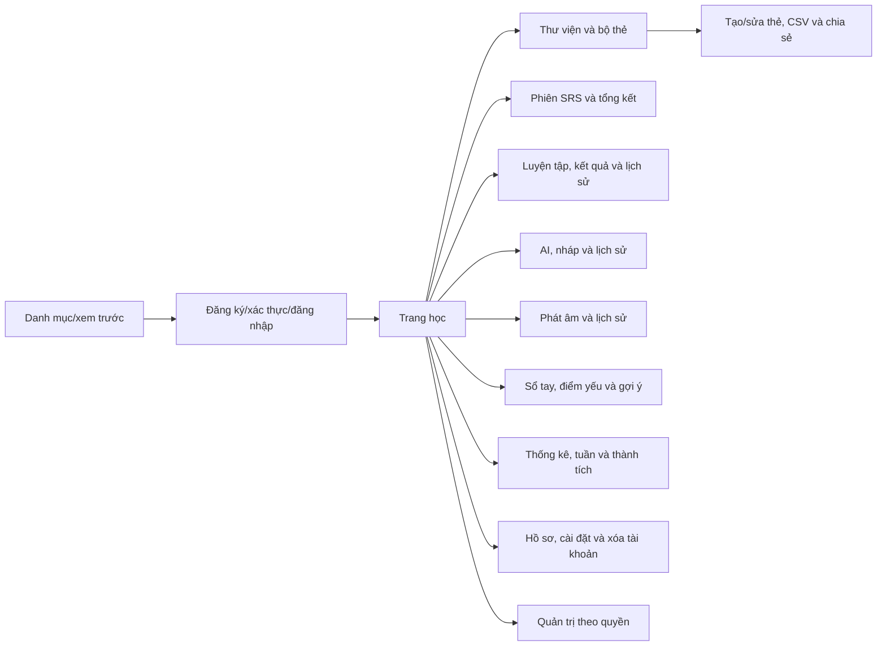

# THIẾT KẾ GIAO DIỆN NGƯỜI DÙNG

**Tên đề tài:** Xây dựng website học từ vựng tiếng Anh ứng dụng ôn tập ngắt quãng và hỗ trợ trí tuệ nhân tạo.

## THÔNG TIN DỰ ÁN

| Mục | Thông tin |
| --- | --- |
| Dự án viết tắt | VocabLearning — tên quy ước |
| Tên dự án | Xây dựng website học từ vựng tiếng Anh ứng dụng ôn tập ngắt quãng và hỗ trợ trí tuệ nhân tạo |
| Ngày bắt đầu | 28/09/2026 |
| Ngày kết thúc | 14/12/2026 |
| Thời gian thực hiện | 2,5 tháng; 78 ngày lịch tính cả hai đầu mốc |
| Nơi thực hiện | Khoa Công nghệ thông tin |
| Giảng viên hướng dẫn | Lương Thị Thu Phương |
| Email/điện thoại giảng viên | Chưa cung cấp; không dùng thông tin của giảng viên trong mẫu |
| Đại diện nhóm | Huỳnh Gia Pho |
| Chủ sở hữu sản phẩm | Đề xuất nhóm trưởng điều phối yêu cầu; cả nhóm thống nhất với giảng viên |
| Quản lý dự án | Huỳnh Gia Pho — nhóm trưởng; vai trò tổ chức phát triển được mô tả trong kế hoạch |
| Liên hệ nhóm | Email/điện thoại chưa cung cấp |

### Thành viên trong đội

| TT | Họ và tên | Mã số sinh viên | Lớp | Vai trò |
| --- | --- | --- | --- | --- |
| 1 | Huỳnh Gia Pho | 28211152416 | K28TPM5 | Nhóm trưởng |
| 2 | Phạm Ngọc Thái | 28211106637 | K28TPM10 | Thành viên |
| 3 | Nguyễn Đình Nhật Quân | 28211100097 | K28TPM10 | Thành viên |
| 4 | Lê Hữu Thảo | 28212241493 | K28TPM9 | Thành viên |
| 5 | Trần Văn Màu | 28212306184 | K28TPM24 | Thành viên |

## THÔNG TIN TÀI LIỆU

| Mục | Nội dung |
| --- | --- |
| Tên dự án | Xây dựng website học từ vựng tiếng Anh ứng dụng ôn tập ngắt quãng và hỗ trợ trí tuệ nhân tạo |
| Tiêu đề tài liệu | Thiết kế giao diện người dùng |
| Mã tài liệu | SCI_SE_5 |
| Người thực hiện | Nhóm Huỳnh Gia Pho |
| Phiên bản | 1.1 |
| Ngày lập | 26/09/2026 |
| Trạng thái | Bản thiết kế và kế hoạch; chưa ghi nhận phê duyệt hay kết quả kiểm thử thực tế |
| Ngôn ngữ | Tiếng Việt; giữ tên công nghệ, ID, API, SQL và các tên kỹ thuật cần thiết |
| Quy ước dữ liệu | Tên bảng/cột tiếng Việt không dấu dạng nguoi_dung, bo_the, trang_thai; giữ id, email, password_hash, created_at, updated_at, ipa, slug và kiểu SQL |

## LỊCH SỬ CHỈNH SỬA TÀI LIỆU

| Phiên bản | Người chỉnh sửa | Ngày | Ghi chú |
| --- | --- | --- | --- |
| 1.0 | Nhóm thực hiện | 26/09/2026 | Lập đầy đủ nội dung theo mẫu; đối chiếu 111 mục chức năng và 12 yêu cầu phi chức năng |
| 1.1 | Nhóm thực hiện | 26/09/2026 | Đồng bộ giữa các tài liệu: giao diện JavaScript; đường dẫn trang tiếng Việt; tên VocabLearning và CSDL `vocab_learning`; QT-02 sang đợt 2; tiêu chí ghi nhớ và ngưỡng sổ tay thống nhất; sửa tên kỹ thuật bị đổi nhầm; phân bổ giờ theo người |

## PHÊ DUYỆT TÀI LIỆU

| Vai trò | Họ tên | Chữ ký | Ngày |
| --- | --- | --- | --- |
| Giảng viên hướng dẫn | Lương Thị Thu Phương | Chưa ký | Chưa xác nhận |
| Nhóm trưởng | Huỳnh Gia Pho | Chưa ký | Chưa xác nhận |
| Thành viên | Phạm Ngọc Thái | Chưa ký | Chưa xác nhận |
| Thành viên | Nguyễn Đình Nhật Quân | Chưa ký | Chưa xác nhận |
| Thành viên | Lê Hữu Thảo | Chưa ký | Chưa xác nhận |
| Thành viên | Trần Văn Màu | Chưa ký | Chưa xác nhận |

## MỤC LỤC

  - Thành viên trong đội
- 1. SƠ ĐỒ LIÊN KẾT GIAO DIỆN
  - 1.1. Quy tắc giao diện chung
  - 1.2. Trạng thái chung
  - 1.3. Truy cập và bàn phím
- 2. THIẾT KẾ GIAO DIỆN
  - 2.1. Giao diện Đăng ký
  - 2.2. Giao diện Xác thực email
  - 2.3. Giao diện Đăng nhập
  - 2.4. Giao diện Quên và đặt lại mật khẩu
  - 2.5. Giao diện Hồ sơ
  - 2.6. Giao diện Thiết lập học và nhắc
  - 2.7. Giao diện Xóa tài khoản
  - 2.8. Giao diện Danh mục và thư viện
  - 2.9. Giao diện Chi tiết/xem trước bộ
  - 2.10. Giao diện Tạo và sửa bộ
  - 2.11. Giao diện Danh sách thẻ
  - 2.12. Giao diện Tạo và sửa thẻ
  - 2.13. Giao diện Nhập/xuất CSV và chia sẻ
  - 2.14. Giao diện Bộ nội dung theo chủ đề
  - 2.15. Giao diện Trang học và hàng đợi
  - 2.16. Giao diện Phiên lật thẻ
  - 2.17. Giao diện Tổng kết phiên
  - 2.18. Giao diện Quản lý tiến độ và học lại sau nghỉ
  - 2.19. Giao diện Chọn bài luyện/kiểm tra
  - 2.20. Giao diện Làm bài luyện
  - 2.21. Giao diện Kết quả bài luyện
  - 2.22. Giao diện Lịch sử bài làm
  - 2.23. Giao diện Tạo thẻ AI từ đoạn văn
  - 2.24. Giao diện Duyệt và lưu thẻ AI
  - 2.25. Giao diện Trợ lý ngữ cảnh và luyện AI
  - 2.26. Giao diện Lịch sử AI và hội thoại mở rộng
  - 2.27. Giao diện Sổ tay từ khó
  - 2.28. Giao diện Hồ sơ điểm yếu và làm chủ
  - 2.29. Giao diện Cặp từ nhầm và lý do gợi ý
  - 2.30. Giao diện Thống kê tiến độ
  - 2.31. Giao diện Báo cáo tuần và hoạt động
  - 2.32. Giao diện Điểm và huy hiệu
  - 2.33. Giao diện Thử thách ngày/tuần
  - 2.34. Giao diện Thông báo trong ứng dụng
  - 2.35. Giao diện Ghi âm luyện phát âm
  - 2.36. Giao diện Kết quả và lịch sử phát âm
  - 2.37. Giao diện Quản trị tài khoản và quyền
  - 2.38. Giao diện Quản trị nội dung mẫu
  - 2.39. Giao diện Kiểm duyệt báo cáo
  - 2.40. Giao diện Hạn mức và chi phí API
  - 2.41. Giao diện Thống kê sử dụng và thông báo hệ thống
  - 2.42. Giao diện Nhật ký quản trị
- PHỤ LỤC A — CẤU TRÚC NEXT.JS VÀ TƯƠNG TÁC
  - Thiết kế giao diện người dùng
- PHỤ LỤC B — API CHO GIAO DIỆN
  - Đặc tả API

## 1. SƠ ĐỒ LIÊN KẾT GIAO DIỆN
Khách đi từ danh mục đến xem trước/đăng ký; người học vào trang học, thư viện, luyện tập, AI, sổ tay, thống kê và phát âm; quản trị vào vùng riêng theo quyền. Menu chỉ ẩn nút không đủ quyền để hỗ trợ trải nghiệm, quyền thật vẫn ở Spring Boot. Đường dẫn dưới đây là giao diện đề xuất; ID động lấy từ API dạng chuỗi.


| Mã UI | Tên | Đường dẫn | Ý nghĩa |
| --- | --- | --- | --- |
| UI01 | Đăng ký | /dang-ky | Tạo tài khoản và chuyển sang chờ xác thực |
| UI02 | Xác thực email | /xac-thuc-email | Thông báo đã xác thực, mở đăng nhập |
| UI03 | Đăng nhập | /dang-nhap | Tạo phiên và về trang học |
| UI04 | Quên và đặt lại mật khẩu | /quen-mat-khau và /dat-lai-mat-khau | Thông báo chung khi gửi; đổi xong thu hồi phiên |
| UI05 | Hồ sơ | /ho-so | Lưu và hiển thị hồ sơ mới; đăng xuất thu hồi phiên |
| UI06 | Thiết lập học và nhắc | /cai-dat | Cập nhật mục tiêu và lịch nhắc tương lai |
| UI07 | Xóa tài khoản | /cai-dat/xoa-tai-khoan | Khóa học ngay, hiển thị mốc và tiến trình xóa |
| UI08 | Danh mục và thư viện | /thu-vien | Danh sách đúng quyền và nguồn rõ |
| UI09 | Chi tiết/xem trước bộ | /bo-the/[id] | Chuyển đúng luồng; bản sao riêng tư độc lập |
| UI10 | Tạo và sửa bộ | /bo-the/moi và /bo-the/[id]/sua | Bộ được lưu; công khai hiện chờ kiểm duyệt |
| UI11 | Danh sách thẻ | /bo-the/[id]/the | Danh sách cập nhật, lịch sử vẫn giữ |
| UI12 | Tạo và sửa thẻ | /bo-the/[id]/the/moi và /the/[id]/sua | Lưu một nghĩa mục tiêu; cảnh báo từ trùng cụ thể |
| UI13 | Nhập/xuất CSV và chia sẻ | /bo-the/[id]/du-lieu | Theo dõi lần nhập và kết quả; liên kết không vượt quyền |
| UI14 | Bộ nội dung theo chủ đề | /kham-pha | Chọn được nội dung đã duyệt phù hợp |
| UI15 | Trang học và hàng đợi | /hoc | Hàng đợi và hạn mức do máy chủ quyết định |
| UI16 | Phiên lật thẻ | /hoc/phien/[id] | Ghi một lượt và chuyển thẻ sau xác nhận |
| UI17 | Tổng kết phiên | /hoc/phien/[id]/tong-ket | Tổng kết đúng dữ liệu đã xác nhận |
| UI18 | Quản lý tiến độ và học lại sau nghỉ | /tien-do | Giữ lịch sử, tạo giai đoạn mới khi đặt lại |
| UI19 | Chọn bài luyện/kiểm tra | /luyen-tap | Đề cố định đủ số câu khả dụng, không lộ đáp án |
| UI20 | Làm bài luyện | /luyen-tap/lan-lam/[id] | Bài khóa sau nộp; chấm cố định ngay, AI có trạng thái riêng |
| UI21 | Kết quả bài luyện | /luyen-tap/lan-lam/[id]/ket-qua | Tạo lần làm mới, giữ lịch sử cũ |
| UI22 | Lịch sử bài làm | /luyen-tap/lich-su | Dữ liệu thuộc người dùng, lần mới truy vết lần cũ |
| UI23 | Tạo thẻ AI từ đoạn văn | /ai/tao-the | Trả mã tác vụ, nháp sau kiểm tra đầu ra |
| UI24 | Duyệt và lưu thẻ AI | /ai/yeu-cau/[id]/the-nhap | Chỉ thẻ đã chọn được ghi một lần |
| UI25 | Trợ lý ngữ cảnh và luyện AI | /ai/tro-ly | Kết quả và câu gốc tách biệt; bài có đáp án kiểm tra trước dùng |
| UI26 | Lịch sử AI và hội thoại mở rộng | /ai/lich-su và /ai/hoi-thoai | Lịch sử có quyền, nội dung hết hạn được nêu rõ |
| UI27 | Sổ tay từ khó | /so-tay | Một mục mỗi người/thẻ, tạo bài từ từ được chọn |
| UI28 | Hồ sơ điểm yếu và làm chủ | /diem-yeu | Điểm theo kỹ năng; chưa đủ mẫu được ghi rõ |
| UI29 | Cặp từ nhầm và lý do gợi ý | /goi-y | Không dùng thẻ tạm ngưng, có quy tắc phiên bản |
| UI30 | Thống kê tiến độ | /thong-ke | Mẫu số/số mẫu rõ, thống kê cùng phạm vi |
| UI31 | Báo cáo tuần và hoạt động | /bao-cao-tuan | Báo cáo lưu phiên bản, chưa học có trạng thái rõ |
| UI32 | Điểm và huy hiệu | /thanh-tich | Thưởng có giới hạn, cấp duy nhất |
| UI33 | Thử thách ngày/tuần | /thu-thach | Tiến độ đúng kỳ, thưởng một lần |
| UI34 | Thông báo trong ứng dụng | /thong-bao | Điều hướng đúng quyền; trạng thái đọc lưu |
| UI35 | Ghi âm luyện phát âm | /phat-am | Tác vụ đánh giá có trạng thái; chưa gửi không gọi API |
| UI36 | Kết quả và lịch sử phát âm | /phat-am/lich-su | Điểm thực nhận, bản ghi xóa có trạng thái |
| UI37 | Quản trị tài khoản và quyền | /quan-tri/tai-khoan | Thu hồi phiên theo thay đổi, có nhật ký |
| UI38 | Quản trị nội dung mẫu | /quan-tri/noi-dung | Nhãn ADMIN chỉ quản trị, nội dung có quyền nguồn |
| UI39 | Kiểm duyệt báo cáo | /quan-tri/bao-cao | Lưu quyết định và người xử lý, có nhật ký |
| UI40 | Hạn mức và chi phí API | /quan-tri/ai | Có phiên bản/ngày hiệu lực, không lộ khóa |
| UI41 | Thống kê sử dụng và thông báo hệ thống | /quan-tri/tong-quan | Đếm người hoạt động thực, phát hành một lần |
| UI42 | Nhật ký quản trị | /quan-tri/nhat-ky | Chỉ đọc, không có nút sửa/xóa thông thường |


### 1.1. Quy tắc giao diện chung
Tiếng Việt cho nhãn, lỗi, phản hồi và chỉ dẫn. Phông giao diện dễ đọc hỗ trợ Unicode; nền sáng, tương phản chữ đạt mục tiêu WCAG AA; nút nguy hiểm có nhãn rõ và xác nhận. Màn hình 360–1440 px dùng bố cục co giãn; menu thành ngăn kéo trên điện thoại; bảng nhiều cột đổi thành thẻ hoặc cuộn trong vùng bảng, không làm toàn trang tràn ngang. Không chỉ dùng màu để biểu thị đúng/sai, độ khó hay hoạt động. Không cần đưa tên bảng, mã lỗi kỹ thuật hay chi phí nội bộ vào luồng người học.
### 1.2. Trạng thái chung
Tải: hiển thị bộ khung/chỉ báo và khóa nút đang gửi; rỗng: nói chưa có dữ liệu/kết quả, có hành động tạo/chọn; lỗi: thông báo tiếng Việt, giữ đầu vào hợp lệ và nút thử lại; thành công: xác nhận và cập nhật dữ liệu sau máy chủ. 401 đưa đăng nhập và giữ đường dẫn quay lại; 403/404 không lộ tài nguyên; 409/412 cho tải phiên bản mới; 429 nêu thời điểm thử lại; 503 nêu dịch vụ tạm lỗi. Không coi tác vụ 202 là hoàn thành.
### 1.3. Truy cập và bàn phím
Nhãn liên kết ô nhập, thông báo lỗi gắn trường và có vùng thông báo đọc được; Tab theo thứ tự; focus về phần lỗi đầu tiên; hộp thoại giữ focus rồi trả về nút mở; các biểu đồ có bảng dữ liệu/diễn giải. Space/1–4 cho học chỉ hoạt động khi không nhập văn bản. Audio không tự chồng; ghi âm có xin quyền và mô tả thời lượng. Bảo toàn đầu vào khi mất mạng; kết quả chưa được xác nhận không tăng tiến độ tại máy chủ.
## 2. THIẾT KẾ GIAO DIỆN

### 2.1. Giao diện Đăng ký
#### 2.1.1. Bảng mẫu

```text
[Menu]  Đăng ký                         [Hồ sơ/Thông báo]
  email: [email — bắt buộc]
  ten_hien_thi: [text — 2–100 ký tự]
  password: [password — 10–128 ký tự]
  xac_nhan: [password — khớp mật khẩu]
  chap_nhan: [checkbox — đồng ý điều khoản]
  [Đăng ký]
  [Thông báo trạng thái / hướng dẫn / lỗi theo trường]
```

#### 2.1.2. Đặc tả chi tiết

| Mục | Đặc tả |
| --- | --- |
| Màn hình | Đăng ký |
| Mô tả | Tạo tài khoản và chuyển sang chờ xác thực |
| Truy cập | /dang-ky |
| Đối tượng | Khách/người học |
| Yêu cầu liên quan | TK-01, TK-02, TK-03, TK-04, TK-05, TK-06, TK-07, TK-08, TK-09, TK-10, TK-11 |
| Quyền | Kiểm tra phiên/vai trò/quyền tài nguyên ở máy chủ; không dựa menu để cấp quyền |


**Nội dung**

| Mục | Tên trường | Kiểu | Dữ liệu mặc định | Mô tả/ràng buộc |
| --- | --- | --- | --- | --- |
| 1 | email | email | Chưa chọn/để trống khi tạo; nạp giá trị từ API khi sửa | bắt buộc |
| 2 | ten_hien_thi | text | Chưa chọn/để trống khi tạo; nạp giá trị từ API khi sửa | 2–100 ký tự; gửi thành `displayName` |
| 3 | password | password | Chưa chọn/để trống khi tạo; nạp giá trị từ API khi sửa | 10–128 ký tự |
| 4 | xac_nhan | password | Chưa chọn/để trống khi tạo; nạp giá trị từ API khi sửa | khớp mật khẩu |
| 5 | chap_nhan | checkbox | Chưa chọn/để trống khi tạo; nạp giá trị từ API khi sửa | đồng ý điều khoản |


**Hoạt động**

| Tên | Mô tả | Thành công | Thất bại |
| --- | --- | --- | --- |
| Đăng ký | Kiểm tra dữ liệu và gửi thao tác tương ứng theo đặc tả API | Tạo tài khoản và chuyển sang chờ xác thực | Email sai, trùng hoặc mật khẩu không khớp |
| Kiểm tra nhập | Đối chiếu từng ràng buộc bảng trường; máy chủ kiểm tra lại | Cho phép gửi khi hợp lệ | Gắn lỗi trường, giữ dữ liệu hợp lệ |
| Tải/xem lại | Lấy dữ liệu theo ID và quyền hiện tại | Hiển thị dữ liệu và thời điểm cập nhật | Mạng lỗi có thử lại; 403/404 không lộ dữ liệu |
| Gửi lại/đồng thời | Khóa nút khi gửi; dùng mã sự kiện/phiên bản theo tác vụ | Một kết quả duy nhất hoặc trạng thái tác vụ đang chạy | Không ghi đôi; 409/412 hướng dẫn đọc lại |
| Quay lại/đóng | Nếu có thay đổi chưa lưu, hỏi giữ hay bỏ; tác vụ đã gửi xem ở lịch sử | Không mất kết quả đã ghi | Không báo đã lưu nếu máy chủ chưa xác nhận |


**Trạng thái màn hình:** Tải — chỉ báo trong vùng dữ liệu; rỗng — thông báo phù hợp mục đích và hành động tiếp; lỗi — Email sai, trùng hoặc mật khẩu không khớp; thành công — Tạo tài khoản và chuyển sang chờ xác thực. Trên điện thoại, trường xếp một cột và hành động chính luôn có nhãn; bảng kết quả không cắt chữ.

### 2.2. Giao diện Xác thực email
#### 2.2.1. Bảng mẫu

```text
[Menu]  Xác thực email                         [Hồ sơ/Thông báo]
  token: [hidden — mã từ liên kết]
  email: [email — gửi lại khi cần]
  gui_lai: [button — có thời gian chờ]
  [Xác thực, gửi lại]
  [Thông báo trạng thái / hướng dẫn / lỗi theo trường]
```

#### 2.2.2. Đặc tả chi tiết

| Mục | Đặc tả |
| --- | --- |
| Màn hình | Xác thực email |
| Mô tả | Thông báo đã xác thực, mở đăng nhập |
| Truy cập | /xac-thuc-email |
| Đối tượng | Khách/người học |
| Yêu cầu liên quan | TK-01, TK-02, TK-03, TK-04, TK-05, TK-06, TK-07, TK-08, TK-09, TK-10, TK-11 |
| Quyền | Kiểm tra phiên/vai trò/quyền tài nguyên ở máy chủ; không dựa menu để cấp quyền |


**Nội dung**

| Mục | Tên trường | Kiểu | Dữ liệu mặc định | Mô tả/ràng buộc |
| --- | --- | --- | --- | --- |
| 1 | token | hidden | Nạp từ API có quyền; không coi dữ liệu chưa tải là số 0 | mã từ liên kết |
| 2 | email | email | Chưa chọn/để trống khi tạo; nạp giá trị từ API khi sửa | gửi lại khi cần |
| 3 | gui_lai | button | Chưa chọn/để trống khi tạo; nạp giá trị từ API khi sửa | có thời gian chờ |


**Hoạt động**

| Tên | Mô tả | Thành công | Thất bại |
| --- | --- | --- | --- |
| Xác thực, gửi lại | Kiểm tra dữ liệu và gửi thao tác tương ứng theo đặc tả API | Thông báo đã xác thực, mở đăng nhập | Mã hết hạn/đã dùng, giới hạn gửi lại |
| Kiểm tra nhập | Đối chiếu từng ràng buộc bảng trường; máy chủ kiểm tra lại | Cho phép gửi khi hợp lệ | Gắn lỗi trường, giữ dữ liệu hợp lệ |
| Tải/xem lại | Lấy dữ liệu theo ID và quyền hiện tại | Hiển thị dữ liệu và thời điểm cập nhật | Mạng lỗi có thử lại; 403/404 không lộ dữ liệu |
| Gửi lại/đồng thời | Khóa nút khi gửi; dùng mã sự kiện/phiên bản theo tác vụ | Một kết quả duy nhất hoặc trạng thái tác vụ đang chạy | Không ghi đôi; 409/412 hướng dẫn đọc lại |
| Quay lại/đóng | Nếu có thay đổi chưa lưu, hỏi giữ hay bỏ; tác vụ đã gửi xem ở lịch sử | Không mất kết quả đã ghi | Không báo đã lưu nếu máy chủ chưa xác nhận |


**Trạng thái màn hình:** Tải — chỉ báo trong vùng dữ liệu; rỗng — thông báo phù hợp mục đích và hành động tiếp; lỗi — Mã hết hạn/đã dùng, giới hạn gửi lại; thành công — Thông báo đã xác thực, mở đăng nhập. Trên điện thoại, trường xếp một cột và hành động chính luôn có nhãn; bảng kết quả không cắt chữ.

### 2.3. Giao diện Đăng nhập
#### 2.3.1. Bảng mẫu

```text
[Menu]  Đăng nhập                         [Hồ sơ/Thông báo]
  email: [email — bắt buộc]
  password: [password — bắt buộc]
  google: [button — OIDC]
  facebook: [button — mở rộng]
  quen_mat_khau: [link — điều hướng]
  [Đăng nhập email/Google/Facebook]
  [Thông báo trạng thái / hướng dẫn / lỗi theo trường]
```

#### 2.3.2. Đặc tả chi tiết

| Mục | Đặc tả |
| --- | --- |
| Màn hình | Đăng nhập |
| Mô tả | Tạo phiên và về trang học |
| Truy cập | /dang-nhap |
| Đối tượng | Khách/người học |
| Yêu cầu liên quan | TK-01, TK-02, TK-03, TK-04, TK-05, TK-06, TK-07, TK-08, TK-09, TK-10, TK-11 |
| Quyền | Kiểm tra phiên/vai trò/quyền tài nguyên ở máy chủ; không dựa menu để cấp quyền |


**Nội dung**

| Mục | Tên trường | Kiểu | Dữ liệu mặc định | Mô tả/ràng buộc |
| --- | --- | --- | --- | --- |
| 1 | email | email | Chưa chọn/để trống khi tạo; nạp giá trị từ API khi sửa | bắt buộc |
| 2 | password | password | Chưa chọn/để trống khi tạo; nạp giá trị từ API khi sửa | bắt buộc |
| 3 | google | button | Chưa chọn/để trống khi tạo; nạp giá trị từ API khi sửa | OIDC |
| 4 | facebook | button | Chưa chọn/để trống khi tạo; nạp giá trị từ API khi sửa | mở rộng |
| 5 | quen_mat_khau | link | Chưa chọn/để trống khi tạo; nạp giá trị từ API khi sửa | điều hướng |


**Hoạt động**

| Tên | Mô tả | Thành công | Thất bại |
| --- | --- | --- | --- |
| Đăng nhập email/Google/Facebook | Kiểm tra dữ liệu và gửi thao tác tương ứng theo đặc tả API | Tạo phiên và về trang học | Sai thông tin, khóa, chưa xác thực, nhà cung cấp lỗi |
| Kiểm tra nhập | Đối chiếu từng ràng buộc bảng trường; máy chủ kiểm tra lại | Cho phép gửi khi hợp lệ | Gắn lỗi trường, giữ dữ liệu hợp lệ |
| Tải/xem lại | Lấy dữ liệu theo ID và quyền hiện tại | Hiển thị dữ liệu và thời điểm cập nhật | Mạng lỗi có thử lại; 403/404 không lộ dữ liệu |
| Gửi lại/đồng thời | Khóa nút khi gửi; dùng mã sự kiện/phiên bản theo tác vụ | Một kết quả duy nhất hoặc trạng thái tác vụ đang chạy | Không ghi đôi; 409/412 hướng dẫn đọc lại |
| Quay lại/đóng | Nếu có thay đổi chưa lưu, hỏi giữ hay bỏ; tác vụ đã gửi xem ở lịch sử | Không mất kết quả đã ghi | Không báo đã lưu nếu máy chủ chưa xác nhận |


**Trạng thái màn hình:** Tải — chỉ báo trong vùng dữ liệu; rỗng — thông báo phù hợp mục đích và hành động tiếp; lỗi — Sai thông tin, khóa, chưa xác thực, nhà cung cấp lỗi; thành công — Tạo phiên và về trang học. Trên điện thoại, trường xếp một cột và hành động chính luôn có nhãn; bảng kết quả không cắt chữ.

### 2.4. Giao diện Quên và đặt lại mật khẩu
#### 2.4.1. Bảng mẫu

```text
[Menu]  Quên và đặt lại mật khẩu                         [Hồ sơ/Thông báo]
  email: [email — yêu cầu mã]
  token: [hidden — mã liên kết]
  mat_khau_moi: [password — 10–128 ký tự]
  xac_nhan: [password — khớp]
  [Gửi email, đặt lại]
  [Thông báo trạng thái / hướng dẫn / lỗi theo trường]
```

#### 2.4.2. Đặc tả chi tiết

| Mục | Đặc tả |
| --- | --- |
| Màn hình | Quên và đặt lại mật khẩu |
| Mô tả | Thông báo chung khi gửi; đổi xong thu hồi phiên |
| Truy cập | /quen-mat-khau và /dat-lai-mat-khau |
| Đối tượng | Khách/người học |
| Yêu cầu liên quan | TK-01, TK-02, TK-03, TK-04, TK-05, TK-06, TK-07, TK-08, TK-09, TK-10, TK-11 |
| Quyền | Kiểm tra phiên/vai trò/quyền tài nguyên ở máy chủ; không dựa menu để cấp quyền |


**Nội dung**

| Mục | Tên trường | Kiểu | Dữ liệu mặc định | Mô tả/ràng buộc |
| --- | --- | --- | --- | --- |
| 1 | email | email | Chưa chọn/để trống khi tạo; nạp giá trị từ API khi sửa | yêu cầu mã |
| 2 | token | hidden | Nạp từ API có quyền; không coi dữ liệu chưa tải là số 0 | mã liên kết |
| 3 | mat_khau_moi | password | Chưa chọn/để trống khi tạo; nạp giá trị từ API khi sửa | 10–128 ký tự |
| 4 | xac_nhan | password | Chưa chọn/để trống khi tạo; nạp giá trị từ API khi sửa | khớp |


**Hoạt động**

| Tên | Mô tả | Thành công | Thất bại |
| --- | --- | --- | --- |
| Gửi email, đặt lại | Kiểm tra dữ liệu và gửi thao tác tương ứng theo đặc tả API | Thông báo chung khi gửi; đổi xong thu hồi phiên | Mã sai/hết hạn/đã dùng, mật khẩu không khớp |
| Kiểm tra nhập | Đối chiếu từng ràng buộc bảng trường; máy chủ kiểm tra lại | Cho phép gửi khi hợp lệ | Gắn lỗi trường, giữ dữ liệu hợp lệ |
| Tải/xem lại | Lấy dữ liệu theo ID và quyền hiện tại | Hiển thị dữ liệu và thời điểm cập nhật | Mạng lỗi có thử lại; 403/404 không lộ dữ liệu |
| Gửi lại/đồng thời | Khóa nút khi gửi; dùng mã sự kiện/phiên bản theo tác vụ | Một kết quả duy nhất hoặc trạng thái tác vụ đang chạy | Không ghi đôi; 409/412 hướng dẫn đọc lại |
| Quay lại/đóng | Nếu có thay đổi chưa lưu, hỏi giữ hay bỏ; tác vụ đã gửi xem ở lịch sử | Không mất kết quả đã ghi | Không báo đã lưu nếu máy chủ chưa xác nhận |


**Trạng thái màn hình:** Tải — chỉ báo trong vùng dữ liệu; rỗng — thông báo phù hợp mục đích và hành động tiếp; lỗi — Mã sai/hết hạn/đã dùng, mật khẩu không khớp; thành công — Thông báo chung khi gửi; đổi xong thu hồi phiên. Trên điện thoại, trường xếp một cột và hành động chính luôn có nhãn; bảng kết quả không cắt chữ.

### 2.5. Giao diện Hồ sơ
#### 2.5.1. Bảng mẫu

```text
[Menu]  Hồ sơ                         [Hồ sơ/Thông báo]
  ten: [text — 2–100 ký tự]
  gioi_thieu: [textarea — tối đa 500 ký tự]
  anh: [file — JPEG/PNG/WebP <=5 MB]
  email: [readonly — không sửa tùy tiện]
  chuoi_ngay: [readonly — chuỗi hiện tại/dài nhất (TK-10)]
  hoat_dong: [list — lịch sử hoạt động theo ngày địa phương (TK-10)]
  [Lưu hồ sơ, thay ảnh, đăng xuất]
  [Thông báo trạng thái / hướng dẫn / lỗi theo trường]
```

#### 2.5.2. Đặc tả chi tiết

| Mục | Đặc tả |
| --- | --- |
| Màn hình | Hồ sơ |
| Mô tả | Lưu và hiển thị hồ sơ mới; đăng xuất thu hồi phiên |
| Truy cập | /ho-so |
| Đối tượng | Người học |
| Yêu cầu liên quan | TK-01, TK-02, TK-03, TK-04, TK-05, TK-06, TK-07, TK-08, TK-09, TK-10, TK-11 |
| Quyền | Kiểm tra phiên/vai trò/quyền tài nguyên ở máy chủ; không dựa menu để cấp quyền |


**Nội dung**

| Mục | Tên trường | Kiểu | Dữ liệu mặc định | Mô tả/ràng buộc |
| --- | --- | --- | --- | --- |
| 1 | ten | text | Chưa chọn/để trống khi tạo; nạp giá trị từ API khi sửa | 2–100 ký tự |
| 2 | gioi_thieu | textarea | Chưa chọn/để trống khi tạo; nạp giá trị từ API khi sửa | tối đa 500 ký tự |
| 3 | anh | file | Chưa chọn/để trống khi tạo; nạp giá trị từ API khi sửa | JPEG/PNG/WebP <=5 MB |
| 4 | email | readonly | Nạp từ API có quyền; không coi dữ liệu chưa tải là số 0 | không sửa tùy tiện |
| 5 | chuoi_ngay | readonly | Nạp từ `/users/me/streak`; không coi dữ liệu chưa tải là số 0 | chuỗi hiện tại và dài nhất; cùng nguồn với TKH-05, DL-04 |
| 6 | hoat_dong | list | Nạp từ `/users/me/activity` có phân trang | theo ngày địa phương; chưa có ON/LT thì hiện "Chưa có dữ liệu" |


**Hoạt động**

| Tên | Mô tả | Thành công | Thất bại |
| --- | --- | --- | --- |
| Lưu hồ sơ, thay ảnh, đăng xuất | Kiểm tra dữ liệu và gửi thao tác tương ứng theo đặc tả API | Lưu và hiển thị hồ sơ mới; đăng xuất thu hồi phiên | Ảnh lỗi/quá lớn, tên rỗng, phiên hết hạn |
| Kiểm tra nhập | Đối chiếu từng ràng buộc bảng trường; máy chủ kiểm tra lại | Cho phép gửi khi hợp lệ | Gắn lỗi trường, giữ dữ liệu hợp lệ |
| Tải/xem lại | Lấy dữ liệu theo ID và quyền hiện tại | Hiển thị dữ liệu và thời điểm cập nhật | Mạng lỗi có thử lại; 403/404 không lộ dữ liệu |
| Gửi lại/đồng thời | Khóa nút khi gửi; dùng mã sự kiện/phiên bản theo tác vụ | Một kết quả duy nhất hoặc trạng thái tác vụ đang chạy | Không ghi đôi; 409/412 hướng dẫn đọc lại |
| Quay lại/đóng | Nếu có thay đổi chưa lưu, hỏi giữ hay bỏ; tác vụ đã gửi xem ở lịch sử | Không mất kết quả đã ghi | Không báo đã lưu nếu máy chủ chưa xác nhận |


**Trạng thái màn hình:** Tải — chỉ báo trong vùng dữ liệu; rỗng — thông báo phù hợp mục đích và hành động tiếp; lỗi — Ảnh lỗi/quá lớn, tên rỗng, phiên hết hạn; thành công — Lưu và hiển thị hồ sơ mới; đăng xuất thu hồi phiên. Trên điện thoại, trường xếp một cột và hành động chính luôn có nhãn; bảng kết quả không cắt chữ.

### 2.6. Giao diện Thiết lập học và nhắc
#### 2.6.1. Bảng mẫu

```text
[Menu]  Thiết lập học và nhắc                         [Hồ sơ/Thông báo]
  trinh_do: [select — A1–C2 khi hoàn tất]
  muc_tieu: [textarea — <=500 ký tự]
  chu_de: [multiselect — đang hoạt động]
  tu_moi: [number — 0–100]
  phut: [number — 1–240]
  gio_nhac: [time — HH:mm]
  mui_gio: [select — IANA]
  email_nhac: [checkbox — tùy chọn]
  thong_bao: [checkbox — tùy chọn]
  [Lưu thiết lập]
  [Thông báo trạng thái / hướng dẫn / lỗi theo trường]
```

#### 2.6.2. Đặc tả chi tiết

| Mục | Đặc tả |
| --- | --- |
| Màn hình | Thiết lập học và nhắc |
| Mô tả | Cập nhật mục tiêu và lịch nhắc tương lai |
| Truy cập | /cai-dat |
| Đối tượng | Người học |
| Yêu cầu liên quan | TK-01, TK-02, TK-03, TK-04, TK-05, TK-06, TK-07, TK-08, TK-09, TK-10, TK-11 |
| Quyền | Kiểm tra phiên/vai trò/quyền tài nguyên ở máy chủ; không dựa menu để cấp quyền |


**Nội dung**

| Mục | Tên trường | Kiểu | Dữ liệu mặc định | Mô tả/ràng buộc |
| --- | --- | --- | --- | --- |
| 1 | trinh_do | select | Chưa chọn/để trống khi tạo; nạp giá trị từ API khi sửa | A1–C2 khi hoàn tất |
| 2 | muc_tieu | textarea | Chưa chọn/để trống khi tạo; nạp giá trị từ API khi sửa | <=500 ký tự |
| 3 | chu_de | multiselect | Chưa chọn/để trống khi tạo; nạp giá trị từ API khi sửa | đang hoạt động |
| 4 | tu_moi | number | Chưa chọn/để trống khi tạo; nạp giá trị từ API khi sửa | 0–100 |
| 5 | phut | number | Chưa chọn/để trống khi tạo; nạp giá trị từ API khi sửa | 1–240 |
| 6 | gio_nhac | time | Chưa chọn/để trống khi tạo; nạp giá trị từ API khi sửa | HH:mm |
| 7 | mui_gio | select | Chưa chọn/để trống khi tạo; nạp giá trị từ API khi sửa | IANA |
| 8 | email_nhac | checkbox | Chưa chọn/để trống khi tạo; nạp giá trị từ API khi sửa | tùy chọn |
| 9 | thong_bao | checkbox | Chưa chọn/để trống khi tạo; nạp giá trị từ API khi sửa | tùy chọn |


**Hoạt động**

| Tên | Mô tả | Thành công | Thất bại |
| --- | --- | --- | --- |
| Lưu thiết lập | Kiểm tra dữ liệu và gửi thao tác tương ứng theo đặc tả API | Cập nhật mục tiêu và lịch nhắc tương lai | Giá trị ngoài khoảng, múi giờ lạ, xung đột phiên bản |
| Kiểm tra nhập | Đối chiếu từng ràng buộc bảng trường; máy chủ kiểm tra lại | Cho phép gửi khi hợp lệ | Gắn lỗi trường, giữ dữ liệu hợp lệ |
| Tải/xem lại | Lấy dữ liệu theo ID và quyền hiện tại | Hiển thị dữ liệu và thời điểm cập nhật | Mạng lỗi có thử lại; 403/404 không lộ dữ liệu |
| Gửi lại/đồng thời | Khóa nút khi gửi; dùng mã sự kiện/phiên bản theo tác vụ | Một kết quả duy nhất hoặc trạng thái tác vụ đang chạy | Không ghi đôi; 409/412 hướng dẫn đọc lại |
| Quay lại/đóng | Nếu có thay đổi chưa lưu, hỏi giữ hay bỏ; tác vụ đã gửi xem ở lịch sử | Không mất kết quả đã ghi | Không báo đã lưu nếu máy chủ chưa xác nhận |


**Trạng thái màn hình:** Tải — chỉ báo trong vùng dữ liệu; rỗng — thông báo phù hợp mục đích và hành động tiếp; lỗi — Giá trị ngoài khoảng, múi giờ lạ, xung đột phiên bản; thành công — Cập nhật mục tiêu và lịch nhắc tương lai. Trên điện thoại, trường xếp một cột và hành động chính luôn có nhãn; bảng kết quả không cắt chữ.

### 2.7. Giao diện Xóa tài khoản
#### 2.7.1. Bảng mẫu

```text
[Menu]  Xóa tài khoản                         [Hồ sơ/Thông báo]
  xac_thuc_lai: [password/OIDC — theo phương thức]
  chap_nhan: [checkbox — xác nhận hậu quả]
  trang_thai: [readonly — tiến trình]
  huy: [button — trong 7 ngày trước xử lý]
  [Yêu cầu/hủy xóa]
  [Thông báo trạng thái / hướng dẫn / lỗi theo trường]
```

#### 2.7.2. Đặc tả chi tiết

| Mục | Đặc tả |
| --- | --- |
| Màn hình | Xóa tài khoản |
| Mô tả | Khóa học ngay, hiển thị mốc và tiến trình xóa |
| Truy cập | /cai-dat/xoa-tai-khoan |
| Đối tượng | Người học |
| Yêu cầu liên quan | TK-01, TK-02, TK-03, TK-04, TK-05, TK-06, TK-07, TK-08, TK-09, TK-10, TK-11 |
| Quyền | Kiểm tra phiên/vai trò/quyền tài nguyên ở máy chủ; không dựa menu để cấp quyền |


**Nội dung**

| Mục | Tên trường | Kiểu | Dữ liệu mặc định | Mô tả/ràng buộc |
| --- | --- | --- | --- | --- |
| 1 | xac_thuc_lai | password/OIDC | Chưa chọn/để trống khi tạo; nạp giá trị từ API khi sửa | theo phương thức |
| 2 | chap_nhan | checkbox | Chưa chọn/để trống khi tạo; nạp giá trị từ API khi sửa | xác nhận hậu quả |
| 3 | trang_thai | readonly | Nạp từ API có quyền; không coi dữ liệu chưa tải là số 0 | tiến trình |
| 4 | huy | button | Chưa chọn/để trống khi tạo; nạp giá trị từ API khi sửa | trong 7 ngày trước xử lý |


**Hoạt động**

| Tên | Mô tả | Thành công | Thất bại |
| --- | --- | --- | --- |
| Yêu cầu/hủy xóa | Kiểm tra dữ liệu và gửi thao tác tương ứng theo đặc tả API | Khóa học ngay, hiển thị mốc và tiến trình xóa | Sai xác thực, đã bắt đầu xóa không cho hủy |
| Kiểm tra nhập | Đối chiếu từng ràng buộc bảng trường; máy chủ kiểm tra lại | Cho phép gửi khi hợp lệ | Gắn lỗi trường, giữ dữ liệu hợp lệ |
| Tải/xem lại | Lấy dữ liệu theo ID và quyền hiện tại | Hiển thị dữ liệu và thời điểm cập nhật | Mạng lỗi có thử lại; 403/404 không lộ dữ liệu |
| Gửi lại/đồng thời | Khóa nút khi gửi; dùng mã sự kiện/phiên bản theo tác vụ | Một kết quả duy nhất hoặc trạng thái tác vụ đang chạy | Không ghi đôi; 409/412 hướng dẫn đọc lại |
| Quay lại/đóng | Nếu có thay đổi chưa lưu, hỏi giữ hay bỏ; tác vụ đã gửi xem ở lịch sử | Không mất kết quả đã ghi | Không báo đã lưu nếu máy chủ chưa xác nhận |


**Trạng thái màn hình:** Tải — chỉ báo trong vùng dữ liệu; rỗng — thông báo phù hợp mục đích và hành động tiếp; lỗi — Sai xác thực, đã bắt đầu xóa không cho hủy; thành công — Khóa học ngay, hiển thị mốc và tiến trình xóa. Trên điện thoại, trường xếp một cột và hành động chính luôn có nhãn; bảng kết quả không cắt chữ.

### 2.8. Giao diện Danh mục và thư viện
#### 2.8.1. Bảng mẫu

```text
[Menu]  Danh mục và thư viện                         [Hồ sơ/Thông báo]
  tu_khoa: [search — tên bộ]
  chu_de: [select — lọc]
  trinh_do: [select — lọc]
  nguon: [select — quản trị/người dùng]
  yeu_thich: [toggle — lọc]
  sap_xep: [select — mới/tên/số thẻ]
  trang: [pagination — tối đa 100]
  [Tìm, lọc, mở, yêu thích]
  [Thông báo trạng thái / hướng dẫn / lỗi theo trường]
```

#### 2.8.2. Đặc tả chi tiết

| Mục | Đặc tả |
| --- | --- |
| Màn hình | Danh mục và thư viện |
| Mô tả | Danh sách đúng quyền và nguồn rõ |
| Truy cập | /thu-vien |
| Đối tượng | Khách/người học |
| Yêu cầu liên quan | BT-01, BT-02, BT-03, BT-04, BT-05, BT-06, BT-07, BT-08, BT-09, BT-10, BT-11, BT-12, ND-01, ND-02, ND-03, ND-04, ND-05, ND-06, ND-07 |
| Quyền | Kiểm tra phiên/vai trò/quyền tài nguyên ở máy chủ; không dựa menu để cấp quyền |


**Nội dung**

| Mục | Tên trường | Kiểu | Dữ liệu mặc định | Mô tả/ràng buộc |
| --- | --- | --- | --- | --- |
| 1 | tu_khoa | search | Chưa chọn/để trống khi tạo; nạp giá trị từ API khi sửa | tên bộ |
| 2 | chu_de | select | Chưa chọn/để trống khi tạo; nạp giá trị từ API khi sửa | lọc |
| 3 | trinh_do | select | Chưa chọn/để trống khi tạo; nạp giá trị từ API khi sửa | lọc |
| 4 | nguon | select | Chưa chọn/để trống khi tạo; nạp giá trị từ API khi sửa | quản trị/người dùng |
| 5 | yeu_thich | toggle | Chưa chọn/để trống khi tạo; nạp giá trị từ API khi sửa | lọc |
| 6 | sap_xep | select | Chưa chọn/để trống khi tạo; nạp giá trị từ API khi sửa | mới/tên/số thẻ |
| 7 | trang | pagination | Chưa chọn/để trống khi tạo; nạp giá trị từ API khi sửa | tối đa 100 |


**Hoạt động**

| Tên | Mô tả | Thành công | Thất bại |
| --- | --- | --- | --- |
| Tìm, lọc, mở, yêu thích | Kiểm tra dữ liệu và gửi thao tác tương ứng theo đặc tả API | Danh sách đúng quyền và nguồn rõ | Mất kết nối, không có kết quả, bộ bị ẩn |
| Kiểm tra nhập | Đối chiếu từng ràng buộc bảng trường; máy chủ kiểm tra lại | Cho phép gửi khi hợp lệ | Gắn lỗi trường, giữ dữ liệu hợp lệ |
| Tải/xem lại | Lấy dữ liệu theo ID và quyền hiện tại | Hiển thị dữ liệu và thời điểm cập nhật | Mạng lỗi có thử lại; 403/404 không lộ dữ liệu |
| Gửi lại/đồng thời | Khóa nút khi gửi; dùng mã sự kiện/phiên bản theo tác vụ | Một kết quả duy nhất hoặc trạng thái tác vụ đang chạy | Không ghi đôi; 409/412 hướng dẫn đọc lại |
| Quay lại/đóng | Nếu có thay đổi chưa lưu, hỏi giữ hay bỏ; tác vụ đã gửi xem ở lịch sử | Không mất kết quả đã ghi | Không báo đã lưu nếu máy chủ chưa xác nhận |


**Trạng thái màn hình:** Tải — chỉ báo trong vùng dữ liệu; rỗng — thông báo phù hợp mục đích và hành động tiếp; lỗi — Mất kết nối, không có kết quả, bộ bị ẩn; thành công — Danh sách đúng quyền và nguồn rõ. Trên điện thoại, trường xếp một cột và hành động chính luôn có nhãn; bảng kết quả không cắt chữ.

### 2.9. Giao diện Chi tiết/xem trước bộ
#### 2.9.1. Bảng mẫu

```text
[Menu]  Chi tiết/xem trước bộ                         [Hồ sơ/Thông báo]
  ten: [readonly — tên bộ]
  mo_ta: [readonly — mô tả]
  so_the: [readonly — thẻ hoạt động]
  nguon: [badge — ADMIN/USER]
  the_mau: [list — tối đa 10 cho khách]
  hanh_dong: [buttons — học/sao chép/sửa theo quyền]
  [Học, sao chép, báo cáo]
  [Thông báo trạng thái / hướng dẫn / lỗi theo trường]
```

#### 2.9.2. Đặc tả chi tiết

| Mục | Đặc tả |
| --- | --- |
| Màn hình | Chi tiết/xem trước bộ |
| Mô tả | Chuyển đúng luồng; bản sao riêng tư độc lập |
| Truy cập | /bo-the/[id] |
| Đối tượng | Khách/người học |
| Yêu cầu liên quan | BT-01, BT-02, BT-03, BT-04, BT-05, BT-06, BT-07, BT-08, BT-09, BT-10, BT-11, BT-12, ND-01, ND-02, ND-03, ND-04, ND-05, ND-06, ND-07 |
| Quyền | Kiểm tra phiên/vai trò/quyền tài nguyên ở máy chủ; không dựa menu để cấp quyền |


**Nội dung**

| Mục | Tên trường | Kiểu | Dữ liệu mặc định | Mô tả/ràng buộc |
| --- | --- | --- | --- | --- |
| 1 | ten | readonly | Nạp từ API có quyền; không coi dữ liệu chưa tải là số 0 | tên bộ |
| 2 | mo_ta | readonly | Nạp từ API có quyền; không coi dữ liệu chưa tải là số 0 | mô tả |
| 3 | so_the | readonly | Nạp từ API có quyền; không coi dữ liệu chưa tải là số 0 | thẻ hoạt động |
| 4 | nguon | badge | Nạp từ API có quyền; không coi dữ liệu chưa tải là số 0 | ADMIN/USER |
| 5 | the_mau | list | Nạp từ API có quyền; không coi dữ liệu chưa tải là số 0 | tối đa 10 cho khách |
| 6 | hanh_dong | buttons | Chưa chọn/để trống khi tạo; nạp giá trị từ API khi sửa | học/sao chép/sửa theo quyền |


**Hoạt động**

| Tên | Mô tả | Thành công | Thất bại |
| --- | --- | --- | --- |
| Học, sao chép, báo cáo | Kiểm tra dữ liệu và gửi thao tác tương ứng theo đặc tả API | Chuyển đúng luồng; bản sao riêng tư độc lập | Không có quyền, bộ bị xóa/ẩn, sao chép lỗi |
| Kiểm tra nhập | Đối chiếu từng ràng buộc bảng trường; máy chủ kiểm tra lại | Cho phép gửi khi hợp lệ | Gắn lỗi trường, giữ dữ liệu hợp lệ |
| Tải/xem lại | Lấy dữ liệu theo ID và quyền hiện tại | Hiển thị dữ liệu và thời điểm cập nhật | Mạng lỗi có thử lại; 403/404 không lộ dữ liệu |
| Gửi lại/đồng thời | Khóa nút khi gửi; dùng mã sự kiện/phiên bản theo tác vụ | Một kết quả duy nhất hoặc trạng thái tác vụ đang chạy | Không ghi đôi; 409/412 hướng dẫn đọc lại |
| Quay lại/đóng | Nếu có thay đổi chưa lưu, hỏi giữ hay bỏ; tác vụ đã gửi xem ở lịch sử | Không mất kết quả đã ghi | Không báo đã lưu nếu máy chủ chưa xác nhận |


**Trạng thái màn hình:** Tải — chỉ báo trong vùng dữ liệu; rỗng — thông báo phù hợp mục đích và hành động tiếp; lỗi — Không có quyền, bộ bị xóa/ẩn, sao chép lỗi; thành công — Chuyển đúng luồng; bản sao riêng tư độc lập. Trên điện thoại, trường xếp một cột và hành động chính luôn có nhãn; bảng kết quả không cắt chữ.

### 2.10. Giao diện Tạo và sửa bộ
#### 2.10.1. Bảng mẫu

```text
[Menu]  Tạo và sửa bộ                         [Hồ sơ/Thông báo]
  ten: [text — 1–150]
  mo_ta: [textarea — <=2000]
  trinh_do: [select — CEFR]
  chu_de: [multiselect — đang hoạt động]
  che_do: [select — PRIVATE/PUBLIC]
  expectedVersion: [hidden — chống ghi đè]
  [Lưu, công khai, riêng tư, xóa]
  [Thông báo trạng thái / hướng dẫn / lỗi theo trường]
```

#### 2.10.2. Đặc tả chi tiết

| Mục | Đặc tả |
| --- | --- |
| Màn hình | Tạo và sửa bộ |
| Mô tả | Bộ được lưu; công khai hiện chờ kiểm duyệt |
| Truy cập | /bo-the/moi và /bo-the/[id]/sua |
| Đối tượng | Người học |
| Yêu cầu liên quan | BT-01, BT-02, BT-03, BT-04, BT-05, BT-06, BT-07, BT-08, BT-09, BT-10, BT-11, BT-12 |
| Quyền | Kiểm tra phiên/vai trò/quyền tài nguyên ở máy chủ; không dựa menu để cấp quyền |


**Nội dung**

| Mục | Tên trường | Kiểu | Dữ liệu mặc định | Mô tả/ràng buộc |
| --- | --- | --- | --- | --- |
| 1 | ten | text | Chưa chọn/để trống khi tạo; nạp giá trị từ API khi sửa | 1–150 |
| 2 | mo_ta | textarea | Chưa chọn/để trống khi tạo; nạp giá trị từ API khi sửa | <=2000 |
| 3 | trinh_do | select | Chưa chọn/để trống khi tạo; nạp giá trị từ API khi sửa | CEFR |
| 4 | chu_de | multiselect | Chưa chọn/để trống khi tạo; nạp giá trị từ API khi sửa | đang hoạt động |
| 5 | che_do | select | Chưa chọn/để trống khi tạo; nạp giá trị từ API khi sửa | PRIVATE/PUBLIC |
| 6 | expectedVersion | hidden | Nạp từ API có quyền; không coi dữ liệu chưa tải là số 0 | chống ghi đè |


**Hoạt động**

| Tên | Mô tả | Thành công | Thất bại |
| --- | --- | --- | --- |
| Lưu, công khai, riêng tư, xóa | Kiểm tra dữ liệu và gửi thao tác tương ứng theo đặc tả API | Bộ được lưu; công khai hiện chờ kiểm duyệt | Tên rỗng, phiên bản cũ, không quyền, xóa cần xác nhận |
| Kiểm tra nhập | Đối chiếu từng ràng buộc bảng trường; máy chủ kiểm tra lại | Cho phép gửi khi hợp lệ | Gắn lỗi trường, giữ dữ liệu hợp lệ |
| Tải/xem lại | Lấy dữ liệu theo ID và quyền hiện tại | Hiển thị dữ liệu và thời điểm cập nhật | Mạng lỗi có thử lại; 403/404 không lộ dữ liệu |
| Gửi lại/đồng thời | Khóa nút khi gửi; dùng mã sự kiện/phiên bản theo tác vụ | Một kết quả duy nhất hoặc trạng thái tác vụ đang chạy | Không ghi đôi; 409/412 hướng dẫn đọc lại |
| Quay lại/đóng | Nếu có thay đổi chưa lưu, hỏi giữ hay bỏ; tác vụ đã gửi xem ở lịch sử | Không mất kết quả đã ghi | Không báo đã lưu nếu máy chủ chưa xác nhận |


**Trạng thái màn hình:** Tải — chỉ báo trong vùng dữ liệu; rỗng — thông báo phù hợp mục đích và hành động tiếp; lỗi — Tên rỗng, phiên bản cũ, không quyền, xóa cần xác nhận; thành công — Bộ được lưu; công khai hiện chờ kiểm duyệt. Trên điện thoại, trường xếp một cột và hành động chính luôn có nhãn; bảng kết quả không cắt chữ.

### 2.11. Giao diện Danh sách thẻ
#### 2.11.1. Bảng mẫu

```text
[Menu]  Danh sách thẻ                         [Hồ sơ/Thông báo]
  tim: [search — từ/nghĩa]
  nhan: [multiselect — trong bộ]
  do_kho: [select — 1–5]
  the: [list — từ-nghĩa-trạng thái]
  hanh_dong: [buttons — tạo/sửa/xóa/tạm ngưng]
  [Tìm thẻ, mở sửa, xóa]
  [Thông báo trạng thái / hướng dẫn / lỗi theo trường]
```

#### 2.11.2. Đặc tả chi tiết

| Mục | Đặc tả |
| --- | --- |
| Màn hình | Danh sách thẻ |
| Mô tả | Danh sách cập nhật, lịch sử vẫn giữ |
| Truy cập | /bo-the/[id]/the |
| Đối tượng | Người học |
| Yêu cầu liên quan | BT-01, BT-02, BT-03, BT-04, BT-05, BT-06, BT-07, BT-08, BT-09, BT-10, BT-11, BT-12 |
| Quyền | Kiểm tra phiên/vai trò/quyền tài nguyên ở máy chủ; không dựa menu để cấp quyền |


**Nội dung**

| Mục | Tên trường | Kiểu | Dữ liệu mặc định | Mô tả/ràng buộc |
| --- | --- | --- | --- | --- |
| 1 | tim | search | Chưa chọn/để trống khi tạo; nạp giá trị từ API khi sửa | từ/nghĩa |
| 2 | nhan | multiselect | Chưa chọn/để trống khi tạo; nạp giá trị từ API khi sửa | trong bộ |
| 3 | do_kho | select | Chưa chọn/để trống khi tạo; nạp giá trị từ API khi sửa | 1–5 |
| 4 | the | list | Nạp từ API có quyền; không coi dữ liệu chưa tải là số 0 | từ-nghĩa-trạng thái |
| 5 | hanh_dong | buttons | Chưa chọn/để trống khi tạo; nạp giá trị từ API khi sửa | tạo/sửa/xóa/tạm ngưng |


**Hoạt động**

| Tên | Mô tả | Thành công | Thất bại |
| --- | --- | --- | --- |
| Tìm thẻ, mở sửa, xóa | Kiểm tra dữ liệu và gửi thao tác tương ứng theo đặc tả API | Danh sách cập nhật, lịch sử vẫn giữ | Thẻ sai bộ, đã xóa hoặc không quyền |
| Kiểm tra nhập | Đối chiếu từng ràng buộc bảng trường; máy chủ kiểm tra lại | Cho phép gửi khi hợp lệ | Gắn lỗi trường, giữ dữ liệu hợp lệ |
| Tải/xem lại | Lấy dữ liệu theo ID và quyền hiện tại | Hiển thị dữ liệu và thời điểm cập nhật | Mạng lỗi có thử lại; 403/404 không lộ dữ liệu |
| Gửi lại/đồng thời | Khóa nút khi gửi; dùng mã sự kiện/phiên bản theo tác vụ | Một kết quả duy nhất hoặc trạng thái tác vụ đang chạy | Không ghi đôi; 409/412 hướng dẫn đọc lại |
| Quay lại/đóng | Nếu có thay đổi chưa lưu, hỏi giữ hay bỏ; tác vụ đã gửi xem ở lịch sử | Không mất kết quả đã ghi | Không báo đã lưu nếu máy chủ chưa xác nhận |


**Trạng thái màn hình:** Tải — chỉ báo trong vùng dữ liệu; rỗng — thông báo phù hợp mục đích và hành động tiếp; lỗi — Thẻ sai bộ, đã xóa hoặc không quyền; thành công — Danh sách cập nhật, lịch sử vẫn giữ. Trên điện thoại, trường xếp một cột và hành động chính luôn có nhãn; bảng kết quả không cắt chữ.

### 2.12. Giao diện Tạo và sửa thẻ
#### 2.12.1. Bảng mẫu

```text
[Menu]  Tạo và sửa thẻ                         [Hồ sơ/Thông báo]
  tu: [text — 1–255]
  tu_loai: [select — danh sách]
  nghia: [textarea — bắt buộc]
  ipa: [text — tùy chọn]
  vi_du: [repeater — câu và bản dịch]
  nhan: [multiselect — cùng bộ]
  do_kho: [select — 1–5]
  anh: [file — ảnh]
  audio: [file — âm thanh]
  expectedVersion: [hidden — bắt buộc khi sửa]
  [Lưu, kiểm tra trùng, thêm ví dụ]
  [Thông báo trạng thái / hướng dẫn / lỗi theo trường]
```

#### 2.12.2. Đặc tả chi tiết

| Mục | Đặc tả |
| --- | --- |
| Màn hình | Tạo và sửa thẻ |
| Mô tả | Lưu một nghĩa mục tiêu; cảnh báo từ trùng cụ thể |
| Truy cập | /bo-the/[id]/the/moi và /the/[id]/sua |
| Đối tượng | Người học |
| Yêu cầu liên quan | BT-01, BT-02, BT-03, BT-04, BT-05, BT-06, BT-07, BT-08, BT-09, BT-10, BT-11, BT-12 |
| Quyền | Kiểm tra phiên/vai trò/quyền tài nguyên ở máy chủ; không dựa menu để cấp quyền |


**Nội dung**

| Mục | Tên trường | Kiểu | Dữ liệu mặc định | Mô tả/ràng buộc |
| --- | --- | --- | --- | --- |
| 1 | tu | text | Chưa chọn/để trống khi tạo; nạp giá trị từ API khi sửa | 1–255 |
| 2 | tu_loai | select | Chưa chọn/để trống khi tạo; nạp giá trị từ API khi sửa | danh sách |
| 3 | nghia | textarea | Chưa chọn/để trống khi tạo; nạp giá trị từ API khi sửa | bắt buộc |
| 4 | ipa | text | Chưa chọn/để trống khi tạo; nạp giá trị từ API khi sửa | tùy chọn |
| 5 | vi_du | repeater | Chưa chọn/để trống khi tạo; nạp giá trị từ API khi sửa | câu và bản dịch |
| 6 | nhan | multiselect | Chưa chọn/để trống khi tạo; nạp giá trị từ API khi sửa | cùng bộ |
| 7 | do_kho | select | Chưa chọn/để trống khi tạo; nạp giá trị từ API khi sửa | 1–5 |
| 8 | anh | file | Chưa chọn/để trống khi tạo; nạp giá trị từ API khi sửa | ảnh |
| 9 | audio | file | Chưa chọn/để trống khi tạo; nạp giá trị từ API khi sửa | âm thanh |
| 10 | expectedVersion | hidden | Nạp từ API có quyền; không coi dữ liệu chưa tải là số 0 | bắt buộc khi sửa |


**Hoạt động**

| Tên | Mô tả | Thành công | Thất bại |
| --- | --- | --- | --- |
| Lưu, kiểm tra trùng, thêm ví dụ | Kiểm tra dữ liệu và gửi thao tác tương ứng theo đặc tả API | Lưu một nghĩa mục tiêu; cảnh báo từ trùng cụ thể | Thiếu nghĩa, tệp sai, nhãn khác bộ, xung đột |
| Kiểm tra nhập | Đối chiếu từng ràng buộc bảng trường; máy chủ kiểm tra lại | Cho phép gửi khi hợp lệ | Gắn lỗi trường, giữ dữ liệu hợp lệ |
| Tải/xem lại | Lấy dữ liệu theo ID và quyền hiện tại | Hiển thị dữ liệu và thời điểm cập nhật | Mạng lỗi có thử lại; 403/404 không lộ dữ liệu |
| Gửi lại/đồng thời | Khóa nút khi gửi; dùng mã sự kiện/phiên bản theo tác vụ | Một kết quả duy nhất hoặc trạng thái tác vụ đang chạy | Không ghi đôi; 409/412 hướng dẫn đọc lại |
| Quay lại/đóng | Nếu có thay đổi chưa lưu, hỏi giữ hay bỏ; tác vụ đã gửi xem ở lịch sử | Không mất kết quả đã ghi | Không báo đã lưu nếu máy chủ chưa xác nhận |


**Trạng thái màn hình:** Tải — chỉ báo trong vùng dữ liệu; rỗng — thông báo phù hợp mục đích và hành động tiếp; lỗi — Thiếu nghĩa, tệp sai, nhãn khác bộ, xung đột; thành công — Lưu một nghĩa mục tiêu; cảnh báo từ trùng cụ thể. Trên điện thoại, trường xếp một cột và hành động chính luôn có nhãn; bảng kết quả không cắt chữ.

### 2.13. Giao diện Nhập/xuất CSV và chia sẻ
#### 2.13.1. Bảng mẫu

```text
[Menu]  Nhập/xuất CSV và chia sẻ                         [Hồ sơ/Thông báo]
  tep: [file — UTF-8 <=5 MB/5000 dòng]
  preview: [table — dòng/lỗi]
  chon_dong: [checkbox — chỉ dòng hợp lệ]
  chinh_sach: [select — bỏ trùng hoàn toàn]
  export: [button — CSV V1]
  share: [list — liên kết/thu hồi]
  [Xem trước, xác nhận nhập, xuất, chia sẻ]
  [Thông báo trạng thái / hướng dẫn / lỗi theo trường]
```

#### 2.13.2. Đặc tả chi tiết

| Mục | Đặc tả |
| --- | --- |
| Màn hình | Nhập/xuất CSV và chia sẻ |
| Mô tả | Theo dõi lần nhập và kết quả; liên kết không vượt quyền |
| Truy cập | /bo-the/[id]/du-lieu |
| Đối tượng | Người học |
| Yêu cầu liên quan | BT-01, BT-02, BT-03, BT-04, BT-05, BT-06, BT-07, BT-08, BT-09, BT-10, BT-11, BT-12 |
| Quyền | Kiểm tra phiên/vai trò/quyền tài nguyên ở máy chủ; không dựa menu để cấp quyền |


**Nội dung**

| Mục | Tên trường | Kiểu | Dữ liệu mặc định | Mô tả/ràng buộc |
| --- | --- | --- | --- | --- |
| 1 | tep | file | Chưa chọn/để trống khi tạo; nạp giá trị từ API khi sửa | UTF-8 <=5 MB/5000 dòng |
| 2 | preview | table | Nạp từ API có quyền; không coi dữ liệu chưa tải là số 0 | dòng/lỗi |
| 3 | chon_dong | checkbox | Chưa chọn/để trống khi tạo; nạp giá trị từ API khi sửa | chỉ dòng hợp lệ |
| 4 | chinh_sach | select | Chưa chọn/để trống khi tạo; nạp giá trị từ API khi sửa | bỏ trùng hoàn toàn |
| 5 | export | button | Chưa chọn/để trống khi tạo; nạp giá trị từ API khi sửa | CSV V1 |
| 6 | share | list | Nạp từ API có quyền; không coi dữ liệu chưa tải là số 0 | liên kết/thu hồi |


**Hoạt động**

| Tên | Mô tả | Thành công | Thất bại |
| --- | --- | --- | --- |
| Xem trước, xác nhận nhập, xuất, chia sẻ | Kiểm tra dữ liệu và gửi thao tác tương ứng theo đặc tả API | Theo dõi lần nhập và kết quả; liên kết không vượt quyền | CSV lỗi, trùng, tệp sai quyền; cảnh báo CSV chỉ giữ ví dụ đầu |
| Kiểm tra nhập | Đối chiếu từng ràng buộc bảng trường; máy chủ kiểm tra lại | Cho phép gửi khi hợp lệ | Gắn lỗi trường, giữ dữ liệu hợp lệ |
| Tải/xem lại | Lấy dữ liệu theo ID và quyền hiện tại | Hiển thị dữ liệu và thời điểm cập nhật | Mạng lỗi có thử lại; 403/404 không lộ dữ liệu |
| Gửi lại/đồng thời | Khóa nút khi gửi; dùng mã sự kiện/phiên bản theo tác vụ | Một kết quả duy nhất hoặc trạng thái tác vụ đang chạy | Không ghi đôi; 409/412 hướng dẫn đọc lại |
| Quay lại/đóng | Nếu có thay đổi chưa lưu, hỏi giữ hay bỏ; tác vụ đã gửi xem ở lịch sử | Không mất kết quả đã ghi | Không báo đã lưu nếu máy chủ chưa xác nhận |


**Trạng thái màn hình:** Tải — chỉ báo trong vùng dữ liệu; rỗng — thông báo phù hợp mục đích và hành động tiếp; lỗi — CSV lỗi, trùng, tệp sai quyền; cảnh báo CSV chỉ giữ ví dụ đầu; thành công — Theo dõi lần nhập và kết quả; liên kết không vượt quyền. Trên điện thoại, trường xếp một cột và hành động chính luôn có nhãn; bảng kết quả không cắt chữ.

### 2.14. Giao diện Bộ nội dung theo chủ đề
#### 2.14.1. Bảng mẫu

```text
[Menu]  Bộ nội dung theo chủ đề                         [Hồ sơ/Thông báo]
  loai: [tabs — giao tiếp/TOEIC/mở rộng]
  chu_de: [select — lọc]
  trinh_do: [select — CEFR]
  mo_ta: [cards — mô tả/số thẻ/nguồn]
  [Xem trước, sao chép]
  [Thông báo trạng thái / hướng dẫn / lỗi theo trường]
```

#### 2.14.2. Đặc tả chi tiết

| Mục | Đặc tả |
| --- | --- |
| Màn hình | Bộ nội dung theo chủ đề |
| Mô tả | Chọn được nội dung đã duyệt phù hợp |
| Truy cập | /kham-pha |
| Đối tượng | Khách/người học |
| Yêu cầu liên quan | ND-01, ND-02, ND-03, ND-04, ND-05, ND-06, ND-07 |
| Quyền | Kiểm tra phiên/vai trò/quyền tài nguyên ở máy chủ; không dựa menu để cấp quyền |


**Nội dung**

| Mục | Tên trường | Kiểu | Dữ liệu mặc định | Mô tả/ràng buộc |
| --- | --- | --- | --- | --- |
| 1 | loai | tabs | Chưa chọn/để trống khi tạo; nạp giá trị từ API khi sửa | giao tiếp/TOEIC/mở rộng |
| 2 | chu_de | select | Chưa chọn/để trống khi tạo; nạp giá trị từ API khi sửa | lọc |
| 3 | trinh_do | select | Chưa chọn/để trống khi tạo; nạp giá trị từ API khi sửa | CEFR |
| 4 | mo_ta | cards | Nạp từ API có quyền; không coi dữ liệu chưa tải là số 0 | mô tả/số thẻ/nguồn |


**Hoạt động**

| Tên | Mô tả | Thành công | Thất bại |
| --- | --- | --- | --- |
| Xem trước, sao chép | Kiểm tra dữ liệu và gửi thao tác tương ứng theo đặc tả API | Chọn được nội dung đã duyệt phù hợp | Không có bộ, nội dung mở rộng chưa bật |
| Kiểm tra nhập | Đối chiếu từng ràng buộc bảng trường; máy chủ kiểm tra lại | Cho phép gửi khi hợp lệ | Gắn lỗi trường, giữ dữ liệu hợp lệ |
| Tải/xem lại | Lấy dữ liệu theo ID và quyền hiện tại | Hiển thị dữ liệu và thời điểm cập nhật | Mạng lỗi có thử lại; 403/404 không lộ dữ liệu |
| Gửi lại/đồng thời | Khóa nút khi gửi; dùng mã sự kiện/phiên bản theo tác vụ | Một kết quả duy nhất hoặc trạng thái tác vụ đang chạy | Không ghi đôi; 409/412 hướng dẫn đọc lại |
| Quay lại/đóng | Nếu có thay đổi chưa lưu, hỏi giữ hay bỏ; tác vụ đã gửi xem ở lịch sử | Không mất kết quả đã ghi | Không báo đã lưu nếu máy chủ chưa xác nhận |


**Trạng thái màn hình:** Tải — chỉ báo trong vùng dữ liệu; rỗng — thông báo phù hợp mục đích và hành động tiếp; lỗi — Không có bộ, nội dung mở rộng chưa bật; thành công — Chọn được nội dung đã duyệt phù hợp. Trên điện thoại, trường xếp một cột và hành động chính luôn có nhãn; bảng kết quả không cắt chữ.

### 2.15. Giao diện Trang học và hàng đợi
#### 2.15.1. Bảng mẫu

```text
[Menu]  Trang học và hàng đợi                         [Hồ sơ/Thông báo]
  den_han: [counter — số thẻ]
  qua_han: [counter — số thẻ]
  tu_moi: [counter — hạn mức]
  bo: [multiselect — có quyền]
  chieu: [select — Anh–Việt/Việt–Anh]
  phut: [number — 1–240]
  [Bắt đầu phiên]
  [Thông báo trạng thái / hướng dẫn / lỗi theo trường]
```

#### 2.15.2. Đặc tả chi tiết

| Mục | Đặc tả |
| --- | --- |
| Màn hình | Trang học và hàng đợi |
| Mô tả | Hàng đợi và hạn mức do máy chủ quyết định |
| Truy cập | /hoc |
| Đối tượng | Người học |
| Yêu cầu liên quan | ON-01, ON-02, ON-03, ON-04, ON-05, ON-06, ON-07, ON-08, ON-09, ON-10, ON-11, ON-12, ON-13, ON-14 |
| Quyền | Kiểm tra phiên/vai trò/quyền tài nguyên ở máy chủ; không dựa menu để cấp quyền |


**Nội dung**

| Mục | Tên trường | Kiểu | Dữ liệu mặc định | Mô tả/ràng buộc |
| --- | --- | --- | --- | --- |
| 1 | den_han | counter | Nạp từ API có quyền; không coi dữ liệu chưa tải là số 0 | số thẻ |
| 2 | qua_han | counter | Nạp từ API có quyền; không coi dữ liệu chưa tải là số 0 | số thẻ |
| 3 | tu_moi | counter | Nạp từ API có quyền; không coi dữ liệu chưa tải là số 0 | hạn mức |
| 4 | bo | multiselect | Chưa chọn/để trống khi tạo; nạp giá trị từ API khi sửa | có quyền |
| 5 | chieu | select | Chưa chọn/để trống khi tạo; nạp giá trị từ API khi sửa | Anh–Việt/Việt–Anh |
| 6 | phut | number | Chưa chọn/để trống khi tạo; nạp giá trị từ API khi sửa | 1–240 |


**Hoạt động**

| Tên | Mô tả | Thành công | Thất bại |
| --- | --- | --- | --- |
| Bắt đầu phiên | Kiểm tra dữ liệu và gửi thao tác tương ứng theo đặc tả API | Hàng đợi và hạn mức do máy chủ quyết định | Không có thẻ, hết suất mới, bộ không quyền |
| Kiểm tra nhập | Đối chiếu từng ràng buộc bảng trường; máy chủ kiểm tra lại | Cho phép gửi khi hợp lệ | Gắn lỗi trường, giữ dữ liệu hợp lệ |
| Tải/xem lại | Lấy dữ liệu theo ID và quyền hiện tại | Hiển thị dữ liệu và thời điểm cập nhật | Mạng lỗi có thử lại; 403/404 không lộ dữ liệu |
| Gửi lại/đồng thời | Khóa nút khi gửi; dùng mã sự kiện/phiên bản theo tác vụ | Một kết quả duy nhất hoặc trạng thái tác vụ đang chạy | Không ghi đôi; 409/412 hướng dẫn đọc lại |
| Quay lại/đóng | Nếu có thay đổi chưa lưu, hỏi giữ hay bỏ; tác vụ đã gửi xem ở lịch sử | Không mất kết quả đã ghi | Không báo đã lưu nếu máy chủ chưa xác nhận |


**Trạng thái màn hình:** Tải — chỉ báo trong vùng dữ liệu; rỗng — thông báo phù hợp mục đích và hành động tiếp; lỗi — Không có thẻ, hết suất mới, bộ không quyền; thành công — Hàng đợi và hạn mức do máy chủ quyết định. Trên điện thoại, trường xếp một cột và hành động chính luôn có nhãn; bảng kết quả không cắt chữ.

### 2.16. Giao diện Phiên lật thẻ
#### 2.16.1. Bảng mẫu

```text
[Menu]  Phiên lật thẻ                         [Hồ sơ/Thông báo]
  mat_truoc: [panel — theo chiều]
  mat_sau: [panel — sau lật]
  audio: [player — từ/câu]
  danh_gia: [buttons — Quên/Khó/Nhớ/Dễ]
  tien_do: [counter — lượt]
  tam_dung: [button — kết thúc dở dang]
  [Lật, nghe, đánh giá, phím tắt]
  [Thông báo trạng thái / hướng dẫn / lỗi theo trường]
```

#### 2.16.2. Đặc tả chi tiết

| Mục | Đặc tả |
| --- | --- |
| Màn hình | Phiên lật thẻ |
| Mô tả | Ghi một lượt và chuyển thẻ sau xác nhận |
| Truy cập | /hoc/phien/[id] |
| Đối tượng | Người học |
| Yêu cầu liên quan | ON-01, ON-02, ON-03, ON-04, ON-05, ON-06, ON-07, ON-08, ON-09, ON-10, ON-11, ON-12, ON-13, ON-14 |
| Quyền | Kiểm tra phiên/vai trò/quyền tài nguyên ở máy chủ; không dựa menu để cấp quyền |


**Nội dung**

| Mục | Tên trường | Kiểu | Dữ liệu mặc định | Mô tả/ràng buộc |
| --- | --- | --- | --- | --- |
| 1 | mat_truoc | panel | Nạp từ API có quyền; không coi dữ liệu chưa tải là số 0 | theo chiều |
| 2 | mat_sau | panel | Nạp từ API có quyền; không coi dữ liệu chưa tải là số 0 | sau lật |
| 3 | audio | player | Chưa chọn/để trống khi tạo; nạp giá trị từ API khi sửa | từ/câu |
| 4 | danh_gia | buttons | Chưa chọn/để trống khi tạo; nạp giá trị từ API khi sửa | Quên/Khó/Nhớ/Dễ |
| 5 | tien_do | counter | Nạp từ API có quyền; không coi dữ liệu chưa tải là số 0 | lượt |
| 6 | tam_dung | button | Chưa chọn/để trống khi tạo; nạp giá trị từ API khi sửa | kết thúc dở dang |


**Hoạt động**

| Tên | Mô tả | Thành công | Thất bại |
| --- | --- | --- | --- |
| Lật, nghe, đánh giá, phím tắt | Kiểm tra dữ liệu và gửi thao tác tương ứng theo đặc tả API | Ghi một lượt và chuyển thẻ sau xác nhận | Gửi trùng, xung đột tiến độ, audio lỗi; giữ kết quả đã ghi |
| Kiểm tra nhập | Đối chiếu từng ràng buộc bảng trường; máy chủ kiểm tra lại | Cho phép gửi khi hợp lệ | Gắn lỗi trường, giữ dữ liệu hợp lệ |
| Tải/xem lại | Lấy dữ liệu theo ID và quyền hiện tại | Hiển thị dữ liệu và thời điểm cập nhật | Mạng lỗi có thử lại; 403/404 không lộ dữ liệu |
| Gửi lại/đồng thời | Khóa nút khi gửi; dùng mã sự kiện/phiên bản theo tác vụ | Một kết quả duy nhất hoặc trạng thái tác vụ đang chạy | Không ghi đôi; 409/412 hướng dẫn đọc lại |
| Quay lại/đóng | Nếu có thay đổi chưa lưu, hỏi giữ hay bỏ; tác vụ đã gửi xem ở lịch sử | Không mất kết quả đã ghi | Không báo đã lưu nếu máy chủ chưa xác nhận |


**Trạng thái màn hình:** Tải — chỉ báo trong vùng dữ liệu; rỗng — thông báo phù hợp mục đích và hành động tiếp; lỗi — Gửi trùng, xung đột tiến độ, audio lỗi; giữ kết quả đã ghi; thành công — Ghi một lượt và chuyển thẻ sau xác nhận. Trên điện thoại, trường xếp một cột và hành động chính luôn có nhãn; bảng kết quả không cắt chữ.

### 2.17. Giao diện Tổng kết phiên
#### 2.17.1. Bảng mẫu

```text
[Menu]  Tổng kết phiên                         [Hồ sơ/Thông báo]
  luot: [readonly — số lượt]
  the: [readonly — số thẻ duy nhất]
  tu_moi: [readonly — suất đã dùng]
  quen: [readonly — số lần]
  thoi_gian: [readonly — hoạt động]
  goi_y: [links — bài tiếp]
  [Xem lịch sử, tiếp tục học]
  [Thông báo trạng thái / hướng dẫn / lỗi theo trường]
```

#### 2.17.2. Đặc tả chi tiết

| Mục | Đặc tả |
| --- | --- |
| Màn hình | Tổng kết phiên |
| Mô tả | Tổng kết đúng dữ liệu đã xác nhận |
| Truy cập | /hoc/phien/[id]/tong-ket |
| Đối tượng | Người học |
| Yêu cầu liên quan | ON-01, ON-02, ON-03, ON-04, ON-05, ON-06, ON-07, ON-08, ON-09, ON-10, ON-11, ON-12, ON-13, ON-14 |
| Quyền | Kiểm tra phiên/vai trò/quyền tài nguyên ở máy chủ; không dựa menu để cấp quyền |


**Nội dung**

| Mục | Tên trường | Kiểu | Dữ liệu mặc định | Mô tả/ràng buộc |
| --- | --- | --- | --- | --- |
| 1 | luot | readonly | Nạp từ API có quyền; không coi dữ liệu chưa tải là số 0 | số lượt |
| 2 | the | readonly | Nạp từ API có quyền; không coi dữ liệu chưa tải là số 0 | số thẻ duy nhất |
| 3 | tu_moi | readonly | Nạp từ API có quyền; không coi dữ liệu chưa tải là số 0 | suất đã dùng |
| 4 | quen | readonly | Nạp từ API có quyền; không coi dữ liệu chưa tải là số 0 | số lần |
| 5 | thoi_gian | readonly | Nạp từ API có quyền; không coi dữ liệu chưa tải là số 0 | hoạt động |
| 6 | goi_y | links | Chưa chọn/để trống khi tạo; nạp giá trị từ API khi sửa | bài tiếp |


**Hoạt động**

| Tên | Mô tả | Thành công | Thất bại |
| --- | --- | --- | --- |
| Xem lịch sử, tiếp tục học | Kiểm tra dữ liệu và gửi thao tác tương ứng theo đặc tả API | Tổng kết đúng dữ liệu đã xác nhận | Phiên chưa xong hiện dở dang, không có quyền |
| Kiểm tra nhập | Đối chiếu từng ràng buộc bảng trường; máy chủ kiểm tra lại | Cho phép gửi khi hợp lệ | Gắn lỗi trường, giữ dữ liệu hợp lệ |
| Tải/xem lại | Lấy dữ liệu theo ID và quyền hiện tại | Hiển thị dữ liệu và thời điểm cập nhật | Mạng lỗi có thử lại; 403/404 không lộ dữ liệu |
| Gửi lại/đồng thời | Khóa nút khi gửi; dùng mã sự kiện/phiên bản theo tác vụ | Một kết quả duy nhất hoặc trạng thái tác vụ đang chạy | Không ghi đôi; 409/412 hướng dẫn đọc lại |
| Quay lại/đóng | Nếu có thay đổi chưa lưu, hỏi giữ hay bỏ; tác vụ đã gửi xem ở lịch sử | Không mất kết quả đã ghi | Không báo đã lưu nếu máy chủ chưa xác nhận |


**Trạng thái màn hình:** Tải — chỉ báo trong vùng dữ liệu; rỗng — thông báo phù hợp mục đích và hành động tiếp; lỗi — Phiên chưa xong hiện dở dang, không có quyền; thành công — Tổng kết đúng dữ liệu đã xác nhận. Trên điện thoại, trường xếp một cột và hành động chính luôn có nhãn; bảng kết quả không cắt chữ.

### 2.18. Giao diện Quản lý tiến độ và học lại sau nghỉ
#### 2.18.1. Bảng mẫu

```text
[Menu]  Quản lý tiến độ và học lại sau nghỉ                         [Hồ sơ/Thông báo]
  bo: [filter — bộ]
  chieu: [filter — chiều]
  the: [list — trạng thái/due]
  tam_ngung: [toggle — theo thẻ]
  dat_lai: [button — xác nhận]
  ke_hoach: [panel — ngân sách ôn nợ]
  [Tạm ngưng, khôi phục, đặt lại, nhận kế hoạch]
  [Thông báo trạng thái / hướng dẫn / lỗi theo trường]
```

#### 2.18.2. Đặc tả chi tiết

| Mục | Đặc tả |
| --- | --- |
| Màn hình | Quản lý tiến độ và học lại sau nghỉ |
| Mô tả | Giữ lịch sử, tạo giai đoạn mới khi đặt lại |
| Truy cập | /tien-do |
| Đối tượng | Người học |
| Yêu cầu liên quan | ON-01, ON-02, ON-03, ON-04, ON-05, ON-06, ON-07, ON-08, ON-09, ON-10, ON-11, ON-12, ON-13, ON-14 |
| Quyền | Kiểm tra phiên/vai trò/quyền tài nguyên ở máy chủ; không dựa menu để cấp quyền |


**Nội dung**

| Mục | Tên trường | Kiểu | Dữ liệu mặc định | Mô tả/ràng buộc |
| --- | --- | --- | --- | --- |
| 1 | bo | filter | Chưa chọn/để trống khi tạo; nạp giá trị từ API khi sửa | bộ |
| 2 | chieu | filter | Chưa chọn/để trống khi tạo; nạp giá trị từ API khi sửa | chiều |
| 3 | the | list | Nạp từ API có quyền; không coi dữ liệu chưa tải là số 0 | trạng thái/due |
| 4 | tam_ngung | toggle | Chưa chọn/để trống khi tạo; nạp giá trị từ API khi sửa | theo thẻ |
| 5 | dat_lai | button | Chưa chọn/để trống khi tạo; nạp giá trị từ API khi sửa | xác nhận |
| 6 | ke_hoach | panel | Nạp từ API có quyền; không coi dữ liệu chưa tải là số 0 | ngân sách ôn nợ |


**Hoạt động**

| Tên | Mô tả | Thành công | Thất bại |
| --- | --- | --- | --- |
| Tạm ngưng, khôi phục, đặt lại, nhận kế hoạch | Kiểm tra dữ liệu và gửi thao tác tương ứng theo đặc tả API | Giữ lịch sử, tạo giai đoạn mới khi đặt lại | Người khác, phiên bản cũ, kế hoạch thiếu dữ liệu |
| Kiểm tra nhập | Đối chiếu từng ràng buộc bảng trường; máy chủ kiểm tra lại | Cho phép gửi khi hợp lệ | Gắn lỗi trường, giữ dữ liệu hợp lệ |
| Tải/xem lại | Lấy dữ liệu theo ID và quyền hiện tại | Hiển thị dữ liệu và thời điểm cập nhật | Mạng lỗi có thử lại; 403/404 không lộ dữ liệu |
| Gửi lại/đồng thời | Khóa nút khi gửi; dùng mã sự kiện/phiên bản theo tác vụ | Một kết quả duy nhất hoặc trạng thái tác vụ đang chạy | Không ghi đôi; 409/412 hướng dẫn đọc lại |
| Quay lại/đóng | Nếu có thay đổi chưa lưu, hỏi giữ hay bỏ; tác vụ đã gửi xem ở lịch sử | Không mất kết quả đã ghi | Không báo đã lưu nếu máy chủ chưa xác nhận |


**Trạng thái màn hình:** Tải — chỉ báo trong vùng dữ liệu; rỗng — thông báo phù hợp mục đích và hành động tiếp; lỗi — Người khác, phiên bản cũ, kế hoạch thiếu dữ liệu; thành công — Giữ lịch sử, tạo giai đoạn mới khi đặt lại. Trên điện thoại, trường xếp một cột và hành động chính luôn có nhãn; bảng kết quả không cắt chữ.

### 2.19. Giao diện Chọn bài luyện/kiểm tra
#### 2.19.1. Bảng mẫu

```text
[Menu]  Chọn bài luyện/kiểm tra                         [Hồ sơ/Thông báo]
  nguon: [select — bộ/từ sai/đến hạn]
  bo: [multiselect — có quyền]
  dang: [multiselect — 9 dạng]
  so_cau: [number — 1–100]
  cap_tu: [select — cặp được duyệt]
  [Tạo đề]
  [Thông báo trạng thái / hướng dẫn / lỗi theo trường]
```

#### 2.19.2. Đặc tả chi tiết

| Mục | Đặc tả |
| --- | --- |
| Màn hình | Chọn bài luyện/kiểm tra |
| Mô tả | Đề cố định đủ số câu khả dụng, không lộ đáp án |
| Truy cập | /luyen-tap |
| Đối tượng | Người học |
| Yêu cầu liên quan | LT-01, LT-02, LT-03, LT-04, LT-05, LT-06, LT-07, LT-08, LT-09, LT-10, LT-11, LT-12 |
| Quyền | Kiểm tra phiên/vai trò/quyền tài nguyên ở máy chủ; không dựa menu để cấp quyền |


**Nội dung**

| Mục | Tên trường | Kiểu | Dữ liệu mặc định | Mô tả/ràng buộc |
| --- | --- | --- | --- | --- |
| 1 | nguon | select | Chưa chọn/để trống khi tạo; nạp giá trị từ API khi sửa | bộ/từ sai/đến hạn |
| 2 | bo | multiselect | Chưa chọn/để trống khi tạo; nạp giá trị từ API khi sửa | có quyền |
| 3 | dang | multiselect | Chưa chọn/để trống khi tạo; nạp giá trị từ API khi sửa | 9 dạng |
| 4 | so_cau | number | Chưa chọn/để trống khi tạo; nạp giá trị từ API khi sửa | 1–100 |
| 5 | cap_tu | select | Chưa chọn/để trống khi tạo; nạp giá trị từ API khi sửa | cặp được duyệt |


**Hoạt động**

| Tên | Mô tả | Thành công | Thất bại |
| --- | --- | --- | --- |
| Tạo đề | Kiểm tra dữ liệu và gửi thao tác tương ứng theo đặc tả API | Đề cố định đủ số câu khả dụng, không lộ đáp án | Không đủ phương án/audio/ngữ cảnh; giải thích dạng bị loại |
| Kiểm tra nhập | Đối chiếu từng ràng buộc bảng trường; máy chủ kiểm tra lại | Cho phép gửi khi hợp lệ | Gắn lỗi trường, giữ dữ liệu hợp lệ |
| Tải/xem lại | Lấy dữ liệu theo ID và quyền hiện tại | Hiển thị dữ liệu và thời điểm cập nhật | Mạng lỗi có thử lại; 403/404 không lộ dữ liệu |
| Gửi lại/đồng thời | Khóa nút khi gửi; dùng mã sự kiện/phiên bản theo tác vụ | Một kết quả duy nhất hoặc trạng thái tác vụ đang chạy | Không ghi đôi; 409/412 hướng dẫn đọc lại |
| Quay lại/đóng | Nếu có thay đổi chưa lưu, hỏi giữ hay bỏ; tác vụ đã gửi xem ở lịch sử | Không mất kết quả đã ghi | Không báo đã lưu nếu máy chủ chưa xác nhận |


**Trạng thái màn hình:** Tải — chỉ báo trong vùng dữ liệu; rỗng — thông báo phù hợp mục đích và hành động tiếp; lỗi — Không đủ phương án/audio/ngữ cảnh; giải thích dạng bị loại; thành công — Đề cố định đủ số câu khả dụng, không lộ đáp án. Trên điện thoại, trường xếp một cột và hành động chính luôn có nhãn; bảng kết quả không cắt chữ.

### 2.20. Giao diện Làm bài luyện
#### 2.20.1. Bảng mẫu

```text
[Menu]  Làm bài luyện                         [Hồ sơ/Thông báo]
  cau: [panel — ngữ cảnh]
  lua_chon: [radio — trắc nghiệm]
  dap_an: [text — nghe/nhập/điền]
  ghep: [pairs — ghép]
  viet: [textarea — bài viết]
  audio: [player — khi có]
  submit: [button — xác nhận]
  [Lưu nháp, nghe, nộp]
  [Thông báo trạng thái / hướng dẫn / lỗi theo trường]
```

#### 2.20.2. Đặc tả chi tiết

| Mục | Đặc tả |
| --- | --- |
| Màn hình | Làm bài luyện |
| Mô tả | Bài khóa sau nộp; chấm cố định ngay, AI có trạng thái riêng |
| Truy cập | /luyen-tap/lan-lam/[id] |
| Đối tượng | Người học |
| Yêu cầu liên quan | LT-01, LT-02, LT-03, LT-04, LT-05, LT-06, LT-07, LT-08, LT-09, LT-10, LT-11, LT-12 |
| Quyền | Kiểm tra phiên/vai trò/quyền tài nguyên ở máy chủ; không dựa menu để cấp quyền |


**Nội dung**

| Mục | Tên trường | Kiểu | Dữ liệu mặc định | Mô tả/ràng buộc |
| --- | --- | --- | --- | --- |
| 1 | cau | panel | Nạp từ API có quyền; không coi dữ liệu chưa tải là số 0 | ngữ cảnh |
| 2 | lua_chon | radio | Chưa chọn/để trống khi tạo; nạp giá trị từ API khi sửa | trắc nghiệm |
| 3 | dap_an | text | Chưa chọn/để trống khi tạo; nạp giá trị từ API khi sửa | nghe/nhập/điền |
| 4 | ghep | pairs | Chưa chọn/để trống khi tạo; nạp giá trị từ API khi sửa | ghép |
| 5 | viet | textarea | Chưa chọn/để trống khi tạo; nạp giá trị từ API khi sửa | bài viết |
| 6 | audio | player | Chưa chọn/để trống khi tạo; nạp giá trị từ API khi sửa | khi có |
| 7 | submit | button | Chưa chọn/để trống khi tạo; nạp giá trị từ API khi sửa | xác nhận |


**Hoạt động**

| Tên | Mô tả | Thành công | Thất bại |
| --- | --- | --- | --- |
| Lưu nháp, nghe, nộp | Kiểm tra dữ liệu và gửi thao tác tương ứng theo đặc tả API | Bài khóa sau nộp; chấm cố định ngay, AI có trạng thái riêng | Câu sai đề, đáp án rỗng, gửi trùng hoặc mất kết nối |
| Kiểm tra nhập | Đối chiếu từng ràng buộc bảng trường; máy chủ kiểm tra lại | Cho phép gửi khi hợp lệ | Gắn lỗi trường, giữ dữ liệu hợp lệ |
| Tải/xem lại | Lấy dữ liệu theo ID và quyền hiện tại | Hiển thị dữ liệu và thời điểm cập nhật | Mạng lỗi có thử lại; 403/404 không lộ dữ liệu |
| Gửi lại/đồng thời | Khóa nút khi gửi; dùng mã sự kiện/phiên bản theo tác vụ | Một kết quả duy nhất hoặc trạng thái tác vụ đang chạy | Không ghi đôi; 409/412 hướng dẫn đọc lại |
| Quay lại/đóng | Nếu có thay đổi chưa lưu, hỏi giữ hay bỏ; tác vụ đã gửi xem ở lịch sử | Không mất kết quả đã ghi | Không báo đã lưu nếu máy chủ chưa xác nhận |


**Trạng thái màn hình:** Tải — chỉ báo trong vùng dữ liệu; rỗng — thông báo phù hợp mục đích và hành động tiếp; lỗi — Câu sai đề, đáp án rỗng, gửi trùng hoặc mất kết nối; thành công — Bài khóa sau nộp; chấm cố định ngay, AI có trạng thái riêng. Trên điện thoại, trường xếp một cột và hành động chính luôn có nhãn; bảng kết quả không cắt chữ.

### 2.21. Giao diện Kết quả bài luyện
#### 2.21.1. Bảng mẫu

```text
[Menu]  Kết quả bài luyện                         [Hồ sơ/Thông báo]
  diem: [readonly — điểm cố định]
  diem_ai: [badge — riêng]
  dap_an: [panel — sau nộp]
  giai_thich: [panel — nghĩa/lý do]
  loi: [filter — câu sai]
  [Xem giải thích, luyện lại sai]
  [Thông báo trạng thái / hướng dẫn / lỗi theo trường]
```

#### 2.21.2. Đặc tả chi tiết

| Mục | Đặc tả |
| --- | --- |
| Màn hình | Kết quả bài luyện |
| Mô tả | Tạo lần làm mới, giữ lịch sử cũ |
| Truy cập | /luyen-tap/lan-lam/[id]/ket-qua |
| Đối tượng | Người học |
| Yêu cầu liên quan | LT-01, LT-02, LT-03, LT-04, LT-05, LT-06, LT-07, LT-08, LT-09, LT-10, LT-11, LT-12 |
| Quyền | Kiểm tra phiên/vai trò/quyền tài nguyên ở máy chủ; không dựa menu để cấp quyền |


**Nội dung**

| Mục | Tên trường | Kiểu | Dữ liệu mặc định | Mô tả/ràng buộc |
| --- | --- | --- | --- | --- |
| 1 | diem | readonly | Nạp từ API có quyền; không coi dữ liệu chưa tải là số 0 | điểm cố định |
| 2 | diem_ai | badge | Nạp từ API có quyền; không coi dữ liệu chưa tải là số 0 | riêng |
| 3 | dap_an | panel | Nạp từ API có quyền; không coi dữ liệu chưa tải là số 0 | sau nộp |
| 4 | giai_thich | panel | Nạp từ API có quyền; không coi dữ liệu chưa tải là số 0 | nghĩa/lý do |
| 5 | loi | filter | Chưa chọn/để trống khi tạo; nạp giá trị từ API khi sửa | câu sai |


**Hoạt động**

| Tên | Mô tả | Thành công | Thất bại |
| --- | --- | --- | --- |
| Xem giải thích, luyện lại sai | Kiểm tra dữ liệu và gửi thao tác tương ứng theo đặc tả API | Tạo lần làm mới, giữ lịch sử cũ | AI chưa xong/lỗi không hiện điểm 0 giả |
| Kiểm tra nhập | Đối chiếu từng ràng buộc bảng trường; máy chủ kiểm tra lại | Cho phép gửi khi hợp lệ | Gắn lỗi trường, giữ dữ liệu hợp lệ |
| Tải/xem lại | Lấy dữ liệu theo ID và quyền hiện tại | Hiển thị dữ liệu và thời điểm cập nhật | Mạng lỗi có thử lại; 403/404 không lộ dữ liệu |
| Gửi lại/đồng thời | Khóa nút khi gửi; dùng mã sự kiện/phiên bản theo tác vụ | Một kết quả duy nhất hoặc trạng thái tác vụ đang chạy | Không ghi đôi; 409/412 hướng dẫn đọc lại |
| Quay lại/đóng | Nếu có thay đổi chưa lưu, hỏi giữ hay bỏ; tác vụ đã gửi xem ở lịch sử | Không mất kết quả đã ghi | Không báo đã lưu nếu máy chủ chưa xác nhận |


**Trạng thái màn hình:** Tải — chỉ báo trong vùng dữ liệu; rỗng — thông báo phù hợp mục đích và hành động tiếp; lỗi — AI chưa xong/lỗi không hiện điểm 0 giả; thành công — Tạo lần làm mới, giữ lịch sử cũ. Trên điện thoại, trường xếp một cột và hành động chính luôn có nhãn; bảng kết quả không cắt chữ.

### 2.22. Giao diện Lịch sử bài làm
#### 2.22.1. Bảng mẫu

```text
[Menu]  Lịch sử bài làm                         [Hồ sơ/Thông báo]
  ngay: [date-range — hợp lệ]
  bo: [select — lọc]
  dang: [select — lọc]
  lan_lam: [list — điểm/trạng thái]
  retry: [button — từ câu sai]
  [Mở lần làm, luyện lại]
  [Thông báo trạng thái / hướng dẫn / lỗi theo trường]
```

#### 2.22.2. Đặc tả chi tiết

| Mục | Đặc tả |
| --- | --- |
| Màn hình | Lịch sử bài làm |
| Mô tả | Dữ liệu thuộc người dùng, lần mới truy vết lần cũ |
| Truy cập | /luyen-tap/lich-su |
| Đối tượng | Người học |
| Yêu cầu liên quan | LT-01, LT-02, LT-03, LT-04, LT-05, LT-06, LT-07, LT-08, LT-09, LT-10, LT-11, LT-12 |
| Quyền | Kiểm tra phiên/vai trò/quyền tài nguyên ở máy chủ; không dựa menu để cấp quyền |


**Nội dung**

| Mục | Tên trường | Kiểu | Dữ liệu mặc định | Mô tả/ràng buộc |
| --- | --- | --- | --- | --- |
| 1 | ngay | date-range | Chưa chọn/để trống khi tạo; nạp giá trị từ API khi sửa | hợp lệ |
| 2 | bo | select | Chưa chọn/để trống khi tạo; nạp giá trị từ API khi sửa | lọc |
| 3 | dang | select | Chưa chọn/để trống khi tạo; nạp giá trị từ API khi sửa | lọc |
| 4 | lan_lam | list | Nạp từ API có quyền; không coi dữ liệu chưa tải là số 0 | điểm/trạng thái |
| 5 | retry | button | Chưa chọn/để trống khi tạo; nạp giá trị từ API khi sửa | từ câu sai |


**Hoạt động**

| Tên | Mô tả | Thành công | Thất bại |
| --- | --- | --- | --- |
| Mở lần làm, luyện lại | Kiểm tra dữ liệu và gửi thao tác tương ứng theo đặc tả API | Dữ liệu thuộc người dùng, lần mới truy vết lần cũ | Không có dữ liệu, nội dung nguồn không khả dụng |
| Kiểm tra nhập | Đối chiếu từng ràng buộc bảng trường; máy chủ kiểm tra lại | Cho phép gửi khi hợp lệ | Gắn lỗi trường, giữ dữ liệu hợp lệ |
| Tải/xem lại | Lấy dữ liệu theo ID và quyền hiện tại | Hiển thị dữ liệu và thời điểm cập nhật | Mạng lỗi có thử lại; 403/404 không lộ dữ liệu |
| Gửi lại/đồng thời | Khóa nút khi gửi; dùng mã sự kiện/phiên bản theo tác vụ | Một kết quả duy nhất hoặc trạng thái tác vụ đang chạy | Không ghi đôi; 409/412 hướng dẫn đọc lại |
| Quay lại/đóng | Nếu có thay đổi chưa lưu, hỏi giữ hay bỏ; tác vụ đã gửi xem ở lịch sử | Không mất kết quả đã ghi | Không báo đã lưu nếu máy chủ chưa xác nhận |


**Trạng thái màn hình:** Tải — chỉ báo trong vùng dữ liệu; rỗng — thông báo phù hợp mục đích và hành động tiếp; lỗi — Không có dữ liệu, nội dung nguồn không khả dụng; thành công — Dữ liệu thuộc người dùng, lần mới truy vết lần cũ. Trên điện thoại, trường xếp một cột và hành động chính luôn có nhãn; bảng kết quả không cắt chữ.

### 2.23. Giao diện Tạo thẻ AI từ đoạn văn
#### 2.23.1. Bảng mẫu

```text
[Menu]  Tạo thẻ AI từ đoạn văn                         [Hồ sơ/Thông báo]
  doan: [textarea — 50–10000 ký tự]
  trinh_do: [select — CEFR]
  so_the: [number — 1–30]
  bo: [select — có quyền]
  han_muc: [readonly — còn lại]
  dong_y: [checkbox — dữ liệu gửi ngoài]
  [Tạo nháp, theo dõi tác vụ]
  [Thông báo trạng thái / hướng dẫn / lỗi theo trường]
```

#### 2.23.2. Đặc tả chi tiết

| Mục | Đặc tả |
| --- | --- |
| Màn hình | Tạo thẻ AI từ đoạn văn |
| Mô tả | Trả mã tác vụ, nháp sau kiểm tra đầu ra |
| Truy cập | /ai/tao-the |
| Đối tượng | Người học |
| Yêu cầu liên quan | AI-01, AI-02, AI-03, AI-04, AI-05, AI-06, AI-07, AI-08, AI-09, AI-10, AI-11, AI-12 |
| Quyền | Kiểm tra phiên/vai trò/quyền tài nguyên ở máy chủ; không dựa menu để cấp quyền |


**Nội dung**

| Mục | Tên trường | Kiểu | Dữ liệu mặc định | Mô tả/ràng buộc |
| --- | --- | --- | --- | --- |
| 1 | doan | textarea | Chưa chọn/để trống khi tạo; nạp giá trị từ API khi sửa | 50–10000 ký tự |
| 2 | trinh_do | select | Chưa chọn/để trống khi tạo; nạp giá trị từ API khi sửa | CEFR |
| 3 | so_the | number | Chưa chọn/để trống khi tạo; nạp giá trị từ API khi sửa | 1–30 |
| 4 | bo | select | Chưa chọn/để trống khi tạo; nạp giá trị từ API khi sửa | có quyền |
| 5 | han_muc | readonly | Nạp từ API có quyền; không coi dữ liệu chưa tải là số 0 | còn lại |
| 6 | dong_y | checkbox | Chưa chọn/để trống khi tạo; nạp giá trị từ API khi sửa | dữ liệu gửi ngoài |


**Hoạt động**

| Tên | Mô tả | Thành công | Thất bại |
| --- | --- | --- | --- |
| Tạo nháp, theo dõi tác vụ | Kiểm tra dữ liệu và gửi thao tác tương ứng theo đặc tả API | Trả mã tác vụ, nháp sau kiểm tra đầu ra | Hết hạn mức, timeout, cấu trúc sai; không mất đoạn nhập |
| Kiểm tra nhập | Đối chiếu từng ràng buộc bảng trường; máy chủ kiểm tra lại | Cho phép gửi khi hợp lệ | Gắn lỗi trường, giữ dữ liệu hợp lệ |
| Tải/xem lại | Lấy dữ liệu theo ID và quyền hiện tại | Hiển thị dữ liệu và thời điểm cập nhật | Mạng lỗi có thử lại; 403/404 không lộ dữ liệu |
| Gửi lại/đồng thời | Khóa nút khi gửi; dùng mã sự kiện/phiên bản theo tác vụ | Một kết quả duy nhất hoặc trạng thái tác vụ đang chạy | Không ghi đôi; 409/412 hướng dẫn đọc lại |
| Quay lại/đóng | Nếu có thay đổi chưa lưu, hỏi giữ hay bỏ; tác vụ đã gửi xem ở lịch sử | Không mất kết quả đã ghi | Không báo đã lưu nếu máy chủ chưa xác nhận |


**Trạng thái màn hình:** Tải — chỉ báo trong vùng dữ liệu; rỗng — thông báo phù hợp mục đích và hành động tiếp; lỗi — Hết hạn mức, timeout, cấu trúc sai; không mất đoạn nhập; thành công — Trả mã tác vụ, nháp sau kiểm tra đầu ra. Trên điện thoại, trường xếp một cột và hành động chính luôn có nhãn; bảng kết quả không cắt chữ.

**Theo dõi tác vụ:** Chờ → Đang xử lý → Thành công/Lỗi/Chưa rõ; hiển thị mã tham chiếu cho hỗ trợ, không lộ khóa API. Có thể hỏi trạng thái định kỳ có giãn nhịp; SSE là bổ sung tùy chọn với cùng kiểm tra quyền. Hủy chờ không đồng nghĩa nhà cung cấp đã hủy tính phí.

### 2.24. Giao diện Duyệt và lưu thẻ AI
#### 2.24.1. Bảng mẫu

```text
[Menu]  Duyệt và lưu thẻ AI                         [Hồ sơ/Thông báo]
  chon: [checkbox — từng thẻ]
  tu/nghia/ipa: [text — chỉnh sửa]
  vi_du: [textarea — câu/bản dịch]
  meo: [textarea — tùy chọn]
  trung: [badge — cảnh báo]
  bo: [select — có quyền]
  [Chọn, sửa, lưu]
  [Thông báo trạng thái / hướng dẫn / lỗi theo trường]
```

#### 2.24.2. Đặc tả chi tiết

| Mục | Đặc tả |
| --- | --- |
| Màn hình | Duyệt và lưu thẻ AI |
| Mô tả | Chỉ thẻ đã chọn được ghi một lần |
| Truy cập | /ai/yeu-cau/[id]/the-nhap |
| Đối tượng | Người học |
| Yêu cầu liên quan | AI-01, AI-02, AI-03, AI-04, AI-05, AI-06, AI-07, AI-08, AI-09, AI-10, AI-11, AI-12 |
| Quyền | Kiểm tra phiên/vai trò/quyền tài nguyên ở máy chủ; không dựa menu để cấp quyền |


**Nội dung**

| Mục | Tên trường | Kiểu | Dữ liệu mặc định | Mô tả/ràng buộc |
| --- | --- | --- | --- | --- |
| 1 | chon | checkbox | Chưa chọn/để trống khi tạo; nạp giá trị từ API khi sửa | từng thẻ |
| 2 | tu/nghia/ipa | text | Chưa chọn/để trống khi tạo; nạp giá trị từ API khi sửa | chỉnh sửa |
| 3 | vi_du | textarea | Chưa chọn/để trống khi tạo; nạp giá trị từ API khi sửa | câu/bản dịch |
| 4 | meo | textarea | Chưa chọn/để trống khi tạo; nạp giá trị từ API khi sửa | tùy chọn |
| 5 | trung | badge | Nạp từ API có quyền; không coi dữ liệu chưa tải là số 0 | cảnh báo |
| 6 | bo | select | Chưa chọn/để trống khi tạo; nạp giá trị từ API khi sửa | có quyền |


**Hoạt động**

| Tên | Mô tả | Thành công | Thất bại |
| --- | --- | --- | --- |
| Chọn, sửa, lưu | Kiểm tra dữ liệu và gửi thao tác tương ứng theo đặc tả API | Chỉ thẻ đã chọn được ghi một lần | Nháp khác người, bộ xóa, thẻ trùng hoặc sửa lỗi |
| Kiểm tra nhập | Đối chiếu từng ràng buộc bảng trường; máy chủ kiểm tra lại | Cho phép gửi khi hợp lệ | Gắn lỗi trường, giữ dữ liệu hợp lệ |
| Tải/xem lại | Lấy dữ liệu theo ID và quyền hiện tại | Hiển thị dữ liệu và thời điểm cập nhật | Mạng lỗi có thử lại; 403/404 không lộ dữ liệu |
| Gửi lại/đồng thời | Khóa nút khi gửi; dùng mã sự kiện/phiên bản theo tác vụ | Một kết quả duy nhất hoặc trạng thái tác vụ đang chạy | Không ghi đôi; 409/412 hướng dẫn đọc lại |
| Quay lại/đóng | Nếu có thay đổi chưa lưu, hỏi giữ hay bỏ; tác vụ đã gửi xem ở lịch sử | Không mất kết quả đã ghi | Không báo đã lưu nếu máy chủ chưa xác nhận |


**Trạng thái màn hình:** Tải — chỉ báo trong vùng dữ liệu; rỗng — thông báo phù hợp mục đích và hành động tiếp; lỗi — Nháp khác người, bộ xóa, thẻ trùng hoặc sửa lỗi; thành công — Chỉ thẻ đã chọn được ghi một lần. Trên điện thoại, trường xếp một cột và hành động chính luôn có nhãn; bảng kết quả không cắt chữ.

### 2.25. Giao diện Trợ lý ngữ cảnh và luyện AI
#### 2.25.1. Bảng mẫu

```text
[Menu]  Trợ lý ngữ cảnh và luyện AI                         [Hồ sơ/Thông báo]
  tinh_nang: [select — nghĩa/cặp từ/sửa câu/tình huống/phản hồi/bài từ sai]
  tu: [multiselect — 1–20]
  ngucanh: [textarea — câu/đoạn]
  chu_de: [text — chủ đề]
  ket_qua: [panel — có nhãn AI]
  [Gửi, xem, báo cáo, lưu]
  [Thông báo trạng thái / hướng dẫn / lỗi theo trường]
```

#### 2.25.2. Đặc tả chi tiết

| Mục | Đặc tả |
| --- | --- |
| Màn hình | Trợ lý ngữ cảnh và luyện AI |
| Mô tả | Kết quả và câu gốc tách biệt; bài có đáp án kiểm tra trước dùng |
| Truy cập | /ai/tro-ly |
| Đối tượng | Người học |
| Yêu cầu liên quan | AI-01, AI-02, AI-03, AI-04, AI-05, AI-06, AI-07, AI-08, AI-09, AI-10, AI-11, AI-12 |
| Quyền | Kiểm tra phiên/vai trò/quyền tài nguyên ở máy chủ; không dựa menu để cấp quyền |


**Nội dung**

| Mục | Tên trường | Kiểu | Dữ liệu mặc định | Mô tả/ràng buộc |
| --- | --- | --- | --- | --- |
| 1 | tinh_nang | select | Chưa chọn/để trống khi tạo; nạp giá trị từ API khi sửa | nghĩa/cặp từ/sửa câu/tình huống/phản hồi/bài từ sai |
| 2 | tu | multiselect | Chưa chọn/để trống khi tạo; nạp giá trị từ API khi sửa | 1–20 |
| 3 | ngucanh | textarea | Chưa chọn/để trống khi tạo; nạp giá trị từ API khi sửa | câu/đoạn |
| 4 | chu_de | text | Chưa chọn/để trống khi tạo; nạp giá trị từ API khi sửa | chủ đề |
| 5 | ket_qua | panel | Nạp từ API có quyền; không coi dữ liệu chưa tải là số 0 | có nhãn AI |


**Hoạt động**

| Tên | Mô tả | Thành công | Thất bại |
| --- | --- | --- | --- |
| Gửi, xem, báo cáo, lưu | Kiểm tra dữ liệu và gửi thao tác tương ứng theo đặc tả API | Kết quả và câu gốc tách biệt; bài có đáp án kiểm tra trước dùng | AI lỗi/không hữu ích, thiếu từ mục tiêu; cho sửa/báo cáo |
| Kiểm tra nhập | Đối chiếu từng ràng buộc bảng trường; máy chủ kiểm tra lại | Cho phép gửi khi hợp lệ | Gắn lỗi trường, giữ dữ liệu hợp lệ |
| Tải/xem lại | Lấy dữ liệu theo ID và quyền hiện tại | Hiển thị dữ liệu và thời điểm cập nhật | Mạng lỗi có thử lại; 403/404 không lộ dữ liệu |
| Gửi lại/đồng thời | Khóa nút khi gửi; dùng mã sự kiện/phiên bản theo tác vụ | Một kết quả duy nhất hoặc trạng thái tác vụ đang chạy | Không ghi đôi; 409/412 hướng dẫn đọc lại |
| Quay lại/đóng | Nếu có thay đổi chưa lưu, hỏi giữ hay bỏ; tác vụ đã gửi xem ở lịch sử | Không mất kết quả đã ghi | Không báo đã lưu nếu máy chủ chưa xác nhận |


**Trạng thái màn hình:** Tải — chỉ báo trong vùng dữ liệu; rỗng — thông báo phù hợp mục đích và hành động tiếp; lỗi — AI lỗi/không hữu ích, thiếu từ mục tiêu; cho sửa/báo cáo; thành công — Kết quả và câu gốc tách biệt; bài có đáp án kiểm tra trước dùng. Trên điện thoại, trường xếp một cột và hành động chính luôn có nhãn; bảng kết quả không cắt chữ.

**Theo dõi tác vụ:** Chờ → Đang xử lý → Thành công/Lỗi/Chưa rõ; hiển thị mã tham chiếu cho hỗ trợ, không lộ khóa API. Có thể hỏi trạng thái định kỳ có giãn nhịp; SSE là bổ sung tùy chọn với cùng kiểm tra quyền. Hủy chờ không đồng nghĩa nhà cung cấp đã hủy tính phí.

### 2.26. Giao diện Lịch sử AI và hội thoại mở rộng
#### 2.26.1. Bảng mẫu

```text
[Menu]  Lịch sử AI và hội thoại mở rộng                         [Hồ sơ/Thông báo]
  tinh_nang: [filter — loại]
  trang_thai: [filter — tác vụ]
  ngay: [date-range — khoảng]
  yeu_cau: [list — đầu vào/kết quả]
  hoithoai: [panel — mở rộng]
  phan_hoi: [button — báo cáo]
  [Xem lại, báo cáo, hội thoại khi bật]
  [Thông báo trạng thái / hướng dẫn / lỗi theo trường]
```

#### 2.26.2. Đặc tả chi tiết

| Mục | Đặc tả |
| --- | --- |
| Màn hình | Lịch sử AI và hội thoại mở rộng |
| Mô tả | Lịch sử có quyền, nội dung hết hạn được nêu rõ |
| Truy cập | /ai/lich-su và /ai/hoi-thoai (hội thoại chỉ mở ở giai đoạn mở rộng) |
| Đối tượng | Người học |
| Yêu cầu liên quan | AI-01, AI-02, AI-03, AI-04, AI-05, AI-06, AI-07, AI-08, AI-09, AI-10, AI-11, AI-12 |
| Quyền | Kiểm tra phiên/vai trò/quyền tài nguyên ở máy chủ; không dựa menu để cấp quyền |


**Nội dung**

| Mục | Tên trường | Kiểu | Dữ liệu mặc định | Mô tả/ràng buộc |
| --- | --- | --- | --- | --- |
| 1 | tinh_nang | filter | Chưa chọn/để trống khi tạo; nạp giá trị từ API khi sửa | loại |
| 2 | trang_thai | filter | Chưa chọn/để trống khi tạo; nạp giá trị từ API khi sửa | tác vụ |
| 3 | ngay | date-range | Chưa chọn/để trống khi tạo; nạp giá trị từ API khi sửa | khoảng |
| 4 | yeu_cau | list | Nạp từ API có quyền; không coi dữ liệu chưa tải là số 0 | đầu vào/kết quả |
| 5 | hoithoai | panel | Nạp từ API có quyền; không coi dữ liệu chưa tải là số 0 | mở rộng |
| 6 | phan_hoi | button | Chưa chọn/để trống khi tạo; nạp giá trị từ API khi sửa | báo cáo |


**Hoạt động**

| Tên | Mô tả | Thành công | Thất bại |
| --- | --- | --- | --- |
| Xem lại, báo cáo, hội thoại khi bật | Kiểm tra dữ liệu và gửi thao tác tương ứng theo đặc tả API | Lịch sử có quyền, nội dung hết hạn được nêu rõ | Hội thoại chưa bật, lịch sử xóa, tác vụ chưa rõ |
| Kiểm tra nhập | Đối chiếu từng ràng buộc bảng trường; máy chủ kiểm tra lại | Cho phép gửi khi hợp lệ | Gắn lỗi trường, giữ dữ liệu hợp lệ |
| Tải/xem lại | Lấy dữ liệu theo ID và quyền hiện tại | Hiển thị dữ liệu và thời điểm cập nhật | Mạng lỗi có thử lại; 403/404 không lộ dữ liệu |
| Gửi lại/đồng thời | Khóa nút khi gửi; dùng mã sự kiện/phiên bản theo tác vụ | Một kết quả duy nhất hoặc trạng thái tác vụ đang chạy | Không ghi đôi; 409/412 hướng dẫn đọc lại |
| Quay lại/đóng | Nếu có thay đổi chưa lưu, hỏi giữ hay bỏ; tác vụ đã gửi xem ở lịch sử | Không mất kết quả đã ghi | Không báo đã lưu nếu máy chủ chưa xác nhận |


**Trạng thái màn hình:** Tải — chỉ báo trong vùng dữ liệu; rỗng — thông báo phù hợp mục đích và hành động tiếp; lỗi — Hội thoại chưa bật, lịch sử xóa, tác vụ chưa rõ; thành công — Lịch sử có quyền, nội dung hết hạn được nêu rõ. Trên điện thoại, trường xếp một cột và hành động chính luôn có nhãn; bảng kết quả không cắt chữ.

### 2.27. Giao diện Sổ tay từ khó
#### 2.27.1. Bảng mẫu

```text
[Menu]  Sổ tay từ khó                         [Hồ sơ/Thông báo]
  tim: [search — từ]
  nhom_loi: [select — 4 nhóm]
  the: [list — ghi chú/lý do]
  goi_y: [list — có minh chứng]
  chon: [checkbox — tạo bài]
  [Lưu/bỏ lưu, chấp nhận đề xuất, luyện]
  [Thông báo trạng thái / hướng dẫn / lỗi theo trường]
```

#### 2.27.2. Đặc tả chi tiết

| Mục | Đặc tả |
| --- | --- |
| Màn hình | Sổ tay từ khó |
| Mô tả | Một mục mỗi người/thẻ, tạo bài từ từ được chọn |
| Truy cập | /so-tay |
| Đối tượng | Người học |
| Yêu cầu liên quan | ST-01, ST-02, ST-03, ST-04, ST-05, ST-06, ST-07, ST-08, ST-09 |
| Quyền | Kiểm tra phiên/vai trò/quyền tài nguyên ở máy chủ; không dựa menu để cấp quyền |


**Nội dung**

| Mục | Tên trường | Kiểu | Dữ liệu mặc định | Mô tả/ràng buộc |
| --- | --- | --- | --- | --- |
| 1 | tim | search | Chưa chọn/để trống khi tạo; nạp giá trị từ API khi sửa | từ |
| 2 | nhom_loi | select | Chưa chọn/để trống khi tạo; nạp giá trị từ API khi sửa | 4 nhóm |
| 3 | the | list | Nạp từ API có quyền; không coi dữ liệu chưa tải là số 0 | ghi chú/lý do |
| 4 | goi_y | list | Nạp từ API có quyền; không coi dữ liệu chưa tải là số 0 | có minh chứng |
| 5 | chon | checkbox | Chưa chọn/để trống khi tạo; nạp giá trị từ API khi sửa | tạo bài |


**Hoạt động**

| Tên | Mô tả | Thành công | Thất bại |
| --- | --- | --- | --- |
| Lưu/bỏ lưu, chấp nhận đề xuất, luyện | Kiểm tra dữ liệu và gửi thao tác tương ứng theo đặc tả API | Một mục mỗi người/thẻ, tạo bài từ từ được chọn | Thẻ mất quyền, gợi ý cũ hoặc đã lưu |
| Kiểm tra nhập | Đối chiếu từng ràng buộc bảng trường; máy chủ kiểm tra lại | Cho phép gửi khi hợp lệ | Gắn lỗi trường, giữ dữ liệu hợp lệ |
| Tải/xem lại | Lấy dữ liệu theo ID và quyền hiện tại | Hiển thị dữ liệu và thời điểm cập nhật | Mạng lỗi có thử lại; 403/404 không lộ dữ liệu |
| Gửi lại/đồng thời | Khóa nút khi gửi; dùng mã sự kiện/phiên bản theo tác vụ | Một kết quả duy nhất hoặc trạng thái tác vụ đang chạy | Không ghi đôi; 409/412 hướng dẫn đọc lại |
| Quay lại/đóng | Nếu có thay đổi chưa lưu, hỏi giữ hay bỏ; tác vụ đã gửi xem ở lịch sử | Không mất kết quả đã ghi | Không báo đã lưu nếu máy chủ chưa xác nhận |


**Trạng thái màn hình:** Tải — chỉ báo trong vùng dữ liệu; rỗng — thông báo phù hợp mục đích và hành động tiếp; lỗi — Thẻ mất quyền, gợi ý cũ hoặc đã lưu; thành công — Một mục mỗi người/thẻ, tạo bài từ từ được chọn. Trên điện thoại, trường xếp một cột và hành động chính luôn có nhãn; bảng kết quả không cắt chữ.

### 2.28. Giao diện Hồ sơ điểm yếu và làm chủ
#### 2.28.1. Bảng mẫu

```text
[Menu]  Hồ sơ điểm yếu và làm chủ                         [Hồ sơ/Thông báo]
  ky_nang: [tabs — nghĩa/chính tả/nghe/sử dụng]
  chu_de: [filter — chủ đề]
  ngay: [date-range — khoảng]
  so_mau: [readonly — số quan sát]
  minh_chung: [list — lỗi nguồn]
  [Xem nguồn, tạo bài phù hợp]
  [Thông báo trạng thái / hướng dẫn / lỗi theo trường]
```

#### 2.28.2. Đặc tả chi tiết

| Mục | Đặc tả |
| --- | --- |
| Màn hình | Hồ sơ điểm yếu và làm chủ |
| Mô tả | Điểm theo kỹ năng; chưa đủ mẫu được ghi rõ |
| Truy cập | /diem-yeu |
| Đối tượng | Người học |
| Yêu cầu liên quan | ST-01, ST-02, ST-03, ST-04, ST-05, ST-06, ST-07, ST-08, ST-09 |
| Quyền | Kiểm tra phiên/vai trò/quyền tài nguyên ở máy chủ; không dựa menu để cấp quyền |


**Nội dung**

| Mục | Tên trường | Kiểu | Dữ liệu mặc định | Mô tả/ràng buộc |
| --- | --- | --- | --- | --- |
| 1 | ky_nang | tabs | Chưa chọn/để trống khi tạo; nạp giá trị từ API khi sửa | nghĩa/chính tả/nghe/sử dụng |
| 2 | chu_de | filter | Chưa chọn/để trống khi tạo; nạp giá trị từ API khi sửa | chủ đề |
| 3 | ngay | date-range | Chưa chọn/để trống khi tạo; nạp giá trị từ API khi sửa | khoảng |
| 4 | so_mau | readonly | Nạp từ API có quyền; không coi dữ liệu chưa tải là số 0 | số quan sát |
| 5 | minh_chung | list | Nạp từ API có quyền; không coi dữ liệu chưa tải là số 0 | lỗi nguồn |


**Hoạt động**

| Tên | Mô tả | Thành công | Thất bại |
| --- | --- | --- | --- |
| Xem nguồn, tạo bài phù hợp | Kiểm tra dữ liệu và gửi thao tác tương ứng theo đặc tả API | Điểm theo kỹ năng; chưa đủ mẫu được ghi rõ | Không dữ liệu, nguồn hết hạn hoặc không quyền |
| Kiểm tra nhập | Đối chiếu từng ràng buộc bảng trường; máy chủ kiểm tra lại | Cho phép gửi khi hợp lệ | Gắn lỗi trường, giữ dữ liệu hợp lệ |
| Tải/xem lại | Lấy dữ liệu theo ID và quyền hiện tại | Hiển thị dữ liệu và thời điểm cập nhật | Mạng lỗi có thử lại; 403/404 không lộ dữ liệu |
| Gửi lại/đồng thời | Khóa nút khi gửi; dùng mã sự kiện/phiên bản theo tác vụ | Một kết quả duy nhất hoặc trạng thái tác vụ đang chạy | Không ghi đôi; 409/412 hướng dẫn đọc lại |
| Quay lại/đóng | Nếu có thay đổi chưa lưu, hỏi giữ hay bỏ; tác vụ đã gửi xem ở lịch sử | Không mất kết quả đã ghi | Không báo đã lưu nếu máy chủ chưa xác nhận |


**Trạng thái màn hình:** Tải — chỉ báo trong vùng dữ liệu; rỗng — thông báo phù hợp mục đích và hành động tiếp; lỗi — Không dữ liệu, nguồn hết hạn hoặc không quyền; thành công — Điểm theo kỹ năng; chưa đủ mẫu được ghi rõ. Trên điện thoại, trường xếp một cột và hành động chính luôn có nhãn; bảng kết quả không cắt chữ.

### 2.29. Giao diện Cặp từ nhầm và lý do gợi ý
#### 2.29.1. Bảng mẫu

```text
[Menu]  Cặp từ nhầm và lý do gợi ý                         [Hồ sơ/Thông báo]
  cap_tu: [list — tần suất/ngữ cảnh]
  de_xuat: [list — ưu tiên]
  ly_do: [panel — nguồn/số lần/ngày]
  hanh_dong: [button — luyện]
  [Xem lý do, bắt đầu luyện]
  [Thông báo trạng thái / hướng dẫn / lỗi theo trường]
```

#### 2.29.2. Đặc tả chi tiết

| Mục | Đặc tả |
| --- | --- |
| Màn hình | Cặp từ nhầm và lý do gợi ý |
| Mô tả | Không dùng thẻ tạm ngưng, có quy tắc phiên bản |
| Truy cập | /goi-y |
| Đối tượng | Người học |
| Yêu cầu liên quan | ST-01, ST-02, ST-03, ST-04, ST-05, ST-06, ST-07, ST-08, ST-09 |
| Quyền | Kiểm tra phiên/vai trò/quyền tài nguyên ở máy chủ; không dựa menu để cấp quyền |


**Nội dung**

| Mục | Tên trường | Kiểu | Dữ liệu mặc định | Mô tả/ràng buộc |
| --- | --- | --- | --- | --- |
| 1 | cap_tu | list | Nạp từ API có quyền; không coi dữ liệu chưa tải là số 0 | tần suất/ngữ cảnh |
| 2 | de_xuat | list | Nạp từ API có quyền; không coi dữ liệu chưa tải là số 0 | ưu tiên |
| 3 | ly_do | panel | Nạp từ API có quyền; không coi dữ liệu chưa tải là số 0 | nguồn/số lần/ngày |
| 4 | hanh_dong | button | Chưa chọn/để trống khi tạo; nạp giá trị từ API khi sửa | luyện |


**Hoạt động**

| Tên | Mô tả | Thành công | Thất bại |
| --- | --- | --- | --- |
| Xem lý do, bắt đầu luyện | Kiểm tra dữ liệu và gửi thao tác tương ứng theo đặc tả API | Không dùng thẻ tạm ngưng, có quy tắc phiên bản | Nguồn cũ, cặp mơ hồ, không đủ mẫu |
| Kiểm tra nhập | Đối chiếu từng ràng buộc bảng trường; máy chủ kiểm tra lại | Cho phép gửi khi hợp lệ | Gắn lỗi trường, giữ dữ liệu hợp lệ |
| Tải/xem lại | Lấy dữ liệu theo ID và quyền hiện tại | Hiển thị dữ liệu và thời điểm cập nhật | Mạng lỗi có thử lại; 403/404 không lộ dữ liệu |
| Gửi lại/đồng thời | Khóa nút khi gửi; dùng mã sự kiện/phiên bản theo tác vụ | Một kết quả duy nhất hoặc trạng thái tác vụ đang chạy | Không ghi đôi; 409/412 hướng dẫn đọc lại |
| Quay lại/đóng | Nếu có thay đổi chưa lưu, hỏi giữ hay bỏ; tác vụ đã gửi xem ở lịch sử | Không mất kết quả đã ghi | Không báo đã lưu nếu máy chủ chưa xác nhận |


**Trạng thái màn hình:** Tải — chỉ báo trong vùng dữ liệu; rỗng — thông báo phù hợp mục đích và hành động tiếp; lỗi — Nguồn cũ, cặp mơ hồ, không đủ mẫu; thành công — Không dùng thẻ tạm ngưng, có quy tắc phiên bản. Trên điện thoại, trường xếp một cột và hành động chính luôn có nhãn; bảng kết quả không cắt chữ.

### 2.30. Giao diện Thống kê tiến độ
#### 2.30.1. Bảng mẫu

```text
[Menu]  Thống kê tiến độ                         [Hồ sơ/Thông báo]
  khoang: [date-range — ngày/tuần/tháng]
  bo/chu_de: [filters — có quyền]
  ky_nang: [filter — riêng]
  so_lieu: [cards — mới/học/ghi nhớ/đúng/thời gian]
  lich: [heatmap — có chú giải]
  so_sanh: [date-range — hai giai đoạn]
  [Lọc, xem chi tiết, so sánh]
  [Thông báo trạng thái / hướng dẫn / lỗi theo trường]
```

#### 2.30.2. Đặc tả chi tiết

| Mục | Đặc tả |
| --- | --- |
| Màn hình | Thống kê tiến độ |
| Mô tả | Mẫu số/số mẫu rõ, thống kê cùng phạm vi |
| Truy cập | /thong-ke |
| Đối tượng | Người học |
| Yêu cầu liên quan | TKH-01, TKH-02, TKH-03, TKH-04, TKH-05, TKH-06, TKH-07, TKH-08, TKH-09, TKH-10 |
| Quyền | Kiểm tra phiên/vai trò/quyền tài nguyên ở máy chủ; không dựa menu để cấp quyền |


**Nội dung**

| Mục | Tên trường | Kiểu | Dữ liệu mặc định | Mô tả/ràng buộc |
| --- | --- | --- | --- | --- |
| 1 | khoang | date-range | Chưa chọn/để trống khi tạo; nạp giá trị từ API khi sửa | ngày/tuần/tháng |
| 2 | bo/chu_de | filters | Chưa chọn/để trống khi tạo; nạp giá trị từ API khi sửa | có quyền |
| 3 | ky_nang | filter | Chưa chọn/để trống khi tạo; nạp giá trị từ API khi sửa | riêng |
| 4 | so_lieu | cards | Nạp từ API có quyền; không coi dữ liệu chưa tải là số 0 | mới/học/ghi nhớ/đúng/thời gian |
| 5 | lich | heatmap | Nạp từ API có quyền; không coi dữ liệu chưa tải là số 0 | có chú giải |
| 6 | so_sanh | date-range | Chưa chọn/để trống khi tạo; nạp giá trị từ API khi sửa | hai giai đoạn |


**Hoạt động**

| Tên | Mô tả | Thành công | Thất bại |
| --- | --- | --- | --- |
| Lọc, xem chi tiết, so sánh | Kiểm tra dữ liệu và gửi thao tác tương ứng theo đặc tả API | Mẫu số/số mẫu rõ, thống kê cùng phạm vi | Khoảng sai, mẫu 0, chủ đề chồng lặp |
| Kiểm tra nhập | Đối chiếu từng ràng buộc bảng trường; máy chủ kiểm tra lại | Cho phép gửi khi hợp lệ | Gắn lỗi trường, giữ dữ liệu hợp lệ |
| Tải/xem lại | Lấy dữ liệu theo ID và quyền hiện tại | Hiển thị dữ liệu và thời điểm cập nhật | Mạng lỗi có thử lại; 403/404 không lộ dữ liệu |
| Gửi lại/đồng thời | Khóa nút khi gửi; dùng mã sự kiện/phiên bản theo tác vụ | Một kết quả duy nhất hoặc trạng thái tác vụ đang chạy | Không ghi đôi; 409/412 hướng dẫn đọc lại |
| Quay lại/đóng | Nếu có thay đổi chưa lưu, hỏi giữ hay bỏ; tác vụ đã gửi xem ở lịch sử | Không mất kết quả đã ghi | Không báo đã lưu nếu máy chủ chưa xác nhận |


**Trạng thái màn hình:** Tải — chỉ báo trong vùng dữ liệu; rỗng — thông báo phù hợp mục đích và hành động tiếp; lỗi — Khoảng sai, mẫu 0, chủ đề chồng lặp; thành công — Mẫu số/số mẫu rõ, thống kê cùng phạm vi. Trên điện thoại, trường xếp một cột và hành động chính luôn có nhãn; bảng kết quả không cắt chữ.

### 2.31. Giao diện Báo cáo tuần và hoạt động
#### 2.31.1. Bảng mẫu

```text
[Menu]  Báo cáo tuần và hoạt động                         [Hồ sơ/Thông báo]
  tuan: [select — mốc]
  chi_tieu: [readonly — ngày chốt]
  muc_tieu: [readonly — áp dụng]
  tu_quen: [list — từ]
  goi_y: [list — bài]
  hoat_dong: [timeline — sự kiện]
  [Xem tuần, lịch sử hoạt động]
  [Thông báo trạng thái / hướng dẫn / lỗi theo trường]
```

#### 2.31.2. Đặc tả chi tiết

| Mục | Đặc tả |
| --- | --- |
| Màn hình | Báo cáo tuần và hoạt động |
| Mô tả | Báo cáo lưu phiên bản, chưa học có trạng thái rõ |
| Truy cập | /bao-cao-tuan |
| Đối tượng | Người học |
| Yêu cầu liên quan | TKH-01, TKH-02, TKH-03, TKH-04, TKH-05, TKH-06, TKH-07, TKH-08, TKH-09, TKH-10 |
| Quyền | Kiểm tra phiên/vai trò/quyền tài nguyên ở máy chủ; không dựa menu để cấp quyền |


**Nội dung**

| Mục | Tên trường | Kiểu | Dữ liệu mặc định | Mô tả/ràng buộc |
| --- | --- | --- | --- | --- |
| 1 | tuan | select | Chưa chọn/để trống khi tạo; nạp giá trị từ API khi sửa | mốc |
| 2 | chi_tieu | readonly | Nạp từ API có quyền; không coi dữ liệu chưa tải là số 0 | ngày chốt |
| 3 | muc_tieu | readonly | Nạp từ API có quyền; không coi dữ liệu chưa tải là số 0 | áp dụng |
| 4 | tu_quen | list | Nạp từ API có quyền; không coi dữ liệu chưa tải là số 0 | từ |
| 5 | goi_y | list | Nạp từ API có quyền; không coi dữ liệu chưa tải là số 0 | bài |
| 6 | hoat_dong | timeline | Nạp từ API có quyền; không coi dữ liệu chưa tải là số 0 | sự kiện |


**Hoạt động**

| Tên | Mô tả | Thành công | Thất bại |
| --- | --- | --- | --- |
| Xem tuần, lịch sử hoạt động | Kiểm tra dữ liệu và gửi thao tác tương ứng theo đặc tả API | Báo cáo lưu phiên bản, chưa học có trạng thái rõ | Tuần chưa chốt hoặc dữ liệu chưa tổng hợp |
| Kiểm tra nhập | Đối chiếu từng ràng buộc bảng trường; máy chủ kiểm tra lại | Cho phép gửi khi hợp lệ | Gắn lỗi trường, giữ dữ liệu hợp lệ |
| Tải/xem lại | Lấy dữ liệu theo ID và quyền hiện tại | Hiển thị dữ liệu và thời điểm cập nhật | Mạng lỗi có thử lại; 403/404 không lộ dữ liệu |
| Gửi lại/đồng thời | Khóa nút khi gửi; dùng mã sự kiện/phiên bản theo tác vụ | Một kết quả duy nhất hoặc trạng thái tác vụ đang chạy | Không ghi đôi; 409/412 hướng dẫn đọc lại |
| Quay lại/đóng | Nếu có thay đổi chưa lưu, hỏi giữ hay bỏ; tác vụ đã gửi xem ở lịch sử | Không mất kết quả đã ghi | Không báo đã lưu nếu máy chủ chưa xác nhận |


**Trạng thái màn hình:** Tải — chỉ báo trong vùng dữ liệu; rỗng — thông báo phù hợp mục đích và hành động tiếp; lỗi — Tuần chưa chốt hoặc dữ liệu chưa tổng hợp; thành công — Báo cáo lưu phiên bản, chưa học có trạng thái rõ. Trên điện thoại, trường xếp một cột và hành động chính luôn có nhãn; bảng kết quả không cắt chữ.

### 2.32. Giao diện Điểm và huy hiệu
#### 2.32.1. Bảng mẫu

```text
[Menu]  Điểm và huy hiệu                         [Hồ sơ/Thông báo]
  xp: [readonly — tổng/ngày/trần]
  huy_hieu: [grid — điều kiện/ngày]
  lich_su: [list — sự kiện]
  streak: [readonly — chuỗi]
  [Xem minh chứng]
  [Thông báo trạng thái / hướng dẫn / lỗi theo trường]
```

#### 2.32.2. Đặc tả chi tiết

| Mục | Đặc tả |
| --- | --- |
| Màn hình | Điểm và huy hiệu |
| Mô tả | Thưởng có giới hạn, cấp duy nhất |
| Truy cập | /thanh-tich |
| Đối tượng | Người học |
| Yêu cầu liên quan | DL-01, DL-02, DL-03, DL-04, DL-05, DL-06, DL-07 |
| Quyền | Kiểm tra phiên/vai trò/quyền tài nguyên ở máy chủ; không dựa menu để cấp quyền |


**Nội dung**

| Mục | Tên trường | Kiểu | Dữ liệu mặc định | Mô tả/ràng buộc |
| --- | --- | --- | --- | --- |
| 1 | xp | readonly | Nạp từ API có quyền; không coi dữ liệu chưa tải là số 0 | tổng/ngày/trần |
| 2 | huy_hieu | grid | Chưa chọn/để trống khi tạo; nạp giá trị từ API khi sửa | điều kiện/ngày |
| 3 | lich_su | list | Nạp từ API có quyền; không coi dữ liệu chưa tải là số 0 | sự kiện |
| 4 | streak | readonly | Nạp từ API có quyền; không coi dữ liệu chưa tải là số 0 | chuỗi |


**Hoạt động**

| Tên | Mô tả | Thành công | Thất bại |
| --- | --- | --- | --- |
| Xem minh chứng | Kiểm tra dữ liệu và gửi thao tác tương ứng theo đặc tả API | Thưởng có giới hạn, cấp duy nhất | Chưa đạt huy hiệu, đồng bộ chậm; không cộng do mở trang |
| Kiểm tra nhập | Đối chiếu từng ràng buộc bảng trường; máy chủ kiểm tra lại | Cho phép gửi khi hợp lệ | Gắn lỗi trường, giữ dữ liệu hợp lệ |
| Tải/xem lại | Lấy dữ liệu theo ID và quyền hiện tại | Hiển thị dữ liệu và thời điểm cập nhật | Mạng lỗi có thử lại; 403/404 không lộ dữ liệu |
| Gửi lại/đồng thời | Khóa nút khi gửi; dùng mã sự kiện/phiên bản theo tác vụ | Một kết quả duy nhất hoặc trạng thái tác vụ đang chạy | Không ghi đôi; 409/412 hướng dẫn đọc lại |
| Quay lại/đóng | Nếu có thay đổi chưa lưu, hỏi giữ hay bỏ; tác vụ đã gửi xem ở lịch sử | Không mất kết quả đã ghi | Không báo đã lưu nếu máy chủ chưa xác nhận |


**Trạng thái màn hình:** Tải — chỉ báo trong vùng dữ liệu; rỗng — thông báo phù hợp mục đích và hành động tiếp; lỗi — Chưa đạt huy hiệu, đồng bộ chậm; không cộng do mở trang; thành công — Thưởng có giới hạn, cấp duy nhất. Trên điện thoại, trường xếp một cột và hành động chính luôn có nhãn; bảng kết quả không cắt chữ.

### 2.33. Giao diện Thử thách ngày/tuần
#### 2.33.1. Bảng mẫu

```text
[Menu]  Thử thách ngày/tuần                         [Hồ sơ/Thông báo]
  ky: [tabs — ngày/tuần]
  nhiem_vu: [cards — mục tiêu]
  progress: [bar — đếm hợp lệ]
  thuong: [readonly — XP/trần]
  thoi_han: [readonly — mốc]
  [Mở nhiệm vụ, nhận thành tích]
  [Thông báo trạng thái / hướng dẫn / lỗi theo trường]
```

#### 2.33.2. Đặc tả chi tiết

| Mục | Đặc tả |
| --- | --- |
| Màn hình | Thử thách ngày/tuần |
| Mô tả | Tiến độ đúng kỳ, thưởng một lần |
| Truy cập | /thu-thach |
| Đối tượng | Người học |
| Yêu cầu liên quan | DL-01, DL-02, DL-03, DL-04, DL-05, DL-06, DL-07 |
| Quyền | Kiểm tra phiên/vai trò/quyền tài nguyên ở máy chủ; không dựa menu để cấp quyền |


**Nội dung**

| Mục | Tên trường | Kiểu | Dữ liệu mặc định | Mô tả/ràng buộc |
| --- | --- | --- | --- | --- |
| 1 | ky | tabs | Chưa chọn/để trống khi tạo; nạp giá trị từ API khi sửa | ngày/tuần |
| 2 | nhiem_vu | cards | Nạp từ API có quyền; không coi dữ liệu chưa tải là số 0 | mục tiêu |
| 3 | progress | bar | Chưa chọn/để trống khi tạo; nạp giá trị từ API khi sửa | đếm hợp lệ |
| 4 | thuong | readonly | Nạp từ API có quyền; không coi dữ liệu chưa tải là số 0 | XP/trần |
| 5 | thoi_han | readonly | Nạp từ API có quyền; không coi dữ liệu chưa tải là số 0 | mốc |


**Hoạt động**

| Tên | Mô tả | Thành công | Thất bại |
| --- | --- | --- | --- |
| Mở nhiệm vụ, nhận thành tích | Kiểm tra dữ liệu và gửi thao tác tương ứng theo đặc tả API | Tiến độ đúng kỳ, thưởng một lần | Kỳ hết hạn, sự kiện trùng hoặc ngoài kỳ |
| Kiểm tra nhập | Đối chiếu từng ràng buộc bảng trường; máy chủ kiểm tra lại | Cho phép gửi khi hợp lệ | Gắn lỗi trường, giữ dữ liệu hợp lệ |
| Tải/xem lại | Lấy dữ liệu theo ID và quyền hiện tại | Hiển thị dữ liệu và thời điểm cập nhật | Mạng lỗi có thử lại; 403/404 không lộ dữ liệu |
| Gửi lại/đồng thời | Khóa nút khi gửi; dùng mã sự kiện/phiên bản theo tác vụ | Một kết quả duy nhất hoặc trạng thái tác vụ đang chạy | Không ghi đôi; 409/412 hướng dẫn đọc lại |
| Quay lại/đóng | Nếu có thay đổi chưa lưu, hỏi giữ hay bỏ; tác vụ đã gửi xem ở lịch sử | Không mất kết quả đã ghi | Không báo đã lưu nếu máy chủ chưa xác nhận |


**Trạng thái màn hình:** Tải — chỉ báo trong vùng dữ liệu; rỗng — thông báo phù hợp mục đích và hành động tiếp; lỗi — Kỳ hết hạn, sự kiện trùng hoặc ngoài kỳ; thành công — Tiến độ đúng kỳ, thưởng một lần. Trên điện thoại, trường xếp một cột và hành động chính luôn có nhãn; bảng kết quả không cắt chữ.

### 2.34. Giao diện Thông báo trong ứng dụng
#### 2.34.1. Bảng mẫu

```text
[Menu]  Thông báo trong ứng dụng                         [Hồ sơ/Thông báo]
  loc: [select — đọc/chưa đọc]
  danh_sach: [list — đến hạn/mục tiêu/hệ thống]
  read: [button — đánh dấu]
  settings: [link — tùy chọn]
  [Mở, đánh dấu, tắt nhắc]
  [Thông báo trạng thái / hướng dẫn / lỗi theo trường]
```

#### 2.34.2. Đặc tả chi tiết

| Mục | Đặc tả |
| --- | --- |
| Màn hình | Thông báo trong ứng dụng |
| Mô tả | Điều hướng đúng quyền; trạng thái đọc lưu |
| Truy cập | /thong-bao |
| Đối tượng | Người học |
| Yêu cầu liên quan | DL-01, DL-02, DL-03, DL-04, DL-05, DL-06, DL-07 |
| Quyền | Kiểm tra phiên/vai trò/quyền tài nguyên ở máy chủ; không dựa menu để cấp quyền |


**Nội dung**

| Mục | Tên trường | Kiểu | Dữ liệu mặc định | Mô tả/ràng buộc |
| --- | --- | --- | --- | --- |
| 1 | loc | select | Chưa chọn/để trống khi tạo; nạp giá trị từ API khi sửa | đọc/chưa đọc |
| 2 | danh_sach | list | Nạp từ API có quyền; không coi dữ liệu chưa tải là số 0 | đến hạn/mục tiêu/hệ thống |
| 3 | read | button | Chưa chọn/để trống khi tạo; nạp giá trị từ API khi sửa | đánh dấu |
| 4 | settings | link | Chưa chọn/để trống khi tạo; nạp giá trị từ API khi sửa | tùy chọn |


**Hoạt động**

| Tên | Mô tả | Thành công | Thất bại |
| --- | --- | --- | --- |
| Mở, đánh dấu, tắt nhắc | Kiểm tra dữ liệu và gửi thao tác tương ứng theo đặc tả API | Điều hướng đúng quyền; trạng thái đọc lưu | Thông báo cũ tài nguyên xóa, phiên hết hạn |
| Kiểm tra nhập | Đối chiếu từng ràng buộc bảng trường; máy chủ kiểm tra lại | Cho phép gửi khi hợp lệ | Gắn lỗi trường, giữ dữ liệu hợp lệ |
| Tải/xem lại | Lấy dữ liệu theo ID và quyền hiện tại | Hiển thị dữ liệu và thời điểm cập nhật | Mạng lỗi có thử lại; 403/404 không lộ dữ liệu |
| Gửi lại/đồng thời | Khóa nút khi gửi; dùng mã sự kiện/phiên bản theo tác vụ | Một kết quả duy nhất hoặc trạng thái tác vụ đang chạy | Không ghi đôi; 409/412 hướng dẫn đọc lại |
| Quay lại/đóng | Nếu có thay đổi chưa lưu, hỏi giữ hay bỏ; tác vụ đã gửi xem ở lịch sử | Không mất kết quả đã ghi | Không báo đã lưu nếu máy chủ chưa xác nhận |


**Trạng thái màn hình:** Tải — chỉ báo trong vùng dữ liệu; rỗng — thông báo phù hợp mục đích và hành động tiếp; lỗi — Thông báo cũ tài nguyên xóa, phiên hết hạn; thành công — Điều hướng đúng quyền; trạng thái đọc lưu. Trên điện thoại, trường xếp một cột và hành động chính luôn có nhãn; bảng kết quả không cắt chữ.

### 2.35. Giao diện Ghi âm luyện phát âm
#### 2.35.1. Bảng mẫu

```text
[Menu]  Ghi âm luyện phát âm                         [Hồ sơ/Thông báo]
  tu_cau: [select — có quyền]
  audio_mau: [player — mẫu]
  micro: [permission — hỏi quyền]
  record: [button — ghi/dừng <=30 giây]
  playback: [player — bản ghi]
  delete: [button — xóa]
  submit: [button — xác nhận gửi]
  [Nghe, ghi, phát lại, gửi]
  [Thông báo trạng thái / hướng dẫn / lỗi theo trường]
```

#### 2.35.2. Đặc tả chi tiết

| Mục | Đặc tả |
| --- | --- |
| Màn hình | Ghi âm luyện phát âm |
| Mô tả | Tác vụ đánh giá có trạng thái; chưa gửi không gọi API |
| Truy cập | /phat-am |
| Đối tượng | Người học |
| Yêu cầu liên quan | PA-01, PA-02, PA-03, PA-04, PA-05, PA-06, PA-07, PA-08 |
| Quyền | Kiểm tra phiên/vai trò/quyền tài nguyên ở máy chủ; không dựa menu để cấp quyền |


**Nội dung**

| Mục | Tên trường | Kiểu | Dữ liệu mặc định | Mô tả/ràng buộc |
| --- | --- | --- | --- | --- |
| 1 | tu_cau | select | Chưa chọn/để trống khi tạo; nạp giá trị từ API khi sửa | có quyền |
| 2 | audio_mau | player | Chưa chọn/để trống khi tạo; nạp giá trị từ API khi sửa | mẫu |
| 3 | micro | permission | Chưa chọn/để trống khi tạo; nạp giá trị từ API khi sửa | hỏi quyền |
| 4 | record | button | Chưa chọn/để trống khi tạo; nạp giá trị từ API khi sửa | ghi/dừng <=30 giây |
| 5 | playback | player | Chưa chọn/để trống khi tạo; nạp giá trị từ API khi sửa | bản ghi |
| 6 | delete | button | Chưa chọn/để trống khi tạo; nạp giá trị từ API khi sửa | xóa |
| 7 | submit | button | Chưa chọn/để trống khi tạo; nạp giá trị từ API khi sửa | xác nhận gửi |


**Hoạt động**

| Tên | Mô tả | Thành công | Thất bại |
| --- | --- | --- | --- |
| Nghe, ghi, phát lại, gửi | Kiểm tra dữ liệu và gửi thao tác tương ứng theo đặc tả API | Tác vụ đánh giá có trạng thái; chưa gửi không gọi API | Từ chối micro, định dạng lạ, ghi rỗng/quá dài, hết hạn mức |
| Kiểm tra nhập | Đối chiếu từng ràng buộc bảng trường; máy chủ kiểm tra lại | Cho phép gửi khi hợp lệ | Gắn lỗi trường, giữ dữ liệu hợp lệ |
| Tải/xem lại | Lấy dữ liệu theo ID và quyền hiện tại | Hiển thị dữ liệu và thời điểm cập nhật | Mạng lỗi có thử lại; 403/404 không lộ dữ liệu |
| Gửi lại/đồng thời | Khóa nút khi gửi; dùng mã sự kiện/phiên bản theo tác vụ | Một kết quả duy nhất hoặc trạng thái tác vụ đang chạy | Không ghi đôi; 409/412 hướng dẫn đọc lại |
| Quay lại/đóng | Nếu có thay đổi chưa lưu, hỏi giữ hay bỏ; tác vụ đã gửi xem ở lịch sử | Không mất kết quả đã ghi | Không báo đã lưu nếu máy chủ chưa xác nhận |


**Trạng thái màn hình:** Tải — chỉ báo trong vùng dữ liệu; rỗng — thông báo phù hợp mục đích và hành động tiếp; lỗi — Từ chối micro, định dạng lạ, ghi rỗng/quá dài, hết hạn mức; thành công — Tác vụ đánh giá có trạng thái; chưa gửi không gọi API. Trên điện thoại, trường xếp một cột và hành động chính luôn có nhãn; bảng kết quả không cắt chữ.

**Theo dõi tác vụ:** Chờ → Đang xử lý → Thành công/Lỗi/Chưa rõ; hiển thị mã tham chiếu cho hỗ trợ, không lộ khóa API. Có thể hỏi trạng thái định kỳ có giãn nhịp; SSE là bổ sung tùy chọn với cùng kiểm tra quyền. Hủy chờ không đồng nghĩa nhà cung cấp đã hủy tính phí.

### 2.36. Giao diện Kết quả và lịch sử phát âm
#### 2.36.1. Bảng mẫu

```text
[Menu]  Kết quả và lịch sử phát âm                         [Hồ sơ/Thông báo]
  lan: [list — ngày/nguồn]
  diem: [cards — API hỗ trợ]
  chi_tiet: [table — từ/âm vị khi có]
  so_sanh: [chart — cùng thang]
  tu_thap: [list — luyện lại]
  delete: [button — xóa audio]
  [Xem, luyện lại, xóa bản ghi]
  [Thông báo trạng thái / hướng dẫn / lỗi theo trường]
```

#### 2.36.2. Đặc tả chi tiết

| Mục | Đặc tả |
| --- | --- |
| Màn hình | Kết quả và lịch sử phát âm |
| Mô tả | Điểm thực nhận, bản ghi xóa có trạng thái |
| Truy cập | /phat-am/lich-su |
| Đối tượng | Người học |
| Yêu cầu liên quan | PA-01, PA-02, PA-03, PA-04, PA-05, PA-06, PA-07, PA-08 |
| Quyền | Kiểm tra phiên/vai trò/quyền tài nguyên ở máy chủ; không dựa menu để cấp quyền |


**Nội dung**

| Mục | Tên trường | Kiểu | Dữ liệu mặc định | Mô tả/ràng buộc |
| --- | --- | --- | --- | --- |
| 1 | lan | list | Nạp từ API có quyền; không coi dữ liệu chưa tải là số 0 | ngày/nguồn |
| 2 | diem | cards | Nạp từ API có quyền; không coi dữ liệu chưa tải là số 0 | API hỗ trợ |
| 3 | chi_tiet | table | Nạp từ API có quyền; không coi dữ liệu chưa tải là số 0 | từ/âm vị khi có |
| 4 | so_sanh | chart | Nạp từ API có quyền; không coi dữ liệu chưa tải là số 0 | cùng thang |
| 5 | tu_thap | list | Nạp từ API có quyền; không coi dữ liệu chưa tải là số 0 | luyện lại |
| 6 | delete | button | Chưa chọn/để trống khi tạo; nạp giá trị từ API khi sửa | xóa audio |


**Hoạt động**

| Tên | Mô tả | Thành công | Thất bại |
| --- | --- | --- | --- |
| Xem, luyện lại, xóa bản ghi | Kiểm tra dữ liệu và gửi thao tác tương ứng theo đặc tả API | Điểm thực nhận, bản ghi xóa có trạng thái | API thiếu chỉ số, khác nhà cung cấp, không quyền |
| Kiểm tra nhập | Đối chiếu từng ràng buộc bảng trường; máy chủ kiểm tra lại | Cho phép gửi khi hợp lệ | Gắn lỗi trường, giữ dữ liệu hợp lệ |
| Tải/xem lại | Lấy dữ liệu theo ID và quyền hiện tại | Hiển thị dữ liệu và thời điểm cập nhật | Mạng lỗi có thử lại; 403/404 không lộ dữ liệu |
| Gửi lại/đồng thời | Khóa nút khi gửi; dùng mã sự kiện/phiên bản theo tác vụ | Một kết quả duy nhất hoặc trạng thái tác vụ đang chạy | Không ghi đôi; 409/412 hướng dẫn đọc lại |
| Quay lại/đóng | Nếu có thay đổi chưa lưu, hỏi giữ hay bỏ; tác vụ đã gửi xem ở lịch sử | Không mất kết quả đã ghi | Không báo đã lưu nếu máy chủ chưa xác nhận |


**Trạng thái màn hình:** Tải — chỉ báo trong vùng dữ liệu; rỗng — thông báo phù hợp mục đích và hành động tiếp; lỗi — API thiếu chỉ số, khác nhà cung cấp, không quyền; thành công — Điểm thực nhận, bản ghi xóa có trạng thái. Trên điện thoại, trường xếp một cột và hành động chính luôn có nhãn; bảng kết quả không cắt chữ.

**Theo dõi tác vụ:** Chờ → Đang xử lý → Thành công/Lỗi/Chưa rõ; hiển thị mã tham chiếu cho hỗ trợ, không lộ khóa API. Có thể hỏi trạng thái định kỳ có giãn nhịp; SSE là bổ sung tùy chọn với cùng kiểm tra quyền. Hủy chờ không đồng nghĩa nhà cung cấp đã hủy tính phí.

### 2.37. Giao diện Quản trị tài khoản và quyền
#### 2.37.1. Bảng mẫu

```text
[Menu]  Quản trị tài khoản và quyền                         [Hồ sơ/Thông báo]
  tim: [search — email/tên]
  trang_thai: [select — lọc]
  vai_tro: [select — lọc]
  khoa: [button — lý do]
  mo_khoa: [button — xác nhận]
  phan_quyen: [multiselect — người học/quản trị]
  [Khóa/mở, cấp/thu hồi quyền]
  [Thông báo trạng thái / hướng dẫn / lỗi theo trường]
```

#### 2.37.2. Đặc tả chi tiết

| Mục | Đặc tả |
| --- | --- |
| Màn hình | Quản trị tài khoản và quyền |
| Mô tả | Thu hồi phiên theo thay đổi, có nhật ký |
| Truy cập | /quan-tri/tai-khoan |
| Đối tượng | Quản trị viên |
| Yêu cầu liên quan | QT-01, QT-02, QT-03, QT-04, QT-05, QT-06, QT-07, QT-08, QT-09 |
| Quyền | Kiểm tra phiên/vai trò/quyền tài nguyên ở máy chủ; không dựa menu để cấp quyền |


**Nội dung**

| Mục | Tên trường | Kiểu | Dữ liệu mặc định | Mô tả/ràng buộc |
| --- | --- | --- | --- | --- |
| 1 | tim | search | Chưa chọn/để trống khi tạo; nạp giá trị từ API khi sửa | email/tên |
| 2 | trang_thai | select | Chưa chọn/để trống khi tạo; nạp giá trị từ API khi sửa | lọc |
| 3 | vai_tro | select | Chưa chọn/để trống khi tạo; nạp giá trị từ API khi sửa | lọc |
| 4 | khoa | button | Chưa chọn/để trống khi tạo; nạp giá trị từ API khi sửa | lý do |
| 5 | mo_khoa | button | Chưa chọn/để trống khi tạo; nạp giá trị từ API khi sửa | xác nhận |
| 6 | phan_quyen | multiselect | Chưa chọn/để trống khi tạo; nạp giá trị từ API khi sửa | người học/quản trị |


**Hoạt động**

| Tên | Mô tả | Thành công | Thất bại |
| --- | --- | --- | --- |
| Khóa/mở, cấp/thu hồi quyền | Kiểm tra dữ liệu và gửi thao tác tương ứng theo đặc tả API | Thu hồi phiên theo thay đổi, có nhật ký | Thiếu quyền, quản trị cuối cùng, xác thực lại sai |
| Kiểm tra nhập | Đối chiếu từng ràng buộc bảng trường; máy chủ kiểm tra lại | Cho phép gửi khi hợp lệ | Gắn lỗi trường, giữ dữ liệu hợp lệ |
| Tải/xem lại | Lấy dữ liệu theo ID và quyền hiện tại | Hiển thị dữ liệu và thời điểm cập nhật | Mạng lỗi có thử lại; 403/404 không lộ dữ liệu |
| Gửi lại/đồng thời | Khóa nút khi gửi; dùng mã sự kiện/phiên bản theo tác vụ | Một kết quả duy nhất hoặc trạng thái tác vụ đang chạy | Không ghi đôi; 409/412 hướng dẫn đọc lại |
| Quay lại/đóng | Nếu có thay đổi chưa lưu, hỏi giữ hay bỏ; tác vụ đã gửi xem ở lịch sử | Không mất kết quả đã ghi | Không báo đã lưu nếu máy chủ chưa xác nhận |


**Trạng thái màn hình:** Tải — chỉ báo trong vùng dữ liệu; rỗng — thông báo phù hợp mục đích và hành động tiếp; lỗi — Thiếu quyền, quản trị cuối cùng, xác thực lại sai; thành công — Thu hồi phiên theo thay đổi, có nhật ký. Trên điện thoại, trường xếp một cột và hành động chính luôn có nhãn; bảng kết quả không cắt chữ.

### 2.38. Giao diện Quản trị nội dung mẫu
#### 2.38.1. Bảng mẫu

```text
[Menu]  Quản trị nội dung mẫu                         [Hồ sơ/Thông báo]
  chu_de: [tree — quản lý]
  bo: [list — chính thức]
  the: [editor — nghĩa/ví dụ/audio]
  nguon: [text — nguồn]
  duyet: [button — kiểm tra]
  an: [button — ẩn]
  [Tạo/sửa/duyệt/ẩn]
  [Thông báo trạng thái / hướng dẫn / lỗi theo trường]
```

#### 2.38.2. Đặc tả chi tiết

| Mục | Đặc tả |
| --- | --- |
| Màn hình | Quản trị nội dung mẫu |
| Mô tả | Nhãn ADMIN chỉ quản trị, nội dung có quyền nguồn |
| Truy cập | /quan-tri/noi-dung |
| Đối tượng | Quản trị viên |
| Yêu cầu liên quan | QT-01, QT-02, QT-03, QT-04, QT-05, QT-06, QT-07, QT-08, QT-09 |
| Quyền | Kiểm tra phiên/vai trò/quyền tài nguyên ở máy chủ; không dựa menu để cấp quyền |


**Nội dung**

| Mục | Tên trường | Kiểu | Dữ liệu mặc định | Mô tả/ràng buộc |
| --- | --- | --- | --- | --- |
| 1 | chu_de | tree | Chưa chọn/để trống khi tạo; nạp giá trị từ API khi sửa | quản lý |
| 2 | bo | list | Nạp từ API có quyền; không coi dữ liệu chưa tải là số 0 | chính thức |
| 3 | the | editor | Chưa chọn/để trống khi tạo; nạp giá trị từ API khi sửa | nghĩa/ví dụ/audio |
| 4 | nguon | text | Chưa chọn/để trống khi tạo; nạp giá trị từ API khi sửa | nguồn |
| 5 | duyet | button | Chưa chọn/để trống khi tạo; nạp giá trị từ API khi sửa | kiểm tra |
| 6 | an | button | Chưa chọn/để trống khi tạo; nạp giá trị từ API khi sửa | ẩn |


**Hoạt động**

| Tên | Mô tả | Thành công | Thất bại |
| --- | --- | --- | --- |
| Tạo/sửa/duyệt/ẩn | Kiểm tra dữ liệu và gửi thao tác tương ứng theo đặc tả API | Nhãn ADMIN chỉ quản trị, nội dung có quyền nguồn | Bộ chưa duyệt, dữ liệu thiếu, tệp không hợp lệ |
| Kiểm tra nhập | Đối chiếu từng ràng buộc bảng trường; máy chủ kiểm tra lại | Cho phép gửi khi hợp lệ | Gắn lỗi trường, giữ dữ liệu hợp lệ |
| Tải/xem lại | Lấy dữ liệu theo ID và quyền hiện tại | Hiển thị dữ liệu và thời điểm cập nhật | Mạng lỗi có thử lại; 403/404 không lộ dữ liệu |
| Gửi lại/đồng thời | Khóa nút khi gửi; dùng mã sự kiện/phiên bản theo tác vụ | Một kết quả duy nhất hoặc trạng thái tác vụ đang chạy | Không ghi đôi; 409/412 hướng dẫn đọc lại |
| Quay lại/đóng | Nếu có thay đổi chưa lưu, hỏi giữ hay bỏ; tác vụ đã gửi xem ở lịch sử | Không mất kết quả đã ghi | Không báo đã lưu nếu máy chủ chưa xác nhận |


**Trạng thái màn hình:** Tải — chỉ báo trong vùng dữ liệu; rỗng — thông báo phù hợp mục đích và hành động tiếp; lỗi — Bộ chưa duyệt, dữ liệu thiếu, tệp không hợp lệ; thành công — Nhãn ADMIN chỉ quản trị, nội dung có quyền nguồn. Trên điện thoại, trường xếp một cột và hành động chính luôn có nhãn; bảng kết quả không cắt chữ.

### 2.39. Giao diện Kiểm duyệt báo cáo
#### 2.39.1. Bảng mẫu

```text
[Menu]  Kiểm duyệt báo cáo                         [Hồ sơ/Thông báo]
  trang_thai: [filter — chờ/xử lý]
  phieu: [list — đối tượng/lý do]
  minh_chung: [panel — nội dung]
  quyet_dinh: [select — duyệt/từ chối/ẩn]
  ly_do: [textarea — bắt buộc]
  version: [hidden — kiểm tra]
  [Xử lý phiếu]
  [Thông báo trạng thái / hướng dẫn / lỗi theo trường]
```

#### 2.39.2. Đặc tả chi tiết

| Mục | Đặc tả |
| --- | --- |
| Màn hình | Kiểm duyệt báo cáo |
| Mô tả | Lưu quyết định và người xử lý, có nhật ký |
| Truy cập | /quan-tri/bao-cao |
| Đối tượng | Quản trị viên |
| Yêu cầu liên quan | QT-01, QT-02, QT-03, QT-04, QT-05, QT-06, QT-07, QT-08, QT-09 |
| Quyền | Kiểm tra phiên/vai trò/quyền tài nguyên ở máy chủ; không dựa menu để cấp quyền |


**Nội dung**

| Mục | Tên trường | Kiểu | Dữ liệu mặc định | Mô tả/ràng buộc |
| --- | --- | --- | --- | --- |
| 1 | trang_thai | filter | Chưa chọn/để trống khi tạo; nạp giá trị từ API khi sửa | chờ/xử lý |
| 2 | phieu | list | Nạp từ API có quyền; không coi dữ liệu chưa tải là số 0 | đối tượng/lý do |
| 3 | minh_chung | panel | Nạp từ API có quyền; không coi dữ liệu chưa tải là số 0 | nội dung |
| 4 | quyet_dinh | select | Chưa chọn/để trống khi tạo; nạp giá trị từ API khi sửa | duyệt/từ chối/ẩn |
| 5 | ly_do | textarea | Chưa chọn/để trống khi tạo; nạp giá trị từ API khi sửa | bắt buộc |
| 6 | version | hidden | Nạp từ API có quyền; không coi dữ liệu chưa tải là số 0 | kiểm tra |


**Hoạt động**

| Tên | Mô tả | Thành công | Thất bại |
| --- | --- | --- | --- |
| Xử lý phiếu | Kiểm tra dữ liệu và gửi thao tác tương ứng theo đặc tả API | Lưu quyết định và người xử lý, có nhật ký | Hai người xử lý đồng thời; đối tượng xóa; không quyền |
| Kiểm tra nhập | Đối chiếu từng ràng buộc bảng trường; máy chủ kiểm tra lại | Cho phép gửi khi hợp lệ | Gắn lỗi trường, giữ dữ liệu hợp lệ |
| Tải/xem lại | Lấy dữ liệu theo ID và quyền hiện tại | Hiển thị dữ liệu và thời điểm cập nhật | Mạng lỗi có thử lại; 403/404 không lộ dữ liệu |
| Gửi lại/đồng thời | Khóa nút khi gửi; dùng mã sự kiện/phiên bản theo tác vụ | Một kết quả duy nhất hoặc trạng thái tác vụ đang chạy | Không ghi đôi; 409/412 hướng dẫn đọc lại |
| Quay lại/đóng | Nếu có thay đổi chưa lưu, hỏi giữ hay bỏ; tác vụ đã gửi xem ở lịch sử | Không mất kết quả đã ghi | Không báo đã lưu nếu máy chủ chưa xác nhận |


**Trạng thái màn hình:** Tải — chỉ báo trong vùng dữ liệu; rỗng — thông báo phù hợp mục đích và hành động tiếp; lỗi — Hai người xử lý đồng thời; đối tượng xóa; không quyền; thành công — Lưu quyết định và người xử lý, có nhật ký. Trên điện thoại, trường xếp một cột và hành động chính luôn có nhãn; bảng kết quả không cắt chữ.

### 2.40. Giao diện Hạn mức và chi phí API
#### 2.40.1. Bảng mẫu

```text
[Menu]  Hạn mức và chi phí API                         [Hồ sơ/Thông báo]
  chinh_sach: [form — ngày/tính năng/đồng thời/ngân sách]
  nha_cung_cap: [filter — dịch vụ]
  luot: [table — trạng thái/độ trễ]
  chi_phi: [chart — ước tính/đối soát]
  canh_bao: [panel — 70/90%]
  [Cập nhật chính sách, xem đối soát]
  [Thông báo trạng thái / hướng dẫn / lỗi theo trường]
```

#### 2.40.2. Đặc tả chi tiết

| Mục | Đặc tả |
| --- | --- |
| Màn hình | Hạn mức và chi phí API |
| Mô tả | Có phiên bản/ngày hiệu lực, không lộ khóa |
| Truy cập | /quan-tri/ai |
| Đối tượng | Quản trị viên |
| Yêu cầu liên quan | QT-01, QT-02, QT-03, QT-04, QT-05, QT-06, QT-07, QT-08, QT-09 |
| Quyền | Kiểm tra phiên/vai trò/quyền tài nguyên ở máy chủ; không dựa menu để cấp quyền |


**Nội dung**

| Mục | Tên trường | Kiểu | Dữ liệu mặc định | Mô tả/ràng buộc |
| --- | --- | --- | --- | --- |
| 1 | chinh_sach | form | Chưa chọn/để trống khi tạo; nạp giá trị từ API khi sửa | ngày/tính năng/đồng thời/ngân sách |
| 2 | nha_cung_cap | filter | Chưa chọn/để trống khi tạo; nạp giá trị từ API khi sửa | dịch vụ |
| 3 | luot | table | Nạp từ API có quyền; không coi dữ liệu chưa tải là số 0 | trạng thái/độ trễ |
| 4 | chi_phi | chart | Nạp từ API có quyền; không coi dữ liệu chưa tải là số 0 | ước tính/đối soát |
| 5 | canh_bao | panel | Nạp từ API có quyền; không coi dữ liệu chưa tải là số 0 | 70/90% |


**Hoạt động**

| Tên | Mô tả | Thành công | Thất bại |
| --- | --- | --- | --- |
| Cập nhật chính sách, xem đối soát | Kiểm tra dữ liệu và gửi thao tác tương ứng theo đặc tả API | Có phiên bản/ngày hiệu lực, không lộ khóa | Giới hạn âm, giữ trước vượt trần mới, lượt chưa rõ |
| Kiểm tra nhập | Đối chiếu từng ràng buộc bảng trường; máy chủ kiểm tra lại | Cho phép gửi khi hợp lệ | Gắn lỗi trường, giữ dữ liệu hợp lệ |
| Tải/xem lại | Lấy dữ liệu theo ID và quyền hiện tại | Hiển thị dữ liệu và thời điểm cập nhật | Mạng lỗi có thử lại; 403/404 không lộ dữ liệu |
| Gửi lại/đồng thời | Khóa nút khi gửi; dùng mã sự kiện/phiên bản theo tác vụ | Một kết quả duy nhất hoặc trạng thái tác vụ đang chạy | Không ghi đôi; 409/412 hướng dẫn đọc lại |
| Quay lại/đóng | Nếu có thay đổi chưa lưu, hỏi giữ hay bỏ; tác vụ đã gửi xem ở lịch sử | Không mất kết quả đã ghi | Không báo đã lưu nếu máy chủ chưa xác nhận |


**Trạng thái màn hình:** Tải — chỉ báo trong vùng dữ liệu; rỗng — thông báo phù hợp mục đích và hành động tiếp; lỗi — Giới hạn âm, giữ trước vượt trần mới, lượt chưa rõ; thành công — Có phiên bản/ngày hiệu lực, không lộ khóa. Trên điện thoại, trường xếp một cột và hành động chính luôn có nhãn; bảng kết quả không cắt chữ.

### 2.41. Giao diện Thống kê sử dụng và thông báo hệ thống
#### 2.41.1. Bảng mẫu

```text
[Menu]  Thống kê sử dụng và thông báo hệ thống                         [Hồ sơ/Thông báo]
  khoang: [date-range — thời gian]
  hoat_dong: [cards — người/phiên/lỗi]
  thong_bao: [editor — nội dung]
  doi_tuong: [select — nhóm]
  lich: [datetime — bắt đầu/kết thúc]
  preview: [panel — xem trước]
  [Xem thống kê, phát hành/thu hồi]
  [Thông báo trạng thái / hướng dẫn / lỗi theo trường]
```

#### 2.41.2. Đặc tả chi tiết

| Mục | Đặc tả |
| --- | --- |
| Màn hình | Thống kê sử dụng và thông báo hệ thống |
| Mô tả | Đếm người hoạt động thực, phát hành một lần |
| Truy cập | /quan-tri/tong-quan |
| Đối tượng | Quản trị viên |
| Yêu cầu liên quan | QT-01, QT-02, QT-03, QT-04, QT-05, QT-06, QT-07, QT-08, QT-09 |
| Quyền | Kiểm tra phiên/vai trò/quyền tài nguyên ở máy chủ; không dựa menu để cấp quyền |


**Nội dung**

| Mục | Tên trường | Kiểu | Dữ liệu mặc định | Mô tả/ràng buộc |
| --- | --- | --- | --- | --- |
| 1 | khoang | date-range | Chưa chọn/để trống khi tạo; nạp giá trị từ API khi sửa | thời gian |
| 2 | hoat_dong | cards | Nạp từ API có quyền; không coi dữ liệu chưa tải là số 0 | người/phiên/lỗi |
| 3 | thong_bao | editor | Chưa chọn/để trống khi tạo; nạp giá trị từ API khi sửa | nội dung |
| 4 | doi_tuong | select | Chưa chọn/để trống khi tạo; nạp giá trị từ API khi sửa | nhóm |
| 5 | lich | datetime | Chưa chọn/để trống khi tạo; nạp giá trị từ API khi sửa | bắt đầu/kết thúc |
| 6 | preview | panel | Nạp từ API có quyền; không coi dữ liệu chưa tải là số 0 | xem trước |


**Hoạt động**

| Tên | Mô tả | Thành công | Thất bại |
| --- | --- | --- | --- |
| Xem thống kê, phát hành/thu hồi | Kiểm tra dữ liệu và gửi thao tác tương ứng theo đặc tả API | Đếm người hoạt động thực, phát hành một lần | Script độc hại, lịch sai, gửi không theo tùy chọn |
| Kiểm tra nhập | Đối chiếu từng ràng buộc bảng trường; máy chủ kiểm tra lại | Cho phép gửi khi hợp lệ | Gắn lỗi trường, giữ dữ liệu hợp lệ |
| Tải/xem lại | Lấy dữ liệu theo ID và quyền hiện tại | Hiển thị dữ liệu và thời điểm cập nhật | Mạng lỗi có thử lại; 403/404 không lộ dữ liệu |
| Gửi lại/đồng thời | Khóa nút khi gửi; dùng mã sự kiện/phiên bản theo tác vụ | Một kết quả duy nhất hoặc trạng thái tác vụ đang chạy | Không ghi đôi; 409/412 hướng dẫn đọc lại |
| Quay lại/đóng | Nếu có thay đổi chưa lưu, hỏi giữ hay bỏ; tác vụ đã gửi xem ở lịch sử | Không mất kết quả đã ghi | Không báo đã lưu nếu máy chủ chưa xác nhận |


**Trạng thái màn hình:** Tải — chỉ báo trong vùng dữ liệu; rỗng — thông báo phù hợp mục đích và hành động tiếp; lỗi — Script độc hại, lịch sai, gửi không theo tùy chọn; thành công — Đếm người hoạt động thực, phát hành một lần. Trên điện thoại, trường xếp một cột và hành động chính luôn có nhãn; bảng kết quả không cắt chữ.

### 2.42. Giao diện Nhật ký quản trị
#### 2.42.1. Bảng mẫu

```text
[Menu]  Nhật ký quản trị                         [Hồ sơ/Thông báo]
  nguoi: [filter — quản trị]
  hanh_dong: [filter — loại]
  doi_tuong: [search — ID]
  ngay: [date-range — khoảng]
  chi_tiet: [panel — trước/sau đã che]
  trace: [readonly — mã truy vết]
  [Tìm và xem]
  [Thông báo trạng thái / hướng dẫn / lỗi theo trường]
```

#### 2.42.2. Đặc tả chi tiết

| Mục | Đặc tả |
| --- | --- |
| Màn hình | Nhật ký quản trị |
| Mô tả | Chỉ đọc, không có nút sửa/xóa thông thường |
| Truy cập | /quan-tri/nhat-ky |
| Đối tượng | Quản trị viên |
| Yêu cầu liên quan | QT-01, QT-02, QT-03, QT-04, QT-05, QT-06, QT-07, QT-08, QT-09 |
| Quyền | Kiểm tra phiên/vai trò/quyền tài nguyên ở máy chủ; không dựa menu để cấp quyền |


**Nội dung**

| Mục | Tên trường | Kiểu | Dữ liệu mặc định | Mô tả/ràng buộc |
| --- | --- | --- | --- | --- |
| 1 | nguoi | filter | Chưa chọn/để trống khi tạo; nạp giá trị từ API khi sửa | quản trị |
| 2 | hanh_dong | filter | Chưa chọn/để trống khi tạo; nạp giá trị từ API khi sửa | loại |
| 3 | doi_tuong | search | Chưa chọn/để trống khi tạo; nạp giá trị từ API khi sửa | ID |
| 4 | ngay | date-range | Chưa chọn/để trống khi tạo; nạp giá trị từ API khi sửa | khoảng |
| 5 | chi_tiet | panel | Nạp từ API có quyền; không coi dữ liệu chưa tải là số 0 | trước/sau đã che |
| 6 | trace | readonly | Nạp từ API có quyền; không coi dữ liệu chưa tải là số 0 | mã truy vết |


**Hoạt động**

| Tên | Mô tả | Thành công | Thất bại |
| --- | --- | --- | --- |
| Tìm và xem | Kiểm tra dữ liệu và gửi thao tác tương ứng theo đặc tả API | Chỉ đọc, không có nút sửa/xóa thông thường | Không quyền, dữ liệu quá hạn lưu, thiếu minh chứng |
| Kiểm tra nhập | Đối chiếu từng ràng buộc bảng trường; máy chủ kiểm tra lại | Cho phép gửi khi hợp lệ | Gắn lỗi trường, giữ dữ liệu hợp lệ |
| Tải/xem lại | Lấy dữ liệu theo ID và quyền hiện tại | Hiển thị dữ liệu và thời điểm cập nhật | Mạng lỗi có thử lại; 403/404 không lộ dữ liệu |
| Gửi lại/đồng thời | Khóa nút khi gửi; dùng mã sự kiện/phiên bản theo tác vụ | Một kết quả duy nhất hoặc trạng thái tác vụ đang chạy | Không ghi đôi; 409/412 hướng dẫn đọc lại |
| Quay lại/đóng | Nếu có thay đổi chưa lưu, hỏi giữ hay bỏ; tác vụ đã gửi xem ở lịch sử | Không mất kết quả đã ghi | Không báo đã lưu nếu máy chủ chưa xác nhận |


**Trạng thái màn hình:** Tải — chỉ báo trong vùng dữ liệu; rỗng — thông báo phù hợp mục đích và hành động tiếp; lỗi — Không quyền, dữ liệu quá hạn lưu, thiếu minh chứng; thành công — Chỉ đọc, không có nút sửa/xóa thông thường. Trên điện thoại, trường xếp một cột và hành động chính luôn có nhãn; bảng kết quả không cắt chữ.

## PHỤ LỤC A — CẤU TRÚC NEXT.JS VÀ TƯƠNG TÁC

### Thiết kế giao diện người dùng

#### A.1 Các trang

| Đường dẫn | Nội dung |
|---|---|
| `/`, `/kham-pha`, `/bo-the/[id]` | Giới thiệu; danh mục bộ công khai (UI14); xem trước bộ (UI09) |
| `/dang-ky`, `/dang-nhap`, `/xac-thuc-email` | Đăng ký, đăng nhập, xác thực và gửi lại email (UI01–UI03) |
| `/quen-mat-khau`, `/dat-lai-mat-khau` | Quên/đặt lại mật khẩu; không ghi mã xác thực vào dữ liệu theo dõi (UI04) |
| `/cai-dat` | Thiết lập học và nhắc (UI06); lần đầu chạy theo từng bước: trình độ → mục tiêu/chủ đề → kế hoạch → giờ nhắc |
| `/hoc` | Trang chính sau đăng nhập (UI15): thẻ đến hạn, mục tiêu, chuỗi ngày và gợi ý có lý do |
| `/thu-vien`, `/bo-the/moi`, `/bo-the/[id]/sua`, `/bo-the/[id]/the`, `/bo-the/[id]/the/moi`, `/the/[id]/sua` | Quản lý bộ/thẻ, yêu thích, sao chép, nhãn (UI08, UI10–UI12) |
| `/bo-the/[id]/du-lieu` | Nhập/xuất CSV, xem trước lỗi, xác nhận, kết quả và chia sẻ (UI13) |
| `/hoc/phien/[id]`, `/hoc/phien/[id]/tong-ket`, `/tien-do` | Học; tổng kết; quản lý tiến độ và học lại sau nghỉ (UI16–UI18) |
| `/luyen-tap`, `/luyen-tap/lan-lam/[id]`, `/luyen-tap/lan-lam/[id]/ket-qua`, `/luyen-tap/lich-su` | Chọn dạng bài, làm bài, kết quả, lịch sử, luyện câu sai (UI19–UI22) |
| `/ai/tao-the`, `/ai/yeu-cau/[id]/the-nhap`, `/ai/tro-ly`, `/ai/lich-su` | Tạo thẻ nháp, chọn/sửa/lưu, trợ lý ngữ cảnh và lịch sử AI (UI23–UI26) |
| `/so-tay`, `/diem-yeu`, `/goi-y` | Từ khó, lỗi, kỹ năng, cặp nhầm và lý do gợi ý (UI27–UI29) |
| `/phat-am`, `/phat-am/lich-su` | Ghi âm, nghe lại, điểm, lịch sử và xóa (UI35–UI36) |
| `/thong-ke`, `/bao-cao-tuan`, `/thanh-tich`, `/thu-thach`, `/thong-bao` | Biểu đồ, báo cáo tuần, XP, huy hiệu, thử thách và thông báo (UI30–UI34) |
| `/ho-so`, `/cai-dat`, `/cai-dat/xoa-tai-khoan` | Hồ sơ và chuỗi ngày, kế hoạch/thông báo, xóa dữ liệu (UI05–UI07) |
| `/quan-tri/*` | Tài khoản, nội dung, báo cáo, hạn mức, chi phí, thông báo và nhật ký (UI37–UI42) |
| `/ai/hoi-thoai` | Hội thoại AI (thuộc UI26); chỉ mở ở giai đoạn mở rộng |

Đường dẫn trang dùng tiếng Việt không dấu và khớp bảng mã UI trong SCI_SE_5; đường dẫn API vẫn giữ tiếng Anh dưới tiền tố `/api/v1`.

#### A.2 Tương tác

- Phím Space lật thẻ; phím 1–4 đánh giá sau khi lật. Không tự gửi kết quả bằng phím mũi tên; tắt phím tắt khi đang nhập liệu hoặc mở hộp thoại. Tôn trọng `prefers-reduced-motion`.
- Mặt trước hiện từ hoặc nghĩa theo chiều học; mặt sau có IPA, nghĩa, ví dụ và bản dịch. Âm thanh chỉ phát khi người dùng thao tác; lỗi âm thanh không chặn đánh giá thẻ.
- Mất mạng giữa phiên: giữ kết quả chưa gửi trong bộ nhớ, hiện “Chưa lưu”, thử lại cùng khóa chống trùng. Không coi là hỗ trợ đồng bộ ngoại tuyến nhiều ngày.
- Thẻ AI có ô chọn, ô sửa từng trường, cảnh báo và nút “Lưu thẻ đã chọn”. Lỗi AI giữ lại đoạn văn để người dùng chủ động thử lại.
- Ghép từ hỗ trợ nhấn chọn/bàn phím ngoài kéo thả. Ghi âm xin quyền micrô khi bấm, có đồng hồ, dừng và ghi lại; chỉ gửi API khi người dùng đồng ý.
- Đổi trang không mất tác vụ đang chạy trên máy chủ; mở lại trong lịch sử. Tài khoản đang xóa không được tạo tác vụ mới.

#### A.3 Cấu trúc mã nguồn

```text
frontend/
  src/app/(public)/, (auth)/, (learner)/, admin/
  src/features/auth|decks|study|practice|ai|notebook|speaking|stats/
  src/components/ui/
  src/lib/api-client.js, csrf.js, date-time.js
  src/lib/schemas/        # lược đồ Zod dùng chung; mô tả kiểu bằng JSDoc
  tests/e2e/
```

Khi dựng trang tại máy chủ, Next.js gọi API nội bộ và chuyển tiếp cookie đúng đích; không chuyển cookie tới URL do người dùng nhập. Chặn trang ở giao diện chỉ cải thiện trải nghiệm, không thay kiểm tra quyền tại máy chủ. Khóa bộ nhớ đệm có mã người dùng để tránh hiện dữ liệu của tài khoản trước sau đăng xuất.


## PHỤ LỤC B — API CHO GIAO DIỆN

### Đặc tả API

#### B.1 Quy ước

- Tiền tố `/api/v1`; JSON dùng `camelCase`; ID là chuỗi; thời điểm UTC theo ISO-8601.
- Tạo mới 201; nhận tác vụ 202; xóa 204; dữ liệu sai 400/422; chưa đăng nhập 401; không có quyền 403; không thấy tài nguyên 404; xung đột 409; sai phiên bản 412; hết hạn mức 429; dịch vụ phụ thuộc lỗi 503.
- Phân trang `{items,page,size,total}` hoặc theo mốc `{items,nextCursor}`. Mặc định 20, tối đa 100.
- Thao tác dễ gửi lại có `Idempotency-Key`: ôn, nộp bài, sao chép, xác nhận CSV/nháp và tạo AI. Cùng khóa khác nội dung →409; cùng khóa/nội dung trả kết quả cũ. Lưu 24 giờ; ràng buộc lịch sử vẫn chống trùng lâu hơn.
- `X-CSRF-TOKEN` bảo vệ thao tác thay đổi với cookie. GET không đổi dữ liệu. `ETag`/`If-Match` kiểm tra phiên bản.
- Quyền: **G** khách; **L** người học hoạt động; **O** người sở hữu và đã đăng nhập; **A** quản trị viên; **S** tác vụ nội bộ. Kiểm tra quyền tại máy chủ.

```json
{
  "type": "urn:vocablearning:error:stale-progress",
  "title": "Tiến độ đã thay đổi",
  "status": 409,
  "code": "STALE_PROGRESS",
  "detail": "Hãy tải lại thẻ trước khi gửi kết quả.",
  "traceId": "a5f1...",
  "fieldErrors": [],
  "retryable": false
}
```

#### B.2 Tài khoản và cài đặt

| Phương thức + đường dẫn | Quyền | Nội dung |
|---|---|---|
| POST `/auth/register` | G | `email,password,displayName`; thông báo chung |
| POST `/auth/verify-email` | G | `token`; kiểm tra thời hạn và sử dụng một lần |
| POST `/auth/resend-verification` | G | `email`; giới hạn tần suất |
| GET `/auth/csrf` | G/L | Lấy mã chống giả mạo yêu cầu |
| POST `/auth/login` | G | Email/mật khẩu; thông tin người dùng và cookie phiên |
| POST `/auth/logout` | L | Hủy phiên, an toàn khi gọi lại |
| POST `/auth/forgot-password` | G | Thông báo giống nhau dù email tồn tại hay không |
| POST `/auth/reset-password` | G | `token,newPassword`; thu hồi phiên |
| POST `/auth/reauthenticate` | L | Xác thực lại để làm thao tác nhạy cảm |
| GET `/auth/sessions` | L | Danh sách phiên/thiết bị với dữ liệu tối thiểu |
| DELETE `/auth/sessions/{sessionId}` | O | Thu hồi phiên của mình |
| GET `/auth/identities` | L | Phương thức đăng nhập đã liên kết |
| POST `/auth/identities/{provider}/link` | L | Bắt đầu liên kết sau xác thực lại |
| DELETE `/auth/identities/{provider}` | L | Không cho gỡ phương thức cuối cùng |
| GET `/users/me` | L | Tài khoản và hồ sơ |
| PATCH `/users/me/profile` | L | Tên, giới thiệu, ảnh, trình độ, mục tiêu |
| PUT `/users/me/interests` | L | `topicIds` |
| GET/PUT `/users/me/preferences` | L | Kế hoạch, múi giờ, nhắc, thông báo, đồng ý AI và phiên bản |
| POST `/users/me/deletion-requests` | L | Xác thực lại và xác nhận; trả 202 |
| GET `/users/me/deletion-requests/current` | L* | Trạng thái xóa |
| POST `/users/me/deletion-requests/{id}/cancel` | O* | Chỉ trước khi bắt đầu xóa |

`L*`/`O*`: tài khoản chờ xóa chỉ được xác thực hạn chế để xem/hủy/đăng xuất. Google bắt đầu tại `/oauth2/authorization/google`, nhận kết quả tại `/login/oauth2/code/google`; Spring Security xử lý. Facebook tương tự khi bật tính năng.

#### B.3 Bộ thẻ, danh mục, tệp và CSV

| Phương thức + đường dẫn | Quyền | Nội dung |
|---|---|---|
| GET `/topics` | G | Cây chủ đề đang dùng |
| GET `/catalog/decks` | G | Tìm/lọc theo chủ đề, trình độ, loại, nguồn; sắp xếp/phân trang |
| GET `/catalog/decks/{id}` | G | Thông tin và tối đa 10 thẻ xem trước |
| GET `/library/decks` | L | Bộ sở hữu/sao chép; lọc yêu thích riêng |
| POST `/decks` | L | Tạo bộ, chủ đề, trình độ |
| GET/PATCH/DELETE `/decks/{id}` | O | Xem/sửa có phiên bản/xóa mềm |
| POST `/decks/{id}/publication` | O | Quyền công khai/riêng và trạng thái; công khai chờ duyệt |
| POST `/decks/{id}/copy` | L | Sao chép bộ công khai đã duyệt; 201 hoặc 202 khi cần sao chép tệp |
| GET/POST `/decks/{id}/cards` | O | Danh sách/tìm thẻ; tạo thẻ và ví dụ/tệp |
| GET/PATCH/DELETE `/cards/{id}` | O | Xem/sửa/xóa thẻ, kiểm tra phiên bản |
| POST `/decks/{id}/duplicate-check` | O | `expression,partOfSpeech,meaning,excludeCardId`; trả trùng hoàn toàn/cùng từ |
| GET/POST `/decks/{id}/tags` | O | Xem/tạo nhãn |
| PATCH/DELETE `/tags/{id}` | O | Sửa/xóa nhãn thuộc bộ |
| PUT `/cards/{id}/tags` | O | Gắn các nhãn cùng bộ |
| PUT/DELETE `/decks/{id}/favorite` | L | Đánh dấu/bỏ yêu thích |
| POST/GET `/decks/{id}/share-links` | O | Tạo/xem liên kết; mã gốc chỉ trả một lần |
| DELETE `/share-links/{id}` | O | Thu hồi |
| GET `/shares/{token}` | G/L | Mở theo quyền hiện tại |
| POST `/media/upload-intents` | L | Loại/kích thước/mục đích; trả mã tệp và đường dẫn tải lên có thời hạn |
| POST `/media/{id}/complete` | O | Kiểm tra tệp; chuyển xử lý/sẵn sàng |
| GET `/media/{id}/access` | O/G | Đường dẫn truy cập sau kiểm tra quyền |
| DELETE `/media/{id}` | O | Chặn nếu tệp còn dùng; phải gỡ liên kết trước |
| POST `/decks/{id}/imports` | O | Tải CSV; trả 202 và mã lần nhập |
| GET `/imports/{id}` | O | Tổng kết, số dòng hợp lệ/lỗi |
| GET `/imports/{id}/rows` | O | Dòng dữ liệu tạm có phân trang |
| POST `/imports/{id}/commit` | O | Dòng được chọn, `SKIP_STRONG`, phiên bản bộ |
| GET `/decks/{id}/export` | O | Xuất CSV từng phần, xử lý công thức bảng tính |
| POST `/reports` | L | Đúng một `deckId/cardId/aiRequestId`, lý do, mô tả |

CSV V1: `tu_cum_tu,tu_loai,nghia_tieng_viet,ipa,cau_vi_du_en,cau_vi_du_vi,chu_de_slug,nhan,do_kho,tep_anh,tep_audio_tu,tep_audio_vi_du`. UTF-8/BOM, hỗ trợ dấu phẩy/xuống dòng trong chuỗi có ngoặc kép; tối đa 5MB/5.000 dòng. Nhiều nhãn/chủ đề dùng `|` và quy tắc thoát ký tự. Tệp tham chiếu là ID tệp thuộc quyền người nhập hoặc để trống, không tự tải URL ngoài.

CSV V1 một dòng/thẻ và chỉ xuất ví dụ đầu tiên; giao diện phải thông báo không khôi phục đầy đủ nhiều ví dụ/tệp. Sao lưu đầy đủ bằng JSON là cải tiến riêng. Tên tệp/thông tin xuất ghi phiên bản định dạng.

#### B.4 Học và luyện tập

| Phương thức + đường dẫn | Quyền | Nội dung |
|---|---|---|
| GET `/study/overview` | L | Từ mới, đến hạn ngay/hôm nay, quá hạn, hạn mức |
| POST `/study/sessions` | L | Bộ, chiều, cách học, quỹ thời gian |
| GET `/study/sessions/{id}` | O | Phiên và hàng đợi |
| POST `/study/sessions/{id}/items/{itemId}/reveal` | O | Hiển thị và dùng suất từ mới trong giao dịch |
| POST `/study/sessions/{id}/reviews` | O | Mục thẻ, đánh giá, phiên bản tiến độ, mã sự kiện, thời gian trả lời |
| POST `/study/sessions/{id}/heartbeat` | O | Cập nhật khoảng hoạt động, không đếm trùng |
| POST `/study/sessions/{id}/complete` | O | Hoàn thành, trả suất chưa dùng |
| POST `/study/sessions/{id}/abandon` | O | Dừng và trả suất chưa dùng |
| GET `/study/sessions/{id}/summary` | O | Từ mới, lượt ôn, quên, thời gian |
| PUT `/progress/{id}/suspension` | O | `suspended` (true/false), lưu vào cột `tam_ngung` |
| POST `/progress/{id}/reset` | O | Phiên bản và xác nhận; tăng giai đoạn tiến độ |
| GET `/reviews` | L | Lịch sử theo bộ/khoảng ngày/mốc phân trang |
| GET `/study/recovery-plan` | L | Kế hoạch học lại sau nghỉ |
| POST `/practice/sets` | L | Bộ, dạng, số câu, nguồn `DECK/ERRORS/DUE` |
| GET `/practice/sets/{id}` | O | Đề, không có đáp án chấm |
| POST `/practice/sets/{id}/attempts` | O | Tạo lần làm |
| GET `/practice/attempts/{id}` | O | Câu hỏi và bản trả lời đang lưu |
| PUT `/practice/attempts/{id}/answers/{questionId}` | O | Lưu bản nháp, chưa lộ đáp án |
| POST `/practice/attempts/{id}/submit` | O | Khóa bài, chấm cố định, tạo tác vụ chấm AI |
| GET `/practice/attempts/{id}/results` | O | Điểm/giải thích; trạng thái AI rõ ràng |
| POST `/practice/attempts/{id}/retry-wrong` | O | Tạo đề/lần làm mới từ câu sai |
| GET `/practice/attempts` | L | Lịch sử |

```json
{
  "itemId": "91001",
  "rating": 3,
  "expectedProgressVersion": 8,
  "eventKey": "48b0fd4e-c8f9-4a4f-88c1-bb3acf21ba68",
  "responseMs": 8500
}
```

Không nhận `userId`, ngày ôn tiếp, XP hoặc đáp án đúng từ trình duyệt để quyết định kết quả. Đánh giá nhớ là tự đánh giá, không tuyên bố ngăn được người dùng cố ý chọn Dễ; giới hạn thưởng giảm động cơ lặp.

#### B.5 AI, sổ tay, phát âm và theo dõi học

| Phương thức + đường dẫn | Quyền | Nội dung |
|---|---|---|
| GET `/ai/usage` | L | Hạn mức còn lại, tổng và thời điểm mở lại |
| POST `/ai/requests` | L | Tính năng, đầu vào, bộ/thẻ mục tiêu; trả 202 |
| GET `/ai/requests` | L | Lịch sử theo tính năng/trạng thái |
| GET/DELETE `/ai/requests/{id}` | O | Xem hoặc xóa nội dung; giữ thông tin hạn mức tối thiểu khi cần |
| POST `/ai/requests/{id}/cancel` | O | Hủy trước gửi; đang chạy chỉ hủy nếu còn có thể |
| PATCH `/ai/candidates/{id}` | O | Sửa nháp và kiểm tra phiên bản |
| POST `/ai/requests/{id}/commit-cards` | O | Bộ đích, mã nháp, phiên bản bộ |
| POST `/ai/requests/{id}/feedback` | O | Sai/không hữu ích/không an toàn và mô tả |
| POST/GET `/ai/conversations` | L | Tạo/xem hội thoại mở rộng |
| POST `/ai/conversations/{id}/messages` | O | Gửi văn bản; trả mã tác vụ |
| GET/DELETE `/ai/conversations/{id}` | O | Xem/xóa |
| GET/POST `/notebook/entries` | L | Lọc theo lỗi; thêm từ khó |
| PATCH/DELETE `/notebook/entries/{id}` | O | Sửa/xóa |
| POST `/notebook/entries/{id}/accept` | O | Chấp nhận đề xuất |
| POST `/notebook/entries/{id}/dismiss` | O | Bỏ qua đề xuất |
| GET `/weaknesses` | L | Điểm yếu và số mẫu |
| GET `/cards/{id}/mastery` | O | Mức làm chủ từng kỹ năng |
| GET `/confused-pairs`, `/recommendations` | L | Cặp nhầm/gợi ý và lý do |
| POST `/recommendations/{id}/dismiss` | O | Bỏ gợi ý |
| POST `/pronunciation/attempts` | L | Thẻ/văn bản mẫu, bản ghi, ngôn ngữ; trả 202 |
| GET `/pronunciation/attempts` | L | Lịch sử; lọc điểm thấp |
| GET/DELETE `/pronunciation/attempts/{id}` | O | Xem/xóa toàn bộ kết quả |
| DELETE `/pronunciation/attempts/{id}/recording` | O | Xóa âm thanh, giữ điểm |
| GET `/statistics/summary` | L | Tổng hợp theo kỳ/bộ/chủ đề |
| GET `/statistics/activity`, `/statistics/skills`, `/statistics/forgotten-words` | L | Hoạt động, kỹ năng, từ hay quên |
| GET `/statistics/comparison`, `/statistics/weekly-reports` | L | So sánh kỳ/báo cáo tuần |
| GET `/users/me/activity`, `/users/me/streak` | L | Lịch sử/chuỗi hiện tại và dài nhất |
| GET `/achievements`, `/challenges` | L | XP, huy hiệu và thử thách |
| GET `/notifications`, `/announcements` | L | Thông báo cá nhân/hệ thống |
| PATCH `/notifications/{id}/read` | O | Đánh dấu đã đọc |
| POST `/notifications/read-all` | L | Đọc tất cả của người hiện tại |

#### B.6 Quản trị

| Phương thức + đường dẫn | Quyền | Nội dung |
|---|---|---|
| GET `/admin/users` | A | Tìm/lọc tài khoản và vai trò |
| PUT `/admin/users/{id}/lock` | A | Khóa/mở, lý do, thu hồi phiên |
| PUT `/admin/users/{id}/roles` | A | Phân quyền; xác thực lại; bảo vệ quản trị cuối |
| POST/PATCH/DELETE `/admin/topics[/{id}]` | A | Chủ đề; không tạo vòng lặp cha/con |
| POST `/admin/decks` | A | Tạo bộ nguồn ADMIN |
| PATCH/DELETE `/admin/decks/{id}` | A | Quản lý bộ mẫu |
| POST/PATCH/DELETE `/admin/decks/{id}/cards[/{cardId}]` | A | Thẻ mẫu |
| GET `/admin/reports` | A | Hàng đợi kiểm duyệt |
| POST `/admin/reports/{id}/resolve` | A | Hành động, lý do, phiên bản đích |
| PUT `/admin/decks/{id}/moderation` | A | Duyệt/từ chối/ẩn |
| GET `/admin/usage`, `/admin/api-calls` | A | Sử dụng, lỗi, token/giây/chi phí |
| GET/PUT `/admin/ai-policies[/{feature}]` | A | Hạn mức, mô hình, chỉ dẫn; không có khóa API |
| GET/PUT `/admin/settings[/{key}]` | A | Cấu hình được cho phép, có phiên bản |
| GET/POST/PATCH/DELETE `/admin/announcements[/{id}]` | A | Soạn, hẹn và công bố thông báo |
| GET `/admin/audit-logs` | A | Nhật ký bất biến, lọc và phân trang |

Ký hiệu `[/{id}]` trong bảng chỉ viết gọn, không phải đường dẫn thật. OpenAPI phải tách từng thao tác và DTO. Tài liệu tương tác Swagger chỉ mở khi phát triển hoặc trong mạng quản trị.


