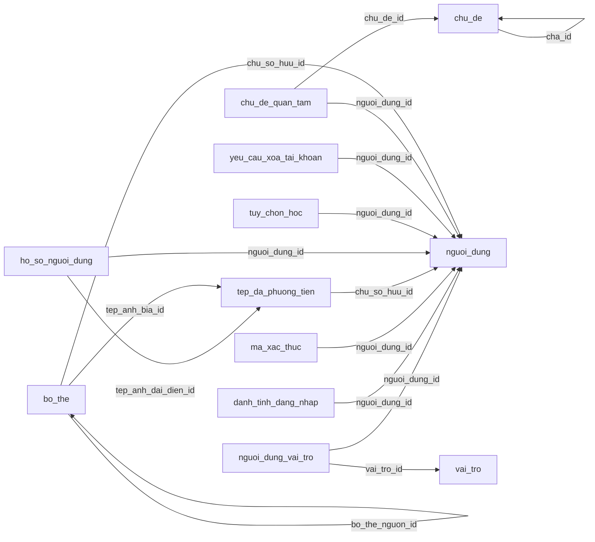
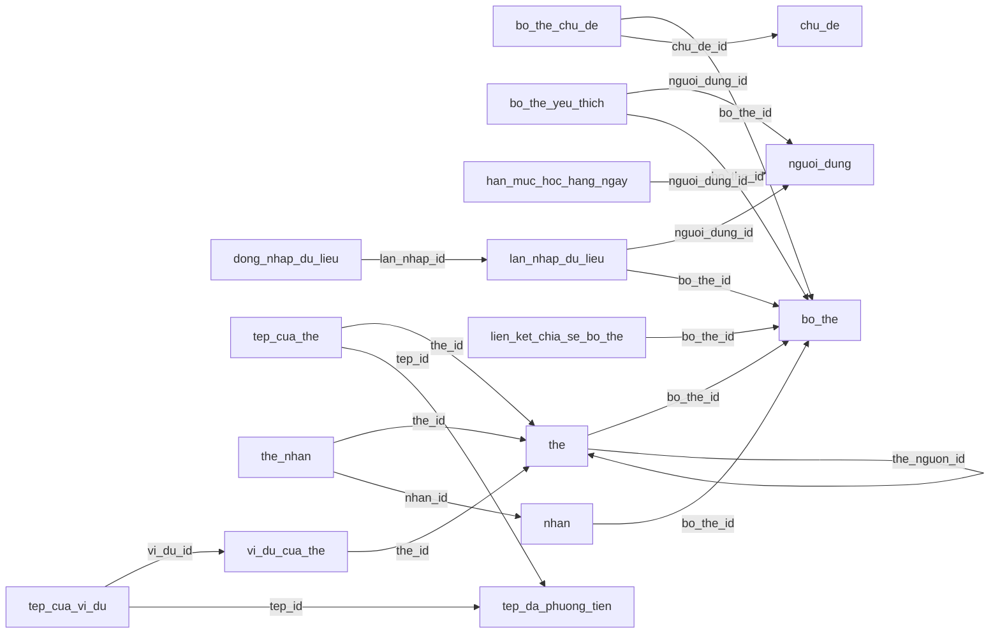
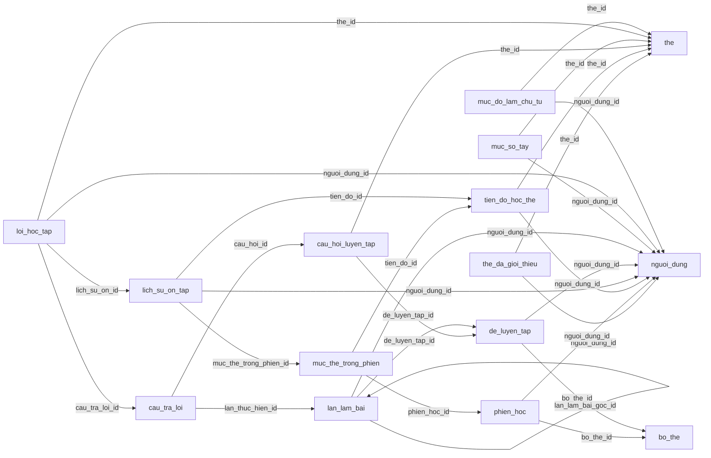
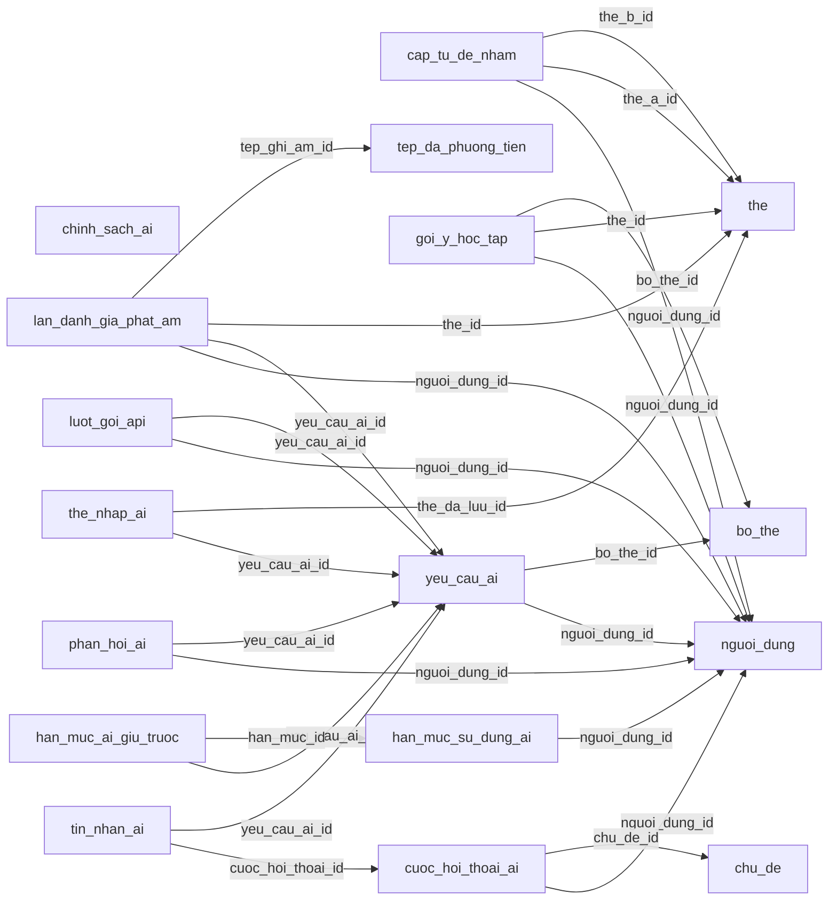
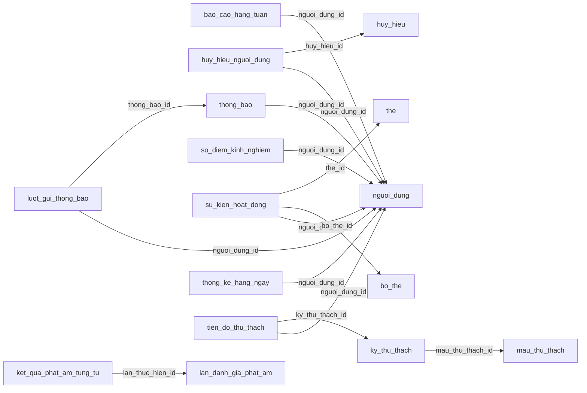
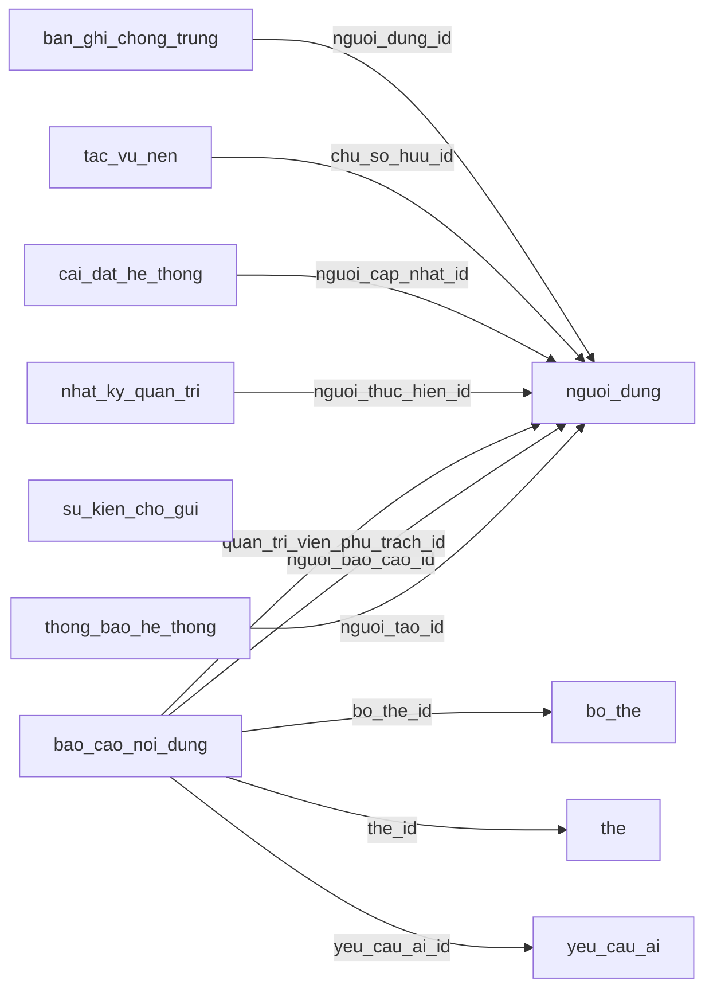

# THIẾT KẾ CƠ SỞ DỮ LIỆU

**Tên đề tài:** Xây dựng website học từ vựng tiếng Anh ứng dụng ôn tập ngắt quãng và hỗ trợ trí tuệ nhân tạo.

## THÔNG TIN DỰ ÁN

| Mục | Thông tin |
| --- | --- |
| Dự án viết tắt | VocabLearning — tên quy ước |
| Tên dự án | Xây dựng website học từ vựng tiếng Anh ứng dụng ôn tập ngắt quãng và hỗ trợ trí tuệ nhân tạo |
| Ngày bắt đầu | 28/09/2026 |
| Ngày kết thúc | 14/12/2026 |
| Thời gian thực hiện | 2,5 tháng; 78 ngày lịch tính cả hai đầu mốc |
| Nơi thực hiện | Khoa Công nghệ thông tin |
| Giảng viên hướng dẫn | Lương Thị Thu Phương |
| Email/điện thoại giảng viên | Chưa cung cấp; không dùng thông tin của giảng viên trong mẫu |
| Đại diện nhóm | Huỳnh Gia Pho |
| Chủ sở hữu sản phẩm | Đề xuất nhóm trưởng điều phối yêu cầu; cả nhóm thống nhất với giảng viên |
| Quản lý dự án | Huỳnh Gia Pho — nhóm trưởng; vai trò tổ chức phát triển được mô tả trong kế hoạch |
| Liên hệ nhóm | Email/điện thoại chưa cung cấp |

### Thành viên trong đội

| TT | Họ và tên | Mã số sinh viên | Lớp | Vai trò |
| --- | --- | --- | --- | --- |
| 1 | Huỳnh Gia Pho | 28211152416 | K28TPM5 | Nhóm trưởng |
| 2 | Phạm Ngọc Thái | 28211106637 | K28TPM10 | Thành viên |
| 3 | Nguyễn Đình Nhật Quân | 28211100097 | K28TPM10 | Thành viên |
| 4 | Lê Hữu Thảo | 28212241493 | K28TPM9 | Thành viên |
| 5 | Trần Văn Màu | 28212306184 | K28TPM24 | Thành viên |

## THÔNG TIN TÀI LIỆU

| Mục | Nội dung |
| --- | --- |
| Tên dự án | Xây dựng website học từ vựng tiếng Anh ứng dụng ôn tập ngắt quãng và hỗ trợ trí tuệ nhân tạo |
| Tiêu đề tài liệu | Thiết kế cơ sở dữ liệu |
| Mã tài liệu | SCI_SE_6 |
| Người thực hiện | Nhóm Huỳnh Gia Pho |
| Phiên bản | 1.1 |
| Ngày lập | 26/09/2026 |
| Trạng thái | Bản thiết kế và kế hoạch; chưa ghi nhận phê duyệt hay kết quả kiểm thử thực tế |
| Ngôn ngữ | Tiếng Việt; giữ tên công nghệ, ID, API, SQL và các tên kỹ thuật cần thiết |
| Quy ước dữ liệu | Tên bảng/cột tiếng Việt không dấu dạng nguoi_dung, bo_the, trang_thai; giữ id, email, password_hash, created_at, updated_at, ipa, slug và kiểu SQL |

## LỊCH SỬ CHỈNH SỬA TÀI LIỆU

| Phiên bản | Người chỉnh sửa | Ngày | Ghi chú |
| --- | --- | --- | --- |
| 1.0 | Nhóm thực hiện | 26/09/2026 | Lập đầy đủ nội dung theo mẫu; đối chiếu 111 mục chức năng và 12 yêu cầu phi chức năng |
| 1.1 | Nhóm thực hiện | 26/09/2026 | Đồng bộ giữa các tài liệu: giao diện JavaScript; đường dẫn trang tiếng Việt; tên VocabLearning và CSDL `vocab_learning`; QT-02 sang đợt 2; tiêu chí ghi nhớ và ngưỡng sổ tay thống nhất; sửa tên kỹ thuật bị đổi nhầm; phân bổ giờ theo người |

## PHÊ DUYỆT TÀI LIỆU

| Vai trò | Họ tên | Chữ ký | Ngày |
| --- | --- | --- | --- |
| Giảng viên hướng dẫn | Lương Thị Thu Phương | Chưa ký | Chưa xác nhận |
| Nhóm trưởng | Huỳnh Gia Pho | Chưa ký | Chưa xác nhận |
| Thành viên | Phạm Ngọc Thái | Chưa ký | Chưa xác nhận |
| Thành viên | Nguyễn Đình Nhật Quân | Chưa ký | Chưa xác nhận |
| Thành viên | Lê Hữu Thảo | Chưa ký | Chưa xác nhận |
| Thành viên | Trần Văn Màu | Chưa ký | Chưa xác nhận |

## MỤC LỤC

  - Thành viên trong đội
- 1. LỰA CHỌN CƠ SỞ DỮ LIỆU
- 2. THIẾT KẾ CƠ SỞ DỮ LIỆU
  - 2.1. Lược đồ cơ sở dữ liệu
  - 2.2. Thiết kế kiến trúc bảng
  - 2.3. Sơ đồ thực tế liên kết
  - 2.4. SQL tạo cơ sở dữ liệu đầy đủ
  - 2.5. Giao dịch, đồng thời và quyền liên bảng
  - 2.6. Truy vấn và dữ liệu mẫu
  - 2.7. Vận hành, nâng cấp và phục hồi

## 1. LỰA CHỌN CƠ SỞ DỮ LIỆU
Chọn MySQL 8.4 LTS, InnoDB, utf8mb4 cho dữ liệu quan hệ, giao dịch lịch ôn/chấm bài/hạn mức và tính toàn vẹn bằng khóa/ràng buộc. Redis giữ phiên, bộ nhớ đệm và giới hạn tần suất; không làm nguồn duy nhất của lịch sử hay XP. Tệp ở kho S3, MySQL giữ khóa, nguồn, quyền và trạng thái. Không lưu audio nhị phân lớn trong bảng nghiệp vụ.
Quy ước: tên bảng/cột tiếng Việt không dấu dạng snake_case, giữ id/email/password_hash/created_at/updated_at/ipa/slug/mime_type và từ kỹ thuật SQL. JSON API có thể giữ tên tiếng Anh, ánh xạ rõ tại DTO/JPA. Thời điểm UTC, ngày học chốt theo địa phương, hạn mức API theo ngày UTC. Khóa BIGINT UNSIGNED trả chuỗi để tránh mất chính xác JavaScript; Java phải bảo đảm ID thực dùng nằm trong miền Long được hỗ trợ hoặc dùng ánh xạ số lớn thích hợp.
## 2. THIẾT KẾ CƠ SỞ DỮ LIỆU
### 2.1. Lược đồ cơ sở dữ liệu

#### Thiết kế cơ sở dữ liệu

##### 2.1.1 Quy ước

- Dùng InnoDB và `utf8mb4_0900_ai_ci` cho nội dung. Khóa email/từ đã chuẩn hóa dùng so sánh nhị phân hoặc giá trị băm để so khớp rõ ràng.
- Khóa chính nội bộ là `BIGINT UNSIGNED`. Trả ID dạng **chuỗi** trong JSON vì JavaScript không biểu diễn chính xác mọi giá trị BIGINT bằng Number.
- Thời điểm `created_at`, `updated_at` dùng UTC; `DATE` là ngày địa phương đã chốt khi phát sinh sự kiện.
- Trạng thái quan trọng có ràng buộc `CHECK`; giá trị mở rộng còn lại kiểm tra bằng kiểu liệt kê Java và Bean Validation. `CHECK` không thay kiểm tra quyền sở hữu liên bảng.
- JSON chỉ dùng cho nội dung lưu tại một thời điểm, cấu hình, câu hỏi có cấu trúc, kết quả dịch vụ và dữ liệu sự kiện. Quan hệ người/bộ/thẻ và chỉ số cần tìm kiếm vẫn có cột riêng.
- Khóa ngoại mặc định ngăn xóa khi còn tham chiếu. Xóa dây chuyền chỉ áp dụng bảng con/bảng liên kết phù hợp; không dùng một lệnh xóa dây chuyền thay quy trình xóa tài khoản.
- Báo cáo có các khóa đích riêng và chỉ cho đúng một đích. Nhật ký/sự kiện có định danh lịch sử có chủ ý, không giả làm khóa ngoại đa loại đối tượng.

##### 2.1.2 Quan hệ chính

```text
nguoi_dung 1--1 ho_so_nguoi_dung, tuy_chon_hoc
nguoi_dung N--N vai_tro qua nguoi_dung_vai_tro; nguoi_dung N--N chu_de qua chu_de_quan_tam
nguoi_dung 1--N danh_tinh_dang_nhap, ma_xac_thuc, yeu_cau_xoa_tai_khoan
nguoi_dung 1--N bo_the 1--N the 1--N vi_du_cua_the
bo_the N--N chu_de qua bo_the_chu_de; the N--N nhan qua the_nhan
the N--N tep_da_phuong_tien qua tep_cua_the
vi_du_cua_the N--N tep_da_phuong_tien qua tep_cua_vi_du
nguoi_dung N--N bo_the qua bo_the_yeu_thich; bo_the 1--N lien_ket_chia_se_bo_the
bo_the 1--N lan_nhap_du_lieu 1--N dong_nhap_du_lieu
nguoi_dung + the + chieu_hoc -> tien_do_hoc_the
phien_hoc 1--N muc_the_trong_phien 1--1 lich_su_on_tap
tien_do_hoc_the 1--N lich_su_on_tap
de_luyen_tap 1--N cau_hoi_luyen_tap; de_luyen_tap 1--N lan_lam_bai
lan_lam_bai 1--N cau_tra_loi N--1 cau_hoi_luyen_tap
nguoi_dung + the -> muc_so_tay; nguoi_dung + the + ky_nang -> muc_do_lam_chu_tu
nguoi_dung 1--N loi_hoc_tap, cap_tu_de_nham, goi_y_hoc_tap
nguoi_dung 1--N yeu_cau_ai 1--N the_nhap_ai
yeu_cau_ai 1--1 han_muc_ai_giu_truoc N--1 han_muc_su_dung_ai
yeu_cau_ai 1--N luot_goi_api; yeu_cau_ai 1--1 lan_danh_gia_phat_am
lan_danh_gia_phat_am 1--N ket_qua_phat_am_tung_tu
nguoi_dung 1--N cuoc_hoi_thoai_ai 1--N tin_nhan_ai
nguoi_dung 1--N su_kien_hoat_dong, so_diem_kinh_nghiem, thong_bao, bao_cao_hang_tuan
nguoi_dung + ngay_dia_phuong -> thong_ke_hang_ngay, han_muc_hoc_hang_ngay
nguoi_dung N--N huy_hieu qua huy_hieu_nguoi_dung
nguoi_dung N--N ky_thu_thach qua tien_do_thu_thach
```

Mô hình có **67 bảng**. Không cần triển khai tất cả màn hình cùng lúc; chia theo giai đoạn nhưng giữ quan hệ dữ liệu nhất quán.

##### 2.1.3 Từ điển dữ liệu

Mục 2.2 (từng bảng) và mục 2.4 (SQL) định nghĩa từng cột, kiểu, giá trị mặc định, khả năng nhận NULL, khóa chính/ngoại, ràng buộc và chỉ mục.

| Nhóm | Tên bảng | Ý nghĩa |
|---|---|---|
| Tài khoản | `nguoi_dung`, `vai_tro`, `nguoi_dung_vai_tro` | Người dùng, thông tin đăng nhập trực tiếp, trạng thái và phân quyền |
| Xác thực | `danh_tinh_dang_nhap`, `ma_xac_thuc` | Danh tính Google/Facebook và mã xác thực/đặt lại đã băm |
| Hồ sơ | `ho_so_nguoi_dung`, `tuy_chon_hoc`, `chu_de_quan_tam` | Hồ sơ, trình độ, kế hoạch, thông báo, chủ đề |
| Quyền riêng tư | `yeu_cau_xoa_tai_khoan` | Yêu cầu xóa, thời hạn, trạng thái, mốc xử lý |
| Tệp | `tep_da_phuong_tien` | Khóa tệp, loại, kích thước, nguồn gốc, quyền truy cập |
| Nội dung | `chu_de`, `bo_the`, `bo_the_chu_de`, `nhan`, `the`, `the_nhan` | Bộ/thẻ, phân loại, nguồn, độ khó, chống trùng |
| Ví dụ và tệp | `vi_du_cua_the`, `tep_cua_the`, `tep_cua_vi_du` | Câu ví dụ, bản dịch, ảnh, âm thanh từ/câu |
| Thư viện | `bo_the_yeu_thich`, `lien_ket_chia_se_bo_the` | Yêu thích và liên kết có thể thu hồi |
| CSV | `lan_nhap_du_lieu`, `dong_nhap_du_lieu` | Dữ liệu nhập tạm và lỗi từng dòng |
| Hạn mức học | `han_muc_hoc_hang_ngay`, `the_da_gioi_thieu` | Suất từ mới và thẻ đã giới thiệu, tránh đếm hai chiều |
| Phiên học | `phien_hoc`, `muc_the_trong_phien` | Hàng đợi thẻ, nội dung lúc học, suất giữ trước |
| Ôn tập | `tien_do_hoc_the`, `lich_su_on_tap` | Lịch ôn hiện tại và lịch sử trước/sau mỗi lượt |
| Đề luyện | `de_luyen_tap`, `cau_hoi_luyen_tap` | Đề/câu hỏi đã cố định, đáp án chấm giữ ở máy chủ |
| Bài làm | `lan_lam_bai`, `cau_tra_loi` | Lần làm, câu trả lời, điểm, phản hồi, trạng thái chấm |
| Lỗi và sổ tay | `muc_so_tay`, `loi_hoc_tap` | Từ khó và minh chứng lỗi |
| Cá nhân hóa | `muc_do_lam_chu_tu`, `cap_tu_de_nham`, `goi_y_hoc_tap` | Kỹ năng, cặp nhầm, lý do đề xuất |
| Hạn mức AI | `chinh_sach_ai`, `han_muc_su_dung_ai`, `han_muc_ai_giu_truoc` | Chính sách, số lượt/đơn vị văn bản/giây âm thanh/chi phí |
| Nội dung AI | `yeu_cau_ai`, `the_nhap_ai`, `phan_hoi_ai` | Tác vụ, đầu vào/đầu ra, nháp, phản hồi |
| Hội thoại | `cuoc_hoi_thoai_ai`, `tin_nhan_ai` | Hội thoại văn bản mở rộng |
| Dịch vụ ngoài | `luot_goi_api` | Lượt gọi, độ trễ, lỗi, mức dùng và chi phí; không chứa khóa API |
| Phát âm | `lan_danh_gia_phat_am`, `ket_qua_phat_am_tung_tu` | Văn bản mẫu, bản ghi, điểm tổng/từng từ/âm vị |
| Thống kê | `su_kien_hoat_dong`, `thong_ke_hang_ngay`, `bao_cao_hang_tuan` | Minh chứng, tổng hợp ngày và báo cáo tuần |
| Thành tích | `so_diem_kinh_nghiem`, `huy_hieu`, `huy_hieu_nguoi_dung` | Sổ thưởng, huy hiệu và lần cấp duy nhất |
| Thử thách | `mau_thu_thach`, `ky_thu_thach`, `tien_do_thu_thach` | Mẫu, kỳ áp dụng và tiến độ |
| Thông báo | `thong_bao`, `luot_gui_thong_bao`, `thong_bao_he_thong` | Hộp thông báo, gửi ngoài và thông báo hệ thống |
| Quản trị | `bao_cao_noi_dung`, `nhat_ky_quan_tri`, `cai_dat_he_thong` | Kiểm duyệt, nhật ký và cấu hình có phiên bản |
| Hạ tầng | `tac_vu_nen`, `su_kien_cho_gui`, `ban_ghi_chong_trung` | Tác vụ bền vững, sự kiện sau giao dịch, chống ghi trùng |

##### 2.1.4 Chỉ mục và nhất quán

- Hàng đợi ôn dùng `(nguoi_dung_id,chieu_hoc,tam_ngung,trang_thai_hoc,thoi_diem_den_han)`; lọc bộ qua thẻ chưa xóa.
- Thư viện dùng chủ sở hữu/thời điểm sửa; danh mục dùng quyền hiển thị/kiểm duyệt/trình độ. FULLTEXT tìm tên/mô tả; từ ngắn dùng tìm tiền tố có giới hạn vì FULLTEXT có từ bị loại và độ dài tối thiểu.
- Lịch sử dùng người/thời điểm/ID; phân trang theo mốc bản ghi. Mặc định 20, tối đa 100 mục/lần.
- Tác vụ dùng trạng thái/thời điểm chạy/quyền xử lý. Nhận bằng `SELECT ... FOR UPDATE SKIP LOCKED`, giữ giao dịch ngắn.
- Chưa phân vùng bảng lịch sử ngay bản đầu vì cần cân nhắc hạn chế khóa ngoại MySQL; lưu trữ dài hạn sau khi đo tải.
- Dịch vụ phải kiểm tra thẻ thuộc bộ, nhãn thuộc cùng bộ, tiến độ/mục phiên cùng người và chiều, câu hỏi thuộc đề của lần làm, quyền tệp và quyền với thẻ AI. Khóa ngoại đơn lẻ không thay kiểm tra này; có thể bổ sung khóa ngoại nhiều cột khi cần.


### 2.2. Thiết kế kiến trúc bảng
Từng bảng dưới đây liệt kê **mọi cột**, kiểu dữ liệu, NULL, khóa, giá trị mặc định, thông tin bổ sung và ý nghĩa. Ràng buộc SQL được giữ nguyên để không mất chi tiết chỉ mục nhiều cột/CHECK/FK. Trường không có DEFAULT không đồng nghĩa mặc định là chuỗi None; nếu NOT NULL thì máy chủ phải cấp giá trị. Khóa ngoại đơn không tự kiểm tra người dùng sở hữu cùng bộ hay nhãn thuộc đúng bộ; dịch vụ phải kiểm tra thêm.

#### 2.2.1. Bảng `nguoi_dung`

**Mục đích:** Người dùng, thông tin đăng nhập trực tiếp, trạng thái và phân quyền.

| Cột | Kiểu | Cho NULL | Khóa | Mặc định | Thông tin bổ sung | Ý nghĩa |
| --- | --- | --- | --- | --- | --- | --- |
| id | BIGINT UNSIGNED | Không | PK | Không khai báo | AUTO_INCREMENT | Khóa định danh nội bộ; BIGINT trả dạng chuỗi trong JSON. |
| email | VARCHAR(254) | Không | — | Không khai báo | — | Email hiển thị của người dùng. |
| email_chuan_hoa | VARCHAR(254) | Không | UNIQUE (có thể ghép) | Không khai báo | COLLATE utf8mb4_bin | Email sau trim và chuyển chữ thường; dùng kiểm tra duy nhất, không bỏ dấu chấm/phần +. |
| password_hash | VARCHAR(255) | Có | — | Không khai báo | — | Bản băm mật khẩu có thuật toán/tham số; NULL cho tài khoản chỉ đăng nhập nhà cung cấp. |
| trang_thai | VARCHAR(30) | Không | — | 'PENDING_VERIFICATION' | — | Trạng thái trang thai; giá trị hợp lệ xem CHECK hoặc kiểu liệt kê máy chủ. |
| thoi_diem_xac_thuc_email | DATETIME(3) | Có | — | Không khai báo | — | Mốc thoi diem xac thuc email theo UTC; NULL khi sự kiện chưa phát sinh nếu cột cho phép. |
| thoi_diem_dang_nhap_gan_nhat | DATETIME(3) | Có | — | Không khai báo | — | Mốc thoi diem dang nhap gan nhat theo UTC; NULL khi sự kiện chưa phát sinh nếu cột cho phép. |
| phien_ban_xac_thuc | BIGINT | Không | — | 0 | — | Lưu phien ban xac thuc. Kiểm tra giới hạn/giá trị theo kiểu SQL, ràng buộc và đặc tả nghiệp vụ liên quan. |
| ly_do_khoa | VARCHAR(500) | Có | — | Không khai báo | — | Lưu ly do khoa. Kiểm tra giới hạn/giá trị theo kiểu SQL, ràng buộc và đặc tả nghiệp vụ liên quan. |
| created_at | DATETIME(3) | Không | — | CURRENT_TIMESTAMP(3) | — | Thời điểm tạo theo UTC, độ chính xác mili giây. |
| updated_at | DATETIME(3) | Không | — | CURRENT_TIMESTAMP(3) | ON UPDATE CURRENT_TIMESTAMP(3) | Thời điểm sửa gần nhất theo UTC. |


**Khóa, chỉ mục và ràng buộc:**

```sql
UNIQUE KEY uk_nguoi_dung_email (email_chuan_hoa);
CHECK (trang_thai IN ('PENDING_VERIFICATION','ACTIVE','LOCKED','PENDING_DELETION'));
```

**Liên kết yêu cầu:** TK-01, TK-02, TK-03, TK-04, TK-05, TK-06, TK-07, TK-08, TK-09, TK-10, TK-11.

#### 2.2.2. Bảng `vai_tro`

**Mục đích:** Người dùng, thông tin đăng nhập trực tiếp, trạng thái và phân quyền.

| Cột | Kiểu | Cho NULL | Khóa | Mặc định | Thông tin bổ sung | Ý nghĩa |
| --- | --- | --- | --- | --- | --- | --- |
| id | BIGINT UNSIGNED | Không | PK | Không khai báo | AUTO_INCREMENT | Khóa định danh nội bộ; BIGINT trả dạng chuỗi trong JSON. |
| ma | VARCHAR(30) | Không | UNIQUE | Không khai báo | — | Lưu ma. Kiểm tra giới hạn/giá trị theo kiểu SQL, ràng buộc và đặc tả nghiệp vụ liên quan. |
| mo_ta | VARCHAR(255) | Có | — | Không khai báo | — | Lưu mo ta. Kiểm tra giới hạn/giá trị theo kiểu SQL, ràng buộc và đặc tả nghiệp vụ liên quan. |


**Khóa, chỉ mục và ràng buộc:**

```sql
-- Khóa khai báo trực tiếp trong các cột phía trên.
```

**Liên kết yêu cầu:** Hạ tầng/quan hệ dùng chung; kiểm chứng cùng các luồng sử dụng ở đặc tả API và giao dịch.

#### 2.2.3. Bảng `nguoi_dung_vai_tro`

**Mục đích:** Người dùng, thông tin đăng nhập trực tiếp, trạng thái và phân quyền.

| Cột | Kiểu | Cho NULL | Khóa | Mặc định | Thông tin bổ sung | Ý nghĩa |
| --- | --- | --- | --- | --- | --- | --- |
| nguoi_dung_id | BIGINT UNSIGNED | Không | PK, FK | Không khai báo | — | Định danh tham chiếu nguoi_dung. Quan hệ/đích chính xác được ghi tại ràng buộc khóa ngoại bên dưới. |
| vai_tro_id | BIGINT UNSIGNED | Không | PK, FK | Không khai báo | — | Định danh tham chiếu vai_tro. Quan hệ/đích chính xác được ghi tại ràng buộc khóa ngoại bên dưới. |


**Khóa, chỉ mục và ràng buộc:**

```sql
PRIMARY KEY (nguoi_dung_id, vai_tro_id);
FOREIGN KEY (nguoi_dung_id) REFERENCES nguoi_dung(id) ON DELETE CASCADE;
FOREIGN KEY (vai_tro_id) REFERENCES vai_tro(id);
```

**Liên kết yêu cầu:** QT-01, QT-02, QT-03, QT-04, QT-05, QT-06, QT-07, QT-08, QT-09.

#### 2.2.4. Bảng `danh_tinh_dang_nhap`

**Mục đích:** Danh tính Google/Facebook và mã xác thực/đặt lại đã băm.

| Cột | Kiểu | Cho NULL | Khóa | Mặc định | Thông tin bổ sung | Ý nghĩa |
| --- | --- | --- | --- | --- | --- | --- |
| id | BIGINT UNSIGNED | Không | PK | Không khai báo | AUTO_INCREMENT | Khóa định danh nội bộ; BIGINT trả dạng chuỗi trong JSON. |
| nguoi_dung_id | BIGINT UNSIGNED | Không | UNIQUE (có thể ghép), FK | Không khai báo | — | Định danh tham chiếu nguoi_dung. Quan hệ/đích chính xác được ghi tại ràng buộc khóa ngoại bên dưới. |
| nha_cung_cap | VARCHAR(20) | Không | UNIQUE (có thể ghép) | Không khai báo | — | Lưu nha cung cap. Kiểm tra giới hạn/giá trị theo kiểu SQL, ràng buộc và đặc tả nghiệp vụ liên quan. |
| dinh_danh_nha_cung_cap | VARCHAR(255) | Không | UNIQUE (có thể ghép) | Không khai báo | COLLATE utf8mb4_bin | Lưu dinh danh nha cung cap. Kiểm tra giới hạn/giá trị theo kiểu SQL, ràng buộc và đặc tả nghiệp vụ liên quan. |
| email_nha_cung_cap | VARCHAR(254) | Có | — | Không khai báo | — | Lưu email nha cung cap. Kiểm tra giới hạn/giá trị theo kiểu SQL, ràng buộc và đặc tả nghiệp vụ liên quan. |
| thoi_diem_lien_ket | DATETIME(3) | Không | — | CURRENT_TIMESTAMP(3) | — | Mốc thoi diem lien ket theo UTC; NULL khi sự kiện chưa phát sinh nếu cột cho phép. |


**Khóa, chỉ mục và ràng buộc:**

```sql
UNIQUE KEY uk_danh_tinh (nha_cung_cap,dinh_danh_nha_cung_cap);
UNIQUE KEY uk_nguoi_dung_nha_cung_cap (nguoi_dung_id,nha_cung_cap);
FOREIGN KEY (nguoi_dung_id) REFERENCES nguoi_dung(id) ON DELETE CASCADE;
CHECK (nha_cung_cap IN ('GOOGLE','FACEBOOK'));
```

**Liên kết yêu cầu:** TK-01, TK-02, TK-03, TK-04, TK-05, TK-06, TK-07, TK-08, TK-09, TK-10, TK-11.

#### 2.2.5. Bảng `ma_xac_thuc`

**Mục đích:** Danh tính Google/Facebook và mã xác thực/đặt lại đã băm.

| Cột | Kiểu | Cho NULL | Khóa | Mặc định | Thông tin bổ sung | Ý nghĩa |
| --- | --- | --- | --- | --- | --- | --- |
| id | BIGINT UNSIGNED | Không | PK | Không khai báo | AUTO_INCREMENT | Khóa định danh nội bộ; BIGINT trả dạng chuỗi trong JSON. |
| nguoi_dung_id | BIGINT UNSIGNED | Không | FK | Không khai báo | — | Định danh tham chiếu nguoi_dung. Quan hệ/đích chính xác được ghi tại ràng buộc khóa ngoại bên dưới. |
| muc_dich | VARCHAR(30) | Không | — | Không khai báo | — | Lưu muc dich. Kiểm tra giới hạn/giá trị theo kiểu SQL, ràng buộc và đặc tả nghiệp vụ liên quan. |
| ma_xac_thuc_bam | BINARY(32) | Không | UNIQUE | Không khai báo | — | Giá trị băm của ma xac thuc bam; không lưu mã bí mật gốc. |
| thoi_diem_het_han | DATETIME(3) | Không | — | Không khai báo | — | Mốc thoi diem het han theo UTC; NULL khi sự kiện chưa phát sinh nếu cột cho phép. |
| thoi_diem_da_su_dung | DATETIME(3) | Có | — | Không khai báo | — | Mốc thoi diem da su dung theo UTC; NULL khi sự kiện chưa phát sinh nếu cột cho phép. |
| created_at | DATETIME(3) | Không | — | CURRENT_TIMESTAMP(3) | — | Thời điểm tạo theo UTC, độ chính xác mili giây. |


**Khóa, chỉ mục và ràng buộc:**

```sql
KEY ix_ma_xac_thuc_nguoi_dung (nguoi_dung_id,muc_dich,thoi_diem_het_han);
FOREIGN KEY (nguoi_dung_id) REFERENCES nguoi_dung(id) ON DELETE CASCADE;
CHECK (muc_dich IN ('VERIFY_EMAIL','RESET_PASSWORD','LINK_IDENTITY','DELETE_CONFIRM'));
```

**Liên kết yêu cầu:** TK-01, TK-02, TK-03, TK-04, TK-05, TK-06, TK-07, TK-08, TK-09, TK-10, TK-11.

#### 2.2.6. Bảng `tep_da_phuong_tien`

**Mục đích:** Khóa tệp, loại, kích thước, nguồn gốc, quyền truy cập.

| Cột | Kiểu | Cho NULL | Khóa | Mặc định | Thông tin bổ sung | Ý nghĩa |
| --- | --- | --- | --- | --- | --- | --- |
| id | BIGINT UNSIGNED | Không | PK | Không khai báo | AUTO_INCREMENT | Khóa định danh nội bộ; BIGINT trả dạng chuỗi trong JSON. |
| chu_so_huu_id | BIGINT UNSIGNED | Có | FK | Không khai báo | — | Định danh tham chiếu chu_so_huu. Quan hệ/đích chính xác được ghi tại ràng buộc khóa ngoại bên dưới. |
| khoa_doi_tuong_luu_tru | VARCHAR(512) | Không | UNIQUE | Không khai báo | COLLATE utf8mb4_bin | Lưu khoa doi tuong luu tru. Kiểm tra giới hạn/giá trị theo kiểu SQL, ràng buộc và đặc tả nghiệp vụ liên quan. |
| mime_type | VARCHAR(100) | Không | — | Không khai báo | — | Kiểu MIME đã kiểm tra từ tệp, không chỉ tin tên mở rộng. |
| loai_tep | VARCHAR(20) | Không | — | Không khai báo | — | Lưu loai tep. Kiểm tra giới hạn/giá trị theo kiểu SQL, ràng buộc và đặc tả nghiệp vụ liên quan. |
| kich_thuoc_byte | BIGINT UNSIGNED | Không | — | Không khai báo | — | Lưu kich thuoc byte. Kiểm tra giới hạn/giá trị theo kiểu SQL, ràng buộc và đặc tả nghiệp vụ liên quan. |
| thoi_luong_ms | INT UNSIGNED | Có | — | Không khai báo | — | Lưu thoi luong ms. Kiểm tra giới hạn/giá trị theo kiểu SQL, ràng buộc và đặc tả nghiệp vụ liên quan. |
| ma_bam_noi_dung | BINARY(32) | Không | — | Không khai báo | — | Giá trị băm của ma bam noi dung; không lưu mã bí mật gốc. |
| pham_vi_truy_cap | VARCHAR(20) | Không | — | 'PRIVATE' | — | Lưu pham vi truy cap. Kiểm tra giới hạn/giá trị theo kiểu SQL, ràng buộc và đặc tả nghiệp vụ liên quan. |
| trang_thai | VARCHAR(20) | Không | — | 'UPLOADING' | — | Trạng thái trang thai; giá trị hợp lệ xem CHECK hoặc kiểu liệt kê máy chủ. |
| nguon_goc_tep | VARCHAR(30) | Không | — | 'USER_UPLOAD' | — | Lưu nguon goc tep. Kiểm tra giới hạn/giá trị theo kiểu SQL, ràng buộc và đặc tả nghiệp vụ liên quan. |
| ghi_chu_quyen_su_dung | VARCHAR(500) | Có | — | Không khai báo | — | Lưu ghi chu quyen su dung. Kiểm tra giới hạn/giá trị theo kiểu SQL, ràng buộc và đặc tả nghiệp vụ liên quan. |
| created_at | DATETIME(3) | Không | — | CURRENT_TIMESTAMP(3) | — | Thời điểm tạo theo UTC, độ chính xác mili giây. |
| thoi_diem_xoa | DATETIME(3) | Có | — | Không khai báo | — | Mốc thoi diem xoa theo UTC; NULL khi sự kiện chưa phát sinh nếu cột cho phép. |


**Khóa, chỉ mục và ràng buộc:**

```sql
KEY ix_tep_chu_so_huu (chu_so_huu_id,trang_thai);
KEY ix_tep_bam (ma_bam_noi_dung);
FOREIGN KEY (chu_so_huu_id) REFERENCES nguoi_dung(id) ON DELETE SET NULL;
CHECK (loai_tep IN ('IMAGE','AUDIO'));
CHECK (pham_vi_truy_cap IN ('PRIVATE','PUBLIC'));
CHECK (trang_thai IN ('UPLOADING','PROCESSING','READY','REJECTED','DELETED'));
```

**Liên kết yêu cầu:** PA-01, PA-02, PA-03, PA-04, PA-05, PA-06, PA-07, PA-08.

#### 2.2.7. Bảng `ho_so_nguoi_dung`

**Mục đích:** Hồ sơ, trình độ, kế hoạch, thông báo, chủ đề.

| Cột | Kiểu | Cho NULL | Khóa | Mặc định | Thông tin bổ sung | Ý nghĩa |
| --- | --- | --- | --- | --- | --- | --- |
| nguoi_dung_id | BIGINT UNSIGNED | Không | PK, FK | Không khai báo | — | Định danh tham chiếu nguoi_dung. Quan hệ/đích chính xác được ghi tại ràng buộc khóa ngoại bên dưới. |
| ten_hien_thi | VARCHAR(100) | Không | — | Không khai báo | — | Lưu ten hien thi. Kiểm tra giới hạn/giá trị theo kiểu SQL, ràng buộc và đặc tả nghiệp vụ liên quan. |
| gioi_thieu | VARCHAR(500) | Có | — | Không khai báo | — | Lưu gioi thieu. Kiểm tra giới hạn/giá trị theo kiểu SQL, ràng buộc và đặc tả nghiệp vụ liên quan. |
| tep_anh_dai_dien_id | BIGINT UNSIGNED | Có | FK | Không khai báo | — | Định danh tham chiếu tep_anh_dai_dien. Quan hệ/đích chính xác được ghi tại ràng buộc khóa ngoại bên dưới. |
| trinh_do_tu_danh_gia | VARCHAR(10) | Không | — | 'A1' | — | Lưu trinh do tu danh gia. Kiểm tra giới hạn/giá trị theo kiểu SQL, ràng buộc và đặc tả nghiệp vụ liên quan. |
| muc_tieu_hoc | VARCHAR(500) | Có | — | Không khai báo | — | Lưu muc tieu hoc. Kiểm tra giới hạn/giá trị theo kiểu SQL, ràng buộc và đặc tả nghiệp vụ liên quan. |
| thoi_diem_xong_thiet_lap | DATETIME(3) | Có | — | Không khai báo | — | Mốc thoi diem xong thiet lap theo UTC; NULL khi sự kiện chưa phát sinh nếu cột cho phép. |
| updated_at | DATETIME(3) | Không | — | CURRENT_TIMESTAMP(3) | ON UPDATE CURRENT_TIMESTAMP(3) | Thời điểm sửa gần nhất theo UTC. |


**Khóa, chỉ mục và ràng buộc:**

```sql
FOREIGN KEY (nguoi_dung_id) REFERENCES nguoi_dung(id) ON DELETE CASCADE;
FOREIGN KEY (tep_anh_dai_dien_id) REFERENCES tep_da_phuong_tien(id) ON DELETE SET NULL;
CHECK (trinh_do_tu_danh_gia IN ('A1','A2','B1','B2','C1','C2'));
```

**Liên kết yêu cầu:** TK-01, TK-02, TK-03, TK-04, TK-05, TK-06, TK-07, TK-08, TK-09, TK-10, TK-11.

#### 2.2.8. Bảng `tuy_chon_hoc`

**Mục đích:** Hồ sơ, trình độ, kế hoạch, thông báo, chủ đề.

| Cột | Kiểu | Cho NULL | Khóa | Mặc định | Thông tin bổ sung | Ý nghĩa |
| --- | --- | --- | --- | --- | --- | --- |
| nguoi_dung_id | BIGINT UNSIGNED | Không | PK, FK | Không khai báo | — | Định danh tham chiếu nguoi_dung. Quan hệ/đích chính xác được ghi tại ràng buộc khóa ngoại bên dưới. |
| so_the_moi_moi_ngay | SMALLINT UNSIGNED | Không | — | 10 | — | Số lượng/tổng so the moi moi ngay, đơn vị theo nghiệp vụ; không nhận trực tiếp số tổng từ trình duyệt. |
| muc_tieu_phut_moi_ngay | SMALLINT UNSIGNED | Không | — | 15 | — | Lưu muc tieu phut moi ngay. Kiểm tra giới hạn/giá trị theo kiểu SQL, ràng buộc và đặc tả nghiệp vụ liên quan. |
| mui_gio | VARCHAR(64) | Không | — | 'Asia/Ho_Chi_Minh' | — | Lưu mui gio. Kiểm tra giới hạn/giá trị theo kiểu SQL, ràng buộc và đặc tả nghiệp vụ liên quan. |
| thoi_diem_doi_mui_gio | DATETIME(3) | Có | — | Không khai báo | — | Mốc thoi diem doi mui gio theo UTC; NULL khi sự kiện chưa phát sinh nếu cột cho phép. |
| gio_nhac_dia_phuong | TIME | Không | — | '20:00:00' | — | Lưu gio nhac dia phuong. Kiểm tra giới hạn/giá trị theo kiểu SQL, ràng buộc và đặc tả nghiệp vụ liên quan. |
| bat_nhac_hoc | BOOLEAN | Không | — | TRUE | — | Lưu bat nhac hoc. Kiểm tra giới hạn/giá trị theo kiểu SQL, ràng buộc và đặc tả nghiệp vụ liên quan. |
| dong_y_email_nhac_hoc | BOOLEAN | Không | — | FALSE | — | Lưu dong y email nhac hoc. Kiểm tra giới hạn/giá trị theo kiểu SQL, ràng buộc và đặc tả nghiệp vụ liên quan. |
| thong_bao_trong_ung_dung | BOOLEAN | Không | — | TRUE | — | Lưu thong bao trong ung dung. Kiểm tra giới hạn/giá trị theo kiểu SQL, ràng buộc và đặc tả nghiệp vụ liên quan. |
| thong_bao_muc_tieu | BOOLEAN | Không | — | TRUE | — | Lưu thong bao muc tieu. Kiểm tra giới hạn/giá trị theo kiểu SQL, ràng buộc và đặc tả nghiệp vụ liên quan. |
| thoi_diem_dong_y_ai | DATETIME(3) | Có | — | Không khai báo | — | Mốc thoi diem dong y ai theo UTC; NULL khi sự kiện chưa phát sinh nếu cột cho phép. |
| chieu_hoc_mac_dinh | VARCHAR(10) | Không | — | 'EN_VI' | — | Lưu chieu hoc mac dinh. Kiểm tra giới hạn/giá trị theo kiểu SQL, ràng buộc và đặc tả nghiệp vụ liên quan. |
| phien_ban | BIGINT | Không | — | 0 | — | Phiên bản dùng kiểm tra cập nhật đồng thời. |
| updated_at | DATETIME(3) | Không | — | CURRENT_TIMESTAMP(3) | ON UPDATE CURRENT_TIMESTAMP(3) | Thời điểm sửa gần nhất theo UTC. |


**Khóa, chỉ mục và ràng buộc:**

```sql
FOREIGN KEY (nguoi_dung_id) REFERENCES nguoi_dung(id) ON DELETE CASCADE;
CHECK (so_the_moi_moi_ngay <= 100);
CHECK (muc_tieu_phut_moi_ngay BETWEEN 1 AND 240);
CHECK (chieu_hoc_mac_dinh IN ('EN_VI','VI_EN'));
```

**Liên kết yêu cầu:** TK-01, TK-02, TK-03, TK-04, TK-05, TK-06, TK-07, TK-08, TK-09, TK-10, TK-11.

#### 2.2.9. Bảng `yeu_cau_xoa_tai_khoan`

**Mục đích:** Yêu cầu xóa, thời hạn, trạng thái, mốc xử lý.

| Cột | Kiểu | Cho NULL | Khóa | Mặc định | Thông tin bổ sung | Ý nghĩa |
| --- | --- | --- | --- | --- | --- | --- |
| id | BIGINT UNSIGNED | Không | PK | Không khai báo | AUTO_INCREMENT | Khóa định danh nội bộ; BIGINT trả dạng chuỗi trong JSON. |
| nguoi_dung_id | BIGINT UNSIGNED | Có | FK | Không khai báo | — | Định danh tham chiếu nguoi_dung. Quan hệ/đích chính xác được ghi tại ràng buộc khóa ngoại bên dưới. |
| tham_chieu_doi_tuong | BINARY(32) | Không | — | Không khai báo | — | Lưu tham chieu doi tuong. Kiểm tra giới hạn/giá trị theo kiểu SQL, ràng buộc và đặc tả nghiệp vụ liên quan. |
| trang_thai_tai_khoan_truoc | VARCHAR(30) | Không | — | Không khai báo | — | Trạng thái trang thai tai khoan truoc; giá trị hợp lệ xem CHECK hoặc kiểu liệt kê máy chủ. |
| trang_thai | VARCHAR(20) | Không | — | 'REQUESTED' | — | Trạng thái trang thai; giá trị hợp lệ xem CHECK hoặc kiểu liệt kê máy chủ. |
| thoi_diem_yeu_cau | DATETIME(3) | Không | — | Không khai báo | — | Mốc thoi diem yeu cau theo UTC; NULL khi sự kiện chưa phát sinh nếu cột cho phép. |
| thoi_diem_duoc_phep_xoa | DATETIME(3) | Không | — | Không khai báo | — | Mốc thoi diem duoc phep xoa theo UTC; NULL khi sự kiện chưa phát sinh nếu cột cho phép. |
| thoi_diem_hoan_thanh | DATETIME(3) | Có | — | Không khai báo | — | Mốc thoi diem hoan thanh theo UTC; NULL khi sự kiện chưa phát sinh nếu cột cho phép. |
| ma_loi_xu_ly | VARCHAR(100) | Có | — | Không khai báo | — | Lưu ma loi xu ly. Kiểm tra giới hạn/giá trị theo kiểu SQL, ràng buộc và đặc tả nghiệp vụ liên quan. |
| moc_xu_ly | JSON | Có | — | Không khai báo | — | Dữ liệu có cấu trúc của moc xu ly. Máy chủ kiểm tra phiên bản/cấu trúc và loại dữ liệu cá nhân không cần thiết. |


**Khóa, chỉ mục và ràng buộc:**

```sql
KEY ix_delete_hang_doi (trang_thai,thoi_diem_duoc_phep_xoa);
FOREIGN KEY (nguoi_dung_id) REFERENCES nguoi_dung(id) ON DELETE SET NULL;
CHECK (trang_thai IN ('REQUESTED','PROCESSING','COMPLETED','FAILED','CANCELLED'));
```

**Liên kết yêu cầu:** TK-01, TK-02, TK-03, TK-04, TK-05, TK-06, TK-07, TK-08, TK-09, TK-10, TK-11.

#### 2.2.10. Bảng `chu_de`

**Mục đích:** Bộ/thẻ, phân loại, nguồn, độ khó, chống trùng.

| Cột | Kiểu | Cho NULL | Khóa | Mặc định | Thông tin bổ sung | Ý nghĩa |
| --- | --- | --- | --- | --- | --- | --- |
| id | BIGINT UNSIGNED | Không | PK | Không khai báo | AUTO_INCREMENT | Khóa định danh nội bộ; BIGINT trả dạng chuỗi trong JSON. |
| cha_id | BIGINT UNSIGNED | Có | FK | Không khai báo | — | Định danh tham chiếu cha. Quan hệ/đích chính xác được ghi tại ràng buộc khóa ngoại bên dưới. |
| slug | VARCHAR(120) | Không | UNIQUE | Không khai báo | — | Tên ngắn phục vụ đường dẫn/tìm kiếm. |
| ten | VARCHAR(150) | Không | — | Không khai báo | — | Lưu ten. Kiểm tra giới hạn/giá trị theo kiểu SQL, ràng buộc và đặc tả nghiệp vụ liên quan. |
| mo_ta | TEXT | Có | — | Không khai báo | — | Lưu mo ta. Kiểm tra giới hạn/giá trị theo kiểu SQL, ràng buộc và đặc tả nghiệp vụ liên quan. |
| dang_su_dung | BOOLEAN | Không | — | TRUE | — | Lưu dang su dung. Kiểm tra giới hạn/giá trị theo kiểu SQL, ràng buộc và đặc tả nghiệp vụ liên quan. |


**Khóa, chỉ mục và ràng buộc:**

```sql
FOREIGN KEY (cha_id) REFERENCES chu_de(id);
```

**Liên kết yêu cầu:** ND-01, ND-02, ND-03, ND-04, ND-05, ND-06, ND-07.

#### 2.2.11. Bảng `chu_de_quan_tam`

**Mục đích:** Hồ sơ, trình độ, kế hoạch, thông báo, chủ đề.

| Cột | Kiểu | Cho NULL | Khóa | Mặc định | Thông tin bổ sung | Ý nghĩa |
| --- | --- | --- | --- | --- | --- | --- |
| nguoi_dung_id | BIGINT UNSIGNED | Không | PK, FK | Không khai báo | — | Định danh tham chiếu nguoi_dung. Quan hệ/đích chính xác được ghi tại ràng buộc khóa ngoại bên dưới. |
| chu_de_id | BIGINT UNSIGNED | Không | PK, FK | Không khai báo | — | Định danh tham chiếu chu_de. Quan hệ/đích chính xác được ghi tại ràng buộc khóa ngoại bên dưới. |


**Khóa, chỉ mục và ràng buộc:**

```sql
PRIMARY KEY (nguoi_dung_id,chu_de_id);
FOREIGN KEY (nguoi_dung_id) REFERENCES nguoi_dung(id) ON DELETE CASCADE;
FOREIGN KEY (chu_de_id) REFERENCES chu_de(id);
```

**Liên kết yêu cầu:** Hạ tầng/quan hệ dùng chung; kiểm chứng cùng các luồng sử dụng ở đặc tả API và giao dịch.

#### 2.2.12. Bảng `bo_the`

**Mục đích:** Bộ/thẻ, phân loại, nguồn, độ khó, chống trùng.

| Cột | Kiểu | Cho NULL | Khóa | Mặc định | Thông tin bổ sung | Ý nghĩa |
| --- | --- | --- | --- | --- | --- | --- |
| id | BIGINT UNSIGNED | Không | PK | Không khai báo | AUTO_INCREMENT | Khóa định danh nội bộ; BIGINT trả dạng chuỗi trong JSON. |
| chu_so_huu_id | BIGINT UNSIGNED | Không | FK | Không khai báo | — | Định danh tham chiếu chu_so_huu. Quan hệ/đích chính xác được ghi tại ràng buộc khóa ngoại bên dưới. |
| bo_the_nguon_id | BIGINT UNSIGNED | Có | FK | Không khai báo | — | Định danh tham chiếu bo_the_nguon. Quan hệ/đích chính xác được ghi tại ràng buộc khóa ngoại bên dưới. |
| tieu_de | VARCHAR(150) | Không | — | Không khai báo | — | Lưu tieu de. Kiểm tra giới hạn/giá trị theo kiểu SQL, ràng buộc và đặc tả nghiệp vụ liên quan. |
| mo_ta | TEXT | Có | — | Không khai báo | — | Lưu mo ta. Kiểm tra giới hạn/giá trị theo kiểu SQL, ràng buộc và đặc tả nghiệp vụ liên quan. |
| loai_nguon | VARCHAR(10) | Không | — | 'USER' | — | Lưu loai nguon. Kiểm tra giới hạn/giá trị theo kiểu SQL, ràng buộc và đặc tả nghiệp vụ liên quan. |
| phan_loai | VARCHAR(20) | Không | — | 'GENERAL' | — | Lưu phan loai. Kiểm tra giới hạn/giá trị theo kiểu SQL, ràng buộc và đặc tả nghiệp vụ liên quan. |
| trinh_do | VARCHAR(10) | Không | — | 'A1' | — | Lưu trinh do. Kiểm tra giới hạn/giá trị theo kiểu SQL, ràng buộc và đặc tả nghiệp vụ liên quan. |
| che_do_hien_thi | VARCHAR(10) | Không | — | 'PRIVATE' | — | Lưu che do hien thi. Kiểm tra giới hạn/giá trị theo kiểu SQL, ràng buộc và đặc tả nghiệp vụ liên quan. |
| vong_doi | VARCHAR(15) | Không | — | 'DRAFT' | — | Lưu vong doi. Kiểm tra giới hạn/giá trị theo kiểu SQL, ràng buộc và đặc tả nghiệp vụ liên quan. |
| trang_thai_kiem_duyet | VARCHAR(20) | Không | — | 'NOT_REQUIRED' | — | Trạng thái trang thai kiem duyet; giá trị hợp lệ xem CHECK hoặc kiểu liệt kê máy chủ. |
| tep_anh_bia_id | BIGINT UNSIGNED | Có | FK | Không khai báo | — | Định danh tham chiếu tep_anh_bia. Quan hệ/đích chính xác được ghi tại ràng buộc khóa ngoại bên dưới. |
| so_the | INT UNSIGNED | Không | — | 0 | — | Số lượng/tổng so the, đơn vị theo nghiệp vụ; không nhận trực tiếp số tổng từ trình duyệt. |
| phien_ban | BIGINT | Không | — | 0 | — | Phiên bản dùng kiểm tra cập nhật đồng thời. |
| created_at | DATETIME(3) | Không | — | CURRENT_TIMESTAMP(3) | — | Thời điểm tạo theo UTC, độ chính xác mili giây. |
| updated_at | DATETIME(3) | Không | — | CURRENT_TIMESTAMP(3) | ON UPDATE CURRENT_TIMESTAMP(3) | Thời điểm sửa gần nhất theo UTC. |
| thoi_diem_xoa | DATETIME(3) | Có | — | Không khai báo | — | Mốc thoi diem xoa theo UTC; NULL khi sự kiện chưa phát sinh nếu cột cho phép. |


**Khóa, chỉ mục và ràng buộc:**

```sql
KEY ix_bo_the_chu_so_huu (chu_so_huu_id,thoi_diem_xoa,updated_at);
KEY ix_bo_the_danh_muc (che_do_hien_thi,trang_thai_kiem_duyet,vong_doi,trinh_do,thoi_diem_xoa);
FULLTEXT KEY ft_bo_the (tieu_de,mo_ta);
FOREIGN KEY (chu_so_huu_id) REFERENCES nguoi_dung(id);
FOREIGN KEY (bo_the_nguon_id) REFERENCES bo_the(id) ON DELETE SET NULL;
FOREIGN KEY (tep_anh_bia_id) REFERENCES tep_da_phuong_tien(id) ON DELETE SET NULL;
CHECK (loai_nguon IN ('USER','ADMIN'));
CHECK (che_do_hien_thi IN ('PRIVATE','PUBLIC'));
CHECK (vong_doi IN ('DRAFT','PUBLISHED','ARCHIVED'));
CHECK (trang_thai_kiem_duyet IN ('NOT_REQUIRED','PENDING','APPROVED','REJECTED','HIDDEN'));
CHECK (trinh_do IN ('A1','A2','B1','B2','C1','C2'));
CHECK (phan_loai IN ('GENERAL','COMMUNICATION','TOEIC','IELTS','CHILDREN'));
```

**Liên kết yêu cầu:** BT-01, BT-02, BT-03, BT-04, BT-05, BT-06, BT-07, BT-08, BT-09, BT-10, BT-11, BT-12, ND-01, ND-02, ND-03, ND-04, ND-05, ND-06, ND-07.

#### 2.2.13. Bảng `bo_the_chu_de`

**Mục đích:** Bộ/thẻ, phân loại, nguồn, độ khó, chống trùng.

| Cột | Kiểu | Cho NULL | Khóa | Mặc định | Thông tin bổ sung | Ý nghĩa |
| --- | --- | --- | --- | --- | --- | --- |
| bo_the_id | BIGINT UNSIGNED | Không | PK, FK | Không khai báo | — | Định danh tham chiếu bo_the. Quan hệ/đích chính xác được ghi tại ràng buộc khóa ngoại bên dưới. |
| chu_de_id | BIGINT UNSIGNED | Không | PK, FK | Không khai báo | — | Định danh tham chiếu chu_de. Quan hệ/đích chính xác được ghi tại ràng buộc khóa ngoại bên dưới. |


**Khóa, chỉ mục và ràng buộc:**

```sql
PRIMARY KEY (bo_the_id,chu_de_id);
FOREIGN KEY (bo_the_id) REFERENCES bo_the(id) ON DELETE CASCADE;
FOREIGN KEY (chu_de_id) REFERENCES chu_de(id);
```

**Liên kết yêu cầu:** ND-01, ND-02, ND-03, ND-04, ND-05, ND-06, ND-07.

#### 2.2.14. Bảng `nhan`

**Mục đích:** Bộ/thẻ, phân loại, nguồn, độ khó, chống trùng.

| Cột | Kiểu | Cho NULL | Khóa | Mặc định | Thông tin bổ sung | Ý nghĩa |
| --- | --- | --- | --- | --- | --- | --- |
| id | BIGINT UNSIGNED | Không | PK | Không khai báo | AUTO_INCREMENT | Khóa định danh nội bộ; BIGINT trả dạng chuỗi trong JSON. |
| bo_the_id | BIGINT UNSIGNED | Không | UNIQUE (có thể ghép), FK | Không khai báo | — | Định danh tham chiếu bo_the. Quan hệ/đích chính xác được ghi tại ràng buộc khóa ngoại bên dưới. |
| ten | VARCHAR(80) | Không | — | Không khai báo | — | Lưu ten. Kiểm tra giới hạn/giá trị theo kiểu SQL, ràng buộc và đặc tả nghiệp vụ liên quan. |
| ten_chuan_hoa | VARCHAR(80) | Không | UNIQUE (có thể ghép) | Không khai báo | COLLATE utf8mb4_bin | Lưu ten chuan hoa. Kiểm tra giới hạn/giá trị theo kiểu SQL, ràng buộc và đặc tả nghiệp vụ liên quan. |


**Khóa, chỉ mục và ràng buộc:**

```sql
UNIQUE KEY uk_bo_the_nhan (bo_the_id,ten_chuan_hoa);
FOREIGN KEY (bo_the_id) REFERENCES bo_the(id) ON DELETE CASCADE;
```

**Liên kết yêu cầu:** BT-01, BT-02, BT-03, BT-04, BT-05, BT-06, BT-07, BT-08, BT-09, BT-10, BT-11, BT-12.

#### 2.2.15. Bảng `the`

**Mục đích:** Bộ/thẻ, phân loại, nguồn, độ khó, chống trùng.

| Cột | Kiểu | Cho NULL | Khóa | Mặc định | Thông tin bổ sung | Ý nghĩa |
| --- | --- | --- | --- | --- | --- | --- |
| id | BIGINT UNSIGNED | Không | PK | Không khai báo | AUTO_INCREMENT | Khóa định danh nội bộ; BIGINT trả dạng chuỗi trong JSON. |
| bo_the_id | BIGINT UNSIGNED | Không | UNIQUE (có thể ghép), FK | Không khai báo | — | Định danh tham chiếu bo_the. Quan hệ/đích chính xác được ghi tại ràng buộc khóa ngoại bên dưới. |
| the_nguon_id | BIGINT UNSIGNED | Có | FK | Không khai báo | — | Định danh tham chiếu the_nguon. Quan hệ/đích chính xác được ghi tại ràng buộc khóa ngoại bên dưới. |
| tu_cum_tu | VARCHAR(255) | Không | — | Không khai báo | — | Lưu tu cum tu. Kiểm tra giới hạn/giá trị theo kiểu SQL, ràng buộc và đặc tả nghiệp vụ liên quan. |
| tu_cum_tu_chuan_hoa | VARCHAR(255) | Không | — | Không khai báo | COLLATE utf8mb4_bin | Lưu tu cum tu chuan hoa. Kiểm tra giới hạn/giá trị theo kiểu SQL, ràng buộc và đặc tả nghiệp vụ liên quan. |
| tu_loai | VARCHAR(30) | Không | — | 'OTHER' | — | Lưu tu loai. Kiểm tra giới hạn/giá trị theo kiểu SQL, ràng buộc và đặc tả nghiệp vụ liên quan. |
| nghia_tieng_viet | VARCHAR(1000) | Không | — | Không khai báo | — | Lưu nghia tieng viet. Kiểm tra giới hạn/giá trị theo kiểu SQL, ràng buộc và đặc tả nghiệp vụ liên quan. |
| ipa | VARCHAR(255) | Có | — | Không khai báo | — | Phiên âm quốc tế của từ/cụm từ. |
| meo_ghi_nho | TEXT | Có | — | Không khai báo | — | Lưu meo ghi nho. Kiểm tra giới hạn/giá trị theo kiểu SQL, ràng buộc và đặc tả nghiệp vụ liên quan. |
| do_kho | TINYINT UNSIGNED | Không | — | 1 | — | Lưu do kho. Kiểm tra giới hạn/giá trị theo kiểu SQL, ràng buộc và đặc tả nghiệp vụ liên quan. |
| thu_tu | INT UNSIGNED | Không | — | 0 | — | Lưu thu tu. Kiểm tra giới hạn/giá trị theo kiểu SQL, ràng buộc và đặc tả nghiệp vụ liên quan. |
| nguon_tao | VARCHAR(20) | Không | — | 'MANUAL' | — | Lưu nguon tao. Kiểm tra giới hạn/giá trị theo kiểu SQL, ràng buộc và đặc tả nghiệp vụ liên quan. |
| khoa_kiem_tra_trung | BINARY(32) | Không | — | Không khai báo | — | SHA-256 của từ + từ loại + nghĩa đã chuẩn hóa trong bộ. |
| thoi_diem_xoa | DATETIME(3) | Có | — | Không khai báo | — | Mốc thoi diem xoa theo UTC; NULL khi sự kiện chưa phát sinh nếu cột cho phép. |
| khoa_trung_dang_su_dung | BINARY(32) | Có | UNIQUE (có thể ghép) | Không khai báo | GENERATED ALWAYS AS<br>    (CASE WHEN thoi_diem_xoa IS NULL THEN khoa_kiem_tra_trung ELSE NULL END) STORED | Lưu khoa trung dang su dung. Kiểm tra giới hạn/giá trị theo kiểu SQL, ràng buộc và đặc tả nghiệp vụ liên quan. |
| phien_ban | BIGINT | Không | — | 0 | — | Phiên bản dùng kiểm tra cập nhật đồng thời. |
| created_at | DATETIME(3) | Không | — | CURRENT_TIMESTAMP(3) | — | Thời điểm tạo theo UTC, độ chính xác mili giây. |
| updated_at | DATETIME(3) | Không | — | CURRENT_TIMESTAMP(3) | ON UPDATE CURRENT_TIMESTAMP(3) | Thời điểm sửa gần nhất theo UTC. |


**Khóa, chỉ mục và ràng buộc:**

```sql
UNIQUE KEY uk_the_trung (bo_the_id,khoa_trung_dang_su_dung);
KEY ix_the_bo_the (bo_the_id,thoi_diem_xoa,thu_tu);
KEY ix_the_tu (bo_the_id,tu_cum_tu_chuan_hoa);
FOREIGN KEY (bo_the_id) REFERENCES bo_the(id);
FOREIGN KEY (the_nguon_id) REFERENCES the(id) ON DELETE SET NULL;
CHECK (do_kho BETWEEN 1 AND 5);
CHECK (nguon_tao IN ('MANUAL','CSV','AI','COPY','ADMIN'));
```

**Liên kết yêu cầu:** BT-01, BT-02, BT-03, BT-04, BT-05, BT-06, BT-07, BT-08, BT-09, BT-10, BT-11, BT-12, ND-01, ND-02, ND-03, ND-04, ND-05, ND-06, ND-07.

#### 2.2.16. Bảng `the_nhan`

**Mục đích:** Bộ/thẻ, phân loại, nguồn, độ khó, chống trùng.

| Cột | Kiểu | Cho NULL | Khóa | Mặc định | Thông tin bổ sung | Ý nghĩa |
| --- | --- | --- | --- | --- | --- | --- |
| the_id | BIGINT UNSIGNED | Không | PK, FK | Không khai báo | — | Định danh tham chiếu the. Quan hệ/đích chính xác được ghi tại ràng buộc khóa ngoại bên dưới. |
| nhan_id | BIGINT UNSIGNED | Không | PK, FK | Không khai báo | — | Định danh tham chiếu nhan. Quan hệ/đích chính xác được ghi tại ràng buộc khóa ngoại bên dưới. |


**Khóa, chỉ mục và ràng buộc:**

```sql
PRIMARY KEY (the_id,nhan_id);
FOREIGN KEY (the_id) REFERENCES the(id) ON DELETE CASCADE;
FOREIGN KEY (nhan_id) REFERENCES nhan(id) ON DELETE CASCADE;
```

**Liên kết yêu cầu:** BT-01, BT-02, BT-03, BT-04, BT-05, BT-06, BT-07, BT-08, BT-09, BT-10, BT-11, BT-12.

#### 2.2.17. Bảng `vi_du_cua_the`

**Mục đích:** Câu ví dụ, bản dịch, ảnh, âm thanh từ/câu.

| Cột | Kiểu | Cho NULL | Khóa | Mặc định | Thông tin bổ sung | Ý nghĩa |
| --- | --- | --- | --- | --- | --- | --- |
| id | BIGINT UNSIGNED | Không | PK | Không khai báo | AUTO_INCREMENT | Khóa định danh nội bộ; BIGINT trả dạng chuỗi trong JSON. |
| the_id | BIGINT UNSIGNED | Không | FK | Không khai báo | — | Định danh tham chiếu the. Quan hệ/đích chính xác được ghi tại ràng buộc khóa ngoại bên dưới. |
| cau_tieng_anh | TEXT | Không | — | Không khai báo | — | Lưu cau tieng anh. Kiểm tra giới hạn/giá trị theo kiểu SQL, ràng buộc và đặc tả nghiệp vụ liên quan. |
| ban_dich_tieng_viet | TEXT | Không | — | Không khai báo | — | Lưu ban dich tieng viet. Kiểm tra giới hạn/giá trị theo kiểu SQL, ràng buộc và đặc tả nghiệp vụ liên quan. |
| vi_tri_bat_dau_cho_trong | INT UNSIGNED | Có | — | Không khai báo | — | Lưu vi tri bat dau cho trong. Kiểm tra giới hạn/giá trị theo kiểu SQL, ràng buộc và đặc tả nghiệp vụ liên quan. |
| vi_tri_ket_thuc_cho_trong | INT UNSIGNED | Có | — | Không khai báo | — | Lưu vi tri ket thuc cho trong. Kiểm tra giới hạn/giá trị theo kiểu SQL, ràng buộc và đặc tả nghiệp vụ liên quan. |
| thu_tu | INT UNSIGNED | Không | — | 0 | — | Lưu thu tu. Kiểm tra giới hạn/giá trị theo kiểu SQL, ràng buộc và đặc tả nghiệp vụ liên quan. |


**Khóa, chỉ mục và ràng buộc:**

```sql
FOREIGN KEY (the_id) REFERENCES the(id) ON DELETE CASCADE;
CHECK ((vi_tri_bat_dau_cho_trong IS NULL AND vi_tri_ket_thuc_cho_trong IS NULL) OR
    (vi_tri_bat_dau_cho_trong IS NOT NULL AND vi_tri_ket_thuc_cho_trong IS NOT NULL AND vi_tri_ket_thuc_cho_trong > vi_tri_bat_dau_cho_trong));
```

**Liên kết yêu cầu:** BT-01, BT-02, BT-03, BT-04, BT-05, BT-06, BT-07, BT-08, BT-09, BT-10, BT-11, BT-12.

#### 2.2.18. Bảng `tep_cua_the`

**Mục đích:** Câu ví dụ, bản dịch, ảnh, âm thanh từ/câu.

| Cột | Kiểu | Cho NULL | Khóa | Mặc định | Thông tin bổ sung | Ý nghĩa |
| --- | --- | --- | --- | --- | --- | --- |
| the_id | BIGINT UNSIGNED | Không | PK, FK | Không khai báo | — | Định danh tham chiếu the. Quan hệ/đích chính xác được ghi tại ràng buộc khóa ngoại bên dưới. |
| tep_id | BIGINT UNSIGNED | Không | PK, FK | Không khai báo | — | Định danh tham chiếu tep. Quan hệ/đích chính xác được ghi tại ràng buộc khóa ngoại bên dưới. |
| muc_dich_su_dung | VARCHAR(20) | Không | PK | Không khai báo | — | Lưu muc dich su dung. Kiểm tra giới hạn/giá trị theo kiểu SQL, ràng buộc và đặc tả nghiệp vụ liên quan. |
| giong_doc | VARCHAR(20) | Có | — | Không khai báo | — | Lưu giong doc. Kiểm tra giới hạn/giá trị theo kiểu SQL, ràng buộc và đặc tả nghiệp vụ liên quan. |


**Khóa, chỉ mục và ràng buộc:**

```sql
PRIMARY KEY (the_id,tep_id,muc_dich_su_dung);
FOREIGN KEY (the_id) REFERENCES the(id) ON DELETE CASCADE;
FOREIGN KEY (tep_id) REFERENCES tep_da_phuong_tien(id);
CHECK (muc_dich_su_dung IN ('IMAGE','WORD_AUDIO'));
```

**Liên kết yêu cầu:** BT-01, BT-02, BT-03, BT-04, BT-05, BT-06, BT-07, BT-08, BT-09, BT-10, BT-11, BT-12.

#### 2.2.19. Bảng `tep_cua_vi_du`

**Mục đích:** Câu ví dụ, bản dịch, ảnh, âm thanh từ/câu.

| Cột | Kiểu | Cho NULL | Khóa | Mặc định | Thông tin bổ sung | Ý nghĩa |
| --- | --- | --- | --- | --- | --- | --- |
| vi_du_id | BIGINT UNSIGNED | Không | PK, FK | Không khai báo | — | Định danh tham chiếu vi_du. Quan hệ/đích chính xác được ghi tại ràng buộc khóa ngoại bên dưới. |
| tep_id | BIGINT UNSIGNED | Không | PK, FK | Không khai báo | — | Định danh tham chiếu tep. Quan hệ/đích chính xác được ghi tại ràng buộc khóa ngoại bên dưới. |


**Khóa, chỉ mục và ràng buộc:**

```sql
PRIMARY KEY (vi_du_id,tep_id);
FOREIGN KEY (vi_du_id) REFERENCES vi_du_cua_the(id) ON DELETE CASCADE;
FOREIGN KEY (tep_id) REFERENCES tep_da_phuong_tien(id);
```

**Liên kết yêu cầu:** Hạ tầng/quan hệ dùng chung; kiểm chứng cùng các luồng sử dụng ở đặc tả API và giao dịch.

#### 2.2.20. Bảng `bo_the_yeu_thich`

**Mục đích:** Yêu thích và liên kết có thể thu hồi.

| Cột | Kiểu | Cho NULL | Khóa | Mặc định | Thông tin bổ sung | Ý nghĩa |
| --- | --- | --- | --- | --- | --- | --- |
| nguoi_dung_id | BIGINT UNSIGNED | Không | PK, FK | Không khai báo | — | Định danh tham chiếu nguoi_dung. Quan hệ/đích chính xác được ghi tại ràng buộc khóa ngoại bên dưới. |
| bo_the_id | BIGINT UNSIGNED | Không | PK, FK | Không khai báo | — | Định danh tham chiếu bo_the. Quan hệ/đích chính xác được ghi tại ràng buộc khóa ngoại bên dưới. |
| created_at | DATETIME(3) | Không | — | CURRENT_TIMESTAMP(3) | — | Thời điểm tạo theo UTC, độ chính xác mili giây. |


**Khóa, chỉ mục và ràng buộc:**

```sql
PRIMARY KEY (nguoi_dung_id,bo_the_id);
FOREIGN KEY (nguoi_dung_id) REFERENCES nguoi_dung(id) ON DELETE CASCADE;
FOREIGN KEY (bo_the_id) REFERENCES bo_the(id) ON DELETE CASCADE;
```

**Liên kết yêu cầu:** Hạ tầng/quan hệ dùng chung; kiểm chứng cùng các luồng sử dụng ở đặc tả API và giao dịch.

#### 2.2.21. Bảng `lien_ket_chia_se_bo_the`

**Mục đích:** Yêu thích và liên kết có thể thu hồi.

| Cột | Kiểu | Cho NULL | Khóa | Mặc định | Thông tin bổ sung | Ý nghĩa |
| --- | --- | --- | --- | --- | --- | --- |
| id | BIGINT UNSIGNED | Không | PK | Không khai báo | AUTO_INCREMENT | Khóa định danh nội bộ; BIGINT trả dạng chuỗi trong JSON. |
| bo_the_id | BIGINT UNSIGNED | Không | FK | Không khai báo | — | Định danh tham chiếu bo_the. Quan hệ/đích chính xác được ghi tại ràng buộc khóa ngoại bên dưới. |
| ma_xac_thuc_bam | BINARY(32) | Không | UNIQUE | Không khai báo | — | Giá trị băm của ma xac thuc bam; không lưu mã bí mật gốc. |
| thoi_diem_het_han | DATETIME(3) | Có | — | Không khai báo | — | Mốc thoi diem het han theo UTC; NULL khi sự kiện chưa phát sinh nếu cột cho phép. |
| thoi_diem_thu_hoi | DATETIME(3) | Có | — | Không khai báo | — | Mốc thoi diem thu hoi theo UTC; NULL khi sự kiện chưa phát sinh nếu cột cho phép. |
| created_at | DATETIME(3) | Không | — | CURRENT_TIMESTAMP(3) | — | Thời điểm tạo theo UTC, độ chính xác mili giây. |


**Khóa, chỉ mục và ràng buộc:**

```sql
FOREIGN KEY (bo_the_id) REFERENCES bo_the(id) ON DELETE CASCADE;
```

**Liên kết yêu cầu:** Hạ tầng/quan hệ dùng chung; kiểm chứng cùng các luồng sử dụng ở đặc tả API và giao dịch.

#### 2.2.22. Bảng `lan_nhap_du_lieu`

**Mục đích:** Dữ liệu nhập tạm và lỗi từng dòng.

| Cột | Kiểu | Cho NULL | Khóa | Mặc định | Thông tin bổ sung | Ý nghĩa |
| --- | --- | --- | --- | --- | --- | --- |
| id | BIGINT UNSIGNED | Không | PK | Không khai báo | AUTO_INCREMENT | Khóa định danh nội bộ; BIGINT trả dạng chuỗi trong JSON. |
| nguoi_dung_id | BIGINT UNSIGNED | Không | FK | Không khai báo | — | Định danh tham chiếu nguoi_dung. Quan hệ/đích chính xác được ghi tại ràng buộc khóa ngoại bên dưới. |
| bo_the_id | BIGINT UNSIGNED | Không | FK | Không khai báo | — | Định danh tham chiếu bo_the. Quan hệ/đích chính xác được ghi tại ràng buộc khóa ngoại bên dưới. |
| trang_thai | VARCHAR(20) | Không | — | 'UPLOADED' | — | Trạng thái trang thai; giá trị hợp lệ xem CHECK hoặc kiểu liệt kê máy chủ. |
| khoa_tep_luu_tru | VARCHAR(512) | Không | — | Không khai báo | — | Lưu khoa tep luu tru. Kiểm tra giới hạn/giá trị theo kiểu SQL, ràng buộc và đặc tả nghiệp vụ liên quan. |
| ma_bam_tep | BINARY(32) | Không | — | Không khai báo | — | Giá trị băm của ma bam tep; không lưu mã bí mật gốc. |
| phien_ban_bo_the_mong_doi | BIGINT | Không | — | Không khai báo | — | Lưu phien ban bo the mong doi. Kiểm tra giới hạn/giá trị theo kiểu SQL, ràng buộc và đặc tả nghiệp vụ liên quan. |
| tong_so_dong | INT UNSIGNED | Không | — | 0 | — | Số lượng/tổng tong so dong, đơn vị theo nghiệp vụ; không nhận trực tiếp số tổng từ trình duyệt. |
| so_dong_hop_le | INT UNSIGNED | Không | — | 0 | — | Số lượng/tổng so dong hop le, đơn vị theo nghiệp vụ; không nhận trực tiếp số tổng từ trình duyệt. |
| so_dong_loi | INT UNSIGNED | Không | — | 0 | — | Số lượng/tổng so dong loi, đơn vị theo nghiệp vụ; không nhận trực tiếp số tổng từ trình duyệt. |
| so_dong_da_nhap | INT UNSIGNED | Không | — | 0 | — | Số lượng/tổng so dong da nhap, đơn vị theo nghiệp vụ; không nhận trực tiếp số tổng từ trình duyệt. |
| created_at | DATETIME(3) | Không | — | CURRENT_TIMESTAMP(3) | — | Thời điểm tạo theo UTC, độ chính xác mili giây. |
| thoi_diem_het_han | DATETIME(3) | Không | — | Không khai báo | — | Mốc thoi diem het han theo UTC; NULL khi sự kiện chưa phát sinh nếu cột cho phép. |


**Khóa, chỉ mục và ràng buộc:**

```sql
FOREIGN KEY (nguoi_dung_id) REFERENCES nguoi_dung(id);
FOREIGN KEY (bo_the_id) REFERENCES bo_the(id);
```

**Liên kết yêu cầu:** BT-01, BT-02, BT-03, BT-04, BT-05, BT-06, BT-07, BT-08, BT-09, BT-10, BT-11, BT-12.

#### 2.2.23. Bảng `dong_nhap_du_lieu`

**Mục đích:** Dữ liệu nhập tạm và lỗi từng dòng.

| Cột | Kiểu | Cho NULL | Khóa | Mặc định | Thông tin bổ sung | Ý nghĩa |
| --- | --- | --- | --- | --- | --- | --- |
| lan_nhap_id | BIGINT UNSIGNED | Không | PK, FK | Không khai báo | — | Định danh tham chiếu lan_nhap. Quan hệ/đích chính xác được ghi tại ràng buộc khóa ngoại bên dưới. |
| so_dong | INT UNSIGNED | Không | PK | Không khai báo | — | Số lượng/tổng so dong, đơn vị theo nghiệp vụ; không nhận trực tiếp số tổng từ trình duyệt. |
| du_lieu | JSON | Không | — | Không khai báo | — | Dữ liệu có cấu trúc của du lieu. Máy chủ kiểm tra phiên bản/cấu trúc và loại dữ liệu cá nhân không cần thiết. |
| khoa_kiem_tra_trung | BINARY(32) | Có | — | Không khai báo | — | SHA-256 của từ + từ loại + nghĩa đã chuẩn hóa trong bộ. |
| trang_thai | VARCHAR(20) | Không | — | Không khai báo | — | Trạng thái trang thai; giá trị hợp lệ xem CHECK hoặc kiểu liệt kê máy chủ. |
| danh_sach_loi | JSON | Có | — | Không khai báo | — | Dữ liệu có cấu trúc của danh sach loi. Máy chủ kiểm tra phiên bản/cấu trúc và loại dữ liệu cá nhân không cần thiết. |


**Khóa, chỉ mục và ràng buộc:**

```sql
PRIMARY KEY (lan_nhap_id,so_dong);
FOREIGN KEY (lan_nhap_id) REFERENCES lan_nhap_du_lieu(id) ON DELETE CASCADE;
```

**Liên kết yêu cầu:** Hạ tầng/quan hệ dùng chung; kiểm chứng cùng các luồng sử dụng ở đặc tả API và giao dịch.

#### 2.2.24. Bảng `han_muc_hoc_hang_ngay`

**Mục đích:** Suất từ mới và thẻ đã giới thiệu, tránh đếm hai chiều.

| Cột | Kiểu | Cho NULL | Khóa | Mặc định | Thông tin bổ sung | Ý nghĩa |
| --- | --- | --- | --- | --- | --- | --- |
| nguoi_dung_id | BIGINT UNSIGNED | Không | PK, FK | Không khai báo | — | Định danh tham chiếu nguoi_dung. Quan hệ/đích chính xác được ghi tại ràng buộc khóa ngoại bên dưới. |
| ngay_dia_phuong | DATE | Không | PK | Không khai báo | — | Ngày học chốt theo múi giờ tại lúc xảy ra sự kiện. |
| mui_gio | VARCHAR(64) | Không | — | Không khai báo | — | Lưu mui gio. Kiểm tra giới hạn/giá trị theo kiểu SQL, ràng buộc và đặc tả nghiệp vụ liên quan. |
| gioi_han_chot_dau_ngay | SMALLINT UNSIGNED | Không | — | Không khai báo | — | Lưu gioi han chot dau ngay. Kiểm tra giới hạn/giá trị theo kiểu SQL, ràng buộc và đặc tả nghiệp vụ liên quan. |
| so_the_da_gioi_thieu | SMALLINT UNSIGNED | Không | — | 0 | — | Số lượng/tổng so the da gioi thieu, đơn vị theo nghiệp vụ; không nhận trực tiếp số tổng từ trình duyệt. |
| so_suat_giu_truoc | SMALLINT UNSIGNED | Không | — | 0 | — | Số lượng/tổng so suat giu truoc, đơn vị theo nghiệp vụ; không nhận trực tiếp số tổng từ trình duyệt. |
| phien_ban | BIGINT | Không | — | 0 | — | Phiên bản dùng kiểm tra cập nhật đồng thời. |


**Khóa, chỉ mục và ràng buộc:**

```sql
PRIMARY KEY (nguoi_dung_id,ngay_dia_phuong);
FOREIGN KEY (nguoi_dung_id) REFERENCES nguoi_dung(id) ON DELETE CASCADE;
```

**Liên kết yêu cầu:** ON-01, ON-02, ON-03, ON-04, ON-05, ON-06, ON-07, ON-08, ON-09, ON-10, ON-11, ON-12, ON-13, ON-14.

#### 2.2.25. Bảng `the_da_gioi_thieu`

**Mục đích:** Suất từ mới và thẻ đã giới thiệu, tránh đếm hai chiều.

| Cột | Kiểu | Cho NULL | Khóa | Mặc định | Thông tin bổ sung | Ý nghĩa |
| --- | --- | --- | --- | --- | --- | --- |
| nguoi_dung_id | BIGINT UNSIGNED | Không | PK, FK | Không khai báo | — | Định danh tham chiếu nguoi_dung. Quan hệ/đích chính xác được ghi tại ràng buộc khóa ngoại bên dưới. |
| the_id | BIGINT UNSIGNED | Không | PK, FK | Không khai báo | — | Định danh tham chiếu the. Quan hệ/đích chính xác được ghi tại ràng buộc khóa ngoại bên dưới. |
| thoi_diem_gioi_thieu_dau | DATETIME(3) | Không | — | Không khai báo | — | Mốc thoi diem gioi thieu dau theo UTC; NULL khi sự kiện chưa phát sinh nếu cột cho phép. |
| ngay_dia_phuong | DATE | Không | — | Không khai báo | — | Ngày học chốt theo múi giờ tại lúc xảy ra sự kiện. |


**Khóa, chỉ mục và ràng buộc:**

```sql
PRIMARY KEY (nguoi_dung_id,the_id);
KEY ix_gioi_thieu_ngay (nguoi_dung_id,ngay_dia_phuong);
FOREIGN KEY (nguoi_dung_id) REFERENCES nguoi_dung(id) ON DELETE CASCADE;
FOREIGN KEY (the_id) REFERENCES the(id);
```

**Liên kết yêu cầu:** ON-01, ON-02, ON-03, ON-04, ON-05, ON-06, ON-07, ON-08, ON-09, ON-10, ON-11, ON-12, ON-13, ON-14.

#### 2.2.26. Bảng `phien_hoc`

**Mục đích:** Hàng đợi thẻ, nội dung lúc học, suất giữ trước.

| Cột | Kiểu | Cho NULL | Khóa | Mặc định | Thông tin bổ sung | Ý nghĩa |
| --- | --- | --- | --- | --- | --- | --- |
| id | BIGINT UNSIGNED | Không | PK | Không khai báo | AUTO_INCREMENT | Khóa định danh nội bộ; BIGINT trả dạng chuỗi trong JSON. |
| nguoi_dung_id | BIGINT UNSIGNED | Không | FK | Không khai báo | — | Định danh tham chiếu nguoi_dung. Quan hệ/đích chính xác được ghi tại ràng buộc khóa ngoại bên dưới. |
| bo_the_id | BIGINT UNSIGNED | Có | FK | Không khai báo | — | Định danh tham chiếu bo_the. Quan hệ/đích chính xác được ghi tại ràng buộc khóa ngoại bên dưới. |
| chieu_hoc | VARCHAR(10) | Không | — | Không khai báo | — | Chiều EN_VI/VI_EN; khóa tiến độ tách theo chiều. |
| che_do | VARCHAR(20) | Không | — | 'DAILY' | — | Lưu che do. Kiểm tra giới hạn/giá trị theo kiểu SQL, ràng buộc và đặc tả nghiệp vụ liên quan. |
| quy_thoi_gian_giay | INT UNSIGNED | Có | — | Không khai báo | — | Lưu quy thoi gian giay. Kiểm tra giới hạn/giá trị theo kiểu SQL, ràng buộc và đặc tả nghiệp vụ liên quan. |
| trang_thai | VARCHAR(20) | Không | — | 'ACTIVE' | — | Trạng thái trang thai; giá trị hợp lệ xem CHECK hoặc kiểu liệt kê máy chủ. |
| mui_gio | VARCHAR(64) | Không | — | Không khai báo | — | Lưu mui gio. Kiểm tra giới hạn/giá trị theo kiểu SQL, ràng buộc và đặc tả nghiệp vụ liên quan. |
| ngay_dia_phuong | DATE | Không | — | Không khai báo | — | Ngày học chốt theo múi giờ tại lúc xảy ra sự kiện. |
| so_suat_the_moi_giu_truoc | SMALLINT UNSIGNED | Không | — | 0 | — | Số lượng/tổng so suat the moi giu truoc, đơn vị theo nghiệp vụ; không nhận trực tiếp số tổng từ trình duyệt. |
| thoi_diem_het_giu_suat | DATETIME(3) | Có | — | Không khai báo | — | Mốc thoi diem het giu suat theo UTC; NULL khi sự kiện chưa phát sinh nếu cột cho phép. |
| thoi_diem_bat_dau | DATETIME(3) | Không | — | Không khai báo | — | Mốc thoi diem bat dau theo UTC; NULL khi sự kiện chưa phát sinh nếu cột cho phép. |
| thoi_diem_hoan_thanh | DATETIME(3) | Có | — | Không khai báo | — | Mốc thoi diem hoan thanh theo UTC; NULL khi sự kiện chưa phát sinh nếu cột cho phép. |
| so_giay_hoat_dong | INT UNSIGNED | Không | — | 0 | — | Số lượng/tổng so giay hoat dong, đơn vị theo nghiệp vụ; không nhận trực tiếp số tổng từ trình duyệt. |


**Khóa, chỉ mục và ràng buộc:**

```sql
KEY ix_phien_nguoi_dung (nguoi_dung_id,thoi_diem_bat_dau);
FOREIGN KEY (nguoi_dung_id) REFERENCES nguoi_dung(id);
FOREIGN KEY (bo_the_id) REFERENCES bo_the(id) ON DELETE SET NULL;
CHECK (chieu_hoc IN ('EN_VI','VI_EN'));
CHECK (trang_thai IN ('ACTIVE','COMPLETED','ABANDONED'));
```

**Liên kết yêu cầu:** ON-01, ON-02, ON-03, ON-04, ON-05, ON-06, ON-07, ON-08, ON-09, ON-10, ON-11, ON-12, ON-13, ON-14.

#### 2.2.27. Bảng `tien_do_hoc_the`

**Mục đích:** Lịch ôn hiện tại và lịch sử trước/sau mỗi lượt.

| Cột | Kiểu | Cho NULL | Khóa | Mặc định | Thông tin bổ sung | Ý nghĩa |
| --- | --- | --- | --- | --- | --- | --- |
| id | BIGINT UNSIGNED | Không | PK | Không khai báo | AUTO_INCREMENT | Khóa định danh nội bộ; BIGINT trả dạng chuỗi trong JSON. |
| nguoi_dung_id | BIGINT UNSIGNED | Không | UNIQUE (có thể ghép), FK | Không khai báo | — | Định danh tham chiếu nguoi_dung. Quan hệ/đích chính xác được ghi tại ràng buộc khóa ngoại bên dưới. |
| the_id | BIGINT UNSIGNED | Không | UNIQUE (có thể ghép), FK | Không khai báo | — | Định danh tham chiếu the. Quan hệ/đích chính xác được ghi tại ràng buộc khóa ngoại bên dưới. |
| chieu_hoc | VARCHAR(10) | Không | UNIQUE (có thể ghép) | Không khai báo | — | Chiều EN_VI/VI_EN; khóa tiến độ tách theo chiều. |
| trang_thai_hoc | VARCHAR(15) | Không | — | 'NEW' | — | Trạng thái trang thai hoc; giá trị hợp lệ xem CHECK hoặc kiểu liệt kê máy chủ. |
| thoi_diem_den_han | DATETIME(3) | Có | — | Không khai báo | — | Mốc đến hạn theo UTC, dùng chọn hàng đợi. |
| khoang_on_ngay | INT UNSIGNED | Không | — | 0 | — | Lưu khoang on ngay. Kiểm tra giới hạn/giá trị theo kiểu SQL, ràng buộc và đặc tả nghiệp vụ liên quan. |
| he_so_de_nho | DECIMAL(5,3) | Không | — | 2.500 | — | Lưu he so de nho. Kiểm tra giới hạn/giá trị theo kiểu SQL, ràng buộc và đặc tả nghiệp vụ liên quan. |
| so_lan_on_thanh_cong | INT UNSIGNED | Không | — | 0 | — | Số lượng/tổng so lan on thanh cong, đơn vị theo nghiệp vụ; không nhận trực tiếp số tổng từ trình duyệt. |
| so_lan_nho_lien_tiep | INT UNSIGNED | Không | — | 0 | — | Số lượng/tổng so lan nho lien tiep, đơn vị theo nghiệp vụ; không nhận trực tiếp số tổng từ trình duyệt. |
| so_lan_quen | INT UNSIGNED | Không | — | 0 | — | Số lượng/tổng so lan quen, đơn vị theo nghiệp vụ; không nhận trực tiếp số tổng từ trình duyệt. |
| buoc_hoc | SMALLINT UNSIGNED | Không | — | 0 | — | Lưu buoc hoc. Kiểm tra giới hạn/giá trị theo kiểu SQL, ràng buộc và đặc tả nghiệp vụ liên quan. |
| tam_ngung | BOOLEAN | Không | — | FALSE | — | Cờ tạm ngưng; không tạo trạng thái SRS SUSPENDED. |
| phien_ban_lap_lich | VARCHAR(30) | Không | — | 'SM2_V1' | — | Lưu phien ban lap lich. Kiểm tra giới hạn/giá trị theo kiểu SQL, ràng buộc và đặc tả nghiệp vụ liên quan. |
| giai_doan_tien_do | INT UNSIGNED | Không | — | 0 | — | Lưu giai doan tien do. Kiểm tra giới hạn/giá trị theo kiểu SQL, ràng buộc và đặc tả nghiệp vụ liên quan. |
| thoi_diem_hoc_dau | DATETIME(3) | Có | — | Không khai báo | — | Mốc thoi diem hoc dau theo UTC; NULL khi sự kiện chưa phát sinh nếu cột cho phép. |
| thoi_diem_on_gan_nhat | DATETIME(3) | Có | — | Không khai báo | — | Mốc thoi diem on gan nhat theo UTC; NULL khi sự kiện chưa phát sinh nếu cột cho phép. |
| phien_ban | BIGINT | Không | — | 0 | — | Phiên bản dùng kiểm tra cập nhật đồng thời. |


**Khóa, chỉ mục và ràng buộc:**

```sql
UNIQUE KEY uk_tien_do (nguoi_dung_id,the_id,chieu_hoc);
KEY ix_tien_do_den_han (nguoi_dung_id,chieu_hoc,tam_ngung,trang_thai_hoc,thoi_diem_den_han);
FOREIGN KEY (nguoi_dung_id) REFERENCES nguoi_dung(id);
FOREIGN KEY (the_id) REFERENCES the(id);
CHECK (chieu_hoc IN ('EN_VI','VI_EN'));
CHECK (trang_thai_hoc IN ('NEW','LEARNING','REVIEW','RELEARNING'));
CHECK (he_so_de_nho >= 1.300);
```

**Liên kết yêu cầu:** ON-01, ON-02, ON-03, ON-04, ON-05, ON-06, ON-07, ON-08, ON-09, ON-10, ON-11, ON-12, ON-13, ON-14.

#### 2.2.28. Bảng `muc_the_trong_phien`

**Mục đích:** Hàng đợi thẻ, nội dung lúc học, suất giữ trước.

| Cột | Kiểu | Cho NULL | Khóa | Mặc định | Thông tin bổ sung | Ý nghĩa |
| --- | --- | --- | --- | --- | --- | --- |
| id | BIGINT UNSIGNED | Không | PK | Không khai báo | AUTO_INCREMENT | Khóa định danh nội bộ; BIGINT trả dạng chuỗi trong JSON. |
| phien_hoc_id | BIGINT UNSIGNED | Không | UNIQUE (có thể ghép), FK | Không khai báo | — | Định danh tham chiếu phien_hoc. Quan hệ/đích chính xác được ghi tại ràng buộc khóa ngoại bên dưới. |
| tien_do_id | BIGINT UNSIGNED | Không | FK | Không khai báo | — | Định danh tham chiếu tien_do. Quan hệ/đích chính xác được ghi tại ràng buộc khóa ngoại bên dưới. |
| thu_tu_hang_doi | INT UNSIGNED | Không | UNIQUE (có thể ghép) | Không khai báo | — | Lưu thu tu hang doi. Kiểm tra giới hạn/giá trị theo kiểu SQL, ràng buộc và đặc tả nghiệp vụ liên quan. |
| phien_ban_the | BIGINT | Không | — | Không khai báo | — | Lưu phien ban the. Kiểm tra giới hạn/giá trị theo kiểu SQL, ràng buộc và đặc tả nghiệp vụ liên quan. |
| noi_dung_luc_hoc | JSON | Không | — | Không khai báo | — | Dữ liệu có cấu trúc của noi dung luc hoc. Máy chủ kiểm tra phiên bản/cấu trúc và loại dữ liệu cá nhân không cần thiết. |
| trang_thai | VARCHAR(20) | Không | — | 'PENDING' | — | Trạng thái trang thai; giá trị hợp lệ xem CHECK hoặc kiểu liệt kê máy chủ. |
| giu_suat_the_moi | BOOLEAN | Không | — | FALSE | — | Lưu giu suat the moi. Kiểm tra giới hạn/giá trị theo kiểu SQL, ràng buộc và đặc tả nghiệp vụ liên quan. |
| thoi_diem_tra_suat | DATETIME(3) | Có | — | Không khai báo | — | Mốc thoi diem tra suat theo UTC; NULL khi sự kiện chưa phát sinh nếu cột cho phép. |


**Khóa, chỉ mục và ràng buộc:**

```sql
UNIQUE KEY uk_phien_thu_tu (phien_hoc_id,thu_tu_hang_doi);
KEY ix_phien_tien_do (phien_hoc_id,tien_do_id);
FOREIGN KEY (phien_hoc_id) REFERENCES phien_hoc(id) ON DELETE CASCADE;
FOREIGN KEY (tien_do_id) REFERENCES tien_do_hoc_the(id);
```

**Liên kết yêu cầu:** ON-01, ON-02, ON-03, ON-04, ON-05, ON-06, ON-07, ON-08, ON-09, ON-10, ON-11, ON-12, ON-13, ON-14.

#### 2.2.29. Bảng `lich_su_on_tap`

**Mục đích:** Lịch ôn hiện tại và lịch sử trước/sau mỗi lượt.

| Cột | Kiểu | Cho NULL | Khóa | Mặc định | Thông tin bổ sung | Ý nghĩa |
| --- | --- | --- | --- | --- | --- | --- |
| id | BIGINT UNSIGNED | Không | PK | Không khai báo | AUTO_INCREMENT | Khóa định danh nội bộ; BIGINT trả dạng chuỗi trong JSON. |
| nguoi_dung_id | BIGINT UNSIGNED | Không | UNIQUE (có thể ghép), FK | Không khai báo | — | Định danh tham chiếu nguoi_dung. Quan hệ/đích chính xác được ghi tại ràng buộc khóa ngoại bên dưới. |
| tien_do_id | BIGINT UNSIGNED | Không | FK | Không khai báo | — | Định danh tham chiếu tien_do. Quan hệ/đích chính xác được ghi tại ràng buộc khóa ngoại bên dưới. |
| muc_the_trong_phien_id | BIGINT UNSIGNED | Không | UNIQUE (có thể ghép), FK | Không khai báo | — | Định danh tham chiếu muc_the_trong_phien. Quan hệ/đích chính xác được ghi tại ràng buộc khóa ngoại bên dưới. |
| khoa_su_kien | VARCHAR(80) | Không | UNIQUE (có thể ghép) | Không khai báo | COLLATE utf8mb4_bin | Khóa nguồn chống ghi nhận/thưởng lặp. |
| muc_danh_gia | TINYINT UNSIGNED | Không | — | Không khai báo | — | Lưu muc danh gia. Kiểm tra giới hạn/giá trị theo kiểu SQL, ràng buộc và đặc tả nghiệp vụ liên quan. |
| trang_thai_truoc | JSON | Không | — | Không khai báo | — | Dữ liệu có cấu trúc của trang thai truoc. Máy chủ kiểm tra phiên bản/cấu trúc và loại dữ liệu cá nhân không cần thiết. |
| trang_thai_sau | JSON | Không | — | Không khai báo | — | Dữ liệu có cấu trúc của trang thai sau. Máy chủ kiểm tra phiên bản/cấu trúc và loại dữ liệu cá nhân không cần thiết. |
| phien_ban_lap_lich | VARCHAR(30) | Không | — | Không khai báo | — | Lưu phien ban lap lich. Kiểm tra giới hạn/giá trị theo kiểu SQL, ràng buộc và đặc tả nghiệp vụ liên quan. |
| giai_doan_tien_do | INT UNSIGNED | Không | — | Không khai báo | — | Lưu giai doan tien do. Kiểm tra giới hạn/giá trị theo kiểu SQL, ràng buộc và đặc tả nghiệp vụ liên quan. |
| thoi_diem_on | DATETIME(3) | Không | — | Không khai báo | — | Mốc thoi diem on theo UTC; NULL khi sự kiện chưa phát sinh nếu cột cho phép. |
| ngay_dia_phuong | DATE | Không | — | Không khai báo | — | Ngày học chốt theo múi giờ tại lúc xảy ra sự kiện. |
| mui_gio | VARCHAR(64) | Không | — | Không khai báo | — | Lưu mui gio. Kiểm tra giới hạn/giá trị theo kiểu SQL, ràng buộc và đặc tả nghiệp vụ liên quan. |
| thoi_gian_tra_loi_ms | INT UNSIGNED | Không | — | Không khai báo | — | Lưu thoi gian tra loi ms. Kiểm tra giới hạn/giá trị theo kiểu SQL, ràng buộc và đặc tả nghiệp vụ liên quan. |


**Khóa, chỉ mục và ràng buộc:**

```sql
UNIQUE KEY uk_on_su_kien (nguoi_dung_id,khoa_su_kien);
UNIQUE KEY uk_on_item (muc_the_trong_phien_id);
KEY ix_on_nguoi_dung_thoi_gian (nguoi_dung_id,thoi_diem_on,id);
KEY ix_on_tien_do (tien_do_id,thoi_diem_on);
FOREIGN KEY (nguoi_dung_id) REFERENCES nguoi_dung(id);
FOREIGN KEY (tien_do_id) REFERENCES tien_do_hoc_the(id);
FOREIGN KEY (muc_the_trong_phien_id) REFERENCES muc_the_trong_phien(id);
CHECK (muc_danh_gia BETWEEN 1 AND 4);
```

**Liên kết yêu cầu:** ON-01, ON-02, ON-03, ON-04, ON-05, ON-06, ON-07, ON-08, ON-09, ON-10, ON-11, ON-12, ON-13, ON-14.

#### 2.2.30. Bảng `de_luyen_tap`

**Mục đích:** Đề/câu hỏi đã cố định, đáp án chấm giữ ở máy chủ.

| Cột | Kiểu | Cho NULL | Khóa | Mặc định | Thông tin bổ sung | Ý nghĩa |
| --- | --- | --- | --- | --- | --- | --- |
| id | BIGINT UNSIGNED | Không | PK | Không khai báo | AUTO_INCREMENT | Khóa định danh nội bộ; BIGINT trả dạng chuỗi trong JSON. |
| nguoi_dung_id | BIGINT UNSIGNED | Không | FK | Không khai báo | — | Định danh tham chiếu nguoi_dung. Quan hệ/đích chính xác được ghi tại ràng buộc khóa ngoại bên dưới. |
| bo_the_id | BIGINT UNSIGNED | Có | FK | Không khai báo | — | Định danh tham chiếu bo_the. Quan hệ/đích chính xác được ghi tại ràng buộc khóa ngoại bên dưới. |
| tieu_de | VARCHAR(200) | Không | — | Không khai báo | — | Lưu tieu de. Kiểm tra giới hạn/giá trị theo kiểu SQL, ràng buộc và đặc tả nghiệp vụ liên quan. |
| loai_nguon | VARCHAR(20) | Không | — | Không khai báo | — | Lưu loai nguon. Kiểm tra giới hạn/giá trị theo kiểu SQL, ràng buộc và đặc tả nghiệp vụ liên quan. |
| trang_thai | VARCHAR(20) | Không | — | 'DRAFT' | — | Trạng thái trang thai; giá trị hợp lệ xem CHECK hoặc kiểu liệt kê máy chủ. |
| phien_ban_tao_de | VARCHAR(30) | Không | — | Không khai báo | — | Lưu phien ban tao de. Kiểm tra giới hạn/giá trị theo kiểu SQL, ràng buộc và đặc tả nghiệp vụ liên quan. |
| created_at | DATETIME(3) | Không | — | CURRENT_TIMESTAMP(3) | — | Thời điểm tạo theo UTC, độ chính xác mili giây. |
| thoi_diem_xoa | DATETIME(3) | Có | — | Không khai báo | — | Mốc thoi diem xoa theo UTC; NULL khi sự kiện chưa phát sinh nếu cột cho phép. |


**Khóa, chỉ mục và ràng buộc:**

```sql
FOREIGN KEY (nguoi_dung_id) REFERENCES nguoi_dung(id);
FOREIGN KEY (bo_the_id) REFERENCES bo_the(id) ON DELETE SET NULL;
```

**Liên kết yêu cầu:** LT-01, LT-02, LT-03, LT-04, LT-05, LT-06, LT-07, LT-08, LT-09, LT-10, LT-11, LT-12.

#### 2.2.31. Bảng `cau_hoi_luyen_tap`

**Mục đích:** Đề/câu hỏi đã cố định, đáp án chấm giữ ở máy chủ.

| Cột | Kiểu | Cho NULL | Khóa | Mặc định | Thông tin bổ sung | Ý nghĩa |
| --- | --- | --- | --- | --- | --- | --- |
| id | BIGINT UNSIGNED | Không | PK | Không khai báo | AUTO_INCREMENT | Khóa định danh nội bộ; BIGINT trả dạng chuỗi trong JSON. |
| de_luyen_tap_id | BIGINT UNSIGNED | Không | UNIQUE (có thể ghép), FK | Không khai báo | — | Định danh tham chiếu de_luyen_tap. Quan hệ/đích chính xác được ghi tại ràng buộc khóa ngoại bên dưới. |
| the_id | BIGINT UNSIGNED | Có | FK | Không khai báo | — | Định danh tham chiếu the. Quan hệ/đích chính xác được ghi tại ràng buộc khóa ngoại bên dưới. |
| loai_cau_hoi | VARCHAR(30) | Không | — | Không khai báo | — | Lưu loai cau hoi. Kiểm tra giới hạn/giá trị theo kiểu SQL, ràng buộc và đặc tả nghiệp vụ liên quan. |
| ky_nang | VARCHAR(20) | Không | — | Không khai báo | — | Lưu ky nang. Kiểm tra giới hạn/giá trị theo kiểu SQL, ràng buộc và đặc tả nghiệp vụ liên quan. |
| noi_dung_cau_hoi | JSON | Không | — | Không khai báo | — | Dữ liệu có cấu trúc của noi dung cau hoi. Máy chủ kiểm tra phiên bản/cấu trúc và loại dữ liệu cá nhân không cần thiết. |
| dap_an_cham | JSON | Không | — | Không khai báo | — | Dữ liệu có cấu trúc của dap an cham. Máy chủ kiểm tra phiên bản/cấu trúc và loại dữ liệu cá nhân không cần thiết. |
| giai_thich_tieng_viet | TEXT | Có | — | Không khai báo | — | Lưu giai thich tieng viet. Kiểm tra giới hạn/giá trị theo kiểu SQL, ràng buộc và đặc tả nghiệp vụ liên quan. |
| cach_cham | VARCHAR(10) | Không | — | 'FIXED' | — | Lưu cach cham. Kiểm tra giới hạn/giá trị theo kiểu SQL, ràng buộc và đặc tả nghiệp vụ liên quan. |
| diem_toi_da | DECIMAL(6,2) | Không | — | 1.00 | — | Lưu diem toi da. Kiểm tra giới hạn/giá trị theo kiểu SQL, ràng buộc và đặc tả nghiệp vụ liên quan. |
| thu_tu | INT UNSIGNED | Không | UNIQUE (có thể ghép) | Không khai báo | — | Lưu thu tu. Kiểm tra giới hạn/giá trị theo kiểu SQL, ràng buộc và đặc tả nghiệp vụ liên quan. |


**Khóa, chỉ mục và ràng buộc:**

```sql
UNIQUE KEY uk_cau_hoi_thu_tu (de_luyen_tap_id,thu_tu);
FOREIGN KEY (de_luyen_tap_id) REFERENCES de_luyen_tap(id) ON DELETE CASCADE;
FOREIGN KEY (the_id) REFERENCES the(id) ON DELETE SET NULL;
CHECK (cach_cham IN ('FIXED','AI'));
CHECK (diem_toi_da > 0);
```

**Liên kết yêu cầu:** LT-01, LT-02, LT-03, LT-04, LT-05, LT-06, LT-07, LT-08, LT-09, LT-10, LT-11, LT-12.

#### 2.2.32. Bảng `lan_lam_bai`

**Mục đích:** Lần làm, câu trả lời, điểm, phản hồi, trạng thái chấm.

| Cột | Kiểu | Cho NULL | Khóa | Mặc định | Thông tin bổ sung | Ý nghĩa |
| --- | --- | --- | --- | --- | --- | --- |
| id | BIGINT UNSIGNED | Không | PK | Không khai báo | AUTO_INCREMENT | Khóa định danh nội bộ; BIGINT trả dạng chuỗi trong JSON. |
| nguoi_dung_id | BIGINT UNSIGNED | Không | FK | Không khai báo | — | Định danh tham chiếu nguoi_dung. Quan hệ/đích chính xác được ghi tại ràng buộc khóa ngoại bên dưới. |
| de_luyen_tap_id | BIGINT UNSIGNED | Không | FK | Không khai báo | — | Định danh tham chiếu de_luyen_tap. Quan hệ/đích chính xác được ghi tại ràng buộc khóa ngoại bên dưới. |
| lan_lam_bai_goc_id | BIGINT UNSIGNED | Có | FK | Không khai báo | — | Định danh tham chiếu lan_lam_bai_goc. Quan hệ/đích chính xác được ghi tại ràng buộc khóa ngoại bên dưới. |
| trang_thai | VARCHAR(20) | Không | — | 'IN_PROGRESS' | — | Trạng thái trang thai; giá trị hợp lệ xem CHECK hoặc kiểu liệt kê máy chủ. |
| diem_co_dinh | DECIMAL(8,2) | Có | — | Không khai báo | — | Lưu diem co dinh. Kiểm tra giới hạn/giá trị theo kiểu SQL, ràng buộc và đặc tả nghiệp vụ liên quan. |
| diem_co_dinh_toi_da | DECIMAL(8,2) | Có | — | Không khai báo | — | Lưu diem co dinh toi da. Kiểm tra giới hạn/giá trị theo kiểu SQL, ràng buộc và đặc tả nghiệp vụ liên quan. |
| diem_ai | DECIMAL(8,2) | Có | — | Không khai báo | — | Lưu diem ai. Kiểm tra giới hạn/giá trị theo kiểu SQL, ràng buộc và đặc tả nghiệp vụ liên quan. |
| thoi_diem_bat_dau | DATETIME(3) | Không | — | Không khai báo | — | Mốc thoi diem bat dau theo UTC; NULL khi sự kiện chưa phát sinh nếu cột cho phép. |
| thoi_diem_nop | DATETIME(3) | Có | — | Không khai báo | — | Mốc thoi diem nop theo UTC; NULL khi sự kiện chưa phát sinh nếu cột cho phép. |
| so_giay_hoat_dong | INT UNSIGNED | Không | — | 0 | — | Số lượng/tổng so giay hoat dong, đơn vị theo nghiệp vụ; không nhận trực tiếp số tổng từ trình duyệt. |
| phien_ban | BIGINT | Không | — | 0 | — | Phiên bản dùng kiểm tra cập nhật đồng thời. |


**Khóa, chỉ mục và ràng buộc:**

```sql
KEY ix_lan_lam_lich_su (nguoi_dung_id,thoi_diem_bat_dau,id);
FOREIGN KEY (nguoi_dung_id) REFERENCES nguoi_dung(id);
FOREIGN KEY (de_luyen_tap_id) REFERENCES de_luyen_tap(id);
FOREIGN KEY (lan_lam_bai_goc_id) REFERENCES lan_lam_bai(id) ON DELETE SET NULL;
```

**Liên kết yêu cầu:** LT-01, LT-02, LT-03, LT-04, LT-05, LT-06, LT-07, LT-08, LT-09, LT-10, LT-11, LT-12.

#### 2.2.33. Bảng `cau_tra_loi`

**Mục đích:** Lần làm, câu trả lời, điểm, phản hồi, trạng thái chấm.

| Cột | Kiểu | Cho NULL | Khóa | Mặc định | Thông tin bổ sung | Ý nghĩa |
| --- | --- | --- | --- | --- | --- | --- |
| id | BIGINT UNSIGNED | Không | PK | Không khai báo | AUTO_INCREMENT | Khóa định danh nội bộ; BIGINT trả dạng chuỗi trong JSON. |
| lan_thuc_hien_id | BIGINT UNSIGNED | Không | UNIQUE (có thể ghép), FK | Không khai báo | — | Định danh tham chiếu lan_thuc_hien. Quan hệ/đích chính xác được ghi tại ràng buộc khóa ngoại bên dưới. |
| cau_hoi_id | BIGINT UNSIGNED | Không | UNIQUE (có thể ghép), FK | Không khai báo | — | Định danh tham chiếu cau_hoi. Quan hệ/đích chính xác được ghi tại ràng buộc khóa ngoại bên dưới. |
| noi_dung_tra_loi | JSON | Không | — | Không khai báo | — | Dữ liệu có cấu trúc của noi dung tra loi. Máy chủ kiểm tra phiên bản/cấu trúc và loại dữ liệu cá nhân không cần thiết. |
| tra_loi_dung | BOOLEAN | Có | — | Không khai báo | — | Lưu tra loi dung. Kiểm tra giới hạn/giá trị theo kiểu SQL, ràng buộc và đặc tả nghiệp vụ liên quan. |
| diem | DECIMAL(6,2) | Có | — | Không khai báo | — | Lưu diem. Kiểm tra giới hạn/giá trị theo kiểu SQL, ràng buộc và đặc tả nghiệp vụ liên quan. |
| phan_hoi_tieng_viet | TEXT | Có | — | Không khai báo | — | Lưu phan hoi tieng viet. Kiểm tra giới hạn/giá trị theo kiểu SQL, ràng buộc và đặc tả nghiệp vụ liên quan. |
| trang_thai_cham | VARCHAR(20) | Không | — | 'PENDING' | — | Trạng thái trang thai cham; giá trị hợp lệ xem CHECK hoặc kiểu liệt kê máy chủ. |
| phien_ban_cham | VARCHAR(30) | Có | — | Không khai báo | — | Lưu phien ban cham. Kiểm tra giới hạn/giá trị theo kiểu SQL, ràng buộc và đặc tả nghiệp vụ liên quan. |
| yeu_cau_ai_id | BIGINT UNSIGNED | Có | — | Không khai báo | — | Định danh tham chiếu yeu_cau_ai. Quan hệ/đích chính xác được ghi tại ràng buộc khóa ngoại bên dưới. |
| thoi_diem_tra_loi | DATETIME(3) | Không | — | Không khai báo | — | Mốc thoi diem tra loi theo UTC; NULL khi sự kiện chưa phát sinh nếu cột cho phép. |
| thoi_gian_tra_loi_ms | INT UNSIGNED | Không | — | Không khai báo | — | Lưu thoi gian tra loi ms. Kiểm tra giới hạn/giá trị theo kiểu SQL, ràng buộc và đặc tả nghiệp vụ liên quan. |


**Khóa, chỉ mục và ràng buộc:**

```sql
UNIQUE KEY uk_lan_lam_cau_hoi (lan_thuc_hien_id,cau_hoi_id);
FOREIGN KEY (lan_thuc_hien_id) REFERENCES lan_lam_bai(id) ON DELETE CASCADE;
FOREIGN KEY (cau_hoi_id) REFERENCES cau_hoi_luyen_tap(id);
```

**Liên kết yêu cầu:** LT-01, LT-02, LT-03, LT-04, LT-05, LT-06, LT-07, LT-08, LT-09, LT-10, LT-11, LT-12.

#### 2.2.34. Bảng `muc_so_tay`

**Mục đích:** Từ khó và minh chứng lỗi.

| Cột | Kiểu | Cho NULL | Khóa | Mặc định | Thông tin bổ sung | Ý nghĩa |
| --- | --- | --- | --- | --- | --- | --- |
| id | BIGINT UNSIGNED | Không | PK | Không khai báo | AUTO_INCREMENT | Khóa định danh nội bộ; BIGINT trả dạng chuỗi trong JSON. |
| nguoi_dung_id | BIGINT UNSIGNED | Không | UNIQUE (có thể ghép), FK | Không khai báo | — | Định danh tham chiếu nguoi_dung. Quan hệ/đích chính xác được ghi tại ràng buộc khóa ngoại bên dưới. |
| the_id | BIGINT UNSIGNED | Không | UNIQUE (có thể ghép), FK | Không khai báo | — | Định danh tham chiếu the. Quan hệ/đích chính xác được ghi tại ràng buộc khóa ngoại bên dưới. |
| loai_nguon | VARCHAR(20) | Không | — | Không khai báo | — | Lưu loai nguon. Kiểm tra giới hạn/giá trị theo kiểu SQL, ràng buộc và đặc tả nghiệp vụ liên quan. |
| trang_thai | VARCHAR(20) | Không | — | 'ACTIVE' | — | Trạng thái trang thai; giá trị hợp lệ xem CHECK hoặc kiểu liệt kê máy chủ. |
| ghi_chu | TEXT | Có | — | Không khai báo | — | Lưu ghi chu. Kiểm tra giới hạn/giá trị theo kiểu SQL, ràng buộc và đặc tả nghiệp vụ liên quan. |
| nhom_loi | JSON | Có | — | Không khai báo | — | Dữ liệu có cấu trúc của nhom loi. Máy chủ kiểm tra phiên bản/cấu trúc và loại dữ liệu cá nhân không cần thiết. |
| created_at | DATETIME(3) | Không | — | CURRENT_TIMESTAMP(3) | — | Thời điểm tạo theo UTC, độ chính xác mili giây. |
| updated_at | DATETIME(3) | Không | — | CURRENT_TIMESTAMP(3) | ON UPDATE CURRENT_TIMESTAMP(3) | Thời điểm sửa gần nhất theo UTC. |


**Khóa, chỉ mục và ràng buộc:**

```sql
UNIQUE KEY uk_so_tay (nguoi_dung_id,the_id);
FOREIGN KEY (nguoi_dung_id) REFERENCES nguoi_dung(id);
FOREIGN KEY (the_id) REFERENCES the(id);
```

**Liên kết yêu cầu:** ST-01, ST-02, ST-03, ST-04, ST-05, ST-06, ST-07, ST-08, ST-09.

#### 2.2.35. Bảng `loi_hoc_tap`

**Mục đích:** Từ khó và minh chứng lỗi.

| Cột | Kiểu | Cho NULL | Khóa | Mặc định | Thông tin bổ sung | Ý nghĩa |
| --- | --- | --- | --- | --- | --- | --- |
| id | BIGINT UNSIGNED | Không | PK | Không khai báo | AUTO_INCREMENT | Khóa định danh nội bộ; BIGINT trả dạng chuỗi trong JSON. |
| nguoi_dung_id | BIGINT UNSIGNED | Không | UNIQUE (có thể ghép), FK | Không khai báo | — | Định danh tham chiếu nguoi_dung. Quan hệ/đích chính xác được ghi tại ràng buộc khóa ngoại bên dưới. |
| the_id | BIGINT UNSIGNED | Không | FK | Không khai báo | — | Định danh tham chiếu the. Quan hệ/đích chính xác được ghi tại ràng buộc khóa ngoại bên dưới. |
| phan_loai | VARCHAR(20) | Không | — | Không khai báo | — | Lưu phan loai. Kiểm tra giới hạn/giá trị theo kiểu SQL, ràng buộc và đặc tả nghiệp vụ liên quan. |
| cau_tra_loi_id | BIGINT UNSIGNED | Có | FK | Không khai báo | — | Định danh tham chiếu cau_tra_loi. Quan hệ/đích chính xác được ghi tại ràng buộc khóa ngoại bên dưới. |
| lich_su_on_id | BIGINT UNSIGNED | Có | FK | Không khai báo | — | Định danh tham chiếu lich_su_on. Quan hệ/đích chính xác được ghi tại ràng buộc khóa ngoại bên dưới. |
| khoa_loai_trung | VARCHAR(100) | Không | UNIQUE (có thể ghép) | Không khai báo | COLLATE utf8mb4_bin | Lưu khoa loai trung. Kiểm tra giới hạn/giá trị theo kiểu SQL, ràng buộc và đặc tả nghiệp vụ liên quan. |
| minh_chung | JSON | Không | — | Không khai báo | — | Dữ liệu có cấu trúc của minh chung. Máy chủ kiểm tra phiên bản/cấu trúc và loại dữ liệu cá nhân không cần thiết. |
| thoi_diem_phat_sinh | DATETIME(3) | Không | — | Không khai báo | — | Mốc thoi diem phat sinh theo UTC; NULL khi sự kiện chưa phát sinh nếu cột cho phép. |


**Khóa, chỉ mục và ràng buộc:**

```sql
UNIQUE KEY uk_loi_su_kien (nguoi_dung_id,khoa_loai_trung);
KEY ix_loi_nguoi_dung (nguoi_dung_id,phan_loai,thoi_diem_phat_sinh);
FOREIGN KEY (nguoi_dung_id) REFERENCES nguoi_dung(id);
FOREIGN KEY (the_id) REFERENCES the(id);
FOREIGN KEY (cau_tra_loi_id) REFERENCES cau_tra_loi(id) ON DELETE SET NULL;
FOREIGN KEY (lich_su_on_id) REFERENCES lich_su_on_tap(id) ON DELETE SET NULL;
CHECK (phan_loai IN ('MEANING','SPELLING','LISTENING','USAGE'));
```

**Liên kết yêu cầu:** LT-01, LT-02, LT-03, LT-04, LT-05, LT-06, LT-07, LT-08, LT-09, LT-10, LT-11, LT-12, ST-01, ST-02, ST-03, ST-04, ST-05, ST-06, ST-07, ST-08, ST-09.

#### 2.2.36. Bảng `muc_do_lam_chu_tu`

**Mục đích:** Kỹ năng, cặp nhầm, lý do đề xuất.

| Cột | Kiểu | Cho NULL | Khóa | Mặc định | Thông tin bổ sung | Ý nghĩa |
| --- | --- | --- | --- | --- | --- | --- |
| nguoi_dung_id | BIGINT UNSIGNED | Không | PK, FK | Không khai báo | — | Định danh tham chiếu nguoi_dung. Quan hệ/đích chính xác được ghi tại ràng buộc khóa ngoại bên dưới. |
| the_id | BIGINT UNSIGNED | Không | PK, FK | Không khai báo | — | Định danh tham chiếu the. Quan hệ/đích chính xác được ghi tại ràng buộc khóa ngoại bên dưới. |
| ky_nang | VARCHAR(20) | Không | PK | Không khai báo | — | Lưu ky nang. Kiểm tra giới hạn/giá trị theo kiểu SQL, ràng buộc và đặc tả nghiệp vụ liên quan. |
| so_mau_minh_chung | INT UNSIGNED | Không | — | 0 | — | Số lượng/tổng so mau minh chung, đơn vị theo nghiệp vụ; không nhận trực tiếp số tổng từ trình duyệt. |
| trong_so_thanh_cong | DECIMAL(12,4) | Không | — | 0 | — | Lưu trong so thanh cong. Kiểm tra giới hạn/giá trị theo kiểu SQL, ràng buộc và đặc tả nghiệp vụ liên quan. |
| trong_so_that_bai | DECIMAL(12,4) | Không | — | 0 | — | Lưu trong so that bai. Kiểm tra giới hạn/giá trị theo kiểu SQL, ràng buộc và đặc tả nghiệp vụ liên quan. |
| diem_lam_chu | DECIMAL(5,2) | Có | — | Không khai báo | — | Lưu diem lam chu. Kiểm tra giới hạn/giá trị theo kiểu SQL, ràng buộc và đặc tả nghiệp vụ liên quan. |
| thoi_diem_tinh_toan | DATETIME(3) | Không | — | Không khai báo | — | Mốc thoi diem tinh toan theo UTC; NULL khi sự kiện chưa phát sinh nếu cột cho phép. |
| phien_ban_thuat_toan | VARCHAR(30) | Không | — | Không khai báo | — | Lưu phien ban thuat toan. Kiểm tra giới hạn/giá trị theo kiểu SQL, ràng buộc và đặc tả nghiệp vụ liên quan. |


**Khóa, chỉ mục và ràng buộc:**

```sql
PRIMARY KEY (nguoi_dung_id,the_id,ky_nang);
FOREIGN KEY (nguoi_dung_id) REFERENCES nguoi_dung(id);
FOREIGN KEY (the_id) REFERENCES the(id);
CHECK (diem_lam_chu IS NULL OR diem_lam_chu BETWEEN 0 AND 100);
```

**Liên kết yêu cầu:** ST-01, ST-02, ST-03, ST-04, ST-05, ST-06, ST-07, ST-08, ST-09, TKH-01, TKH-02, TKH-03, TKH-04, TKH-05, TKH-06, TKH-07, TKH-08, TKH-09, TKH-10.

#### 2.2.37. Bảng `cap_tu_de_nham`

**Mục đích:** Kỹ năng, cặp nhầm, lý do đề xuất.

| Cột | Kiểu | Cho NULL | Khóa | Mặc định | Thông tin bổ sung | Ý nghĩa |
| --- | --- | --- | --- | --- | --- | --- |
| nguoi_dung_id | BIGINT UNSIGNED | Không | PK, FK | Không khai báo | — | Định danh tham chiếu nguoi_dung. Quan hệ/đích chính xác được ghi tại ràng buộc khóa ngoại bên dưới. |
| the_a_id | BIGINT UNSIGNED | Không | PK, FK | Không khai báo | — | Định danh tham chiếu the_a. Quan hệ/đích chính xác được ghi tại ràng buộc khóa ngoại bên dưới. |
| the_b_id | BIGINT UNSIGNED | Không | PK, FK | Không khai báo | — | Định danh tham chiếu the_b. Quan hệ/đích chính xác được ghi tại ràng buộc khóa ngoại bên dưới. |
| so_lan_nham | INT UNSIGNED | Không | — | 1 | — | Số lượng/tổng so lan nham, đơn vị theo nghiệp vụ; không nhận trực tiếp số tổng từ trình duyệt. |
| thoi_diem_nham_gan_nhat | DATETIME(3) | Không | — | Không khai báo | — | Mốc thoi diem nham gan nhat theo UTC; NULL khi sự kiện chưa phát sinh nếu cột cho phép. |
| giai_thich_tieng_viet | TEXT | Có | — | Không khai báo | — | Lưu giai thich tieng viet. Kiểm tra giới hạn/giá trị theo kiểu SQL, ràng buộc và đặc tả nghiệp vụ liên quan. |


**Khóa, chỉ mục và ràng buộc:**

```sql
PRIMARY KEY (nguoi_dung_id,the_a_id,the_b_id);
FOREIGN KEY (nguoi_dung_id) REFERENCES nguoi_dung(id);
FOREIGN KEY (the_a_id) REFERENCES the(id);
FOREIGN KEY (the_b_id) REFERENCES the(id);
CHECK (the_a_id < the_b_id);
```

**Liên kết yêu cầu:** ST-01, ST-02, ST-03, ST-04, ST-05, ST-06, ST-07, ST-08, ST-09.

#### 2.2.38. Bảng `goi_y_hoc_tap`

**Mục đích:** Kỹ năng, cặp nhầm, lý do đề xuất.

| Cột | Kiểu | Cho NULL | Khóa | Mặc định | Thông tin bổ sung | Ý nghĩa |
| --- | --- | --- | --- | --- | --- | --- |
| id | BIGINT UNSIGNED | Không | PK | Không khai báo | AUTO_INCREMENT | Khóa định danh nội bộ; BIGINT trả dạng chuỗi trong JSON. |
| nguoi_dung_id | BIGINT UNSIGNED | Không | FK | Không khai báo | — | Định danh tham chiếu nguoi_dung. Quan hệ/đích chính xác được ghi tại ràng buộc khóa ngoại bên dưới. |
| the_id | BIGINT UNSIGNED | Có | FK | Không khai báo | — | Định danh tham chiếu the. Quan hệ/đích chính xác được ghi tại ràng buộc khóa ngoại bên dưới. |
| bo_the_id | BIGINT UNSIGNED | Có | FK | Không khai báo | — | Định danh tham chiếu bo_the. Quan hệ/đích chính xác được ghi tại ràng buộc khóa ngoại bên dưới. |
| loai_goi_y | VARCHAR(30) | Không | — | Không khai báo | — | Lưu loai goi y. Kiểm tra giới hạn/giá trị theo kiểu SQL, ràng buộc và đặc tả nghiệp vụ liên quan. |
| do_uu_tien | DECIMAL(8,3) | Không | — | Không khai báo | — | Lưu do uu tien. Kiểm tra giới hạn/giá trị theo kiểu SQL, ràng buộc và đặc tả nghiệp vụ liên quan. |
| ma_ly_do | VARCHAR(50) | Không | — | Không khai báo | — | Lưu ma ly do. Kiểm tra giới hạn/giá trị theo kiểu SQL, ràng buộc và đặc tả nghiệp vụ liên quan. |
| du_lieu_ly_do | JSON | Không | — | Không khai báo | — | Dữ liệu có cấu trúc của du lieu ly do. Máy chủ kiểm tra phiên bản/cấu trúc và loại dữ liệu cá nhân không cần thiết. |
| phien_ban_thuat_toan | VARCHAR(30) | Không | — | Không khai báo | — | Lưu phien ban thuat toan. Kiểm tra giới hạn/giá trị theo kiểu SQL, ràng buộc và đặc tả nghiệp vụ liên quan. |
| trang_thai | VARCHAR(20) | Không | — | 'ACTIVE' | — | Trạng thái trang thai; giá trị hợp lệ xem CHECK hoặc kiểu liệt kê máy chủ. |
| created_at | DATETIME(3) | Không | — | CURRENT_TIMESTAMP(3) | — | Thời điểm tạo theo UTC, độ chính xác mili giây. |
| thoi_diem_het_han | DATETIME(3) | Không | — | Không khai báo | — | Mốc thoi diem het han theo UTC; NULL khi sự kiện chưa phát sinh nếu cột cho phép. |


**Khóa, chỉ mục và ràng buộc:**

```sql
KEY ix_goi_y (nguoi_dung_id,trang_thai,do_uu_tien);
FOREIGN KEY (nguoi_dung_id) REFERENCES nguoi_dung(id);
FOREIGN KEY (the_id) REFERENCES the(id) ON DELETE SET NULL;
FOREIGN KEY (bo_the_id) REFERENCES bo_the(id) ON DELETE SET NULL;
```

**Liên kết yêu cầu:** ST-01, ST-02, ST-03, ST-04, ST-05, ST-06, ST-07, ST-08, ST-09.

#### 2.2.39. Bảng `chinh_sach_ai`

**Mục đích:** Chính sách, số lượt/đơn vị văn bản/giây âm thanh/chi phí.

| Cột | Kiểu | Cho NULL | Khóa | Mặc định | Thông tin bổ sung | Ý nghĩa |
| --- | --- | --- | --- | --- | --- | --- |
| id | BIGINT UNSIGNED | Không | PK | Không khai báo | AUTO_INCREMENT | Khóa định danh nội bộ; BIGINT trả dạng chuỗi trong JSON. |
| tinh_nang | VARCHAR(40) | Không | UNIQUE | Không khai báo | — | Lưu tinh nang. Kiểm tra giới hạn/giá trị theo kiểu SQL, ràng buộc và đặc tả nghiệp vụ liên quan. |
| duoc_bat | BOOLEAN | Không | — | TRUE | — | Lưu duoc bat. Kiểm tra giới hạn/giá trị theo kiểu SQL, ràng buộc và đặc tả nghiệp vụ liên quan. |
| nha_cung_cap | VARCHAR(40) | Không | — | Không khai báo | — | Lưu nha cung cap. Kiểm tra giới hạn/giá trị theo kiểu SQL, ràng buộc và đặc tả nghiệp vụ liên quan. |
| ten_mo_hinh | VARCHAR(120) | Không | — | Không khai báo | — | Lưu ten mo hinh. Kiểm tra giới hạn/giá trị theo kiểu SQL, ràng buộc và đặc tả nghiệp vụ liên quan. |
| gioi_han_luot_moi_ngay | INT UNSIGNED | Không | — | Không khai báo | — | Lưu gioi han luot moi ngay. Kiểm tra giới hạn/giá trị theo kiểu SQL, ràng buộc và đặc tả nghiệp vụ liên quan. |
| gioi_han_token_moi_ngay | INT UNSIGNED | Không | — | Không khai báo | — | Lưu gioi han token moi ngay. Kiểm tra giới hạn/giá trị theo kiểu SQL, ràng buộc và đặc tả nghiệp vụ liên quan. |
| gioi_han_giay_am_thanh_moi_ngay | INT UNSIGNED | Có | — | Không khai báo | — | Lưu gioi han giay am thanh moi ngay. Kiểm tra giới hạn/giá trị theo kiểu SQL, ràng buộc và đặc tả nghiệp vụ liên quan. |
| gioi_han_chi_phi_usd_moi_ngay | DECIMAL(12,6) | Không | — | Không khai báo | — | Chi phí gioi han chi phi usd moi ngay; dùng DECIMAL, phân biệt ước tính và đã đối soát. |
| so_ky_tu_dau_vao_toi_da | INT UNSIGNED | Không | — | Không khai báo | — | Số lượng/tổng so ky tu dau vao toi da, đơn vị theo nghiệp vụ; không nhận trực tiếp số tổng từ trình duyệt. |
| so_token_dau_ra_toi_da | INT UNSIGNED | Không | — | Không khai báo | — | Số lượng/tổng so token dau ra toi da, đơn vị theo nghiệp vụ; không nhận trực tiếp số tổng từ trình duyệt. |
| so_giay_am_thanh_toi_da | SMALLINT UNSIGNED | Có | — | Không khai báo | — | Số lượng/tổng so giay am thanh toi da, đơn vị theo nghiệp vụ; không nhận trực tiếp số tổng từ trình duyệt. |
| thoi_gian_cho_giay | SMALLINT UNSIGNED | Không | — | Không khai báo | — | Lưu thoi gian cho giay. Kiểm tra giới hạn/giá trị theo kiểu SQL, ràng buộc và đặc tả nghiệp vụ liên quan. |
| phien_ban_chi_dan_ai | VARCHAR(40) | Không | — | Không khai báo | — | Lưu phien ban chi dan ai. Kiểm tra giới hạn/giá trị theo kiểu SQL, ràng buộc và đặc tả nghiệp vụ liên quan. |
| phien_ban_cau_truc | VARCHAR(40) | Không | — | Không khai báo | — | Lưu phien ban cau truc. Kiểm tra giới hạn/giá trị theo kiểu SQL, ràng buộc và đặc tả nghiệp vụ liên quan. |
| phien_ban | BIGINT | Không | — | 0 | — | Phiên bản dùng kiểm tra cập nhật đồng thời. |
| updated_at | DATETIME(3) | Không | — | CURRENT_TIMESTAMP(3) | ON UPDATE CURRENT_TIMESTAMP(3) | Thời điểm sửa gần nhất theo UTC. |


**Khóa, chỉ mục và ràng buộc:**

```sql
-- Khóa khai báo trực tiếp trong các cột phía trên.
```

**Liên kết yêu cầu:** QT-01, QT-02, QT-03, QT-04, QT-05, QT-06, QT-07, QT-08, QT-09.

#### 2.2.40. Bảng `han_muc_su_dung_ai`

**Mục đích:** Chính sách, số lượt/đơn vị văn bản/giây âm thanh/chi phí.

| Cột | Kiểu | Cho NULL | Khóa | Mặc định | Thông tin bổ sung | Ý nghĩa |
| --- | --- | --- | --- | --- | --- | --- |
| id | BIGINT UNSIGNED | Không | PK | Không khai báo | AUTO_INCREMENT | Khóa định danh nội bộ; BIGINT trả dạng chuỗi trong JSON. |
| nguoi_dung_id | BIGINT UNSIGNED | Không | UNIQUE (có thể ghép), FK | Không khai báo | — | Định danh tham chiếu nguoi_dung. Quan hệ/đích chính xác được ghi tại ràng buộc khóa ngoại bên dưới. |
| tinh_nang | VARCHAR(40) | Không | UNIQUE (có thể ghép) | Không khai báo | — | Lưu tinh nang. Kiểm tra giới hạn/giá trị theo kiểu SQL, ràng buộc và đặc tả nghiệp vụ liên quan. |
| ngay_tinh_han_muc | DATE | Không | UNIQUE (có thể ghép) | Không khai báo | — | Lưu ngay tinh han muc. Kiểm tra giới hạn/giá trị theo kiểu SQL, ràng buộc và đặc tả nghiệp vụ liên quan. |
| so_luot_da_dung | INT UNSIGNED | Không | — | 0 | — | Số lượng/tổng so luot da dung, đơn vị theo nghiệp vụ; không nhận trực tiếp số tổng từ trình duyệt. |
| so_luot_giu_truoc | INT UNSIGNED | Không | — | 0 | — | Số lượng/tổng so luot giu truoc, đơn vị theo nghiệp vụ; không nhận trực tiếp số tổng từ trình duyệt. |
| so_token_da_dung | BIGINT UNSIGNED | Không | — | 0 | — | Số lượng/tổng so token da dung, đơn vị theo nghiệp vụ; không nhận trực tiếp số tổng từ trình duyệt. |
| so_token_giu_truoc | BIGINT UNSIGNED | Không | — | 0 | — | Số lượng/tổng so token giu truoc, đơn vị theo nghiệp vụ; không nhận trực tiếp số tổng từ trình duyệt. |
| so_giay_am_thanh_da_dung | DECIMAL(12,3) | Không | — | 0 | — | Số lượng/tổng so giay am thanh da dung, đơn vị theo nghiệp vụ; không nhận trực tiếp số tổng từ trình duyệt. |
| so_giay_am_thanh_giu_truoc | DECIMAL(12,3) | Không | — | 0 | — | Số lượng/tổng so giay am thanh giu truoc, đơn vị theo nghiệp vụ; không nhận trực tiếp số tổng từ trình duyệt. |
| chi_phi_usd_da_dung | DECIMAL(12,6) | Không | — | 0 | — | Chi phí chi phi usd da dung; dùng DECIMAL, phân biệt ước tính và đã đối soát. |
| chi_phi_usd_giu_truoc | DECIMAL(12,6) | Không | — | 0 | — | Chi phí chi phi usd giu truoc; dùng DECIMAL, phân biệt ước tính và đã đối soát. |
| phien_ban | BIGINT | Không | — | 0 | — | Phiên bản dùng kiểm tra cập nhật đồng thời. |


**Khóa, chỉ mục và ràng buộc:**

```sql
UNIQUE KEY uk_ai_han_muc (nguoi_dung_id,tinh_nang,ngay_tinh_han_muc);
FOREIGN KEY (nguoi_dung_id) REFERENCES nguoi_dung(id);
```

**Liên kết yêu cầu:** AI-01, AI-02, AI-03, AI-04, AI-05, AI-06, AI-07, AI-08, AI-09, AI-10, AI-11, AI-12.

#### 2.2.41. Bảng `yeu_cau_ai`

**Mục đích:** Tác vụ, đầu vào/đầu ra, nháp, phản hồi.

| Cột | Kiểu | Cho NULL | Khóa | Mặc định | Thông tin bổ sung | Ý nghĩa |
| --- | --- | --- | --- | --- | --- | --- |
| id | BIGINT UNSIGNED | Không | PK | Không khai báo | AUTO_INCREMENT | Khóa định danh nội bộ; BIGINT trả dạng chuỗi trong JSON. |
| nguoi_dung_id | BIGINT UNSIGNED | Không | FK | Không khai báo | — | Định danh tham chiếu nguoi_dung. Quan hệ/đích chính xác được ghi tại ràng buộc khóa ngoại bên dưới. |
| bo_the_id | BIGINT UNSIGNED | Có | FK | Không khai báo | — | Định danh tham chiếu bo_the. Quan hệ/đích chính xác được ghi tại ràng buộc khóa ngoại bên dưới. |
| tinh_nang | VARCHAR(40) | Không | — | Không khai báo | — | Lưu tinh nang. Kiểm tra giới hạn/giá trị theo kiểu SQL, ràng buộc và đặc tả nghiệp vụ liên quan. |
| trang_thai | VARCHAR(20) | Không | — | 'QUEUED' | — | Trạng thái trang thai; giá trị hợp lệ xem CHECK hoặc kiểu liệt kê máy chủ. |
| du_lieu_dau_vao | JSON | Không | — | Không khai báo | — | Dữ liệu có cấu trúc của du lieu dau vao. Máy chủ kiểm tra phiên bản/cấu trúc và loại dữ liệu cá nhân không cần thiết. |
| ma_bam_dau_vao | BINARY(32) | Không | — | Không khai báo | — | Giá trị băm của ma bam dau vao; không lưu mã bí mật gốc. |
| du_lieu_dau_ra | JSON | Có | — | Không khai báo | — | Dữ liệu có cấu trúc của du lieu dau ra. Máy chủ kiểm tra phiên bản/cấu trúc và loại dữ liệu cá nhân không cần thiết. |
| chinh_sach_luc_tao | JSON | Không | — | Không khai báo | — | Dữ liệu có cấu trúc của chinh sach luc tao. Máy chủ kiểm tra phiên bản/cấu trúc và loại dữ liệu cá nhân không cần thiết. |
| nha_cung_cap | VARCHAR(40) | Không | — | Không khai báo | — | Lưu nha cung cap. Kiểm tra giới hạn/giá trị theo kiểu SQL, ràng buộc và đặc tả nghiệp vụ liên quan. |
| ten_mo_hinh | VARCHAR(120) | Không | — | Không khai báo | — | Lưu ten mo hinh. Kiểm tra giới hạn/giá trị theo kiểu SQL, ràng buộc và đặc tả nghiệp vụ liên quan. |
| phien_ban_chi_dan_ai | VARCHAR(40) | Không | — | Không khai báo | — | Lưu phien ban chi dan ai. Kiểm tra giới hạn/giá trị theo kiểu SQL, ràng buộc và đặc tả nghiệp vụ liên quan. |
| phien_ban_cau_truc | VARCHAR(40) | Không | — | Không khai báo | — | Lưu phien ban cau truc. Kiểm tra giới hạn/giá trị theo kiểu SQL, ràng buộc và đặc tả nghiệp vụ liên quan. |
| ma_loi_xu_ly | VARCHAR(80) | Có | — | Không khai báo | — | Lưu ma loi xu ly. Kiểm tra giới hạn/giá trị theo kiểu SQL, ràng buộc và đặc tả nghiệp vụ liên quan. |
| created_at | DATETIME(3) | Không | — | CURRENT_TIMESTAMP(3) | — | Thời điểm tạo theo UTC, độ chính xác mili giây. |
| thoi_diem_hoan_thanh | DATETIME(3) | Có | — | Không khai báo | — | Mốc thoi diem hoan thanh theo UTC; NULL khi sự kiện chưa phát sinh nếu cột cho phép. |
| thoi_diem_het_han | DATETIME(3) | Có | — | Không khai báo | — | Mốc thoi diem het han theo UTC; NULL khi sự kiện chưa phát sinh nếu cột cho phép. |


**Khóa, chỉ mục và ràng buộc:**

```sql
KEY ix_ai_lich_su (nguoi_dung_id,created_at,id);
FOREIGN KEY (nguoi_dung_id) REFERENCES nguoi_dung(id);
FOREIGN KEY (bo_the_id) REFERENCES bo_the(id) ON DELETE SET NULL;
CHECK (trang_thai IN ('QUEUED','RUNNING','SUCCEEDED','FAILED','CANCELLED'));
```

**Liên kết yêu cầu:** AI-01, AI-02, AI-03, AI-04, AI-05, AI-06, AI-07, AI-08, AI-09, AI-10, AI-11, AI-12.

#### 2.2.42. Bảng `han_muc_ai_giu_truoc`

**Mục đích:** Chính sách, số lượt/đơn vị văn bản/giây âm thanh/chi phí.

| Cột | Kiểu | Cho NULL | Khóa | Mặc định | Thông tin bổ sung | Ý nghĩa |
| --- | --- | --- | --- | --- | --- | --- |
| id | BIGINT UNSIGNED | Không | PK | Không khai báo | AUTO_INCREMENT | Khóa định danh nội bộ; BIGINT trả dạng chuỗi trong JSON. |
| yeu_cau_ai_id | BIGINT UNSIGNED | Không | FK, UNIQUE | Không khai báo | — | Định danh tham chiếu yeu_cau_ai. Quan hệ/đích chính xác được ghi tại ràng buộc khóa ngoại bên dưới. |
| han_muc_id | BIGINT UNSIGNED | Không | FK | Không khai báo | — | Định danh tham chiếu han_muc. Quan hệ/đích chính xác được ghi tại ràng buộc khóa ngoại bên dưới. |
| so_token_giu_truoc | INT UNSIGNED | Không | — | Không khai báo | — | Số lượng/tổng so token giu truoc, đơn vị theo nghiệp vụ; không nhận trực tiếp số tổng từ trình duyệt. |
| so_giay_am_thanh_giu_truoc | DECIMAL(12,3) | Không | — | 0 | — | Số lượng/tổng so giay am thanh giu truoc, đơn vị theo nghiệp vụ; không nhận trực tiếp số tổng từ trình duyệt. |
| chi_phi_usd_giu_truoc | DECIMAL(12,6) | Không | — | Không khai báo | — | Chi phí chi phi usd giu truoc; dùng DECIMAL, phân biệt ước tính và đã đối soát. |
| trang_thai | VARCHAR(20) | Không | — | 'RESERVED' | — | Trạng thái trang thai; giá trị hợp lệ xem CHECK hoặc kiểu liệt kê máy chủ. |
| created_at | DATETIME(3) | Không | — | CURRENT_TIMESTAMP(3) | — | Thời điểm tạo theo UTC, độ chính xác mili giây. |
| thoi_diem_doi_soat | DATETIME(3) | Có | — | Không khai báo | — | Mốc thoi diem doi soat theo UTC; NULL khi sự kiện chưa phát sinh nếu cột cho phép. |


**Khóa, chỉ mục và ràng buộc:**

```sql
FOREIGN KEY (yeu_cau_ai_id) REFERENCES yeu_cau_ai(id);
FOREIGN KEY (han_muc_id) REFERENCES han_muc_su_dung_ai(id);
CHECK (trang_thai IN ('RESERVED','SETTLED','RELEASED','UNCERTAIN'));
```

**Liên kết yêu cầu:** Hạ tầng/quan hệ dùng chung; kiểm chứng cùng các luồng sử dụng ở đặc tả API và giao dịch.

#### 2.2.43. Bảng `the_nhap_ai`

**Mục đích:** Tác vụ, đầu vào/đầu ra, nháp, phản hồi.

| Cột | Kiểu | Cho NULL | Khóa | Mặc định | Thông tin bổ sung | Ý nghĩa |
| --- | --- | --- | --- | --- | --- | --- |
| id | BIGINT UNSIGNED | Không | PK | Không khai báo | AUTO_INCREMENT | Khóa định danh nội bộ; BIGINT trả dạng chuỗi trong JSON. |
| yeu_cau_ai_id | BIGINT UNSIGNED | Không | UNIQUE (có thể ghép), FK | Không khai báo | — | Định danh tham chiếu yeu_cau_ai. Quan hệ/đích chính xác được ghi tại ràng buộc khóa ngoại bên dưới. |
| thu_tu | INT UNSIGNED | Không | UNIQUE (có thể ghép) | Không khai báo | — | Lưu thu tu. Kiểm tra giới hạn/giá trị theo kiểu SQL, ràng buộc và đặc tả nghiệp vụ liên quan. |
| noi_dung_the_nhap | JSON | Không | — | Không khai báo | — | Dữ liệu có cấu trúc của noi dung the nhap. Máy chủ kiểm tra phiên bản/cấu trúc và loại dữ liệu cá nhân không cần thiết. |
| noi_dung_da_sua | JSON | Có | — | Không khai báo | — | Dữ liệu có cấu trúc của noi dung da sua. Máy chủ kiểm tra phiên bản/cấu trúc và loại dữ liệu cá nhân không cần thiết. |
| loi_kiem_tra | JSON | Có | — | Không khai báo | — | Dữ liệu có cấu trúc của loi kiem tra. Máy chủ kiểm tra phiên bản/cấu trúc và loại dữ liệu cá nhân không cần thiết. |
| trang_thai | VARCHAR(20) | Không | — | 'PENDING' | — | Trạng thái trang thai; giá trị hợp lệ xem CHECK hoặc kiểu liệt kê máy chủ. |
| the_da_luu_id | BIGINT UNSIGNED | Có | FK | Không khai báo | — | Định danh tham chiếu the_da_luu. Quan hệ/đích chính xác được ghi tại ràng buộc khóa ngoại bên dưới. |
| phien_ban | BIGINT | Không | — | 0 | — | Phiên bản dùng kiểm tra cập nhật đồng thời. |


**Khóa, chỉ mục và ràng buộc:**

```sql
UNIQUE KEY uk_the_nhap_thu_tu (yeu_cau_ai_id,thu_tu);
FOREIGN KEY (yeu_cau_ai_id) REFERENCES yeu_cau_ai(id) ON DELETE CASCADE;
FOREIGN KEY (the_da_luu_id) REFERENCES the(id) ON DELETE SET NULL;
CHECK (trang_thai IN ('PENDING','ACCEPTED','REJECTED'));
```

**Liên kết yêu cầu:** AI-01, AI-02, AI-03, AI-04, AI-05, AI-06, AI-07, AI-08, AI-09, AI-10, AI-11, AI-12.

#### 2.2.44. Bảng `phan_hoi_ai`

**Mục đích:** Tác vụ, đầu vào/đầu ra, nháp, phản hồi.

| Cột | Kiểu | Cho NULL | Khóa | Mặc định | Thông tin bổ sung | Ý nghĩa |
| --- | --- | --- | --- | --- | --- | --- |
| id | BIGINT UNSIGNED | Không | PK | Không khai báo | AUTO_INCREMENT | Khóa định danh nội bộ; BIGINT trả dạng chuỗi trong JSON. |
| nguoi_dung_id | BIGINT UNSIGNED | Không | UNIQUE (có thể ghép), FK | Không khai báo | — | Định danh tham chiếu nguoi_dung. Quan hệ/đích chính xác được ghi tại ràng buộc khóa ngoại bên dưới. |
| yeu_cau_ai_id | BIGINT UNSIGNED | Không | UNIQUE (có thể ghép), FK | Không khai báo | — | Định danh tham chiếu yeu_cau_ai. Quan hệ/đích chính xác được ghi tại ràng buộc khóa ngoại bên dưới. |
| loai_phan_hoi | VARCHAR(30) | Không | UNIQUE (có thể ghép) | Không khai báo | — | Lưu loai phan hoi. Kiểm tra giới hạn/giá trị theo kiểu SQL, ràng buộc và đặc tả nghiệp vụ liên quan. |
| chi_tiet | TEXT | Có | — | Không khai báo | — | Lưu chi tiet. Kiểm tra giới hạn/giá trị theo kiểu SQL, ràng buộc và đặc tả nghiệp vụ liên quan. |
| trang_thai_kiem_duyet | VARCHAR(20) | Không | — | 'OPEN' | — | Trạng thái trang thai kiem duyet; giá trị hợp lệ xem CHECK hoặc kiểu liệt kê máy chủ. |
| created_at | DATETIME(3) | Không | — | CURRENT_TIMESTAMP(3) | — | Thời điểm tạo theo UTC, độ chính xác mili giây. |


**Khóa, chỉ mục và ràng buộc:**

```sql
UNIQUE KEY uk_ai_phan_hoi (nguoi_dung_id,yeu_cau_ai_id,loai_phan_hoi);
FOREIGN KEY (nguoi_dung_id) REFERENCES nguoi_dung(id);
FOREIGN KEY (yeu_cau_ai_id) REFERENCES yeu_cau_ai(id) ON DELETE CASCADE;
```

**Liên kết yêu cầu:** AI-01, AI-02, AI-03, AI-04, AI-05, AI-06, AI-07, AI-08, AI-09, AI-10, AI-11, AI-12.

#### 2.2.45. Bảng `cuoc_hoi_thoai_ai`

**Mục đích:** Hội thoại văn bản mở rộng.

| Cột | Kiểu | Cho NULL | Khóa | Mặc định | Thông tin bổ sung | Ý nghĩa |
| --- | --- | --- | --- | --- | --- | --- |
| id | BIGINT UNSIGNED | Không | PK | Không khai báo | AUTO_INCREMENT | Khóa định danh nội bộ; BIGINT trả dạng chuỗi trong JSON. |
| nguoi_dung_id | BIGINT UNSIGNED | Không | FK | Không khai báo | — | Định danh tham chiếu nguoi_dung. Quan hệ/đích chính xác được ghi tại ràng buộc khóa ngoại bên dưới. |
| chu_de_id | BIGINT UNSIGNED | Có | FK | Không khai báo | — | Định danh tham chiếu chu_de. Quan hệ/đích chính xác được ghi tại ràng buộc khóa ngoại bên dưới. |
| tieu_de | VARCHAR(200) | Không | — | Không khai báo | — | Lưu tieu de. Kiểm tra giới hạn/giá trị theo kiểu SQL, ràng buộc và đặc tả nghiệp vụ liên quan. |
| created_at | DATETIME(3) | Không | — | CURRENT_TIMESTAMP(3) | — | Thời điểm tạo theo UTC, độ chính xác mili giây. |
| thoi_diem_xoa | DATETIME(3) | Có | — | Không khai báo | — | Mốc thoi diem xoa theo UTC; NULL khi sự kiện chưa phát sinh nếu cột cho phép. |


**Khóa, chỉ mục và ràng buộc:**

```sql
FOREIGN KEY (nguoi_dung_id) REFERENCES nguoi_dung(id);
FOREIGN KEY (chu_de_id) REFERENCES chu_de(id) ON DELETE SET NULL;
```

**Liên kết yêu cầu:** AI-01, AI-02, AI-03, AI-04, AI-05, AI-06, AI-07, AI-08, AI-09, AI-10, AI-11, AI-12.

#### 2.2.46. Bảng `tin_nhan_ai`

**Mục đích:** Hội thoại văn bản mở rộng.

| Cột | Kiểu | Cho NULL | Khóa | Mặc định | Thông tin bổ sung | Ý nghĩa |
| --- | --- | --- | --- | --- | --- | --- |
| id | BIGINT UNSIGNED | Không | PK | Không khai báo | AUTO_INCREMENT | Khóa định danh nội bộ; BIGINT trả dạng chuỗi trong JSON. |
| cuoc_hoi_thoai_id | BIGINT UNSIGNED | Không | FK | Không khai báo | — | Định danh tham chiếu cuoc_hoi_thoai. Quan hệ/đích chính xác được ghi tại ràng buộc khóa ngoại bên dưới. |
| yeu_cau_ai_id | BIGINT UNSIGNED | Có | FK | Không khai báo | — | Định danh tham chiếu yeu_cau_ai. Quan hệ/đích chính xác được ghi tại ràng buộc khóa ngoại bên dưới. |
| vai_tro | VARCHAR(20) | Không | — | Không khai báo | — | Lưu vai tro. Kiểm tra giới hạn/giá trị theo kiểu SQL, ràng buộc và đặc tả nghiệp vụ liên quan. |
| noi_dung | TEXT | Không | — | Không khai báo | — | Lưu noi dung. Kiểm tra giới hạn/giá trị theo kiểu SQL, ràng buộc và đặc tả nghiệp vụ liên quan. |
| created_at | DATETIME(3) | Không | — | CURRENT_TIMESTAMP(3) | — | Thời điểm tạo theo UTC, độ chính xác mili giây. |


**Khóa, chỉ mục và ràng buộc:**

```sql
FOREIGN KEY (cuoc_hoi_thoai_id) REFERENCES cuoc_hoi_thoai_ai(id) ON DELETE CASCADE;
FOREIGN KEY (yeu_cau_ai_id) REFERENCES yeu_cau_ai(id) ON DELETE SET NULL;
CHECK (vai_tro IN ('USER','ASSISTANT'));
```

**Liên kết yêu cầu:** AI-01, AI-02, AI-03, AI-04, AI-05, AI-06, AI-07, AI-08, AI-09, AI-10, AI-11, AI-12.

#### 2.2.47. Bảng `luot_goi_api`

**Mục đích:** Lượt gọi, độ trễ, lỗi, mức dùng và chi phí; không chứa khóa API.

| Cột | Kiểu | Cho NULL | Khóa | Mặc định | Thông tin bổ sung | Ý nghĩa |
| --- | --- | --- | --- | --- | --- | --- |
| id | BIGINT UNSIGNED | Không | PK | Không khai báo | AUTO_INCREMENT | Khóa định danh nội bộ; BIGINT trả dạng chuỗi trong JSON. |
| nguoi_dung_id | BIGINT UNSIGNED | Có | FK | Không khai báo | — | Định danh tham chiếu nguoi_dung. Quan hệ/đích chính xác được ghi tại ràng buộc khóa ngoại bên dưới. |
| yeu_cau_ai_id | BIGINT UNSIGNED | Có | FK | Không khai báo | — | Định danh tham chiếu yeu_cau_ai. Quan hệ/đích chính xác được ghi tại ràng buộc khóa ngoại bên dưới. |
| loai_dich_vu | VARCHAR(30) | Không | — | Không khai báo | — | Lưu loai dich vu. Kiểm tra giới hạn/giá trị theo kiểu SQL, ràng buộc và đặc tả nghiệp vụ liên quan. |
| tham_chieu_thao_tac | VARCHAR(100) | Có | — | Không khai báo | — | Lưu tham chieu thao tac. Kiểm tra giới hạn/giá trị theo kiểu SQL, ràng buộc và đặc tả nghiệp vụ liên quan. |
| nha_cung_cap | VARCHAR(40) | Không | — | Không khai báo | — | Lưu nha cung cap. Kiểm tra giới hạn/giá trị theo kiểu SQL, ràng buộc và đặc tả nghiệp vụ liên quan. |
| ten_mo_hinh | VARCHAR(120) | Có | — | Không khai báo | — | Lưu ten mo hinh. Kiểm tra giới hạn/giá trị theo kiểu SQL, ràng buộc và đặc tả nghiệp vụ liên quan. |
| yeu_cau_nha_cung_cap_id | VARCHAR(200) | Có | — | Không khai báo | — | Định danh tham chiếu yeu_cau_nha_cung_cap. Quan hệ/đích chính xác được ghi tại ràng buộc khóa ngoại bên dưới. |
| thu_tu_lan_goi | SMALLINT UNSIGNED | Không | — | Không khai báo | — | Lưu thu tu lan goi. Kiểm tra giới hạn/giá trị theo kiểu SQL, ràng buộc và đặc tả nghiệp vụ liên quan. |
| trang_thai | VARCHAR(20) | Không | — | Không khai báo | — | Trạng thái trang thai; giá trị hợp lệ xem CHECK hoặc kiểu liệt kê máy chủ. |
| so_token_dau_vao | INT UNSIGNED | Có | — | Không khai báo | — | Số lượng/tổng so token dau vao, đơn vị theo nghiệp vụ; không nhận trực tiếp số tổng từ trình duyệt. |
| so_token_dau_ra | INT UNSIGNED | Có | — | Không khai báo | — | Số lượng/tổng so token dau ra, đơn vị theo nghiệp vụ; không nhận trực tiếp số tổng từ trình duyệt. |
| so_giay_am_thanh | DECIMAL(10,3) | Có | — | Không khai báo | — | Số lượng/tổng so giay am thanh, đơn vị theo nghiệp vụ; không nhận trực tiếp số tổng từ trình duyệt. |
| chi_phi_uoc_tinh_usd | DECIMAL(12,6) | Có | — | Không khai báo | — | Chi phí chi phi uoc tinh usd; dùng DECIMAL, phân biệt ước tính và đã đối soát. |
| chi_phi_thuc_tra_usd | DECIMAL(12,6) | Có | — | Không khai báo | — | Chi phí chi phi thuc tra usd; dùng DECIMAL, phân biệt ước tính và đã đối soát. |
| don_gia_luc_goi | JSON | Có | — | Không khai báo | — | Dữ liệu có cấu trúc của don gia luc goi. Máy chủ kiểm tra phiên bản/cấu trúc và loại dữ liệu cá nhân không cần thiết. |
| ma_loi | VARCHAR(100) | Có | — | Không khai báo | — | Lưu ma loi. Kiểm tra giới hạn/giá trị theo kiểu SQL, ràng buộc và đặc tả nghiệp vụ liên quan. |
| do_tre_ms | INT UNSIGNED | Có | — | Không khai báo | — | Lưu do tre ms. Kiểm tra giới hạn/giá trị theo kiểu SQL, ràng buộc và đặc tả nghiệp vụ liên quan. |
| thoi_diem_bat_dau | DATETIME(3) | Không | — | Không khai báo | — | Mốc thoi diem bat dau theo UTC; NULL khi sự kiện chưa phát sinh nếu cột cho phép. |
| thoi_diem_hoan_thanh | DATETIME(3) | Có | — | Không khai báo | — | Mốc thoi diem hoan thanh theo UTC; NULL khi sự kiện chưa phát sinh nếu cột cho phép. |


**Khóa, chỉ mục và ràng buộc:**

```sql
KEY ix_api_chi_so (loai_dich_vu,thoi_diem_bat_dau,trang_thai);
FOREIGN KEY (nguoi_dung_id) REFERENCES nguoi_dung(id) ON DELETE SET NULL;
FOREIGN KEY (yeu_cau_ai_id) REFERENCES yeu_cau_ai(id) ON DELETE SET NULL;
```

**Liên kết yêu cầu:** AI-01, AI-02, AI-03, AI-04, AI-05, AI-06, AI-07, AI-08, AI-09, AI-10, AI-11, AI-12, PA-01, PA-02, PA-03, PA-04, PA-05, PA-06, PA-07, PA-08, QT-01, QT-02, QT-03, QT-04, QT-05, QT-06, QT-07, QT-08, QT-09.

#### 2.2.48. Bảng `lan_danh_gia_phat_am`

**Mục đích:** Văn bản mẫu, bản ghi, điểm tổng/từng từ/âm vị.

| Cột | Kiểu | Cho NULL | Khóa | Mặc định | Thông tin bổ sung | Ý nghĩa |
| --- | --- | --- | --- | --- | --- | --- |
| id | BIGINT UNSIGNED | Không | PK | Không khai báo | AUTO_INCREMENT | Khóa định danh nội bộ; BIGINT trả dạng chuỗi trong JSON. |
| nguoi_dung_id | BIGINT UNSIGNED | Không | FK | Không khai báo | — | Định danh tham chiếu nguoi_dung. Quan hệ/đích chính xác được ghi tại ràng buộc khóa ngoại bên dưới. |
| yeu_cau_ai_id | BIGINT UNSIGNED | Không | FK, UNIQUE | Không khai báo | — | Định danh tham chiếu yeu_cau_ai. Quan hệ/đích chính xác được ghi tại ràng buộc khóa ngoại bên dưới. |
| the_id | BIGINT UNSIGNED | Có | FK | Không khai báo | — | Định danh tham chiếu the. Quan hệ/đích chính xác được ghi tại ràng buộc khóa ngoại bên dưới. |
| tep_ghi_am_id | BIGINT UNSIGNED | Có | FK | Không khai báo | — | Định danh tham chiếu tep_ghi_am. Quan hệ/đích chính xác được ghi tại ràng buộc khóa ngoại bên dưới. |
| van_ban_mau | TEXT | Không | — | Không khai báo | — | Lưu van ban mau. Kiểm tra giới hạn/giá trị theo kiểu SQL, ràng buộc và đặc tả nghiệp vụ liên quan. |
| ma_ngon_ngu_vung | VARCHAR(20) | Không | — | 'en-US' | — | Lưu ma ngon ngu vung. Kiểm tra giới hạn/giá trị theo kiểu SQL, ràng buộc và đặc tả nghiệp vụ liên quan. |
| nha_cung_cap | VARCHAR(40) | Không | — | Không khai báo | — | Lưu nha cung cap. Kiểm tra giới hạn/giá trị theo kiểu SQL, ràng buộc và đặc tả nghiệp vụ liên quan. |
| phien_ban_cau_hinh_dich_vu | VARCHAR(40) | Không | — | Không khai báo | — | Lưu phien ban cau hinh dich vu. Kiểm tra giới hạn/giá trị theo kiểu SQL, ràng buộc và đặc tả nghiệp vụ liên quan. |
| trang_thai | VARCHAR(20) | Không | — | 'QUEUED' | — | Trạng thái trang thai; giá trị hợp lệ xem CHECK hoặc kiểu liệt kê máy chủ. |
| diem_phat_am | DECIMAL(5,2) | Có | — | Không khai báo | — | Lưu diem phat am. Kiểm tra giới hạn/giá trị theo kiểu SQL, ràng buộc và đặc tả nghiệp vụ liên quan. |
| diem_chinh_xac | DECIMAL(5,2) | Có | — | Không khai báo | — | Lưu diem chinh xac. Kiểm tra giới hạn/giá trị theo kiểu SQL, ràng buộc và đặc tả nghiệp vụ liên quan. |
| diem_troi_chay | DECIMAL(5,2) | Có | — | Không khai báo | — | Lưu diem troi chay. Kiểm tra giới hạn/giá trị theo kiểu SQL, ràng buộc và đặc tả nghiệp vụ liên quan. |
| diem_day_du | DECIMAL(5,2) | Có | — | Không khai báo | — | Lưu diem day du. Kiểm tra giới hạn/giá trị theo kiểu SQL, ràng buộc và đặc tả nghiệp vụ liên quan. |
| diem_ngu_dieu | DECIMAL(5,2) | Có | — | Không khai báo | — | Lưu diem ngu dieu. Kiểm tra giới hạn/giá trị theo kiểu SQL, ràng buộc và đặc tả nghiệp vụ liên quan. |
| van_ban_nhan_dang | TEXT | Có | — | Không khai báo | — | Lưu van ban nhan dang. Kiểm tra giới hạn/giá trị theo kiểu SQL, ràng buộc và đặc tả nghiệp vụ liên quan. |
| phan_hoi_tieng_viet | TEXT | Có | — | Không khai báo | — | Lưu phan hoi tieng viet. Kiểm tra giới hạn/giá trị theo kiểu SQL, ràng buộc và đặc tả nghiệp vụ liên quan. |
| ket_qua_goc | JSON | Có | — | Không khai báo | — | Dữ liệu có cấu trúc của ket qua goc. Máy chủ kiểm tra phiên bản/cấu trúc và loại dữ liệu cá nhân không cần thiết. |
| ma_loi_xu_ly | VARCHAR(100) | Có | — | Không khai báo | — | Lưu ma loi xu ly. Kiểm tra giới hạn/giá trị theo kiểu SQL, ràng buộc và đặc tả nghiệp vụ liên quan. |
| thoi_diem_xoa_ghi_am | DATETIME(3) | Có | — | Không khai báo | — | Mốc thoi diem xoa ghi am theo UTC; NULL khi sự kiện chưa phát sinh nếu cột cho phép. |
| created_at | DATETIME(3) | Không | — | CURRENT_TIMESTAMP(3) | — | Thời điểm tạo theo UTC, độ chính xác mili giây. |
| thoi_diem_hoan_thanh | DATETIME(3) | Có | — | Không khai báo | — | Mốc thoi diem hoan thanh theo UTC; NULL khi sự kiện chưa phát sinh nếu cột cho phép. |


**Khóa, chỉ mục và ràng buộc:**

```sql
KEY ix_phat_am_lich_su (nguoi_dung_id,created_at,id);
FOREIGN KEY (nguoi_dung_id) REFERENCES nguoi_dung(id);
FOREIGN KEY (yeu_cau_ai_id) REFERENCES yeu_cau_ai(id);
FOREIGN KEY (the_id) REFERENCES the(id) ON DELETE SET NULL;
FOREIGN KEY (tep_ghi_am_id) REFERENCES tep_da_phuong_tien(id) ON DELETE SET NULL;
CHECK (diem_phat_am IS NULL OR diem_phat_am BETWEEN 0 AND 100);
```

**Liên kết yêu cầu:** PA-01, PA-02, PA-03, PA-04, PA-05, PA-06, PA-07, PA-08.

#### 2.2.49. Bảng `ket_qua_phat_am_tung_tu`

**Mục đích:** Văn bản mẫu, bản ghi, điểm tổng/từng từ/âm vị.

| Cột | Kiểu | Cho NULL | Khóa | Mặc định | Thông tin bổ sung | Ý nghĩa |
| --- | --- | --- | --- | --- | --- | --- |
| id | BIGINT UNSIGNED | Không | PK | Không khai báo | AUTO_INCREMENT | Khóa định danh nội bộ; BIGINT trả dạng chuỗi trong JSON. |
| lan_thuc_hien_id | BIGINT UNSIGNED | Không | UNIQUE (có thể ghép), FK | Không khai báo | — | Định danh tham chiếu lan_thuc_hien. Quan hệ/đích chính xác được ghi tại ràng buộc khóa ngoại bên dưới. |
| thu_tu | INT UNSIGNED | Không | UNIQUE (có thể ghép) | Không khai báo | — | Lưu thu tu. Kiểm tra giới hạn/giá trị theo kiểu SQL, ràng buộc và đặc tả nghiệp vụ liên quan. |
| tu | VARCHAR(255) | Không | — | Không khai báo | — | Lưu tu. Kiểm tra giới hạn/giá trị theo kiểu SQL, ràng buộc và đặc tả nghiệp vụ liên quan. |
| diem_chinh_xac | DECIMAL(5,2) | Có | — | Không khai báo | — | Lưu diem chinh xac. Kiểm tra giới hạn/giá trị theo kiểu SQL, ràng buộc và đặc tả nghiệp vụ liên quan. |
| loai_loi | VARCHAR(50) | Có | — | Không khai báo | — | Lưu loai loi. Kiểm tra giới hạn/giá trị theo kiểu SQL, ràng buộc và đặc tả nghiệp vụ liên quan. |
| vi_tri_bat_dau_ms | INT UNSIGNED | Có | — | Không khai báo | — | Lưu vi tri bat dau ms. Kiểm tra giới hạn/giá trị theo kiểu SQL, ràng buộc và đặc tả nghiệp vụ liên quan. |
| thoi_luong_ms | INT UNSIGNED | Có | — | Không khai báo | — | Lưu thoi luong ms. Kiểm tra giới hạn/giá trị theo kiểu SQL, ràng buộc và đặc tả nghiệp vụ liên quan. |
| ket_qua_am_vi | JSON | Có | — | Không khai báo | — | Dữ liệu có cấu trúc của ket qua am vi. Máy chủ kiểm tra phiên bản/cấu trúc và loại dữ liệu cá nhân không cần thiết. |


**Khóa, chỉ mục và ràng buộc:**

```sql
UNIQUE KEY uk_phat_am_tu (lan_thuc_hien_id,thu_tu);
FOREIGN KEY (lan_thuc_hien_id) REFERENCES lan_danh_gia_phat_am(id) ON DELETE CASCADE;
```

**Liên kết yêu cầu:** PA-01, PA-02, PA-03, PA-04, PA-05, PA-06, PA-07, PA-08.

#### 2.2.50. Bảng `su_kien_hoat_dong`

**Mục đích:** Minh chứng, tổng hợp ngày và báo cáo tuần.

| Cột | Kiểu | Cho NULL | Khóa | Mặc định | Thông tin bổ sung | Ý nghĩa |
| --- | --- | --- | --- | --- | --- | --- |
| id | BIGINT UNSIGNED | Không | PK | Không khai báo | AUTO_INCREMENT | Khóa định danh nội bộ; BIGINT trả dạng chuỗi trong JSON. |
| nguoi_dung_id | BIGINT UNSIGNED | Không | UNIQUE (có thể ghép), FK | Không khai báo | — | Định danh tham chiếu nguoi_dung. Quan hệ/đích chính xác được ghi tại ràng buộc khóa ngoại bên dưới. |
| loai_su_kien | VARCHAR(40) | Không | — | Không khai báo | — | Lưu loai su kien. Kiểm tra giới hạn/giá trị theo kiểu SQL, ràng buộc và đặc tả nghiệp vụ liên quan. |
| khoa_loai_trung | VARCHAR(120) | Không | UNIQUE (có thể ghép) | Không khai báo | COLLATE utf8mb4_bin | Lưu khoa loai trung. Kiểm tra giới hạn/giá trị theo kiểu SQL, ràng buộc và đặc tả nghiệp vụ liên quan. |
| bo_the_id | BIGINT UNSIGNED | Có | FK | Không khai báo | — | Định danh tham chiếu bo_the. Quan hệ/đích chính xác được ghi tại ràng buộc khóa ngoại bên dưới. |
| the_id | BIGINT UNSIGNED | Có | FK | Không khai báo | — | Định danh tham chiếu the. Quan hệ/đích chính xác được ghi tại ràng buộc khóa ngoại bên dưới. |
| thoi_diem_phat_sinh | DATETIME(3) | Không | — | Không khai báo | — | Mốc thoi diem phat sinh theo UTC; NULL khi sự kiện chưa phát sinh nếu cột cho phép. |
| ngay_dia_phuong | DATE | Không | — | Không khai báo | — | Ngày học chốt theo múi giờ tại lúc xảy ra sự kiện. |
| mui_gio | VARCHAR(64) | Không | — | Không khai báo | — | Lưu mui gio. Kiểm tra giới hạn/giá trị theo kiểu SQL, ràng buộc và đặc tả nghiệp vụ liên quan. |
| du_lieu | JSON | Không | — | Không khai báo | — | Dữ liệu có cấu trúc của du lieu. Máy chủ kiểm tra phiên bản/cấu trúc và loại dữ liệu cá nhân không cần thiết. |


**Khóa, chỉ mục và ràng buộc:**

```sql
UNIQUE KEY uk_hoat_dong (nguoi_dung_id,khoa_loai_trung);
KEY ix_hoat_dong_nguoi_dung_ngay (nguoi_dung_id,ngay_dia_phuong,loai_su_kien);
FOREIGN KEY (nguoi_dung_id) REFERENCES nguoi_dung(id);
FOREIGN KEY (bo_the_id) REFERENCES bo_the(id) ON DELETE SET NULL;
FOREIGN KEY (the_id) REFERENCES the(id) ON DELETE SET NULL;
```

**Liên kết yêu cầu:** TKH-01, TKH-02, TKH-03, TKH-04, TKH-05, TKH-06, TKH-07, TKH-08, TKH-09, TKH-10.

#### 2.2.51. Bảng `thong_ke_hang_ngay`

**Mục đích:** Minh chứng, tổng hợp ngày và báo cáo tuần.

| Cột | Kiểu | Cho NULL | Khóa | Mặc định | Thông tin bổ sung | Ý nghĩa |
| --- | --- | --- | --- | --- | --- | --- |
| nguoi_dung_id | BIGINT UNSIGNED | Không | PK, FK | Không khai báo | — | Định danh tham chiếu nguoi_dung. Quan hệ/đích chính xác được ghi tại ràng buộc khóa ngoại bên dưới. |
| ngay_dia_phuong | DATE | Không | PK | Không khai báo | — | Ngày học chốt theo múi giờ tại lúc xảy ra sự kiện. |
| so_the_moi | INT UNSIGNED | Không | — | 0 | — | Số lượng/tổng so the moi, đơn vị theo nghiệp vụ; không nhận trực tiếp số tổng từ trình duyệt. |
| so_luot_on | INT UNSIGNED | Không | — | 0 | — | Số lượng/tổng so luot on, đơn vị theo nghiệp vụ; không nhận trực tiếp số tổng từ trình duyệt. |
| so_cau_dung_co_dinh | INT UNSIGNED | Không | — | 0 | — | Số lượng/tổng so cau dung co dinh, đơn vị theo nghiệp vụ; không nhận trực tiếp số tổng từ trình duyệt. |
| so_cau_cham_co_dinh | INT UNSIGNED | Không | — | 0 | — | Số lượng/tổng so cau cham co dinh, đơn vị theo nghiệp vụ; không nhận trực tiếp số tổng từ trình duyệt. |
| so_giay_hoat_dong | INT UNSIGNED | Không | — | 0 | — | Số lượng/tổng so giay hoat dong, đơn vị theo nghiệp vụ; không nhận trực tiếp số tổng từ trình duyệt. |
| diem_kinh_nghiem_da_nhan | INT UNSIGNED | Không | — | 0 | — | Lưu diem kinh nghiem da nhan. Kiểm tra giới hạn/giá trị theo kiểu SQL, ràng buộc và đặc tả nghiệp vụ liên quan. |
| muc_tieu_the_moi_luc_chot | SMALLINT UNSIGNED | Không | — | Không khai báo | — | Lưu muc tieu the moi luc chot. Kiểm tra giới hạn/giá trị theo kiểu SQL, ràng buộc và đặc tả nghiệp vụ liên quan. |
| muc_tieu_phut_luc_chot | SMALLINT UNSIGNED | Không | — | Không khai báo | — | Lưu muc tieu phut luc chot. Kiểm tra giới hạn/giá trị theo kiểu SQL, ràng buộc và đặc tả nghiệp vụ liên quan. |
| du_dieu_kien_chuoi_ngay | BOOLEAN | Không | — | FALSE | — | Lưu du dieu kien chuoi ngay. Kiểm tra giới hạn/giá trị theo kiểu SQL, ràng buộc và đặc tả nghiệp vụ liên quan. |
| da_hoan_thanh_muc_tieu | BOOLEAN | Không | — | FALSE | — | Lưu da hoan thanh muc tieu. Kiểm tra giới hạn/giá trị theo kiểu SQL, ràng buộc và đặc tả nghiệp vụ liên quan. |
| su_kien_gan_nhat_id | BIGINT UNSIGNED | Có | — | Không khai báo | — | Định danh tham chiếu su_kien_gan_nhat. Quan hệ/đích chính xác được ghi tại ràng buộc khóa ngoại bên dưới. |
| phien_ban_tong_hop | VARCHAR(30) | Không | — | Không khai báo | — | Lưu phien ban tong hop. Kiểm tra giới hạn/giá trị theo kiểu SQL, ràng buộc và đặc tả nghiệp vụ liên quan. |
| updated_at | DATETIME(3) | Không | — | CURRENT_TIMESTAMP(3) | ON UPDATE CURRENT_TIMESTAMP(3) | Thời điểm sửa gần nhất theo UTC. |


**Khóa, chỉ mục và ràng buộc:**

```sql
PRIMARY KEY (nguoi_dung_id,ngay_dia_phuong);
FOREIGN KEY (nguoi_dung_id) REFERENCES nguoi_dung(id) ON DELETE CASCADE;
```

**Liên kết yêu cầu:** TKH-01, TKH-02, TKH-03, TKH-04, TKH-05, TKH-06, TKH-07, TKH-08, TKH-09, TKH-10.

#### 2.2.52. Bảng `bao_cao_hang_tuan`

**Mục đích:** Minh chứng, tổng hợp ngày và báo cáo tuần.

| Cột | Kiểu | Cho NULL | Khóa | Mặc định | Thông tin bổ sung | Ý nghĩa |
| --- | --- | --- | --- | --- | --- | --- |
| id | BIGINT UNSIGNED | Không | PK | Không khai báo | AUTO_INCREMENT | Khóa định danh nội bộ; BIGINT trả dạng chuỗi trong JSON. |
| nguoi_dung_id | BIGINT UNSIGNED | Không | UNIQUE (có thể ghép), FK | Không khai báo | — | Định danh tham chiếu nguoi_dung. Quan hệ/đích chính xác được ghi tại ràng buộc khóa ngoại bên dưới. |
| ngay_dau_tuan | DATE | Không | UNIQUE (có thể ghép) | Không khai báo | — | Lưu ngay dau tuan. Kiểm tra giới hạn/giá trị theo kiểu SQL, ràng buộc và đặc tả nghiệp vụ liên quan. |
| mui_gio | VARCHAR(64) | Không | — | Không khai báo | — | Lưu mui gio. Kiểm tra giới hạn/giá trị theo kiểu SQL, ràng buộc và đặc tả nghiệp vụ liên quan. |
| noi_dung_bao_cao | JSON | Không | — | Không khai báo | — | Dữ liệu có cấu trúc của noi dung bao cao. Máy chủ kiểm tra phiên bản/cấu trúc và loại dữ liệu cá nhân không cần thiết. |
| thoi_diem_tao_bao_cao | DATETIME(3) | Không | — | Không khai báo | — | Mốc thoi diem tao bao cao theo UTC; NULL khi sự kiện chưa phát sinh nếu cột cho phép. |


**Khóa, chỉ mục và ràng buộc:**

```sql
UNIQUE KEY uk_hang_tuan_bao_cao (nguoi_dung_id,ngay_dau_tuan);
FOREIGN KEY (nguoi_dung_id) REFERENCES nguoi_dung(id) ON DELETE CASCADE;
```

**Liên kết yêu cầu:** TKH-01, TKH-02, TKH-03, TKH-04, TKH-05, TKH-06, TKH-07, TKH-08, TKH-09, TKH-10.

#### 2.2.53. Bảng `so_diem_kinh_nghiem`

**Mục đích:** Sổ thưởng, huy hiệu và lần cấp duy nhất.

| Cột | Kiểu | Cho NULL | Khóa | Mặc định | Thông tin bổ sung | Ý nghĩa |
| --- | --- | --- | --- | --- | --- | --- |
| id | BIGINT UNSIGNED | Không | PK | Không khai báo | AUTO_INCREMENT | Khóa định danh nội bộ; BIGINT trả dạng chuỗi trong JSON. |
| nguoi_dung_id | BIGINT UNSIGNED | Không | UNIQUE (có thể ghép), FK | Không khai báo | — | Định danh tham chiếu nguoi_dung. Quan hệ/đích chính xác được ghi tại ràng buộc khóa ngoại bên dưới. |
| khoa_thuong | VARCHAR(150) | Không | UNIQUE (có thể ghép) | Không khai báo | COLLATE utf8mb4_bin | Lưu khoa thuong. Kiểm tra giới hạn/giá trị theo kiểu SQL, ràng buộc và đặc tả nghiệp vụ liên quan. |
| loai_nguon | VARCHAR(30) | Không | — | Không khai báo | — | Lưu loai nguon. Kiểm tra giới hạn/giá trị theo kiểu SQL, ràng buộc và đặc tả nghiệp vụ liên quan. |
| tham_chieu_nguon | VARCHAR(100) | Không | — | Không khai báo | — | Lưu tham chieu nguon. Kiểm tra giới hạn/giá trị theo kiểu SQL, ràng buộc và đặc tả nghiệp vụ liên quan. |
| diem | SMALLINT | Không | — | Không khai báo | — | Lưu diem. Kiểm tra giới hạn/giá trị theo kiểu SQL, ràng buộc và đặc tả nghiệp vụ liên quan. |
| ngay_dia_phuong | DATE | Không | — | Không khai báo | — | Ngày học chốt theo múi giờ tại lúc xảy ra sự kiện. |
| phien_ban_chinh_sach | VARCHAR(30) | Không | — | Không khai báo | — | Lưu phien ban chinh sach. Kiểm tra giới hạn/giá trị theo kiểu SQL, ràng buộc và đặc tả nghiệp vụ liên quan. |
| thoi_diem_nhan_thuong | DATETIME(3) | Không | — | Không khai báo | — | Mốc thoi diem nhan thuong theo UTC; NULL khi sự kiện chưa phát sinh nếu cột cho phép. |


**Khóa, chỉ mục và ràng buộc:**

```sql
UNIQUE KEY uk_kinh_nghiem_thuong (nguoi_dung_id,khoa_thuong);
KEY ix_kinh_nghiem_ngay (nguoi_dung_id,ngay_dia_phuong);
FOREIGN KEY (nguoi_dung_id) REFERENCES nguoi_dung(id);
```

**Liên kết yêu cầu:** DL-01, DL-02, DL-03, DL-04, DL-05, DL-06, DL-07.

#### 2.2.54. Bảng `huy_hieu`

**Mục đích:** Sổ thưởng, huy hiệu và lần cấp duy nhất.

| Cột | Kiểu | Cho NULL | Khóa | Mặc định | Thông tin bổ sung | Ý nghĩa |
| --- | --- | --- | --- | --- | --- | --- |
| id | BIGINT UNSIGNED | Không | PK | Không khai báo | AUTO_INCREMENT | Khóa định danh nội bộ; BIGINT trả dạng chuỗi trong JSON. |
| ma | VARCHAR(60) | Không | UNIQUE | Không khai báo | — | Lưu ma. Kiểm tra giới hạn/giá trị theo kiểu SQL, ràng buộc và đặc tả nghiệp vụ liên quan. |
| tieu_de | VARCHAR(100) | Không | — | Không khai báo | — | Lưu tieu de. Kiểm tra giới hạn/giá trị theo kiểu SQL, ràng buộc và đặc tả nghiệp vụ liên quan. |
| mo_ta | VARCHAR(500) | Không | — | Không khai báo | — | Lưu mo ta. Kiểm tra giới hạn/giá trị theo kiểu SQL, ràng buộc và đặc tả nghiệp vụ liên quan. |
| quy_tac | JSON | Không | — | Không khai báo | — | Dữ liệu có cấu trúc của quy tac. Máy chủ kiểm tra phiên bản/cấu trúc và loại dữ liệu cá nhân không cần thiết. |
| dang_su_dung | BOOLEAN | Không | — | TRUE | — | Lưu dang su dung. Kiểm tra giới hạn/giá trị theo kiểu SQL, ràng buộc và đặc tả nghiệp vụ liên quan. |


**Khóa, chỉ mục và ràng buộc:**

```sql
-- Khóa khai báo trực tiếp trong các cột phía trên.
```

**Liên kết yêu cầu:** DL-01, DL-02, DL-03, DL-04, DL-05, DL-06, DL-07.

#### 2.2.55. Bảng `huy_hieu_nguoi_dung`

**Mục đích:** Sổ thưởng, huy hiệu và lần cấp duy nhất.

| Cột | Kiểu | Cho NULL | Khóa | Mặc định | Thông tin bổ sung | Ý nghĩa |
| --- | --- | --- | --- | --- | --- | --- |
| nguoi_dung_id | BIGINT UNSIGNED | Không | PK, FK | Không khai báo | — | Định danh tham chiếu nguoi_dung. Quan hệ/đích chính xác được ghi tại ràng buộc khóa ngoại bên dưới. |
| huy_hieu_id | BIGINT UNSIGNED | Không | PK, FK | Không khai báo | — | Định danh tham chiếu huy_hieu. Quan hệ/đích chính xác được ghi tại ràng buộc khóa ngoại bên dưới. |
| thoi_diem_nhan_thuong | DATETIME(3) | Không | — | Không khai báo | — | Mốc thoi diem nhan thuong theo UTC; NULL khi sự kiện chưa phát sinh nếu cột cho phép. |
| minh_chung | JSON | Không | — | Không khai báo | — | Dữ liệu có cấu trúc của minh chung. Máy chủ kiểm tra phiên bản/cấu trúc và loại dữ liệu cá nhân không cần thiết. |


**Khóa, chỉ mục và ràng buộc:**

```sql
PRIMARY KEY (nguoi_dung_id,huy_hieu_id);
FOREIGN KEY (nguoi_dung_id) REFERENCES nguoi_dung(id) ON DELETE CASCADE;
FOREIGN KEY (huy_hieu_id) REFERENCES huy_hieu(id);
```

**Liên kết yêu cầu:** DL-01, DL-02, DL-03, DL-04, DL-05, DL-06, DL-07.

#### 2.2.56. Bảng `mau_thu_thach`

**Mục đích:** Mẫu, kỳ áp dụng và tiến độ.

| Cột | Kiểu | Cho NULL | Khóa | Mặc định | Thông tin bổ sung | Ý nghĩa |
| --- | --- | --- | --- | --- | --- | --- |
| id | BIGINT UNSIGNED | Không | PK | Không khai báo | AUTO_INCREMENT | Khóa định danh nội bộ; BIGINT trả dạng chuỗi trong JSON. |
| ma | VARCHAR(60) | Không | UNIQUE | Không khai báo | — | Lưu ma. Kiểm tra giới hạn/giá trị theo kiểu SQL, ràng buộc và đặc tả nghiệp vụ liên quan. |
| tieu_de | VARCHAR(150) | Không | — | Không khai báo | — | Lưu tieu de. Kiểm tra giới hạn/giá trị theo kiểu SQL, ràng buộc và đặc tả nghiệp vụ liên quan. |
| chu_ky | VARCHAR(10) | Không | — | Không khai báo | — | Lưu chu ky. Kiểm tra giới hạn/giá trị theo kiểu SQL, ràng buộc và đặc tả nghiệp vụ liên quan. |
| chi_so | VARCHAR(40) | Không | — | Không khai báo | — | Lưu chi so. Kiểm tra giới hạn/giá trị theo kiểu SQL, ràng buộc và đặc tả nghiệp vụ liên quan. |
| gia_tri_muc_tieu | INT UNSIGNED | Không | — | Không khai báo | — | Lưu gia tri muc tieu. Kiểm tra giới hạn/giá trị theo kiểu SQL, ràng buộc và đặc tả nghiệp vụ liên quan. |
| diem_kinh_nghiem_thuong | SMALLINT UNSIGNED | Không | — | Không khai báo | — | Lưu diem kinh nghiem thuong. Kiểm tra giới hạn/giá trị theo kiểu SQL, ràng buộc và đặc tả nghiệp vụ liên quan. |
| dang_su_dung | BOOLEAN | Không | — | TRUE | — | Lưu dang su dung. Kiểm tra giới hạn/giá trị theo kiểu SQL, ràng buộc và đặc tả nghiệp vụ liên quan. |


**Khóa, chỉ mục và ràng buộc:**

```sql
CHECK (chu_ky IN ('DAILY','WEEKLY'));
```

**Liên kết yêu cầu:** DL-01, DL-02, DL-03, DL-04, DL-05, DL-06, DL-07.

#### 2.2.57. Bảng `ky_thu_thach`

**Mục đích:** Mẫu, kỳ áp dụng và tiến độ.

| Cột | Kiểu | Cho NULL | Khóa | Mặc định | Thông tin bổ sung | Ý nghĩa |
| --- | --- | --- | --- | --- | --- | --- |
| id | BIGINT UNSIGNED | Không | PK | Không khai báo | AUTO_INCREMENT | Khóa định danh nội bộ; BIGINT trả dạng chuỗi trong JSON. |
| mau_thu_thach_id | BIGINT UNSIGNED | Không | UNIQUE (có thể ghép), FK | Không khai báo | — | Định danh tham chiếu mau_thu_thach. Quan hệ/đích chính xác được ghi tại ràng buộc khóa ngoại bên dưới. |
| ngay_bat_dau_ky | DATE | Không | UNIQUE (có thể ghép) | Không khai báo | — | Lưu ngay bat dau ky. Kiểm tra giới hạn/giá trị theo kiểu SQL, ràng buộc và đặc tả nghiệp vụ liên quan. |
| ngay_ket_thuc_ky | DATE | Không | — | Không khai báo | — | Lưu ngay ket thuc ky. Kiểm tra giới hạn/giá trị theo kiểu SQL, ràng buộc và đặc tả nghiệp vụ liên quan. |
| quy_tac_luc_tao | JSON | Không | — | Không khai báo | — | Dữ liệu có cấu trúc của quy tac luc tao. Máy chủ kiểm tra phiên bản/cấu trúc và loại dữ liệu cá nhân không cần thiết. |


**Khóa, chỉ mục và ràng buộc:**

```sql
UNIQUE KEY uk_thu_thach_ky (mau_thu_thach_id,ngay_bat_dau_ky);
FOREIGN KEY (mau_thu_thach_id) REFERENCES mau_thu_thach(id);
CHECK (ngay_ket_thuc_ky >= ngay_bat_dau_ky);
```

**Liên kết yêu cầu:** DL-01, DL-02, DL-03, DL-04, DL-05, DL-06, DL-07.

#### 2.2.58. Bảng `tien_do_thu_thach`

**Mục đích:** Mẫu, kỳ áp dụng và tiến độ.

| Cột | Kiểu | Cho NULL | Khóa | Mặc định | Thông tin bổ sung | Ý nghĩa |
| --- | --- | --- | --- | --- | --- | --- |
| nguoi_dung_id | BIGINT UNSIGNED | Không | PK, FK | Không khai báo | — | Định danh tham chiếu nguoi_dung. Quan hệ/đích chính xác được ghi tại ràng buộc khóa ngoại bên dưới. |
| ky_thu_thach_id | BIGINT UNSIGNED | Không | PK, FK | Không khai báo | — | Định danh tham chiếu ky_thu_thach. Quan hệ/đích chính xác được ghi tại ràng buộc khóa ngoại bên dưới. |
| gia_tri_hien_tai | INT UNSIGNED | Không | — | 0 | — | Lưu gia tri hien tai. Kiểm tra giới hạn/giá trị theo kiểu SQL, ràng buộc và đặc tả nghiệp vụ liên quan. |
| thoi_diem_hoan_thanh | DATETIME(3) | Có | — | Không khai báo | — | Mốc thoi diem hoan thanh theo UTC; NULL khi sự kiện chưa phát sinh nếu cột cho phép. |
| thoi_diem_cap_thuong | DATETIME(3) | Có | — | Không khai báo | — | Mốc thoi diem cap thuong theo UTC; NULL khi sự kiện chưa phát sinh nếu cột cho phép. |
| su_kien_gan_nhat_id | BIGINT UNSIGNED | Có | — | Không khai báo | — | Định danh tham chiếu su_kien_gan_nhat. Quan hệ/đích chính xác được ghi tại ràng buộc khóa ngoại bên dưới. |


**Khóa, chỉ mục và ràng buộc:**

```sql
PRIMARY KEY (nguoi_dung_id,ky_thu_thach_id);
FOREIGN KEY (nguoi_dung_id) REFERENCES nguoi_dung(id) ON DELETE CASCADE;
FOREIGN KEY (ky_thu_thach_id) REFERENCES ky_thu_thach(id);
```

**Liên kết yêu cầu:** DL-01, DL-02, DL-03, DL-04, DL-05, DL-06, DL-07.

#### 2.2.59. Bảng `thong_bao`

**Mục đích:** Hộp thông báo, gửi ngoài và thông báo hệ thống.

| Cột | Kiểu | Cho NULL | Khóa | Mặc định | Thông tin bổ sung | Ý nghĩa |
| --- | --- | --- | --- | --- | --- | --- |
| id | BIGINT UNSIGNED | Không | PK | Không khai báo | AUTO_INCREMENT | Khóa định danh nội bộ; BIGINT trả dạng chuỗi trong JSON. |
| nguoi_dung_id | BIGINT UNSIGNED | Không | UNIQUE (có thể ghép), FK | Không khai báo | — | Định danh tham chiếu nguoi_dung. Quan hệ/đích chính xác được ghi tại ràng buộc khóa ngoại bên dưới. |
| loai_thong_bao | VARCHAR(40) | Không | — | Không khai báo | — | Lưu loai thong bao. Kiểm tra giới hạn/giá trị theo kiểu SQL, ràng buộc và đặc tả nghiệp vụ liên quan. |
| khoa_loai_trung | VARCHAR(120) | Không | UNIQUE (có thể ghép) | Không khai báo | COLLATE utf8mb4_bin | Lưu khoa loai trung. Kiểm tra giới hạn/giá trị theo kiểu SQL, ràng buộc và đặc tả nghiệp vụ liên quan. |
| tieu_de | VARCHAR(200) | Không | — | Không khai báo | — | Lưu tieu de. Kiểm tra giới hạn/giá trị theo kiểu SQL, ràng buộc và đặc tả nghiệp vụ liên quan. |
| noi_dung | TEXT | Không | — | Không khai báo | — | Lưu noi dung. Kiểm tra giới hạn/giá trị theo kiểu SQL, ràng buộc và đặc tả nghiệp vụ liên quan. |
| duong_dan_hanh_dong | VARCHAR(500) | Có | — | Không khai báo | — | Lưu duong dan hanh dong. Kiểm tra giới hạn/giá trị theo kiểu SQL, ràng buộc và đặc tả nghiệp vụ liên quan. |
| thoi_diem_da_doc | DATETIME(3) | Có | — | Không khai báo | — | Mốc thoi diem da doc theo UTC; NULL khi sự kiện chưa phát sinh nếu cột cho phép. |
| created_at | DATETIME(3) | Không | — | CURRENT_TIMESTAMP(3) | — | Thời điểm tạo theo UTC, độ chính xác mili giây. |


**Khóa, chỉ mục và ràng buộc:**

```sql
UNIQUE KEY uk_thong_bao (nguoi_dung_id,khoa_loai_trung);
KEY ix_thong_bao_hop (nguoi_dung_id,thoi_diem_da_doc,created_at);
FOREIGN KEY (nguoi_dung_id) REFERENCES nguoi_dung(id) ON DELETE CASCADE;
```

**Liên kết yêu cầu:** DL-01, DL-02, DL-03, DL-04, DL-05, DL-06, DL-07.

#### 2.2.60. Bảng `luot_gui_thong_bao`

**Mục đích:** Hộp thông báo, gửi ngoài và thông báo hệ thống.

| Cột | Kiểu | Cho NULL | Khóa | Mặc định | Thông tin bổ sung | Ý nghĩa |
| --- | --- | --- | --- | --- | --- | --- |
| id | BIGINT UNSIGNED | Không | PK | Không khai báo | AUTO_INCREMENT | Khóa định danh nội bộ; BIGINT trả dạng chuỗi trong JSON. |
| nguoi_dung_id | BIGINT UNSIGNED | Không | FK | Không khai báo | — | Định danh tham chiếu nguoi_dung. Quan hệ/đích chính xác được ghi tại ràng buộc khóa ngoại bên dưới. |
| thong_bao_id | BIGINT UNSIGNED | Có | FK | Không khai báo | — | Định danh tham chiếu thong_bao. Quan hệ/đích chính xác được ghi tại ràng buộc khóa ngoại bên dưới. |
| kenh_gui | VARCHAR(20) | Không | — | Không khai báo | — | Lưu kenh gui. Kiểm tra giới hạn/giá trị theo kiểu SQL, ràng buộc và đặc tả nghiệp vụ liên quan. |
| khoa_gui_thong_bao | VARCHAR(150) | Không | UNIQUE | Không khai báo | COLLATE utf8mb4_bin | Lưu khoa gui thong bao. Kiểm tra giới hạn/giá trị theo kiểu SQL, ràng buộc và đặc tả nghiệp vụ liên quan. |
| trang_thai | VARCHAR(20) | Không | — | 'QUEUED' | — | Trạng thái trang thai; giá trị hợp lệ xem CHECK hoặc kiểu liệt kê máy chủ. |
| thoi_diem_hen_gui | DATETIME(3) | Không | — | Không khai báo | — | Mốc thoi diem hen gui theo UTC; NULL khi sự kiện chưa phát sinh nếu cột cho phép. |
| thoi_diem_gui | DATETIME(3) | Có | — | Không khai báo | — | Mốc thoi diem gui theo UTC; NULL khi sự kiện chưa phát sinh nếu cột cho phép. |
| so_lan_thu | SMALLINT UNSIGNED | Không | — | 0 | — | Số lượng/tổng so lan thu, đơn vị theo nghiệp vụ; không nhận trực tiếp số tổng từ trình duyệt. |
| tin_nhan_nha_cung_cap_id | VARCHAR(200) | Có | — | Không khai báo | — | Định danh tham chiếu tin_nhan_nha_cung_cap. Quan hệ/đích chính xác được ghi tại ràng buộc khóa ngoại bên dưới. |
| ma_loi_xu_ly | VARCHAR(100) | Có | — | Không khai báo | — | Lưu ma loi xu ly. Kiểm tra giới hạn/giá trị theo kiểu SQL, ràng buộc và đặc tả nghiệp vụ liên quan. |


**Khóa, chỉ mục và ràng buộc:**

```sql
KEY ix_gui_hang_doi (trang_thai,thoi_diem_hen_gui);
FOREIGN KEY (nguoi_dung_id) REFERENCES nguoi_dung(id);
FOREIGN KEY (thong_bao_id) REFERENCES thong_bao(id) ON DELETE SET NULL;
```

**Liên kết yêu cầu:** DL-01, DL-02, DL-03, DL-04, DL-05, DL-06, DL-07.

#### 2.2.61. Bảng `thong_bao_he_thong`

**Mục đích:** Hộp thông báo, gửi ngoài và thông báo hệ thống.

| Cột | Kiểu | Cho NULL | Khóa | Mặc định | Thông tin bổ sung | Ý nghĩa |
| --- | --- | --- | --- | --- | --- | --- |
| id | BIGINT UNSIGNED | Không | PK | Không khai báo | AUTO_INCREMENT | Khóa định danh nội bộ; BIGINT trả dạng chuỗi trong JSON. |
| nguoi_tao_id | BIGINT UNSIGNED | Có | FK | Không khai báo | — | Định danh tham chiếu nguoi_tao. Quan hệ/đích chính xác được ghi tại ràng buộc khóa ngoại bên dưới. |
| tieu_de | VARCHAR(200) | Không | — | Không khai báo | — | Lưu tieu de. Kiểm tra giới hạn/giá trị theo kiểu SQL, ràng buộc và đặc tả nghiệp vụ liên quan. |
| noi_dung | TEXT | Không | — | Không khai báo | — | Lưu noi dung. Kiểm tra giới hạn/giá trị theo kiểu SQL, ràng buộc và đặc tả nghiệp vụ liên quan. |
| doi_tuong_nhan | VARCHAR(30) | Không | — | 'ALL' | — | Lưu doi tuong nhan. Kiểm tra giới hạn/giá trị theo kiểu SQL, ràng buộc và đặc tả nghiệp vụ liên quan. |
| thoi_diem_bat_dau | DATETIME(3) | Không | — | Không khai báo | — | Mốc thoi diem bat dau theo UTC; NULL khi sự kiện chưa phát sinh nếu cột cho phép. |
| thoi_diem_ket_thuc | DATETIME(3) | Có | — | Không khai báo | — | Mốc thoi diem ket thuc theo UTC; NULL khi sự kiện chưa phát sinh nếu cột cho phép. |
| trang_thai | VARCHAR(20) | Không | — | 'DRAFT' | — | Trạng thái trang thai; giá trị hợp lệ xem CHECK hoặc kiểu liệt kê máy chủ. |
| phien_ban | BIGINT | Không | — | 0 | — | Phiên bản dùng kiểm tra cập nhật đồng thời. |


**Khóa, chỉ mục và ràng buộc:**

```sql
FOREIGN KEY (nguoi_tao_id) REFERENCES nguoi_dung(id) ON DELETE SET NULL;
```

**Liên kết yêu cầu:** QT-01, QT-02, QT-03, QT-04, QT-05, QT-06, QT-07, QT-08, QT-09.

#### 2.2.62. Bảng `bao_cao_noi_dung`

**Mục đích:** Kiểm duyệt, nhật ký và cấu hình có phiên bản.

| Cột | Kiểu | Cho NULL | Khóa | Mặc định | Thông tin bổ sung | Ý nghĩa |
| --- | --- | --- | --- | --- | --- | --- |
| id | BIGINT UNSIGNED | Không | PK | Không khai báo | AUTO_INCREMENT | Khóa định danh nội bộ; BIGINT trả dạng chuỗi trong JSON. |
| nguoi_bao_cao_id | BIGINT UNSIGNED | Có | FK | Không khai báo | — | Định danh tham chiếu nguoi_bao_cao. Quan hệ/đích chính xác được ghi tại ràng buộc khóa ngoại bên dưới. |
| bo_the_id | BIGINT UNSIGNED | Có | FK | Không khai báo | — | Định danh tham chiếu bo_the. Quan hệ/đích chính xác được ghi tại ràng buộc khóa ngoại bên dưới. |
| the_id | BIGINT UNSIGNED | Có | FK | Không khai báo | — | Định danh tham chiếu the. Quan hệ/đích chính xác được ghi tại ràng buộc khóa ngoại bên dưới. |
| yeu_cau_ai_id | BIGINT UNSIGNED | Có | FK | Không khai báo | — | Định danh tham chiếu yeu_cau_ai. Quan hệ/đích chính xác được ghi tại ràng buộc khóa ngoại bên dưới. |
| ly_do | VARCHAR(40) | Không | — | Không khai báo | — | Lưu ly do. Kiểm tra giới hạn/giá trị theo kiểu SQL, ràng buộc và đặc tả nghiệp vụ liên quan. |
| chi_tiet | TEXT | Có | — | Không khai báo | — | Lưu chi tiet. Kiểm tra giới hạn/giá trị theo kiểu SQL, ràng buộc và đặc tả nghiệp vụ liên quan. |
| noi_dung_dich_luc_bao_cao | JSON | Không | — | Không khai báo | — | Dữ liệu có cấu trúc của noi dung dich luc bao cao. Máy chủ kiểm tra phiên bản/cấu trúc và loại dữ liệu cá nhân không cần thiết. |
| trang_thai | VARCHAR(20) | Không | — | 'OPEN' | — | Trạng thái trang thai; giá trị hợp lệ xem CHECK hoặc kiểu liệt kê máy chủ. |
| quan_tri_vien_phu_trach_id | BIGINT UNSIGNED | Có | FK | Không khai báo | — | Định danh tham chiếu quan_tri_vien_phu_trach. Quan hệ/đích chính xác được ghi tại ràng buộc khóa ngoại bên dưới. |
| ghi_chu_xu_ly | TEXT | Có | — | Không khai báo | — | Lưu ghi chu xu ly. Kiểm tra giới hạn/giá trị theo kiểu SQL, ràng buộc và đặc tả nghiệp vụ liên quan. |
| created_at | DATETIME(3) | Không | — | CURRENT_TIMESTAMP(3) | — | Thời điểm tạo theo UTC, độ chính xác mili giây. |
| thoi_diem_xu_ly_xong | DATETIME(3) | Có | — | Không khai báo | — | Mốc thoi diem xu ly xong theo UTC; NULL khi sự kiện chưa phát sinh nếu cột cho phép. |


**Khóa, chỉ mục và ràng buộc:**

```sql
KEY ix_bao_cao_hang_doi (trang_thai,created_at);
FOREIGN KEY (nguoi_bao_cao_id) REFERENCES nguoi_dung(id) ON DELETE SET NULL;
FOREIGN KEY (bo_the_id) REFERENCES bo_the(id);
FOREIGN KEY (the_id) REFERENCES the(id);
FOREIGN KEY (yeu_cau_ai_id) REFERENCES yeu_cau_ai(id);
FOREIGN KEY (quan_tri_vien_phu_trach_id) REFERENCES nguoi_dung(id) ON DELETE SET NULL;
CHECK ((bo_the_id IS NOT NULL) + (the_id IS NOT NULL) + (yeu_cau_ai_id IS NOT NULL) = 1);
```

**Liên kết yêu cầu:** BT-01, BT-02, BT-03, BT-04, BT-05, BT-06, BT-07, BT-08, BT-09, BT-10, BT-11, BT-12, QT-01, QT-02, QT-03, QT-04, QT-05, QT-06, QT-07, QT-08, QT-09.

#### 2.2.63. Bảng `nhat_ky_quan_tri`

**Mục đích:** Kiểm duyệt, nhật ký và cấu hình có phiên bản.

| Cột | Kiểu | Cho NULL | Khóa | Mặc định | Thông tin bổ sung | Ý nghĩa |
| --- | --- | --- | --- | --- | --- | --- |
| id | BIGINT UNSIGNED | Không | PK | Không khai báo | AUTO_INCREMENT | Khóa định danh nội bộ; BIGINT trả dạng chuỗi trong JSON. |
| nguoi_thuc_hien_id | BIGINT UNSIGNED | Có | FK | Không khai báo | — | Định danh tham chiếu nguoi_thuc_hien. Quan hệ/đích chính xác được ghi tại ràng buộc khóa ngoại bên dưới. |
| hanh_dong | VARCHAR(60) | Không | — | Không khai báo | — | Lưu hanh dong. Kiểm tra giới hạn/giá trị theo kiểu SQL, ràng buộc và đặc tả nghiệp vụ liên quan. |
| loai_dich | VARCHAR(40) | Không | — | Không khai báo | — | Lưu loai dich. Kiểm tra giới hạn/giá trị theo kiểu SQL, ràng buộc và đặc tả nghiệp vụ liên quan. |
| tham_chieu_dich | VARCHAR(100) | Không | — | Không khai báo | — | Lưu tham chieu dich. Kiểm tra giới hạn/giá trị theo kiểu SQL, ràng buộc và đặc tả nghiệp vụ liên quan. |
| du_lieu_truoc | JSON | Có | — | Không khai báo | — | Dữ liệu có cấu trúc của du lieu truoc. Máy chủ kiểm tra phiên bản/cấu trúc và loại dữ liệu cá nhân không cần thiết. |
| du_lieu_sau | JSON | Có | — | Không khai báo | — | Dữ liệu có cấu trúc của du lieu sau. Máy chủ kiểm tra phiên bản/cấu trúc và loại dữ liệu cá nhân không cần thiết. |
| ma_truy_vet | VARCHAR(64) | Không | — | Không khai báo | — | Lưu ma truy vet. Kiểm tra giới hạn/giá trị theo kiểu SQL, ràng buộc và đặc tả nghiệp vụ liên quan. |
| thoi_diem_phat_sinh | DATETIME(3) | Không | — | Không khai báo | — | Mốc thoi diem phat sinh theo UTC; NULL khi sự kiện chưa phát sinh nếu cột cho phép. |


**Khóa, chỉ mục và ràng buộc:**

```sql
KEY ix_quan_tri_thoi_gian (thoi_diem_phat_sinh,id);
FOREIGN KEY (nguoi_thuc_hien_id) REFERENCES nguoi_dung(id) ON DELETE SET NULL;
```

**Liên kết yêu cầu:** QT-01, QT-02, QT-03, QT-04, QT-05, QT-06, QT-07, QT-08, QT-09.

#### 2.2.64. Bảng `cai_dat_he_thong`

**Mục đích:** Kiểm duyệt, nhật ký và cấu hình có phiên bản.

| Cột | Kiểu | Cho NULL | Khóa | Mặc định | Thông tin bổ sung | Ý nghĩa |
| --- | --- | --- | --- | --- | --- | --- |
| khoa_cai_dat | VARCHAR(100) | Không | PK | Không khai báo | COLLATE utf8mb4_bin | Lưu khoa cai dat. Kiểm tra giới hạn/giá trị theo kiểu SQL, ràng buộc và đặc tả nghiệp vụ liên quan. |
| gia_tri | JSON | Không | — | Không khai báo | — | Dữ liệu có cấu trúc của gia tri. Máy chủ kiểm tra phiên bản/cấu trúc và loại dữ liệu cá nhân không cần thiết. |
| phien_ban | BIGINT | Không | — | 0 | — | Phiên bản dùng kiểm tra cập nhật đồng thời. |
| nguoi_cap_nhat_id | BIGINT UNSIGNED | Có | FK | Không khai báo | — | Định danh tham chiếu nguoi_cap_nhat. Quan hệ/đích chính xác được ghi tại ràng buộc khóa ngoại bên dưới. |
| updated_at | DATETIME(3) | Không | — | CURRENT_TIMESTAMP(3) | ON UPDATE CURRENT_TIMESTAMP(3) | Thời điểm sửa gần nhất theo UTC. |


**Khóa, chỉ mục và ràng buộc:**

```sql
FOREIGN KEY (nguoi_cap_nhat_id) REFERENCES nguoi_dung(id) ON DELETE SET NULL;
```

**Liên kết yêu cầu:** QT-01, QT-02, QT-03, QT-04, QT-05, QT-06, QT-07, QT-08, QT-09.

#### 2.2.65. Bảng `tac_vu_nen`

**Mục đích:** Tác vụ bền vững, sự kiện sau giao dịch, chống ghi trùng.

| Cột | Kiểu | Cho NULL | Khóa | Mặc định | Thông tin bổ sung | Ý nghĩa |
| --- | --- | --- | --- | --- | --- | --- |
| id | BIGINT UNSIGNED | Không | PK | Không khai báo | AUTO_INCREMENT | Khóa định danh nội bộ; BIGINT trả dạng chuỗi trong JSON. |
| loai_tac_vu | VARCHAR(40) | Không | — | Không khai báo | — | Lưu loai tac vu. Kiểm tra giới hạn/giá trị theo kiểu SQL, ràng buộc và đặc tả nghiệp vụ liên quan. |
| chu_so_huu_id | BIGINT UNSIGNED | Có | FK | Không khai báo | — | Định danh tham chiếu chu_so_huu. Quan hệ/đích chính xác được ghi tại ràng buộc khóa ngoại bên dưới. |
| khoa_loai_trung | VARCHAR(150) | Không | UNIQUE | Không khai báo | COLLATE utf8mb4_bin | Lưu khoa loai trung. Kiểm tra giới hạn/giá trị theo kiểu SQL, ràng buộc và đặc tả nghiệp vụ liên quan. |
| du_lieu | JSON | Không | — | Không khai báo | — | Dữ liệu có cấu trúc của du lieu. Máy chủ kiểm tra phiên bản/cấu trúc và loại dữ liệu cá nhân không cần thiết. |
| trang_thai | VARCHAR(20) | Không | — | 'QUEUED' | — | Trạng thái trang thai; giá trị hợp lệ xem CHECK hoặc kiểu liệt kê máy chủ. |
| thoi_diem_co_the_xu_ly | DATETIME(3) | Không | — | Không khai báo | — | Mốc thoi diem co the xu ly theo UTC; NULL khi sự kiện chưa phát sinh nếu cột cho phép. |
| tien_trinh_nhan_xu_ly | VARCHAR(100) | Có | — | Không khai báo | — | Lưu tien trinh nhan xu ly. Kiểm tra giới hạn/giá trị theo kiểu SQL, ràng buộc và đặc tả nghiệp vụ liên quan. |
| ma_quyen_xu_ly | VARCHAR(64) | Có | — | Không khai báo | — | Mã quyền tác vụ có thời hạn; chống tiến trình mất quyền ghi kết quả. |
| quyen_xu_ly_den_luc | DATETIME(3) | Có | — | Không khai báo | — | Lưu quyen xu ly den luc. Kiểm tra giới hạn/giá trị theo kiểu SQL, ràng buộc và đặc tả nghiệp vụ liên quan. |
| so_lan_thu | SMALLINT UNSIGNED | Không | — | 0 | — | Số lượng/tổng so lan thu, đơn vị theo nghiệp vụ; không nhận trực tiếp số tổng từ trình duyệt. |
| so_lan_thu_toi_da | SMALLINT UNSIGNED | Không | — | 3 | — | Số lượng/tổng so lan thu toi da, đơn vị theo nghiệp vụ; không nhận trực tiếp số tổng từ trình duyệt. |
| ma_loi_gan_nhat | VARCHAR(100) | Có | — | Không khai báo | — | Lưu ma loi gan nhat. Kiểm tra giới hạn/giá trị theo kiểu SQL, ràng buộc và đặc tả nghiệp vụ liên quan. |
| created_at | DATETIME(3) | Không | — | CURRENT_TIMESTAMP(3) | — | Thời điểm tạo theo UTC, độ chính xác mili giây. |
| thoi_diem_hoan_thanh | DATETIME(3) | Có | — | Không khai báo | — | Mốc thoi diem hoan thanh theo UTC; NULL khi sự kiện chưa phát sinh nếu cột cho phép. |


**Khóa, chỉ mục và ràng buộc:**

```sql
KEY ix_tac_vu_nhan (trang_thai,thoi_diem_co_the_xu_ly,quyen_xu_ly_den_luc);
FOREIGN KEY (chu_so_huu_id) REFERENCES nguoi_dung(id) ON DELETE SET NULL;
```

**Liên kết yêu cầu:** Hạ tầng/quan hệ dùng chung; kiểm chứng cùng các luồng sử dụng ở đặc tả API và giao dịch.

#### 2.2.66. Bảng `su_kien_cho_gui`

**Mục đích:** Tác vụ bền vững, sự kiện sau giao dịch, chống ghi trùng.

| Cột | Kiểu | Cho NULL | Khóa | Mặc định | Thông tin bổ sung | Ý nghĩa |
| --- | --- | --- | --- | --- | --- | --- |
| id | BIGINT UNSIGNED | Không | PK | Không khai báo | AUTO_INCREMENT | Khóa định danh nội bộ; BIGINT trả dạng chuỗi trong JSON. |
| su_kien_id | VARCHAR(64) | Không | UNIQUE | Không khai báo | COLLATE utf8mb4_bin | Định danh tham chiếu su_kien. Quan hệ/đích chính xác được ghi tại ràng buộc khóa ngoại bên dưới. |
| loai_nhom_du_lieu | VARCHAR(40) | Không | — | Không khai báo | — | Lưu loai nhom du lieu. Kiểm tra giới hạn/giá trị theo kiểu SQL, ràng buộc và đặc tả nghiệp vụ liên quan. |
| tham_chieu_nhom_du_lieu | VARCHAR(100) | Không | — | Không khai báo | — | Lưu tham chieu nhom du lieu. Kiểm tra giới hạn/giá trị theo kiểu SQL, ràng buộc và đặc tả nghiệp vụ liên quan. |
| loai_su_kien | VARCHAR(60) | Không | — | Không khai báo | — | Lưu loai su kien. Kiểm tra giới hạn/giá trị theo kiểu SQL, ràng buộc và đặc tả nghiệp vụ liên quan. |
| phien_ban_cau_truc | INT UNSIGNED | Không | — | Không khai báo | — | Lưu phien ban cau truc. Kiểm tra giới hạn/giá trị theo kiểu SQL, ràng buộc và đặc tả nghiệp vụ liên quan. |
| du_lieu | JSON | Không | — | Không khai báo | — | Dữ liệu có cấu trúc của du lieu. Máy chủ kiểm tra phiên bản/cấu trúc và loại dữ liệu cá nhân không cần thiết. |
| thoi_diem_phat_sinh | DATETIME(3) | Không | — | Không khai báo | — | Mốc thoi diem phat sinh theo UTC; NULL khi sự kiện chưa phát sinh nếu cột cho phép. |
| thoi_diem_da_gui | DATETIME(3) | Có | — | Không khai báo | — | Mốc thoi diem da gui theo UTC; NULL khi sự kiện chưa phát sinh nếu cột cho phép. |
| so_lan_thu | SMALLINT UNSIGNED | Không | — | 0 | — | Số lượng/tổng so lan thu, đơn vị theo nghiệp vụ; không nhận trực tiếp số tổng từ trình duyệt. |
| thoi_diem_co_the_xu_ly | DATETIME(3) | Không | — | Không khai báo | — | Mốc thoi diem co the xu ly theo UTC; NULL khi sự kiện chưa phát sinh nếu cột cho phép. |
| ma_quyen_xu_ly | VARCHAR(64) | Có | — | Không khai báo | — | Mã quyền tác vụ có thời hạn; chống tiến trình mất quyền ghi kết quả. |
| quyen_xu_ly_den_luc | DATETIME(3) | Có | — | Không khai báo | — | Lưu quyen xu ly den luc. Kiểm tra giới hạn/giá trị theo kiểu SQL, ràng buộc và đặc tả nghiệp vụ liên quan. |


**Khóa, chỉ mục và ràng buộc:**

```sql
KEY ix_su_kien_gui (thoi_diem_da_gui,thoi_diem_co_the_xu_ly,quyen_xu_ly_den_luc);
```

**Liên kết yêu cầu:** Hạ tầng/quan hệ dùng chung; kiểm chứng cùng các luồng sử dụng ở đặc tả API và giao dịch.

#### 2.2.67. Bảng `ban_ghi_chong_trung`

**Mục đích:** Tác vụ bền vững, sự kiện sau giao dịch, chống ghi trùng.

| Cột | Kiểu | Cho NULL | Khóa | Mặc định | Thông tin bổ sung | Ý nghĩa |
| --- | --- | --- | --- | --- | --- | --- |
| nguoi_dung_id | BIGINT UNSIGNED | Không | PK, FK | Không khai báo | — | Định danh tham chiếu nguoi_dung. Quan hệ/đích chính xác được ghi tại ràng buộc khóa ngoại bên dưới. |
| thao_tac | VARCHAR(80) | Không | PK | Không khai báo | COLLATE utf8mb4_bin | Lưu thao tac. Kiểm tra giới hạn/giá trị theo kiểu SQL, ràng buộc và đặc tả nghiệp vụ liên quan. |
| khoa_chong_ghi_trung | VARCHAR(80) | Không | PK | Không khai báo | COLLATE utf8mb4_bin | Lưu khoa chong ghi trung. Kiểm tra giới hạn/giá trị theo kiểu SQL, ràng buộc và đặc tả nghiệp vụ liên quan. |
| ma_bam_yeu_cau | BINARY(32) | Không | — | Không khai báo | — | Giá trị băm của ma bam yeu cau; không lưu mã bí mật gốc. |
| trang_thai | VARCHAR(20) | Không | — | Không khai báo | — | Trạng thái trang thai; giá trị hợp lệ xem CHECK hoặc kiểu liệt kê máy chủ. |
| ma_http_phan_hoi | SMALLINT UNSIGNED | Có | — | Không khai báo | — | Lưu ma http phan hoi. Kiểm tra giới hạn/giá trị theo kiểu SQL, ràng buộc và đặc tả nghiệp vụ liên quan. |
| du_lieu_phan_hoi | JSON | Có | — | Không khai báo | — | Dữ liệu có cấu trúc của du lieu phan hoi. Máy chủ kiểm tra phiên bản/cấu trúc và loại dữ liệu cá nhân không cần thiết. |
| tham_chieu_tai_nguyen | VARCHAR(100) | Có | — | Không khai báo | — | Lưu tham chieu tai nguyen. Kiểm tra giới hạn/giá trị theo kiểu SQL, ràng buộc và đặc tả nghiệp vụ liên quan. |
| created_at | DATETIME(3) | Không | — | Không khai báo | — | Thời điểm tạo theo UTC, độ chính xác mili giây. |
| thoi_diem_het_han | DATETIME(3) | Không | — | Không khai báo | — | Mốc thoi diem het han theo UTC; NULL khi sự kiện chưa phát sinh nếu cột cho phép. |


**Khóa, chỉ mục và ràng buộc:**

```sql
PRIMARY KEY (nguoi_dung_id,thao_tac,khoa_chong_ghi_trung);
KEY ix_chong_trung_het_han (thoi_diem_het_han);
FOREIGN KEY (nguoi_dung_id) REFERENCES nguoi_dung(id) ON DELETE CASCADE;
```

**Liên kết yêu cầu:** Hạ tầng/quan hệ dùng chung; kiểm chứng cùng các luồng sử dụng ở đặc tả API và giao dịch.

### 2.3. Sơ đồ thực tế liên kết
Các sơ đồ dưới đây sinh trực tiếp từ khóa ngoại của 67 bảng. Mũi tên từ bảng con sang bảng được tham chiếu, nhãn là cột FK. Bảng liên kết thể hiện quan hệ nhiều–nhiều; khóa duy nhất và khóa ghép chính xác xem từng bảng. Dùng sơ đồ quan hệ tham chiếu để không suy đoán sai 1–1 từ FK chưa có UNIQUE.

#### Sơ đồ nhóm bảng 1–12



#### Sơ đồ nhóm bảng 13–24



#### Sơ đồ nhóm bảng 25–36



#### Sơ đồ nhóm bảng 37–48



#### Sơ đồ nhóm bảng 49–60



#### Sơ đồ nhóm bảng 61–67



### 2.4. SQL tạo cơ sở dữ liệu đầy đủ
Đây là mã DDL đầy đủ 67 bảng, không phải đoạn minh họa cắt bớt. Khi đưa vào Flyway, bỏ CREATE DATABASE/USE nếu tài khoản triển khai không có quyền tạo CSDL. Không chạy lại lên CSDL đang có dữ liệu như một công cụ cập nhật; dùng migration tiếp theo.

#### Mã SQL tạo cơ sở dữ liệu

Khối SQL dưới đây giữ nguyên cấu trúc đã kiểm tra, tạo **67 bảng** theo thứ tự phụ thuộc. Dùng làm nền cho Flyway V1; tách các lần cập nhật sau cho dữ liệu mẫu và chỉ mục bổ sung. Nếu cơ sở dữ liệu được cấp sẵn, bỏ `CREATE DATABASE` và điều chỉnh `USE`. Không tắt kiểm tra khóa ngoại.

```sql
CREATE DATABASE IF NOT EXISTS vocab_learning
  CHARACTER SET utf8mb4 COLLATE utf8mb4_0900_ai_ci;
USE vocab_learning;
SET time_zone = '+00:00';

CREATE TABLE nguoi_dung (
  id BIGINT UNSIGNED AUTO_INCREMENT PRIMARY KEY,
  email VARCHAR(254) NOT NULL,
  email_chuan_hoa VARCHAR(254) COLLATE utf8mb4_bin NOT NULL,
  password_hash VARCHAR(255) NULL,
  trang_thai VARCHAR(30) NOT NULL DEFAULT 'PENDING_VERIFICATION',
  thoi_diem_xac_thuc_email DATETIME(3) NULL,
  thoi_diem_dang_nhap_gan_nhat DATETIME(3) NULL,
  phien_ban_xac_thuc BIGINT NOT NULL DEFAULT 0,
  ly_do_khoa VARCHAR(500) NULL,
  created_at DATETIME(3) NOT NULL DEFAULT CURRENT_TIMESTAMP(3),
  updated_at DATETIME(3) NOT NULL DEFAULT CURRENT_TIMESTAMP(3) ON UPDATE CURRENT_TIMESTAMP(3),
  UNIQUE KEY uk_nguoi_dung_email (email_chuan_hoa),
  CHECK (trang_thai IN ('PENDING_VERIFICATION','ACTIVE','LOCKED','PENDING_DELETION'))
) ENGINE=InnoDB;

CREATE TABLE vai_tro (
  id BIGINT UNSIGNED AUTO_INCREMENT PRIMARY KEY,
  ma VARCHAR(30) NOT NULL UNIQUE,
  mo_ta VARCHAR(255) NULL
) ENGINE=InnoDB;
CREATE TABLE nguoi_dung_vai_tro (
  nguoi_dung_id BIGINT UNSIGNED NOT NULL,
  vai_tro_id BIGINT UNSIGNED NOT NULL,
  PRIMARY KEY (nguoi_dung_id, vai_tro_id),
  FOREIGN KEY (nguoi_dung_id) REFERENCES nguoi_dung(id) ON DELETE CASCADE,
  FOREIGN KEY (vai_tro_id) REFERENCES vai_tro(id)
) ENGINE=InnoDB;
CREATE TABLE danh_tinh_dang_nhap (
  id BIGINT UNSIGNED AUTO_INCREMENT PRIMARY KEY,
  nguoi_dung_id BIGINT UNSIGNED NOT NULL,
  nha_cung_cap VARCHAR(20) NOT NULL,
  dinh_danh_nha_cung_cap VARCHAR(255) COLLATE utf8mb4_bin NOT NULL,
  email_nha_cung_cap VARCHAR(254) NULL,
  thoi_diem_lien_ket DATETIME(3) NOT NULL DEFAULT CURRENT_TIMESTAMP(3),
  UNIQUE KEY uk_danh_tinh (nha_cung_cap,dinh_danh_nha_cung_cap),
  UNIQUE KEY uk_nguoi_dung_nha_cung_cap (nguoi_dung_id,nha_cung_cap),
  FOREIGN KEY (nguoi_dung_id) REFERENCES nguoi_dung(id) ON DELETE CASCADE,
  CHECK (nha_cung_cap IN ('GOOGLE','FACEBOOK'))
) ENGINE=InnoDB;
CREATE TABLE ma_xac_thuc (
  id BIGINT UNSIGNED AUTO_INCREMENT PRIMARY KEY,
  nguoi_dung_id BIGINT UNSIGNED NOT NULL,
  muc_dich VARCHAR(30) NOT NULL,
  ma_xac_thuc_bam BINARY(32) NOT NULL UNIQUE,
  thoi_diem_het_han DATETIME(3) NOT NULL,
  thoi_diem_da_su_dung DATETIME(3) NULL,
  created_at DATETIME(3) NOT NULL DEFAULT CURRENT_TIMESTAMP(3),
  KEY ix_ma_xac_thuc_nguoi_dung (nguoi_dung_id,muc_dich,thoi_diem_het_han),
  FOREIGN KEY (nguoi_dung_id) REFERENCES nguoi_dung(id) ON DELETE CASCADE,
  CHECK (muc_dich IN ('VERIFY_EMAIL','RESET_PASSWORD','LINK_IDENTITY','DELETE_CONFIRM'))
) ENGINE=InnoDB;

CREATE TABLE tep_da_phuong_tien (
  id BIGINT UNSIGNED AUTO_INCREMENT PRIMARY KEY,
  chu_so_huu_id BIGINT UNSIGNED NULL,
  khoa_doi_tuong_luu_tru VARCHAR(512) COLLATE utf8mb4_bin NOT NULL UNIQUE,
  mime_type VARCHAR(100) NOT NULL,
  loai_tep VARCHAR(20) NOT NULL,
  kich_thuoc_byte BIGINT UNSIGNED NOT NULL,
  thoi_luong_ms INT UNSIGNED NULL,
  ma_bam_noi_dung BINARY(32) NOT NULL,
  pham_vi_truy_cap VARCHAR(20) NOT NULL DEFAULT 'PRIVATE',
  trang_thai VARCHAR(20) NOT NULL DEFAULT 'UPLOADING',
  nguon_goc_tep VARCHAR(30) NOT NULL DEFAULT 'USER_UPLOAD',
  ghi_chu_quyen_su_dung VARCHAR(500) NULL,
  created_at DATETIME(3) NOT NULL DEFAULT CURRENT_TIMESTAMP(3),
  thoi_diem_xoa DATETIME(3) NULL,
  KEY ix_tep_chu_so_huu (chu_so_huu_id,trang_thai),
  KEY ix_tep_bam (ma_bam_noi_dung),
  FOREIGN KEY (chu_so_huu_id) REFERENCES nguoi_dung(id) ON DELETE SET NULL,
  CHECK (loai_tep IN ('IMAGE','AUDIO')),
  CHECK (pham_vi_truy_cap IN ('PRIVATE','PUBLIC')),
  CHECK (trang_thai IN ('UPLOADING','PROCESSING','READY','REJECTED','DELETED'))
) ENGINE=InnoDB;
CREATE TABLE ho_so_nguoi_dung (
  nguoi_dung_id BIGINT UNSIGNED PRIMARY KEY,
  ten_hien_thi VARCHAR(100) NOT NULL,
  gioi_thieu VARCHAR(500) NULL,
  tep_anh_dai_dien_id BIGINT UNSIGNED NULL,
  trinh_do_tu_danh_gia VARCHAR(10) NOT NULL DEFAULT 'A1',
  muc_tieu_hoc VARCHAR(500) NULL,
  thoi_diem_xong_thiet_lap DATETIME(3) NULL,
  updated_at DATETIME(3) NOT NULL DEFAULT CURRENT_TIMESTAMP(3) ON UPDATE CURRENT_TIMESTAMP(3),
  FOREIGN KEY (nguoi_dung_id) REFERENCES nguoi_dung(id) ON DELETE CASCADE,
  FOREIGN KEY (tep_anh_dai_dien_id) REFERENCES tep_da_phuong_tien(id) ON DELETE SET NULL,
  CHECK (trinh_do_tu_danh_gia IN ('A1','A2','B1','B2','C1','C2'))
) ENGINE=InnoDB;
CREATE TABLE tuy_chon_hoc (
  nguoi_dung_id BIGINT UNSIGNED PRIMARY KEY,
  so_the_moi_moi_ngay SMALLINT UNSIGNED NOT NULL DEFAULT 10,
  muc_tieu_phut_moi_ngay SMALLINT UNSIGNED NOT NULL DEFAULT 15,
  mui_gio VARCHAR(64) NOT NULL DEFAULT 'Asia/Ho_Chi_Minh',
  thoi_diem_doi_mui_gio DATETIME(3) NULL,
  gio_nhac_dia_phuong TIME NOT NULL DEFAULT '20:00:00',
  bat_nhac_hoc BOOLEAN NOT NULL DEFAULT TRUE,
  dong_y_email_nhac_hoc BOOLEAN NOT NULL DEFAULT FALSE,
  thong_bao_trong_ung_dung BOOLEAN NOT NULL DEFAULT TRUE,
  thong_bao_muc_tieu BOOLEAN NOT NULL DEFAULT TRUE,
  thoi_diem_dong_y_ai DATETIME(3) NULL,
  chieu_hoc_mac_dinh VARCHAR(10) NOT NULL DEFAULT 'EN_VI',
  phien_ban BIGINT NOT NULL DEFAULT 0,
  updated_at DATETIME(3) NOT NULL DEFAULT CURRENT_TIMESTAMP(3) ON UPDATE CURRENT_TIMESTAMP(3),
  FOREIGN KEY (nguoi_dung_id) REFERENCES nguoi_dung(id) ON DELETE CASCADE,
  CHECK (so_the_moi_moi_ngay <= 100),
  CHECK (muc_tieu_phut_moi_ngay BETWEEN 1 AND 240),
  CHECK (chieu_hoc_mac_dinh IN ('EN_VI','VI_EN'))
) ENGINE=InnoDB;
CREATE TABLE yeu_cau_xoa_tai_khoan (
  id BIGINT UNSIGNED AUTO_INCREMENT PRIMARY KEY,
  nguoi_dung_id BIGINT UNSIGNED NULL,
  tham_chieu_doi_tuong BINARY(32) NOT NULL,
  trang_thai_tai_khoan_truoc VARCHAR(30) NOT NULL,
  trang_thai VARCHAR(20) NOT NULL DEFAULT 'REQUESTED',
  thoi_diem_yeu_cau DATETIME(3) NOT NULL,
  thoi_diem_duoc_phep_xoa DATETIME(3) NOT NULL,
  thoi_diem_hoan_thanh DATETIME(3) NULL,
  ma_loi_xu_ly VARCHAR(100) NULL,
  moc_xu_ly JSON NULL,
  KEY ix_delete_hang_doi (trang_thai,thoi_diem_duoc_phep_xoa),
  FOREIGN KEY (nguoi_dung_id) REFERENCES nguoi_dung(id) ON DELETE SET NULL,
  CHECK (trang_thai IN ('REQUESTED','PROCESSING','COMPLETED','FAILED','CANCELLED'))
) ENGINE=InnoDB;

CREATE TABLE chu_de (
  id BIGINT UNSIGNED AUTO_INCREMENT PRIMARY KEY,
  cha_id BIGINT UNSIGNED NULL,
  slug VARCHAR(120) NOT NULL UNIQUE,
  ten VARCHAR(150) NOT NULL,
  mo_ta TEXT NULL,
  dang_su_dung BOOLEAN NOT NULL DEFAULT TRUE,
  FOREIGN KEY (cha_id) REFERENCES chu_de(id)
) ENGINE=InnoDB;
CREATE TABLE chu_de_quan_tam (
  nguoi_dung_id BIGINT UNSIGNED NOT NULL,
  chu_de_id BIGINT UNSIGNED NOT NULL,
  PRIMARY KEY (nguoi_dung_id,chu_de_id),
  FOREIGN KEY (nguoi_dung_id) REFERENCES nguoi_dung(id) ON DELETE CASCADE,
  FOREIGN KEY (chu_de_id) REFERENCES chu_de(id)
) ENGINE=InnoDB;
CREATE TABLE bo_the (
  id BIGINT UNSIGNED AUTO_INCREMENT PRIMARY KEY,
  chu_so_huu_id BIGINT UNSIGNED NOT NULL,
  bo_the_nguon_id BIGINT UNSIGNED NULL,
  tieu_de VARCHAR(150) NOT NULL,
  mo_ta TEXT NULL,
  loai_nguon VARCHAR(10) NOT NULL DEFAULT 'USER',
  phan_loai VARCHAR(20) NOT NULL DEFAULT 'GENERAL',
  trinh_do VARCHAR(10) NOT NULL DEFAULT 'A1',
  che_do_hien_thi VARCHAR(10) NOT NULL DEFAULT 'PRIVATE',
  vong_doi VARCHAR(15) NOT NULL DEFAULT 'DRAFT',
  trang_thai_kiem_duyet VARCHAR(20) NOT NULL DEFAULT 'NOT_REQUIRED',
  tep_anh_bia_id BIGINT UNSIGNED NULL,
  so_the INT UNSIGNED NOT NULL DEFAULT 0,
  phien_ban BIGINT NOT NULL DEFAULT 0,
  created_at DATETIME(3) NOT NULL DEFAULT CURRENT_TIMESTAMP(3),
  updated_at DATETIME(3) NOT NULL DEFAULT CURRENT_TIMESTAMP(3) ON UPDATE CURRENT_TIMESTAMP(3),
  thoi_diem_xoa DATETIME(3) NULL,
  KEY ix_bo_the_chu_so_huu (chu_so_huu_id,thoi_diem_xoa,updated_at),
  KEY ix_bo_the_danh_muc (che_do_hien_thi,trang_thai_kiem_duyet,vong_doi,trinh_do,thoi_diem_xoa),
  FULLTEXT KEY ft_bo_the (tieu_de,mo_ta),
  FOREIGN KEY (chu_so_huu_id) REFERENCES nguoi_dung(id),
  FOREIGN KEY (bo_the_nguon_id) REFERENCES bo_the(id) ON DELETE SET NULL,
  FOREIGN KEY (tep_anh_bia_id) REFERENCES tep_da_phuong_tien(id) ON DELETE SET NULL,
  CHECK (loai_nguon IN ('USER','ADMIN')),
  CHECK (che_do_hien_thi IN ('PRIVATE','PUBLIC')),
  CHECK (vong_doi IN ('DRAFT','PUBLISHED','ARCHIVED')),
  CHECK (trang_thai_kiem_duyet IN ('NOT_REQUIRED','PENDING','APPROVED','REJECTED','HIDDEN')),
  CHECK (trinh_do IN ('A1','A2','B1','B2','C1','C2')),
  CHECK (phan_loai IN ('GENERAL','COMMUNICATION','TOEIC','IELTS','CHILDREN'))
) ENGINE=InnoDB;
CREATE TABLE bo_the_chu_de (
  bo_the_id BIGINT UNSIGNED NOT NULL,
  chu_de_id BIGINT UNSIGNED NOT NULL,
  PRIMARY KEY (bo_the_id,chu_de_id),
  FOREIGN KEY (bo_the_id) REFERENCES bo_the(id) ON DELETE CASCADE,
  FOREIGN KEY (chu_de_id) REFERENCES chu_de(id)
) ENGINE=InnoDB;
CREATE TABLE nhan (
  id BIGINT UNSIGNED AUTO_INCREMENT PRIMARY KEY,
  bo_the_id BIGINT UNSIGNED NOT NULL,
  ten VARCHAR(80) NOT NULL,
  ten_chuan_hoa VARCHAR(80) COLLATE utf8mb4_bin NOT NULL,
  UNIQUE KEY uk_bo_the_nhan (bo_the_id,ten_chuan_hoa),
  FOREIGN KEY (bo_the_id) REFERENCES bo_the(id) ON DELETE CASCADE
) ENGINE=InnoDB;
CREATE TABLE the (
  id BIGINT UNSIGNED AUTO_INCREMENT PRIMARY KEY,
  bo_the_id BIGINT UNSIGNED NOT NULL,
  the_nguon_id BIGINT UNSIGNED NULL,
  tu_cum_tu VARCHAR(255) NOT NULL,
  tu_cum_tu_chuan_hoa VARCHAR(255) COLLATE utf8mb4_bin NOT NULL,
  tu_loai VARCHAR(30) NOT NULL DEFAULT 'OTHER',
  nghia_tieng_viet VARCHAR(1000) NOT NULL,
  ipa VARCHAR(255) NULL,
  meo_ghi_nho TEXT NULL,
  do_kho TINYINT UNSIGNED NOT NULL DEFAULT 1,
  thu_tu INT UNSIGNED NOT NULL DEFAULT 0,
  nguon_tao VARCHAR(20) NOT NULL DEFAULT 'MANUAL',
  khoa_kiem_tra_trung BINARY(32) NOT NULL,
  thoi_diem_xoa DATETIME(3) NULL,
  khoa_trung_dang_su_dung BINARY(32) GENERATED ALWAYS AS
    (CASE WHEN thoi_diem_xoa IS NULL THEN khoa_kiem_tra_trung ELSE NULL END) STORED,
  phien_ban BIGINT NOT NULL DEFAULT 0,
  created_at DATETIME(3) NOT NULL DEFAULT CURRENT_TIMESTAMP(3),
  updated_at DATETIME(3) NOT NULL DEFAULT CURRENT_TIMESTAMP(3) ON UPDATE CURRENT_TIMESTAMP(3),
  UNIQUE KEY uk_the_trung (bo_the_id,khoa_trung_dang_su_dung),
  KEY ix_the_bo_the (bo_the_id,thoi_diem_xoa,thu_tu),
  KEY ix_the_tu (bo_the_id,tu_cum_tu_chuan_hoa),
  FOREIGN KEY (bo_the_id) REFERENCES bo_the(id),
  FOREIGN KEY (the_nguon_id) REFERENCES the(id) ON DELETE SET NULL,
  CHECK (do_kho BETWEEN 1 AND 5),
  CHECK (nguon_tao IN ('MANUAL','CSV','AI','COPY','ADMIN'))
) ENGINE=InnoDB;
CREATE TABLE the_nhan (
  the_id BIGINT UNSIGNED NOT NULL,
  nhan_id BIGINT UNSIGNED NOT NULL,
  PRIMARY KEY (the_id,nhan_id),
  FOREIGN KEY (the_id) REFERENCES the(id) ON DELETE CASCADE,
  FOREIGN KEY (nhan_id) REFERENCES nhan(id) ON DELETE CASCADE
) ENGINE=InnoDB;
CREATE TABLE vi_du_cua_the (
  id BIGINT UNSIGNED AUTO_INCREMENT PRIMARY KEY,
  the_id BIGINT UNSIGNED NOT NULL,
  cau_tieng_anh TEXT NOT NULL,
  ban_dich_tieng_viet TEXT NOT NULL,
  vi_tri_bat_dau_cho_trong INT UNSIGNED NULL,
  vi_tri_ket_thuc_cho_trong INT UNSIGNED NULL,
  thu_tu INT UNSIGNED NOT NULL DEFAULT 0,
  FOREIGN KEY (the_id) REFERENCES the(id) ON DELETE CASCADE,
  CHECK ((vi_tri_bat_dau_cho_trong IS NULL AND vi_tri_ket_thuc_cho_trong IS NULL) OR
    (vi_tri_bat_dau_cho_trong IS NOT NULL AND vi_tri_ket_thuc_cho_trong IS NOT NULL AND vi_tri_ket_thuc_cho_trong > vi_tri_bat_dau_cho_trong))
) ENGINE=InnoDB;
CREATE TABLE tep_cua_the (
  the_id BIGINT UNSIGNED NOT NULL,
  tep_id BIGINT UNSIGNED NOT NULL,
  muc_dich_su_dung VARCHAR(20) NOT NULL,
  giong_doc VARCHAR(20) NULL,
  PRIMARY KEY (the_id,tep_id,muc_dich_su_dung),
  FOREIGN KEY (the_id) REFERENCES the(id) ON DELETE CASCADE,
  FOREIGN KEY (tep_id) REFERENCES tep_da_phuong_tien(id),
  CHECK (muc_dich_su_dung IN ('IMAGE','WORD_AUDIO'))
) ENGINE=InnoDB;
CREATE TABLE tep_cua_vi_du (
  vi_du_id BIGINT UNSIGNED NOT NULL,
  tep_id BIGINT UNSIGNED NOT NULL,
  PRIMARY KEY (vi_du_id,tep_id),
  FOREIGN KEY (vi_du_id) REFERENCES vi_du_cua_the(id) ON DELETE CASCADE,
  FOREIGN KEY (tep_id) REFERENCES tep_da_phuong_tien(id)
) ENGINE=InnoDB;
CREATE TABLE bo_the_yeu_thich (
  nguoi_dung_id BIGINT UNSIGNED NOT NULL,
  bo_the_id BIGINT UNSIGNED NOT NULL,
  created_at DATETIME(3) NOT NULL DEFAULT CURRENT_TIMESTAMP(3),
  PRIMARY KEY (nguoi_dung_id,bo_the_id),
  FOREIGN KEY (nguoi_dung_id) REFERENCES nguoi_dung(id) ON DELETE CASCADE,
  FOREIGN KEY (bo_the_id) REFERENCES bo_the(id) ON DELETE CASCADE
) ENGINE=InnoDB;
CREATE TABLE lien_ket_chia_se_bo_the (
  id BIGINT UNSIGNED AUTO_INCREMENT PRIMARY KEY,
  bo_the_id BIGINT UNSIGNED NOT NULL,
  ma_xac_thuc_bam BINARY(32) NOT NULL UNIQUE,
  thoi_diem_het_han DATETIME(3) NULL,
  thoi_diem_thu_hoi DATETIME(3) NULL,
  created_at DATETIME(3) NOT NULL DEFAULT CURRENT_TIMESTAMP(3),
  FOREIGN KEY (bo_the_id) REFERENCES bo_the(id) ON DELETE CASCADE
) ENGINE=InnoDB;
CREATE TABLE lan_nhap_du_lieu (
  id BIGINT UNSIGNED AUTO_INCREMENT PRIMARY KEY,
  nguoi_dung_id BIGINT UNSIGNED NOT NULL,
  bo_the_id BIGINT UNSIGNED NOT NULL,
  trang_thai VARCHAR(20) NOT NULL DEFAULT 'UPLOADED',
  khoa_tep_luu_tru VARCHAR(512) NOT NULL,
  ma_bam_tep BINARY(32) NOT NULL,
  phien_ban_bo_the_mong_doi BIGINT NOT NULL,
  tong_so_dong INT UNSIGNED NOT NULL DEFAULT 0,
  so_dong_hop_le INT UNSIGNED NOT NULL DEFAULT 0,
  so_dong_loi INT UNSIGNED NOT NULL DEFAULT 0,
  so_dong_da_nhap INT UNSIGNED NOT NULL DEFAULT 0,
  created_at DATETIME(3) NOT NULL DEFAULT CURRENT_TIMESTAMP(3),
  thoi_diem_het_han DATETIME(3) NOT NULL,
  FOREIGN KEY (nguoi_dung_id) REFERENCES nguoi_dung(id),
  FOREIGN KEY (bo_the_id) REFERENCES bo_the(id)
) ENGINE=InnoDB;
CREATE TABLE dong_nhap_du_lieu (
  lan_nhap_id BIGINT UNSIGNED NOT NULL,
  so_dong INT UNSIGNED NOT NULL,
  du_lieu JSON NOT NULL,
  khoa_kiem_tra_trung BINARY(32) NULL,
  trang_thai VARCHAR(20) NOT NULL,
  danh_sach_loi JSON NULL,
  PRIMARY KEY (lan_nhap_id,so_dong),
  FOREIGN KEY (lan_nhap_id) REFERENCES lan_nhap_du_lieu(id) ON DELETE CASCADE
) ENGINE=InnoDB;

CREATE TABLE han_muc_hoc_hang_ngay (
  nguoi_dung_id BIGINT UNSIGNED NOT NULL,
  ngay_dia_phuong DATE NOT NULL,
  mui_gio VARCHAR(64) NOT NULL,
  gioi_han_chot_dau_ngay SMALLINT UNSIGNED NOT NULL,
  so_the_da_gioi_thieu SMALLINT UNSIGNED NOT NULL DEFAULT 0,
  so_suat_giu_truoc SMALLINT UNSIGNED NOT NULL DEFAULT 0,
  phien_ban BIGINT NOT NULL DEFAULT 0,
  PRIMARY KEY (nguoi_dung_id,ngay_dia_phuong),
  FOREIGN KEY (nguoi_dung_id) REFERENCES nguoi_dung(id) ON DELETE CASCADE
) ENGINE=InnoDB;
CREATE TABLE the_da_gioi_thieu (
  nguoi_dung_id BIGINT UNSIGNED NOT NULL,
  the_id BIGINT UNSIGNED NOT NULL,
  thoi_diem_gioi_thieu_dau DATETIME(3) NOT NULL,
  ngay_dia_phuong DATE NOT NULL,
  PRIMARY KEY (nguoi_dung_id,the_id),
  KEY ix_gioi_thieu_ngay (nguoi_dung_id,ngay_dia_phuong),
  FOREIGN KEY (nguoi_dung_id) REFERENCES nguoi_dung(id) ON DELETE CASCADE,
  FOREIGN KEY (the_id) REFERENCES the(id)
) ENGINE=InnoDB;
CREATE TABLE phien_hoc (
  id BIGINT UNSIGNED AUTO_INCREMENT PRIMARY KEY,
  nguoi_dung_id BIGINT UNSIGNED NOT NULL,
  bo_the_id BIGINT UNSIGNED NULL,
  chieu_hoc VARCHAR(10) NOT NULL,
  che_do VARCHAR(20) NOT NULL DEFAULT 'DAILY',
  quy_thoi_gian_giay INT UNSIGNED NULL,
  trang_thai VARCHAR(20) NOT NULL DEFAULT 'ACTIVE',
  mui_gio VARCHAR(64) NOT NULL,
  ngay_dia_phuong DATE NOT NULL,
  so_suat_the_moi_giu_truoc SMALLINT UNSIGNED NOT NULL DEFAULT 0,
  thoi_diem_het_giu_suat DATETIME(3) NULL,
  thoi_diem_bat_dau DATETIME(3) NOT NULL,
  thoi_diem_hoan_thanh DATETIME(3) NULL,
  so_giay_hoat_dong INT UNSIGNED NOT NULL DEFAULT 0,
  KEY ix_phien_nguoi_dung (nguoi_dung_id,thoi_diem_bat_dau),
  FOREIGN KEY (nguoi_dung_id) REFERENCES nguoi_dung(id),
  FOREIGN KEY (bo_the_id) REFERENCES bo_the(id) ON DELETE SET NULL,
  CHECK (chieu_hoc IN ('EN_VI','VI_EN')),
  CHECK (trang_thai IN ('ACTIVE','COMPLETED','ABANDONED'))
) ENGINE=InnoDB;
CREATE TABLE tien_do_hoc_the (
  id BIGINT UNSIGNED AUTO_INCREMENT PRIMARY KEY,
  nguoi_dung_id BIGINT UNSIGNED NOT NULL,
  the_id BIGINT UNSIGNED NOT NULL,
  chieu_hoc VARCHAR(10) NOT NULL,
  trang_thai_hoc VARCHAR(15) NOT NULL DEFAULT 'NEW',
  thoi_diem_den_han DATETIME(3) NULL,
  khoang_on_ngay INT UNSIGNED NOT NULL DEFAULT 0,
  he_so_de_nho DECIMAL(5,3) NOT NULL DEFAULT 2.500,
  so_lan_on_thanh_cong INT UNSIGNED NOT NULL DEFAULT 0,
  so_lan_nho_lien_tiep INT UNSIGNED NOT NULL DEFAULT 0,
  so_lan_quen INT UNSIGNED NOT NULL DEFAULT 0,
  buoc_hoc SMALLINT UNSIGNED NOT NULL DEFAULT 0,
  tam_ngung BOOLEAN NOT NULL DEFAULT FALSE,
  phien_ban_lap_lich VARCHAR(30) NOT NULL DEFAULT 'SM2_V1',
  giai_doan_tien_do INT UNSIGNED NOT NULL DEFAULT 0,
  thoi_diem_hoc_dau DATETIME(3) NULL,
  thoi_diem_on_gan_nhat DATETIME(3) NULL,
  phien_ban BIGINT NOT NULL DEFAULT 0,
  UNIQUE KEY uk_tien_do (nguoi_dung_id,the_id,chieu_hoc),
  KEY ix_tien_do_den_han (nguoi_dung_id,chieu_hoc,tam_ngung,trang_thai_hoc,thoi_diem_den_han),
  FOREIGN KEY (nguoi_dung_id) REFERENCES nguoi_dung(id),
  FOREIGN KEY (the_id) REFERENCES the(id),
  CHECK (chieu_hoc IN ('EN_VI','VI_EN')),
  CHECK (trang_thai_hoc IN ('NEW','LEARNING','REVIEW','RELEARNING')),
  CHECK (he_so_de_nho >= 1.300)
) ENGINE=InnoDB;
CREATE TABLE muc_the_trong_phien (
  id BIGINT UNSIGNED AUTO_INCREMENT PRIMARY KEY,
  phien_hoc_id BIGINT UNSIGNED NOT NULL,
  tien_do_id BIGINT UNSIGNED NOT NULL,
  thu_tu_hang_doi INT UNSIGNED NOT NULL,
  phien_ban_the BIGINT NOT NULL,
  noi_dung_luc_hoc JSON NOT NULL,
  trang_thai VARCHAR(20) NOT NULL DEFAULT 'PENDING',
  giu_suat_the_moi BOOLEAN NOT NULL DEFAULT FALSE,
  thoi_diem_tra_suat DATETIME(3) NULL,
  UNIQUE KEY uk_phien_thu_tu (phien_hoc_id,thu_tu_hang_doi),
  KEY ix_phien_tien_do (phien_hoc_id,tien_do_id),
  FOREIGN KEY (phien_hoc_id) REFERENCES phien_hoc(id) ON DELETE CASCADE,
  FOREIGN KEY (tien_do_id) REFERENCES tien_do_hoc_the(id)
) ENGINE=InnoDB;
CREATE TABLE lich_su_on_tap (
  id BIGINT UNSIGNED AUTO_INCREMENT PRIMARY KEY,
  nguoi_dung_id BIGINT UNSIGNED NOT NULL,
  tien_do_id BIGINT UNSIGNED NOT NULL,
  muc_the_trong_phien_id BIGINT UNSIGNED NOT NULL,
  khoa_su_kien VARCHAR(80) COLLATE utf8mb4_bin NOT NULL,
  muc_danh_gia TINYINT UNSIGNED NOT NULL,
  trang_thai_truoc JSON NOT NULL,
  trang_thai_sau JSON NOT NULL,
  phien_ban_lap_lich VARCHAR(30) NOT NULL,
  giai_doan_tien_do INT UNSIGNED NOT NULL,
  thoi_diem_on DATETIME(3) NOT NULL,
  ngay_dia_phuong DATE NOT NULL,
  mui_gio VARCHAR(64) NOT NULL,
  thoi_gian_tra_loi_ms INT UNSIGNED NOT NULL,
  UNIQUE KEY uk_on_su_kien (nguoi_dung_id,khoa_su_kien),
  UNIQUE KEY uk_on_item (muc_the_trong_phien_id),
  KEY ix_on_nguoi_dung_thoi_gian (nguoi_dung_id,thoi_diem_on,id),
  KEY ix_on_tien_do (tien_do_id,thoi_diem_on),
  FOREIGN KEY (nguoi_dung_id) REFERENCES nguoi_dung(id),
  FOREIGN KEY (tien_do_id) REFERENCES tien_do_hoc_the(id),
  FOREIGN KEY (muc_the_trong_phien_id) REFERENCES muc_the_trong_phien(id),
  CHECK (muc_danh_gia BETWEEN 1 AND 4)
) ENGINE=InnoDB;

CREATE TABLE de_luyen_tap (
  id BIGINT UNSIGNED AUTO_INCREMENT PRIMARY KEY,
  nguoi_dung_id BIGINT UNSIGNED NOT NULL,
  bo_the_id BIGINT UNSIGNED NULL,
  tieu_de VARCHAR(200) NOT NULL,
  loai_nguon VARCHAR(20) NOT NULL,
  trang_thai VARCHAR(20) NOT NULL DEFAULT 'DRAFT',
  phien_ban_tao_de VARCHAR(30) NOT NULL,
  created_at DATETIME(3) NOT NULL DEFAULT CURRENT_TIMESTAMP(3),
  thoi_diem_xoa DATETIME(3) NULL,
  FOREIGN KEY (nguoi_dung_id) REFERENCES nguoi_dung(id),
  FOREIGN KEY (bo_the_id) REFERENCES bo_the(id) ON DELETE SET NULL
) ENGINE=InnoDB;
CREATE TABLE cau_hoi_luyen_tap (
  id BIGINT UNSIGNED AUTO_INCREMENT PRIMARY KEY,
  de_luyen_tap_id BIGINT UNSIGNED NOT NULL,
  the_id BIGINT UNSIGNED NULL,
  loai_cau_hoi VARCHAR(30) NOT NULL,
  ky_nang VARCHAR(20) NOT NULL,
  noi_dung_cau_hoi JSON NOT NULL,
  dap_an_cham JSON NOT NULL,
  giai_thich_tieng_viet TEXT NULL,
  cach_cham VARCHAR(10) NOT NULL DEFAULT 'FIXED',
  diem_toi_da DECIMAL(6,2) NOT NULL DEFAULT 1.00,
  thu_tu INT UNSIGNED NOT NULL,
  UNIQUE KEY uk_cau_hoi_thu_tu (de_luyen_tap_id,thu_tu),
  FOREIGN KEY (de_luyen_tap_id) REFERENCES de_luyen_tap(id) ON DELETE CASCADE,
  FOREIGN KEY (the_id) REFERENCES the(id) ON DELETE SET NULL,
  CHECK (cach_cham IN ('FIXED','AI')),
  CHECK (diem_toi_da > 0)
) ENGINE=InnoDB;
CREATE TABLE lan_lam_bai (
  id BIGINT UNSIGNED AUTO_INCREMENT PRIMARY KEY,
  nguoi_dung_id BIGINT UNSIGNED NOT NULL,
  de_luyen_tap_id BIGINT UNSIGNED NOT NULL,
  lan_lam_bai_goc_id BIGINT UNSIGNED NULL,
  trang_thai VARCHAR(20) NOT NULL DEFAULT 'IN_PROGRESS',
  diem_co_dinh DECIMAL(8,2) NULL,
  diem_co_dinh_toi_da DECIMAL(8,2) NULL,
  diem_ai DECIMAL(8,2) NULL,
  thoi_diem_bat_dau DATETIME(3) NOT NULL,
  thoi_diem_nop DATETIME(3) NULL,
  so_giay_hoat_dong INT UNSIGNED NOT NULL DEFAULT 0,
  phien_ban BIGINT NOT NULL DEFAULT 0,
  KEY ix_lan_lam_lich_su (nguoi_dung_id,thoi_diem_bat_dau,id),
  FOREIGN KEY (nguoi_dung_id) REFERENCES nguoi_dung(id),
  FOREIGN KEY (de_luyen_tap_id) REFERENCES de_luyen_tap(id),
  FOREIGN KEY (lan_lam_bai_goc_id) REFERENCES lan_lam_bai(id) ON DELETE SET NULL
) ENGINE=InnoDB;
CREATE TABLE cau_tra_loi (
  id BIGINT UNSIGNED AUTO_INCREMENT PRIMARY KEY,
  lan_thuc_hien_id BIGINT UNSIGNED NOT NULL,
  cau_hoi_id BIGINT UNSIGNED NOT NULL,
  noi_dung_tra_loi JSON NOT NULL,
  tra_loi_dung BOOLEAN NULL,
  diem DECIMAL(6,2) NULL,
  phan_hoi_tieng_viet TEXT NULL,
  trang_thai_cham VARCHAR(20) NOT NULL DEFAULT 'PENDING',
  phien_ban_cham VARCHAR(30) NULL,
  yeu_cau_ai_id BIGINT UNSIGNED NULL,
  thoi_diem_tra_loi DATETIME(3) NOT NULL,
  thoi_gian_tra_loi_ms INT UNSIGNED NOT NULL,
  UNIQUE KEY uk_lan_lam_cau_hoi (lan_thuc_hien_id,cau_hoi_id),
  FOREIGN KEY (lan_thuc_hien_id) REFERENCES lan_lam_bai(id) ON DELETE CASCADE,
  FOREIGN KEY (cau_hoi_id) REFERENCES cau_hoi_luyen_tap(id)
) ENGINE=InnoDB;
CREATE TABLE muc_so_tay (
  id BIGINT UNSIGNED AUTO_INCREMENT PRIMARY KEY,
  nguoi_dung_id BIGINT UNSIGNED NOT NULL,
  the_id BIGINT UNSIGNED NOT NULL,
  loai_nguon VARCHAR(20) NOT NULL,
  trang_thai VARCHAR(20) NOT NULL DEFAULT 'ACTIVE',
  ghi_chu TEXT NULL,
  nhom_loi JSON NULL,
  created_at DATETIME(3) NOT NULL DEFAULT CURRENT_TIMESTAMP(3),
  updated_at DATETIME(3) NOT NULL DEFAULT CURRENT_TIMESTAMP(3) ON UPDATE CURRENT_TIMESTAMP(3),
  UNIQUE KEY uk_so_tay (nguoi_dung_id,the_id),
  FOREIGN KEY (nguoi_dung_id) REFERENCES nguoi_dung(id),
  FOREIGN KEY (the_id) REFERENCES the(id)
) ENGINE=InnoDB;
CREATE TABLE loi_hoc_tap (
  id BIGINT UNSIGNED AUTO_INCREMENT PRIMARY KEY,
  nguoi_dung_id BIGINT UNSIGNED NOT NULL,
  the_id BIGINT UNSIGNED NOT NULL,
  phan_loai VARCHAR(20) NOT NULL,
  cau_tra_loi_id BIGINT UNSIGNED NULL,
  lich_su_on_id BIGINT UNSIGNED NULL,
  khoa_loai_trung VARCHAR(100) COLLATE utf8mb4_bin NOT NULL,
  minh_chung JSON NOT NULL,
  thoi_diem_phat_sinh DATETIME(3) NOT NULL,
  UNIQUE KEY uk_loi_su_kien (nguoi_dung_id,khoa_loai_trung),
  KEY ix_loi_nguoi_dung (nguoi_dung_id,phan_loai,thoi_diem_phat_sinh),
  FOREIGN KEY (nguoi_dung_id) REFERENCES nguoi_dung(id),
  FOREIGN KEY (the_id) REFERENCES the(id),
  FOREIGN KEY (cau_tra_loi_id) REFERENCES cau_tra_loi(id) ON DELETE SET NULL,
  FOREIGN KEY (lich_su_on_id) REFERENCES lich_su_on_tap(id) ON DELETE SET NULL,
  CHECK (phan_loai IN ('MEANING','SPELLING','LISTENING','USAGE'))
) ENGINE=InnoDB;
CREATE TABLE muc_do_lam_chu_tu (
  nguoi_dung_id BIGINT UNSIGNED NOT NULL,
  the_id BIGINT UNSIGNED NOT NULL,
  ky_nang VARCHAR(20) NOT NULL,
  so_mau_minh_chung INT UNSIGNED NOT NULL DEFAULT 0,
  trong_so_thanh_cong DECIMAL(12,4) NOT NULL DEFAULT 0,
  trong_so_that_bai DECIMAL(12,4) NOT NULL DEFAULT 0,
  diem_lam_chu DECIMAL(5,2) NULL,
  thoi_diem_tinh_toan DATETIME(3) NOT NULL,
  phien_ban_thuat_toan VARCHAR(30) NOT NULL,
  PRIMARY KEY (nguoi_dung_id,the_id,ky_nang),
  FOREIGN KEY (nguoi_dung_id) REFERENCES nguoi_dung(id),
  FOREIGN KEY (the_id) REFERENCES the(id),
  CHECK (diem_lam_chu IS NULL OR diem_lam_chu BETWEEN 0 AND 100)
) ENGINE=InnoDB;
CREATE TABLE cap_tu_de_nham (
  nguoi_dung_id BIGINT UNSIGNED NOT NULL,
  the_a_id BIGINT UNSIGNED NOT NULL,
  the_b_id BIGINT UNSIGNED NOT NULL,
  so_lan_nham INT UNSIGNED NOT NULL DEFAULT 1,
  thoi_diem_nham_gan_nhat DATETIME(3) NOT NULL,
  giai_thich_tieng_viet TEXT NULL,
  PRIMARY KEY (nguoi_dung_id,the_a_id,the_b_id),
  FOREIGN KEY (nguoi_dung_id) REFERENCES nguoi_dung(id),
  FOREIGN KEY (the_a_id) REFERENCES the(id),
  FOREIGN KEY (the_b_id) REFERENCES the(id),
  CHECK (the_a_id < the_b_id)
) ENGINE=InnoDB;
CREATE TABLE goi_y_hoc_tap (
  id BIGINT UNSIGNED AUTO_INCREMENT PRIMARY KEY,
  nguoi_dung_id BIGINT UNSIGNED NOT NULL,
  the_id BIGINT UNSIGNED NULL,
  bo_the_id BIGINT UNSIGNED NULL,
  loai_goi_y VARCHAR(30) NOT NULL,
  do_uu_tien DECIMAL(8,3) NOT NULL,
  ma_ly_do VARCHAR(50) NOT NULL,
  du_lieu_ly_do JSON NOT NULL,
  phien_ban_thuat_toan VARCHAR(30) NOT NULL,
  trang_thai VARCHAR(20) NOT NULL DEFAULT 'ACTIVE',
  created_at DATETIME(3) NOT NULL DEFAULT CURRENT_TIMESTAMP(3),
  thoi_diem_het_han DATETIME(3) NOT NULL,
  KEY ix_goi_y (nguoi_dung_id,trang_thai,do_uu_tien),
  FOREIGN KEY (nguoi_dung_id) REFERENCES nguoi_dung(id),
  FOREIGN KEY (the_id) REFERENCES the(id) ON DELETE SET NULL,
  FOREIGN KEY (bo_the_id) REFERENCES bo_the(id) ON DELETE SET NULL
) ENGINE=InnoDB;

CREATE TABLE chinh_sach_ai (
  id BIGINT UNSIGNED AUTO_INCREMENT PRIMARY KEY,
  tinh_nang VARCHAR(40) NOT NULL UNIQUE,
  duoc_bat BOOLEAN NOT NULL DEFAULT TRUE,
  nha_cung_cap VARCHAR(40) NOT NULL,
  ten_mo_hinh VARCHAR(120) NOT NULL,
  gioi_han_luot_moi_ngay INT UNSIGNED NOT NULL,
  gioi_han_token_moi_ngay INT UNSIGNED NOT NULL,
  gioi_han_giay_am_thanh_moi_ngay INT UNSIGNED NULL,
  gioi_han_chi_phi_usd_moi_ngay DECIMAL(12,6) NOT NULL,
  so_ky_tu_dau_vao_toi_da INT UNSIGNED NOT NULL,
  so_token_dau_ra_toi_da INT UNSIGNED NOT NULL,
  so_giay_am_thanh_toi_da SMALLINT UNSIGNED NULL,
  thoi_gian_cho_giay SMALLINT UNSIGNED NOT NULL,
  phien_ban_chi_dan_ai VARCHAR(40) NOT NULL,
  phien_ban_cau_truc VARCHAR(40) NOT NULL,
  phien_ban BIGINT NOT NULL DEFAULT 0,
  updated_at DATETIME(3) NOT NULL DEFAULT CURRENT_TIMESTAMP(3) ON UPDATE CURRENT_TIMESTAMP(3)
) ENGINE=InnoDB;
CREATE TABLE han_muc_su_dung_ai (
  id BIGINT UNSIGNED AUTO_INCREMENT PRIMARY KEY,
  nguoi_dung_id BIGINT UNSIGNED NOT NULL,
  tinh_nang VARCHAR(40) NOT NULL,
  ngay_tinh_han_muc DATE NOT NULL,
  so_luot_da_dung INT UNSIGNED NOT NULL DEFAULT 0,
  so_luot_giu_truoc INT UNSIGNED NOT NULL DEFAULT 0,
  so_token_da_dung BIGINT UNSIGNED NOT NULL DEFAULT 0,
  so_token_giu_truoc BIGINT UNSIGNED NOT NULL DEFAULT 0,
  so_giay_am_thanh_da_dung DECIMAL(12,3) NOT NULL DEFAULT 0,
  so_giay_am_thanh_giu_truoc DECIMAL(12,3) NOT NULL DEFAULT 0,
  chi_phi_usd_da_dung DECIMAL(12,6) NOT NULL DEFAULT 0,
  chi_phi_usd_giu_truoc DECIMAL(12,6) NOT NULL DEFAULT 0,
  phien_ban BIGINT NOT NULL DEFAULT 0,
  UNIQUE KEY uk_ai_han_muc (nguoi_dung_id,tinh_nang,ngay_tinh_han_muc),
  FOREIGN KEY (nguoi_dung_id) REFERENCES nguoi_dung(id)
) ENGINE=InnoDB;
CREATE TABLE yeu_cau_ai (
  id BIGINT UNSIGNED AUTO_INCREMENT PRIMARY KEY,
  nguoi_dung_id BIGINT UNSIGNED NOT NULL,
  bo_the_id BIGINT UNSIGNED NULL,
  tinh_nang VARCHAR(40) NOT NULL,
  trang_thai VARCHAR(20) NOT NULL DEFAULT 'QUEUED',
  du_lieu_dau_vao JSON NOT NULL,
  ma_bam_dau_vao BINARY(32) NOT NULL,
  du_lieu_dau_ra JSON NULL,
  chinh_sach_luc_tao JSON NOT NULL,
  nha_cung_cap VARCHAR(40) NOT NULL,
  ten_mo_hinh VARCHAR(120) NOT NULL,
  phien_ban_chi_dan_ai VARCHAR(40) NOT NULL,
  phien_ban_cau_truc VARCHAR(40) NOT NULL,
  ma_loi_xu_ly VARCHAR(80) NULL,
  created_at DATETIME(3) NOT NULL DEFAULT CURRENT_TIMESTAMP(3),
  thoi_diem_hoan_thanh DATETIME(3) NULL,
  thoi_diem_het_han DATETIME(3) NULL,
  KEY ix_ai_lich_su (nguoi_dung_id,created_at,id),
  FOREIGN KEY (nguoi_dung_id) REFERENCES nguoi_dung(id),
  FOREIGN KEY (bo_the_id) REFERENCES bo_the(id) ON DELETE SET NULL,
  CHECK (trang_thai IN ('QUEUED','RUNNING','SUCCEEDED','FAILED','CANCELLED'))
) ENGINE=InnoDB;
ALTER TABLE cau_tra_loi ADD CONSTRAINT fk_tra_loi_ai
  FOREIGN KEY (yeu_cau_ai_id) REFERENCES yeu_cau_ai(id) ON DELETE SET NULL;
CREATE TABLE han_muc_ai_giu_truoc (
  id BIGINT UNSIGNED AUTO_INCREMENT PRIMARY KEY,
  yeu_cau_ai_id BIGINT UNSIGNED NOT NULL UNIQUE,
  han_muc_id BIGINT UNSIGNED NOT NULL,
  so_token_giu_truoc INT UNSIGNED NOT NULL,
  so_giay_am_thanh_giu_truoc DECIMAL(12,3) NOT NULL DEFAULT 0,
  chi_phi_usd_giu_truoc DECIMAL(12,6) NOT NULL,
  trang_thai VARCHAR(20) NOT NULL DEFAULT 'RESERVED',
  created_at DATETIME(3) NOT NULL DEFAULT CURRENT_TIMESTAMP(3),
  thoi_diem_doi_soat DATETIME(3) NULL,
  FOREIGN KEY (yeu_cau_ai_id) REFERENCES yeu_cau_ai(id),
  FOREIGN KEY (han_muc_id) REFERENCES han_muc_su_dung_ai(id),
  CHECK (trang_thai IN ('RESERVED','SETTLED','RELEASED','UNCERTAIN'))
) ENGINE=InnoDB;
CREATE TABLE the_nhap_ai (
  id BIGINT UNSIGNED AUTO_INCREMENT PRIMARY KEY,
  yeu_cau_ai_id BIGINT UNSIGNED NOT NULL,
  thu_tu INT UNSIGNED NOT NULL,
  noi_dung_the_nhap JSON NOT NULL,
  noi_dung_da_sua JSON NULL,
  loi_kiem_tra JSON NULL,
  trang_thai VARCHAR(20) NOT NULL DEFAULT 'PENDING',
  the_da_luu_id BIGINT UNSIGNED NULL,
  phien_ban BIGINT NOT NULL DEFAULT 0,
  UNIQUE KEY uk_the_nhap_thu_tu (yeu_cau_ai_id,thu_tu),
  FOREIGN KEY (yeu_cau_ai_id) REFERENCES yeu_cau_ai(id) ON DELETE CASCADE,
  FOREIGN KEY (the_da_luu_id) REFERENCES the(id) ON DELETE SET NULL,
  CHECK (trang_thai IN ('PENDING','ACCEPTED','REJECTED'))
) ENGINE=InnoDB;
CREATE TABLE phan_hoi_ai (
  id BIGINT UNSIGNED AUTO_INCREMENT PRIMARY KEY,
  nguoi_dung_id BIGINT UNSIGNED NOT NULL,
  yeu_cau_ai_id BIGINT UNSIGNED NOT NULL,
  loai_phan_hoi VARCHAR(30) NOT NULL,
  chi_tiet TEXT NULL,
  trang_thai_kiem_duyet VARCHAR(20) NOT NULL DEFAULT 'OPEN',
  created_at DATETIME(3) NOT NULL DEFAULT CURRENT_TIMESTAMP(3),
  UNIQUE KEY uk_ai_phan_hoi (nguoi_dung_id,yeu_cau_ai_id,loai_phan_hoi),
  FOREIGN KEY (nguoi_dung_id) REFERENCES nguoi_dung(id),
  FOREIGN KEY (yeu_cau_ai_id) REFERENCES yeu_cau_ai(id) ON DELETE CASCADE
) ENGINE=InnoDB;
CREATE TABLE cuoc_hoi_thoai_ai (
  id BIGINT UNSIGNED AUTO_INCREMENT PRIMARY KEY,
  nguoi_dung_id BIGINT UNSIGNED NOT NULL,
  chu_de_id BIGINT UNSIGNED NULL,
  tieu_de VARCHAR(200) NOT NULL,
  created_at DATETIME(3) NOT NULL DEFAULT CURRENT_TIMESTAMP(3),
  thoi_diem_xoa DATETIME(3) NULL,
  FOREIGN KEY (nguoi_dung_id) REFERENCES nguoi_dung(id),
  FOREIGN KEY (chu_de_id) REFERENCES chu_de(id) ON DELETE SET NULL
) ENGINE=InnoDB;
CREATE TABLE tin_nhan_ai (
  id BIGINT UNSIGNED AUTO_INCREMENT PRIMARY KEY,
  cuoc_hoi_thoai_id BIGINT UNSIGNED NOT NULL,
  yeu_cau_ai_id BIGINT UNSIGNED NULL,
  vai_tro VARCHAR(20) NOT NULL,
  noi_dung TEXT NOT NULL,
  created_at DATETIME(3) NOT NULL DEFAULT CURRENT_TIMESTAMP(3),
  FOREIGN KEY (cuoc_hoi_thoai_id) REFERENCES cuoc_hoi_thoai_ai(id) ON DELETE CASCADE,
  FOREIGN KEY (yeu_cau_ai_id) REFERENCES yeu_cau_ai(id) ON DELETE SET NULL,
  CHECK (vai_tro IN ('USER','ASSISTANT'))
) ENGINE=InnoDB;
CREATE TABLE luot_goi_api (
  id BIGINT UNSIGNED AUTO_INCREMENT PRIMARY KEY,
  nguoi_dung_id BIGINT UNSIGNED NULL,
  yeu_cau_ai_id BIGINT UNSIGNED NULL,
  loai_dich_vu VARCHAR(30) NOT NULL,
  tham_chieu_thao_tac VARCHAR(100) NULL,
  nha_cung_cap VARCHAR(40) NOT NULL,
  ten_mo_hinh VARCHAR(120) NULL,
  yeu_cau_nha_cung_cap_id VARCHAR(200) NULL,
  thu_tu_lan_goi SMALLINT UNSIGNED NOT NULL,
  trang_thai VARCHAR(20) NOT NULL,
  so_token_dau_vao INT UNSIGNED NULL,
  so_token_dau_ra INT UNSIGNED NULL,
  so_giay_am_thanh DECIMAL(10,3) NULL,
  chi_phi_uoc_tinh_usd DECIMAL(12,6) NULL,
  chi_phi_thuc_tra_usd DECIMAL(12,6) NULL,
  don_gia_luc_goi JSON NULL,
  ma_loi VARCHAR(100) NULL,
  do_tre_ms INT UNSIGNED NULL,
  thoi_diem_bat_dau DATETIME(3) NOT NULL,
  thoi_diem_hoan_thanh DATETIME(3) NULL,
  KEY ix_api_chi_so (loai_dich_vu,thoi_diem_bat_dau,trang_thai),
  FOREIGN KEY (nguoi_dung_id) REFERENCES nguoi_dung(id) ON DELETE SET NULL,
  FOREIGN KEY (yeu_cau_ai_id) REFERENCES yeu_cau_ai(id) ON DELETE SET NULL
) ENGINE=InnoDB;

CREATE TABLE lan_danh_gia_phat_am (
  id BIGINT UNSIGNED AUTO_INCREMENT PRIMARY KEY,
  nguoi_dung_id BIGINT UNSIGNED NOT NULL,
  yeu_cau_ai_id BIGINT UNSIGNED NOT NULL UNIQUE,
  the_id BIGINT UNSIGNED NULL,
  tep_ghi_am_id BIGINT UNSIGNED NULL,
  van_ban_mau TEXT NOT NULL,
  ma_ngon_ngu_vung VARCHAR(20) NOT NULL DEFAULT 'en-US',
  nha_cung_cap VARCHAR(40) NOT NULL,
  phien_ban_cau_hinh_dich_vu VARCHAR(40) NOT NULL,
  trang_thai VARCHAR(20) NOT NULL DEFAULT 'QUEUED',
  diem_phat_am DECIMAL(5,2) NULL,
  diem_chinh_xac DECIMAL(5,2) NULL,
  diem_troi_chay DECIMAL(5,2) NULL,
  diem_day_du DECIMAL(5,2) NULL,
  diem_ngu_dieu DECIMAL(5,2) NULL,
  van_ban_nhan_dang TEXT NULL,
  phan_hoi_tieng_viet TEXT NULL,
  ket_qua_goc JSON NULL,
  ma_loi_xu_ly VARCHAR(100) NULL,
  thoi_diem_xoa_ghi_am DATETIME(3) NULL,
  created_at DATETIME(3) NOT NULL DEFAULT CURRENT_TIMESTAMP(3),
  thoi_diem_hoan_thanh DATETIME(3) NULL,
  KEY ix_phat_am_lich_su (nguoi_dung_id,created_at,id),
  FOREIGN KEY (nguoi_dung_id) REFERENCES nguoi_dung(id),
  FOREIGN KEY (yeu_cau_ai_id) REFERENCES yeu_cau_ai(id),
  FOREIGN KEY (the_id) REFERENCES the(id) ON DELETE SET NULL,
  FOREIGN KEY (tep_ghi_am_id) REFERENCES tep_da_phuong_tien(id) ON DELETE SET NULL,
  CHECK (diem_phat_am IS NULL OR diem_phat_am BETWEEN 0 AND 100)
) ENGINE=InnoDB;
CREATE TABLE ket_qua_phat_am_tung_tu (
  id BIGINT UNSIGNED AUTO_INCREMENT PRIMARY KEY,
  lan_thuc_hien_id BIGINT UNSIGNED NOT NULL,
  thu_tu INT UNSIGNED NOT NULL,
  tu VARCHAR(255) NOT NULL,
  diem_chinh_xac DECIMAL(5,2) NULL,
  loai_loi VARCHAR(50) NULL,
  vi_tri_bat_dau_ms INT UNSIGNED NULL,
  thoi_luong_ms INT UNSIGNED NULL,
  ket_qua_am_vi JSON NULL,
  UNIQUE KEY uk_phat_am_tu (lan_thuc_hien_id,thu_tu),
  FOREIGN KEY (lan_thuc_hien_id) REFERENCES lan_danh_gia_phat_am(id) ON DELETE CASCADE
) ENGINE=InnoDB;

CREATE TABLE su_kien_hoat_dong (
  id BIGINT UNSIGNED AUTO_INCREMENT PRIMARY KEY,
  nguoi_dung_id BIGINT UNSIGNED NOT NULL,
  loai_su_kien VARCHAR(40) NOT NULL,
  khoa_loai_trung VARCHAR(120) COLLATE utf8mb4_bin NOT NULL,
  bo_the_id BIGINT UNSIGNED NULL,
  the_id BIGINT UNSIGNED NULL,
  thoi_diem_phat_sinh DATETIME(3) NOT NULL,
  ngay_dia_phuong DATE NOT NULL,
  mui_gio VARCHAR(64) NOT NULL,
  du_lieu JSON NOT NULL,
  UNIQUE KEY uk_hoat_dong (nguoi_dung_id,khoa_loai_trung),
  KEY ix_hoat_dong_nguoi_dung_ngay (nguoi_dung_id,ngay_dia_phuong,loai_su_kien),
  FOREIGN KEY (nguoi_dung_id) REFERENCES nguoi_dung(id),
  FOREIGN KEY (bo_the_id) REFERENCES bo_the(id) ON DELETE SET NULL,
  FOREIGN KEY (the_id) REFERENCES the(id) ON DELETE SET NULL
) ENGINE=InnoDB;
CREATE TABLE thong_ke_hang_ngay (
  nguoi_dung_id BIGINT UNSIGNED NOT NULL,
  ngay_dia_phuong DATE NOT NULL,
  so_the_moi INT UNSIGNED NOT NULL DEFAULT 0,
  so_luot_on INT UNSIGNED NOT NULL DEFAULT 0,
  so_cau_dung_co_dinh INT UNSIGNED NOT NULL DEFAULT 0,
  so_cau_cham_co_dinh INT UNSIGNED NOT NULL DEFAULT 0,
  so_giay_hoat_dong INT UNSIGNED NOT NULL DEFAULT 0,
  diem_kinh_nghiem_da_nhan INT UNSIGNED NOT NULL DEFAULT 0,
  muc_tieu_the_moi_luc_chot SMALLINT UNSIGNED NOT NULL,
  muc_tieu_phut_luc_chot SMALLINT UNSIGNED NOT NULL,
  du_dieu_kien_chuoi_ngay BOOLEAN NOT NULL DEFAULT FALSE,
  da_hoan_thanh_muc_tieu BOOLEAN NOT NULL DEFAULT FALSE,
  su_kien_gan_nhat_id BIGINT UNSIGNED NULL,
  phien_ban_tong_hop VARCHAR(30) NOT NULL,
  updated_at DATETIME(3) NOT NULL DEFAULT CURRENT_TIMESTAMP(3) ON UPDATE CURRENT_TIMESTAMP(3),
  PRIMARY KEY (nguoi_dung_id,ngay_dia_phuong),
  FOREIGN KEY (nguoi_dung_id) REFERENCES nguoi_dung(id) ON DELETE CASCADE
) ENGINE=InnoDB;
CREATE TABLE bao_cao_hang_tuan (
  id BIGINT UNSIGNED AUTO_INCREMENT PRIMARY KEY,
  nguoi_dung_id BIGINT UNSIGNED NOT NULL,
  ngay_dau_tuan DATE NOT NULL,
  mui_gio VARCHAR(64) NOT NULL,
  noi_dung_bao_cao JSON NOT NULL,
  thoi_diem_tao_bao_cao DATETIME(3) NOT NULL,
  UNIQUE KEY uk_hang_tuan_bao_cao (nguoi_dung_id,ngay_dau_tuan),
  FOREIGN KEY (nguoi_dung_id) REFERENCES nguoi_dung(id) ON DELETE CASCADE
) ENGINE=InnoDB;
CREATE TABLE so_diem_kinh_nghiem (
  id BIGINT UNSIGNED AUTO_INCREMENT PRIMARY KEY,
  nguoi_dung_id BIGINT UNSIGNED NOT NULL,
  khoa_thuong VARCHAR(150) COLLATE utf8mb4_bin NOT NULL,
  loai_nguon VARCHAR(30) NOT NULL,
  tham_chieu_nguon VARCHAR(100) NOT NULL,
  diem SMALLINT NOT NULL,
  ngay_dia_phuong DATE NOT NULL,
  phien_ban_chinh_sach VARCHAR(30) NOT NULL,
  thoi_diem_nhan_thuong DATETIME(3) NOT NULL,
  UNIQUE KEY uk_kinh_nghiem_thuong (nguoi_dung_id,khoa_thuong),
  KEY ix_kinh_nghiem_ngay (nguoi_dung_id,ngay_dia_phuong),
  FOREIGN KEY (nguoi_dung_id) REFERENCES nguoi_dung(id)
) ENGINE=InnoDB;
CREATE TABLE huy_hieu (
  id BIGINT UNSIGNED AUTO_INCREMENT PRIMARY KEY,
  ma VARCHAR(60) NOT NULL UNIQUE,
  tieu_de VARCHAR(100) NOT NULL,
  mo_ta VARCHAR(500) NOT NULL,
  quy_tac JSON NOT NULL,
  dang_su_dung BOOLEAN NOT NULL DEFAULT TRUE
) ENGINE=InnoDB;
CREATE TABLE huy_hieu_nguoi_dung (
  nguoi_dung_id BIGINT UNSIGNED NOT NULL,
  huy_hieu_id BIGINT UNSIGNED NOT NULL,
  thoi_diem_nhan_thuong DATETIME(3) NOT NULL,
  minh_chung JSON NOT NULL,
  PRIMARY KEY (nguoi_dung_id,huy_hieu_id),
  FOREIGN KEY (nguoi_dung_id) REFERENCES nguoi_dung(id) ON DELETE CASCADE,
  FOREIGN KEY (huy_hieu_id) REFERENCES huy_hieu(id)
) ENGINE=InnoDB;
CREATE TABLE mau_thu_thach (
  id BIGINT UNSIGNED AUTO_INCREMENT PRIMARY KEY,
  ma VARCHAR(60) NOT NULL UNIQUE,
  tieu_de VARCHAR(150) NOT NULL,
  chu_ky VARCHAR(10) NOT NULL,
  chi_so VARCHAR(40) NOT NULL,
  gia_tri_muc_tieu INT UNSIGNED NOT NULL,
  diem_kinh_nghiem_thuong SMALLINT UNSIGNED NOT NULL,
  dang_su_dung BOOLEAN NOT NULL DEFAULT TRUE,
  CHECK (chu_ky IN ('DAILY','WEEKLY'))
) ENGINE=InnoDB;
CREATE TABLE ky_thu_thach (
  id BIGINT UNSIGNED AUTO_INCREMENT PRIMARY KEY,
  mau_thu_thach_id BIGINT UNSIGNED NOT NULL,
  ngay_bat_dau_ky DATE NOT NULL,
  ngay_ket_thuc_ky DATE NOT NULL,
  quy_tac_luc_tao JSON NOT NULL,
  UNIQUE KEY uk_thu_thach_ky (mau_thu_thach_id,ngay_bat_dau_ky),
  FOREIGN KEY (mau_thu_thach_id) REFERENCES mau_thu_thach(id),
  CHECK (ngay_ket_thuc_ky >= ngay_bat_dau_ky)
) ENGINE=InnoDB;
CREATE TABLE tien_do_thu_thach (
  nguoi_dung_id BIGINT UNSIGNED NOT NULL,
  ky_thu_thach_id BIGINT UNSIGNED NOT NULL,
  gia_tri_hien_tai INT UNSIGNED NOT NULL DEFAULT 0,
  thoi_diem_hoan_thanh DATETIME(3) NULL,
  thoi_diem_cap_thuong DATETIME(3) NULL,
  su_kien_gan_nhat_id BIGINT UNSIGNED NULL,
  PRIMARY KEY (nguoi_dung_id,ky_thu_thach_id),
  FOREIGN KEY (nguoi_dung_id) REFERENCES nguoi_dung(id) ON DELETE CASCADE,
  FOREIGN KEY (ky_thu_thach_id) REFERENCES ky_thu_thach(id)
) ENGINE=InnoDB;
CREATE TABLE thong_bao (
  id BIGINT UNSIGNED AUTO_INCREMENT PRIMARY KEY,
  nguoi_dung_id BIGINT UNSIGNED NOT NULL,
  loai_thong_bao VARCHAR(40) NOT NULL,
  khoa_loai_trung VARCHAR(120) COLLATE utf8mb4_bin NOT NULL,
  tieu_de VARCHAR(200) NOT NULL,
  noi_dung TEXT NOT NULL,
  duong_dan_hanh_dong VARCHAR(500) NULL,
  thoi_diem_da_doc DATETIME(3) NULL,
  created_at DATETIME(3) NOT NULL DEFAULT CURRENT_TIMESTAMP(3),
  UNIQUE KEY uk_thong_bao (nguoi_dung_id,khoa_loai_trung),
  KEY ix_thong_bao_hop (nguoi_dung_id,thoi_diem_da_doc,created_at),
  FOREIGN KEY (nguoi_dung_id) REFERENCES nguoi_dung(id) ON DELETE CASCADE
) ENGINE=InnoDB;
CREATE TABLE luot_gui_thong_bao (
  id BIGINT UNSIGNED AUTO_INCREMENT PRIMARY KEY,
  nguoi_dung_id BIGINT UNSIGNED NOT NULL,
  thong_bao_id BIGINT UNSIGNED NULL,
  kenh_gui VARCHAR(20) NOT NULL,
  khoa_gui_thong_bao VARCHAR(150) COLLATE utf8mb4_bin NOT NULL UNIQUE,
  trang_thai VARCHAR(20) NOT NULL DEFAULT 'QUEUED',
  thoi_diem_hen_gui DATETIME(3) NOT NULL,
  thoi_diem_gui DATETIME(3) NULL,
  so_lan_thu SMALLINT UNSIGNED NOT NULL DEFAULT 0,
  tin_nhan_nha_cung_cap_id VARCHAR(200) NULL,
  ma_loi_xu_ly VARCHAR(100) NULL,
  KEY ix_gui_hang_doi (trang_thai,thoi_diem_hen_gui),
  FOREIGN KEY (nguoi_dung_id) REFERENCES nguoi_dung(id),
  FOREIGN KEY (thong_bao_id) REFERENCES thong_bao(id) ON DELETE SET NULL
) ENGINE=InnoDB;
CREATE TABLE thong_bao_he_thong (
  id BIGINT UNSIGNED AUTO_INCREMENT PRIMARY KEY,
  nguoi_tao_id BIGINT UNSIGNED NULL,
  tieu_de VARCHAR(200) NOT NULL,
  noi_dung TEXT NOT NULL,
  doi_tuong_nhan VARCHAR(30) NOT NULL DEFAULT 'ALL',
  thoi_diem_bat_dau DATETIME(3) NOT NULL,
  thoi_diem_ket_thuc DATETIME(3) NULL,
  trang_thai VARCHAR(20) NOT NULL DEFAULT 'DRAFT',
  phien_ban BIGINT NOT NULL DEFAULT 0,
  FOREIGN KEY (nguoi_tao_id) REFERENCES nguoi_dung(id) ON DELETE SET NULL
) ENGINE=InnoDB;
CREATE TABLE bao_cao_noi_dung (
  id BIGINT UNSIGNED AUTO_INCREMENT PRIMARY KEY,
  nguoi_bao_cao_id BIGINT UNSIGNED NULL,
  bo_the_id BIGINT UNSIGNED NULL,
  the_id BIGINT UNSIGNED NULL,
  yeu_cau_ai_id BIGINT UNSIGNED NULL,
  ly_do VARCHAR(40) NOT NULL,
  chi_tiet TEXT NULL,
  noi_dung_dich_luc_bao_cao JSON NOT NULL,
  trang_thai VARCHAR(20) NOT NULL DEFAULT 'OPEN',
  quan_tri_vien_phu_trach_id BIGINT UNSIGNED NULL,
  ghi_chu_xu_ly TEXT NULL,
  created_at DATETIME(3) NOT NULL DEFAULT CURRENT_TIMESTAMP(3),
  thoi_diem_xu_ly_xong DATETIME(3) NULL,
  KEY ix_bao_cao_hang_doi (trang_thai,created_at),
  FOREIGN KEY (nguoi_bao_cao_id) REFERENCES nguoi_dung(id) ON DELETE SET NULL,
  FOREIGN KEY (bo_the_id) REFERENCES bo_the(id),
  FOREIGN KEY (the_id) REFERENCES the(id),
  FOREIGN KEY (yeu_cau_ai_id) REFERENCES yeu_cau_ai(id),
  FOREIGN KEY (quan_tri_vien_phu_trach_id) REFERENCES nguoi_dung(id) ON DELETE SET NULL,
  CHECK ((bo_the_id IS NOT NULL) + (the_id IS NOT NULL) + (yeu_cau_ai_id IS NOT NULL) = 1)
) ENGINE=InnoDB;
CREATE TABLE nhat_ky_quan_tri (
  id BIGINT UNSIGNED AUTO_INCREMENT PRIMARY KEY,
  nguoi_thuc_hien_id BIGINT UNSIGNED NULL,
  hanh_dong VARCHAR(60) NOT NULL,
  loai_dich VARCHAR(40) NOT NULL,
  tham_chieu_dich VARCHAR(100) NOT NULL,
  du_lieu_truoc JSON NULL,
  du_lieu_sau JSON NULL,
  ma_truy_vet VARCHAR(64) NOT NULL,
  thoi_diem_phat_sinh DATETIME(3) NOT NULL,
  KEY ix_quan_tri_thoi_gian (thoi_diem_phat_sinh,id),
  FOREIGN KEY (nguoi_thuc_hien_id) REFERENCES nguoi_dung(id) ON DELETE SET NULL
) ENGINE=InnoDB;
CREATE TABLE cai_dat_he_thong (
  khoa_cai_dat VARCHAR(100) COLLATE utf8mb4_bin PRIMARY KEY,
  gia_tri JSON NOT NULL,
  phien_ban BIGINT NOT NULL DEFAULT 0,
  nguoi_cap_nhat_id BIGINT UNSIGNED NULL,
  updated_at DATETIME(3) NOT NULL DEFAULT CURRENT_TIMESTAMP(3) ON UPDATE CURRENT_TIMESTAMP(3),
  FOREIGN KEY (nguoi_cap_nhat_id) REFERENCES nguoi_dung(id) ON DELETE SET NULL
) ENGINE=InnoDB;
CREATE TABLE tac_vu_nen (
  id BIGINT UNSIGNED AUTO_INCREMENT PRIMARY KEY,
  loai_tac_vu VARCHAR(40) NOT NULL,
  chu_so_huu_id BIGINT UNSIGNED NULL,
  khoa_loai_trung VARCHAR(150) COLLATE utf8mb4_bin NOT NULL UNIQUE,
  du_lieu JSON NOT NULL,
  trang_thai VARCHAR(20) NOT NULL DEFAULT 'QUEUED',
  thoi_diem_co_the_xu_ly DATETIME(3) NOT NULL,
  tien_trinh_nhan_xu_ly VARCHAR(100) NULL,
  ma_quyen_xu_ly VARCHAR(64) NULL,
  quyen_xu_ly_den_luc DATETIME(3) NULL,
  so_lan_thu SMALLINT UNSIGNED NOT NULL DEFAULT 0,
  so_lan_thu_toi_da SMALLINT UNSIGNED NOT NULL DEFAULT 3,
  ma_loi_gan_nhat VARCHAR(100) NULL,
  created_at DATETIME(3) NOT NULL DEFAULT CURRENT_TIMESTAMP(3),
  thoi_diem_hoan_thanh DATETIME(3) NULL,
  KEY ix_tac_vu_nhan (trang_thai,thoi_diem_co_the_xu_ly,quyen_xu_ly_den_luc),
  FOREIGN KEY (chu_so_huu_id) REFERENCES nguoi_dung(id) ON DELETE SET NULL
) ENGINE=InnoDB;
CREATE TABLE su_kien_cho_gui (
  id BIGINT UNSIGNED AUTO_INCREMENT PRIMARY KEY,
  su_kien_id VARCHAR(64) COLLATE utf8mb4_bin NOT NULL UNIQUE,
  loai_nhom_du_lieu VARCHAR(40) NOT NULL,
  tham_chieu_nhom_du_lieu VARCHAR(100) NOT NULL,
  loai_su_kien VARCHAR(60) NOT NULL,
  phien_ban_cau_truc INT UNSIGNED NOT NULL,
  du_lieu JSON NOT NULL,
  thoi_diem_phat_sinh DATETIME(3) NOT NULL,
  thoi_diem_da_gui DATETIME(3) NULL,
  so_lan_thu SMALLINT UNSIGNED NOT NULL DEFAULT 0,
  thoi_diem_co_the_xu_ly DATETIME(3) NOT NULL,
  ma_quyen_xu_ly VARCHAR(64) NULL,
  quyen_xu_ly_den_luc DATETIME(3) NULL,
  KEY ix_su_kien_gui (thoi_diem_da_gui,thoi_diem_co_the_xu_ly,quyen_xu_ly_den_luc)
) ENGINE=InnoDB;
CREATE TABLE ban_ghi_chong_trung (
  nguoi_dung_id BIGINT UNSIGNED NOT NULL,
  thao_tac VARCHAR(80) COLLATE utf8mb4_bin NOT NULL,
  khoa_chong_ghi_trung VARCHAR(80) COLLATE utf8mb4_bin NOT NULL,
  ma_bam_yeu_cau BINARY(32) NOT NULL,
  trang_thai VARCHAR(20) NOT NULL,
  ma_http_phan_hoi SMALLINT UNSIGNED NULL,
  du_lieu_phan_hoi JSON NULL,
  tham_chieu_tai_nguyen VARCHAR(100) NULL,
  created_at DATETIME(3) NOT NULL,
  thoi_diem_het_han DATETIME(3) NOT NULL,
  PRIMARY KEY (nguoi_dung_id,thao_tac,khoa_chong_ghi_trung),
  KEY ix_chong_trung_het_han (thoi_diem_het_han),
  FOREIGN KEY (nguoi_dung_id) REFERENCES nguoi_dung(id) ON DELETE CASCADE
) ENGINE=InnoDB;
```

##### 2.4.1 Dữ liệu mẫu và lưu ý

- Vai trò `LEARNER`, `ADMIN`; chủ đề giao tiếp: chào hỏi, mua sắm, du lịch, nơi làm việc; TOEIC: văn phòng, tuyển dụng, tài chính, cuộc họp.
- Sáu bộ mẫu A1–B2, mỗi bộ 20–50 thẻ, có IPA/ví dụ/dịch/âm thanh hợp lệ về quyền sử dụng; hai bộ riêng tư và một bộ người dùng công khai đã duyệt.
- Huy hiệu `FIRST_SESSION`, `STREAK_7`, `REVIEW_100`; thử thách ôn 20 thẻ/ngày và 100 thẻ/tuần; cấu hình AI riêng từng tính năng.
- Tài khoản minh họa chỉ tạo ở môi trường minh họa, mật khẩu được băm khi tạo; không đưa mật khẩu mặc định vào môi trường thật.
- `so_the` cập nhật cùng giao dịch thêm/xóa/nhập/sao chép; đối soát định kỳ với số thẻ chưa xóa.
- `dap_an_cham` chỉ máy chủ đọc. Bản lưu lịch sử chứa đủ nội dung và phiên bản để tái hiện, không chứa thông tin đăng nhập.
- `bao_cao_noi_dung` phải có đúng một đích. Trước xóa đích, xử lý/xóa báo cáo hoặc lưu kết quả kiểm duyệt đã loại dữ liệu cá nhân vào nhật ký rồi xóa báo cáo.
- Tiền dùng DECIMAL, đơn vị USD; tách chi phí ước tính và thực trả. Sau xóa tài khoản chỉ giữ tổng chi phí không định danh khi phù hợp.


### 2.5. Giao dịch, đồng thời và quyền liên bảng

#### Luồng xử lý và giao dịch

##### 2.5.1 Xác thực

Đăng ký: chuẩn hóa email → băm mật khẩu → tạo người/hồ sơ/tùy chọn/vai trò → tạo mã xác thực đã băm và tác vụ email → ghi giao dịch → gửi nền. Gửi email lỗi không xóa tài khoản; cho gửi lại có giới hạn.

Xác thực: băm mã nhận vào → khóa bản ghi → kiểm tra thời hạn/chưa dùng → chuyển `ACTIVE`, ghi thời điểm xác thực và dùng mã → ghi giao dịch. Mã email 24 giờ, mã đặt lại 15 phút; phát mã mới vô hiệu mã cũ cùng mục đích. Mã gốc trong tác vụ email được mã hóa và xóa sau gửi/hết hạn, không ghi nhật ký.

Google: mã cấp quyền, kiểm tra `state`, PKCE/nonce khi hỗ trợ → xác thực từ nhà cung cấp → tìm `(nha_cung_cap,dinh_danh_nha_cung_cap)` → đăng nhập danh tính cũ/tạo người mới/liên kết rõ ràng khi trùng email → đổi ID phiên → chuyển về trang được cho phép.

##### 2.5.2 Ghi nhận lượt ôn

1. Kiểm tra tài khoản, quyền, phiên/mục đã hiển thị, thẻ/bộ chưa xóa. Thẻ đã sửa dùng nội dung lưu của lần học; đã xóa trả `CARD_UNAVAILABLE`.
2. Khóa bản chống trùng theo người/thao tác/khóa. Khác nội dung trả 409; đã hoàn tất trả phản hồi cũ trước kiểm tra phiên bản.
3. Khóa dữ liệu theo thứ tự người → hạn mức/tổng hợp ngày → phiên/mục → tiến độ → sổ thưởng/sự kiện. Đã ghi mục/sự kiện thì trả cũ; phiên bản cũ không tính lại lịch.
4. Tính SRS từ thời gian máy chủ và mức đánh giá; cập nhật tiến độ/phiên bản, ghi lịch sử trước/sau, hoàn thành mục. Quên có thể thêm mục học lại sau một phút.
5. Ghi sự kiện và thưởng trong giao dịch, khóa tổng hợp ngày và kiểm tra khóa thưởng duy nhất để không vượt 200 XP khi đồng thời.
6. Ghi sự kiện sau giao dịch và phản hồi chống trùng; hoàn tất giao dịch rồi trả kết quả.
7. Thành phần nhận sự kiện cập nhật kỹ năng/gợi ý/thử thách/báo cáo, không tăng mù bộ đếm khi nhận lại. Có thể tạo lại từ lịch sử.

Bế tắc khóa chéo thử lại tối đa ba lần với cùng khóa chống trùng. Không gọi nhà cung cấp trong giao dịch. Mọi dịch vụ chạm cùng hàng phải theo cùng thứ tự khóa.

##### 2.5.3 CSV, sao chép và nộp bài

- Xem trước CSV chỉ ghi dữ liệu tạm. Xác nhận khóa bộ/phiên bản/lần nhập/dòng; bỏ trùng hoàn toàn theo lựa chọn. Còn lỗi dữ liệu thì 422 và không nhập một phần. Giới hạn 5.000 dòng; lần nhập chỉ xác nhận một lần. Dữ liệu tạm xóa sau 24 giờ nếu chưa nhập, tối đa bảy ngày sau nhập.
- Sao chép kiểm tra quyền công khai/duyệt và lấy dữ liệu nhất quán; sao chép nội dung/nhãn/ví dụ, không tiến độ/sổ tay/bài làm/báo cáo. Tệp riêng chuẩn bị ngoài giao dịch, gắn sau; lỗi thì dọn tệp không dùng. Có tệp trả tác vụ 202, tránh giữ giao dịch trong lúc gọi kho lưu trữ.
- Nộp bài khóa lần làm, cố định bản trả lời, chấm tại máy chủ, ghi lỗi/sự kiện và tạo chấm AI khi cần. Gửi lại trả kết quả cũ. AI lỗi giữ điểm cố định, đánh dấu chấm một phần, không tính bài viết là sai vì dịch vụ hỏng.

##### 2.5.4 Nhắc học và báo cáo tuần

Tác vụ mỗi phút tính giờ nhắc theo múi giờ; khóa chống trùng theo người/ngày. Trước gửi kiểm tra lựa chọn và tài khoản lần nữa. Giờ địa phương không tồn tại do đổi giờ mùa dùng thời điểm hợp lệ tiếp; giờ lặp chỉ gửi một lần. Chậm quá sáu giờ thì bỏ email cũ.

Email tắt nhắc có liên kết chỉ có quyền tắt nhắc, không đăng nhập. Email xác thực/đặt lại tách khỏi lựa chọn email nhắc học. Dịch vụ email có thể nhận yêu cầu rồi hết chờ, nên không tạo gửi trùng vô hạn.

Báo cáo tạo thứ Hai theo múi giờ cho tuần vừa kết thúc; tuần bắt đầu thứ Hai, lưu nội dung và không cần AI. Mục tiêu hoàn thành khi đạt cả số mới và phút, số mới bằng 0 thì không yêu cầu; một thông báo/ngày.

##### 2.5.5 Xóa dữ liệu

1. Xác thực lại, khóa người để chỉ có một yêu cầu hoạt động, lưu trạng thái cũ, hẹn sau bảy ngày; chuyển chờ xóa, thu hồi phiên đầy đủ, dừng nhắc/tác vụ mới.
2. Chỉ hủy khi chưa bắt đầu xóa; phục hồi trạng thái cũ, không tự mở khóa tài khoản vốn bị khóa.
3. Tiến trình nền có quyền xử lý và mốc từng nhóm, xóa an toàn khi chạy lại. Dừng/chờ tác vụ đang chạy; kết quả AI đến muộn phải bị làm sạch.
4. Xóa nội dung AI/hội thoại; phát âm/tệp; CSV; bài làm/đề; sổ tay/lỗi/kỹ năng/gợi ý; lịch sử ôn/phiên/tiến độ/hạn mức; hoạt động/điểm/thông báo; nội dung sở hữu; mã/danh tính/hồ sơ/quyền; cuối cùng là người dùng. Kiểm tra tham chiếu theo thứ tự, không chỉ một lệnh xóa dây chuyền.
5. Xử lý báo cáo trước xóa đích. Bản sao từ vựng chung hợp lệ của người khác có thể giữ, nhưng loại tên tác giả/định danh cá nhân. Nội dung có dữ liệu cá nhân phải làm sạch cả bản sao và lịch sử liên quan.
6. Nhật ký/lượt gọi/tác vụ/sự kiện phải làm sạch cả dữ liệu trong JSON và định danh, không chỉ đặt khóa ngoại NULL. Mã đối soát xóa là HMAC, vẫn có thể liên kết nên giữ tối đa 30 ngày.
7. Chỉ hoàn tất khi tệp đã xóa xác nhận; lỗi giữ mốc để thử lại. Sao lưu mã hóa hết hạn 30 ngày; sau khôi phục phải xử lý lại danh sách xóa trước mở truy cập.

Đây là chính sách sản phẩm đề xuất, chưa phải xác nhận tuân thủ quy định pháp lý. Cần rà soát quy định áp dụng trước đưa vào sử dụng thật.


#### Bảo mật và quyền riêng tư

##### 2.5.6 Tài khoản và quyền

- Dùng PasswordEncoder, BCrypt/Argon2; chọn BCrypt với mức chi phí hiệu chỉnh để kiểm tra khoảng 100–300ms. Không tự băm mật khẩu bằng SHA-256; lưu tiền tố để nâng cấp bộ mã hóa.
- Cookie `Secure`, `HttpOnly`, `SameSite=Lax`, `Path=/`; đổi ID sau đăng nhập/thay đổi quyền. Hết phiên khi không hoạt động 30 phút, tối đa 24 giờ; nhớ đăng nhập dài hạn cần thiết kế riêng.
- Spring Session lập chỉ mục theo người để thu hồi. Tăng `phien_ban_xac_thuc` khi đặt lại/khóa/đổi quyền. Không trả mã truy cập Google cho giao diện hoặc lưu lâu khi chỉ cần đăng nhập.
- Chống giả mạo yêu cầu CSRF cho thay đổi bằng cookie, gồm đăng nhập/đăng xuất; đăng nhập ngoài có `state/nonce`.
- Kiểm tra vai trò và quyền sở hữu tại dịch vụ. Đoán ID thẻ/tệp/tiến độ/AI của người khác trả 403/404.
- Xác thực lại trong năm phút cho liên kết/gỡ danh tính, xóa tài khoản, đổi quyền/cấu hình nhạy cảm. Quản trị nên bật xác thực nhiều yếu tố trước vận hành thật.

##### 2.5.7 Dữ liệu và tệp

- DTO chỉ nhận trường cho phép, kiểm tra bằng Bean Validation; truy vấn có tham số, không ghép trực tiếp điều kiện/sắp xếp từ đầu vào.
- Nội dung hiển thị được thoát ký tự; không chạy HTML AI. Trang có mã xác thực không gửi mã qua nguồn truy cập; dùng chính sách bảo mật nội dung và `Referrer-Policy` phù hợp.
- Kiểm tra kích thước, MIME thực, dấu nhận dạng, thời lượng và kích thước ảnh; loại thông tin EXIF; quét mã độc khi có công cụ. Không cho SVG/HTML hoạt động như ảnh tải lên.
- Đường dẫn tệp có chữ ký tối đa năm phút; kiểm tra quyền khi cấp. Đường dẫn đã cấp có thể còn dùng tới hết hạn, phải nêu trong hướng dẫn ẩn/xóa.
- Không tải URL tùy ý do CSV/AI/người dùng đưa để tránh truy cập mạng nội bộ. Chỉ gọi địa chỉ dịch vụ cấu hình tại máy chủ.
- Khóa API từ biến môi trường/dịch vụ quản lý bí mật phía máy chủ, không dùng `NEXT_PUBLIC` cho khóa. Cài đặt hệ thống chỉ chứa chính sách/mô hình, không khóa.
- Giới hạn ban đầu: đăng nhập 10/IP/phút và 5/tài khoản/phút; đăng ký 5/IP/giờ; gửi lại 3/tài khoản/giờ; đặt lại 5/IP/giờ. Điều chỉnh cho mạng dùng IP chung.
- Sự đồng ý AI/phát âm giải thích dữ liệu gửi ngoài; không gửi email/tên nếu không cần. Điều khoản lưu/huấn luyện của nhà cung cấp cần kiểm tra theo gói sử dụng.
- Không ghi mật khẩu, mã xác thực, đoạn văn cá nhân hoặc đường dẫn âm thanh có chữ ký vào nhật ký. Nhật ký quản trị chỉ ghi thay đổi cần thiết.
- CSV xuất xử lý ô mở đầu `= + - @` hoặc khoảng trắng điều khiển để tránh công thức bảng tính; quy tắc thêm dấu nháy có phiên bản và hướng dẫn nhập lại.

##### 2.5.8 Thời hạn lưu đề xuất

| Dữ liệu | Thời hạn |
|---|---|
| Mã xác thực/đặt lại | Xóa sau hết hạn 24 giờ; mã đã dùng vô hiệu ngay |
| Tiến độ/lịch sử/bài làm | Đến khi người dùng xóa; có thể lưu dài hạn sau 12 tháng |
| Văn bản/kết quả/hội thoại AI | 90 ngày, cho xóa sớm; thẻ đã chọn lưu độc lập |
| Bản ghi âm người học | 30 ngày; điểm giữ tới khi xóa kết quả/tài khoản |
| Tệp chưa gắn vào nội dung | 24 giờ với khoảng chờ an toàn |
| Nhật ký gọi dịch vụ | 30 ngày, không giữ văn bản cá nhân |
| Nhật ký quản trị | 180 ngày, che dữ liệu cá nhân và hạn chế truy cập |
| Bản chống trùng yêu cầu | 24 giờ; lịch sử/sổ thưởng vẫn có ràng buộc lâu hơn |
| Sao lưu | 30 ngày, mã hóa, xử lý yêu cầu xóa khi khôi phục |

Dọn dữ liệu theo khóa ngoại; báo cáo xử lý trước xóa yêu cầu AI. Cấu hình thời hạn có giới hạn hợp lệ và nhật ký thay đổi.


### 2.6. Truy vấn và dữ liệu mẫu

#### Thuật toán ôn tập và cá nhân hóa

##### 2.6.1 Thuật toán SRS

SRS là ôn lặp lại ngắt quãng. Bộ lập lịch `SM2_V1` là **biến thể thiết kế** dựa trên hệ số dễ nhớ và khoảng ôn của SM-2, thêm bước học ngắn và bốn mức đánh giá. Không gọi đây là SM-2 nguyên bản hoặc FSRS; không dùng AI tính lịch.

| Mã | Nút | Điểm chất lượng q | Hành vi |
|---|---|---|---|
| 1 | Quên | 1 | Về bước 1 phút; đang ôn thì chuyển học lại, tăng số lần quên |
| 2 | Khó | 3 | Giữ bước ngắn hoặc tăng khoảng ôn chậm |
| 3 | Nhớ | 4 | Sang bước tiếp hoặc tăng khoảng ôn bình thường |
| 4 | Dễ | 5 | Bỏ qua bước học hoặc tăng khoảng ôn nhiều hơn |

Thông số: hệ số dễ nhớ ban đầu 2,5, tối thiểu 1,3; bước ngắn 1 phút/10 phút; tốt nghiệp học thường 1 ngày, học dễ 4 ngày; khoảng tối đa 365 ngày. Đồng hồ máy chủ được thay bằng đồng hồ giả lập trong kiểm thử.

**Thẻ mới `NEW`:** Quên → học bước 0 sau 1 phút; Khó → bước 0 sau 6 phút; Nhớ → bước 1 sau 10 phút; Dễ → ôn sau 4 ngày. Ghi `thoi_diem_hoc_dau`; không tăng số lần quên vì chưa từng học.

**Đang học `LEARNING`:** Quên về bước 0 sau 1 phút. Khó giữ bước, hẹn 6 phút ở bước 0 hoặc 15 phút ở bước 1. Nhớ đi từ bước 0 sang bước 1 sau 10 phút, từ bước 1 sang ôn sau 1 ngày. Dễ chuyển ôn sau 4 ngày. Không cập nhật hệ số dễ nhớ trong các bước ngắn.

**Đang ôn `REVIEW`:** Gọi I là khoảng ôn cũ theo ngày, EF là hệ số dễ nhớ cũ. Hàm giới hạn đưa giá trị vào khoảng 1–365.

```text
Quên:
  Chuyển RELEARNING, bước 0, đến hạn sau 1 phút.
  Số lần quên +1; số lần nhớ liên tiếp =0; số lần ôn thành công =0.
  EF mới = max(1.3, EF-0.2); giữ I để phục hồi sau học lại.
Khó:
  I mới = giới hạn(ceil(I*1.2), 1, 365).
  EF mới = max(1.3, EF-0.15); nhớ liên tiếp =0; ôn thành công +1.
Nhớ:
  I mới = giới hạn(max(I+1, round(I*EF)), 1, 365).
  EF không đổi; nhớ liên tiếp +1; ôn thành công +1.
Dễ:
  I mới = giới hạn(max(I+1, round(I*EF*1.3)), 1, 365).
  EF mới = EF+0.1; nhớ liên tiếp +1; ôn thành công +1.
Khó/Nhớ/Dễ: đến hạn = thời điểm hiện tại + I mới *24 giờ.
```

**Học lại `RELEARNING`:** Dùng hai bước ngắn như trên. Quên trong cùng đợt không tăng thêm số lần quên. Nhớ qua bước cuối hoặc chọn Dễ thì trở lại ôn với I mới = `max(1,ceil(I_cũ*0.5))`. Chỉ chuyển từ ôn sang học lại tăng một lần quên. Hoàn tất bước học không tự thêm một lần nhớ thành công trong giai đoạn ôn.

Ví dụ: I=6 ngày, EF=2,5, chọn Nhớ →15 ngày. Chọn Quên → học lại sau 1 phút, số lần quên tăng 1; hoàn tất học lại →3 ngày. Thẻ mới chọn Nhớ →10 phút, tiếp tục Nhớ →1 ngày.

Khoảng ngày trong SRS là 24 giờ; hạn mức/ngày và giờ nhắc theo ngày địa phương. Phiên bản thuật toán, trạng thái trước/sau được lưu để giải thích mọi thay đổi; không cộng khoảng thưởng vì ôn trễ ở V1.

##### 2.6.2 Hàng đợi và giới hạn từ mới

1. Ưu tiên học/học lại đã đến hạn; sau đó ôn quá hạn theo tỷ lệ `(now-due)/max(interval,1)` giảm dần, ôn đến hạn hôm nay, cuối cùng là thẻ mới còn hạn mức.
2. Khóa người dùng/hạn mức khi giữ suất từ mới. Bản đầu chỉ có một phiên học `ACTIVE`/người; mở lại phiên cũ hoặc chủ động dừng trước khi tạo phiên khác.
3. Chỉ giữ suất cho thẻ chưa có trong `the_da_gioi_thieu`. Khi hiển thị lần đầu, chuyển suất giữ trước thành đã dùng trong cùng giao dịch và ghi thẻ đã giới thiệu.
4. Suất chưa hiển thị hết hạn sau 30 phút; tiến trình nền trả suất và đánh dấu đã trả. Muốn hiển thị sau đó phải kiểm tra và giữ lại suất; không cho bộ đếm âm.
5. Qua ngày mới: trả suất chưa dùng của ngày cũ, giữ lại theo ngày mới. Thêm kiểm tra số thẻ mới trong 24 giờ liên tục để không vượt hạn mức bằng đổi múi giờ.
6. Quỹ thời gian T: số thẻ ước tính bằng T chia trung vị thời gian trả lời 7 ngày; mặc định 20 giây/thẻ. Không ép thẻ chưa đến bước ngắn xuất hiện. Cùng tiến độ có thể lặp trong phiên bằng mục thẻ mới, mỗi mục chỉ ghi một lượt ôn.
7. Nghỉ ≥7 ngày: gợi ý tối đa 50 lượt ôn/ngày, tạm giảm từ mới về 0 nếu người dùng chọn; chia số nợ thành kế hoạch 7–14 ngày, không sửa ngày đến hạn thật.
8. Tạm ngưng loại thẻ khỏi hàng đợi. Đặt lại tăng `giai_doan_tien_do`, về `NEW` và xóa giá trị lập lịch; giữ `the_da_gioi_thieu` và lịch sử để tránh đếm lại từ mới hoặc tăng điểm bằng đặt lại.

Mục tiêu chốt đầu ngày bằng `gioi_han_chot_dau_ngay`; thay đổi áp dụng ngày sau và được thông báo. Phân biệt: đến hạn ngay là `thoi_diem_den_han≤now`; quá hạn là trước đầu ngày; đến hạn hôm nay là trước cuối ngày địa phương.

##### 2.6.3 Tạo và chấm bài

| Mã dạng bài | Nội dung | Cách chấm |
|---|---|---|
| `MCQ_MEANING` | Chọn nghĩa từ bốn phương án | So mã phương án trên máy chủ |
| `MCQ_WORD` | Chọn từ từ nghĩa/ngữ cảnh | Một đáp án rõ ràng, tránh phương án đồng nghĩa gây mơ hồ |
| `DICTATION` | Nghe và viết lại | So cách viết được chấp nhận sau chuẩn hóa có phiên bản |
| `CLOZE` | Điền từ vào câu ví dụ | Dùng vị trí chỗ trống đã kiểm tra, không thay mọi chuỗi giống nhau |
| `MATCHING` | Ghép từ–nghĩa | Chấm từng cặp, có thể cho điểm một phần theo quy tắc cố định |
| `TYPE_FROM_MEANING` | Nhập từ từ nghĩa và từ loại | So chính xác sau chuẩn hóa; không tự chấp nhận gần đúng |
| `CONFUSABLE_PAIR` | Phân biệt hai từ dễ nhầm | Đáp án cố định; ghi cặp bị nhầm theo lựa chọn |
| `SENTENCE_WRITING` | Viết câu dùng từ mục tiêu | AI phản hồi/điểm riêng, có thể chưa chấm khi dịch vụ lỗi |
| `MIXED_TEST` | Kiểm tra tổng hợp | Tổng điểm cố định riêng với điểm AI |

`dap_an_cham` gồm `acceptedAnswers`, `correctOptionId`, `pairs`, `normalizationVersion`, `rubric` tùy dạng. Đề cố định khi `READY`; sửa thẻ không đổi đề đã tạo. Không đủ bốn phương án khác nhau thì chuyển dạng nhập từ hoặc yêu cầu bộ khác; thiếu âm thanh thì bỏ câu nghe và nêu lý do.

Không trả đáp án trước nộp. Kiểm tra tổng hợp chỉ giải thích sau nộp cả bài. Điểm AI chưa có không tính thành 0 cố định. Luyện tập ghi minh chứng nhưng không tự thay lịch SRS.

##### 2.6.4 Điểm yếu và gợi ý

- Kỹ năng: nghĩa, chính tả, nghe, sử dụng và phát âm. Chỉ lấy dữ liệu đã chấm đáng tin cậy.
- Với bài cố định, trọng số mẫu = `exp(-age_days/30)`, mức làm chủ = `100*(1+success)/(2+success+failure)`. Dưới năm mẫu trả `NULL` và hiện “Chưa đủ dữ liệu”. Phát âm dùng trung bình điểm API có trọng số, không tự đổi thành đúng/sai.
- Phản hồi bài viết AI có nhãn riêng; chỉ tổng hợp kỹ năng sử dụng khi cùng tiêu chí/phiên bản chấm. Không trộn vào tỷ lệ đúng cố định.
- Đề xuất từ khó khi ≥3 lỗi/14 ngày hoặc ≥2 lần quên/7 ngày. Người học chấp nhận/bỏ qua; không tự xóa mục sổ tay thủ công.
- Điểm gợi ý = 0,5×tỷ lệ lỗi gần đây +0,3×độ quá hạn chuẩn hóa +0,2×điểm yếu kỹ năng, mỗi thành phần trong [0,1]. Lưu số mẫu, kỳ tính và mã lý do, ví dụ “Bạn viết sai từ này 3 lần trong 7 ngày”.
- Cặp nhầm lưu với `the_a_id<the_b_id`, tăng một lần/sự kiện. Hai nghĩa của cùng từ vẫn có ID thẻ khác nhau.


#### Dữ liệu kiểm chứng
Hai người học A/B, một quản trị; bộ giao tiếp và TOEIC mỗi bộ tối thiểu 30 thẻ tự soạn; bộ riêng A/B; bộ công khai đã duyệt/chờ duyệt/bị ẩn; thẻ cùng từ khác nghĩa và trùng hoàn toàn; tiến độ mới/đang học/đến hạn/quá hạn/tạm ngưng cả hai chiều; bài đủ 9 dạng; mẫu ảnh/audio hợp lệ và lỗi; yêu cầu AI thành công/lỗi/chưa rõ; bản ghi phát âm có/không có chỉ số. Dữ liệu mẫu không dùng email cá nhân thật; mật khẩu demo được băm và đổi khi triển khai.
#### Kiểm tra sau tạo dữ liệu
Đếm 67 bảng; đối chiếu FK và UNIQUE/CHECK; không có tài nguyên riêng lộ qua truy vấn của B; một thẻ hai chiều chỉ dùng một suất mới; nộp/ôn/thưởng lặp không tăng hàng; xóa bộ không xóa bản sao; xóa tài khoản không để tệp cá nhân còn truy cập. Sao lưu DB và tệp được kiểm tra phục hồi theo cùng mốc.
### 2.7. Vận hành, nâng cấp và phục hồi

#### Hiệu năng và vận hành

##### 2.7.1 Định nghĩa chỉ số

| Chỉ số | Cách tính |
|---|---|
| Mới | Thẻ thư viện chưa có trong `the_da_gioi_thieu`, chưa xóa |
| Đang học | Đã giới thiệu nhưng chưa đạt tiêu chí ghi nhớ ở chiều chọn |
| Ghi nhớ | `REVIEW`, khoảng ≥21 ngày, nhớ liên tiếp ≥3, không tạm ngưng |
| Thẻ đã ôn | Số lượt lịch sử; kèm số thẻ không trùng để phân biệt lặp bước |
| Tỷ lệ đúng cố định | Câu đúng/câu đã chấm cố định, không gồm bài viết AI |
| Mục tiêu | Tỷ lệ từ mới/phút đạt, tối đa 100%; mục tiêu từ mới 0 thì không áp dụng |
| Hay quên | Số lần quên/tổng lượt theo kỳ, kèm số mẫu |
| Theo chủ đề | Một bộ có thể nhiều chủ đề; tổng các chủ đề không bằng tổng thẻ duy nhất |
| So sánh | Hai kỳ cùng độ dài; mốc bằng 0 thì hiện không áp dụng |
| XP | Tổng sổ thưởng; giới hạn trên điểm dương, sửa điểm âm có nhật ký |

Thống kê theo chiều để không đếm đôi; chọn cả hai chiều chỉ coi ghi nhớ khi cả hai đạt. Thẻ tạm ngưng có số riêng; thẻ xóa vẫn có lịch sử, không tính từ đang dùng. Tổng hợp có thể chậm ≤60 giây và trả thời điểm cập nhật; ngày đến hạn/kết quả ôn đọc dữ liệu giao dịch chính.

##### 2.7.2 Redis

```text
spring:session:*                          # Phiên đăng nhập
rl:{scope}:{subjectHash}:{window}          # Bộ đếm tần suất có thời hạn
catalog:v1:{filterHash}                    # Danh mục, thời hạn 60 giây
ai:cache:{userId}:{inputHash}:{configHash}  # Nội dung riêng, thời hạn 24 giờ
provider:breaker:{provider}                        # Trạng thái tạm ngắt dịch vụ
```

Redis không là nguồn duy nhất của tiến độ/hạn mức/XP. Lỗi giới hạn tần suất thì chức năng xác thực/AI phải từ chối hoặc dùng phương án giới hạn tại cơ sở dữ liệu; xem công khai có thể bỏ bộ nhớ đệm. Không lưu chung dữ liệu riêng hoặc đường dẫn có chữ ký dài hạn.

##### 2.7.3 Theo dõi và xử lý sự cố

- Actuator kiểm tra tiến trình đang chạy độc lập với API AI; kiểm tra sẵn sàng xét MySQL/Redis phiên. Thông tin sức khỏe chi tiết không công khai.
- Micrometer ghi độ trễ/lỗi HTTP, chờ kết nối DB, truy vấn đến hạn, tuổi hàng đợi, mất quyền tác vụ, số lượt/token/giây/chi phí/lỗi API, email và tệp chưa dọn.
- Mã truy vết xuyên yêu cầu → tác vụ → lượt gọi ngoài. Nhật ký quản trị bất biến với tài khoản ứng dụng thường; dọn riêng bằng quyền chuyên dụng.
- Cảnh báo: lỗi 5xx >2%/5 phút; kết nối DB >80%; tác vụ chờ >5 phút; lỗi nhà cung cấp >20%; chi phí đạt 80% ngân sách/ngày; tác vụ xóa lỗi.
- Dịch vụ AI lỗi: tắt tính năng bằng chính sách, giữ học cốt lõi. DB lỗi: không báo đã lưu, cho thử lại cùng khóa. Khôi phục: kiểm tra cấu trúc, xử lý danh sách xóa, tạo lại tổng hợp, kiểm tra nhanh rồi mở truy cập.
- Sự kiện có thể được gửi nhiều lần; thành phần nhận phải chống trùng. `su_kien_gan_nhat_id` chỉ dùng bỏ sự kiện cũ khi xử lý có thứ tự theo người; chạy song song cần dấu đã xử lý hoặc tính lại để không bỏ mất sự kiện ID nhỏ.


#### Triển khai và cấu hình

##### 2.7.4 Môi trường

| Môi trường | Thành phần |
|---|---|
| Máy phát triển | Next.js/Spring Boot, MySQL 8.4, Redis, MinIO, email thử và AI giả lập |
| Kiểm thử tự động | MySQL/Redis Testcontainers, API giả lập, kiểm thử giao diện |
| Bản thử nghiệm | HTTPS, Next.js đóng gói độc lập, API/tác vụ nền, DB, Redis, kho tệp, email thử |
| Vận hành nhỏ | Mạng riêng DB/Redis, TLS, sao lưu mã hóa, email/API thật, giám sát |

Điểm bắt đầu đo tải: một máy 4 lõi xử lý/8GB RAM và kho tệp ngoài; Java khoảng 1–2GB, MySQL 2GB, Redis 256MB. Không là bảo đảm tải. Bảo đảm bộ nhớ phiên; tách Redis phiên và bộ nhớ đệm khi cần để danh mục không đẩy mất phiên.

##### 2.7.5 Biến cấu hình

```dotenv
NEXT_PUBLIC_API_BASE=/api/v1
BACKEND_INTERNAL_URL=http://backend-api:8080
SPRING_PROFILES_ACTIVE=prod,api
SPRING_DATASOURCE_URL=jdbc:mysql://mysql:3306/vocab_learning?connectionTimeZone=UTC
SPRING_DATASOURCE_USERNAME=vocab_runtime
SPRING_DATASOURCE_PASSWORD=<secret>
SPRING_DATA_REDIS_HOST=redis
SPRING_DATA_REDIS_PASSWORD=<secret>
APP_PUBLIC_BASE_URL=https://vocab.example.com
GOOGLE_CLIENT_ID=<configured>
GOOGLE_CLIENT_SECRET=<secret>
STORAGE_ENDPOINT=<configured>
STORAGE_BUCKET=<configured>
STORAGE_ACCESS_KEY=<secret>
STORAGE_SECRET_KEY=<secret>
EMAIL_PROVIDER_API_KEY=<secret>
LLM_PROVIDER_API_KEY=<secret>
SPEECH_PROVIDER_KEY=<secret>
SPEECH_PROVIDER_REGION=<configured>
JOB_PAYLOAD_ENCRYPTION_KEY=<secret>
DELETION_REFERENCE_HMAC_KEY=<secret>
```

`<secret>` là khóa bí mật cấp khi triển khai; `<configured>` là giá trị cần cấu hình. Tác vụ nền dùng `prod,worker`; biến tùy chỉnh phải được ánh xạ bằng `@ConfigurationProperties`. Mô hình/chỉ dẫn có phiên bản trong cấu hình, không phải khóa bí mật.

##### 2.7.6 Trình tự

1. Tạo khung dự án, khóa phiên bản, tự động kiểm tra/biên dịch; xác nhận tương thích theo tài liệu chính thức.
2. MySQL/Redis/kho tệp/email; tách tài khoản cập nhật cấu trúc và tài khoản ứng dụng; Flyway tạo bảng, dữ liệu mẫu và ORM kiểm tra.
3. Tài khoản/quyền/CSRF/hồ sơ/thiết lập; thử đăng ký → xác thực → đăng nhập → đăng xuất/đặt lại/Google.
4. Bộ/thẻ/danh mục/tệp/CSV/kiểm duyệt; dữ liệu mẫu có quyền sử dụng; kiểm tra cách ly bộ riêng.
5. SRS/phiên/hạn mức/giao dịch ôn; đồng hồ giả và xử lý đồng thời; tổng kết/lịch sử.
6. Bài cố định, sổ tay, thống kê, điểm và nhắc; các chức năng này chạy khi không có khóa AI/phát âm.
7. Tích hợp API giả trước, API thật với ngân sách thấp sau; kiểm tra nháp AI và ghi âm/xóa.
8. Đóng gói Docker; Nginx/HTTPS/OAuth; chỉ một tác vụ cập nhật cấu trúc trước mở phiên bản ứng dụng mới.
9. Kiểm tra nhanh, đo tải, diễn tập sao lưu/khôi phục, công bố bản minh họa và tài liệu cùng phiên bản.

Quy trình tự động: biên dịch → kiểm thử đơn vị → MySQL thật → luồng đầu-cuối → quét thư viện/khóa → đóng gói → kiểm tra cấu trúc → thử nghiệm → triển khai. Đổi cấu trúc theo cách thêm trước/bỏ sau; quay lại mã cũ chỉ khi tương thích dữ liệu. Không dùng `ddl-auto=update` hoặc xóa cơ sở dữ liệu để nâng cấp.


- [Next.js — tài liệu chính thức](https://nextjs.org/docs).
- [Spring Boot — tài liệu chính thức](https://docs.spring.io/spring-boot/).
- [MySQL 8.4 — tài liệu chính thức](https://dev.mysql.com/doc/refman/8.4/en/).
- [Thuật toán SM-2 gốc — SuperMemo](https://www.supermemo.com/en/blog/application-of-a-computer-to-improve-the-results-obtained-in-working-with-the-supermemo-method).
- Các mẫu SCI_SE_01, SCI_SE_2, SCI_SE_3, SCI_SE_4, SCI_SE_5, SCI_SE_6 và SCI_SE_7 do nhóm cung cấp. Nội dung mẫu thuộc đề tài khác; bộ tài liệu này áp dụng cấu trúc, thay nghiệp vụ bằng hệ thống học từ vựng.
