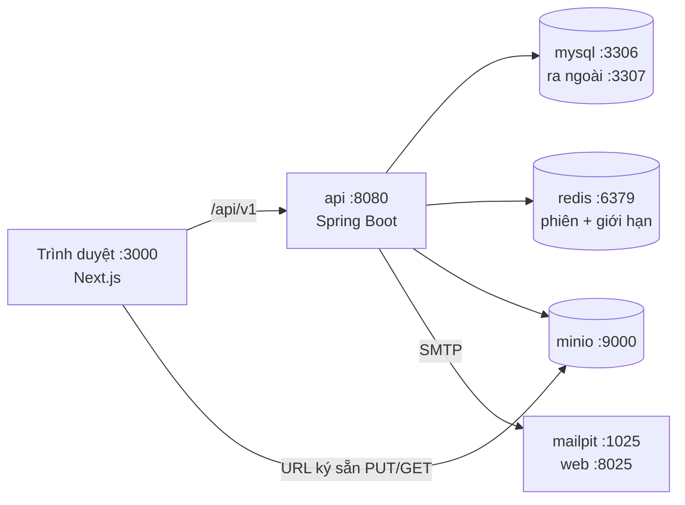

# 01 — Đóng gói backend bằng Docker

> Phạm vi: môi trường **dev/demo** (chưa production). Mọi lệnh chạy trong thư mục `backend/`.
> Windows dùng PowerShell hoặc Git Bash đều được; chỉ cần **Docker Desktop đang chạy**.

## 1. Kiến trúc



| Container | Image | Vai trò | Cổng trên máy |
|---|---|---|---|
| `mysql` | mysql:8.4 | CSDL 67 bảng (Flyway tạo) | 3307 |
| `redis` | redis:7-alpine | Phiên đăng nhập, giới hạn tần suất | 6379 |
| `minio` | minio/minio | Kho tệp kiểu S3 (ảnh, âm thanh) | 9000 (API), 9001 (console) |
| `mailpit` | axllent/mailpit | Bắt mọi email gửi đi, xem trên web | 1025 (SMTP), 8025 (web) |
| `api` | build từ `Dockerfile` | Spring Boot API + tác vụ nền (profile `app`) | 8080 |

`api` nằm trong **compose profile `app`** → `docker compose up -d` chỉ bật 4 dịch vụ hạ tầng (cho BE chạy API trong IDE); thêm `--profile app` mới bật cả API (cho FE).

## 2. Các file liên quan

| File | Làm gì |
|---|---|
| `backend/Dockerfile` | Build 2 tầng: Maven + JDK 21 build jar → tách lớp Spring Boot → chạy trên JRE 21, user không phải root |
| `backend/.dockerignore` | Không gửi `target/`, `.idea/`, `.env` vào build |
| `backend/compose.yaml` | Khai báo 5 container, healthcheck, volume, cổng |
| `backend/.env.example` | Mẫu biến môi trường; chép thành `.env` nếu cần đổi mật khẩu/cổng |
| `src/main/resources/application.yaml` | Cấu hình gốc (giá trị mặc định = chạy API trong IDE, dịch vụ ở `localhost`) |
| `application-docker.yaml` | Khi API chạy trong compose: gọi `mysql`, `redis`, `minio`, `mailpit` theo tên container |
| `application-dev.yaml` | Tự tạo bucket MinIO, log DEBUG |
| `application-worker.yaml` | Bật vòng lặp tác vụ nền (`tac_vu_nen`) và outbox (`su_kien_cho_gui`) |

## 3. Profile Spring

| Profile | Bật khi | Tác dụng |
|---|---|---|
| `dev` (mặc định) | Không đặt gì | Kéo theo nhóm `api,worker` + tạo bucket |
| `docker` | Container `api` | Đổi host dịch vụ sang tên container |
| `worker` | Trong nhóm `dev` | Chạy tác vụ nền (gửi mail, xử lý hàng đợi) |
| `test` | Khi chạy test | Testcontainers tự dựng MySQL/Redis/MinIO/Mailpit riêng |

Container `api` chạy `SPRING_PROFILES_ACTIVE=docker,dev`.

## 4. Lệnh thường dùng

| Mục đích | Lệnh |
|---|---|
| Bật hạ tầng (BE code trong IDE) | `docker compose up -d` |
| Bật toàn bộ kể cả API | `docker compose --profile app up -d --build` |
| Xem trạng thái | `docker compose --profile app ps` |
| Xem log API | `docker compose logs -f api` |
| Build lại API sau khi đổi code | `docker compose --profile app up -d --build api` |
| Tắt (giữ dữ liệu) | `docker compose --profile app down` |
| Tắt + **xóa sạch dữ liệu** (DB, Redis, tệp) | `docker compose --profile app down -v` |
| Vào MySQL | `docker compose exec mysql mysql -uvocab -p vocab_learning` (mật khẩu = `DB_PASSWORD`) |
| Vào Redis | `docker compose exec redis redis-cli` |

Chạy API trong IDE (BE): `docker compose up -d` rồi chạy `VocabLearningApplication` (hoặc `.\mvnw.cmd spring-boot:run`). Giá trị mặc định trong `application.yaml` đã trỏ đúng `localhost:3307/6379/9000/1025`.

## 5. Luồng khởi động

1. `mysql` khởi tạo volume, tự tạo DB `vocab_learning` + user `DB_USER` (toàn quyền trên DB) → healthcheck `mysqladmin ping` xanh.
2. `redis`, `minio`, `mailpit` healthy.
3. `api` khởi động (chờ 4 dịch vụ trên healthy):
   - Flyway (cùng user `vocab` với API) chạy `V1__schema.sql` (67 bảng) và `V2__seed_core.sql` (vai trò, cài đặt, chính sách AI, chủ đề).
   - Hibernate `ddl-auto=validate` kiểm tra entity khớp bảng.
   - Tạo bucket `vocab-media` nếu chưa có.
4. Healthcheck `GET /actuator/health/readiness` (kiểm MySQL + Redis) → `healthy`.

Kiểm tra nhanh:
```bash
curl http://localhost:8080/actuator/health
curl http://localhost:8080/api/v1/topics
```

## 6. Biến môi trường

Chép `backend/.env.example` → `backend/.env` và sửa khi cần; compose tự đọc `.env`. Các biến chính:

| Biến | Mặc định | Ghi chú |
|---|---|---|
| `MYSQL_PORT` | 3307 | Đổi nếu máy đã dùng cổng này |
| `API_PORT` | 8080 | Cổng API trên máy |
| `DB_USER` / `DB_PASSWORD` / `DB_ROOT_PASSWORD` | `vocab` / `vocab_dev_pw` / `root_dev_pw` | 1 user cho cả Flyway và API. Đổi mật khẩu: xem [03_DOI_MAT_KHAU_DB.md](03_DOI_MAT_KHAU_DB.md) |
| `STORAGE_PUBLIC_ENDPOINT` | `http://localhost:9000` | Địa chỉ trình duyệt dùng để tải tệp qua URL ký sẵn |
| `APP_CORS_ALLOWED_ORIGINS` | `http://localhost:3000` | Chỉ cần khi FE gọi thẳng khác origin |
| `LLM_PROVIDER_API_KEY`, `SPEECH_PROVIDER_KEY` | trống | Trống = dùng bản giả lập (Đợt 3) |

> `.env` chứa mật khẩu → không commit (đã có trong `backend/.gitignore`). Đổi mật khẩu DB: xem [03_DOI_MAT_KHAU_DB.md](03_DOI_MAT_KHAU_DB.md).

## 7. Vì sao thiết kế như vậy

| Quyết định | Lý do |
|---|---|
| Build 2 tầng + tách lớp | Image nhỏ (JRE), đổi code chỉ build lại lớp `application` → nhanh |
| Healthcheck + `depends_on: service_healthy` | API không khởi động khi DB chưa sẵn sàng |
| `STORAGE_PUBLIC_ENDPOINT` riêng | Trong Docker API gọi `minio:9000`, nhưng trình duyệt chỉ thấy `localhost:9000` → URL ký phải dùng địa chỉ trình duyệt |
| MySQL mở cổng 3307 | Tránh đụng MySQL cài sẵn trên máy (3306) |
| Múi giờ UTC ở JVM + MySQL | Quy ước lưu thời gian UTC |

## 8. Xử lý sự cố

| Triệu chứng | Nguyên nhân / cách xử lý |
|---|---|
| `port is already allocated` | Cổng bị chiếm → đổi `MYSQL_PORT`/`API_PORT`/`REDIS_PORT` trong `.env` |
| `api` restart liên tục, log `Access denied for user 'vocab'` | Mật khẩu trong `.env` khác mật khẩu MySQL đang giữ → [03_DOI_MAT_KHAU_DB.md](03_DOI_MAT_KHAU_DB.md) |
| Log `Validate failed: Migration checksum mismatch` | Ai đó sửa file `V1__`/`V2__` đã chạy. Không sửa migration cũ; thêm `V3__...`. Dev có thể `down -v` |
| `Schema-validation: missing column` | Entity map sai tên cột tiếng Việt → sửa `@Column(name=...)` |
| Build chậm lần đầu | Tải thư viện Maven (~vài phút); lần sau dùng cache |
| Docker Desktop không chạy | Mở Docker Desktop, chờ biểu tượng xanh |
