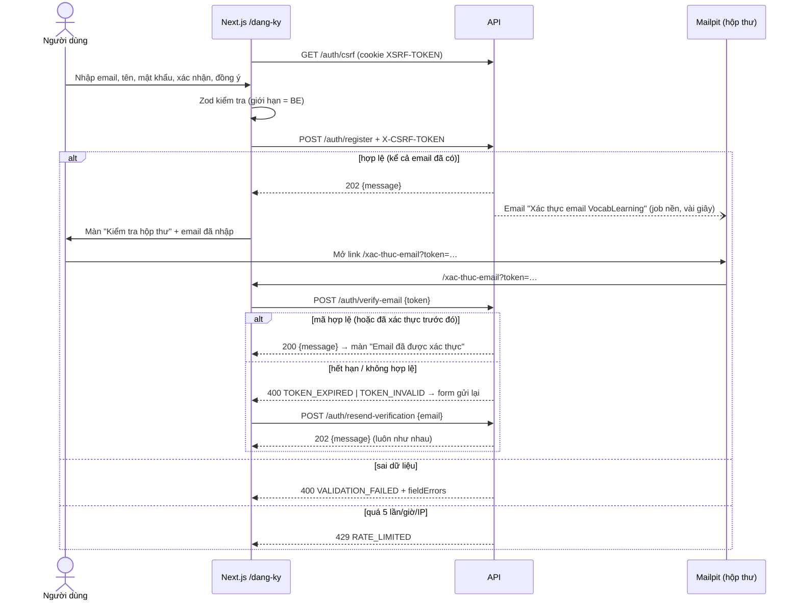

# Báo cáo bàn giao BE → FE — ĐỢT 1 Tài khoản & nội dung

| Mục | Giá trị |
|---|---|
| Giai đoạn | Đợt 1 — Tài khoản & nội dung (12/10 – 25/10/2026) |
| Ngày bàn giao | 27/09/2026 (lần 1: B1.1) |
| Trạng thái BE | 🟡 B1.1 Đăng ký xong · 29 test xanh (3 test TK-01) · chạy được trong Docker |
| FE làm tương ứng | F1.1 UI01 `/dang-ky` (`roadmap/ROADMAP_FE.md` §Đợt 1) |
| Báo cáo trước | [GĐ0](GD0_BAO_CAO_FE.md) — hợp đồng chung (lỗi, CSRF, `api-client.js`, phân trang) xem ở đó |

> **Đọc nhanh:** chạy BE bằng `docker compose --profile app up -d --build`. Làm ngay 5 trang tài khoản `/dang-ky`, `/xac-thuc-email`, `/dang-nhap`, `/quen-mat-khau`, `/dat-lai-mat-khau` (mockup trong `mockups/dot1/`) với API thật.

Báo cáo này được **cập nhật dần** khi BE xong từng bước của Đợt 1.

---

## 1. BE đã giao gì (đối chiếu 2 roadmap)

| BE bước | Kết quả | FE bước / UI | FE cần làm |
|---|---|---|---|
| B1.1 Đăng ký (TK-01) | ✅ `POST /api/v1/auth/register`: tạo tài khoản chờ xác thực, hồ sơ, tùy chọn học mặc định, vai trò `LEARNER`, mã xác thực 24 giờ, email xác thực (Mailpit) | F1.1 UI01 `/dang-ky` | Form 5 trường (mục 5.1), lỗi theo trường, 429 đếm ngược, màn "Kiểm tra hộp thư" |
| B1.2 Xác thực email (TK-02) | ✅ `POST /auth/verify-email`, `POST /auth/resend-verification`: mã dùng 1 lần, 24 giờ, mã mới vô hiệu mã cũ; tài khoản lên `ACTIVE` | F1.2 UI02 `/xac-thuc-email?token=` | Tự gửi mã khi mở trang, màn thành công / hết hạn / không hợp lệ, form gửi lại có đếm ngược (mục 5.2, 5.3) |
| B1.3 Đăng nhập (TK-03) | ✅ `POST /auth/login` tạo phiên (cookie `VOCAB_SESSION`), `POST /auth/logout`, Google `/oauth2/authorization/google` (bật khi có `GOOGLE_CLIENT_ID`) | F1.3 UI03 `/dang-nhap` | Form email/mật khẩu, nút Google (điều hướng cả trang), đọc `?loi=` và `?quay-lai=`, lỗi chưa xác thực/khóa, 429 (mục 5.4, 5.5) |
| B1.4 Quên/đặt lại mật khẩu (TK-05) | ✅ `POST /auth/forgot-password` (202 chung, mã 15 phút), `POST /auth/reset-password` (đổi mật khẩu, thu hồi **mọi** phiên) | F1.4 UI04 `/quen-mat-khau`, `/dat-lai-mat-khau?token=` | Form email → màn kiểm tra hộp thư; form mật khẩu mới + nhập lại; mã hết hạn/đã dùng → link yêu cầu mới (mục 5.6, 5.7) |
| B1.5 Phiên & danh tính (TK-03/05) | ✅ `GET/DELETE /auth/sessions`, `POST /auth/reauthenticate` (5 phút), `GET /auth/identities`, `POST /auth/identities/google/link`, `DELETE /auth/identities/google` | F1.6b `/cai-dat/bao-mat` (mới) | Danh sách thiết bị + đăng xuất từng thiết bị; liên kết/gỡ Google qua hộp thoại xác thực lại (mục 5.8) |
| B1.6 Hồ sơ & ảnh (TK-06) | ✅ `GET /users/me`, `PATCH /users/me/profile`, `POST /media/upload-intents`, `POST /media/{id}/complete`, `GET /media/{id}/access` | F1.5 `/ho-so` | Tên, giới thiệu, ảnh đại diện (tải thẳng lên kho, BE kiểm và bỏ EXIF) (mục 5.9) |
| B1.7 Trình độ/mục tiêu/chủ đề (TK-07) | ✅ `PATCH /users/me/profile` (+`level`, `learningGoal`, `completeOnboarding`), `PUT /users/me/interests`; `GET /users/me` có thêm `interests` | F1.6 `/cai-dat` (bước 1–2) | Trình độ tự đánh giá A1–C2, mục tiêu ≤500, chủ đề đang hoạt động (mục 5.10) |

**Chưa có** (dùng MSW, hợp đồng ở mục 9):

| API | BE bước | Khi nào có |
|---|---|---|
| `GET /users/me/streak`, `/users/me/activity` (khối chuỗi ngày ở `/ho-so`) | B1.x TK-10 | Hiện "Chưa có dữ liệu" |

Luồng tài khoản chạy trọn: đăng ký → xác thực → đăng nhập → đăng xuất.

## 2. Chạy BE

Không có dịch vụ mới so với GĐ0. **Thay đổi:** MySQL giờ chỉ có **1 user** `vocab`. Nếu còn volume cũ thì chạy `docker compose down -v` một lần. Chi tiết: [`huong-dan/03_DOI_MAT_KHAU_DB.md`](../huong-dan/03_DOI_MAT_KHAU_DB.md).

```bash
cd backend
docker compose --profile app up -d --build
```

Email xác thực xem tại http://localhost:8025 (Mailpit).

## 3. Thay đổi hợp đồng chung

**Giao diện (27/09):** đổi bảng màu và bố cục; tất cả mockup đã cập nhật. FE copy lại `mockups/shared/tokens.css`, `base.css`, `components.css`.

| Thay đổi | Chi tiết |
|---|---|
| Bảng màu 60–30–10 | Nền `#F5F7FB`, chữ `#1B2536`. Xanh dương `--primary #1D5FD1` cho hành động chính và điều hướng. Xanh lá `--secondary #1E7F55` cho tiến độ. Cam `--accent #F59E0B` (chữ tối) chỉ cho **một** nút "Bắt đầu học" mỗi màn. Chi tiết: `frontend/design/YEU_CAU_GIAO_DIEN.md` §2 |
| Hai bố cục (mốc 1024 px) | Máy tính: header + menu trái + nội dung nhiều cột. Dưới 1024 px: thanh trên + **thanh điều hướng dưới 5 mục** (Học, Thư viện, Luyện tập, Sổ tay, Tôi); bỏ ngăn kéo menu. Chi tiết: §4.0 và `mockups/gd0/bo-cuc.html` |
| Thành phần mới | `Button variant="accent"`, `Badge variant="accent"`, chip chuỗi ngày `.streak`, `BottomNav`, layout `(auth)` 2 cột |

**Phiên Redis (27/09, B1.4):** sửa thêm lỗi GĐ0 — cấu hình `spring.session.redis.*` bị Boot 4 bỏ qua, phiên không được đánh chỉ mục theo người dùng. Nay đúng `spring.session.data.redis.*`; đổi mật khẩu thu hồi được mọi phiên. FE không cần đổi gì.

**Cookie phiên (27/09, B1.3):** sửa lỗi GĐ0 — cookie trước đây tên `SESSION`, thiếu `HttpOnly`/`SameSite`. Nay là `VOCAB_SESSION; Path=/; HttpOnly; SameSite=Lax` (Secure khi `APP_COOKIE_SECURE=true`). FE không đọc được cookie này bằng JS — đúng thiết kế; mọi `fetch` phải có `credentials: 'include'` khi gọi khác cổng.

API: không thay đổi. Thêm một quy ước:

- **Một trường có thể có nhiều lỗi** trong `fieldErrors`, thứ tự không cố định. Ví dụ `displayName` rỗng trả cả "Vui lòng nhập…" và "…phải từ 2 đến 100 ký tự." FE hiển thị **lỗi đầu tiên** của mỗi trường.

## 4. Luồng chính



## 5. API chi tiết (đã kiểm chứng trên BE thật)

### 5.1 `POST /api/v1/auth/register` — tạo tài khoản

| Quyền | FE bước | UI | Trang |
|---|---|---|---|
| G (khách), cần CSRF | F1.1 | UI01 | `/dang-ky` |

**Gửi**

| Trường | Kiểu | Bắt buộc | Giới hạn (khớp BE) | Ví dụ |
|---|---|---|---|---|
| `email` | string | ✓ | email hợp lệ, ≤ 254; BE trim, NFC, lowercase để kiểm tra trùng | `lan.anh@example.com` |
| `password` | string | ✓ | 10–128 ký tự, **không trim** | `hoc-tu-vung-moi-ngay` |
| `displayName` | string | ✓ | 2–100 ký tự sau khi trim | `Nguyễn Lan Anh` |

"Nhập lại mật khẩu" và "Đồng ý điều khoản" **chỉ kiểm tra ở FE**, không gửi lên BE.

**Nhận** (thật)

```http
HTTP/1.1 202
Content-Type: application/json
```
```json
{"message":"Nếu email hợp lệ, hãy kiểm tra hộp thư để xác thực tài khoản."}
```

Email đã đăng ký (khác hoa/thường, có khoảng trắng) cũng trả **đúng 202 và cùng nội dung**, không tạo user thứ hai và không gửi email. FE **không được** hiện "email đã tồn tại".

**Lỗi** (thật)

```json
{"detail":"Vui lòng kiểm tra lại các trường được đánh dấu.","instance":"/api/v1/auth/register","status":400,"title":"Dữ liệu không hợp lệ","type":"urn:vocablearning:error:validation-failed","code":"VALIDATION_FAILED","traceId":"d3c15a2235684e71","fieldErrors":[{"field":"displayName","message":"Vui lòng nhập tên hiển thị."},{"field":"email","message":"Email không đúng định dạng."},{"field":"displayName","message":"Tên hiển thị phải từ 2 đến 100 ký tự."},{"field":"password","message":"Mật khẩu phải từ 10 đến 128 ký tự."}],"retryable":false}
```
```json
{"detail":"Bạn thao tác quá nhanh, hãy thử lại sau 3599 giây.","instance":"/api/v1/auth/register","status":429,"title":"Thao tác quá nhanh","type":"urn:vocablearning:error:rate-limited","code":"RATE_LIMITED","traceId":"15b4b0c73f654ec8","fieldErrors":[],"retryable":true}
```

| HTTP | `code` | Khi nào | FE xử lý |
|---|---|---|---|
| 400 | `VALIDATION_FAILED` | Sai định dạng hoặc độ dài | `setError` theo `field`, lấy lỗi đầu tiên; focus ô lỗi đầu |
| 403 | `CSRF_INVALID` | Thiếu hoặc hết hạn CSRF | `api-client` tự lấy token mới và gửi lại 1 lần (GĐ0 §6.3) |
| 429 | `RATE_LIMITED` | Quá 5 lần/giờ cho một IP (tính cả email trùng; lỗi 400 không tính) | Alert + nút "Thử lại sau N giây"; N lấy từ `detail` (regex `(\d+) giây`), mặc định 60 |
| 500 | `INTERNAL_ERROR` | Lỗi hệ thống | Alert "Chưa tạo được tài khoản…" kèm `traceId` |

**Tác dụng phụ:**
- DB: `nguoi_dung` có `trang_thai = PENDING_VERIFICATION`, cùng `ho_so_nguoi_dung` (trình độ A1), `tuy_chon_hoc` (10 thẻ mới/ngày, 15 phút, `Asia/Ho_Chi_Minh`), vai trò `LEARNER` và `ma_xac_thuc` loại `VERIFY_EMAIL` hạn 24 giờ.
- Email: gửi qua job `SEND_EMAIL`, tới Mailpit sau vài giây. Tiêu đề "Xác thực email VocabLearning", link `http://localhost:3000/xac-thuc-email?token=<43 ký tự base64url>`.
- Không tạo phiên, không set cookie `VOCAB_SESSION`.

**Postman:** thư mục `01 Xác thực (TK)` có 3 request: `Đăng ký (TK-01)`, `Đăng ký email trùng → 202 chung`, `Đăng ký dữ liệu sai → 400`.

### 5.2 `POST /api/v1/auth/verify-email` — xác thực email

| Quyền | FE bước | UI | Trang |
|---|---|---|---|
| G (khách), cần CSRF | F1.2 | UI02 | `/xac-thuc-email?token=` |

**Gửi:** `{"token": "<43 ký tự base64url từ ?token=>"}` — bắt buộc, ≤ 128 ký tự.

**Nhận** (thật): `200 {"message":"Email đã được xác thực. Bạn có thể đăng nhập."}`. Tài khoản `PENDING_VERIFICATION` → `ACTIVE`. Không tạo phiên (đăng nhập ở B1.3).

Mở lại **cùng liên kết** sau khi đã xác thực (bấm 2 lần, 2 tab, React StrictMode gọi 2 lần) vẫn trả **200**. Không cần chống gọi trùng ở FE.

**Lỗi** (thật)

```json
{"detail":"Liên kết xác thực không hợp lệ. Hãy yêu cầu gửi lại email xác thực.","instance":"/api/v1/auth/verify-email","status":400,"title":"Mã xác thực không hợp lệ","type":"urn:vocablearning:error:token-invalid","code":"TOKEN_INVALID","traceId":"b118505cd37945d2","fieldErrors":[],"retryable":false}
```

| HTTP | `code` | Khi nào | FE xử lý |
|---|---|---|---|
| 400 | `TOKEN_INVALID` | Mã sai, hoặc đã bị mã mới hơn thay thế (`detail`: "Liên kết này đã được thay bằng liên kết mới hơn…") | Tiêu đề "Liên kết xác thực không dùng được" + hiện `detail` + form gửi lại |
| 400 | `TOKEN_EXPIRED` | Quá 24 giờ (`detail`: "Liên kết xác thực đã hết hạn sau 24 giờ…") | Tiêu đề "Liên kết xác thực đã hết hạn" + form gửi lại |
| 400 | `VALIDATION_FAILED` | Thiếu `token` | Xử lý như `TOKEN_INVALID` |
| 403 | `CSRF_INVALID` | Thiếu CSRF | `api-client` tự thử lại |

Trang không có `?token=` → không gọi API, hiện luôn form gửi lại. Sau khi đọc token, FE xóa nó khỏi URL (`router.replace('/xac-thuc-email')`) để không lưu trong lịch sử.

### 5.3 `POST /api/v1/auth/resend-verification` — gửi lại email xác thực

| Quyền | FE bước | UI | Trang |
|---|---|---|---|
| G (khách), cần CSRF | F1.2 | UI02 | `/xac-thuc-email` |

**Gửi:** `{"email": "lan.anh@example.com"}` — email hợp lệ, ≤ 254, không phân biệt hoa/thường.

**Nhận** (thật): `202 {"message":"Nếu tài khoản đang chờ xác thực, email mới sẽ đến trong vài phút. Liên kết cũ không còn dùng được."}` — **giống hệt** cho email không tồn tại, đã xác thực hay đang chờ. Chỉ tài khoản đang chờ mới nhận email; liên kết cũ hết hiệu lực ngay.

```json
{"detail":"Bạn thao tác quá nhanh, hãy thử lại sau 3451 giây.","instance":"/api/v1/auth/resend-verification","status":429,"title":"Thao tác quá nhanh","type":"urn:vocablearning:error:rate-limited","code":"RATE_LIMITED","traceId":"e3fbaf84460c4b36","fieldErrors":[],"retryable":true}
```

| HTTP | `code` | Khi nào | FE xử lý |
|---|---|---|---|
| 400 | `VALIDATION_FAILED` | Email sai định dạng | Lỗi dưới ô email |
| 429 | `RATE_LIMITED` | Quá **3 lần/giờ cho một email** | Alert + nút "Gửi lại sau N giây" (N từ `detail`) |

Sau 202: alert thành công + khóa nút 60 giây ở FE để tránh bấm liên tục.

**Postman:** thêm `Mailpit — lấy mã xác thực` (tự lưu `verifyToken`), `Xác thực email (TK-02)`, `Xác thực mã sai → 400 TOKEN_INVALID`, `Gửi lại email xác thực (TK-02)`. Thứ tự chạy: Đăng ký → Mailpit → Xác thực email.

### 5.4 `POST /api/v1/auth/login` — đăng nhập email

| Quyền | FE bước | UI | Trang |
|---|---|---|---|
| G (khách), cần CSRF | F1.3 | UI03 | `/dang-nhap?quay-lai=/hoc` |

**Gửi:** `{"email": "lan.anh@example.com", "password": "hoc-tu-vung-moi-ngay"}` — email ≤ 254 (không phân biệt hoa/thường), mật khẩu bắt buộc, ≤ 128. **Không** kiểm độ dài tối thiểu ở FE form đăng nhập.

**Nhận** (thật)

```http
HTTP/1.1 200
Set-Cookie: VOCAB_SESSION=MzI3YzI2NTct…; Path=/; HttpOnly; SameSite=Lax
```
```json
{"id":"7","email":"b12-22323@example.test","displayName":"H?c B12","roles":["LEARNER"],"status":"ACTIVE"}
```

(`H?c` do tài khoản thử được tạo bằng `curl` trong terminal Windows không gửi UTF-8; tạo qua trình duyệt/Postman thì tiếng Việt lưu đúng.)

Mỗi lần đăng nhập tạo phiên **mới** (đổi session id). Phiên hết hạn sau 30 phút không hoạt động → API trả 401 `UNAUTHENTICATED`.

**Lỗi** (thật)

```json
{"detail":"Email hoặc mật khẩu không đúng.","instance":"/api/v1/auth/login","status":401,"title":"Sai thông tin đăng nhập","type":"urn:vocablearning:error:invalid-credentials","code":"INVALID_CREDENTIALS","traceId":"cf125b5dd12c4489","fieldErrors":[],"retryable":false}
```

| HTTP | `code` | Khi nào | FE xử lý |
|---|---|---|---|
| 401 | `INVALID_CREDENTIALS` | Sai email **hoặc** mật khẩu (không phân biệt); tài khoản chỉ có Google | Alert chung, xóa ô mật khẩu, focus lại |
| 403 | `EMAIL_NOT_VERIFIED` | Mật khẩu đúng, email chưa xác thực | Alert vàng + link `/xac-thuc-email` (form gửi lại) |
| 403 | `ACCOUNT_LOCKED` | Mật khẩu đúng, tài khoản bị khóa | Alert đỏ, không cho thử lại ngay |
| 429 | `RATE_LIMITED` | > 10 lần/phút/IP hoặc > 5 lần/phút/email | Alert + nút "Thử lại sau N giây" |
| 400 | `VALIDATION_FAILED` | Thiếu trường/sai định dạng email | Lỗi dưới ô |

Sau 200: lưu user vào cache React Query (`['me']`), chuyển tới `quay-lai` **chỉ khi là đường dẫn nội bộ** (bắt đầu bằng `/`, không phải `//`), mặc định `/hoc`.

**Google** — `GET /oauth2/authorization/google` (không có `/api/v1`), điều hướng **cả trang** (`window.location.href`, qua rewrite Next.js). BE kiểm `state`/`nonce`, tạo phiên rồi 302 về `/hoc`. Lỗi quay về `/dang-nhap?loi=<CODE>`:

| `loi` | Nghĩa | Thông báo gợi ý |
|---|---|---|
| `GOOGLE_EMAIL_IN_USE` | Email Google đã có tài khoản mật khẩu — **không tự ghép** | Đăng nhập bằng mật khẩu, rồi liên kết Google trong Cài đặt (B1.5) |
| `GOOGLE_CANCELLED` | Người dùng hủy ở màn Google | Thông tin, không phải lỗi |
| `GOOGLE_FAILED` | Lỗi khác từ Google | Thử lại sau |
| `EMAIL_NOT_VERIFIED`, `ACCOUNT_LOCKED` | Như bảng trên | Như bảng trên |

Google chỉ bật khi BE có `GOOGLE_CLIENT_ID`/`GOOGLE_CLIENT_SECRET` (`backend/.env`, redirect URI `http://localhost:8080/login/oauth2/code/google`); chưa có thì trả 404 — FE vẫn hiện nút.

### 5.5 `POST /api/v1/auth/logout` — đăng xuất

Cần CSRF, không cần đăng nhập. **204**, gọi lại vẫn 204. BE hủy phiên Redis và xóa cookie. FE: `queryClient.clear()` rồi chuyển `/dang-nhap`.

**Postman:** thêm `Đăng nhập (TK-03)`, `Đăng nhập sai mật khẩu → 401`, `Đăng nhập Google (mở trong trình duyệt)`, `Đăng xuất (TK-03)`.

### 5.6 `POST /api/v1/auth/forgot-password` — quên mật khẩu

| Quyền | FE bước | UI | Trang |
|---|---|---|---|
| G (khách), cần CSRF | F1.4 | UI04 | `/quen-mat-khau` |

**Gửi:** `{"email": "lan.anh@example.com"}` — email hợp lệ, ≤ 254.

**Nhận** (thật): `202 {"message":"Nếu email thuộc một tài khoản đang hoạt động, liên kết đặt lại mật khẩu sẽ đến trong vài phút."}` — **giống hệt** cho email không tồn tại hoặc chưa xác thực. Chỉ tài khoản `ACTIVE` (kể cả tài khoản chỉ có Google) nhận email "Đặt lại mật khẩu VocabLearning" với liên kết `http://localhost:3000/dat-lai-mat-khau?token=<43 ký tự>`, hạn **15 phút**; yêu cầu mới vô hiệu liên kết cũ.

| HTTP | `code` | Khi nào | FE xử lý |
|---|---|---|---|
| 400 | `VALIDATION_FAILED` | Email sai định dạng | Lỗi dưới ô |
| 429 | `RATE_LIMITED` | > 5 lần/giờ/IP hoặc > 3 lần/giờ/email | Alert + đếm ngược trên nút |

Sau 202: màn "Kiểm tra hộp thư" + nút "Gửi lại" khóa 60 giây.

### 5.7 `POST /api/v1/auth/reset-password` — đặt lại mật khẩu

| Quyền | FE bước | UI | Trang |
|---|---|---|---|
| G (khách), cần CSRF | F1.4 | UI04 | `/dat-lai-mat-khau?token=` |

**Gửi:** `{"token": "<từ ?token=>", "newPassword": "hoc-tu-vung-moi-ngay"}` — `newPassword` 10–128 ký tự, không trim. "Nhập lại mật khẩu" chỉ kiểm ở FE.

**Nhận** (thật): `200 {"message":"Đã đặt lại mật khẩu. Hãy đăng nhập bằng mật khẩu mới."}`. BE **thu hồi mọi phiên** của tài khoản (mọi thiết bị, kể cả trình duyệt đang mở) và không tự đăng nhập → FE `queryClient.clear()`, hiện nút "Đăng nhập".

**Lỗi** (thật)

```json
{"detail":"Liên kết đặt lại mật khẩu không hợp lệ hoặc đã được dùng. Hãy yêu cầu liên kết mới.","instance":"/api/v1/auth/reset-password","status":400,"title":"Mã xác thực không hợp lệ","type":"urn:vocablearning:error:token-invalid","code":"TOKEN_INVALID","traceId":"3500d10e6900450d","fieldErrors":[],"retryable":false}
```

| HTTP | `code` | Khi nào | FE xử lý |
|---|---|---|---|
| 400 | `TOKEN_INVALID` | Mã sai, đã dùng, hoặc đã bị yêu cầu mới thay | Màn "Liên kết không dùng được" + nút tới `/quen-mat-khau` |
| 400 | `TOKEN_EXPIRED` | Quá 15 phút | Màn "Liên kết đã hết hạn" + nút tới `/quen-mat-khau` |
| 400 | `VALIDATION_FAILED` | `newPassword` sai độ dài (field `newPassword`); thiếu `token` (field `token` → xử lý như `TOKEN_INVALID`) | Lỗi dưới ô |

Mở trang không có `?token=` → hiện ngay màn "Thiếu liên kết đặt lại". Đọc token xong xóa khỏi URL.

**Postman:** thêm `Quên mật khẩu (TK-05)`, `Mailpit — lấy mã đặt lại mật khẩu` (lưu `resetToken`), `Đặt lại mật khẩu (TK-05)`, `Đặt lại mật khẩu mã sai → 400`.

### 5.8 Phiên, xác thực lại, phương thức đăng nhập (B1.5) — trang `/cai-dat/bao-mat`

Tất cả cần đăng nhập (chưa đăng nhập → 401 `UNAUTHENTICATED`); ghi cần CSRF. Chỉ tác động lên chính người gọi.

| API | Nhận | Lỗi |
|---|---|---|
| `GET /auth/sessions` | `200 [{id, userAgent, createdAt, lastActiveAt, current}]` — mới hoạt động nhất trước; `id` là **mã băm 16 hex**, không phải cookie | — |
| `DELETE /auth/sessions/{id}` | `204` — thiết bị đó bị đăng xuất ngay; xóa phiên hiện tại = đăng xuất | 404 `NOT_FOUND` (lạ/đã thu hồi/của người khác) |
| `POST /auth/reauthenticate` `{password}` | `200 {reauthenticatedUntil}` — hạn **5 phút**, gắn với phiên hiện tại | 401 `INVALID_CREDENTIALS`, 422 `BUSINESS_RULE_VIOLATED` (tài khoản chỉ Google), 429 (5 lần/phút, chung với đăng nhập) |
| `GET /auth/identities` | `200 {hasPassword, identities:[{provider:"google", email, linkedAt}]}` | — |
| `POST /auth/identities/google/link` | `200 {redirectUrl:"/oauth2/authorization/google"}` → **điều hướng cả trang** | 403 `REAUTH_REQUIRED`, 503 `DEPENDENCY_UNAVAILABLE` (Google chưa bật), 404 (provider khác `google`) |
| `DELETE /auth/identities/google` | `204` | 403 `REAUTH_REQUIRED`, 404 (chưa liên kết), 422 `LAST_LOGIN_METHOD` |

**Mẫu xác thực lại:** gọi thao tác → gặp 403 `REAUTH_REQUIRED` → mở hộp thoại mật khẩu → `POST /auth/reauthenticate` → gọi lại **đúng** thao tác đó. Trong 5 phút không hỏi lại. (B1.10 xóa tài khoản dùng cùng mẫu.)

**Liên kết Google:** Google xong quay về `/cai-dat?lien-ket=google` (toast "Đã liên kết Google"); lỗi → `/cai-dat?loi=<CODE>`: `GOOGLE_ACCOUNT_IN_USE` (Google đã thuộc người khác), `CONFLICT` (đã liên kết Google khác), `GOOGLE_CANCELLED`, `GOOGLE_FAILED`. Email Google được phép khác email tài khoản.

**Hiển thị thiết bị:** FE tự rút gọn `userAgent` thành "Chrome trên Windows"… (chỉ để hiển thị). Nút "Gỡ liên kết" tắt sẵn khi `hasPassword=false` và chỉ có 1 identity.

Mockup: `mockups/dot1/bao-mat.html` (`/fe-from-mockup`). **Postman:** 6 request mới (danh sách/thu hồi phiên, xác thực lại, identities, liên kết, gỡ).

### 5.9 Hồ sơ và ảnh đại diện (B1.6) — trang `/ho-so`

Cần đăng nhập; ghi cần CSRF. Không có tham số userId: luôn là người gọi. **Trường null không có trong JSON** (`bio`, `avatar`, `learningGoal`…).

| API | Gửi | Nhận | Lỗi |
|---|---|---|---|
| `GET /users/me` | — | `200 {id, email, status, roles, emailVerified, displayName, bio?, level, learningGoal?, avatar?:{mediaId, url, expiresAt}, onboardingCompletedAt?}` | 401 |
| `PATCH /users/me/profile` | `{displayName?, bio?, avatarMediaId?, removeAvatar?}` — trường không gửi = giữ nguyên | `200` như `GET /users/me` | 400 `VALIDATION_FAILED` `fieldErrors[displayName\|bio]` (tên 2–100 sau khi cắt khoảng trắng, bio ≤500, `""` = xóa); 404 ảnh không phải của mình; 422 ảnh chưa READY |
| `POST /media/upload-intents` | `{purpose:"AVATAR", contentType, sizeBytes}` | `201 {mediaId, uploadUrl, method:"PUT", headers:{Content-Type}, expiresAt}` (URL hạn 5 phút) | 415 `UNSUPPORTED_MEDIA_TYPE` (khác jpeg/png/webp), 422 (>5 MB), 429 (30 lần/giờ) |
| `PUT {uploadUrl}` (MinIO) | thân = tệp, header `Content-Type` như trên, **không** gửi cookie | `200` | 403 nếu kích thước/Content-Type khác lúc tạo ý định |
| `POST /media/{id}/complete` | — | `200 {id, mimeType, sizeBytes, status:"READY"}`; gọi lại khi đã READY trả kết quả cũ | 422 chưa PUT; 415 tệp giả ảnh/hỏng (tệp chuyển REJECTED, phải tải ảnh khác); 409 tệp đã bị từ chối; 404 |
| `GET /media/{id}/access` | — | `200 {url, expiresAt}` | 404 (không phải của mình / chưa READY) |

**Luồng đổi ảnh:** chọn tệp → kiểm sơ bộ loại + ≤5 MB ở FE → `upload-intents` (sizeBytes = `file.size` **chính xác**) → `fetch(uploadUrl, {method:'PUT', headers, body:file})` → `complete` → giữ `mediaId`, xem trước bằng `URL.createObjectURL` → bấm "Lưu hồ sơ" gửi `avatarMediaId`. Nút Lưu tắt trong lúc tải ảnh.

**BE xử lý:** nhận diện theo chữ ký byte, không tin `Content-Type`; bỏ EXIF/XMP/chú thích **không nén lại** (giữ chất lượng). Thay/gỡ ảnh: ảnh cũ không còn nơi nào dùng → xóa khỏi kho. `avatar.url` hết hạn sau 5 phút: khi `` lỗi, gọi lại `GET /users/me`.

**Lưu ý hướng ảnh:** bỏ EXIF là bỏ luôn cờ xoay của ảnh điện thoại. FE nên cắt ảnh vuông bằng `<canvas>` (trình duyệt đã tự xoay đúng) rồi tải bản `image/webp`/`jpeg` từ canvas — ảnh nhẹ hơn và luôn đúng chiều.

Mockup: `mockups/dot1/ho-so.html`. **Postman:** 3 request ở "02 Người dùng & cài đặt", 5 request ở "05 Tệp (media)" (bước 2 chọn tệp ở Body → binary).

### 5.10 Trình độ, mục tiêu, chủ đề quan tâm (B1.7) — trang `/cai-dat`

| API | Gửi | Nhận | Lỗi |
|---|---|---|---|
| `PATCH /users/me/profile` | `{level?, learningGoal?, completeOnboarding?}` (gộp chung với trường B1.6) | `200` như `GET /users/me` | 400 `fieldErrors[level]` (chỉ `A1 A2 B1 B2 C1 C2`, **phân biệt hoa/thường**), 400 `fieldErrors[learningGoal]` (>500) |
| `PUT /users/me/interests` | `{topicIds:["2","8"]}` — **thay toàn bộ**; `[]` = bỏ hết; trùng tự gộp; tối đa 20 | `200 {topics:[{id, slug, name}]}` (theo tên A→Z) | 422 `BUSINESS_RULE_VIOLATED` `fieldErrors[topicIds]` (chủ đề không tồn tại/đã ẩn, kể cả con của chủ đề bị ẩn) — **danh sách cũ giữ nguyên**; 400 (id không phải số, >20, thiếu `topicIds`) |

- `GET /users/me` thêm `interests:[{id, slug, name}]` (luôn là mảng). Chủ đề bị ẩn sau khi đã chọn tự biến mất khỏi danh sách.
- `level` mặc định `A1` từ lúc đăng ký. `learningGoal: ""` = xóa (trường biến mất khỏi JSON).
- `completeOnboarding: true` ghi `onboardingCompletedAt` **lần đầu**; gửi lại không đổi mốc. FE dùng trường này quyết định chạy thiết lập theo bước (chưa có) hay trang sửa (đã có).
- Thứ tự lưu ở bước cuối: `PUT /interests` → `PATCH {learningGoal, completeOnboarding:true}` — lỗi giữa chừng thì chưa đánh dấu hoàn tất. Gặp 422 chủ đề: tải lại `GET /topics` rồi cho chọn lại.
- Hai tab ghi cùng lúc: BE khóa hồ sơ, một lần thắng trọn vẹn (không trộn danh sách).
- B1.8 sẽ thêm bước kế hoạch/giờ nhắc; khi đó cờ `completeOnboarding` chuyển sang bước cuối mới.

Mockup: `mockups/dot1/cai-dat.html`. **Postman:** 4 request mới ở "02 Người dùng & cài đặt".

## 6. Mã FE mẫu

### 6.1 Zod — `src/features/auth/schemas.js`

```js
import { z } from 'zod';

// Giới hạn = RegisterRequest (BE). confirm/terms chỉ có ở FE.
export const registerSchema = z.object({
  email: z.string().trim().min(1, 'Vui lòng nhập email.').email('Email không đúng định dạng.').max(254, 'Email tối đa 254 ký tự.'),
  displayName: z.string().trim().min(1, 'Vui lòng nhập tên hiển thị.')
    .min(2, 'Tên hiển thị phải từ 2 đến 100 ký tự.').max(100, 'Tên hiển thị phải từ 2 đến 100 ký tự.'),
  password: z.string().min(1, 'Vui lòng nhập mật khẩu.')
    .min(10, 'Mật khẩu phải từ 10 đến 128 ký tự.').max(128, 'Mật khẩu phải từ 10 đến 128 ký tự.'),
  confirm: z.string(),
  terms: z.literal(true, { errorMap: () => ({ message: 'Bạn cần đồng ý điều khoản để tạo tài khoản.' }) }),
}).refine((v) => v.confirm === v.password, { path: ['confirm'], message: 'Mật khẩu nhập lại chưa khớp.' });
```

### 6.2 Hook — `src/features/auth/use-register.js`

```js
import { useMutation } from '@tanstack/react-query';
import { apiPost } from '@/lib/api-client';

export function useRegister() {
  return useMutation({
    mutationFn: ({ email, password, displayName }) => apiPost('/auth/register', { email, password, displayName }),
  });
}

// ApiError → lỗi form (lấy lỗi đầu tiên mỗi trường)
export function applyFieldErrors(error, setError) {
  const seen = new Set();
  for (const { field, message } of error.fieldErrors ?? []) {
    if (seen.has(field)) continue;
    seen.add(field);
    setError(field, { type: 'server', message }, { shouldFocus: seen.size === 1 });
  }
}

export const retryAfterSeconds = (error) => Number(error.detail?.match(/(\d+)\s*giây/)?.[1] ?? 60);
```

Trong trang: `onSubmit` → `mutate(values, { onSuccess: () => setSentTo(values.email), onError: (e) => e.code === 'VALIDATION_FAILED' ? applyFieldErrors(e, setError) : e.code === 'RATE_LIMITED' ? startCountdown(retryAfterSeconds(e)) : setFormError(e) })`. Nút submit `disabled` khi `isPending` (GT10).

### 6.3 MSW — `src/mocks/handlers/auth.js`

```js
import { http, HttpResponse } from 'msw';

const problem = (status, code, title, detail, fieldErrors = []) => HttpResponse.json(
  { type: `urn:vocablearning:error:${code.toLowerCase().replaceAll('_', '-')}`, title, status, detail,
    instance: '/api/v1/auth/register', code, traceId: 'mock-trace', fieldErrors, retryable: status >= 429 },
  { status, headers: { 'Content-Type': 'application/problem+json' } });

export const authHandlers = [
  http.post('*/api/v1/auth/register', async ({ request }) => {
    const { email = '', password = '', displayName = '' } = await request.json();
    if (email === 'ratelimit@test.local') {
      return problem(429, 'RATE_LIMITED', 'Thao tác quá nhanh', 'Bạn thao tác quá nhanh, hãy thử lại sau 42 giây.');
    }
    const errors = [];
    if (!/^[^\s@]+@[^\s@]+\.[^\s@]+$/.test(email.trim())) errors.push({ field: 'email', message: 'Email không đúng định dạng.' });
    if (password.length < 10 || password.length > 128) errors.push({ field: 'password', message: 'Mật khẩu phải từ 10 đến 128 ký tự.' });
    const name = displayName.trim();
    if (name.length < 2 || name.length > 100) errors.push({ field: 'displayName', message: 'Tên hiển thị phải từ 2 đến 100 ký tự.' });
    if (errors.length) return problem(400, 'VALIDATION_FAILED', 'Dữ liệu không hợp lệ', 'Vui lòng kiểm tra lại các trường được đánh dấu.', errors);
    return HttpResponse.json({ message: 'Nếu email hợp lệ, hãy kiểm tra hộp thư để xác thực tài khoản.' }, { status: 202 });
  }),
];
```

### 6.4 Giao diện

Dựng giống [`mockups/dot1/dang-ky.html`](../mockups/dot1/dang-ky.html) bằng `/fe-from-mockup mockups/dot1/dang-ky.html`. Mockup có:
- **2 bố cục** (mốc 1024 px): máy tính chia 2 cột (trái khối thương hiệu `--primary-strong`, phải biểu mẫu ≤ 420 px); điện thoại 1 cột, logo trên, không có khối thương hiệu. Dùng `app/(auth)/layout.jsx` chung cho đăng ký/đăng nhập/xác thực;
- màu mới 60–30–10 (xanh dương chính, xanh lá tiến độ, cam nhấn) — xem mục 3;
- nút ẩn/hiện mật khẩu;
- trạng thái đang gửi, lỗi theo trường, alert có `traceId`, 429 đếm ngược;
- màn "Kiểm tra hộp thư của bạn", focus vào tiêu đề;
- chế độ "API thật" gửi request thật tới BE.

Trang `/quen-mat-khau`, `/dat-lai-mat-khau`: `/fe-from-mockup mockups/dot1/quen-mat-khau.html` và `…/dat-lai-mat-khau.html` — đủ màn đang gửi, đã gửi (gửi lại 60 giây), mật khẩu mới + nhập lại, liên kết hỏng/hết hạn/thiếu, thành công.

Trang `/dang-nhap`: `/fe-from-mockup mockups/dot1/dang-nhap.html` — form, nút Google, alert theo `code`/`?loi=`, màn thành công chỉ để thử (app thật chuyển trang ngay).

Trang `/xac-thuc-email`: dựng bằng `/fe-from-mockup mockups/dot1/xac-thuc-email.html` (cùng layout `(auth)`). Có 4 màn: đang xác thực, thành công (nút Đăng nhập), hết hạn/không hợp lệ + form gửi lại, không có mã + form gửi lại. Thử "API thật": mở `http://localhost:5173/dot1/xac-thuc-email?token=<mã từ Mailpit>` (không có `.html`).

## 7. Dữ liệu mẫu / tài khoản demo

- Tạo tài khoản test bằng cách gửi form với email `*@test.local`, rồi mở link trong Mailpit (http://localhost:8025).
- Đăng ký → xác thực (Mailpit) → đăng nhập chạy trọn trên BE thật. Postman đã có sẵn biến `userEmail`/`userPassword` cho luồng đó.
- Hết lượt đăng ký (429) khi test: đợi 1 giờ, hoặc nhờ BE xoá khoá bằng lệnh:

```bash
docker compose exec redis redis-cli --scan --pattern 'rl:register_ip:*'
```

## 8. Checklist FE hoàn thành F1.1

- [ ] `/dang-ky` giống mockup ở 1280 px và 390 px, không cuộn ngang, nút chính cao 48 px
- [ ] Zod chặn trước khi gửi, giới hạn trùng BE; lỗi hiện dưới ô, có `aria-invalid` + `aria-describedby`
- [ ] 400 từ BE hiện đúng ô (lấy lỗi đầu mỗi trường), focus ô lỗi đầu tiên
- [ ] 429: nút bị khoá và đếm ngược, tự mở lại khi hết giờ
- [ ] 500/mạng: alert có `traceId`, dữ liệu đã nhập được giữ nguyên
- [ ] Nút `disabled` + `aria-busy` khi đang gửi; không gửi 2 lần khi bấm liên tục
- [ ] Thành công → màn "Kiểm tra hộp thư" với email đã nhập (kể cả email đã tồn tại, không có thông báo khác)
- [ ] Không log hay lưu mật khẩu (không đưa vào URL, `localStorage` hay dữ liệu gửi Sentry)
- [ ] MSW handler mục 6.3 dùng được khi `NEXT_PUBLIC_API_MOCKING=enabled`

## 9. Sắp có ở Đợt 1 — hợp đồng dự kiến

| BE bước | Dự kiến có | API | FE bước | UI |
|---|---|---|---|---|

Hợp đồng dự kiến (theo THIET_KE §11, GĐ0 §9.2) — **dự kiến**:

| API | Gửi | Thành công | Lỗi |
|---|---|---|---|
| `POST /auth/verify-email` | `{ "token" }` từ `?token=` | `200` | mã hết hạn, sai hoặc đã dùng → `400`/`422`, hiện nút gửi lại |
| `POST /auth/resend-verification` | `{ "email" }` | `202` thông báo chung | `429` (3 lần/giờ/tài khoản) → đếm ngược |
| `POST /auth/login` | `{ "email", "password" }` | `200` + cookie `VOCAB_SESSION` | `401` sai thông tin; chưa xác thực hoặc bị khoá → lỗi riêng; `429` |
| `POST /auth/logout` | — | `204` | — |

## 10. Lưu ý / giới hạn / chưa kiểm chứng

| Mục | Chi tiết |
|---|---|
| Thông báo 202 khác bản nháp GĐ0 | Bản thật: "…để xác thực **tài khoản**." — nên hiển thị đúng `message` từ BE thay vì viết cứng trong FE |
| Giới hạn theo IP khi đi qua Next.js | BE đọc IP qua `X-Forwarded-For` (`forward-headers-strategy: framework`). Rewrite của Next dev có gửi header này; nếu không có, mọi người dùng sau proxy sẽ dùng chung 5 lượt/giờ. BE sẽ siết lại danh sách proxy tin cậy ở GĐ5 |
| Số giây trong 429 | Chỉ có trong `detail`, chưa có header `Retry-After`. BE có thể thêm sau; FE cứ đọc từ `detail`, mặc định 60 |
| Chưa kiểm chứng | Gọi qua Next.js (cổng 3000) chưa thử vì `frontend/` chưa có code; đã kiểm với BE trực tiếp ở cổng 8080 và từ mockup ở cổng 5173 (CORS) |

## 11. Báo lỗi cho BE

Gửi đường dẫn API + body (bỏ mật khẩu) + `traceId`. BE tra bằng:

```bash
docker compose logs api | grep <traceId>
```
