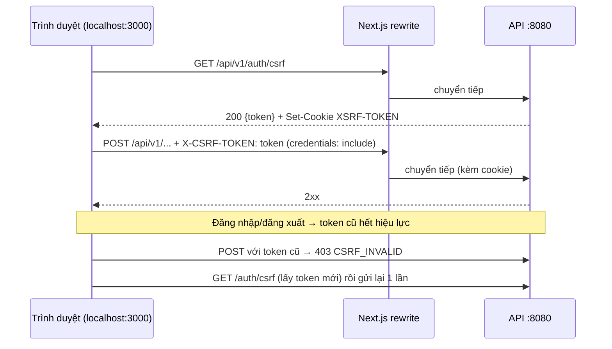

# Báo cáo bàn giao BE → FE — GĐ0 Nền tảng

| Mục | Giá trị |
|---|---|
| Giai đoạn | GĐ0 — Nền tảng (28/09 – 11/10) |
| Ngày bàn giao | 26/09/2026 |
| Trạng thái BE | ✅ Xong B0.1 → B0.7 (`roadmap/ROADMAP_BE.md` §2) · 26/26 test xanh · chạy được trong Docker |
| FE làm tương ứng | F0.1 → F0.8 (`roadmap/ROADMAP_FE.md` §2) |
| Giai đoạn kế tiếp | Đợt 1 (12/10 – 25/10) — xem [mục 9](#9-sắp-có-ở-đợt-1--lịch-bàn-giao-và-hợp-đồng-dự-kiến) để dựng API giả trước |

> **Đọc nhanh:** chạy BE bằng 1 lệnh (mục 2) → copy 4 file mẫu ở mục 6 vào `frontend/src/lib` → gọi được `/api/v1/topics` và `/api/v1/auth/csrf` thật. API tài khoản chưa có → dùng MSW theo hợp đồng mục 9.

---

## 1. BE đã giao gì trong GĐ0 (đối chiếu 2 roadmap)

| BE (ROADMAP_BE) | Kết quả | FE liên quan (ROADMAP_FE) | FE cần làm |
|---|---|---|---|
| B0.1 Maven, thư viện | Spring Boot 4.1, Java 21 | — | Không |
| B0.2 Docker Compose | MySQL, Redis, MinIO, Mailpit + API (profile `app`) | F0.2 | Chạy BE bằng Docker (mục 2) |
| B0.3 Cấu hình | Profile `dev/docker/worker/test`, biến môi trường | F0.2 | `BACKEND_INTERNAL_URL=http://localhost:8080` |
| B0.4 Flyway | 67 bảng + dữ liệu gốc (vai trò, cài đặt, chính sách AI, **9 chủ đề**) | F1.6 (dùng sau) | Có thể hiển thị cây chủ đề thật ngay |
| B0.5 Hạ tầng chung | Lỗi ProblemDetail, ID chuỗi, phân trang, ETag, Idempotency, tác vụ nền, S3, mail | F0.3, F0.5 | Viết `api-client.js` + `ApiError` theo mục 4 |
| B0.6 Bảo mật | Cookie phiên `VOCAB_SESSION`, CSRF cookie `XSRF-TOKEN` + header `X-CSRF-TOKEN`, 401/403 dạng ProblemDetail, CORS | F0.2, F0.3, F0.7 | Luồng CSRF mục 5; guard trang mục 7 |
| B0.7 Test, health, OpenAPI | `/actuator/health`, Swagger UI | F0.8 | Dùng Swagger để xem API |
| *(làm sớm)* ND | `GET /api/v1/topics` | F1.6 | Dùng thật, không cần mock |

**Chưa có trong GĐ0** (đừng gọi thật, dùng MSW): mọi API `/auth/register|login|logout…`, `/users/me…`, `/decks…`, `/media…`. Lịch có ở mục 9.

---

## 2. Chạy BE (không cần Java)

```bash
cd backend
docker compose --profile app up -d --build
docker compose --profile app ps        # chờ api = healthy (~30 giây, lần đầu vài phút)
```

| Dịch vụ | Địa chỉ |
|---|---|
| API | http://localhost:8080/api/v1 |
| Swagger UI | http://localhost:8080/swagger-ui.html |
| Health | http://localhost:8080/actuator/health → `{"status":"UP"}` |
| Mailpit (hộp thư test) | http://localhost:8025 |
| MinIO console | http://localhost:9001 (`minioadmin`/`minioadmin`) |

Chi tiết lệnh, lỗi thường gặp: [`huong-dan/02_FE_CHAY_BACKEND.md`](../huong-dan/02_FE_CHAY_BACKEND.md).

---

## 3. API dùng được ngay (đã chạy thật, phản hồi dưới đây là thật)

### 3.1 `GET /api/v1/auth/csrf` — lấy mã chống giả mạo

- Quyền: khách/đã đăng nhập.
- Tác dụng phụ: đặt cookie `XSRF-TOKEN` (không HttpOnly, `Path=/`, `SameSite=Lax`).

```http
HTTP/1.1 200
X-Trace-Id: c99f585ce0b04cf6
Set-Cookie: XSRF-TOKEN=2233c687-2fac-4494-8dba-90ccbbec7779; Path=/; SameSite=Lax

{"headerName":"X-CSRF-TOKEN","token":"2233c687-2fac-4494-8dba-90ccbbec7779"}
```

### 3.2 `GET /api/v1/topics` — cây chủ đề đang dùng

- Quyền: khách. Sắp xếp theo tên. `children` luôn là mảng (rỗng nếu lá). **`id` là chuỗi.**

```json
[
  {"id":"7","slug":"am-thuc","name":"Ẩm thực","description":"Món ăn, nấu ăn, nhà hàng","children":[]},
  {"id":"4","slug":"cong-nghe","name":"Công nghệ","description":"Máy tính, phần mềm, Internet",
   "children":[{"id":"9","slug":"lap-trinh","name":"Lập trình","description":"Thuật ngữ lập trình cơ bản","children":[]}]},
  {"id":"2","slug":"du-lich","name":"Du lịch","description":"Sân bay, khách sạn, hỏi đường",
   "children":[{"id":"8","slug":"san-bay","name":"Sân bay","description":"Làm thủ tục, hành lý","children":[]}]}
]
```
*(rút gọn; đủ 7 chủ đề gốc: Ẩm thực, Công nghệ, Công việc, Du lịch, Giao tiếp hằng ngày, Học thuật, Sức khỏe)*

Dùng cho: F1.6 bước chọn chủ đề quan tâm (UI06), bộ lọc danh mục F1.8.

### 3.3 Mọi API cần đăng nhập — hiện trả 401

```http
GET /api/v1/users/me   →   401  Content-Type: application/problem+json
```
```json
{"type":"urn:vocablearning:error:unauthenticated","title":"Chưa đăng nhập","status":401,
 "detail":"Bạn cần đăng nhập để tiếp tục.","instance":"/api/v1/users/me",
 "code":"UNAUTHENTICATED","traceId":"6e1314066b754840","fieldErrors":[],"retryable":false}
```

### 3.4 POST thiếu CSRF — 403

```http
POST /api/v1/decks   (không có X-CSRF-TOKEN)   →   403
```
```json
{"type":"urn:vocablearning:error:csrf-invalid","title":"Thiếu hoặc sai mã chống giả mạo","status":403,
 "detail":"Hãy tải lại trang rồi thử lại.","instance":"/api/v1/decks",
 "code":"CSRF_INVALID","traceId":"57eb25be722042a3","fieldErrors":[],"retryable":false}
```

> Lưu ý thứ tự kiểm tra của BE: **CSRF trước, đăng nhập sau**. POST có CSRF đúng nhưng chưa đăng nhập → 401 (không phải 403).

---

## 4. Hợp đồng chung — áp dụng cho MỌI API từ nay

### 4.1 Định dạng dữ liệu

| Quy tắc | Chi tiết | Ví dụ |
|---|---|---|
| Tiền tố | `/api/v1` | `/api/v1/topics` |
| JSON | camelCase tiếng Anh | `displayName`, `newCardsPerDay` |
| **ID** | Luôn **chuỗi** (BE lưu số 64-bit, JS mất chính xác) | `"id":"123"` — không `Number(id)` |
| Số đếm | Là số | `"total": 42` |
| Thời điểm | ISO-8601 UTC có `Z` | `"2026-10-12T17:00:00Z"` → hiển thị theo múi giờ người dùng |
| Trường null | **Bị bỏ khỏi JSON** | Thiếu `description` = null → dùng `obj.description ?? ''` |

### 4.2 Mã trạng thái thành công

| Mã | Khi nào |
|---|---|
| 200 | Đọc/cập nhật trả dữ liệu |
| 201 | Tạo mới (có header `Location`) |
| 202 | Nhận việc chạy nền (CSV, sao chép có tệp, xóa tài khoản) → có trạng thái để hỏi lại |
| 204 | Xóa / không có nội dung → không `res.json()` |

### 4.3 Lỗi — luôn `application/problem+json`

```json
{
  "type": "urn:vocablearning:error:validation-failed",
  "title": "Dữ liệu không hợp lệ",
  "status": 400,
  "code": "VALIDATION_FAILED",
  "detail": "Vui lòng kiểm tra lại các trường được đánh dấu.",
  "instance": "/api/v1/auth/register",
  "traceId": "a5f1c2d3e4f5a6b7",
  "fieldErrors": [{ "field": "password", "message": "size must be between 10 and 128" }],
  "retryable": false
}
```

| Trường | FE dùng để |
|---|---|
| `code` | **Rẽ nhánh logic** (không so sánh `detail`) |
| `detail` | Hiển thị cho người dùng (tiếng Việt) |
| `fieldErrors[].field` | Gắn lỗi vào ô nhập cùng tên (`setError(field, …)` của React Hook Form) |
| `retryable` | `true` → hiện nút "Thử lại" |
| `traceId` | Hiện nhỏ ở ErrorState ("Mã lỗi: …") để báo BE |

Danh sách `code` đầy đủ (BE: `shared/errors/ErrorCode.java`):

| HTTP | `code` | retryable | FE xử lý |
|---|---|---|---|
| 400 | `VALIDATION_FAILED` | ✗ | Lỗi theo trường; nếu `fieldErrors` rỗng → toast `detail` |
| 401 | `UNAUTHENTICATED` | ✗ | Xóa cache Query, chuyển `/dang-nhap?quay-lai=<đường dẫn hiện tại>` |
| 403 | `FORBIDDEN` | ✗ | Trang "Không có quyền" |
| 403 | `CSRF_INVALID` | ✗ | `api-client` tự lấy lại token và gửi lại 1 lần |
| 404 | `NOT_FOUND` | ✗ | "Không tìm thấy" (BE trả 404 cả khi tài nguyên riêng của người khác) |
| 405 | `METHOD_NOT_ALLOWED` | ✗ | Lỗi lập trình → log |
| 409 | `CONFLICT` | ✗ | Toast `detail` |
| 409 | `IDEMPOTENCY_KEY_REUSED` | ✗ | Lỗi lập trình (dùng lại key cho nội dung khác) |
| 409 | `REQUEST_IN_PROGRESS` | ✓ | Đợi 1–2 giây, gửi lại **cùng key** |
| 412 | `STALE_VERSION` | ✗ | "Dữ liệu đã thay đổi" + nút tải lại (refetch) |
| 415 | `UNSUPPORTED_MEDIA_TYPE` | ✗ | Lỗi lập trình (thiếu `Content-Type: application/json`) |
| 422 | `BUSINESS_RULE_VIOLATED` | ✗ | Toast/khối cảnh báo `detail` |
| 429 | `RATE_LIMITED` | ✓ | `detail` có số giây chờ → khóa nút + đếm ngược |
| 429 | `QUOTA_EXCEEDED` | ✓ | Hết hạn mức (AI…) → hiện thời điểm mở lại |
| 500 | `INTERNAL_ERROR` | ✓ | ErrorState + `traceId` |
| 503 | `DEPENDENCY_UNAVAILABLE` | ✓ | "Dịch vụ tạm gián đoạn" + thử lại |

### 4.4 Header

| Header | Chiều | Ý nghĩa |
|---|---|---|
| `X-CSRF-TOKEN` | FE → BE | Bắt buộc với POST/PUT/PATCH/DELETE |
| `Idempotency-Key` | FE → BE | UUID (8–80 ký tự `A-Za-z0-9_.:-`); ôn thẻ, nộp bài, sao chép, xác nhận CSV/nháp AI, tạo AI. **Tạo 1 lần cho 1 hành động, giữ nguyên khi thử lại** |
| `If-Match` | FE → BE | Giá trị `ETag` lấy lúc GET; thiếu → 400, sai → 412 |
| `ETag` | BE → FE | Phiên bản tài nguyên, dạng `"5"` (có dấu nháy) |
| `X-Trace-Id` | BE → FE | Mã theo dõi mọi phản hồi |
| `Location` | BE → FE | URL tài nguyên vừa tạo (201) |

### 4.5 Phân trang

| Kiểu | Tham số | Phản hồi |
|---|---|---|
| Theo trang | `?page=0&size=20` (page từ **0**, size 1–100, mặc định 20) | `{ "items": [...], "page": 0, "size": 20, "total": 57 }` |
| Theo mốc (danh sách dài/lịch sử) | `?cursor=<nextCursor>&size=20` | `{ "items": [...], "nextCursor": "abc" }` — **không có** `nextCursor` = trang cuối |

`size` > 100 hoặc `page` < 0 → 400 `VALIDATION_FAILED`.

### 4.6 Cookie

| Cookie | Ai đặt | FE đọc được? | Ghi chú |
|---|---|---|---|
| `VOCAB_SESSION` | BE khi đăng nhập | ✗ (HttpOnly) | Hết hạn sau 30 phút không hoạt động; trình duyệt tự gửi |
| `XSRF-TOKEN` | BE (`/auth/csrf` hoặc khi cần) | ✓ | Giá trị này = header `X-CSRF-TOKEN`; **đổi sau đăng nhập/đăng xuất** |

---

## 5. Luồng CSRF + phiên (FE phải làm đúng)



Vì sao dùng rewrite (F0.2): cookie thuộc `localhost:3000` → không cần CORS, không lỗi SameSite. **Không gọi thẳng `http://localhost:8080` từ trình duyệt.**

---

## 6. Mã FE mẫu cho F0.2 → F0.5 (copy dùng được)

### 6.1 `frontend/.env.local` + `next.config.mjs` (F0.2)

```dotenv
BACKEND_INTERNAL_URL=http://localhost:8080
NEXT_PUBLIC_API_BASE=/api/v1
NEXT_PUBLIC_API_MOCK=0
```

```js
// frontend/next.config.mjs
/** @type {import('next').NextConfig} */
const nextConfig = {
  async rewrites() {
    return [{ source: '/api/:path*', destination: `${process.env.BACKEND_INTERNAL_URL}/api/:path*` }];
  },
  async headers() {
    return [{
      source: '/:path*',
      headers: [
        { key: 'Referrer-Policy', value: 'strict-origin-when-cross-origin' },
        { key: 'X-Content-Type-Options', value: 'nosniff' },
      ],
    }];
  },
};

export default nextConfig;
```

### 6.2 `src/lib/csrf.js`

```js
const BASE = process.env.NEXT_PUBLIC_API_BASE ?? '/api/v1';

export function readCsrfCookie() {
  if (typeof document === 'undefined') return undefined;
  return document.cookie.split('; ').find((c) => c.startsWith('XSRF-TOKEN='))?.split('=')[1];
}

export async function fetchCsrfToken() {
  const res = await fetch(`${BASE}/auth/csrf`, { credentials: 'include' });
  return (await res.json()).token;
}
```

### 6.3 `src/lib/api-client.js` (F0.3)

```js
import { fetchCsrfToken, readCsrfCookie } from './csrf';

const BASE = process.env.NEXT_PUBLIC_API_BASE ?? '/api/v1';
const WRITE = new Set(['POST', 'PUT', 'PATCH', 'DELETE']);

/** Lỗi chuẩn hóa từ ProblemDetail: {status, code, detail, fieldErrors, retryable, traceId} */
export class ApiError extends Error {
  constructor(p) {
    super(p.detail ?? p.title ?? 'Lỗi không xác định');
    this.status = p.status;
    this.code = p.code ?? 'UNKNOWN';
    this.detail = p.detail;
    this.fieldErrors = p.fieldErrors ?? [];
    this.retryable = Boolean(p.retryable);
    this.traceId = p.traceId;
  }
}

async function request(method, path, { body, query, idempotencyKey, ifMatch, retried } = {}) {
  const url = new URL(`${BASE}${path}`, window.location.origin);
  Object.entries(query ?? {}).forEach(([k, v]) => v != null && url.searchParams.set(k, v));

  const headers = { Accept: 'application/json' };
  if (body !== undefined) headers['Content-Type'] = 'application/json';
  if (WRITE.has(method)) headers['X-CSRF-TOKEN'] = readCsrfCookie() ?? (await fetchCsrfToken());
  if (idempotencyKey) headers['Idempotency-Key'] = idempotencyKey;
  if (ifMatch) headers['If-Match'] = ifMatch;

  const res = await fetch(url, {
    method, headers, credentials: 'include',
    body: body === undefined ? undefined : JSON.stringify(body),
  });

  if (res.status === 403 && !retried) {
    const p = await res.clone().json().catch(() => ({}));
    if (p.code === 'CSRF_INVALID') {
      await fetchCsrfToken();
      return request(method, path, { body, query, idempotencyKey, ifMatch, retried: true });
    }
  }
  if (res.status === 204) return { data: null, etag: null };
  const data = await res.json().catch(() => null);
  if (!res.ok) throw new ApiError(data ?? { status: res.status, title: res.statusText });
  return { data, etag: res.headers.get('ETag') };
}

export const apiGet = (path, opts) => request('GET', path, opts).then((r) => r.data);
export const apiGetWithEtag = (path, opts) => request('GET', path, opts); // {data, etag} cho màn sửa
export const apiPost = (path, body, opts) => request('POST', path, { ...opts, body }).then((r) => r.data);
export const apiPut = (path, body, opts) => request('PUT', path, { ...opts, body }).then((r) => r.data);
export const apiPatch = (path, body, opts) => request('PATCH', path, { ...opts, body }).then((r) => r.data);
export const apiDelete = (path, opts) => request('DELETE', path, opts).then((r) => r.data);
```

### 6.4 `src/lib/query-client.js` (F0.4)

```js
import { QueryClient } from '@tanstack/react-query';
import { ApiError } from './api-client';

export function makeQueryClient() {
  return new QueryClient({
    defaultOptions: {
      queries: {
        staleTime: 30_000,
        // Chỉ thử lại lỗi BE đánh dấu retryable, tối đa 2 lần; 4xx khác không thử lại.
        retry: (count, err) => err instanceof ApiError ? err.retryable && count < 2 : count < 2,
      },
    },
  });
}
// Khi đăng xuất hoặc gặp 401: queryClient.clear()
```

### 6.5 Dùng thử — hook chủ đề (dữ liệu thật)

```js
// src/features/catalog/hooks.js
import { useQuery } from '@tanstack/react-query';
import { apiGet } from '@/lib/api-client';

export const useTopics = () => useQuery({ queryKey: ['topics'], queryFn: () => apiGet('/topics'), staleTime: 5 * 60_000 });
```

### 6.6 MSW cho GĐ0 (F0.5) — `src/mocks/handlers/base.js`

```js
import { http, HttpResponse } from 'msw';

const problem = (status, code, title, detail, fieldErrors = []) =>
  HttpResponse.json(
    { type: `urn:vocablearning:error:${code.toLowerCase().replaceAll('_', '-')}`, title, status, code, detail,
      traceId: 'mock', fieldErrors, retryable: status === 429 || status >= 500 },
    { status, headers: { 'Content-Type': 'application/problem+json' } });

export const baseHandlers = [
  http.get('/api/v1/auth/csrf', () => {
    document.cookie = 'XSRF-TOKEN=mock-csrf; path=/';
    return HttpResponse.json({ headerName: 'X-CSRF-TOKEN', token: 'mock-csrf' });
  }),
  http.get('/api/v1/topics', () => HttpResponse.json([
    { id: '1', slug: 'giao-tiep', name: 'Giao tiếp hằng ngày', children: [] },
    { id: '2', slug: 'du-lich', name: 'Du lịch', children: [{ id: '8', slug: 'san-bay', name: 'Sân bay', children: [] }] },
  ])),
  http.get('/api/v1/users/me', () => problem(401, 'UNAUTHENTICATED', 'Chưa đăng nhập', 'Bạn cần đăng nhập để tiếp tục.')),
];

export { problem };
```

### 6.7 Test đơn vị cho `api-client` (F0.3 "xong khi")

Test tối thiểu (Vitest, `fetch` giả):
- 401 → `ApiError.code === 'UNAUTHENTICATED'`
- 409 `REQUEST_IN_PROGRESS` → `retryable === true`
- 400 có `fieldErrors` → mảng giữ nguyên
- 429 → `retryable === true`
- 403 `CSRF_INVALID` → gọi `/auth/csrf` rồi gửi lại đúng 1 lần

---

## 7. Guard trang cần đăng nhập (F0.7)

- Route group `(learner)` gọi `GET /api/v1/users/me`:
  - 401 → chuyển `/dang-nhap?quay-lai=<đường dẫn>`.
  - 200 → render.
- **GĐ0:** `/users/me` chưa có, nên hiện luôn trả 401 → guard luôn chuyển về đăng nhập. Đó là **hành vi đúng**.
- Muốn làm giao diện trang học viên trước: bật MSW và mock `/users/me` trả 200 theo mẫu ở mục 9.3.
- Menu quản trị: ẩn theo `roles` có `ADMIN` (chỉ để trải nghiệm). BE vẫn tự chặn `/api/v1/admin/**` → 403.

---

## 8. Checklist FE hoàn thành GĐ0

- [ ] F0.1 `npm run dev` mở trang; `.nvmrc` khóa Node LTS
- [ ] F0.2 `curl http://localhost:3000/api/v1/topics` trả JSON **qua Next** (rewrite chạy)
- [ ] F0.3 `api-client.js` + 5 test mục 6.7 xanh
- [ ] F0.4 QueryClient; `queryClient.clear()` khi 401/đăng xuất
- [ ] F0.5 `NEXT_PUBLIC_API_MOCK=1` → dữ liệu mock; `=0` → BE thật
- [ ] F0.6 Trang `/_ui` đủ thành phần; ErrorState hiện `traceId`
- [ ] F0.7 Vào `/hoc` chưa đăng nhập → `/dang-nhap?quay-lai=/hoc`
- [ ] F0.8 `npm test`, `npx playwright test` chạy
- [ ] Hiển thị thử cây chủ đề thật từ `GET /topics` (kiểm tra ID chuỗi, tiếng Việt có dấu)

---

## 9. Sắp có ở Đợt 1 — lịch bàn giao và hợp đồng dự kiến

> Hợp đồng dưới đây lấy từ THIET_KE §11.2–11.3 và SCI_SE_3. Tên trường là **dự kiến**; báo cáo Đợt 1 sẽ chốt chính thức. FE dùng để viết MSW ngay.

### 9.1 Lịch BE → FE

| BE bước | Dự kiến có | API | FE bước dùng | UI |
|---|---|---|---|---|
| B1.1 | 13/10 | `POST /auth/register` | F1.1 | UI01 `/dang-ky` |
| B1.2 | 14/10 | `POST /auth/verify-email`, `POST /auth/resend-verification` | F1.2 | UI02 `/xac-thuc-email` |
| B1.3 | 15/10 | `POST /auth/login`, `POST /auth/logout`, `/oauth2/authorization/google` | F1.3 | UI03 `/dang-nhap` |
| B1.4 | 16/10 | `POST /auth/forgot-password`, `POST /auth/reset-password` | F1.4 | UI04 |
| B1.6–B1.8 | 17–18/10 | `GET /users/me`, `PATCH /users/me/profile`, `PUT /users/me/interests`, `GET/PUT /users/me/preferences` | F1.5, F1.6 | UI05, UI06 |
| B1.9 | 18/10 | `GET /users/me/streak`, `GET /users/me/activity` | F1.5 | UI05 |
| B1.10 | 18/10 | `POST /auth/reauthenticate`, `/users/me/deletion-requests…` | F1.7 | UI07 |
| B1.11–B1.22 | 19–25/10 | `/decks…`, `/cards…`, `/catalog/decks…`, `/media…`, CSV | F1.8 → F1.15 | UI08 → … |

### 9.2 Đăng ký / xác thực / đăng nhập (dự kiến)

| API | Body gửi | Thành công | Lỗi cần xử lý |
|---|---|---|---|
| `POST /auth/register` | `{ "email", "password" (10–128), "displayName" (2–100) }` | `202 { "message": "Nếu email hợp lệ, hãy kiểm tra hộp thư để xác thực." }` — **luôn thông báo chung** (không tiết lộ email đã tồn tại) | 400 `fieldErrors`; 429 `RATE_LIMITED` (5 lần/IP/giờ) |
| `POST /auth/verify-email` | `{ "token" }` (lấy từ link `/xac-thuc-email?token=…` trong Mailpit) | `200` | 400/422 mã hết hạn (24 giờ) hoặc đã dùng → nút gửi lại |
| `POST /auth/resend-verification` | `{ "email" }` | `202` thông báo chung | 429 (3 lần/tài khoản/giờ) → đếm ngược |
| `POST /auth/login` | `{ "email", "password" }` | `200` + cookie `VOCAB_SESSION` + body người dùng (mục 9.3) | 401 sai thông tin; 403/422 chưa xác thực/bị khóa; 429 (10/IP/phút, 5/tài khoản/phút) |
| `POST /auth/logout` | — | `204` (gọi lại vẫn an toàn) | — |

**Sau login/logout:** gọi `GET /auth/csrf` để lấy token mới, rồi `queryClient.clear()`.

### 9.3 `GET /users/me` (dự kiến)

```json
{
  "id": "12",
  "email": "lan@example.com",
  "status": "ACTIVE",
  "roles": ["LEARNER"],
  "profile": { "displayName": "Lan", "bio": "", "avatarUrl": null, "level": "A2", "goal": "" },
  "onboardingCompleted": false
}
```

- `status`: `PENDING_VERIFICATION | ACTIVE | LOCKED | PENDING_DELETION`.
- `level`: `A1…C2`.
- `onboardingCompleted=false` → đưa vào `/cai-dat` chạy theo bước (F1.6).

### 9.4 `GET/PUT /users/me/preferences` (dự kiến)

```json
{
  "newCardsPerDay": 10,
  "dailyMinutes": 15,
  "reminderTime": "20:00",
  "timezone": "Asia/Ho_Chi_Minh",
  "emailReminders": true,
  "aiConsent": false,
  "version": 3
}
```

- Giới hạn: từ mới 0–100, phút 1–240, `reminderTime` dạng `HH:mm`, múi giờ IANA.
- Đổi múi giờ tối đa 1 lần/24 giờ.
- PUT gửi `If-Match: "3"`; nếu sai phiên bản → 412.

---

## 10. Lưu ý / giới hạn hiện tại

| Mục | Chi tiết |
|---|---|
| Email | Không gửi thật; xem ở http://localhost:8025 |
| Google login | Chưa cấu hình (B1.3) → ẩn nút hoặc để disabled |
| Tệp | Hạ tầng S3 sẵn; API `/media/upload-intents` có ở B1.6. URL tải lên trỏ `http://localhost:9000` — `PUT` thẳng, **không** kèm `credentials` |
| Dữ liệu | `docker compose --profile app down -v` xóa sạch → chủ đề seed lại, tài khoản mất |
| Cổng | API 8080; nếu BE đang chạy app trong IntelliJ thì container `api` phải tắt (trùng cổng) |

## 11. Báo lỗi cho BE

Gửi: **đường dẫn API + body gửi + `traceId`** (trong JSON lỗi hoặc header `X-Trace-Id`). BE tra log: `docker compose logs api | grep <traceId>`.
