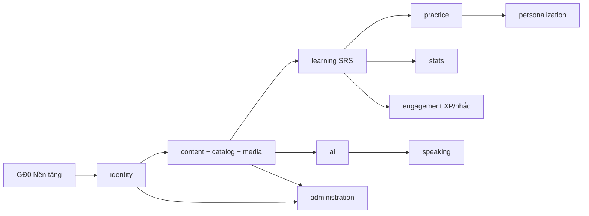

# ROADMAP BACKEND — VocabLearning (Spring Boot)

> Đối chiếu: `docs/SCI_SE_2` (lịch, phân công), `SCI_SE_3/4` (111 yêu cầu), `SCI_SE_6` (67 bảng + SQL), `SCI_SE_7` (kiểm thử), `THIET_KE_HE_THONG_HOC_TU_VUNG.md` (API mục 11, luồng mục 12, bảo mật mục 13).
> Phạm vi: từ khởi tạo đến **bản demo/staging chạy được** (chưa production).
> Cách đọc: mỗi giai đoạn → các **bước (B)** → mỗi bước có *Việc cần làm*, *Tệp/thư mục*, *API*, *Kiểm thử*, *Xong khi*. Đánh `[x]` khi hoàn thành.

---

## 0. Tổng quan một trang

| Giai đoạn | Thời gian | Mục tiêu | Yêu cầu (ID) |
|---|---|---|---|
| **GĐ0 — Nền tảng** | 28/09 – 11/10 | Dự án chạy được, DB 67 bảng, bảo mật, hạ tầng dùng chung | PC03, PC04, PC08 (nền) |
| **Đợt 1 — Tài khoản & nội dung** | 12/10 – 25/10 | Đăng ký/đăng nhập, hồ sơ, bộ thẻ, thẻ, tệp, CSV, danh mục | TK-01…11 (trừ 04), BT-01…12, ND-01…06 |
| **Đợt 2 — Học & luyện** | 26/10 – 08/11 | SRS, phiên học, bài luyện cố định, sổ tay, thống kê, phân quyền | ON-01…14, LT-01…12, ST-01…09, TKH-01…10, QT-02 |
| **Đợt 3 — AI, phát âm, động lực, quản trị** | 09/11 – 29/11 | AI qua API, chấm phát âm, XP/huy hiệu/nhắc, quản trị | AI-01…12 (trừ 09), PA-01…08, DL-01…07, QT-01, QT-03…09 |
| **GĐ4 — Kiểm thử hệ thống** | 30/11 – 06/12 | 20 tình huống trọng yếu, tải, sao lưu/phục hồi | TR01–TR20, PC01–PC12 |
| **GĐ5 — Hoàn thiện bàn giao** | 07/12 – 14/12 | Dữ liệu demo, OpenAPI, hướng dẫn cài đặt, bản staging | PC10 |
| *Mở rộng (sau)* | — | Facebook, IELTS/trẻ em, hội thoại AI | TK-04, ND-07, AI-09 |



### Công nghệ chốt

| Thành phần | Lựa chọn |
|---|---|
| Ngôn ngữ / nền | Java 21 (máy có JDK 25 vẫn biên dịch `release 21`), Spring Boot 4.1.x |
| Web | Spring MVC (`spring-boot-starter-webmvc`), Bean Validation |
| Bảo mật | Spring Security 7, Spring Session (Redis), OAuth2 Client (Google), CSRF header `X-CSRF-TOKEN` |
| Dữ liệu | MySQL 8.4 InnoDB utf8mb4, Spring Data JPA + JdbcTemplate cho truy vấn nặng, Flyway, `ddl-auto=validate` |
| Bộ nhớ đệm | Redis 7 (phiên, giới hạn tần suất, cache danh mục) |
| Tệp | S3 API (MinIO khi dev) qua AWS SDK v2, URL ký ≤ 5 phút |
| Email | JavaMailSender (Mailpit khi dev) |
| AI / giọng nói | OpenAI (JSON có cấu trúc), Azure Speech (TTS + Pronunciation Assessment) — gọi qua lớp `*Client` riêng, có bản giả |
| Kiểm thử | JUnit 5, Mockito, Testcontainers (MySQL, Redis), MockMvc |
| Đóng gói | Docker Compose (dev + staging) |

### Quy ước bắt buộc (áp dụng mọi bước)

1. **Tên bảng/cột** tiếng Việt không dấu (theo SQL trong `SCI_SE_6`); **JSON API** camelCase tiếng Anh; ID trả **chuỗi**.
2. **Thời gian**: lưu UTC `DATETIME(3)`; ngày học theo múi giờ người dùng (`ngay_dia_phuong`); hạn mức API theo ngày UTC.
3. **Lỗi** trả `application/problem+json` đúng mẫu mục 11.1 (`type, title, status, code, detail, traceId, fieldErrors, retryable`).
4. **Ghi quan trọng** (ôn, nộp bài, sao chép, xác nhận CSV/nháp AI, tạo AI) nhận `Idempotency-Key`; cập nhật có `@Version` + `If-Match`/`expectedVersion` → 409/412.
5. **Không gọi mạng trong giao dịch DB** (AI, email, S3, Speech) → dùng tác vụ nền.
6. **Quyền** kiểm tra ở service (chủ sở hữu/vai trò), không tin `userId` từ client.
7. Mỗi yêu cầu có test theo mã `TC-<ID>-01/02/03` (đúng / sai-biên / quyền-đồng thời).

---

## 1. Cấu trúc mã nguồn đích

```text
backend/
├─ pom.xml
├─ compose.yaml                        # mysql, redis, minio, mailpit (dev)
├─ .env.example                        # biến môi trường mẫu, KHÔNG chứa bí mật thật
└─ src/
   ├─ main/java/com/team/vocab_learn/
   │  ├─ VocabLearningApplication.java
   │  ├─ shared/
   │  │  ├─ config/        # Jackson (Long→String), Clock, Async, properties
   │  │  ├─ security/      # SecurityConfig, CurrentUser, CSRF, rate limit
   │  │  ├─ errors/        # ErrorCode, ApiException, GlobalExceptionHandler
   │  │  ├─ web/           # PageResponse, CursorResponse, ETag helper
   │  │  ├─ idempotency/   # IdempotencyService (ban_ghi_chong_trung)
   │  │  ├─ outbox/        # su_kien_cho_gui + publisher
   │  │  ├─ jobs/          # tac_vu_nen: JobQueue, JobWorker, JobHandler
   │  │  ├─ storage/       # S3StorageService, MediaAccess
   │  │  ├─ mail/          # MailSender, templates
   │  │  └─ time/          # LocalDayService (UTC ↔ ngày địa phương)
   │  ├─ identity/         # TK: tài khoản, xác thực, hồ sơ, tùy chọn, xóa tài khoản
   │  ├─ content/          # BT: bộ thẻ, thẻ, ví dụ, nhãn, tệp, CSV, chia sẻ, báo cáo
   │  ├─ catalog/          # ND: danh mục công khai, chủ đề
   │  ├─ learning/         # ON: SRS, phiên học, hạn mức từ mới
   │  ├─ practice/         # LT: đề, câu hỏi, lần làm, chấm
   │  ├─ personalization/  # ST: sổ tay, lỗi, mức làm chủ, cặp nhầm, gợi ý
   │  ├─ stats/            # TKH: thống kê, báo cáo tuần
   │  ├─ ai/               # AI: yêu cầu AI, nháp, hạn mức, lượt gọi
   │  ├─ speaking/         # PA: phát âm
   │  ├─ engagement/       # DL: XP, huy hiệu, thử thách, thông báo, nhắc
   │  └─ administration/   # QT: quản trị, kiểm duyệt, nhật ký, cài đặt
   │     (mỗi mô-đun: api/ (controller+DTO), application/ (service), domain/ (entity, enum, rule), infrastructure/ (repository, client))
   ├─ main/resources/
   │  ├─ application.yaml, application-dev.yaml, application-test.yaml
   │  ├─ db/migration/V1__schema.sql, V2__seed_core.sql, V3__seed_demo_content.sql …
   │  └─ templates/mail/*.html
   └─ test/java/com/team/vocab_learn/…  # unit + integration (Testcontainers)
```

**Quy tắc phụ thuộc:** mô-đun gọi nhau qua service công khai (`application`), không dùng repository của mô-đun khác. `shared` không phụ thuộc mô-đun nghiệp vụ.

---

## 2. GĐ0 — Nền tảng (28/09 – 11/10)

### B0.1 Chuẩn hóa dự án Maven
- [x] `pom.xml`: `groupId=com.team`, `artifactId=vocab-learning-api`, `name=VocabLearning API`; bỏ các thẻ rỗng (`licenses`, `scm`…).
- [x] Đổi `TeamApplication` → `VocabLearningApplication` (giữ package `com.team.vocab_learn`).
- [x] Thêm dependency (xác nhận tên starter trên start.spring.io cho Boot 4.1):
  `webmvc, validation, security, oauth2-client, data-jpa, flyway (+ flyway-mysql), data-redis, session-data-redis, mail, actuator`, `mysql-connector-j`, `software.amazon.awssdk:s3`, `lombok` + `mapstruct` (+ `lombok-mapstruct-binding`), `springdoc-openapi`; test: `spring-boot-starter-test`, `spring-security-test`, `testcontainers` (`mysql`, `junit-jupiter`) .
- **Xong khi:** `./mvnw -q verify` chạy qua (test context rỗng đã tắt DB hoặc dùng Testcontainers).

### B0.2 Môi trường dev bằng Docker Compose
- [x] `backend/compose.yaml`: `mysql:8.4` (máy: 3307 → container 3306, DB `vocab_learning`, 1 user `vocab` cho Flyway + API), `redis:7` (6379), `minio` (9000/9001, bucket `vocab-media`), `mailpit` (1025/8025).
- [x] `.env.example` theo mục 15.2 tài liệu thiết kế (`DB_URL=jdbc:mysql://localhost:3307/vocab_learning?connectionTimeZone=UTC`, …).
- **Xong khi:** `docker compose up -d` → 4 dịch vụ healthy.

### B0.3 Cấu hình ứng dụng
- [x] `application.yaml`: datasource, `spring.jpa.hibernate.ddl-auto=validate`, `open-in-view=false`, `jdbc.time_zone=UTC`, Flyway bật, session store Redis, timeout phiên 30 phút.
- [x] `@ConfigurationProperties`: `AppProperties` (publicBaseUrl), `StorageProperties`, `AiProperties`, `SpeechProperties`, `MailProperties`.
- [x] Profiles: `dev`, `test`, `api`, `worker` (worker chạy tác vụ nền).

### B0.4 Cơ sở dữ liệu bằng Flyway
- [x] `V1__schema.sql`: chép **nguyên** khối SQL 67 bảng từ `SCI_SE_6` mục 2.4, **bỏ** `CREATE DATABASE`/`USE`.
- [x] `V2__seed_core.sql`: `vai_tro` (LEARNER, ADMIN), `cai_dat_he_thong` mặc định, `chinh_sach_ai` mặc định (tạo thẻ 5/ngày, phản hồi viết 10, giải thích 10, phát âm 300 giây, TOTAL), `chu_de` gốc.
- [x] Chỉ ánh xạ entity khi mô-đun cần — `validate` chỉ kiểm tra bảng đã ánh xạ.
- **Xong khi:** khởi động app tạo đủ 67 bảng; `SELECT COUNT(*) FROM information_schema.tables WHERE table_schema='vocab_learning'` = 68 (gồm `flyway_schema_history`).

### B0.5 Hạ tầng dùng chung (`shared`)
| Việc | Chi tiết | Xong khi |
|---|---|---|
| Jackson | `Long`/`BigInteger` → chuỗi; thời điểm ISO-8601 `Z` | Test JSON trả `"id":"123"` |
| Clock | Bean `Clock.systemUTC()`; test dùng `Clock.fixed` | SRS test dùng đồng hồ giả |
| Lỗi | `ErrorCode` (VALIDATION, NOT_FOUND, FORBIDDEN, STALE_VERSION, CONFLICT, QUOTA_EXCEEDED, DEPENDENCY_UNAVAILABLE…), `ApiException`, `@RestControllerAdvice` → ProblemDetail + `traceId` | 400/401/403/404/409/412/422/429/503 đúng mẫu |
| Phân trang | `PageResponse{items,page,size,total}`, `CursorResponse{items,nextCursor}`; mặc định 20, tối đa 100 | Tham số lạ → 400 |
| Idempotency | Bảng `ban_ghi_chong_trung`; header `Idempotency-Key`; cùng khóa khác thân → 409; cùng thân → trả kết quả cũ; lưu 24 giờ | Gửi 2 lần chỉ 1 bản ghi |
| Outbox | Ghi `su_kien_cho_gui` cùng giao dịch; publisher đọc định kỳ | Rollback thì không có sự kiện |
| Tác vụ nền | `tac_vu_nen`: nhận bằng `SELECT … FOR UPDATE SKIP LOCKED`, quyền xử lý 120 giây + `ma_quyen_xu_ly`, thử lại có giới hạn | 2 worker không xử lý trùng |
| Ngày địa phương | `LocalDayService.today(user)`, đầu/cuối ngày theo IANA | Test 23:59/00:00 |
| Storage | `upload-intent` (URL ký PUT), `complete` (kiểm MIME/kích thước), `access` (URL ký GET 5 phút) | Tải/đọc qua MinIO |
| Mail | `MailService.send(template, to, model)` chạy qua tác vụ nền | Mail xuất hiện ở Mailpit |

### B0.6 Bảo mật nền
- [x] `SecurityFilterChain`: phiên cookie (`Secure`, `HttpOnly`, `SameSite=Lax`), đổi session ID sau đăng nhập, CSRF bằng `CookieCsrfTokenRepository`/header `X-CSRF-TOKEN`, `GET /api/v1/auth/csrf`.
- [x] `PasswordEncoder` BCrypt (chi phí sao cho ~100–300 ms).
- [x] `CurrentUser` (lấy từ phiên), `@PreAuthorize` cho ADMIN; 401/403 trả ProblemDetail.
- [x] Giới hạn tần suất (Redis): đăng nhập 10/IP/phút & 5/tài khoản/phút; đăng ký 5/IP/giờ; gửi lại 3/tài khoản/giờ; đặt lại 5/IP/giờ.
- [x] Spring Session lập chỉ mục theo người dùng để thu hồi toàn bộ phiên.
- **Xong khi:** gọi API cần đăng nhập không có phiên → 401; POST thiếu CSRF → 403.

### B0.7 Kiểm thử & chất lượng
- [x] `AbstractIntegrationTest` dùng Testcontainers MySQL 8.4 + Redis (tái sử dụng container).
- [x] Actuator `health` (liveness không phụ thuộc AI; readiness kiểm MySQL/Redis).
- [x] (Tùy chọn) springdoc-openapi nếu đã hỗ trợ Boot 4; nếu chưa, viết `openapi.yaml` tay.

**Mốc GĐ0 (11/10):** app chạy dev, 67 bảng, lỗi/CSRF/phiên/idempotency/tác vụ nền/S3/mail chạy, CI local `./mvnw verify` xanh.

---

## 3. Đợt 1 — Tài khoản & nội dung (12/10 – 25/10)

### Tuần 1 (12–18/10): mô-đun `identity`

| Bước | Yêu cầu | Bảng | API (`/api/v1`) | Quy tắc chính | Test |
|---|---|---|---|---|---|
| ✅ B1.1 Đăng ký | TK-01 | `nguoi_dung`, `ho_so_nguoi_dung`, `tuy_chon_hoc`, `nguoi_dung_vai_tro`, `ma_xac_thuc` | `POST /auth/register` | Email chuẩn hóa (trim + lowercase) duy nhất; mật khẩu 10–128; `displayName` 2–100; tạo `PENDING_VERIFICATION`; trả thông báo chung | TC-TK-01-01/02/03, T01 |
| ✅ B1.2 Xác thực email | TK-02 | `ma_xac_thuc` | `POST /auth/verify-email`, `POST /auth/resend-verification` | Mã ngẫu nhiên chỉ lưu băm, 24 giờ, dùng 1 lần; mã mới vô hiệu mã cũ; gửi qua tác vụ nền | TC-TK-02-*, T02 |
| ✅ B1.3 Đăng nhập | TK-03 | `danh_tinh_dang_nhap` | `POST /auth/login`, `/oauth2/authorization/google`, `POST /auth/logout` | Sai mật khẩu/khóa/chưa xác thực → không tạo phiên; Google kiểm `state`/nonce; **không tự ghép** theo email trùng | TC-TK-03-*, T03 |
| ✅ B1.4 Quên/đặt lại | TK-05 | `ma_xac_thuc` | `POST /auth/forgot-password`, `POST /auth/reset-password` | Trả thông báo chung; mã 15 phút; đổi xong tăng `phien_ban_xac_thuc` + thu hồi mọi phiên | TC-TK-05-*, T04 |
| ✅ B1.5 Phiên & danh tính | TK-03/05 | — | `GET /auth/sessions`, `DELETE /auth/sessions/{id}`, `POST /auth/reauthenticate`, `GET/POST/DELETE /auth/identities…` | Xác thực lại hiệu lực 5 phút; không gỡ phương thức đăng nhập cuối | — |
| ✅ B1.6 Hồ sơ & ảnh | TK-06 | `ho_so_nguoi_dung`, `tep_da_phuong_tien` | `GET /users/me`, `PATCH /users/me/profile` | Tên 2–100, giới thiệu ≤500; ảnh JPEG/PNG/WebP ≤5 MB, kiểm MIME thật, bỏ EXIF | TC-TK-06-* |
| ✅ B1.7 Trình độ/mục tiêu/chủ đề | TK-07 | `ho_so_nguoi_dung`, `chu_de_quan_tam` | `PATCH /users/me/profile`, `PUT /users/me/interests` | A1–C2; mục tiêu ≤500; chủ đề đang hoạt động | TC-TK-07-* |
| B1.8 Kế hoạch & nhắc | TK-08, TK-09 | `tuy_chon_hoc` | `GET/PUT /users/me/preferences` | Từ mới 0–100 (mặc định 10), phút 1–240 (mặc định 15), giờ `HH:mm`, múi giờ IANA, đổi múi giờ ≤1 lần/24 giờ; có `phien_ban` | TC-TK-08/09-* |
| B1.9 Chuỗi ngày & hoạt động | TK-10 | `su_kien_hoat_dong`, `thong_ke_hang_ngay` | `GET /users/me/streak`, `GET /users/me/activity` | Tính từ ngày có lượt ôn hợp lệ/bài nộp; chưa có dữ liệu → 0 + trạng thái rỗng; **dùng chung** cho TKH-05, DL-04 | TC-TK-10-* |
| B1.10 Xóa tài khoản | TK-11 | `yeu_cau_xoa_tai_khoan` | `POST /users/me/deletion-requests`, `GET …/current`, `POST …/{id}/cancel` | Xác thực lại; `PENDING_DELETION` ngay, thu hồi phiên; hẹn 7 ngày; tác vụ xóa theo thứ tự mục 12.5, chạy lại an toàn | TC-TK-11-*, TR12 |

### Tuần 2 (19–25/10): mô-đun `content`, `catalog`, tệp, CSV

| Bước | Yêu cầu | Bảng | API | Quy tắc chính | Test |
|---|---|---|---|---|---|
| B1.11 CRUD bộ thẻ | BT-01 | `bo_the`, `bo_the_chu_de` | `POST /decks`, `GET/PATCH/DELETE /decks/{id}`, `GET /library/decks` | Tên 1–150; chủ sở hữu mới sửa/xóa; xóa mềm `thoi_diem_xoa`; `If-Match` phiên bản | TC-BT-01-* |
| B1.12 CRUD thẻ | BT-02, BT-03 | `the`, `vi_du_cua_the`, `tep_cua_the`, `tep_cua_vi_du` | `GET/POST /decks/{id}/cards`, `GET/PATCH/DELETE /cards/{id}` | Từ 1–255, nghĩa bắt buộc ≤1000; một thẻ = một nghĩa; nhiều ví dụ/tệp; cập nhật `so_the` của bộ | TC-BT-02/03-* |
| B1.13 Nhãn, chủ đề, độ khó | BT-04 | `nhan`, `the_nhan`, `chu_de` | `GET/POST /decks/{id}/tags`, `PATCH/DELETE /tags/{id}`, `PUT /cards/{id}/tags`, `GET /topics` | Nhãn thuộc đúng bộ; độ khó 1–5 | TC-BT-04-* |
| B1.14 Chống trùng | BT-09 | `the.khoa_kiem_tra_trung` | `POST /decks/{id}/duplicate-check` | NFC + trim + lowercase `Locale.ROOT`; SHA-256(từ⎮từ loại⎮nghĩa); trùng hoàn toàn chặn, cùng từ khác nghĩa cảnh báo | TC-BT-09-*, T07 |
| B1.15 Công khai/riêng tư | BT-05 | `bo_the` | `POST /decks/{id}/publication` | Công khai = `PUBLIC`+`PUBLISHED`+`APPROVED`; bật công khai → `PENDING`; sửa bộ công khai → chờ duyệt lại | TC-BT-05-*, TR05 |
| B1.16 Tìm/lọc/sắp xếp | BT-06, ND-04 | `bo_the` (FULLTEXT) | `GET /catalog/decks`, `GET /catalog/decks/{id}` | Lọc chủ đề/trình độ/nguồn; sắp xếp mới/tên/số thẻ; khách xem tối đa 10 thẻ; cache Redis 60 giây | TC-BT-06-*, TC-ND-04-* |
| B1.17 Sao chép | BT-07 | `bo_the.bo_the_nguon_id`, `the.the_nguon_id` | `POST /decks/{id}/copy` | Chỉ bộ đã duyệt; bản sao riêng tư, nguồn USER; không mang tiến độ; có tệp → 202 + tác vụ | TC-BT-07-*, T09 |
| B1.18 Yêu thích | BT-10 | `bo_the_yeu_thich` | `PUT/DELETE /decks/{id}/favorite` | Một bản/người/bộ; lặp không tạo trùng | TC-BT-10-* |
| B1.19 Liên kết chia sẻ | BT-11 | `lien_ket_chia_se_bo_the` | `POST/GET /decks/{id}/share-links`, `DELETE /share-links/{id}`, `GET /shares/{token}` | Mã ngẫu nhiên chỉ lưu băm, trả 1 lần; luôn kiểm quyền hiện tại | TC-BT-11-*, T06 |
| B1.20 Báo cáo nội dung | BT-12 | `bao_cao_noi_dung` | `POST /reports` | Đúng 1 đích; lý do + mô tả; giới hạn tần suất | TC-BT-12-* |
| B1.21 Nhập/xuất CSV | BT-08 | `lan_nhap_du_lieu`, `dong_nhap_du_lieu` | `POST /decks/{id}/imports` (202), `GET /imports/{id}`, `GET /imports/{id}/rows`, `POST /imports/{id}/commit`, `GET /decks/{id}/export` | UTF-8/BOM, ≤5 MB/5 000 dòng, cột V1; xem trước lỗi từng dòng; commit 1 lần, lỗi → 422 không ghi một phần; xuất thoát `= + - @` | TC-BT-08-*, TR06, T08 |
| B1.22 Danh mục có sẵn | ND-01…06 | `chu_de`, `bo_the` (ADMIN) | (dùng B1.16) | `V3__seed_demo_content.sql`: bộ giao tiếp (chào hỏi, mua sắm, du lịch, công việc) + TOEIC (công sở, tuyển dụng, thương mại, du lịch), trạng thái APPROVED, nhãn nguồn ADMIN | TC-ND-01…06-* |

**Mốc Đợt 1 (25/10):** đăng ký → xác thực (Mailpit) → đăng nhập → thiết lập → tạo bộ/thẻ/ảnh → nhập CSV → xem danh mục → sao chép bộ mẫu. Toàn bộ TC-TK/BT/ND nhóm 01–03 xanh.

---

## 4. Đợt 2 — Học & luyện tập (26/10 – 08/11)

### Tuần 3 (26/10–01/11): mô-đun `learning` (SRS) + QT-02

**B2.1 Bộ lập lịch `SM2_V1` (thuần Java, không phụ thuộc Spring)** — ON-05, ON-06
- Lớp `Sm2Scheduler.schedule(ProgressState, Rating, Instant now) → ScheduleResult`.
- Tham số: EF đầu 2.5, tối thiểu 1.3; bước ngắn 1 phút/10 phút; tốt nghiệp 1 ngày (Nhớ) / 4 ngày (Dễ); tối đa 365 ngày.

| Trạng thái | Quên (1) | Khó (2) | Nhớ (3) | Dễ (4) |
|---|---|---|---|---|
| NEW | bước 0, +1 phút | bước 0, +6 phút | bước 1, +10 phút | REVIEW, +4 ngày |
| LEARNING | bước 0, +1 phút | giữ bước (+6 phút ở bước 0 / +15 phút ở bước 1) | bước 0→1 (+10 phút); bước 1→REVIEW (+1 ngày) | REVIEW, +4 ngày |
| REVIEW | RELEARNING, +1 phút, quên+1, liên tiếp=0, EF−0.2 | I=ceil(I×1.2), EF−0.15, liên tiếp=0 | I=max(I+1, round(I×EF)), liên tiếp+1 | I=max(I+1, round(I×EF×1.3)), EF+0.1, liên tiếp+1 |
| RELEARNING | bước 0 (không tăng quên lần nữa) | giữ bước | qua bước cuối → REVIEW, I=max(1, ceil(I_cũ×0.5)) | REVIEW, I=max(1, ceil(I_cũ×0.5)) |

- Test: bảng trên + ví dụ tài liệu (I=6, EF=2.5, Nhớ → 15 ngày; Quên rồi học lại xong → 3 ngày). **TR01, T13**.

| Bước | Yêu cầu | Bảng | API | Quy tắc chính | Test |
|---|---|---|---|---|---|
| B2.2 Tổng quan & hàng đợi | ON-08 | `tien_do_hoc_the` | `GET /study/overview` | Đến hạn ngay `≤ now`; quá hạn trước đầu ngày; hôm nay trước cuối ngày địa phương; bỏ thẻ tạm ngưng/đã xóa | TC-ON-08-* |
| B2.3 Tạo phiên | ON-03, ON-13 | `phien_hoc`, `muc_the_trong_phien` | `POST /study/sessions`, `GET /study/sessions/{id}` | 1 phiên ACTIVE/người; chọn chiều EN_VI/VI_EN; ưu tiên học lại → quá hạn (theo `(now-due)/interval`) → hôm nay → mới; quỹ thời gian: T ÷ trung vị 7 ngày (mặc định 20 giây/thẻ); lưu ảnh chụp nội dung thẻ | TC-ON-03/13-* |
| B2.4 Hạn mức từ mới | ON-10, TK-08 | `han_muc_hoc_hang_ngay`, `the_da_gioi_thieu` | `POST /study/sessions/{id}/items/{itemId}/reveal` | Giữ suất khi tạo phiên, chuyển thành đã dùng khi hiện lần đầu; hết hạn 30 phút; một thẻ tính 1 suất cho cả hai chiều; kiểm 24 giờ trượt | TC-ON-10-*, TR03, T10 |
| B2.5 Ghi lượt ôn | ON-01, ON-05, ON-07, ON-09 | `tien_do_hoc_the`, `lich_su_on_tap`, `ban_ghi_chong_trung` | `POST /study/sessions/{id}/reviews` | Luồng mục 12.2: chống trùng → khóa theo thứ tự (người → hạn mức ngày → phiên/mục → tiến độ → sổ thưởng) → SRS → lịch sử trước/sau → outbox; không nhận ngày đến hạn/XP từ client; deadlock thử lại ≤3 | TC-ON-05/07/09-*, TR02, T11, T12 |
| B2.6 Heartbeat & tổng kết | ON-11 | `phien_hoc` | `POST …/heartbeat`, `POST …/complete`, `POST …/abandon`, `GET …/summary` | Mỗi khoảng ≤60 giây, hợp nhất nhiều tab; trả suất chưa dùng | TC-ON-11-* |
| B2.7 Tạm ngưng/đặt lại | ON-12 | `tien_do_hoc_the` | `PUT /progress/{id}/suspension`, `POST /progress/{id}/reset` | Đặt lại: `giai_doan_tien_do+1`, về NEW, giữ lịch sử và `the_da_gioi_thieu` | TC-ON-12-* |
| B2.8 Học lại sau nghỉ | ON-14 | — | `GET /study/recovery-plan` | Nghỉ ≥7 ngày: ≤50 lượt ôn/ngày, chia nợ 7–14 ngày, không sửa `due` thật | TC-ON-14-* |
| B2.9 Lịch sử ôn | ON-09 | `lich_su_on_tap` | `GET /reviews` | Phân trang theo mốc | — |
| B2.10 Phân quyền | QT-02 | `vai_tro`, `nguoi_dung_vai_tro`, `nhat_ky_quan_tri` | `PUT /admin/users/{id}/roles` | Xác thực lại; không thu hồi ADMIN cuối; đổi quyền thu hồi phiên; ghi nhật ký | TC-QT-02-*, TR15 |

ON-02 (phím tắt) và ON-04 (phát audio) là phía giao diện; BE chỉ cần `GET /media/{id}/access` trả URL ký.

### Tuần 4 (02–08/11): `practice`, `personalization`, `stats`

| Bước | Yêu cầu | Bảng | API | Quy tắc chính | Test |
|---|---|---|---|---|---|
| B2.11 Sinh đề | LT-01…07, LT-09 | `de_luyen_tap`, `cau_hoi_luyen_tap` | `POST /practice/sets`, `GET /practice/sets/{id}` | 9 dạng: `MCQ_MEANING, MCQ_WORD, DICTATION, CLOZE, MATCHING, TYPE_FROM_MEANING, CONFUSABLE_PAIR, SENTENCE_WRITING, MIXED_TEST`; nguồn `DECK/ERRORS/DUE`; `dap_an_cham` chỉ ở server; không đủ 4 phương án → đổi dạng; thiếu audio → bỏ câu nghe | TC-LT-01…09-* |
| B2.12 Làm & nộp bài | LT-10 | `lan_lam_bai`, `cau_tra_loi` | `POST /practice/sets/{id}/attempts`, `GET /practice/attempts/{id}`, `PUT …/answers/{questionId}`, `POST …/submit` | Khóa bài, chấm cố định trong 1 giao dịch; chuẩn hóa có phiên bản; nộp lại trả kết quả cũ; `SENTENCE_WRITING` để `trang_thai_cham=PENDING` (AI ở Đợt 3) | TC-LT-10-*, TR07, T15 |
| B2.13 Kết quả & giải thích | LT-11 | `cau_tra_loi` | `GET /practice/attempts/{id}/results` | Chỉ trả đáp án sau nộp; MIXED_TEST giải thích sau cả bài | TC-LT-11-* |
| B2.14 Lịch sử & luyện lại | LT-12 | `lan_lam_bai.lan_lam_bai_goc_id` | `GET /practice/attempts`, `POST …/retry-wrong` | Tạo lần làm mới, không ghi đè lần cũ | TC-LT-12-* |
| B2.15 Ghi lỗi học tập | ST-03 | `loi_hoc_tap` | (sự kiện từ ON/LT) | Nhóm `MEANING/SPELLING/LISTENING/USAGE`; có minh chứng; khóa `khoa_loai_trung` chống trùng | TC-ST-03-* |
| B2.16 Sổ tay | ST-01, ST-02 | `muc_so_tay` | `GET/POST /notebook/entries`, `PATCH/DELETE …/{id}`, `POST …/{id}/accept`, `…/dismiss` | Một mục/người/thẻ; đề xuất khi ≥3 lỗi/14 ngày hoặc ≥2 lần Quên/7 ngày; người học chấp nhận mới lưu | TC-ST-01/02-* |
| B2.17 Mức làm chủ | ST-04, ST-06 | `muc_do_lam_chu_tu` | `GET /weaknesses`, `GET /cards/{id}/mastery` | Trọng số `exp(-age/30)`, điểm `100×(1+s)/(2+s+f)`; <5 mẫu → NULL "Chưa đủ dữ liệu" | TC-ST-04/06-* |
| B2.18 Cặp nhầm | ST-07 | `cap_tu_de_nham` | `GET /confused-pairs` | `the_a_id < the_b_id`; +1 mỗi sự kiện | TC-ST-07-* |
| B2.19 Gợi ý & lý do | ST-05, ST-08, ST-09 | `goi_y_hoc_tap` | `GET /recommendations`, `POST /recommendations/{id}/dismiss` | Điểm = 0.5×lỗi gần đây + 0.3×quá hạn + 0.2×kỹ năng yếu; lưu mã lý do + số mẫu; bỏ thẻ tạm ngưng | TC-ST-05/08/09-* |
| B2.20 Thống kê | TKH-01…08, TKH-10 | `su_kien_hoat_dong`, `thong_ke_hang_ngay` | `GET /statistics/summary`, `/activity`, `/skills`, `/forgotten-words`, `/comparison` | Định nghĩa mục 14.1; **ghi nhớ = REVIEW, I≥21, nhớ liên tiếp ≥3, không tạm ngưng**; mẫu 0 không chia 0; tổng hợp trễ ≤60 giây | TC-TKH-*, TR14, T25 |
| B2.21 Báo cáo tuần | TKH-09 | `bao_cao_hang_tuan` | `GET /statistics/weekly-reports` | Tác vụ thứ Hai theo múi giờ, tuần bắt đầu thứ Hai, không tạo trùng | TC-TKH-09-* |

**Mốc Đợt 2 (08/11):** học một phiên đầy đủ (mới + ôn + hạn mức) → làm 9 dạng bài → xem sổ tay/gợi ý/thống kê; **tắt AI vẫn chạy** (PC09). TR01, TR02, TR03, TR07, TR14 xanh.

---

## 5. Đợt 3 — AI, phát âm, động lực, quản trị (09/11 – 29/11)

### Tuần 5 (09–15/11): nền AI + `ai`

| Bước | Yêu cầu | Bảng | API | Quy tắc chính | Test |
|---|---|---|---|---|---|
| B3.1 Lớp nhà cung cấp | AI-12 | `luot_goi_api` | — | `LlmClient` (OpenAI Responses/Chat, JSON schema `additionalProperties=false`), `FakeLlmClient` cho test; timeout; thử lại ≤2 với 429/5xx (backoff + jitter); tạm ngắt sau 5 lỗi liên tiếp, thử lại sau 30 giây; ≤4 lượt đồng thời | T18 |
| B3.2 Hạn mức AI | AI-12, QT-06 | `chinh_sach_ai`, `han_muc_su_dung_ai`, `han_muc_ai_giu_truoc` | `GET /ai/usage` | Giữ trước theo ngày UTC (tính năng + TOTAL, khóa theo ID tăng dần); SETTLED/RELEASED/UNCERTAIN; hết → 429 + thời điểm mở lại | TC-AI-12-*, TR09, T17 |
| B3.3 Tác vụ AI chung | AI-11 | `yeu_cau_ai`, `phan_hoi_ai` | `POST /ai/requests` (202), `GET /ai/requests`, `GET/DELETE /ai/requests/{id}`, `POST …/cancel` | Tạo yêu cầu + giữ hạn mức + `tac_vu_nen` trong 1 giao dịch; gọi API ngoài giao dịch; lưu 90 ngày; không trả prompt hệ thống | TC-AI-11-* |
| B3.4 Tạo thẻ từ đoạn văn | AI-01, AI-03 | `the_nhap_ai` | `PATCH /ai/candidates/{id}`, `POST /ai/requests/{id}/commit-cards` | Đoạn 50–10 000 ký tự, ≤30 thẻ; đoạn văn là dữ liệu (chống prompt injection); kiểm cấu trúc + `sourceQuote`; commit kiểm quyền/trùng, 1 lần | TC-AI-01/03-*, TR08, T16, T19 |
| B3.5 Giải thích/ví dụ/mẹo | AI-02, AI-05 | `yeu_cau_ai` | (qua `POST /ai/requests` với `feature`) | AI-05 nhận 2–5 từ; gắn nhãn AI | TC-AI-02/05-* |

### Tuần 6 (16–22/11): AI còn lại + `speaking`

| Bước | Yêu cầu | Bảng | API | Quy tắc chính | Test |
|---|---|---|---|---|---|
| B3.6 Bài luyện AI | AI-04 | `de_luyen_tap` | `POST /ai/requests` (feature `PRACTICE`) | Kiểm đáp án trước phát hành; mơ hồ → cần duyệt | TC-AI-04-* |
| B3.7 Sửa câu / tình huống / phản hồi | AI-06, AI-07, AI-08, LT-08 | `phan_hoi_ai`, `cau_tra_loi` | `POST /ai/requests`; chấm `SENTENCE_WRITING` từ B2.12 | Giữ câu gốc; AI-07 nhận 1–20 từ, kiểm từ mục tiêu xuất hiện; AI lỗi → vẫn lưu, trạng thái chưa đánh giá | TC-AI-06/07/08-*, TC-LT-08-* |
| B3.8 Báo cáo AI | AI-10 | `bao_cao_noi_dung` | `POST /ai/requests/{id}/feedback` | Đúng người sở hữu | TC-AI-10-* |
| B3.9 TTS | PA-01, ON-04 | `tep_da_phuong_tien`, `yeu_cau_ai` | (tác vụ nền) | Cache theo văn bản/giọng/tốc độ/phiên bản; nội dung riêng không dùng cache chung | TC-PA-01-* |
| B3.10 Phát âm | PA-02…08 | `lan_danh_gia_phat_am`, `ket_qua_phat_am_tung_tu` | `POST /pronunciation/attempts` (202), `GET /pronunciation/attempts`, `GET/DELETE …/{id}`, `DELETE …/{id}/recording` | ≤30 giây, ≤10 MB; chuyển PCM 16 kHz mono; `en-US`; chỉ hiện chỉ số API trả; không giọng nói → báo rõ, không gán 0; xóa audio giữ điểm; audio lưu 30 ngày | TC-PA-*, TR11, T20 |

### Tuần 7 (23–29/11): `engagement` + `administration`

| Bước | Yêu cầu | Bảng | API | Quy tắc chính | Test |
|---|---|---|---|---|---|
| B3.11 Sổ XP | DL-01 | `so_diem_kinh_nghiem` | `GET /achievements` | Ôn hợp lệ 5 XP (1 lần/thẻ/ngày), bài cố định đúng 3 XP (1 lần/thẻ/dạng/ngày), ≤200 XP/ngày; khóa sự kiện duy nhất | TC-DL-01-*, TR13, T22 |
| B3.12 Huy hiệu & thử thách | DL-02, DL-03 | `huy_hieu`, `huy_hieu_nguoi_dung`, `mau_thu_thach`, `ky_thu_thach`, `tien_do_thu_thach` | `GET /achievements`, `GET /challenges` | Cấp 1 lần/người/huy hiệu; kỳ DAILY/WEEKLY; sự kiện ngoài kỳ bỏ qua | TC-DL-02/03-* |
| B3.13 Chuỗi ngày | DL-04 | (dùng B1.9) | `GET /users/me/streak` | Cùng nguồn với TK-10/TKH-05 | TC-DL-04-*, TR04 |
| B3.14 Thông báo & nhắc | DL-05, DL-06, DL-07 | `thong_bao`, `luot_gui_thong_bao` | `GET /notifications`, `PATCH /notifications/{id}/read`, `POST /notifications/read-all` | Tác vụ mỗi phút theo múi giờ; khóa người/ngày; kiểm lại tùy chọn trước gửi; trễ >6 giờ bỏ email; liên kết tắt nhắc không cần đăng nhập | TC-DL-05/06/07-*, T24 |
| B3.15 Quản lý tài khoản | QT-01 | `nguoi_dung` | `GET /admin/users`, `PUT /admin/users/{id}/lock` | Khóa có lý do, thu hồi phiên, không khóa ADMIN cuối | TC-QT-01-* |
| B3.16 Nội dung mẫu & kiểm duyệt | QT-03, QT-04 | `chu_de`, `bo_the`, `bao_cao_noi_dung` | `/admin/topics…`, `/admin/decks…`, `/admin/decks/{id}/cards…`, `GET /admin/reports`, `POST /admin/reports/{id}/resolve`, `PUT /admin/decks/{id}/moderation` | Duyệt/từ chối/ẩn có phiên bản; hai quản trị không ghi đè | TC-QT-03/04-* |
| B3.17 Thống kê & chi phí | QT-05, QT-06, QT-07 | `luot_goi_api`, `chinh_sach_ai` | `GET /admin/usage`, `GET /admin/api-calls`, `GET/PUT /admin/ai-policies…` | Không lộ khóa API; tách chi phí ước tính/đối soát | TC-QT-05/06/07-* |
| B3.18 Thông báo hệ thống | QT-08 | `thong_bao_he_thong` | `/admin/announcements…`, `GET /announcements` | Loại script; lịch hợp lệ; phát hành 1 lần | TC-QT-08-* |
| B3.19 Nhật ký & cài đặt | QT-09 | `nhat_ky_quan_tri`, `cai_dat_he_thong` | `GET /admin/audit-logs`, `GET/PUT /admin/settings…` | Nhật ký chỉ đọc, che dữ liệu nhạy cảm, giữ 180 ngày | TC-QT-09-* |
| B3.20 Dọn dữ liệu theo hạn | — | nhiều bảng | (tác vụ nền) | Mã xác thực 24 giờ, AI 90 ngày, audio 30 ngày, tệp mồ côi 24 giờ, nhật ký gọi API 30 ngày, chống trùng 24 giờ | T21, T26 |

**Mốc Đợt 3 (29/11):** toàn bộ 108 mục chính có API chạy; AI/Speech có bản giả + gọi thật trong hạn mức thấp.

---

## 6. GĐ4 — Kiểm thử hệ thống (30/11 – 06/12)

| Ngày | Việc | Kết quả cần |
|---|---|---|
| 30/11–02/12 | Chạy TR01–TR20 + T01–T28 (bước con); luồng quyền/xóa dữ liệu | Không còn lỗi chặn/nghiêm trọng |
| 03/12 | Tải bằng k6: 100 người đồng thời; dữ liệu giả 1 triệu tiến độ / 5 triệu lượt ôn | p95 dữ liệu <500 ms, gửi ôn <300 ms, tìm <800 ms (TR17) |
| 04/12 | Lỗi dịch vụ ngoài (429/5xx/timeout), tắt AI (TR10), sao lưu → phục hồi (TR18) | RPO 24 giờ / RTO 4 giờ đo được |
| 05–06/12 | Sửa lỗi + hồi quy, rà bảo mật (bí mật, CSRF, IDOR, log) | Nghiệm thu nội bộ |

---

## 7. GĐ5 — Hoàn thiện bàn giao (07/12 – 14/12, chưa production)

- [ ] `V4__seed_demo_users.sql` (người học demo, quản trị demo — mật khẩu chỉ dùng demo).
- [ ] `openapi.yaml` / Swagger (chỉ bật ở dev).
- [ ] `backend/README.md`: yêu cầu máy, `docker compose up`, biến môi trường, chạy test, tài khoản demo.
- [ ] `Dockerfile` (multi-stage) + `compose.staging.yaml` (api, worker, mysql, redis, minio, nginx HTTPS tự ký).
- [ ] Đóng băng mã: chỉ sửa lỗi + chạy hồi quy liên quan.

---

## 8. Checklist "xong một mục" (Definition of Done)

- [ ] Migration/entity khớp SQL, `ddl-auto=validate` qua.
- [ ] API đúng đường dẫn, mã trạng thái, ProblemDetail, phân trang.
- [ ] Quyền chủ sở hữu/vai trò ở service; test truy cập chéo A↔B trả 403/404.
- [ ] Idempotency/phiên bản cho thao tác ghi quan trọng.
- [ ] Test `TC-<ID>-01/02/03` xanh trên MySQL thật (Testcontainers).
- [ ] Không log mật khẩu, mã xác thực, khóa API, URL ký.
- [ ] Cập nhật `openapi.yaml` và ghi chú trong PR.

## 9. Lệnh hằng ngày

```bash
docker compose up -d                 # mysql, redis, minio, mailpit
./mvnw spring-boot:run -Dspring-boot.run.profiles=dev,api
./mvnw spring-boot:run -Dspring-boot.run.profiles=dev,worker   # tiến trình nền
./mvnw test                          # unit + integration
```
